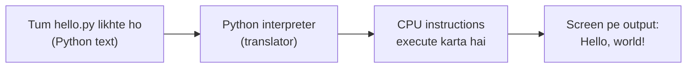
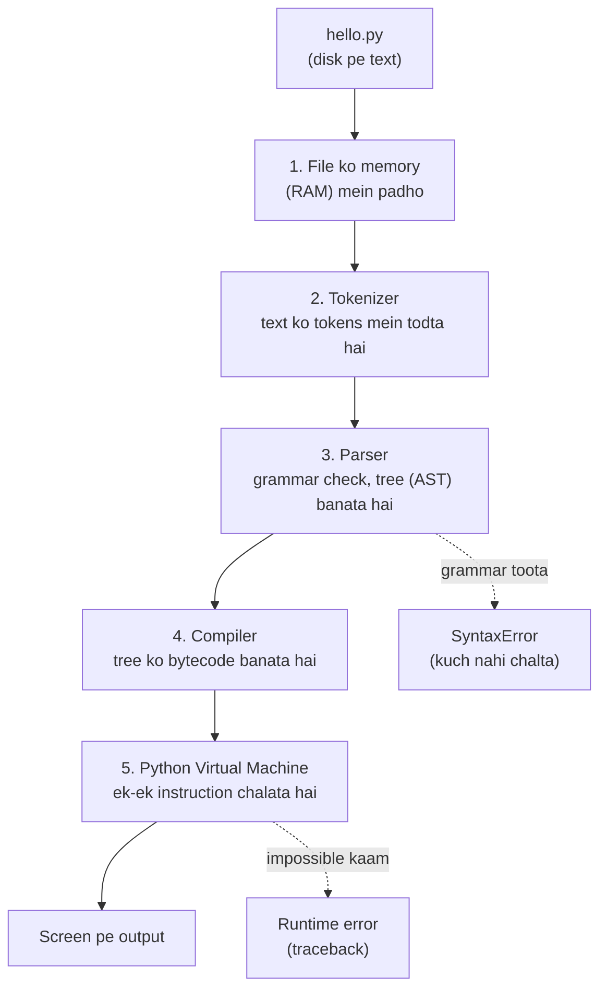
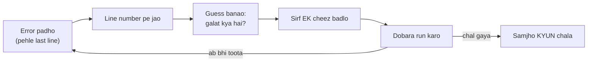

# Chapter 01 · Getting Started: How Computers Run Your Code

> Computer duniya ka sabse fast, sabse obedient aur sabse *literal* worker hai jisse tum kabhi miloge. Ek second mein billions kaam kar deta hai, lekin sirf tab jab tum use *bilkul exactly* batao ki karna kya hai. Programming bas yahi seekhna hai: computer ko aise instructions dena jo woh samajh sake. Is chapter ke end tak tum apne pehle real programs likh chuke hoge, run kar chuke hoge, tod chuke hoge aur phir theek bhi kar chuke hoge.

**Is chapter mein tum seekhoge:**
- Computer, program aur programming language asal mein kya hote hain (koi bhi jargon bina samjhaye nahi chhodenge)
- Python tumhare text ko action mein kaise badalta hai: **interpreter**, bytecode aur Python Virtual Machine
- Windows aur Mac pe Python 3.11+ aur VS Code kaise install karein, including woh ek checkbox jo sab miss kar dete hain
- Python run karne ke do tareeke: **REPL** (turant cheezein try karo) aur **.py files** (real programs save karo)
- `print()` ekdum depth mein, uski secret settings `sep` aur `end` ke saath
- Comments, upar se neeche padhne ka order, aur Python mein indentation itna important kyun hai
- **Syntax errors** aur **runtime errors** ka farak, aur traceback ko ek detective ki tarah kaise padhein
- Practice kaise karein taaki seekha hua sach mein dimaag mein baith jaaye

**Isse pehle padho:** Kuch nahi! Yahin se shuru karo.

---

## 🧠 The Big Idea · Asli Baat

Socho tumne ek naya cook rakha hai. Banda ekdum fast hai, lekin aaj tak kabhi kitchen mein ghusa hi nahi. Tum usse bas "dinner bana do" nahi bol sakte. Tumhe use ek recipe deni padegi:

1. 2 cup paani ubaalo.
2. 1 cup chawal daalo.
3. 15 minute ruko.
4. Serve karo.

Cook steps ko **order mein** follow karta hai, **bilkul waise jaise likha hai**, aur **ek time pe ek**. Agar step 2 mein likha ho "1 cup rcie daalo", toh cook wahin ruk jaata hai aur bolta hai, "Mujhe nahi pata rcie kya hota hai."

Bas, yahi programming hai.

| Kitchen | Computer |
|---|---|
| Cook | **CPU** (woh chip jo asli kaam karti hai) |
| Recipe | Tumhara **program** |
| Woh language jismein recipe likhi hai | **Programming language** (Python) |
| Kitchen counter (jo cheezein abhi use ho rahi hain) | **RAM** (fast, temporary memory) |
| Pantry / store room (jo cheezein baad ke liye rakhi hain) | **Disk / SSD** (slow, permanent storage) |

> 🇮🇳 **Desi Analogy:** Ghar ki kitchen socho. Gas pe jo bhagona chadha hai aur slab pe jo masale khule pade hain, woh **RAM** hai: haath ke paas, turant milta hai, lekin raat ko sab utha ke rakh doge (computer band = RAM khaali). Upar wali almirah mein jo dabbe rakhe hain, woh **disk** hai: nikaalne mein time lagta hai, lekin saal bhar safe rehte hain. Aur mummy ki likhi hui recipe diary tumhara **program** hai, jo almirah (disk) mein rakhi rehti hai aur cook karte waqt slab (RAM) pe khol ke rakhi jaati hai. Yahi exactly hota hai jab tum program run karte ho: file disk se RAM mein aati hai, phir CPU usse padh ke kaam karta hai.

Ek problem hai. CPU na English samajhta hai, na Python. Woh sirf **machine code** samajhta hai: numbers ki lambi lists, jaise `10110000 01100001`. Ye haath se likhna ekdum sazaa hai. Isliye hum Python mein likhte hain, jo lagbhag English jaisa padhta hai, aur ek helper program, jiska naam hai **Python interpreter**, hamare liye translate kar deta hai.



> 💡 **The core insight:** program bas instructions wali ek text file hai. Interpreter us file ko upar se neeche padhta hai aur har line ko execute karta hai. Is poori book mein jo kuch bhi aayega, sab isi ek picture ke upar khada hai.

---

## 🔨 Building It Up · Zero Se Shuru

### 1. What is a program, really?

**Program** instructions ki ek list hai jo computer ko batati hai ki kya karna hai. Python program ek simple text file hoti hai jiska naam `.py` pe khatam hota hai, jaise `hello.py`. Chaaho toh Notepad mein bhi likh sakte ho. File ke andar koi jaadu nahi hai: jaadu us interpreter mein hai jo file ko padhta hai.

**Programming language** un instructions ko likhne ke rules ka ek set hai, taaki koi confusion na rahe. English (aur Hindi bhi) ambiguous hai. "I saw a man with a telescope": telescope kiske paas hai, mere ya us aadmi ke? Programming languages aise design ki jaati hain ki har instruction ka **sirf ek hi matlab** ho.

> 🤔 **Mann mein sawaal:** Computer itna smart hai, toh "rcie" ko "rice" samajh kyun nahi leta, jaise Google search kar leta hai?
>
> **Jawab:** Kyunki guess karna khatarnaak hai. Socho bank ka software `withdraw(500)` ki jagah galti se `withdraw(5000)` "guess" kar le. Programming languages jaan-boojh ke strict banayi gayi hain: ya toh instruction ka exact ek matlab hai, ya error. Guessing ka kaam tumhara hai, executing ka kaam computer ka.

Python hi kyun?

- **Readable.** Python code simple English jaisa dikhta hai, toh tumhari energy *ideas* pe lagti hai, brackets aur semicolons pe nahi.
- **Huge ecosystem.** Websites (Instagram ka backend), data science, AI aur machine learning, automation scripts, aur bahut kuch Python pe chalta hai.
- **Interview friendly.** Zyaadatar companies coding interviews mein Python allow karti hain, aur iska short syntax matlab tum kam likhte ho aur zyada sochte ho.

### 2. Compiled vs interpreted: two kinds of translators

CPU ke liye program translate karne ke do classic tareeke hain.

- **Compiler** aisa hai jaise poori book kisi ke padhne se pehle hi translate kar di jaaye. Tumhe ek finished translated file milti hai (jaise `game.exe`) jo bahut fast chalti hai. C aur C++ aise hi kaam karte hain.
- **Interpreter** aisa hai jaise meeting mein baitha ek live translator, jo log bolte jaate hain aur woh sentence-by-sentence translate karta jaata hai. Tum turant shuru kar sakte ho aur cheezein aasaani se badal sakte ho, lekin thoda overhead (extra mehnat) lagta hai.

> 🇮🇳 **Desi Analogy:** Compiler ek dubbed movie jaisa hai: release se pehle poori film Hindi mein dub ho chuki hai, ab hall mein bas chalao, koi wait nahi. Interpreter UN summit ke live interpreter jaisa hai: PM bol rahe hain aur headphone mein saath-saath translation aa raha hai. Shuru turant ho jaata hai, beech mein speech badal do toh bhi chalega, lekin har line pe translator ko thoda time lagta hai. Python dono ka mix hai, abhi dekhte hain kaise.

Python ko aam taur pe **interpreted language** bola jaata hai, lekin imaandaar jawab hai "thoda dono": Python pehle tumhare code ko ek simpler form mein *compile* karta hai jise **bytecode** kehte hain, phir ek program jiska naam hai **Python Virtual Machine (PVM)**, us bytecode ko *interpret* karta hai. Is chapter mein aage hum iska hood kholenge.

### 3. Installing Python (Windows)

1. [python.org/downloads](https://www.python.org/downloads/) pe jao aur bada peela **Download Python 3.x** button dabao. **3.11 ya usse naya** koi bhi version is book ke liye perfect hai.
2. Installer run karo.
3. ⚠️ **Sabse pehli screen pe hi "Add python.exe to PATH" wala box tick karo.** Yahi woh checkbox hai jo sab miss kar dete hain.
4. **Install Now** pe click karo aur wait karo.
5. **Command Prompt** ya **PowerShell** kholo (Windows key dabao, `cmd` type karo, Enter) aur type karo:

```text
python --version
```

Tumhe kuch aisa dikhna chahiye:

```text
Python 3.12.4
```

**PATH kya hai aur iski itni value kyun hai?** Jab tum `python` jaisa koi command type karte ho, computer kuch folders ki ek list mein dhoondhta hai ki is naam ka program kahan pada hai. Us list ko **PATH** kehte hain. Agar Python ka folder us list mein nahi hai, toh Windows bolega `'python' is not recognized as an internal or external command`, ya phir seedha Microsoft Store khol dega. Box tick karne se Python ka folder automatically list mein add ho jaata hai.

> 🇮🇳 **Desi Analogy:** PATH ko society ke gate pe rakhe guard ke register jaisa socho. Delivery boy aata hai aur bolta hai "Sharma ji ka parcel". Guard register dekhta hai: kaunsa flat, kaunsi wing. Register mein Sharma ji ki entry hi nahi hai? "Is naam ka koi nahi rehta yahan" (yaani `not recognized`). Python install toh ho gaya (Sharma ji society mein shift ho gaye), lekin register mein entry nahi hui, toh koi unhe dhoondh nahi paayega. Checkbox tick karna = register mein entry karwana.

> ⚠️ **Checkbox bhool gaye?** Sabse aasaan fix: installer dobara run karo, **Modify** → **Next** choose karo, aur **"Add Python to environment variables"** tick karo. Phir terminal band karke dobara kholo. Windows pe tum `py --version` bhi try kar sakte ho: `py` launcher aam taur pe install ho jaata hai, chahe PATH set na ho.

### 4. Installing Python (Mac and Linux)

**Mac:** Macs mein kabhi purana Python hota hai, ya ek "stub" jo developer tools install karne ko bolta hai. Uspe bharosa mat karo. python.org se macOS installer download karo, run karo, phir **Terminal** kholo (Cmd + Space, "Terminal" type karo) aur ye chalao:

```text
python3 --version
```

Mac aur Linux pe command aam taur pe `python3` hota hai, `python` nahi. Is poori book mein jahan bhi `python file.py` dikhe, Mac/Linux pe `python3 file.py` use karna.

**Linux:** zyaadatar distributions mein Python 3 pehle se hota hai. `python3 --version` se check karo. Agar 3.11 se purana hai, toh apne package manager se naya install karo (jaise recent Ubuntu pe `sudo apt install python3.12`).

### 5. Installing VS Code (your code editor)

Tum Notepad mein code *likh sakte ho*, lekin woh bina spell-check ke essay likhne jaisa hai. **Code editor** tumhare code ko colour karta hai, type karte-karte galtiyan pakadta hai, aur ek click mein program run kar deta hai.

1. [code.visualstudio.com](https://code.visualstudio.com/) se **Visual Studio Code** download karke install karo. (Windows pe yahan bhi "Add to PATH" tick karna.)
2. VS Code kholo, left sidebar mein **Extensions** icon (chaar chhote squares) pe click karo, **Python** search karo, aur woh wala install karo jo **Microsoft** ne publish kiya hai.
3. Apne kaam ke liye ek folder banao, jaise `python-practice`, aur use **File → Open Folder** se kholo.
4. **Ctrl+Shift+P** dabao (Mac pe Cmd+Shift+P), **Python: Select Interpreter** type karo, aur abhi jo Python 3.11+ install kiya woh choose karo.

Bas, tum ready ho.

### 6. Your first program: hello.py

VS Code mein apne folder ke andar `hello.py` naam ki nayi file banao aur ye type karo (type karna, paste nahi: tumhari ungliyan bhi seekhti hain):

```python
print("Hello, world!")
```

```text
Hello, world!
```

Isse run karne ke do tareeke hain:

- Editor ke top right mein **▶ Run** button pe click karo, ya
- VS Code mein terminal kholo (**Ctrl+`**, yaani Esc ke neeche wali backtick key) aur `python hello.py` type karo.

Abhi kya hua:

- `print` ek **function** hai: ek naam wala, ready-made action jo Python ko pehle se aata hai. "Print" ka matlab hai "screen pe dikhao".
- Gol brackets `( )` se tum function ko **call** (use) karte ho. Jo bhi andar daaloge, woh information tum function ko de rahe ho.
- `"Hello, world!"` ek **string** hai: text ka ek tukda. Quotes Python ko batate hain "ye text hai, instruction nahi". Double quotes `"..."` ya single quotes `'...'` dono chalte hain, dono ka kaam same hai.

> 🇮🇳 **Desi Analogy:** Function ko chai tapri wale bhaiya jaisa socho. Unka naam hai `chai`, aur unhe pehle se pata hai chai kaise banti hai. Tum bas order dete ho: `chai("kam cheeni")`. Brackets order dene ka tareeka hain (call), aur brackets ke andar jo bola woh tumhari instruction (information) hai. `print("Hello, world!")` bhi bilkul aisa hi order hai: "print bhaiya, ye text screen pe dikha do."

1970s se "Hello, world!" print karna hi traditional pehla program raha hai. Mubarak ho, tum officially programmer ban gaye.

### 7. The REPL: Python's playground

Python chalane ka ek doosra tareeka bhi hai. Terminal mein bas `python` (ya `python3`) type karo aur Enter dabao:

```text
Python 3.12.4 (main, ...) on win32
Type "help", "copyright", "credits" or "license" for more information.
>>>
```

Ye `>>>` hai **REPL**, yaani **Read, Evaluate, Print, Loop**. Jo tum type karte ho use *read* karta hai, *evaluate* (calculate) karta hai, result *print* karta hai, aur phir *loop* karke agle input ke liye wapas aa jaata hai. Steroids wala calculator samjho:

```text
>>> 2 + 3
5
>>> 7 * 6
42
>>> "ha" * 3
'hahaha'
>>> print("hi")
hi
```

Ek chupi hui baat notice karo: REPL mein `2 + 3` type karne pe bina `print` ke bhi `5` dikh gaya. REPL jo bhi type karo uski value automatically dikha deta hai. **`.py` file aisa nahi karti.** File mein sirf `print` hi cheezein screen pe laata hai.

> 🤔 **Mann mein sawaal:** REPL mein `'hahaha'` quotes ke saath aaya, lekin `print("hi")` ne `hi` bina quotes ke dikhaya. Aisa kyun?
>
> **Jawab:** REPL value ko "developer view" mein dikhata hai, taaki tumhe saaf pata chale ki ye text (string) hai, number nahi. `print` "user view" mein dikhata hai, jaise end user screen pe dekhega, bina quotes ke. Dono same value hain, bas dikhane ka andaaz alag hai. (Is farak ko technically `repr` vs `str` kehte hain; [Chapter 04](04-strings.md) mein milenge.)

REPL se bahar nikalne ke liye `exit()` type karke Enter dabao (ya Windows pe Ctrl+Z phir Enter, Mac/Linux pe Ctrl+D).

| REPL use karo jab... | .py file use karo jab... |
|---|---|
| Ek chhota idea jaldi test karna ho | Real program likh rahe ho |
| Bhool gaye ho ki koi cheez kaise behave karti hai | Apna kaam save karke dobara chalana ho |
| Python ko calculator ki tarah use kar rahe ho | Code kuch lines se zyada ho |

> 💡 **Try this:** REPL kholo aur `2 ** 10` type karo. Tumhe kya lagta hai `**` ka matlab kya hai? (Jawab [Chapter 03](03-operators-expressions.md) mein hai, lekin shayad tum guess kar loge.)

### 8. print() can show many things at once

Tum `print` ko commas se alag karke kai cheezein de sakte ho. Woh sabko ek hi line mein print karta hai, har do cheezon ke beech ek space daal ke:

```python
print("I am", 20, "years old")
print("Two plus three is", 2 + 3)
print(10, 20, 30)
print()
print("The line above is empty")
```

```text
I am 20 years old
Two plus three is 5
10 20 30

The line above is empty
```

Abhi kya hua:

- Comma se alag har item ko **argument** kehte hain.
- `20` jaise numbers ko quotes ki zaroorat nahi. Quotes sirf text ke liye hain.
- `2 + 3` *pehle* calculate hua, phir uska result `5` print hua. Python hamesha expression ki value pehle nikaalta hai, phir use `print` ke haath mein deta hai.
- Khaali `print()` ek empty line print karta hai.

In do lines ko dhyaan se compare karo:

```python
print("2 + 3")
print(2 + 3)
```

```text
2 + 3
5
```

Quotes ke saath woh sirf text hai, toh Python characters ko jaise ke taise print kar deta hai. Bina quotes ke woh maths hai, toh Python calculate karta hai. Ye farak lagbhag har beginner ko ek baar toh zaroor girata hai.

> 🇮🇳 **Desi Analogy:** Teacher ne board pe likha `2 + 3` aur bola "jo likha hai woh copy karo" (quotes wala case): tum copy mein `2 + 3` likhoge. Ab teacher bola "iska answer likho" (bina quotes wala case): tum `5` likhoge. Quotes ka matlab hai "copy karo", bina quotes ka matlab hai "solve karo".

### 9. print()'s secret settings: sep and end

`print` ki do optional settings hain jinhe tum **naam se** set karte ho. Inhe **keyword arguments** kehte hain.

- `sep` (separator) woh cheez hai jo items ke **beech** mein jaati hai. By default ye ek single space `" "` hai.
- `end` woh cheez hai jo last item ke **baad** jaati hai. By default ye ek **newline** hai, jise `"\n"` likhte hain, matlab "agli line pe chalo".

```python
print("2026", "10", "31", sep="-")
print("a", "b", "c", sep="")
print("apples", "bananas", "cherries", sep=" | ")
print("Loading", end="")
print("...", end="")
print("done!")
print("one", "two", sep=", ", end=".\n")
```

```text
2026-10-31
abc
apples | bananas | cherries
Loading...done!
one, two.
```

Abhi kya hua:

- `sep="-"` ne date ke hisson ko dashes se jod diya.
- `sep=""` (empty string) ka matlab "beech mein kuch nahi", toh sab chipak gaye.
- `end=""` ne `print` ko nayi line pe jaane se rok diya, toh agla `print` **usi** line pe continue hua. Isi tarah teen alag `print` calls se `Loading...done!` ek line mein aaya.
- Last line mein humne dono use kiye. `end` wali string ke andar `"\n"` newline character hai.

> 🇮🇳 **Desi Analogy:** Railway reservation chart pe naam likhne wala clerk socho. `sep` woh hai jo do naamon ke beech likha jaata hai (comma, dash, ya kuch nahi). `end` woh hai jo ek passenger ki entry poori hone ke baad hota hai: normally clerk agli line pe chala jaata hai (`"\n"`). Agar tum bolo `end=""`, toh clerk agli line pe jaata hi nahi, aur agla naam usi line mein aage likh deta hai.

> 🤔 **Mann mein sawaal:** `print("Loading", end="")` ke baad agla `print` same line pe kyun aaya? Maine toh naya `print` likha tha!
>
> **Jawab:** Naya `print` hamesha wahin se likhna shuru karta hai jahan cursor abhi khada hai. "Nayi line pe jaana" `print` khud shuru mein nahi karta; woh kaam *pichle* `print` ka `end="\n"` uske end pe karta hai. Tumne pichle `print` ka `end` khaali kar diya, toh cursor wahin ruka raha, aur agla `print` wahin se chipak gaya.

**Newline character `\n`.** String ke andar backslash ke baad `n` ka matlab hai "yahan se nayi line shuru karo". Ye ek invisible character hai (dikhne mein do symbols, lekin asal mein **ek** character), aur isi se text files aur screens ko pata chalta hai ki line kahan tootegi:

```python
print("Line one\nLine two\nLine three")
```

```text
Line one
Line two
Line three
```

`\t` (tab) jaise doosre backslash codes hum [Chapter 04](04-strings.md) mein milenge.

### 10. Comments: notes for humans

Kisi line mein `#` ke baad jo bhi likha ho, woh **comment** hai. Python use poori tarah ignore karta hai. Comments insaano ke liye notes hain, including future wale tum, jo bhool jaoge ki ye cheez kyun likhi thi.

```python
# Ye program ek greeting print karta hai.
print("Namaste!")   # comment line ke end mein bhi baith sakta hai

# print("This line is switched off, so it never runs")
print("Bye!")
```

```text
Namaste!
Bye!
```

Abhi kya hua: comment kiya hua `print` kabhi chala hi nahi. Debugging ke time kisi line ko delete kiye bina temporarily band karne ke liye use "comment out" karna ek bahut common trick hai.

Achhe comments **kyun** batate hain, **kya** nahi:

```py
# ❌ Bura: wahi dohraata hai jo code pehle se bol raha hai
print(60 * 60 * 24)   # 60 ko 60 se aur phir 24 se multiply karo

# ✅ Accha: matlab samjhaata hai
print(60 * 60 * 24)   # ek din mein kitne seconds hote hain
```

> 💡 VS Code mein kuch lines select karke **Ctrl+/** dabao (Mac pe Cmd+/), sab ek saath comment ya uncomment ho jaayengi.

Tumhe triple quotes mein likha text bhi dikhega, `"""aise"""`. Woh asal mein ek multi-line string hai, jo aksar documentation ke liye use hoti hai. Isse hum theek se [Chapter 04](04-strings.md) aur [Chapter 10](10-functions.md) mein cover karenge.

### 11. Python reads top to bottom, one line at a time

Interpreter line 1 se shuru karta hai aur neeche jaata hai, har line ko poora execute karke hi agli pe jaata hai. Jis order mein tum likhte ho, usi order mein cheezein hoti hain.

```python
print("1. Wake up")
print("2. Brush teeth")
print("3. Drink chai")
print("4. Open laptop")
```

```text
1. Wake up
2. Brush teeth
3. Drink chai
4. Open laptop
```

Do lines swap karo, output ka order bhi swap ho jaayega. Sunne mein obvious lagta hai, lekin bugs ki ek badi family isi se paida hoti hai: kisi cheez ko us line se *pehle* use karna jo use banati hai. Aage chalke **if** statements ([Chapter 05](05-conditionals.md)) Python ko lines skip karne dete hain, **loops** ([Chapter 06](06-loops.md)) lines repeat karwate hain, aur **functions** ([Chapter 10](10-functions.md)) ek naam wale block pe jump karke wapas aane dete hain. Lekin default hamesha yahi hai: upar se neeche.

> 🇮🇳 **Desi Analogy:** Mumbai local ka route socho: Churchgate, Marine Lines, Charni Road, Grant Road... Slow local har station pe rukti hai, order mein. Grant Road pahunchne se pehle Charni Road aayega hi aayega. Python ka interpreter bhi wahi slow local hai, aur tumhari har line ek station. (Aage chalke `if` aur loops "fast local" jaise kuch stations skip ya repeat karna sikhayenge.)

Python **case-sensitive** bhi hai: `print` aur `Print` do bilkul alag naam hain. Sirf lowercase `print` exist karta hai.

### 12. Indentation is part of the language

**Indentation** matlab line ki shuruaat mein spaces. Kai languages mein ye sirf sundar dikhne ke liye hota hai. Python mein **iska matlab hota hai**: ye batata hai ki kaunsi lines ek block mein saath hain. Blocks tum [Chapter 05](05-conditionals.md) mein dekhoge; abhi ek jhalak:

```python
temperature = 38
if temperature > 35:
    print("It's hot!")       # indented: if ka hissa hai
    print("Drink water.")    # indented: ye bhi if ka hissa hai
print("Have a nice day.")    # indented nahi: hamesha chalega
```

```text
It's hot!
Drink water.
Have a nice day.
```

Abhi ke liye rule simple hai: **top-level code bilkul left edge se shuru hota hai, bina kisi space ke.** Agar tum kisi line ki shuruaat mein random space daal doge, Python complain karega:

```py
print("first")
    print("second")   # ❌ IndentationError: unexpected indent
```

Standard hai **har level pe 4 spaces**. `.py` file mein Tab dabane pe VS Code automatically 4 spaces daal deta hai. Tabs aur spaces ko kabhi mix mat karna.

> 🇮🇳 **Desi Analogy:** Shaadi ke card ki guest list socho. "Sharma Family" ke neeche thoda andar khisak ke likha hai "Ramesh ji, Sunita ji, Bunty". Woh khisakna hi batata hai ki ye teeno Sharma family ka hissa hain. Agla naam "Verma Family" phir se left edge se shuru hota hai, matlab naya group. Python mein `if` wali line "Sharma Family" hai, aur andar khiske hue `print` uske members. Aur agar koi naam bina wajah andar khiska diya (random indent), toh padhne wala confuse: "ye kis family ka hai?" Python bhi yahi bolta hai: `unexpected indent`.

### 13. When things go wrong: two kinds of errors

Har programmer, chahe 20 saal ka experience ho, roz errors dekhta hai. Errors failure nahi hain; ye Python ka tumhe clue dene ka tareeka hai. Do main types hain.

**Syntax errors** grammar ki galtiyan hain. Python **kuch bhi run karne se pehle** *poori file* ka grammar check karta hai. Agar grammar toota hua hai, toh **line 1 bhi nahi chalti**.

```py
print("Start")
print("hello"        # ❌ closing bracket missing hai
print("End")
```

```text
  File "C:\practice\broken.py", line 2
    print("hello"
         ^
SyntaxError: '(' was never closed
```

Notice karo, "Start" print **nahi** hua, jabki line 1 bilkul theek thi. Python ne shuru karne se hi mana kar diya kyunki file valid Python thi hi nahi.

**Runtime errors** (inhe **exceptions** bhi kehte hain) program ke *chalte waqt* hote hain. Grammar theek tha, lekin kisi line ne kuch impossible maang liya. Us line se *pehle* ka sab kuch chal chuka hota hai; program buri line pe ruk jaata hai.

```py
print("Start")
print("Total:", 10 / 0)   # ❌ zero se divide karna impossible hai
print("End")
```

```text
Start
Traceback (most recent call last):
  File "C:\practice\broken.py", line 2, in <module>
    print("Total:", 10 / 0)
                    ~~~^~~
ZeroDivisionError: division by zero
```

Is baar "Start" print *hua*, phir program line 2 pe crash hua, aur "End" kabhi nahi chala.

> 🇮🇳 **Desi Analogy:** Board exam socho. **Syntax error** woh hai jab gate pe hi admit card check hota hai aur gadbad nikalti hai: tumhe hall mein ghusne hi nahi diya, ek bhi question attempt nahi hua (koi line nahi chali). **Runtime error** woh hai jab tum andar baithe, pehle 3 questions likh diye (woh copy mein hain, ho chuke), aur chauthe question pe pen ki ink khatam ho gayi: wahin ruk gaye, aage kuch nahi likha gaya.

| | Syntax error | Runtime error (exception) |
|---|---|---|
| Galat kya hai | Code ka grammar | Chalte waqt kuch impossible ho gaya |
| Kab pakda jaata hai | Kuch bhi chalne se pehle | Jis pal buri line chalti hai |
| Pehle wali lines chali? | Nahi | Haan |
| Examples | Bracket ya quote missing, galat indentation, keyword ki spelling galat | Zero se divide, anjaan naam, text mein number jodna |

Ek teesri type bhi hai jise Python bilkul nahi pakad sakta: **logic error** (yaani "bug"). Program bina complain kiye chal jaata hai lekin answer galat deta hai, jaise tumhe `2 * 2` chahiye tha aur likh diya `print(2 + 2)`. (Aur dekho kitna chalaak bug hai: `2 + 2` aur `2 * 2` dono 4 dete hain, toh ye bug tab tak chhupa rahega jab tak numbers badal ke test nahi karoge!) Aise bugs sirf testing aur dhyaan se sochne se pakde jaate hain.

> 🤔 **Mann mein sawaal:** Agar Python poori file pehle check karta hai, toh `10 / 0` jaisi galti bhi pehle hi kyun nahi pakad leta?
>
> **Jawab:** Kyunki pehle wala check sirf **grammar** ka hai, yaani "sentence sahi bana hai ya nahi". `10 / 0` grammar ke hisaab se ekdum valid sentence hai, bilkul jaise "main 10 rotiyan 0 logon mein baatunga" ek sahi Hindi sentence hai, bas karna impossible hai. Impossible hai ya nahi, ye tab pata chalta hai jab line sach mein chalti hai. Real programs mein numbers aksar user se aate hain, toh pehle se pata bhi nahi hota ki zero aayega.

### 14. Reading a traceback like a detective

**Traceback** Python ki crash report hai. Beginners ghabra jaate hain aur usse ghoorte rehte hain. Pros isse is order mein padhte hain: **pehle sabse neeche wali line, phir line number.**

```text
Traceback (most recent call last):
  File "C:\practice\greet.py", line 2, in <module>
    print(mesage)
          ^^^^^^
NameError: name 'mesage' is not defined. Did you mean: 'message'?
```

1. **Last line = kya galat hua.** Colon se pehle wala hissa **error type** hai (`NameError`), aur baaki message. Yahan: Python `mesage` naam ki kisi cheez ko jaanta hi nahi. Woh khud suggest bhi kar raha hai `message`. Typo!
2. **`File ..., line 2` = kahan.** `greet.py` ki line 2 pe jao.
3. **Code wali line aur `^^^^` ke nishaan** exact us hisse ki taraf ishaara karte hain jo fail hua (Python 3.11+ isme kamaal ka hai).
4. **"most recent call last"** ka matlab hai ki jab bahut saari `File` lines hon (functions use karne ke baad aisa hoga), toh sabse last wali woh jagah hai jahan asal mein dhamaka hua.

Beginner ke roop mein ye errors tumhe sabse zyada milenge:

| Error | Simple bhasha mein matlab | Typical cause |
|---|---|---|
| `SyntaxError` | "Ye valid Python grammar nahi hai." | `)` ya `"` missing, `:` missing |
| `IndentationError` | "Line ki shuruaat wale spaces galat hain." | Random indent, tabs/spaces mix |
| `NameError` | "Is naam ke baare mein maine kabhi suna hi nahi." | Typo, galat capital letter (`Print`), cheez banane se pehle use karna |
| `TypeError` | "Is type ki values saath mein ye kaam nahi kar sakti." | `"a" + 5` (text plus number) |
| `ZeroDivisionError` | "Tumne zero se divide kiya." | `10 / 0` |
| `ValueError` | "Type toh sahi hai, lekin value bekaar hai." | `int("hello")` ([Chapter 02](02-variables-types-memory.md)) |

> 💡 **Superpower habit:** traceback ki last line copy karke search engine mein daalo. Kisi na kisi ko bilkul yahi error pehle aa chuka hai. Errors ko gracefully handle karna tum [Chapter 13](13-exceptions-files.md) mein seekhoge.

### 15. Your first mini program: a birthday card

Chalo, ab sab kuch ek program mein jodte hain. Padho, output predict karo, phir run karo.

```python
# Birthday card generator
# Sirf print, sep, end, comments aur arithmetic use karta hai.

print("*" * 30)                      # text ko number se multiply karo toh woh repeat hota hai
print("*", "HAPPY BIRTHDAY, RIYA!", "*", sep="   ")
print("*" * 30)
print()
print("You are", 21, "years old.")
print("That's about", 21 * 365, "days,")
print("or", 21 * 365 * 24, "hours of being awesome.")
print()
print("Wishes from:", end=" ")
print("Arjun", "Meera", "Kabir", sep=", ", end="!\n")
print("-" * 30)
```

```text
******************************
*   HAPPY BIRTHDAY, RIYA!   *
******************************

You are 21 years old.
That's about 7665 days,
or 183960 hours of being awesome.

Wishes from: Arjun, Meera, Kabir!
------------------------------
```

Abhi kya hua:

- `"*" * 30` ne text `*` ko tees baar repeat kiya. (Text arithmetic [Chapter 04](04-strings.md) mein cover hoga.)
- `sep="   "` ne stars aur message ke beech teen spaces daale.
- `21 * 365` aur `21 * 365 * 24` print hone se pehle calculate hue.
- `end=" "` ne `Wishes from:` ko naamon ke saath same line pe rakha, aur `end="!\n"` ne line ko exclamation mark ke saath khatam kiya.

> 💡 **Try this:** naam aur age badlo. Phir koshish karo ki right side wala star border ke edge ke saath bilkul line mein aa jaaye. (Hint: characters gino. Abhi beech wali line 29 characters ki hai: `*` + 3 spaces + 21 characters ka message + 3 spaces + `*`, jabki border 30 ka hai. Ek extra space kahan daaloge?)

### 16. How to practise (so it actually sticks)

Coding seekhna swimming seekhne jaisa hai: uske baare mein padhna help karta hai, lekin seekhte tum sirf paani mein utar ke ho.

1. **Har example khud type karo.** Copy-paste us hisse ko skip kar deta hai jahan tumhara dimaag details notice karta hai.
2. **Pehle predict karo, phir run karo.** Run dabane se pehle zor se bolo ki kya print hoga. Galat hona hi woh pal hai jahan asli seekhna hota hai.
3. **Jaan-boojh ke cheezein todo.** Ek bracket hata do. `print` ki spelling bigaad do. Error padho. Tum apne dimaag mein error messages ki ek dictionary bana rahe ho.
4. **Ek time pe ek hi cheez badlo.** "Agar `sep` `"🔥"` ho toh?" Try karo.
5. **Ek practice folder rakho** jismein har idea ki ek file ho: `print_tricks.py`, `errors.py`, waghera. Ye tumhari personal notebook ban jaayegi.
6. **Roz 20 se 30 minute, Sunday ke 5 ghante se behtar hain.** Tumhara dimaag neend mein cheezein pakki karta hai.
7. **Har chapter ke end mein Practice section karo** solutions kholne se pehle. Kam se kam 10 minute pehle khud se jhoojho.

> 🇮🇳 **Desi Analogy:** Gully cricket mein koi coaching book padh ke cover drive nahi seekhta. Roz shaam ko 30 minute nets mein khade ho, galat shot khelo, bowled ho jao, phir sudhaaro. Ek din achanak shot "haath mein baith jaata hai". Coding bilkul aisa hi hai: roz thoda, aur galtiyon se dosti.

---

## 🔬 Under the Hood · Andar Ki Kahani

### What happens when you run `python hello.py`

Chalo tumhare program ke saath uske safar pe chalte hain: text file se screen ke pixels tak.



1. **Reading.** Operating system tumhari file ka text disk se RAM mein load karta hai.
2. **Tokenizing.** Python text ko matlab wale tukdon mein kaatta hai jinhe **tokens** kehte hain: `print`, `(`, `"Hello, world!"`, `)`. Bilkul jaise ek sentence ko words mein todna.
3. **Parsing.** Parser check karta hai ki tokens Python ke grammar ko follow kar rahe hain ya nahi, aur ek tree banata hai jise **Abstract Syntax Tree (AST)** kehte hain. **SyntaxError** yahin raise hota hai. Kyunki ye step execution se pehle poori file ke liye hota hai, file mein kahin bhi ek grammar ki galti sab kuch rok deti hai. Isi wajah se hamare pichle example mein "Start" print nahi hua tha.
4. **Compiling to bytecode.** Tree ko **bytecode** mein badla jaata hai: simple instructions ki ek compact list, jaise "`print` naam load karo", "constant `'Hello, world!'` load karo", "isse call karo". Bytecode machine code nahi hai; ye ek beech ki language hai jo PVM ke liye design ki gayi hai.
5. **Executing.** **Python Virtual Machine** interpreter ke andar ek bada loop hai jo ek time pe ek bytecode instruction padhta hai aur use perform karta hai. **Runtime errors** yahin hote hain, us pal jab koi impossible instruction chalti hai.

> 🇮🇳 **Desi Analogy:** Mumbai ke dabbawalas ka system socho, ekdum isi pipeline jaisa hai. (1) Ghar se dabba uthaya (file disk se RAM mein). (2) Har dabbe pe likhe code ko padha aur alag kiya (tokenizing). (3) Check kiya ki code valid hai, station-area-building sab sahi format mein hai; galat code wala dabba wahin reject (parsing, `SyntaxError`). (4) Dabbon ko trains ke hisaab se crates mein arrange kiya (bytecode). (5) Delivery wala ek-ek dabba pahunchata gaya (PVM). Delivery ke time pata chala office hi band hai? Woh problem raaste mein pata chalti hai (runtime error).

> 🤔 **Mann mein sawaal:** Agar Python bhi compile karta hai, toh C ki tarah `.exe` file kyun nahi banti?
>
> **Jawab:** Kyunki Python ka compile step machine code nahi, **bytecode** banata hai, jo sirf PVM samajhta hai, tumhara CPU seedha nahi. Ye step itna fast aur automatic hai ki tumhe pata bhi nahi chalta, aur iska result normally sirf memory mein rehta hai (imported files ke liye `.pyc` mein cache hota hai, neeche dekhoge). Isliye "run" ka matlab hamesha hai: interpreter + tumhari `.py` file.

Tum built-in `dis` ("disassemble") module se bytecode sach mein dekh sakte ho. Exact naam Python versions ke beech badalte rehte hain, lekin ye kuch aisa dikhta hai:

```py
import dis
dis.dis('print("Hello")')
```

```text
  LOAD_NAME                0 (print)
  LOAD_CONST               0 ('Hello')
  CALL                     1
  RETURN_VALUE
```

Tumhari woh one-liner asal mein Python ke liye yahi hai: chaar chhoti si instructions.

### CPython, .pyc files and __pycache__

Jo Python tumne python.org se download kiya, uska official naam **CPython** hai, kyunki interpreter khud C language mein likha gaya hai. Doosri implementations bhi hain (PyPy, jo lambe chalne wale code ke liye fast hai; Jython, Java ke liye; MicroPython, chhote devices ke liye), lekin CPython standard hai, aur jab log "Python" bolte hain toh matlab yahi hota hai.

Jab tum ek Python file ko doosri file se **import** karte ho (ye hum [Chapter 17](17-modules-stdlib.md) mein karenge), CPython bytecode ko `__pycache__` naam ke folder mein `.pyc` files ke roop mein save kar leta hai. Agli baar, agar source file nahi badli, toh woh steps 2 se 4 skip karke seedha bytecode load kar leta hai. Woh folder delete karna safe hai; Python use dobara bana leta hai.

> 🇮🇳 **Desi Analogy:** `__pycache__` mummy ke "aata pehle se goondh ke fridge mein rakhne" jaisa hai. Kal roti banani hai toh aata dobara goondhne ki zaroorat nahi, seedha bello aur seko. Agar recipe badal gayi (source file change hui), toh purana aata bekaar, naya goondho. Aur agar fridge se woh aata phenk bhi diya (folder delete), toh koi nuksaan nahi, bas agli baar goondhne mein thoda time lagega.

### Why is Python "slower" than C?

C mein compiler tumhare code ko pehle se hi machine code mein badal deta hai, aur CPU use seedha chalata hai. Python mein PVM loop ko har bytecode instruction dekhni padti hai, figure out karna padta hai ki kis type ki values involved hain, aur phir kaam karna padta hai. Ye extra checking raw number-crunching mein plain Python loops ko equivalent C se lagbhag 10 se 100 guna slow bana deti hai.

Kya isse farak padta hai? Aam taur pe nahi. Developer ka time computer ke time se zyada mehenga hai, aur heavy-lifting wali libraries (jaise NumPy) andar se C mein hi likhi hain. Interviews mein jo matter karta hai woh tumhare algorithm ki **Big-O** complexity hai ([DSA Chapter 01](../part-2-dsa/01-big-o-complexity.md)), language ki raw speed nahi.

### Where does print() actually send text?

`print` text ko ek cheez mein likhta hai jise **standard output** (stdout) kehte hain: characters ki ek stream jo by default tumhari terminal window se judi hoti hai. Terminal phir un characters ko pixels ki tarah draw karta hai. Kyunki output ek stream hai, use redirect (doosri jagah bheja) kiya ja sakta hai. Jaise, `python hello.py > out.txt` output ko screen ki jagah ek file mein bhej deta hai. Error messages ek alag stream mein jaate hain jise **standard error** (stderr) kehte hain, isliye stdout redirect hone ke baad bhi tracebacks screen pe dikhte rehte hain.

> 🇮🇳 **Desi Analogy:** stdout aur stderr ko ghar ke do pipes jaisa socho: ek kitchen ka nal (normal output), ek emergency wala alag pipe (errors). `> out.txt` matlab tumne kitchen ka pipe baalti (file) mein mod diya. Emergency pipe ab bhi seedha aangan (screen) mein girta hai, isliye error tumhe dikh jaata hai.

---

## 🧩 Pattern Decoder · Pattern Pakdo

Is chapter mein koi algorithm nahi hai, lekin kuch *habits* aur idioms zaroor hain jo strong Python programmers pehle din se use karte hain.

### Pythonic habits to start now

| Habit | Kyun |
|---|---|
| Indentation ke liye 4 spaces, tabs kabhi nahi | Ye universal Python standard hai (**PEP 8**, Python ki official style guide) |
| Operators ke aas-paas spaces: `2 + 3`, `2+3` nahi | Padhne mein aasaan; PEP 8 yahi recommend karta hai |
| Brackets se pehle space nahi: `print("hi")`, `print ("hi")` nahi | PEP 8 style |
| Spaces se ladne ke bajaye `sep` aur `end` use karo | Text ko haath se jodne se zyada saaf |
| Ek line, ek idea | Padhna aur debug karna aasaan |
| Comments *kyun* batayein, *kya* nahi | *Kya* toh code khud bol raha hai |
| Tracebacks neeche se upar padho | Last line batati hai kya galat hua |

### The debugging loop

Jab bhi kuch galat ho, ye loop follow karo. Ye 3-line program pe bhi kaam karta hai aur million-line system pe bhi.



> 🇮🇳 **Desi Analogy:** Ye loop bilkul cricket ke **DRS** jaisa hai. Umpire ne out diya (error aaya). Pehle replay dekho (error padho), phir exact frame pe jao (line number), hypothesis banao ("bat pehle laga ya pad?"), ek-ek angle check karo (ek time pe ek cheez badlo), aur final decision tab tak nahi jab tak saaf na ho ki *kyun*. Ek saath paanch cheezein badal di toh pata hi nahi chalega ki kaunsi wajah se fix hua.

### print() is your first debugging tool

Jab program galat answer de, toh andar kya ho raha hai dekhne ke liye `print` lines daal do. Ise **print debugging** kehte hain, aur senior engineers bhi ise har waqt use karte hain:

```python
print("DEBUG: starting calculation")
print("DEBUG: hours =", 24 * 7)
print("Minutes in a week:", 24 * 7 * 60)
```

```text
DEBUG: starting calculation
DEBUG: hours = 168
Minutes in a week: 10080
```

Asli skill hai **pehle predict karna**: run karne se pehle likh lo ki har `DEBUG` line mein tumhe kya dikhne ki ummeed hai. Jis pehli line pe reality tumhari prediction se alag nikle, bug wahin rehta hai. Jab program chal jaaye, debug lines delete kar do (ya comment out kar do).

### How this shows up in DSA later

- Coding interviews mein tum aksar apni logic check karne ke liye **dry run** ke dauraan beech ki values print karoge ([Two Pointers](../part-2-dsa/03-two-pointers.md) mein dry-run tables hain jo tumhe bahut pasand aayengi).
- `print(*items, sep=" ")` jaise tricks poore collection ko ek line mein print kar dete hain. `*` wala "unpacking" tum [Chapter 07](07-lists.md) mein miloge.
- Competitive programming judges tumhara output **character by character** compare karte hain, toh ek extra space ya missing newline ka matlab "Wrong Answer". Wahan `sep` aur `end` exactly kya karte hain, ye jaanna tumhe bachata hai.

---

## ⚠️ Traps & Common Mistakes · Yahan Sab Phisalte Hain

1. **Windows pe "Add python.exe to PATH" bhool jaana.** Symptom: `'python' is not recognized...` ya Microsoft Store khul jaata hai. Fix: installer dobara chalao → Modify → "Add Python to environment variables" tick karo, phir terminal dobara kholo.

2. **Python code REPL ki jagah terminal mein type karna (ya ulta).** Agar tumhara terminal prompt `C:\Users\you>` ya `$` jaisa dikhta hai, toh tum system shell mein ho: wahan `python hello.py` type karo. Agar `>>>` dikh raha hai, toh tum Python ke andar ho: wahan Python code type karo, `python hello.py` nahi.

```py
>>> python hello.py      # ❌ SyntaxError: tum pehle se Python ke andar ho
C:\> print("hi")         # ❌ shell Python nahi samajhta
```

3. **Capital letters.** `Print("hi")` deta hai `NameError: name 'Print' is not defined. Did you mean: 'print'?`. Python case-sensitive hai.

4. **Quotes ka mismatch ya missing hona.**

```py
print("Hello)            # ❌ SyntaxError: unterminated string literal
print("Hello')           # ❌ started with " but ended with '
print("Hello")           # ✅
print('It's sunny')      # ❌ the ' inside ends the string early
print("It's sunny")      # ✅ bahar doosri tarah ka quote use karo
```

(Doosri line: string `"` se shuru hui lekin `'` pe khatam karne ki koshish ki, aur Python ko dono quotes same chahiye. Chauthi line ka matlab: andar wala `'` string ko waqt se pehle hi khatam kar deta hai, kyunki Python ko lagta hai string wahin band ho gayi.)

5. **Brackets missing.** `print "hi"` purane Python 2 mein valid tha, lekin Python 3 mein `print` ek function hai aur use brackets chahiye: `print("hi")`.

6. **`.py` file se REPL jaisi values dikhane ki ummeed rakhna.**

```py
# File mein ye line 5 calculate karti hai aur chupchaap phenk deti hai:
2 + 3
# ✅ Tumhe print karna padega:
print(2 + 3)
```

7. **Random indentation.** Top-level line ki shuruaat mein ek space bhi `IndentationError: unexpected indent` de deta hai. Top-level lines column 0 se shuru karo.

8. **Fancy "smart quotes".** Word ya kuch websites se code copy karne pe curly quotes aa jaate hain, jaise `“hello”`. Python sirf seedhe quotes `"hello"` accept karta hai. Code khud type karne ki ek aur wajah.

9. **File save na karna.** Jab unsaved changes hote hain, VS Code tab pe ek safed dot dikhata hai. Agar tumhara "fix" kaam nahi kar raha, check karo ki save kiya ya nahi (Ctrl+S). **File → Auto Save** on kar do, ye problem hamesha ke liye khatam.

10. **File ka naam kisi module ke naam pe rakhna**, jaise `print.py`, `random.py` ya `math.py`. Baad mein jab tum `import random` karoge, Python asli module ki jagah *tumhari* file utha lega aur cheezein confusing tareeke se tootengi. `dice_game.py` jaise descriptive naam use karo.

---

## 💡 Tips & Tricks · Pro Wale Moves

- **Run shortcut:** VS Code mein `Ctrl+F5` current file ko bina debugger ke run karta hai.
- Terminal ya REPL mein **Up arrow** pichle commands wapas le aata hai. Bahut saari typing bachti hai.
- REPL mein **`help(print)`** `print` ka official documentation dikhata hai. Agar pager khul jaaye toh bahar nikalne ke liye `q` dabao.
- **REPL ka `_`** last result rakhta hai: `7 * 6` type karo, phir `_ + 1` dega `43`.
- **Format on save:** VS Code mein Black Formatter ya Ruff extension install karo, tumhara code automatically PEP 8 ke hisaab se saaf rahega.
- **`print(..., end="")`** `Loading...done` jaise progress messages ke liye perfect hai.
- **`print("-" * 40)`** output mein separator line banane ka quick tareeka hai.
- Error messages ko dost samjho: har baar **last line** pehle padho.
- Debugging ke time selected lines ke comments toggle karne ke liye **Ctrl+/** use karo.

---

## 🎯 Interview Questions · Interview Mein Yahi Poochenge

### 1. Is Python compiled or interpreted? 🔥🔥🔥

<details><summary>Answer dekho 👀</summary>

Dono, stages mein. CPython pehle source code ko **bytecode** mein **compile** karta hai (ek low-level, platform-independent instruction set). Phir **Python Virtual Machine** us bytecode ko instruction-by-instruction **interpret** karti hai. Ise aam taur pe "interpreted" isliye bolte hain kyunki koi alag compile step tumhe haath se nahi chalana padta, aur koi machine-code `.exe` nahi banti. Imported modules ka bytecode `__pycache__/*.pyc` mein cache hota hai.

Strong answer mein ye bhi jodo: doosri implementations alag hain. **PyPy** ek **JIT** (just-in-time compiler) use karta hai jo "hot" (baar-baar chalne wale) bytecode ko runtime pe machine code mein badal deta hai, isliye woh aksar fast hota hai.

> 🗣️ **Interview mein aise bolo:** "It's both, in two stages. CPython first compiles the source into platform-independent bytecode, and then the Python Virtual Machine interprets that bytecode one instruction at a time. We call it interpreted because there's no separate manual compile step and no native executable, though bytecode for imported modules is cached in __pycache__. Other implementations like PyPy add a JIT that compiles hot code to machine code at runtime."

</details>

### 2. What is the difference between a syntax error and an exception? 🔥🔥🔥

<details><summary>Answer dekho 👀</summary>

- **Syntax error** **parsing** ke dauraan pakda jaata hai, program chalne se pehle. Code valid Python hi nahi hai, toh us file mein kuch bhi execute nahi hota. Examples: band na hua bracket, missing colon, galat indentation (`IndentationError` asal mein `SyntaxError` ki hi ek kism hai).
- **Exception** (runtime error) **execution ke dauraan** raise hota hai, jab ek valid line kuch impossible karne ki koshish karti hai: `ZeroDivisionError`, `NameError`, `TypeError`, `ValueError`. Usse pehle ki lines chal chuki hoti hain. Exceptions ko `try`/`except` se pakad ke handle kiya ja sakta hai ([Chapter 13](13-exceptions-files.md)); lekin kisi file ka syntax error usi file ke andar se nahi pakda ja sakta (kyunki woh file kabhi chalti hi nahi).

> 🗣️ **Interview mein aise bolo:** "A syntax error is caught by the parser before any code runs, so not a single line of that file executes. An exception is raised at runtime when a syntactically valid line tries something impossible, like dividing by zero, and everything before that line has already run. Exceptions can be caught with try/except; a syntax error can't be caught from inside the same file."

</details>

### 3. What is CPython? How is it different from Python? 🔥🔥

<details><summary>Answer dekho 👀</summary>

**Python** language hai (rules). **CPython** reference *implementation* hai (woh asli program jo Python code chalata hai), jo C mein likha hai. python.org se download karoge toh CPython milta hai. Alternatives: PyPy (JIT-compiled, fast), Jython (Java VM pe chalta hai), IronPython (.NET) aur MicroPython (microcontrollers).

Yaad rakhne ke liye: "Hindi" ek language hai, aur Doordarshan ka news reader us language ko *bolne* wala ek specific insaan. Python = language, CPython = woh "bolne wala" jise sab default maante hain.

</details>

### 4. What are .pyc files and the __pycache__ folder? 🔥🔥

<details><summary>Answer dekho 👀</summary>

`.pyc` files mein imported modules ka compiled **bytecode** hota hai. CPython inhe `__pycache__` mein store karta hai taaki agli baar, agar source file nahi badli, toh tokenizing, parsing aur compiling skip ho sake. Isse **startup** fast hota hai, program khud fast nahi chalta. Jo main script tum seedha run karte ho, woh is tarah cache nahi hoti. `__pycache__` delete karna hamesha safe hai.

</details>

### 5. Why is indentation important in Python? 🔥🔥🔥

<details><summary>Answer dekho 👀</summary>

Python code ke **blocks** (ek `if` ki body, loop, function, class) define karne ke liye indentation use karta hai, C ya Java ki tarah curly braces `{ }` nahi. Toh indentation syntax ka hissa hai, sirf style nahi. Galat indentation se `IndentationError` aata hai, ya usse bhi bura, chupchaap badal jaata hai ki kaunsi lines block ka hissa hain (aur ye logic bug ban jaata hai). PEP 8 har level pe 4 spaces recommend karta hai, aur Python 3 aisa code chalane se mana kar deta hai jo tabs aur spaces ko inconsistent tareeke se mix kare (`TabError`).

> 🗣️ **Interview mein aise bolo:** "In Python, indentation is part of the syntax: it defines blocks, where languages like C or Java use curly braces. Wrong indentation either raises an IndentationError or, worse, silently moves a line in or out of a block and creates a logic bug. The convention from PEP 8 is four spaces per level, and Python 3 raises a TabError if tabs and spaces are mixed inconsistently."

</details>

### 6. What does print() return? 🔥

<details><summary>Answer dekho 👀</summary>

`print()` **`None`** return karta hai. Woh apna kaam ek *side effect* ke roop mein karta hai (screen pe likhna), koi value bana ke nahi. Tum khud verify kar sakte ho:

```python
result = print("hi")
print(result)
```

```text
hi
None
```

Ye aage chalke matter karega: `x = print(5)` likhne se `x` mein 5 store nahi hota, `None` store hota hai. (`None` [Chapter 02](02-variables-types-memory.md) mein cover hota hai.)

Socho: Swiggy app pe "Order" dabaya, khana ghar aa gaya (side effect), lekin button tumhe haath mein khana nahi deta, bas kaam karwa deta hai. `print` bhi aisa hi hai.

</details>

### 7. What do the sep and end parameters of print() do? 🔥🔥

<details><summary>Answer dekho 👀</summary>

`sep` woh string hai jo arguments ke **beech** rakhi jaati hai (default `" "`), aur `end` woh string hai jo last argument ke **baad** jodi jaati hai (default `"\n"`).

```python
print(1, 2, 3, sep="-", end=" <- done\n")
print("a", "b", sep="")
```

```text
1-2-3 <- done
ab
```

</details>

### 8. Is Python case-sensitive? 🔥

<details><summary>Answer dekho 👀</summary>

Haan. `name`, `Name` aur `NAME` teen alag identifiers hain, aur `Print` `print` jaisa nahi hai. `if`, `for` aur `True` jaise keywords bilkul isi tarah likhne padte hain.

</details>

### 9. What is PEP 8? 🔥🔥

<details><summary>Answer dekho 👀</summary>

**PEP** ka full form hai **Python Enhancement Proposal**: Python community ke liye ek design document. **PEP 8** official style guide hai: 4-space indentation, lines ideally 80 characters se kam, variable aur function names ke liye `snake_case`, classes ke liye `CapWords`, operators ke aas-paas spaces, top-level functions ke beech do blank lines, waghera. Ise follow karne se tumhara code har Python developer ko jaana-pehchaana lagta hai. Black, Ruff aur Flake8 jaise tools ise automatically check ya apply karte hain.

</details>

### 10. What are the key differences between Python 2 and Python 3? 🔥

<details><summary>Answer dekho 👀</summary>

Python 2 ki life 1 January 2020 ko khatam ho gayi, toh ye sawaal mostly general awareness check karne ke liye poocha jaata hai. Main differences:

- Python 2 mein `print` ek **statement** hai (`print "hi"`), lekin Python 3 mein **function** (`print("hi")`).
- Python 2 mein `5 / 2` ka answer `2` hai (integer division), lekin Python 3 mein `2.5`. Python 3 floor division ke liye `//` use karta hai.
- Python 3 mein strings by default **Unicode** hain (isliye Hindi, Tamil ya emoji wala text bina jhanjhat chalta hai).
- Python 3 ka `range` lazy hai (Python 2 ke `xrange` jaisa): numbers ki poori list memory mein nahi banata, zaroorat pe ek-ek deta hai.

Hamesha Python 3 use karo.

</details>

### 11. What is the REPL? 🔥

<details><summary>Answer dekho 👀</summary>

**Read–Evaluate–Print Loop**: woh interactive `>>>` prompt jo bina file ke `python` chalane pe milta hai. Ye ek statement padhta hai, use evaluate karta hai, expressions ki value automatically print karta hai, aur loop karta hai. Experiments ke liye ideal hai. Script ke ulat, ye bina `print` ke values dikha deta hai, aur special variable `_` last result rakhta hai.

</details>

---

## 🏋️ Practice · Ab Tumhari Baari

**🟢 1. Your ID card.** Ye bilkul exactly print karo, har line ke liye ek `print` use karke:

```text
==========================
Name   : Your Name
College: Your College
Goal   : Become an Architect
==========================
```

<details><summary>Solution dekho 👀</summary>

```python
print("=" * 26)
print("Name   : Your Name")
print("College: Your College")
print("Goal   : Become an Architect")
print("=" * 26)
```

```text
==========================
Name   : Your Name
College: Your College
Goal   : Become an Architect
==========================
```

`"=" * 26` 26 equals signs type karne se chhota hai, aur ginti mein galti ho hi nahi sakti.

</details>

**🟢 2. Date formats.** Sirf `sep` use karke numbers `31`, `10`, `2026` ko pehle `31/10/2026` ki tarah print karo, phir `31-10-2026`, phir `31.10.2026`.

<details><summary>Solution dekho 👀</summary>

```python
print(31, 10, 2026, sep="/")
print(31, 10, 2026, sep="-")
print(31, 10, 2026, sep=".")
```

```text
31/10/2026
31-10-2026
31.10.2026
```

</details>

**🟢 3. Predict the output** run karne se pehle:

```py
print("A", end="")
print("B", end="-")
print("C")
print("D", "E", sep="")
```

<details><summary>Solution dekho 👀</summary>

```python
print("A", end="")
print("B", end="-")
print("C")
print("D", "E", sep="")
```

```text
AB-C
DE
```

`A` ka koi ending nahi, toh `B` usse chipak gaya. `B` `-` pe khatam hua, phir `C` default newline pe khatam hua. `D` aur `E` ke beech koi separator nahi.

</details>

**🟡 4. Fix the bugs.** Is program mein chaar errors hain. Pehle *bina run kiye* sab dhoondho, phir check karo.

```py
print("Welcome to the quiz!)
Print("Question 1")
 print("What is 6 x 7?")
print("Answer:" 42)
```

<details><summary>Hint chahiye?</summary>

Har line mein exactly ek galti hai. Chaar cheezein check karo: quotes band hue? Capital letter? Line ki shuruaat mein space? Do arguments ke beech kuch missing?

</details>

<details><summary>Solution dekho 👀</summary>

1. Line 1: string band nahi hui. `)` se pehle `"` lagao.
2. Line 2: `Print` ko `print` hona chahiye (case-sensitive).
3. Line 3: unexpected indent. Shuruaat ka space hatao.
4. Line 4: dono arguments ke beech comma missing hai.

```python
print("Welcome to the quiz!")
print("Question 1")
print("What is 6 x 7?")
print("Answer:", 42)
```

```text
Welcome to the quiz!
Question 1
What is 6 x 7?
Answer: 42
```

Dhyaan do, jab tum toota hua version run karoge, Python sirf **pehla** syntax error report karega jo use mila. Ek fix karo, dobara run karo, phir woh agla dikhayega. Ye normal hai. (Line 2 wala `Print` toh syntax error hai hi nahi, woh `NameError` hai, aur woh tab dikhega jab baaki saare syntax errors theek ho jaayenge aur program chalna shuru karega.)

</details>

**🟡 5. One print, many lines.** Ye kavita **ek hi** `print` call se print karo:

```text
Roses are red,
Python is neat,
Bugs are annoying,
But fixing them's sweet.
```

<details><summary>Solution dekho 👀</summary>

```python
print("Roses are red,\nPython is neat,\nBugs are annoying,\nBut fixing them's sweet.")
```

```text
Roses are red,
Python is neat,
Bugs are annoying,
But fixing them's sweet.
```

Doosra tareeka: `print("Roses are red,", "Python is neat,", ..., sep="\n")`. Dono lines ke beech newline daalte hain.

</details>

**🟡 6. Time calculator.** Bina calculator use kiye, ek program likho jo print kare ki ek hafte mein, ek (non-leap) saal mein, aur 21 saal ki life mein kitne seconds hote hain (leap days ignore karo). Output padhne mein accha lagna chahiye.

<details><summary>Solution dekho 👀</summary>

```python
# 60 seconds * 60 minutes * 24 hours = ek din ke seconds
print("Seconds in a week:", 60 * 60 * 24 * 7)
print("Seconds in a year:", 60 * 60 * 24 * 365)
print("Seconds in 21 years:", 60 * 60 * 24 * 365 * 21)
```

```text
Seconds in a week: 604800
Seconds in a year: 31536000
Seconds in 21 years: 662256000
```

</details>

**🔴 7. Traceback detective.** Har traceback ke liye batao (a) error type, (b) line, (c) fix.

```text
Traceback (most recent call last):
  File "C:\practice\shop.py", line 3, in <module>
    print("Total: " + 250)
          ~~~~~~~~~~^~~~~
TypeError: can only concatenate str (not "int") to str
```

```text
  File "C:\practice\shop.py", line 5
    print("Thanks for shopping"
         ^
SyntaxError: '(' was never closed
```

<details><summary>Solution dekho 👀</summary>

**Pehla:** (a) `TypeError`. (b) Line 3. (c) Text aur number ko `+` se nahi jod sakte. Comma use karo, `print("Total:", 250)`, ya number ko quotes mein daal do. Lines 1 aur 2 pehle hi chal chuki thi. (Clue: pehle traceback mein upar `Traceback (most recent call last):` likha hai, matlab program *chal* raha tha. Doosre mein ye line hai hi nahi, kyunki program kabhi shuru hi nahi hua.)

**Doosra:** (a) `SyntaxError`. (b) Line 5. (c) End mein missing `)` lagao. Kyunki ye syntax error hai, **file ki ek bhi line nahi chali**, lines 1 se 4 bhi nahi.

</details>

**🔴 8. Progress bar.** `end` aur `sep` ko chalaaki se use karke ek program likho jo exactly ye print kare:

```text
Downloading [#####-----] 50%
Downloading [##########] 100%
Done.
```

Rule: apne code mein tum ek se zyada `#` ya `-` character lagaatar type nahi kar sakte.

<details><summary>Hint chahiye?</summary>

`"#" * 5` yaad hai? Aur agar `sep=""` rakho, toh har character ki jagah tum khud decide karte ho, Python apni taraf se koi space nahi daalega.

</details>

<details><summary>Solution dekho 👀</summary>

```python
print("Downloading [", "#" * 5, "-" * 5, "] ", 50, "%", sep="")
print("Downloading [", "#" * 10, "] ", 100, "%", sep="")
print("Done.")
```

```text
Downloading [#####-----] 50%
Downloading [##########] 100%
Done.
```

`sep=""` ke saath har ek character tumhare control mein hota hai, aur competitive programming judges bilkul yahi maangte hain.

</details>

---

## 🧠 Never-Forget Summary · Kabhi Mat Bhoolna

- **Program** instructions ki ek text file hai; **CPU** sirf machine code samajhta hai, isliye Python tumhare liye translate karta hai.
- **CPython** tumhare code ko **bytecode** mein compile karta hai, phir **PVM** use instruction-by-instruction chalata hai.
- Python 3.11+ install karo aur Windows pe **"Add python.exe to PATH" tick karo**. Mac/Linux pe `python3` use karo.
- **VS Code + Microsoft ka Python extension** tumhara workshop hai. **REPL (`>>>`)** tumhara playground.
- `print(a, b, sep=" ", end="\n")`: `sep` **beech** mein jaata hai, `end` **baad** mein.
- `.py` file mein screen pe kuch nahi aata jab tak tum use `print` na karo.
- `#` comment shuru karta hai. Comments *kyun* batate hain.
- Python **upar se neeche** chalta hai, **case-sensitive** hai, aur **indentation grammar hai**.
- **Syntax errors** shuru hone se pehle hi sab rok dete hain. **Runtime errors** program ko buri line pe rokte hain.
- Tracebacks **pehle last line** se padho, phir line number pe jao.

**Memory hooks:**
- **"SEP sits between, END comes at the end."**
- **"Syntax = Spelling test before the exam. Runtime = Tripping during the race."**
- **"Read the traceback like a WhatsApp chat: the latest message is at the bottom."**

**🪝 Yaad rakhne ka jugaad:**
- **"SEP = Sandwich ka beech, END = Plate ka end."** Sandwich mein filling (sep) do slices ke *beech* hoti hai; plate ke *end* mein chutney (end, default `\n`).
- **"Syntax = gate pe hi entry band, Runtime = match ke beech rain stopped play."** Gate pe roka toh ek ball bhi nahi khela gaya; rain aayi toh jitne overs ho chuke, woh scoreboard pe hain.
- **"Traceback = family WhatsApp group: sabse neeche wala message hi taaza khabar hai."**

**One picture:**

| Cheez | Kya hai | Yaad rakho |
|---|---|---|
| `hello.py` | Tumhari recipe | Plain text, `.py` pe khatam |
| Interpreter | Translator + executor | Source → bytecode → PVM |
| REPL `>>>` | Instant playground | Values automatically dikhata hai |
| `print()` | Output dikhao | `sep` beech, `end` baad, `None` return karta hai |
| `#` | Comment | Python ignore karta hai |
| Indentation | Grammar | 4 spaces, top level column 0 pe |
| SyntaxError | Grammar toota | Kuch nahi chalta |
| Exception | Impossible kaam | Buri line tak chalta hai |

> **Agar sirf ek cheez yaad rakhni hai:** Python tumhari file upar se neeche padhta hai aur *exactly* wahi karta hai jo likha hai. Jab woh complain kare, error ki last line batati hai kyun.

---
**Aage:** [Chapter 02 · Variables, Data Types & Memory](02-variables-types-memory.md)  ·  **Wapas** [Contents](../README.md)
