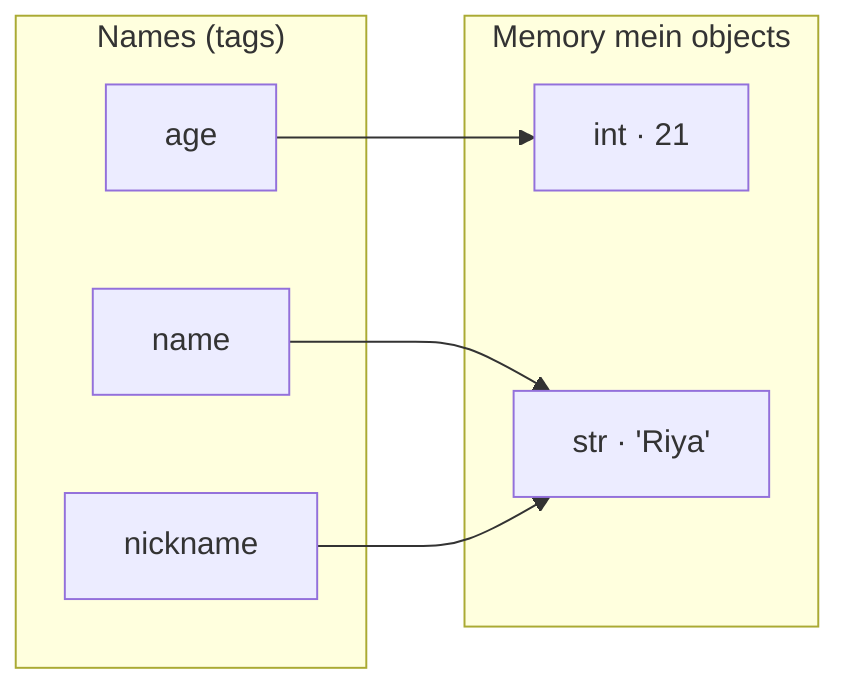
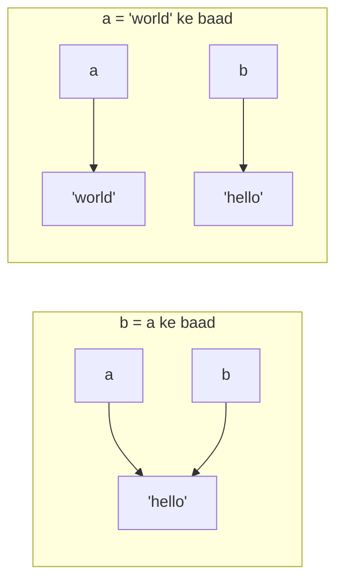
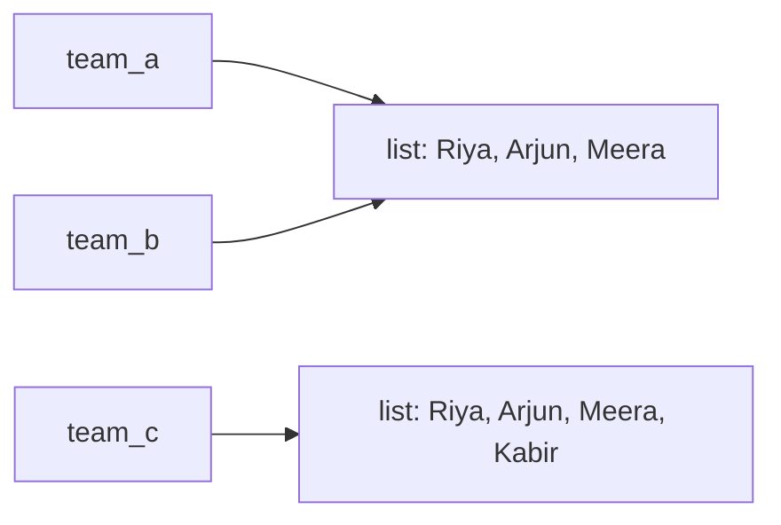
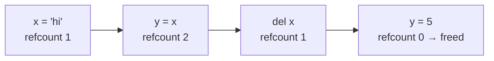

# Chapter 02 · Variables, Data Types & Memory

> Zyaadatar beginners variable ko ek dabba samajhte hain jiske andar value rakhi hai. Ye picture ek hafte chalti hai, phir chupchaap tumhari zindagi ke sabse ganday bugs paida karti hai. Python ke variables dabbe nahi hain: ye objects pe chipke hue **name tags** hain. Aaj sahi picture seekh lo, aur "mera data apne aap kaise badal gaya?!" wali poori family ke mysteries tumhare saath kabhi hongi hi nahi.

**Is chapter mein tum seekhoge:**
- Python mein variable asal mein kya hai: ek **name** jo memory mein kisi **object** ko **refer** karta hai
- Paanch basic types: `int`, `float`, `str`, `bool` aur `None`, aur `type()` se unhe kaise check karein
- **Dynamic typing**, aur phir bhi Python **strongly typed** kyun hai
- Types ke beech **casting** (`int()`, `float()`, `str()`, `bool()`) aur `input()` se user ka input padhna
- Naming rules, keywords aur PEP 8 style
- Multiple assignment, ek-line ka swap, aur constants
- **Mutable vs immutable** objects (woh idea jispe aadha Python khada hai)
- `0.1 + 0.2` `0.3` kyun nahi hota, aur Python ke integers kabhi overflow kyun nahi hote

**Isse pehle padho:** [Chapter 01 · Getting Started](01-getting-started.md)

---

## 🧠 The Big Idea · Asli Baat

Ek bahut bada godown socho (tumhare computer ki memory). Tumhara program jo bhi value banata hai, jaise number `21` ya text `"Riya"`, woh ek **object** hai: kisi shelf pe rakha ek parcel. Har parcel pe teen cheezein likhi hoti hain:

1. **Identity**: uska unique shelf address (woh kahan rehta hai).
2. **Type**: woh kis tarah ki cheez hai (number, text, ...).
3. **Value**: andar ka asli maal.

**Variable** bas ek dhaage pe bandha **name tag** hai, jo kisi ek parcel se bandha hota hai. Jab tum likhte ho:

```py
age = 21
```

Python do kaam karta hai: (1) value `21` wala ek `int` object banata hai (ya pehle se bana hua dhoondh leta hai), phir (2) `age` naam ka tag usse baandh deta hai. Yahan `=` ka matlab maths wala "barabar hai" **nahi** hai. Ise padho **"is naam ko us cheez ki taraf point karwao"**.



Do name tags **same** parcel ki taraf point kar sakte hain (upar `name` aur `nickname`). Ek tag ko doosre parcel pe le jaane se koi bhi parcel nahi badalta. Ye picture poore chapter dimaag mein rakhna.

> 🇮🇳 **Desi Analogy:** Railway station ka **cloak room** (left luggage) socho. Tumne apna bag jama kiya, bag shelf pe kahin rakh diya gaya (object, memory mein), aur tumhe ek **token** mila (name). Token bag nahi hai, bas bag tak pahunchne ka zariya hai. Tumhare dost ke paas bhi usi bag ka doosra token ho sakta hai (do names, ek object). Agar tum apna token phenk ke kisi aur bag ka token le lo (reassignment), toh pehla bag apni jagah waisa hi pada rehta hai. Aur jab kisi ke paas bhi us bag ka token nahi bachta, cloak room wala bag hata deta hai (memory free, ye Under the Hood mein dekhenge).

> 💡 **The core insight:** Python mein **names objects ki taraf point karte hain**. Assignment kabhi data copy nahi karta; woh bas ek name tag ko idhar-udhar karta hai.

---

## 🔨 Building It Up · Zero Se Shuru

### 1. Creating and using variables

```python
name = "Riya"
age = 21
height_m = 1.62

print(name, "is", age, "years old and", height_m, "m tall.")
print("Next year she will be", age + 1)
```

```text
Riya is 21 years old and 1.62 m tall.
Next year she will be 22
```

Abhi kya hua: `=` wali har line ek **assignment statement** hai. Pehle right side evaluate hoti hai, phir left wala naam result se baandh diya jaata hai. Baad mein jab Python `age + 1` dekhta hai, woh dekhta hai ki `age` kis cheez ko refer kar raha hai (21) aur usme 1 jod deta hai. Notice karo, `age` khud nahi badla: `age + 1` ne ek **naya** object, 22, banaya jo seedha `print` ke paas chala gaya.

### 2. Reassignment moves the tag

```python
score = 10
print(score)
score = 25          # tag ek naye object pe shift ho gaya
print(score)
score = score + 5   # pehle right side: 25 + 5 = 30, phir tag shift karo
print(score)
```

```text
10
25
30
```

Abhi kya hua: maths mein `score = score + 5` impossible lagta hai ("x = x + 5"? matlab 0 = 5?). Python mein ye ekdum sensible hai: **current value use karke right side calculate karo, phir naam ko result pe shift kar do**. Purane objects (10, 25) ko kisi ne chhua nahi; agar koi aur unhe refer nahi kar raha, toh Python unhe kabhi na kabhi saaf kar deta hai.

> 🤔 **Mann mein sawaal:** `score = score + 5` mein `score` toh left aur right dono taraf hai. Python confuse nahi hota ki pehle kaunsa?
>
> **Jawab:** Nahi, kyunki rule fixed hai: **right side hamesha pehle, poori ki poori**. Python right side ko aise padhta hai jaise left side exist hi nahi karti: "abhi `score` ki value kya hai? 25. Plus 5 = 30." Jab 30 ban jaata hai, *tab* left wala `score` tag 30 pe chipka diya jaata hai. Do alag time pe do alag kaam, isliye koi clash nahi.

### 3. Identity: id() and the name-tag picture in action

Har object ka ek unique identity number hota hai, jo tum `id()` se dekh sakte ho. CPython mein ye object ka memory address hota hai. Asli numbers har run mein badalte hain, isliye hum unhe print karne ke bajaye compare karenge.

```python
a = "hello"
b = a                 # b ab bhi a wale SAME object ko point karta hai
print(id(a) == id(b))
print(a is b)         # 'is' poochta hai: same object? (ids compare karne jaisa)

a = "world"           # tag a ko doosre object pe le jao
print(a, b)           # b abhi bhi "hello" ko point kar raha hai
print(a is b)
```

```text
True
True
world hello
False
```

Abhi kya hua: `b = a` ne text copy **nahi** kiya. Usne same parcel pe ek doosra tag baandh diya. Phir `a = "world"` ne tag `a` ko kahin aur shift kar diya; tag `b` apni jagah tika raha. Isi wajah se ek variable ko reassign karne se doosra kabhi nahi badalta.



> 🇮🇳 **Desi Analogy:** Tumhare aur tumhare bhai, dono ke phone mein "Pizza Wala" naam se ek hi number save hai (do names, ek object). Ab tumne apne phone mein "Pizza Wala" ko naye shop ke number pe update kar diya (`a = "world"`). Kya bhai ke phone ka contact badal gaya? Bilkul nahi. Woh abhi bhi purani shop ko hi call karega. Reassignment sirf *tumhara* tag shift karta hai.

### 4. The basic data types

Har object ka ek **type** hota hai jo decide karta hai ki tum uske saath kya-kya kar sakte ho. Ye paanch types har cheez ki neev hain:

| Type | Kya rakhta hai | Examples |
|---|---|---|
| `int` | Poore numbers, kisi bhi size ke | `0`, `42`, `-7`, `10**100` |
| `float` | Decimal point wale numbers | `3.14`, `-0.5`, `2.0`, `1e6` |
| `str` | Text (characters ki ek "string", jaise maala mein moti) | `"hi"`, `'Python'`, `""` (empty) |
| `bool` | Sach/jhooth values | `True`, `False` (capital T aur F!) |
| `NoneType` | "Yahan kuch nahi hai" | `None` (is type ki ekmatra value) |

`type()` tumhe kisi object ka type batata hai:

```python
print(type(42))
print(type(3.14))
print(type("42"))
print(type(True))
print(type(None))
print(type(2.0), type(2))
```

```text
<class 'int'>
<class 'float'>
<class 'str'>
<class 'bool'>
<class 'NoneType'>
<class 'float'> <class 'int'>
```

Abhi kya hua: quotes mein `"42"` text hai, number nahi. `2.0` float hai, bhale hi woh poora number hai, kyunki decimal point hi use float banata hai. ("class" Python ka shabd hai "type" ke liye; apni classes hum [Chapter 14](14-oop-classes-objects.md) mein banayenge.)

### 5. Numbers in more detail: int and float

```python
population = 1_400_000_000      # underscores bade numbers ko padhne laayak banate hain
print(population)
print(0b1010, 0o17, 0xFF)        # binary, octal, hexadecimal literals
print(1e3, 2.5e-3)               # scientific notation: 1 x 10^3, 2.5 x 10^-3
print(7 / 2, 6 / 2)              # / hamesha float deta hai
print(type(6 / 2))
print(int(3.99), int(-3.99))     # int() decimal wala hissa kaat deta hai
print(round(3.99), round(3.14159, 2))
```

```text
1400000000
10 15 255
1000.0 0.0025
3.5 3.0
<class 'float'>
3 -3
4 3.14
```

Abhi kya hua:

- `1_400_000_000` bas `1400000000` hai; underscores ignore hote hain, bilkul jaise "1,40,00,00,000" mein commas.
- `0b` matlab binary (base 2), `0o` octal (base 8), `0x` hexadecimal (base 16). Same integers, bas alag spelling. Binary tum [DSA Chapter 23](../part-2-dsa/23-bits-math.md) mein bahut use karoge.
- `1e3` hamesha **float** hota hai.
- `/` (division) hamesha float return karta hai, `6 / 2` ke liye bhi. Operators poori tarah [Chapter 03](03-operators-expressions.md) mein cover honge.
- `int()` **zero ki taraf truncate** karta hai (round nahi karta): `int(-3.99)` ka answer `-3` hai. `round()` sabse paas wali value pe round karta hai.

> 🤔 **Mann mein sawaal:** `int(-3.99)` ka answer `-4` kyun nahi? -3.99 toh -4 ke zyada paas hai!
>
> **Jawab:** Kyunki `int()` round karta hi nahi, woh bas decimal ke baad wala hissa **kaat ke phenk deta hai**. `-3.99` se `.99` kaat diya, bacha `-3`. Isliye kehte hain "truncate toward zero": result hamesha zero ki taraf khisakta hai (positive mein neeche, negative mein upar). Agar tumhe "neeche ki taraf" chahiye, toh `math.floor` ya `//` use karo ([Chapter 03](03-operators-expressions.md)).

### 6. Booleans: True and False

**bool** ek haan/naa wale sawaal ka jawab hai. Ye tumhe comparisons se milte hain:

```python
is_adult = 21 >= 18
print(is_adult, type(is_adult))
print(5 == 5, 5 == 6, 5 != 6)
print(True + True, True * 10)   # bools chupke se ints hain: True matlab 1, False matlab 0
```

```text
True <class 'bool'>
True False True
2 10
```

Abhi kya hua: `==` poochta hai "kya ye barabar hain?" (ek `=` assign karta hai, do `==` compare karte hain). Python mein `bool` asal mein `int` ka hi ek subtype hai, toh arithmetic mein `True` `1` ki tarah aur `False` `0` ki tarah behave karta hai. Ginti ke liye ye kaam ki cheez hai: bahut saare `True` jodo toh woh gin jaate hain. `if` ke saath booleans tum [Chapter 05](05-conditionals.md) mein lagaatar use karoge.

> 🇮🇳 **Desi Analogy:** Class mein attendance socho. Har bachche ke aage "Present" = `True` = 1, "Absent" = `False` = 0. Total present nikaalna hai? Bas saare 1 aur 0 jod do. `True + True` = 2 present. Isliye `bool` ka `int` hona koi ajeeb baat nahi, ekdum kaam ki baat hai.

### 7. None: the value that means "nothing"

`None` ka matlab hai **koi value nahi**, "abhi set nahi hua", ya "return karne ko kuch nahi". Ye `0` nahi hai, `""` nahi hai, `False` bhi nahi hai; ye apne aap mein ek alag cheez hai.

```python
winner = None              # winner abhi pata nahi
print(winner)
print(type(winner))
print(winner is None)      # None test karne ka sahi tareeka
print(print("side effect"))   # print None return karta hai (Chapter 01 dekho)
```

```text
None
<class 'NoneType'>
True
side effect
None
```

Abhi kya hua: chalte hue Python program mein **sirf ek** `None` object hota hai, isliye hum use `is None` se test karte hain, jo identity check karta hai. Last line mein andar wale `print` ne `side effect` print kiya aur `None` return kiya, jise phir bahar wale `print` ne dikhaya.

> 🇮🇳 **Desi Analogy:** Exam form mein "Marks in Maths" ka khaana. **`0`** matlab exam diya aur zero aaya. **`None`** matlab exam abhi hua hi nahi, khaana khaali hai. Dono mein zameen-aasmaan ka farak hai: `0` wale bachche ko pass karwane ki planning chahiye, `None` wale ko bas result ka wait.

### 8. Dynamic typing: tags don't have types, objects do

Java ya C jaisi languages mein tum variable ka type declare karte ho (`int age = 21;`) aur usme hamesha sirf ints hi aa sakte hain. Python **dynamically typed** hai: names ka **koi type nahi** hota. Sirf objects ka hota hai. Ek naam abhi int ko refer kar sakta hai aur baad mein string ko.

```python
thing = 42
print(thing, type(thing))
thing = "forty-two"
print(thing, type(thing))
thing = 42.0
print(thing, type(thing))
```

```text
42 <class 'int'>
forty-two <class 'str'>
42.0 <class 'float'>
```

Lekin Python **strongly typed** bhi hai: jo types saath mein matlab nahi banate, unhe woh chupchaap mix nahi karta.

```py
print("Age: " + 21)
# TypeError: can only concatenate str (not "int") to str
```

JavaScript khushi-khushi `"Age: 21"` bana deta. Python mana kar deta hai aur tumse saaf-saaf bulwata hai ki tumhe chahiye kya (`str(21)` se convert karo, ya `print` mein comma use karo). Strong typing bugs ko jaldi pakad leti hai.

| | Static (Java, C++) | Dynamic (Python, JavaScript) |
|---|---|---|
| Type kiske paas hai? | Variable ke paas | Object ke paas |
| Types kab check hote hain? | Chalne se pehle (compile time) | Chalte waqt |
| | **Strong** (Python, Java) | **Weak** (JavaScript, C kuch jagah) |
| Types mix karna | Error, jab tak convert na karo | Chupchaap convert ho jaata hai |

> 🤔 **Mann mein sawaal:** "Dynamic" aur "weak" ek hi baat nahi hai kya? Dono mein hi toh type ki parwaah kam hai.
>
> **Jawab:** Nahi, ye do alag sawaalon ke jawab hain. **Static/Dynamic** poochta hai: "type *kiske* paas hai aur *kab* check hota hai?" (Python: object ke paas, chalte waqt.) **Strong/Weak** poochta hai: "galat types mile toh language khud se convert karegi ya error degi?" (Python: error degi.) Isliye Python ek saath **dynamic aur strong** dono hai. Tag kisi bhi parcel pe lag sakta hai (dynamic), lekin parcel ke andar ka maal zabardasti mix nahi hota (strong).

> 💡 Modern Python tumhe optional **type hints** lagane deta hai jaise `age: int = 21`. Python khud runtime pe inhe ignore karta hai, lekin editors aur `mypy` jaise tools inse galtiyan pakadte hain. Ye tum [Chapter 10](10-functions.md) mein dekhoge.

### 9. Casting: converting between types

**Casting** (ya type conversion) ka matlab hai kisi existing value se ek alag type ka naya object banana.

```python
print(int("42") + 1)          # str -> int
print(float("3.5") * 2)       # str -> float
print(str(99) + " problems")  # int -> str
print(int(7.9), float(7))     # float -> int (truncate karta hai), int -> float
print(int("  12  "))          # aas-paas ke spaces chal jaate hain
print(int("ff", 16), int("1010", 2))   # doosre base mein parse karo
```

```text
43
7.0
99 problems
7 7.0
12
255 10
```

Kuch conversions fail ho jaate hain, kyunki text us tarah ke number jaisa dikhta hi nahi:

```py
int("3.5")     # ❌ ValueError: invalid literal for int() with base 10: '3.5'
int("twelve")  # ❌ ValueError
int("")        # ❌ ValueError
int(float("3.5"))  # ✅ 3 (pehle float se guzro)
```

> 🇮🇳 **Desi Analogy:** Casting ko currency exchange counter jaisa socho. Tum ₹ dete ho, counter tumhe naye $ notes deta hai (naya object); tumhare purane note waise hi rehte hain (original object nahi badalta). Lekin agar tum counter pe ek kaagaz ka tukda do jispe "bees rupaye" likha hai (`int("twelve")`), toh clerk bolega "ye valid note nahi hai" (`ValueError`).

**`bool()` conversion** ek simple rule follow karta hai: "khaali" ya "zero" cheezein `False` hain, baaki sab `True`.

```python
print(bool(0), bool(0.0), bool(""), bool(None))
print(bool(1), bool(-5), bool("hi"), bool(" "), bool("False"))
```

```text
False False False False
True True True True True
```

Abhi kya hua: `bool("False")` `True` hai! Woh ek non-empty string hai, aur `bool()` bas yahi check karta hai. Ek single space `" "` bhi non-empty hai. Is idea, **truthiness**, ko [Chapter 05](05-conditionals.md) mein poora section milega.

### 10. Reading input from the user: input()

`input()` program ko rok deta hai, ek prompt dikhata hai, user ke kuch type karke Enter dabane ka wait karta hai, aur **hamesha ek string return karta hai**.

```py
name = input("What's your name? ")
print("Hello,", name)
```

```text
What's your name? Arjun
Hello, Arjun
```

Classic beginner bug: bhool jaana ki input hamesha text hota hai.

```py
age = input("Your age: ")      # user 20 type karta hai
print(age + 1)                 # ❌ TypeError: can only concatenate str (not "int") to str

age = int(input("Your age: ")) # ✅ turant convert karo
print(age + 1)                 # 21
```

> 🤔 **Mann mein sawaal:** User ne toh `20` type kiya, number! Phir Python use string kyun maanta hai?
>
> **Jawab:** Kyunki keyboard se sirf **characters** aate hain. Tumne `2` aur `0` naam ke do characters dabaye, Python ko kya pata tum number bata rahe ho, phone number, ya roll number "020"? `input()` koi guess nahi karta (yaad hai, Python guess nahi karta), bas jo type hua woh text ki tarah de deta hai. Number chahiye, toh khud `int()` se bolo.

Ek line pe kai numbers padhna (coding contests mein bahut common):

```py
a, b = input().split()         # user type karta hai: 3 7   ->  a = "3", b = "7"
a, b = int(a), int(b)
print(a + b)                   # 10
```

`.split()` string ko spaces pe tod deta hai; ise tum poori tarah [Chapter 04](04-strings.md) mein seekhoge.

> ⚠️ Is book mein runnable examples kabhi `input()` use nahi karte (unhe bina kisi ke type kiye chalna hota hai). Uske bajaye hum variables seedha set karte hain, jaise `age = 20`. Jab tum khud practice karo, toh bindaas `input()` lagao.

### 11. Naming rules and good style (PEP 8)

**Hard rules** (inhe todoge toh `SyntaxError` milega):

- Names mein letters, digits aur underscores `_` ho sakte hain.
- Ye **digit se shuru nahi ho sakte**: `2nd_place` ❌, `place_2` ✅.
- Spaces ya hyphens nahi: `my name` ❌, `my-name` ❌ (ye toh "my minus name" ban gaya), `my_name` ✅.
- Ye **case-sensitive** hain: `Age` aur `age` alag hain.
- Ye **keywords**, yaani Python ke reserved words, nahi ho sakte.

Python ke keywords (in sabko tum is book mein seekhoge):

```text
False    None     True     and      as       assert   async    await
break    class    continue def      del      elif     else     except
finally  for      from     global   if       import   in       is
lambda   nonlocal not      or       pass     raise    return   try
while    with     yield
```

(`match`, `case`, `type` aur `_` "soft keywords" hain: ye sirf kuch khaas jagahon pe special hote hain, baaki jagah normal naam ki tarah use ho sakte hain.)

**Style conventions (PEP 8)**:

| Naam ka kind | Style | Example |
|---|---|---|
| Variables, functions | `snake_case` | `total_price`, `user_count` |
| Constants | `UPPER_SNAKE_CASE` | `MAX_USERS`, `PI` |
| Classes | `CapWords` | `BankAccount` |
| "Private" / internal | shuru mein underscore | `_cache` |
| Phenk dene wali value | single underscore | `_` |

Achhe naam **matlab** batate hain: `price_in_rupees` `p`, `x1` ya `data` se kahin behtar hai. `i`, `n`, `x` jaise chhote naam chhote scopes ke liye theek hain, jaise loop counters.

> ⚠️ **Built-ins ko shadow mat karo.** `print`, `list`, `str`, `input`, `sum`, `max`, `id`, `type` jaise naam keywords nahi hain, toh Python tumhe inhe dobara use karne deta hai. Lekin phir original gayab ho jaata hai:
>
> ```py
> sum = 10 + 20
> sum(...)   # ❌ TypeError: 'int' object is not callable
> ```
>
> Name-tag picture se samjho: `sum` naam ka tag pehle Python ke built-in "jodne wale function" pe chipka tha. Tumne woh tag utha ke `30` pe chipka diya. Ab `sum(...)` bolne pe Python `30` ko function ki tarah call karne ki koshish karta hai, aur 30 toh number hai, call nahi ho sakta.

### 12. Multiple assignment, chained assignment and the swap

```python
x, y, z = 1, 2, 3            # multiple assignment (unpacking)
print(x, y, z)

a = b = c = 0                # chained: teeno names -> same 0 object
print(a, b, c)

left, right = 10, 20
left, right = right, left    # mashhoor ek-line swap
print(left, right)
```

```text
1 2 3
0 0 0
20 10
```

Swap mein kya hua: Python **poori right side pehle evaluate** karta hai, ek temporary jodi `(20, 10)` banata hai, aur sirf uske baad assign karta hai: `left` ko 20 milta hai, `right` ko 10. Zyaadatar doosri languages mein tumhe ek temporary variable chahiye hota:

```py
temp = left
left = right
right = temp
```

> 🇮🇳 **Desi Analogy:** Do glass hain, ek mein chai, ek mein coffee, aur tumhe swap karna hai. Normal tareeka: teesra khaali glass lo (temp), chai usme daalo, coffee chai wale glass mein, phir temp wali chai coffee wale glass mein. Python ka `a, b = b, a` aisa hai jaise tumne pehle dono glasses ki **photo** le li (right side ki temporary jodi), phir photo dekh-dekh ke dono glasses mein sahi cheez bhar di. Kisi ka maal beech mein overwrite hoke gaayab nahi hota.

Left side ke names ki ginti right side ki values ki ginti se match honi chahiye, warna `ValueError: too many values to unpack` (ya "not enough") milega.

### 13. Constants: a promise, not a lock

**Constant** woh value hai jo kabhi nahi badalni chahiye, jaise π ya koi maximum limit. Python mein sach mein koi constant keyword **nahi** hai. Uske bajaye, convention se, tum naam ko `UPPER_CASE` mein likhte ho aur sab log maan lete hain ki ise reassign nahi karenge.

```python
GST_RATE = 0.18
MAX_LOGIN_ATTEMPTS = 3

price = 1000
print("Price with GST:", price + price * GST_RATE)
print("Attempts allowed:", MAX_LOGIN_ATTEMPTS)
```

```text
Price with GST: 1180.0
Attempts allowed: 3
```

Constants aam taur pe file ke top pe rehte hain, taaki unhe dhoondhna aur ek hi jagah badalna aasaan ho. Isse "magic numbers" khatam ho jaate hain: 20 lines mein bikhra hua akela `0.18` matlab tax rate badalne pe 20 jagah update karna (aur ek bhool gaye toh bug).

> 🇮🇳 **Desi Analogy:** Constant society ke notice board pe likha "Gate 11 baje band hoga" jaisa hai. Koi taala nahi laga jo tumhe notice badalne se roke (Python bhi nahi rokta), lekin sab maante hain ki ye rule hai. Aur jab time 11 se 10:30 karna ho, toh bas ek notice badlo, har flat mein jaake batane ki zaroorat nahi.

### 14. Mutable vs immutable: the most important idea in this chapter

**Immutable** object banne ke baad **kabhi nahi badal sakta**. **Mutable** object ko apni jagah pe (in place) **badla ja sakta hai**.

| Immutable (badal nahi sakte) | Mutable (badal sakte hain) |
|---|---|
| `int`, `float`, `bool`, `str`, `None`, `tuple`, `frozenset` | `list`, `dict`, `set`, tumhare banaye zyaadatar objects |

Is chapter ke paanchon types immutable hain. Toh `x = x + 1` karta kya hai? Woh 5 ko nahi badalta; ek **naya** object banata hai aur tag shift kar deta hai:

```python
x = 5
before = id(x)
x = x + 1
print(x, id(x) == before)   # ab ek alag object hai

s = "cat"
t = s.upper()               # string methods NAYI strings return karti hain
print(s, t)
```

```text
6 False
cat CAT
```

Ab milo hamare pehle mutable type se, **list** (square brackets mein values ka ek sequence; poori detail [Chapter 07](07-lists.md) mein). Mutable object ke saath, same parcel pe lage do name tags *ek doosre ke changes dekhte hain*:

```python
team_a = ["Riya", "Arjun"]
team_b = team_a              # same list, do tags
team_b.append("Meera")       # list ko IN PLACE badlo
print(team_a)                # team_a bhi "badal" gaya!
print(team_a is team_b)

team_c = list(team_a)        # asli copy banao
team_c.append("Kabir")
print(team_a)
print(team_c)
```

```text
['Riya', 'Arjun', 'Meera']
True
['Riya', 'Arjun', 'Meera']
['Riya', 'Arjun', 'Meera', 'Kabir']
```

Abhi kya hua: `team_b = team_a` ne kuch copy nahi kiya; usne same list pe ek doosra tag laga diya. `.append()` ne us ek list ko modify kiya, toh dono names change dikhate hain. Sirf `list(team_a)` ne ek nayi, alag list banayi.



> 🇮🇳 **Desi Analogy:** Mutable list ek **shared Google Doc** jaisi hai: tumne aur tumhari dost ne same link khola hai (do tags, ek object). Woh ek line add karegi, tumhe bhi turant dikhegi. `list(team_a)` aisa hai jaise "Make a copy" dabaya: ab tumhari apni alag doc hai, usme kuch bhi karo, original pe asar nahi. Aur immutable string ek **printed certificate** jaisi hai: usme kuch badalna hai toh naya certificate print hota hai, purana waisa ka waisa rehta hai.

> 🤔 **Mann mein sawaal:** `x = x + 1` mein bhi toh `x` "badal" gaya, 5 se 6 ho gaya. Phir int immutable kaise hua?
>
> **Jawab:** Yahan *object* nahi badla, *tag* shift hua. Object `5` abhi bhi `5` hi hai, memory mein waisa ka waisa. Python ne ek naya object `6` banaya aur `x` ka tag uspe chipka diya. Isiliye `id(x) == before` `False` aaya: naya id, naya object. Mutable list mein `.append()` **usi object ke andar** cheez daalta hai, id same rehta hai. Farak "naya parcel" aur "usi parcel mein maal daalna" ka hai.

> 💡 **Rule of thumb:** immutable objects ke saath sharing bekhatar hai, kyunki parcel ko koi badal hi nahi sakta. Mutable objects ke saath sharing ka matlab hai **jiske paas bhi tag hai, use har change dikhega**. Ye ek akela idea interview questions aur bugs ki ek poori category explain karta hai (default arguments [Chapter 10](10-functions.md) mein, copying [Chapter 07](07-lists.md) mein, 2D grids DSA mein).

### 15. Float precision: why 0.1 + 0.2 != 0.3

```python
print(0.1 + 0.2)
print(0.1 + 0.2 == 0.3)
print(round(0.1 + 0.2, 2) == 0.3)
print(abs((0.1 + 0.2) - 0.3) < 1e-9)    # "kaafi paas hai" wala comparison
```

```text
0.30000000000000004
False
True
True
```

Ye Python ka bug nahi hai. Ye Java, C, JavaScript, har jagah hota hai. Computers floats ko **binary** (base 2) mein store karte hain. Jaise 1/3 ko decimal mein exactly nahi likh sakte (0.3333...), waise hi 0.1 ko binary mein exactly nahi likh sakte (0.0001100110011...). Computer jitni paas wali value store kar sakta hai, kar leta hai, aur jab tum aisi values jodte ho toh chhoti-chhoti galtiyan dikhne lagti hain.

> 🇮🇳 **Desi Analogy:** ₹100 ko 3 doston mein baraabar baanto. Har ek ko ₹33.33 milta hai, aur 1 paisa hamesha bach jaata hai, kyunki 100/3 ko paise mein exactly likh hi nahi sakte. Teeno ka jodo toh ₹99.99, ₹100 nahi. Computer ke saath 0.1 ka bhi yahi haal hai: binary "paise" mein woh exactly fit hi nahi hota, toh thoda sa round karke rakhta hai. Wohi chhota round-off jodne pe `0.30000000000000004` ban jaata hai.

Kya karein:

- **Floats ko kabhi `==` se compare mat karo.** Check karo ki woh kaafi paas hain: `abs(a - b) < 1e-9`, ya `math` module ka `math.isclose(a, b)` use karo (modules [Chapter 17](17-modules-stdlib.md) mein aate hain).
- **Paison ke liye floats use mat karo.** Paise ko integers mein store karo (₹100.50 ke liye `price_paise = 10050`), ya `decimal` module use karo.
- Display ke liye `round()` theek hai.

### 16. Big integers: Python ints never overflow

C ya Java mein `int` ka size fixed hota hai (aksar 32 ya 64 bits), aur maximum ke paar jaane pe woh "overflow" hoke bekaar negative numbers ban jaata hai. Python ka `int` utna bada ho sakta hai jitni tumhari memory allow kare.

```python
big = 2 ** 100
print(big)
print(2 ** 64 + 1)
print(len(str(2 ** 1000)), "digits")
```

```text
1267650600228229401496703205376
18446744073709551617
302 digits
```

> 🇮🇳 **Desi Analogy:** C ka `int` purani car ke odometer jaisa hai: 99999 km ke baad seedha 00000 pe aa jaata hai (overflow), aur car "nayi" dikhne lagti hai. Python ka `int` kirana store ke khata register jaisa hai: number bada hua toh bas aur pages jod do, kabhi wapas zero pe nahi jaata.

Isliye Python "50 ka factorial" ya "500th Fibonacci number" jaisi problems ke liye kamaal ka hai: koi special big-number library nahi chahiye. Keemat: bahut bade ints pe operations chhote ints se slow hote hain, kyunki unhe digits ke kai chunks ki tarah handle kiya jaata hai.

> ⚠️ Floats alag hain: unki limits **hoti hain**. `2.0 ** 10000` `OverflowError` raise karta hai, aur `float` mein sirf lagbhag 15 se 17 significant decimal digits ki precision hoti hai.

### 17. Deleting names with del

`del` ek **name tag** hatata hai, zaroori nahi ki object bhi.

```python
a = "data"
b = a
del a                 # tag 'a' hatao
print(b)              # object zinda hai: b abhi bhi use refer karta hai
```

```text
data
```

Delete karne ke baad us naam ko use karoge toh `NameError` milega. Object khud tabhi free hota hai jab **ek bhi tag** uski taraf point na kar raha ho (Under the Hood dekho).

---

## 🔬 Under the Hood · Andar Ki Kahani

### Every object is a struct in memory

CPython mein har object memory ka ek block hai (ek C struct), jo do fields se shuru hota hai:

- ek **reference count**: abhi kitne names/jagah isko point kar rahe hain,
- uske **type** ka pointer,

aur uske baad asli value. Isliye ek chhota sa number bhi tumhari ummeed se zyada jagah leta hai:

```py
import sys
print(sys.getsizeof(1))          # int object 1 kitne bytes leta hai
print(sys.getsizeof(2 ** 100))   # bade ints zyada memory lete hain
print(sys.getsizeof(""))         # ek empty string object
```

```text
28
40
41
```

(Exact numbers tumhare Python version aur machine pe depend karte hain; ye 64-bit CPython 3.13 ke hain. Point ye hai: ek chhota `int` lagbhag 28 bytes ka hai, C ki tarah 4 ka nahi.)

> 🤔 **Mann mein sawaal:** Sirf number `1` rakhne ke liye 28 bytes? Itni fizool kharchi kyun?
>
> **Jawab:** Kyunki Python ka `1` sirf number nahi, ek poora **object** hai. Uske saath reference count chahiye (kitne tags lage hain, taaki pata chale kab free karna hai), type ka pointer chahiye (taaki Python jaane ki ye `int` hai aur `+` ka matlab kya hai), aur size ki jaankari chahiye (kyunki int kitna bhi bada ho sakta hai). Ye "packaging" hi Python ko flexible banati hai: dynamic typing, big ints, sab isi ki wajah se possible hai. Badle mein thodi memory jaati hai.

### Reference counting and garbage collection

Jab bhi koi naya naam kisi object se baandha jaata hai, uska reference count badh jaata hai. Jab koi naam reassign hota hai, delete hota hai, ya chala jaata hai, count ghat jaata hai. Jab count **zero** hota hai, CPython memory **turant** free kar deta hai.



> 🇮🇳 **Desi Analogy:** Har object ko ek dukaan socho, aur reference count = kitne logon ke phone mein us dukaan ka number save hai. Jab tak kam se kam ek insaan ke paas number hai, dukaan chalti rehti hai (koi toh order karega). Jis din aakhri insaan ne bhi number delete kar diya (refcount 0), dukaan turant band: koi pahunch hi nahi sakta. Ab ek ajeeb case: do dukaanein A aur B ne *ek-doosre ka* number save kar rakha hai, lekin duniya mein aur kisi ke paas dono mein se kisi ka number nahi. Dono ka count 1 hai (zero nahi), toh "refcount wala" niyam unhe band nahi karta, jabki koi customer kabhi pahunch hi nahi sakta. Yahi **reference cycle** hai, aur ise pakadne ke liye alag se ek inspector chahiye: cycle collector.

Ek gap hai: agar object A, B ko refer karta hai aur B wapas A ko (ek **reference cycle**), toh unke counts kabhi zero tak nahi pahunchte. Isliye CPython ke paas ek **cycle-detecting garbage collector** bhi hai (`gc` module) jo time-time pe aise "islands" dhoondh ke free karta hai. Cycles tum linked structures mein [DSA Chapter 10](../part-2-dsa/10-linked-lists.md) mein dekhoge.

### Small integer caching and string interning

Objects banane mein time lagta hai, isliye CPython **-5 se 256** tak ke integers (sabse zyada use hone wale) ka ek pehle se bana hua set rakhta hai. Tumhare program mein har `5` *same* object hai:

```python
a = 256
b = 256
print(a is b)                 # same cached object

x = int("1000")
y = int("1000")
print(x == y, x is y)         # values barabar, lekin do alag objects
```

```text
True
True False
```

Isi tarah CPython bahut saari chhoti strings ko **intern** (reuse) karta hai jo identifiers jaisi dikhti hain, jaise `"hello"`. Ye **implementation details** hain: Python versions ke beech, ya file mein chalane aur REPL mein chalane ke beech bhi badal sakti hain. Seekh ye nahi ki range ratt lo. Seekh ye hai: **values compare karne ke liye `==` use karo. `is` sirf `None` ke liye** (aur `True`/`False` jaise kuch singletons ke liye).

> 🇮🇳 **Desi Analogy:** Small int cache office ke common stationery jaisa hai: pen, stapler, sab ek hi rakhe hain aur sab wahi use karte hain (sab ka `5` same object). Lekin bada saaman, jaise laptop (`1000`), har bande ko alag issue hota hai, chahe model same ho. Do laptop "barabar" hain (`==`), lekin "wahi ek laptop" nahi (`is`).

### Why `is None` and not `== None`?

`None` object sirf ek hai. `is` ek single, fast identity check hai jise bewakoof nahi banaya ja sakta. `==` object se poochta hai "kya tum None ke barabar ho?", aur ek custom class ([Chapter 15](15-oop-inheritance-magic.md)) "haan" bol sakti hai bhale hi woh `None` na ho. PEP 8 kehta hai: hamesha `is None` / `is not None`.

### Where do names live?

Names ek **namespace** mein store hote hain, jo basically naam-strings se objects tak ki ek dictionary hai. File ke top level pe woh module ka **global** namespace hai. Tum `globals()` se usme jhaank sakte ho. Functions ko apne **local** namespaces milte hain; isko (aur LEGB rule ko) hum [Chapter 10](10-functions.md) mein explore karenge. Abhi ke liye: assignment = us dictionary mein ek entry `"age" → <int object 21>` daalna.

> 🇮🇳 **Desi Analogy:** Namespace building ke ground floor pe laga **residents board** hai: "Sharma → Flat 302, Verma → Flat 105". Naam board pe hai, log flat mein hain. `age = 21` bas board pe ek nayi line likhna hai: "age → woh int jiski value 21 hai".

### How floats are stored (IEEE 754)

Python ka `float` ek 64-bit **IEEE 754 double** hai: 1 sign bit, 11 exponent bits, 52 fraction bits. Ise binary mein scientific notation socho: `1.fraction × 2^exponent`. 52 bits se lagbhag **15–17 significant decimal digits** milte hain. 0.5, 0.25 aur 0.125 jaise numbers (2 ki powers) exactly store hote hain; 0.1, 0.2 aur 0.3 nahi.

```python
print(0.5 + 0.25 == 0.75)     # binary mein exact
print(f"{0.1:.20f}")          # 0.1 ko 20 decimal places tak dikhao
```

```text
True
0.10000000000000000555
```

(`f"..."` strings [Chapter 04](04-strings.md) mein cover hoti hain.)

---

## 🧩 Pattern Decoder · Pattern Pakdo

### Pythonic idioms from this chapter

| Iske bajaye... | Ye likho | Kyun |
|---|---|---|
| `temp = a; a = b; b = temp` | `a, b = b, a` | Ek line, koi temp variable nahi |
| `x = 0; y = 0` | `x = y = 0` (sirf immutables ke liye!) | Chhota |
| `if x == None:` | `if x is None:` | Sahi aur fast |
| `0.1 + 0.2 == 0.3` | `abs(a - b) < 1e-9` ya `math.isclose(a, b)` | Floats exact nahi hote |
| `1000000` | `1_000_000` | Padhne laayak |
| `type(x) == int` | `isinstance(x, int)` | Subtypes ko bhi accept karta hai (zyada [Chapter 15](15-oop-inheritance-magic.md) mein) |
| Kai jagah akela `0.18` | Top pe `GST_RATE = 0.18` | Koi magic numbers nahi |
| `n = input()` phir `n + 1` | `n = int(input())` | `input()` hamesha `str` return karta hai |

`isinstance` ek object aur ek type leta hai aur True/False mein jawab deta hai:

```python
print(isinstance(5, int), isinstance(5.0, int), isinstance(True, int))
```

```text
True False True
```

(Haan, `True` ek `int` hai: yaad hai, `bool` `int` ka subtype hai.)

### How this shows up in DSA later

- **Starting value ke roop mein infinity.** Minimum dhoondhna hai toh "har cheez se bada" se shuru karo: `best = float("inf")`. Maximum ke liye `float("-inf")`. Ye tum lagbhag har DSA chapter mein dekhoge.

```python
best = float("inf")
print(best > 10 ** 100, -best)
```

```text
True -inf
```

(Kyun? Socho class mein sabse kam marks dhoondhne hain. Agar "abhi tak ka minimum" `0` se shuru kiya, toh koi bhi asli marks usse kam nahi honge aur galat answer `0` aayega. Infinity se shuru karo, toh pehla hi student usse kam hoga aur sahi tarah replace karega.)
- **Swap** `a[i], a[j] = a[j], a[i]` sorting aur two-pointer problems ka dil hai ([DSA Chapter 03](../part-2-dsa/03-two-pointers.md)).
- **Mutability aur aliasing** mashhoor grid bug paida karte hain: `grid = [[0] * 3] * 3` **same** row ke teen tags banata hai (ek row badlo, teeno badal jaati hain). Fix tum [Chapter 07](07-lists.md) mein seekhoge.
- **Big ints** ki wajah se Python mein overflow ki chinta kam hi karni padti hai. Lekin interviewers phir bhi pooch sakte hain "agar ye Java hota toh?". Overflow ka zikr karo, aur isi wajah se binary search mein `mid = lo + (hi - lo) // 2` use karo ([DSA Chapter 08](../part-2-dsa/08-binary-search.md)).
- **Modulo 10^9 + 7.** Kai problems bolti hain "answer modulo 1_000_000_007 return karo", kyunki doosri languages mein answer overflow ho jaata. Python mein bhi tumhe ise apply karna padega, kyunki judge yahi expect karta hai. Ise constant ki tarah likho: `MOD = 10**9 + 7`.
- Contests mein **fast input**: `int(input())` se padhna common hai. Bahut bade inputs ke liye `sys.stdin` fast hai ([Chapter 17](17-modules-stdlib.md)).

---

## ⚠️ Traps & Common Mistakes · Yahan Sab Phisalte Hain

1. **Sochna ki `b = a` copy karta hai.** Woh share karta hai. Immutables ke liye bekhatar, mutables ke liye chaunkane wala:

```py
# ❌ do naam, ek list
backup = scores
scores.append(100)      # backup bhi badal gaya!
# ✅ asli copy
backup = list(scores)   # ya scores.copy() / scores[:]
```

2. **Bhool jaana ki `input()` string return karta hai.** `input()` + arithmetic → `TypeError`, ya usse bhi bura, `"5" * 3` chupchaap `"555"` de deta hai (koi error nahi, bas galat answer). Turant convert karo: `n = int(input())`.

3. **Decimal string pe `int()`.** `int("3.5")` ek `ValueError` hai. `int(float("3.5"))` ya `float("3.5")` use karo.

4. **`int()` se round karne ki ummeed.** `int(2.99)` `2` hai, aur `int(-2.99)` `-2` hai (zero ki taraf truncation). Rounding chahiye toh `round()` use karo.

5. **Banker's rounding ka surprise.** `round()` exact halves ko sabse paas wale **even** number pe round karta hai:

```python
print(round(0.5), round(1.5), round(2.5), round(3.5))
```

```text
0 2 2 4
```

Ise "round half to even" kehte hain, aur ye statistics mein bias kam karta hai. (Socho: agar har .5 hamesha upar jaaye, toh lakhon numbers jodne pe total thoda-thoda upar khisakta jaayega. Half to even mein aadhe upar jaate hain aadhe neeche, toh balance rehta hai.) Agar tumhe "hamesha .5 upar" chahiye, toh `decimal` module use karo.

6. **Floats ko `==` se compare karna.** `0.1 + 0.2 == 0.3` `False` hai. Tolerance ke saath compare karo.

7. **Values compare karne ke liye `is` use karna.** `x is 1000` `False` ho sakta hai jabki `x == 1000` ho. Python 3.8+ toh warning bhi deta hai: `SyntaxWarning: "is" with a literal`. Values ke liye `==`, `is` sirf `None` ke liye.

8. **Built-ins ko shadow karna.** `list = [1, 2]`, `str = "hi"`, `max = 5`, `id = 7`... phir baad mein `list("abc")` crash hota hai `TypeError: 'list' object is not callable` ke saath. Doosre naam chuno: `items`, `text`, `max_value`, `user_id`.

9. **Lowercase `true`, `false`, `none`.** Sahi hain `True`, `False`, `None`. Lowercase dene se `NameError` milta hai.

10. **Mutables ke liye `a = b = []`.** Dono names **ek hi** list share karte hain. `0` jaise immutables ke liye theek hai kyunki `0` modify ho hi nahi sakta.

11. **Unpacking mismatch.** `a, b = 1, 2, 3` → `ValueError: too many values to unpack (expected 2)`.

12. **Assign karne se pehle variable use karna.** Python upar se neeche chalta hai, toh line 1 pe `print(total)` aur line 2 pe `total = 5` dene se `NameError` milta hai.

---

## 💡 Tips & Tricks · Pro Wale Moves

- REPL mein `type(x)` aur `id(x)` tumhare X-ray chashme hain. Jab bhi doubt ho, use karo.
- Numbers ke liye `x = y = z = 0` theek hai; lists ke liye teen alag assignments likho.
- Min/max searches ke liye `float("inf")` aur `float("-inf")` perfect starting values hain.
- `1e9`, `1e-9` padhne mein acche lagte hain lekin floats hain. Int chahiye toh `10**9` likho.
- `divmod`, `abs`, `round`, `min`, `max`, `pow` built-in number helpers hain; zyaadatar [Chapter 03](03-operators-expressions.md) mein hain.
- Booleans ke naam sawaal jaise rakho: `is_valid`, `has_paid`, `can_vote`. Phir code English jaisa padhta hai: `if is_valid:`.
- Jo value lena zaroori hai lekin tumhe parwaah nahi, uske liye `_` use karo: `_, last = "Riya", "Mehta"`.
- Paise store karne ke liye integer paise/cents use karo. Floats aur paisa saath nahi chalte.
- REPL mein `help(int)` ya `dir(str)` dikhata hai ki koi type kya-kya kar sakta hai.

---

## 🎯 Interview Questions · Interview Mein Yahi Poochenge

### 1. Is Python statically or dynamically typed? Strongly or weakly? 🔥🔥🔥

<details><summary>Answer dekho 👀</summary>

**Dynamically typed**: names ke types nahi hote; objects ke hote hain, aur types runtime pe check hote hain. Same naam pehle `int` ko refer kar sakta hai aur baad mein `str` ko.

**Strongly typed**: Python unrelated types ke beech apne aap convert nahi karta. `"3" + 4` guess karne ke bajaye `TypeError` raise karta hai. (JavaScript se compare karo, jo dynamic aur weak hai: `"3" + 4` deta hai `"34"`.)

Optional type hints (`x: int = 5`) isse kuch nahi badalte; woh `mypy` jaise tools aur editors ke liye hain.

> 🗣️ **Interview mein aise bolo:** "Python is dynamically typed, because types belong to objects rather than variable names and are checked at runtime, so the same name can point to an int and later a string. But it's strongly typed: it never silently converts between unrelated types, so "3" + 4 raises a TypeError instead of producing "34" like JavaScript. Type hints don't change this; they're only used by tools like mypy."

</details>

### 2. What's the difference between mutable and immutable objects? Give examples. 🔥🔥🔥

<details><summary>Answer dekho 👀</summary>

**Immutable** object ki value banne ke baad nahi badal sakti: `int`, `float`, `bool`, `str`, `tuple`, `frozenset`, `None`, `bytes`. Jo operations badlaav jaise dikhte hain (`s.upper()`, `x + 1`) woh **naye** objects banate hain.

**Mutable** object ko in place modify kiya ja sakta hai: `list`, `dict`, `set`, `bytearray`, aur zyaadatar user-defined objects.

Ye kyun matter karta hai:
- Same mutable object ko refer karne wale do names ek-doosre ke changes dekhte hain (aliasing).
- Sirf immutable (zyada precisely, **hashable**) objects hi dictionary keys ya set members ban sakte hain ([Chapter 09](09-dictionaries.md)).
- Mutable default arguments ek classic bug hain ([Chapter 10](10-functions.md)).

```python
a = [1, 2]
b = a
b.append(3)
print(a)           # aliasing: a ko change dikhta hai

s = "hi"
t = s
t = t + "!"        # nayi string banti hai; s ko koi nahi chhoota
print(s, t)
```

```text
[1, 2, 3]
hi hi!
```

> 🗣️ **Interview mein aise bolo:** "An immutable object, like an int, str or tuple, can never change after it's created; anything that looks like a change actually builds a new object. A mutable object, like a list, dict or set, can be modified in place, so every name referring to it sees the change. This matters for aliasing bugs, for mutable default arguments, and because only hashable, typically immutable, objects can be dictionary keys."

</details>

### 3. How are variables stored in Python? Is Python pass-by-value or pass-by-reference? 🔥🔥🔥

<details><summary>Answer dekho 👀</summary>

Variables **objects se bandhe hue names** hain; naam ek reference rakhta hai, aur object heap pe apne type, value aur reference count ke saath rehta hai.

Python na classic pass-by-value hai, na pass-by-reference. Ye **pass-by-object-reference** hai (ise "call by sharing" bhi kehte hain): function ko same object ka reference milta hai. Agar object mutable hai aur function use mutate karta hai, toh caller ko change dikhta hai. Agar function apne parameter naam ko **reassign** karta hai, toh sirf local tag shift hota hai; caller ka variable waisa hi rehta hai. Poora demo [Chapter 10](10-functions.md) mein.

Name-tag picture mein: function ko tumhare parcel pe **ek naya tag** milta hai (copy of the tag, parcel nahi). Woh parcel ke andar maal daale (mutate), toh tumhe dikhega. Woh apna tag utha ke kisi aur parcel pe laga de (reassign), toh tumhara tag wahin ka wahin.

> 🗣️ **Interview mein aise bolo:** "Variables in Python are names bound to objects, so a variable holds a reference, not the value itself. Argument passing is pass-by-object-reference, also called call by sharing: the function gets a new name pointing to the same object. If it mutates a mutable object, the caller sees it; if it just reassigns the parameter, only the local name moves and the caller is unaffected."

</details>

### 4. Why does 0.1 + 0.2 not equal 0.3? How do you compare floats? 🔥🔥🔥

<details><summary>Answer dekho 👀</summary>

Floats **IEEE 754 binary** doubles ki tarah store hote hain. 0.1 aur 0.2 ka koi exact binary representation nahi hai (bilkul jaise decimal mein 1/3 ka nahi hai), isliye unke sabse paas wale approximations store hote hain, aur chhoti galtiyan jud jaati hain: `0.1 + 0.2` `0.30000000000000004` hai.

Tolerance ke saath compare karo: `abs(a - b) < 1e-9` ya `math.isclose(a, b)`. Exact decimal arithmetic (paisa) ke liye sabse chhoti unit mein integers ya `decimal.Decimal` use karo.

> 🗣️ **Interview mein aise bolo:** "Floats are stored as IEEE 754 binary doubles, and values like 0.1 and 0.2 have no exact binary representation, just as one-third has none in decimal. So each is stored as the nearest approximation, and the small errors add up to 0.30000000000000004. I never compare floats with ==; I use a tolerance like math.isclose, and for money I use integer paise or the decimal module."

</details>

### 5. What is the output of `a = 256; b = 256; a is b` versus the same with 257? 🔥🔥

<details><summary>Answer dekho 👀</summary>

CPython **-5 se 256** tak ke chhote integers cache karta hai, isliye 256 ke liye `a is b` `True` hai: dono names ek hi cached object ki taraf point karte hain.

257 ke liye ye context pe depend karta hai. Runtime pe alag-alag bane objects (jaise `int("257")`) alag hote hain, toh `is` `False` deta hai. Lekin jab dono literals same compiled block mein aate hain (same file ya REPL ki same line), toh compiler ek hi constant reuse kar sakta hai aur `is` `True` deta hai. Yahi inconsistency asli point hai: **barabar immutable values ki identity ek implementation detail hai. Value compare karne ke liye `==` use karo.**

</details>

### 6. What is the maximum value of an int in Python? 🔥🔥

<details><summary>Answer dekho 👀</summary>

Koi fixed maximum nahi hai: Python 3 ke integers **arbitrary precision** wale hain aur memory khatam hone tak badhte rehte hain. `2 ** 1000` aaram se chalta hai. (`sys.maxsize`, jo 64-bit systems pe lagbhag 9.2 × 10^18 hai, list/string index ka sabse bada size hai, sabse bada int nahi.) Floats ki limit *hai*: lagbhag 1.8 × 10^308, uske aage `inf` ya `OverflowError` milta hai.

</details>

### 7. How do you swap two variables without a temporary variable? 🔥🔥🔥

<details><summary>Answer dekho 👀</summary>

```python
a, b = 5, 9
a, b = b, a
print(a, b)
```

```text
9 5
```

Right side `b, a` pehle evaluate hoke ek temporary tuple `(9, 5)` banti hai, jo phir `a` aur `b` mein unpack hoti hai. Interviewers kabhi-kabhi arithmetic trick (`a = a + b; b = a - b; a = a - b`) ya XOR trick (`a ^= b; b ^= a; a ^= b`, [DSA Chapter 23](../part-2-dsa/23-bits-math.md) dekho) bhi poochte hain. Unka zikr karo, lekin bolo ki tuple swap hi Pythonic answer hai.

> 🗣️ **Interview mein aise bolo:** "In Python I'd write a, b = b, a. The right-hand side is evaluated first into a temporary tuple, which is then unpacked into the two names, so nothing gets overwritten midway. I'm aware of the arithmetic and XOR tricks used in languages like C, but the tuple swap is the clear, Pythonic choice."

</details>

### 8. What is None? How is it different from 0, False and ""? 🔥🔥

<details><summary>Answer dekho 👀</summary>

`None` `NoneType` ka akela instance hai aur iska matlab hai "koi value nahi". Jab functions kuch return nahi karte, toh yahi return karte hain. `0` ek number hai, `False` ek boolean hai aur `""` ek empty string hai: ye sab asli values hain. Ye sab **falsy** hain (har ek ka `bool()` `False` hai), lekin `None is None` sirf `None` ke liye sach hai. Hamesha `x is None` se test karo, kabhi `x == None` ya `not x` se nahi (kyunki `not x` `0` aur `""` ke liye bhi true hota hai, aur tum galti se "score 0" ko "score set hi nahi hua" samajh baithoge).

</details>

### 9. What's the difference between type() and isinstance()? 🔥🔥

<details><summary>Answer dekho 👀</summary>

`type(x)` `x` ki exact class return karta hai. `isinstance(x, T)` True return karta hai agar `x` `T` ka **ya `T` ki kisi bhi subclass** ka instance hai, aur types ka tuple bhi accept karta hai: `isinstance(x, (int, float))`.

```python
print(type(True) == int, isinstance(True, int))
```

```text
False True
```

Type checks ke liye `isinstance` prefer karo kyunki woh inheritance ki izzat karta hai ([Chapter 15](15-oop-inheritance-magic.md)).

</details>

### 10. What does int(-3.7) return? And round(2.5)? 🔥

<details><summary>Answer dekho 👀</summary>

`int(-3.7)` `-3` hai: `int()` **zero ki taraf truncate** karta hai. `round(2.5)` `2` hai: Python **round half to even** (banker's rounding) use karta hai, isliye `round(3.5)` `4` hai. Hamesha neeche round karna ho toh `math.floor`; upar, `math.ceil` ([Chapter 03](03-operators-expressions.md) floor division ke liye `//` bhi dikhata hai).

</details>

### 11. How does Python manage memory? 🔥🔥

<details><summary>Answer dekho 👀</summary>

CPython apne primary mechanism ke roop mein **reference counting** use karta hai: har object track karta hai ki kitne references usse point kar rahe hain, aur count zero hote hi turant free ho jaata hai. Ek supplementary **generational garbage collector** (`gc` module) un **reference cycles** ko pakad ke free karta hai jinhe akela refcounting nahi pakad sakta. Chhote objects ki memory ek specialised allocator (pymalloc) se aati hai taaki fragmentation kam ho. Programmers memory manually free nahi karte; `del` sirf ek naam hatata hai. Zyada [Chapter 18](18-internals-concurrency.md) mein.

</details>

---

## 🏋️ Practice · Ab Tumhari Baari

**🟢 1. Type detective.** Bina run kiye har value ka `type()` likho, phir check karo: `7`, `7.0`, `"7"`, `7 > 3`, `None`, `7 / 7`, `int("7")`, `str(7.5)`.

<details><summary>Solution dekho 👀</summary>

```python
print(type(7).__name__, type(7.0).__name__, type("7").__name__, type(7 > 3).__name__)
print(type(None).__name__, type(7 / 7).__name__, type(int("7")).__name__, type(str(7.5)).__name__)
```

```text
int float str bool
NoneType float int str
```

`.__name__` bas type ka naam deta hai, bina `<class '...'>` ke. Tricky wala: `7 / 7` `1.0` hai, ek float, kyunki `/` hamesha float return karta hai.

</details>

**🟢 2. Bill splitter.** Chaar dost ₹1,275 ka khana order karte hain, 18% GST ke saath. GST ke saath total aur har bande ka hissa print karo, 2 decimals tak round karke. Rate ke liye constant use karo.

<details><summary>Solution dekho 👀</summary>

```python
GST_RATE = 0.18
FRIENDS = 4

bill = 1275
total = bill + bill * GST_RATE
share = total / FRIENDS

print("Total:", round(total, 2))
print("Each pays:", round(share, 2))
```

```text
Total: 1504.5
Each pays: 376.12
```

(`376.125` round hoke `376.12` bana, `376.13` nahi! Yahan `376.125` binary mein exactly store ho jaata hai, toh `round()` **round half to even** lagata hai (upar Trap 5) aur even digit `2` rakhta hai. Kuch doosri values mein galti float ki khud ki hoti hai: `round(2.675, 2)` `2.67` deta hai kyunki store hua float `2.675` se baal barabar kam hai. Dono tarah se seekh ek hi hai: real systems mein paise ke liye integers ya `decimal` use hote hain.)

</details>

**🟢 3. Swap three.** `a, b, c = 1, 2, 3` diya hai. Ek hi line mein aise rotate karo ki `a` ko b ki value mile, `b` ko c ki, aur `c` ko a ki.

<details><summary>Solution dekho 👀</summary>

```python
a, b, c = 1, 2, 3
a, b, c = b, c, a
print(a, b, c)
```

```text
2 3 1
```

</details>

**🟡 4. Predict the aliasing.** Ye kya print karega? Har line ko name-tag picture se explain karo.

```py
x = 10
y = x
x = x + 5
p = ["a"]
q = p
p.append("b")
print(x, y)
print(p, q)
```

<details><summary>Solution dekho 👀</summary>

```python
x = 10
y = x
x = x + 5
p = ["a"]
q = p
p.append("b")
print(x, y)
print(p, q)
```

```text
15 10
['a', 'b'] ['a', 'b']
```

`x = x + 5` ek naya int 15 banata hai aur sirf tag `x` ko shift karta hai; `y` abhi bhi 10 ki taraf point karta hai. `p.append` us ek list ko mutate karta hai jiski taraf `p` aur `q` dono point karte hain.

</details>

**🟡 5. Seconds converter.** `total_seconds = 100000` diya hai. Print karo ki ye kitne din, ghante, minute aur second hain. (Hint: poore-number division ke liye `//` aur remainder ke liye `%` use karo; dono [Chapter 03](03-operators-expressions.md) mein explain hain.)

<details><summary>Hint chahiye?</summary>

Pehle ek din mein kitne seconds hote hain nikaalo (60 × 60 × 24 = 86400). `100000 // 86400` se poore din milenge, aur `100000 % 86400` se jo bacha. Phir bache hue ke saath yahi kaam ghanton ke liye, phir minutes ke liye. Bilkul jaise ₹100000 ko ₹2000, ₹500, ₹100 ke notes mein todte ho: pehle bade note, phir bacha hua chhote mein.

</details>

<details><summary>Solution dekho 👀</summary>

```python
SECONDS_PER_MINUTE = 60
SECONDS_PER_HOUR = 60 * SECONDS_PER_MINUTE
SECONDS_PER_DAY = 24 * SECONDS_PER_HOUR

total_seconds = 100000
days = total_seconds // SECONDS_PER_DAY
remaining = total_seconds % SECONDS_PER_DAY
hours = remaining // SECONDS_PER_HOUR
remaining = remaining % SECONDS_PER_HOUR
minutes = remaining // SECONDS_PER_MINUTE
seconds = remaining % SECONDS_PER_MINUTE

print(days, "days", hours, "hours", minutes, "minutes", seconds, "seconds")
```

```text
1 days 3 hours 46 minutes 40 seconds
```

Hisaab check karo: 100000 − 86400 = 13600 bache. 13600 // 3600 = 3 ghante, bache 2800. 2800 // 60 = 46 minute, bache 40 second.

</details>

**🟡 6. Casting gauntlet.** Har expression ka result ya error type predict karo: `int("08")`, `int("8.0")`, `float("8")`, `int(True)`, `str(None)`, `bool("0")`, `bool(0)`, `int(" -5 ")`.

<details><summary>Solution dekho 👀</summary>

```python
print(int("08"), float("8"), int(True), str(None), bool("0"), bool(0), int(" -5 "))
```

```text
8 8.0 1 None True False -5
```

`int("8.0")` alag nikalta hai: **`ValueError`**, kyunki `int()` string mein decimal point parse nahi karta. `bool("0")` `True` hai kyunki `"0"` ek non-empty string hai. (Aur `str(None)` ka output `None` dikhta toh hai, lekin woh ab ek 4-character ki **string** `"None"` hai, `None` object nahi.)

</details>

**🔴 7. Float trap hunt.** Dikhao ki `0.1` ko das baar jodne se exactly `1.0` nahi milta, phir ek sahi "kya ye kaafi paas hai?" check print karo. Loops allowed nahi hain (woh tumne abhi seekhe nahi).

<details><summary>Solution dekho 👀</summary>

```python
total = 0.1 + 0.1 + 0.1 + 0.1 + 0.1 + 0.1 + 0.1 + 0.1 + 0.1 + 0.1
print(total)
print(total == 1.0)
print(abs(total - 1.0) < 1e-9)
```

```text
0.9999999999999999
False
True
```

Har addition sabse paas wale representable double pe round hota hai, aur galtiyan jamaa hoti jaati hain. Floats ko hamesha tolerance ke saath compare karo.

</details>

**🔴 8. Huge number facts.** Bina kuch import kiye print karo: (a) `3 ** 500` mein kitne digits hain, (b) uske pehle 5 digits, (c) uske last 5 digits. (Hint: `str()` number ko text banata hai; `len()` characters ginta hai; `text[:5]` aur `text[-5:]` pehle aur last 5 characters lete hain, [Chapter 04](04-strings.md) dekho.)

<details><summary>Solution dekho 👀</summary>

```python
digits = str(3 ** 500)
print(len(digits))
print(digits[:5])
print(digits[-5:])
```

```text
239
36360
10001
```

Python ke arbitrary-precision ints exact value nikaalte hain. Digits dekhne ka sabse simple tareeka `str` mein convert karna hai ([Chapter 06](06-loops.md) mein tum ye arithmetic se bhi karoge, `% 10` aur `// 10` se).

</details>

---

## 🧠 Never-Forget Summary · Kabhi Mat Bhoolna

- Variable ek **name tag** hai jo ek **object** ki taraf point karta hai; `=` ka matlab "is naam ko us cheez se jodo".
- Har object ki ek **identity** (`id`), ek **type** (`type`) aur ek **value** hoti hai.
- Basic types: `int` (koi limit nahi), `float` (64-bit, inexact), `str` (text), `bool` (`True`/`False`, ek tarah ka int), `None` (kuch nahi).
- **Dynamic**: names ka koi type nahi. **Strong**: chupchaap mixing nahi (`"a" + 1` error hai).
- Casting: `int()` truncate karta hai aur `"3.5"` reject karta hai; `bool()` sirf empty/zero/None ke liye False hai.
- `input()` **hamesha string return karta hai**: convert karo.
- Variables ke liye `snake_case`, constants ke liye `UPPER_CASE`, built-ins ko kabhi shadow mat karo.
- `a, b = b, a` swap karta hai: right side pehle poori evaluate hoti hai.
- **Immutable** objects badal nahi sakte (har baar naya object); **mutable** wale in place badalte hain, aur har tag ko dikhta hai.
- Floats: kabhi `==` nahi; tolerance use karo. Paisa: integers ya `decimal`.
- `None` ke liye `is`, baaki sab ke liye `==`.

**Memory hooks:**
- **"Names are TAGS, not BOXES."**
- **"I-T-V: every object has an Identity, a Type and a Value."**
- **"Input is always a String: Input → int() it!"**
- **"Floats Fib (lie a little); Ints Inflate (grow forever)."**

**🪝 Yaad rakhne ka jugaad:**
- **"Naam hai token, maal hai cloak room mein."** Variable cloak room ka token hai, object andar rakha bag. Token badla, bag nahi.
- **"List = Google Doc (sab ko dikhe), String = Certificate (badlo toh naya chhapo)."**
- **"input() se aaya, string hi laaya."**
- **"`is` sirf `None` ke liye, baaki sab `==` ke liye."** Bolo: "None ke saath *is*, baaki sab ke saath *equals*."
- **"Float thoda jhoothi, int bina limit ki rotiyan."**

**One picture:**

| Concept | Picture | Key code |
|---|---|---|
| Variable | Parcel pe tag | `age = 21` |
| Shared reference | Do tags, ek parcel | `b = a`, `a is b` |
| Reassignment | Tag shift karo | `x = x + 1` |
| Immutable | Seal kiya hua parcel | `int, float, str, bool, None, tuple` |
| Mutable | Khula parcel | `list, dict, set` |
| Type | Parcel pe label | `type(x)`, `isinstance(x, int)` |
| Casting | Doosri kism ka naya parcel banao | `int("5")`, `str(5)` |
| Freed memory | Bina tag wala parcel | refcount → 0 |

> **Agar sirf ek cheez yaad rakhni hai:** Python ke names objects ki taraf point karne wale tags hain. Assignment tags ko shift karta hai; kabhi copy nahi karta. Do tags wala mutable object dono ke liye badalta hai.

---
**Aage:** [Chapter 03 · Operators & Expressions](03-operators-expressions.md)  ·  **Wapas** [Contents](../README.md)
