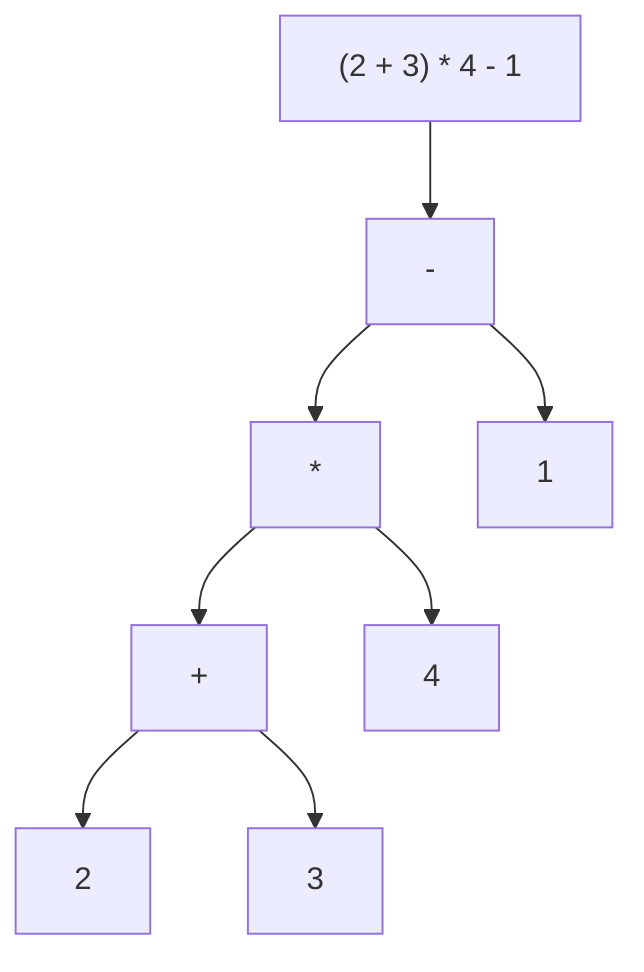
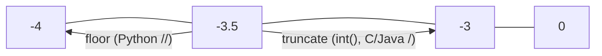
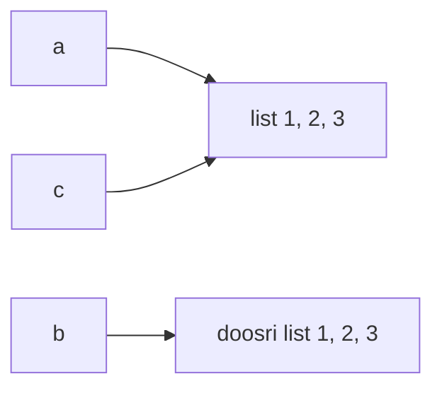

# Chapter 03 · Operators & Expressions

> Operators programming language ke verbs (kriya) hain: jodo, compare karo, milao, test karo. Inmein se zyaadatar bilkul school wale maths jaisa behave karte hain, aur wahi toh trap hai. Kuch gine-chune (`//`, negatives ke saath `%`, `and`/`or` ka ajeeb values return karna, `is` vs `==`) aise behave karte hain jo experienced developers ko bhi chaunka dete hain, aur interviewers ko bilkul yahi poochna pasand hai.

**Is chapter mein tum seekhoge:**
- Saare arithmetic operators, including `/`, `//` aur `%` ka farak, aur **negative numbers** ke saath kya hota hai
- `**`, `divmod()`, `abs()`, `pow()` aur `+=` jaisa augmented assignment
- Comparison operators aur Python ke pyaare **chained comparisons** (`0 < x < 10`)
- `and`, `or`, `not`, **short-circuiting**, aur `0 or "default"` `"default"` kyun return karta hai
- **Identity** (`is`) vs **equality** (`==`), aur **membership** (`in`)
- **Bitwise** operators ki pehli jhalak (`&`, `|`, `^`, `~`, `<<`, `>>`)
- **Precedence** table, taaki tumhe hamesha pata ho ki pehle kya calculate hoga
- **Walrus operator** `:=` aur digit nikaalne wale tricks jo DSA problems mein lagaatar use hote hain

**Isse pehle padho:** [Chapter 01 · Getting Started](01-getting-started.md) · [Chapter 02 · Variables, Data Types & Memory](02-variables-types-memory.md)

---

## 🧠 The Big Idea · Asli Baat

**Expression** koi bhi aisi cheez hai jise Python **evaluate** karke ek value bana sake. `2 + 3` ek expression hai (value: 5). `age >= 18` bhi hai (value: `True` ya `False`), aur akela `42` bhi.

Expression ko ek chhoti si machine samjho jo **operands** (values) aur **operators** (actions) se bani hai:



Python is tree ko **neeche se upar** evaluate karta hai: `2 + 3 = 5`, phir `5 * 4 = 20`, phir `20 - 1 = 19`. Jab brackets nahi hote, toh **precedence rules** decide karte hain ki tree kaise banega, bilkul school ke "BODMAS" (ya "PEMDAS") jaisa.

> 🇮🇳 **Desi Analogy:** Expression tree ko ek **cricket tournament ka bracket** socho. Neeche ke matches pehle khele jaate hain (`2 + 3`), unka winner (5) agle round mein jaata hai (`5 * 4`), aur aakhir mein final (`20 - 1`) se champion (19) nikalta hai. Final tab tak nahi ho sakta jab tak semi-final ka result na aa jaaye. Brackets aur precedence bas ye decide karte hain ki kaun kis round mein khelega.

Operators ki saat families hain. Families seekh lo, sab seekh gaye:

| Family | Operators | Kya deta hai |
|---|---|---|
| Arithmetic | `+ - * / // % **` | numbers |
| Assignment | `= += -= *= /= //= %= **=` aur `:=` | naam baandhta hai |
| Comparison | `== != < > <= >=` | `True` / `False` |
| Logical | `and or not` | operands mein se ek / bool |
| Identity | `is`, `is not` | `True` / `False` |
| Membership | `in`, `not in` | `True` / `False` |
| Bitwise | `& \| ^ ~ << >>` | integers |

> 💡 **The core insight:** har expression aakhir mein ek value ban jaata hai, aur Python use ek strictly defined order mein calculate karta hai. Agar tum tree bana sakte ho, toh tum koi bhi output predict kar sakte ho.

---

## 🔨 Building It Up · Zero Se Shuru

### 1. The basic arithmetic operators

```python
a, b = 17, 5
print(a + b)    # jodna (addition)
print(a - b)    # ghatana (subtraction)
print(a * b)    # guna (multiplication)
print(a / b)    # true division: hamesha float
print(a // b)   # floor division: NEECHE ki taraf poore number pe round karta hai
print(a % b)    # modulo: remainder (bacha hua)
print(a ** 2)   # exponent: 17 ka square
```

```text
22
12
85
3.4
3
2
289
```

Abhi kya hua: pehle teen toh school wala maths hai. Interesting hain **division ke teen kism**:

- `/` exact answer float mein deta hai: `17 / 5 = 3.4`.
- `//` batata hai "17 mein 5 poore kitni baar aata hai?" → `3`.
- `%` batata hai "kitna bacha?" → `17 - 3*5 = 2`.

17 laddoo 5 doston mein baanto: har ek ko `17 // 5 = 3` milte hain, aur `17 % 5 = 2` tumhare liye bach jaate hain.

> 🇮🇳 **Desi Analogy:** Railway coach mein ek compartment mein 5 seats hain aur 17 passengers hain. `17 // 5 = 3` poore bhare compartments, `17 % 5 = 2` log jo chauthe compartment mein akele baithe hain, aur `17 / 5 = 3.4` woh "kagzi" answer jo bolta hai 3.4 compartments chahiye (jo practically koi nahi bolta). Isliye DSA mein `//` aur `%` hi sabse zyada kaam aate hain: duniya mein cheezein poore pieces mein hoti hain.

Ye teeno hamesha is identity se jude rehte hain, jo yaad karne layak hai:

```text
a == (a // b) * b + (a % b)
```

(Matlab: poore groups × group ka size + jo bacha = total. 3 × 5 + 2 = 17.)

### 2. Mixing ints and floats

Agar **koi bhi ek** operand float hai, toh result float hoga. `/` hamesha float deta hai, un ints ke liye bhi jo poore divide ho jaate hain.

```python
print(3 + 4.0, 10 / 2, 10 // 2, 10.0 // 3, 7 % 2.5)
print(type(10 // 2), type(10.0 // 2))
```

```text
7.0 5.0 5 3.0 2.0
<class 'int'> <class 'float'>
```

Abhi kya hua: `10 // 2` `int` hi rehta hai (dono operands ints hain), lekin `10.0 // 3` `3.0` hai, ek float. `%` floats pe bhi kaam karta hai (`7 % 2.5`: 2.5 do baar = 5.0, bacha 2.0).

### 3. Floor division and modulo with negative numbers

Python operators ke baare mein ye sabse zyada poocha jaane wala "trick" hai. `//` **negative infinity ki taraf neeche** round karta hai (isliye iska naam *floor* hai), zero ki taraf nahi.

```python
print(7 // 2, -7 // 2)
print(7 % 2, -7 % 2)
print(7 % -2, -7 % -2)
print(int(-7 / 2))      # comparison ke liye: zero ki taraf truncation
```

```text
3 -4
1 1
-1 -1
-3
```

Abhi kya hua:

- `-7 / 2` hai `-3.5`. `-3.5` ka floor `-4` hai (number line pe neeche), `-3` nahi.
- Phir `%` ko `a == (a // b) * b + a % b` satisfy karna hi hai: `-7 == (-4)*2 + r`, toh `r = 1`.
- **Rule:** Python mein `%` ke result ka sign hamesha **divisor (right wala number) jaisa** hota hai. Toh jab divisor positive ho, `x % 5` hamesha `0..4` mein hi rahega, negative `x` ke liye bhi.



> 🇮🇳 **Desi Analogy:** "Floor" ko building ki **lift** socho jo sirf neeche wale floor pe rukti hai. Tum 3.5 floor pe ho (jo exist nahi karta)? Lift tumhe 3 pe utaaregi, neeche. Ab basement mein socho: tum -3.5 pe ho. "Neeche" wala floor -4 hai (B4), -3 nahi, kyunki -3 toh upar hai! Python ka `//` hamesha neeche jaata hai. C/Java ka truncate wala bhaiya hamesha **ground floor (zero) ki taraf** jaata hai: 3.5 se 3, aur -3.5 se -3.

| Expression | Python | C / Java |
|---|---|---|
| `-7 // 2` (ya C mein `-7 / 2`) | `-4` (floor) | `-3` (truncate) |
| `-7 % 2` | `1` | `-1` |

Python ka ye choice accha kyun hai? Kyunki "ghoom ke wapas aana" (wrap around) wala maths bas chal jaata hai. 12-hour clock pe 1 baje se 3 ghante peeche jaana hai: `(1 - 3) % 12` deta hai `10`. Koi negative surprise nahi. DSA mein circular arrays mein ye lagaatar use hota hai.

```python
hour = 1
print((hour - 3) % 12)        # 1 baje se 3 ghante pehle
index, n = 0, 5
print((index - 1) % n)        # size 5 ke circular array mein pichla index
```

```text
10
4
```

> 🤔 **Mann mein sawaal:** `-7 // 2` ka answer `-4`? Mere dimaag mein toh `-3` aata hai, kyunki 7 // 2 = 3, toh -7 // 2 = -3 hona chahiye na?
>
> **Jawab:** Wahi toh trap hai: tum "pehle sign hatao, divide karo, phir sign lagao" soch rahe ho. Ye truncation hai (C/Java wala). Python ka rule alag hai: "exact answer nikaalo (`-3.5`), phir number line pe **neeche** jao". `-3.5` ke neeche `-4` hai. Check karne ka pakka tareeka identity hai: `(-4) * 2 + 1 = -7` ✅. Aur agar `-3` hota, toh remainder `-1` aata, jo Python ke "remainder ka sign divisor jaisa" rule ko todta.

### 4. Exponents: `**`, pow() and roots

```python
print(2 ** 10)          # 1024
print(2 ** -1)          # negative power -> float
print(9 ** 0.5)         # fractional power -> square root
print(27 ** (1 / 3))    # cube root (float, thoda inexact)
print(pow(2, 10))       # 2 ** 10 jaisa hi
print(pow(2, 10, 1000)) # (2 ** 10) % 1000, lekin efficiently calculate hota hai
print(2 ** 3 ** 2)      # right-to-left: 2 ** (3 ** 2) = 2 ** 9
print(-2 ** 2)          # ** unary minus se zyada tight bandhta hai: -(2 ** 2)
print((-2) ** 2)
```

```text
1024
0.5
3.0
3.0
1024
24
512
-4
4
```

Abhi kya hua:

- `**` **right-associative** hai: `2 ** 3 ** 2` ka matlab `2 ** (3 ** 2) = 2 ** 9 = 512`, `(2 ** 3) ** 2 = 64` nahi. Maths mein powers ke towers bhi aise hi kaam karte hain (upar se neeche).
- `-2 ** 2` `-4` hai, kyunki `**` unary minus se pehle hota hai. Agar matlab "minus do ka square" hai toh `(-2) ** 2` likho.
- `pow(base, exp, mod)` `base ** exp % mod` calculate karta hai, **bina** pehle woh giant number banaye. Jo problems bolti hain "answer modulo 10^9 + 7 return karo", unme ye zaroori hai.

> 🤔 **Mann mein sawaal:** `27 ** (1 / 3)` ka answer `3.0` aaya, toh "thoda inexact" kyun likha hai?
>
> **Jawab:** Kyunki `1 / 3` khud ek float hai jo exactly ek-tihaai nahi hai (`0.333...` kahin pe katta hai, Chapter 02 yaad karo). Kuch numbers ke liye result `3.0` dikh jaata hai, lekin `64 ** (1 / 3)` try karo: `3.9999999999999996` aata hai, `4.0` nahi. Isliye cube roots ko kabhi `==` se compare mat karna.

### 5. divmod() and abs()

`divmod(a, b)` quotient aur remainder dono ek saath, ek jodi ki tarah return karta hai:

```python
q, r = divmod(17, 5)
print(q, r)
print(divmod(-17, 5))
minutes, seconds = divmod(200, 60)
print(minutes, "min", seconds, "sec")
print(abs(-42), abs(3.5), abs(0))
```

```text
3 2
(-4, 3)
3 min 20 sec
42 3.5 0
```

Abhi kya hua: `divmod(a, b)` bilkul `(a // b, a % b)` hai, toh section 3 ke negative wale rules yahan bhi lagte hain (`-17 / 5 = -3.4`, floor `-4`, aur `-4 * 5 + 3 = -17`). Units convert karne ka ye sabse saaf tareeka hai (seconds se minutes, paise se rupaye, ek index se row aur column). `abs()` bas sign hata deta hai: number line pe zero se doori.

### 6. Augmented assignment: +=, -=, and friends

`x = x + 1` likhna itna common hai ki Python ne iska shortcut bana diya:

```python
score = 10
score += 5     # score = score + 5
score -= 3     # score = score - 3
score *= 2     # score = score * 2
score //= 4    # score = score // 4
score **= 2    # score = score ** 2
score %= 7     # score = score % 7
print(score)

greeting = "Hi"
greeting += "!"   # strings ke liye bhi chalta hai
print(greeting)
```

```text
1
Hi!
```

Trace karo: 10 → 15 → 12 → 24 → 6 → 36 → `36 % 7 = 1`.

> ⚠️ Python mein **`++` ya `--` nahi hai**. `x++` ek `SyntaxError` hai, aur `++x` legal hai lekin uska matlab bas `+(+x)` hai, jo kuch nahi karta. `x += 1` use karo.

Immutable objects (numbers, strings) ke liye `x += 1` ek naya object banata hai aur tag shift karta hai, bilkul `x = x + 1` ki tarah. Lists jaise **mutable** objects ke liye `+=` object ko **in place** badalta hai, aur ye tab matter karta hai jab do names use share kar rahe hon:

```python
a = [1, 2]
b = a
a += [3]        # in place: b ko dikhta hai
print(b)

c = [1, 2]
d = c
c = c + [3]     # NAYI list banata hai, sirf c ko shift karta hai
print(d)
```

```text
[1, 2, 3]
[1, 2]
```

(Lists poori tarah: [Chapter 07](07-lists.md).)

> 🇮🇳 **Desi Analogy:** Do bhai ek hi **kirana khata** (list) share karte hain. `a += [3]` matlab usi khate mein nayi entry likh di: doosre bhai ko bhi dikhegi. `c = c + [3]` matlab purane khate ki photocopy karwa ke usme entry jodi aur woh nayi copy apne paas rakh li: doosre bhai ka khata purana hi raha.

### 7. Comparison operators

Comparisons ek sawaal poochte hain aur `bool` mein jawab dete hain:

```python
x = 7
print(x == 7, x != 7)
print(x < 10, x > 10, x <= 7, x >= 8)
print("apple" < "banana", "Zebra" < "apple")   # strings alphabetically compare hoti hain, code ke hisaab se
print(1 == 1.0, True == 1)
```

```text
True False
True False True False
True True
True True
```

Abhi kya hua: strings character-by-character unke Unicode code numbers se compare hoti hain, aur saare uppercase letters saare lowercase letters se **pehle** aate hain (`"Z"` 90 hai, `"a"` 97). Isliye `"Zebra" < "apple"`. Details [Chapter 04](04-strings.md) mein. Aur `1 == 1.0` `True` hai: numbers types ke paar bhi value se compare hote hain.

Python 3 mein incompatible types ko `<` se compare karna error hai:

```py
print(5 < "5")   # ❌ TypeError: '<' not supported between instances of 'int' and 'str'
print(5 == "5")  # ✅ False (alag types ke beech == allowed hai, bas False aata hai)
```

(Logic simple hai: "kya 5 aur '5' ek hi cheez hain?" ka jawab diya ja sakta hai, nahi. Lekin "kya 5 '5' se chhota hai?" ka koi matlab hi nahi, jaise "kya 5 kilo aloo 'Monday' se chhota hai?")

### 8. Chained comparisons

Maths mein tum likhte ho `0 < x < 10`. Zyaadatar languages tumse `0 < x && x < 10` likhwati hain. Python tumhe seedha maths wala version likhne deta hai:

```python
x = 7
print(0 < x < 10)
print(1 <= x <= 5)
a = b = c = 3
print(a == b == c)
print(1 < 3 > 2)    # legal hai lekin confusing: matlab 1 < 3 and 3 > 2
```

```text
True
False
True
True
```

Abhi kya hua: `a < b < c` ka matlab `a < b and b < c` hai, bas `b` **sirf ek baar** evaluate hota hai. Koi bhi comparison operators chain ho sakte hain, lekin padhne layak rakho: `low <= x < high` badhiya hai; `1 < 3 > 2` code nahi, paheli hai.

> 🇮🇳 **Desi Analogy:** Ride pe "height 120 cm se zyada aur 190 cm se kam" wala board socho. Guard dimaag mein ek hi baar tumhari height naapta hai aur dono limits se milata hai: `120 < height < 190`. Python bhi yahi karta hai: beech wali value ek baar nikaali, dono taraf check.

### 9. Logical operators: and, or, not

Ye conditions ko jodte hain:

| `A` | `B` | `A and B` | `A or B` | `not A` |
|---|---|---|---|---|
| True | True | True | True | False |
| True | False | False | True | False |
| False | True | False | True | True |
| False | False | False | False | True |

- `and`: True sirf tab jab **dono** true hon. ("Main jaaunga agar dhoop hai **aur** main free hoon.")
- `or`: True agar **kam se kam ek** true ho.
- `not`: ulta kar deta hai.

```python
age, has_ticket = 20, True
print(age >= 18 and has_ticket)
print(age < 12 or age > 60)
print(not has_ticket)
print(not age >= 18)            # not poore comparison pe lagta hai
```

```text
True
False
False
False
```

### 10. Short-circuiting: Python stops as soon as it knows

Python smart tareeke se aalsi hai:

- `A and B`: agar `A` false hai, toh poora result false hi hoga, isliye **B kabhi evaluate nahi hota**.
- `A or B`: agar `A` true hai, toh poora result true hi hoga, isliye **B kabhi evaluate nahi hota**.

Ise **short-circuit evaluation** kehte hain, aur isse tum safe checks likh sakte ho:

```python
count = 0
total = 50
print(count != 0 and total / count > 10)   # koi ZeroDivisionError nahi!
print(True or 1 / 0)                       # 1 / 0 kabhi chalta hi nahi
```

```text
False
True
```

Abhi kya hua: pehli line mein `count != 0` `False` hai, toh Python `total / count` kabhi calculate hi nahi karta. Order ulta karte toh crash ho jaata. **Sasta ya bachaane wala check pehle rakho.**

> 🇮🇳 **Desi Analogy:** IRCTC Tatkal booking socho. Condition hai: "seat available hai **aur** payment successful hua". Agar seat hi nahi hai (pehli condition False), toh IRCTC tumse payment karwata hi nahi, seedha "Not Available" bol deta hai. Payment wala step (doosra operand) kabhi chala hi nahi. `or` ke liye: "Aadhaar dikhao **ya** PAN dikhao". Aadhaar dikha diya (True)? Guard PAN maangega hi nahi.

### 11. The secret: and/or return one of their operands

Ab woh cheez jo zyaadatar logon ko chaunkati hai. `and` aur `or` zaroori nahi ki `True` ya `False` return karein. Ye **operands mein se ek** return karte hain, woh wala jisne answer decide kiya.

- `A or B` → agar `A` truthy hai toh `A` return karta hai, warna `B`.
- `A and B` → agar `A` falsy hai toh `A` return karta hai, warna `B`.

("Truthy" matlab `bool(value)` `True` hai; falsy values hain `0`, `0.0`, `""`, `None`, `False` aur khaali collections. [Chapter 02](02-variables-types-memory.md#9-casting-converting-between-types) dekho.)

```python
print(0 or "default")
print("Riya" or "default")
print("" or None or "last")
print(5 and 10)
print(0 and 10)
print(None and print("never runs"))
print(not "hello", not "")
```

```text
default
Riya
last
10
0
None
False True
```

Abhi kya hua: `0 or "default"`: 0 falsy hai, toh `or` doosra operand return karta hai. `5 and 10`: 5 truthy hai, toh `and` ko doosre ko dekhna hi padta hai aur woh `10` return karta hai. `not`, baaki dono ke ulat, hamesha asli `bool` return karta hai.

> 🤔 **Mann mein sawaal:** `5 and 10` ka answer `10` kyun? `True` kyun nahi? Dono toh truthy hain.
>
> **Jawab:** `and` ka kaam hai "pehla falsy dhoondho". Woh left se chalta hai: `5` truthy hai, aage badho. `10` pe pahunche, ye aakhri hai, toh jo bhi hai wahi final answer: `10`. Ab socho, `10` truthy hai, toh `if 5 and 10:` waise hi chalega jaise `if True:` chalta. Python ko alag se `True` banane ki zaroorat hi nahi padti. Rule yaad rakho: **`or` pehla truthy dhoondhta hai, `and` pehla falsy; kuch na mile toh aakhri wala return.**

Isse sabse kaam ka idiom hai **default value**:

```python
nickname = ""
display_name = nickname or "Guest"
print("Welcome,", display_name)
```

```text
Welcome, Guest
```

> ⚠️ Dhyaan do: `x or default` **har** falsy value ko replace kar deta hai, ek bilkul valid `0` ko bhi. Agar `0` legal value hai, toh `x is None` test karo (ye tum `if` ya ternary operator se [Chapter 05](05-conditionals.md) mein likhoge).

### 12. Identity (`is`) vs equality (`==`)

Ye idea tum [Chapter 02](02-variables-types-memory.md) mein mil chuke ho. Ab ise pakka karte hain:

- `==` poochta hai: **kya inki value same hai?** (Kya ye do cakes swaad aur shakal mein ek jaise hain?)
- `is` poochta hai: **kya ye bilkul ek hi object hain?** (Kya ye *wahi ek cake* hai?)

```python
a = [1, 2, 3]
b = [1, 2, 3]
c = a
print(a == b, a is b)    # same value, alag objects
print(a == c, a is c)    # same object
x = None
print(x is None, x is not None)
```

```text
True False
True True
True False
```



> 🇮🇳 **Desi Analogy:** Do judwa bhai, Ram aur Shyam: shakal, kapde, sab same (`==` True). Lekin "kya Ram hi Shyam hai?" Nahi, do alag insaan, do alag Aadhaar numbers (`is` False). Aur "Ram" ko ghar pe "Pappu" bulate hain: Ram aur Pappu ek hi banda hai (`is` True), ek hi Aadhaar. `is` Aadhaar number match karta hai, `==` shakal.

Rule: **`is` sirf `None` ke liye use karo** (aur rare cases mein `True`/`False` ke liye). Baaki sab ke liye `==`. Spelling `is not` pe dhyaan do, jo natural padhti hai: `x is not None`.

### 13. Membership: in and not in

`in` poochta hai "kya ye uske andar hai?". Ye strings, lists aur har doosre collection pe kaam karta hai.

```python
print("a" in "banana")
print("nan" in "banana")       # substring check
print("x" not in "banana")
print(3 in [1, 2, 3])
print("Riya" in ["Arjun", "Meera"])
```

```text
True
True
True
True
False
```

Abhi kya hua: strings ke liye `in` ek **substring** check karta hai, sirf ek character nahi. Lists ke liye har element ko `==` se check karta hai. `in` kitna fast hai? Strings aur lists ke liye woh ek-ek karke scan karta hai, **O(n)**. Sets aur dictionaries ke liye average mein **O(1)** hai, hashing ki wajah se ([Chapter 09](09-dictionaries.md)). Ye farak ek classic interview optimisation hai.

> 🇮🇳 **Desi Analogy:** List pe `in` = shaadi ki guest list mein naam dhoondhna, upar se neeche ek-ek naam padh ke (O(n): 1000 guests, 1000 tak check). Set pe `in` = Aadhaar number se seedha record kholna, list padhni hi nahi padti (O(1)). Interview mein "list ko set mein badal do" wala optimisation isi wajah se itna famous hai.

### 14. Bitwise operators: a first look

Computers integers ko **binary** (base 2) mein store karte hain: `5` hai `101`, `3` hai `011`. Bitwise operators seedha in bits pe kaam karte hain, column by column.

| Operator | Naam | Har bit ka rule | `5 op 3` |
|---|---|---|---|
| `&` | AND | 1 agar dono 1 hon | `101 & 011 = 001` → `1` |
| `\|` | OR | 1 agar koi bhi 1 ho | `101 \| 011 = 111` → `7` |
| `^` | XOR | 1 agar dono alag hon | `101 ^ 011 = 110` → `6` |
| `~` | NOT | saare bits ulat do | `~5` → `-6` |
| `<<` | left shift | bits ko left khiskao | `5 << 1 = 1010` → `10` |
| `>>` | right shift | bits ko right khiskao | `5 >> 1 = 10` → `2` |

```python
print(5 & 3, 5 | 3, 5 ^ 3, ~5)
print(5 << 1, 5 << 3, 40 >> 2)
print(bin(5), bin(10), bin(-6))
print(7 & 1, 8 & 1)     # last bit: 1 matlab odd, 0 matlab even
```

```text
1 7 6 -6
10 40 10
0b101 0b1010 -0b110
1 0
```

Abhi kya hua:

- `x << k` `2^k` se multiply karta hai; `x >> k` `2^k` se floor-divide karta hai. (Decimal mein bhi yahi hota hai: `45` ke peeche ek zero lagao toh `450`, 10 guna. Binary mein ek zero lagana = 2 guna.)
- `~x` hamesha `-x - 1` hota hai (negative numbers jis tarah store hote hain, jise **two's complement** kehte hain, uski wajah se).
- `x & 1` batata hai ki `x` odd hai ya nahi. `bin()` binary text dikhata hai.

> 🇮🇳 **Desi Analogy:** Bits ko ghar ke switchboard ke switches socho, har switch ON (1) ya OFF (0). `&` = "dono boards pe jo switch ON hai, sirf wahi ON rakho". `|` = "kisi bhi board pe ON hai toh ON". `^` = "jahan dono boards alag hain, wahan ON". Aur `<<` = saare switches ek jagah left khiska do aur right mein ek naya OFF switch jod do.

Ye exotic dikhte hain, lekin kuch sabse slick interview tricks inhi pe chalti hain (XOR se akela non-duplicate number dhoondhna, `n & (n - 1)` se power of two check karna, bitmasks se saare subsets banana). Poora toolkit [DSA Chapter 23 · Bit Manipulation & Math](../part-2-dsa/23-bits-math.md) mein hai.

> ⚠️ `&` ko `and` se, ya `|` ko `or` se confuse mat karna. `and`/`or` logical hain aur short-circuit karte hain; `&`/`|` bitwise hain aur hamesha dono sides evaluate karte hain. `True & False` sanyog se chal jaata hai (`False` deta hai), lekin `5 and 3` `3` hai jabki `5 & 3` `1` hai.

### 15. Operator precedence: who goes first?

Jab brackets nahi hote, Python ye order use karta hai, **sabse upar se sabse neeche**:

| Priority | Operators | Notes |
|---|---|---|
| 1 (sabse upar) | `( )` | brackets hamesha jeette hain |
| 2 | `**` | right-to-left |
| 3 | `+x`, `-x`, `~x` | unary |
| 4 | `*`, `/`, `//`, `%` | left-to-right |
| 5 | `+`, `-` | left-to-right |
| 6 | `<<`, `>>` | shifts |
| 7 | `&` | bitwise AND |
| 8 | `^` | bitwise XOR |
| 9 | `\|` | bitwise OR |
| 10 | `==`, `!=`, `<`, `>`, `<=`, `>=`, `is`, `is not`, `in`, `not in` | chain ho sakte hain |
| 11 | `not` | |
| 12 | `and` | |
| 13 | `or` | |
| 14 | `x if c else y` | conditional expression ([Chapter 05](05-conditionals.md)) |
| 15 | `lambda` | ([Chapter 11](11-comprehensions-functional.md)) |
| 16 (sabse neeche) | `:=` | walrus |

```python
print(2 + 3 * 4)          # + se pehle *
print((2 + 3) * 4)
print(10 - 4 - 3)         # left to right: (10 - 4) - 3
print(2 * 3 ** 2)         # pehle **: 2 * 9
print(not True or True)   # (not True) or True
print(not (True or True))
print(1 + 2 == 3 and 4 > 5 or 6 < 7)
```

```text
14
20
3
18
True
False
True
```

Last wale ko trace karo: pehle arithmetic (`3 == 3`), phir comparisons (`True and False or True`), phir `and` (`False or True`), phir `or` → `True`.

> 💡 **Poori table ratne ki zaroorat nahi.** Yaad rakho "**PEMDAS, phir comparisons, phir not, and, or**", aur jahan bhi padhne wala atak sakta hai wahan brackets laga do. Brackets ka koi kharcha nahi, aur bugs bachte hain.

> 🇮🇳 **Desi Analogy:** Precedence ko shaadi ke buffet ki queue samjho. Sabse pehle VIPs (brackets), phir dulha-dulhan ki family (`**`), phir baaki rishtedaar (`*`, `/`), phir dost (`+`, `-`), aur sabse aakhir mein "aur haan, khaana khatam toh nahi hua?" wale (`and`, `or`). Jab confusion ho ki kaun pehle, toh tum khud kisi ko VIP pass (brackets) de do, jhagda khatam.

Ek chalaak trap jahan precedence kaat leti hai: Python mein bitwise operators comparisons se **zyada tight** bandhte hain. (C aur Java mein ulta hai, isliye log galat aadat saath le aate hain.)

```python
x, y = 5, 3
print(x & 1 == 1)          # theek: (x & 1) == 1, kyunki & pehle chalta hai
print(x > 1 & y < 2)       # surprise! parse hota hai x > (1 & y) < 2
print((x > 1) & (y < 2))   # jo tumhara matlab tha: True & False
```

```text
True
True
False
```

Beech wali line chained comparison `5 > 1 < 2` ban gayi, jo `True` hai. Seekh: jab `&`/`|` ko comparisons ke saath mix karo, har comparison pe bracket lagao.

### 16. The walrus operator `:=`

Python 3.8 mein aaya, `:=` (side se dekho toh walrus ki aankhein aur daant jaisa dikhta hai) **ek value assign karta hai aur usi expression mein use return bhi karta hai**. Normal `=` ek statement hai aur expression ke andar use nahi ho sakta; `:=` ho sakta hai.

```python
print(n := 10)          # n ko 10 assign karta hai AUR 10 print ko deta hai
print(n * 2)
total = (a := 3) + (b := 4)
print(a, b, total)
```

```text
10
20
3 4 7
```

Iski asli taakat `if` aur `while` ke saath dikhti hai ([Chapter 05](05-conditionals.md), [Chapter 06](06-loops.md)), jahan ye kisi cheez ko do baar calculate karne se bachata hai:

```py
# Bina walrus: len do baar calculate karo, ya ek extra line likho
if len(password) < 8:
    print("Too short:", len(password), "characters")

# Walrus ke saath: ek baar calculate karo, do baar use karo
if (length := len(password)) < 8:
    print("Too short:", length, "characters")

# Classic: jab tak user "quit" type na kare, input padhte raho
while (command := input("> ")) != "quit":
    print("You typed", command)
```

Rules: `(name := value)` ke aas-paas brackets aksar zaroori hote hain, aur `:=` ko plain statement ki tarah use nahi kar sakte (`n := 5` akela line pe `SyntaxError` hai; wahan bas `=` use karo). Ise tab use karo jab code **zyada saaf** bane, dikhawe ke liye nahi.

> 🇮🇳 **Desi Analogy:** Chai tapri pe tum bolte ho "ek cutting dena, aur haan, mera khata mein likh lo". Ek hi baat mein do kaam: chai bhi mil gayi (value use hui) aur khata mein entry bhi ho gayi (naam ko assign hua). `=` sirf khata mein likhta hai; `:=` likhta bhi hai aur chai bhi pakda deta hai.

### 17. Digit-extraction tricks: `% 10` and `// 10`

Yahan operators DSA se milte hain. Base 10 mein:

- `n % 10` **last digit** deta hai.
- `n // 10` last digit **hata** deta hai.
- `n % 100` last do digits deta hai; `n // 100` unhe hata deta hai.
- `n % 2` even ke liye 0 aur odd ke liye 1 hai.

```python
n = 4729
print(n % 10)          # last digit
print(n // 10)         # last digit hatao
print(n // 10 % 10)    # second-last digit
print(n // 1000)       # 4-digit number ka pehla digit
print(n % 1000)        # pehla digit hatao
```

```text
9
472
2
4
729
```

> 🇮🇳 **Desi Analogy:** `4729` ko ek line mein lage pyaaz ke chhilke socho. `% 10` = bahar wala chhilka dekho (9). `// 10` = woh chhilka utaar ke phenk do (472 bacha). Ab phir `% 10` = naya bahar wala chhilka (2). Yahi "dekho, utaaro, dekho, utaaro" loop har digit problem ki jaan hai.

Chalo ek 3-digit number ko sirf arithmetic se (bina strings ke) reverse karte hain:

```python
n = 527
ones = n % 10            # 7
tens = n // 10 % 10      # 2
hundreds = n // 100      # 5
reversed_n = ones * 100 + tens * 10 + hundreds
digit_sum = ones + tens + hundreds
print(reversed_n, digit_sum)
```

```text
725 14
```

Abhi kya hua: humne `% 10` aur `// 10` se right side se digits chheele, phir place values (sau, das, ek) se number ulta bana diya. [Chapter 06](06-loops.md) mein ek loop "last digit chheelo" ko **kisi bhi** length ke numbers ke liye repeat karega. Ye peel-and-rebuild pattern Reverse Integer, Palindrome Number, Happy Number, Add Digits, Armstrong numbers aur bahut saari problems ke peeche hai.

Yahi trick kisi bhi base mein chalti hai: `n % 2` aur `n // 2` binary digits chheelte hain; `n % 16` aur `n // 16` hex digits.

---

## 🔬 Under the Hood · Andar Ki Kahani

### Operators are method calls

Jab tum `a + b` likhte ho, Python asal mein `a` pe ek special method call karta hai: `a.__add__(b)`. Har operator inme se kisi ek "dunder" (double underscore) method se juda hai.

```python
print((3).__add__(4))
print("ab".__mul__(3))
print((10).__floordiv__(3), (10).__mod__(3))
```

```text
7
ababab
3 1
```

| Operator | Method | Operator | Method |
|---|---|---|---|
| `+` | `__add__` | `==` | `__eq__` |
| `-` | `__sub__` | `<` | `__lt__` |
| `*` | `__mul__` | `in` | `__contains__` (right operand pe) |
| `/` | `__truediv__` | `&` | `__and__` |
| `//` | `__floordiv__` | `+=` | `__iadd__` (na ho toh `__add__` pe wapas aata hai) |
| `%` | `__mod__` | `**` | `__pow__` |

Isliye `+` numbers ko jodta hai lekin strings ko chipkaata hai: har type apna khud ka `__add__` define karta hai. Agar `a.__add__(b)` ko `b` handle karna nahi aata, toh `TypeError` raise karne se pehle Python `b.__radd__(a)` (ulta, "reflected" version) try karta hai. Apni classes ke liye ye methods tum [Chapter 15](15-oop-inheritance-magic.md) mein likhoge.

> 🇮🇳 **Desi Analogy:** `+` ek hi shabd hai, lekin har "type" usse apne tareeke se samajhta hai, jaise "set karo" shabd: tailor ke liye matlab kapda fit karna, nai ke liye baal, mechanic ke liye engine. Python bas object se poochta hai "bhai, tumhare liye `+` ka matlab kya hai?" (yaani `__add__` call karta hai), aur object apna kaam karta hai. Number jodta hai, string chipkaati hai.

Aur `is`? Use customise **nahi** kiya ja sakta. Woh seedha identities (memory addresses) compare karta hai. Isliye `is None` poori tarah bharosemand hai.

### Why += on a list is different

List ke liye `__iadd__` exist karta hai aur **in place mutate** karta hai (`.extend()` ki tarah), aur same object return karta hai. Int ya str ke liye koi `__iadd__` nahi hai, toh Python `__add__` pe wapas aata hai, jo naya object banata hai. Same syntax, alag behaviour, aur dono ko ek hi rule explain karta hai: *immutable objects modify nahi ho sakte, isliye unhe replace kiya jaata hai.*

### How short-circuiting compiles

`A and B` "dono calculate karo, phir jodo" mein compile nahi hota. Ye ek **jump** mein compile hota hai: `A` evaluate karo; agar falsy hai, toh `B` ke aage jump kar jao aur result ke roop mein `A` ko hi chhod do. Isliye `B` ko kabhi chhua nahi jaata, aur isliye result `bool` nahi balki ek operand hota hai. Ye jump instructions tum `dis` se dekh sakte ho ([Chapter 01](01-getting-started.md#what-happens-when-you-run-python-hellopy) se).

### Why Python's floor division is the "right" choice

Guido van Rossum (Python ke creator) ne floor division isliye chuna taaki ye identity hamesha sach rahe **aur** positive divisor ke saath `%` kabhi negative na ho:

```text
a == (a // b) * b + (a % b)      and      0 <= a % b < b   (when b > 0)
```

C ke truncation mein `-7 % 2` `-1` hai, toh valid circular index ke liye tumhe `((x % n) + n) % n` likhna padta. Python ye free mein deta hai. Agar Python mein C-style behaviour chahiye, toh `math.fmod(-7, 2)` use karo (`-1.0` deta hai) ya truncating division ke liye `int(a / b)` (bahut bade numbers aur floats ke saath dhyaan se).

### Big-int arithmetic cost

Chhote ints fast hote hain. Bahut bade ints ke liye `+` digits ki ginti d mein O(d) hai, aur `*` **Karatsuba** algorithm use karta hai, lagbhag O(d^1.58). Python mein interview answers aam taur pe ise ignore karte hain, lekin isi wajah se `pow(b, e, m)` (jo har step pe `% m` lagake numbers chhote rakhta hai) bade exponents ke liye `b ** e % m` se kai guna fast hai. Teen arguments wala `pow` **fast exponentiation** (repeated squaring) use karta hai, O(log e) multiplications, ek technique jo tum khud [DSA Chapter 23](../part-2-dsa/23-bits-math.md) mein implement karoge.

> 🤔 **Mann mein sawaal:** Repeated squaring se sirf log(e) multiplications kaise? 2^1000000 ke liye toh 1000000 baar multiply karna padega na?
>
> **Jawab:** Nahi, squaring se power double hoti jaati hai. `7` → `7²` → `7⁴` → `7⁸` → `7¹⁶`... sirf 20 squarings mein tum `7^(2^20)`, yaani 7 ki 10 lakh se upar ki power tak pahunch jaate ho. Phir exponent ke binary digits dekh ke inme se sahi wale multiply kar lo. Isliye ~20 squarings + ~20 multiplications ≈ 40 kaam, 10 lakh nahi. Aur har step pe `% m` lagane se numbers kabhi bade hi nahi hote.

---

## 🧩 Pattern Decoder · Pattern Pakdo

### Pythonic operator idioms

| Goal | Pythonic | Avoid |
|---|---|---|
| Range check | `0 <= i < n` | `i >= 0 and i < n` |
| Khaali/None jaisa ho toh default | `name = name or "Guest"` | multi-line checks (jab 0/"" valid na hon) |
| Safe division check | `count and total / count` | pehle divide karna |
| Even/odd | `n % 2 == 0` (ya `n & 1 == 0`) | `n / 2 == int(n / 2)` |
| Quotient + remainder | `q, r = divmod(a, b)` | do alag operations |
| Wrap-around index | `(i + 1) % n`, `(i - 1) % n` | manual "if i == n: i = 0" |
| Bada power mod m | `pow(b, e, m)` | `b ** e % m` |
| Positives ka ceiling division | `-(-a // b)` ya `(a + b - 1) // b` | `int(a / b) + 1` (exact divide hone pe galat) |
| None test | `x is None` | `x == None` |
| Increment | `x += 1` | `x++` (exist hi nahi karta) |

**Ceiling division** baar-baar aata hai: "23 items ke liye 10 items wale kitne pages?" → 3.

```python
items, per_page = 23, 10
print(-(-items // per_page), (items + per_page - 1) // per_page)
print(-(-20 // per_page))     # poora divide hota hai: phir bhi sahi
```

```text
3 3
2
```

> 🤔 **Mann mein sawaal:** `-(-a // b)` ye kya jaadu hai? Do minus kyun?
>
> **Jawab:** `//` hamesha **neeche** round karta hai, aur hume **upar** chahiye. Trick: number ko ulta (negative) karo, toh "neeche" ka matlab ban jaata hai "zero se door", jo absolute value mein upar hai. `-23 // 10` = floor(-2.3) = `-3`. Ab wapas minus lagao: `3`. Yaani ceiling(x) = −floor(−x). Doosra form `(a + b - 1) // b` aise kaam karta hai: agar thoda bhi remainder hai, toh `b - 1` jodne se woh agle poore number ko cross kar jaata hai; aur exact divide hone pe `b - 1` itna kam hai ki cross nahi karta.

### Signals: when operators ARE the algorithm

| Problem bolti hai... | Ye uthao |
|---|---|
| "digit", "reverse the number", "sum of digits", "palindrome number" | `% 10` aur `// 10` |
| "circular", "wrap around", "rotate", "clock" | `% n` |
| "answer modulo 10^9 + 7" | har `+` aur `*` ke baad `% MOD` lagao; `pow(b, e, MOD)` |
| "even/odd", "power of two", "appears once while others appear twice" | bitwise: `& 1`, `n & (n - 1)`, `^` |
| "convert seconds/minutes", "row and column from index" | `divmod` |
| "midpoint" | `lo + (hi - lo) // 2` ([Binary Search](../part-2-dsa/08-binary-search.md)) |

### How this shows up in DSA later

- **2D grid ↔ 1D index**: `R × C` grid mein cell `(r, c)` ka index `r * C + c` hai, aur index `i` wapas `r, c = divmod(i, C)` se milta hai. Matrices pe binary search mein use hota hai. (Cinema hall socho: har row mein C seats. Seat number 23 aur har row mein 10 seats? `divmod(23, 10) = (2, 3)`: row 2, seat 3, dono 0 se ginti.)
- **Modular arithmetic**: counting problems (DP paths, combinations) bolti hain "mod 10^9 + 7". Kyunki `(a + b) % m == ((a % m) + (b % m)) % m` (aur `*` ke liye bhi same), tum har step pe reduce karke numbers chhote rakh sakte ho.
- **XOR magic**: `x ^ x == 0` aur `x ^ 0 == x`, toh agar har value do baar aati hai siwaay ek ke, toh saare numbers ko XOR karne pe wahi akela bachta hai ("Single Number", [DSA Chapter 23](../part-2-dsa/23-bits-math.md)).
- **Short-circuit guards**: `while i < n and nums[i] == target:` is baat pe tika hai ki `i < n` pehle check ho, taaki `nums[i]` kabhi range se bahar na jaaye. Ye tum [Two Pointers](../part-2-dsa/03-two-pointers.md) mein dekhoge.

---

## ⚠️ Traps & Common Mistakes · Yahan Sab Phisalte Hain

1. **Sochna ki `//` truncate karta hai.** `-7 // 2` `-4` hai, `-3` nahi. Truncation chahiye toh `int(a / b)` use karo (normal size ke numbers ke liye theek hai).

2. **Sochna ki positive divisor ke saath `%` negative ho sakta hai.** Python mein `-7 % 3` `2` hai. C/Java mein `-1`. Languages ke beech code translate karte waqt ye matter karta hai.

3. **`-x ** 2` vs `(-x) ** 2`.**

```py
x = 3
print(-x ** 2)    # ❌ -9 : matlab -(x ** 2)
print((-x) ** 2)  # ✅ 9
```

4. **`==` ki jagah `=` likh dena.** Python mein `if x = 5:` ek `SyntaxError` hai, jo kam se kam tumhe bacha leta hai. Lekin `print(x = 5)` jaise expression mein tumhe unexpected keyword argument wala `TypeError` milta hai (Python sochta hai tum `print` ko `x` naam ka setting de rahe ho, jaise `sep=`).

5. **Value compare karne ke liye `is` use karna.**

```py
a = 1000
b = int("1000")
print(a is b)   # ❌ False: alag objects (implementation detail)
print(a == b)   # ✅ True
```

6. **`and`/`or` se booleans ki ummeed rakhna.** `"a" or "b"` `"a"` hai, aur `[] and 5` `[]` hai. Asli bool chahiye toh `bool()` mein wrap karo.

7. **Jab 0 valid ho tab `x or default`.** `quantity = user_quantity or 1` ek jaayaz 0 ko 1 bana deta hai. Explicit `is None` check use karo.

8. **`x == 1 or 2` likhna.** Ye `(x == 1) or 2` hai, jo hamesha truthy hai!

```py
x = 5
print(x == 1 or 2)       # ❌ 2 print karta hai (truthy) jabki x na 1 hai na 2
print(x == 1 or x == 2)  # ✅ False
print(x in (1, 2))       # ✅ sabse saaf: False
```

(Hindi mein hum bolte hain "agar x 1 ya 2 hai", toh dimaag `x == 1 or 2` likhwa deta hai. Python ke liye "2" akela ek poori condition hai, aur 2 truthy hai.)

9. **Bitwise vs comparison ki precedence.** `&` `<` se zyada tight bandhta hai, toh `a > 1 & b < 2` ka matlab hai `a > (1 & b) < 2`. Har comparison pe bracket lagao: `(a > 1) & (b < 2)`. (Ya logic ke liye bas `and` use karo.)

10. **`x++`**: exist nahi karta. `x += 1`.

11. **Arithmetic ke baad float equality.** `0.1 * 3 == 0.3` `False` hai. Tolerance ke saath compare karo ([Chapter 02](02-variables-types-memory.md)).

12. **Guard jo bahut der se chalta hai, aur zero se divide.** `total / count > 10 and count != 0` phir bhi crash hota hai; guard **pehle** aana chahiye: `count != 0 and total / count > 10`.

---

## 💡 Tips & Tricks · Pro Wale Moves

- `a == (a // b) * b + a % b` hamesha sach hai. Koi bhi `//`/`%` paheli double-check karne ke liye ise use karo.
- `n % 10` = last digit, `n // 10` = last digit hatao. Ise dimaag mein chhaap lo.
- `(i + 1) % n` circle mein aage badhata hai; `(i - 1) % n` peeche, safely, 0 se bhi.
- `divmod(total_seconds, 60)` → `(minutes, seconds)`. Ghanton ke liye ise nest karo.
- `x * 2 ** k` hai `x << k`; lekin jo zyada saaf ho wahi likho (aam taur pe `*`).
- `min(max(x, low), high)` `x` ko `[low, high]` ke andar clamp kar deta hai (bahar gaya toh kinaare pe rok deta hai).
- `bool(x)` ya `not not x` kisi bhi value ko asli boolean bana deta hai (`bool(x)` prefer karo).
- Precedence pe doubt ho toh brackets lagao. Padhne wale shukriya kahenge.
- REPL mein koi bhi expression turant check karo: "`-7 % 3` kya deta hai?" settle karne ka sabse fast tareeka.
- `10**9 + 7` ko `MOD = 10**9 + 7` (int) likho, `1e9 + 7` (float!) nahi.

---

## 🎯 Interview Questions · Interview Mein Yahi Poochenge

### 1. What's the difference between `/`, `//` and `%`? 🔥🔥🔥

<details><summary>Answer dekho 👀</summary>

- `/` **true division** hai aur hamesha `float` return karta hai: `7 / 2 == 3.5`, `6 / 2 == 3.0`.
- `//` **floor division** hai: result **neeche** (negative infinity ki taraf) round hota hai. Do ints ke saath int return karta hai: `7 // 2 == 3`, `-7 // 2 == -4`.
- `%` **modulo** hai, yaani remainder, aise define kiya gaya ki `a == (a // b) * b + a % b`. Iske result ka sign divisor jaisa hota hai: `-7 % 2 == 1`, `7 % -2 == -1`.

`divmod(a, b)` ek hi call mein `(a // b, a % b)` return karta hai.

> 🗣️ **Interview mein aise bolo:** "Slash is true division and always returns a float. Double slash is floor division: it rounds down toward negative infinity, so minus seven floor-divided by two is minus four. Percent is the remainder, defined so that a equals a floor-divided by b, times b, plus a mod b, which means the result always takes the sign of the divisor. divmod returns both at once."

</details>

### 2. What is the output of `-7 // 2` and `-7 % 2` in Python? How is it different from C or Java? 🔥🔥🔥

<details><summary>Answer dekho 👀</summary>

```python
print(-7 // 2, -7 % 2)
```

```text
-4 1
```

Python floor karta hai (`-3.5` → `-4`), isliye remainder `1` hai. C aur Java zero ki taraf truncate karte hain (`-3`), jisse remainder `-1` aata hai. Python ke choice ka matlab hai ki positive `n` ke liye `x % n` hamesha `[0, n)` mein hota hai, jo circular indexing ko safe banata hai.

> 🗣️ **Interview mein aise bolo:** "In Python, minus seven floor-divided by two is minus four and minus seven mod two is one, because Python floors toward negative infinity. C and Java truncate toward zero, giving minus three and minus one. Python's choice guarantees that x mod n is always between 0 and n minus 1 for a positive n, which makes wrap-around indexing safe without extra fixes."

</details>

### 3. What's the difference between `is` and `==`? 🔥🔥🔥

<details><summary>Answer dekho 👀</summary>

`==` **values** compare karta hai (`__eq__` call karta hai, jise types customise kar sakte hain). `is` **identity** compare karta hai: kya dono names memory mein bilkul ek hi object ko refer kar rahe hain (ise customise nahi kiya ja sakta).

```python
a = [1, 2]
b = [1, 2]
print(a == b, a is b)
```

```text
True False
```

`None` jaise singletons ke liye `is` use karo (`x is None`), aur baaki sab ke liye `==`. Small-int caching aur string interning ki wajah se kabhi-kabhi barabar values ke liye `is` kaam karta hua *dikh* sakta hai, lekin woh implementation detail hai aur bharosemand nahi.

> 🗣️ **Interview mein aise bolo:** "Double equals checks whether two objects have the same value, and a class can customise it through __eq__. 'is' checks identity, whether both names point to the exact same object, and it can't be overridden. So I use 'is' only for singletons like None, and double equals for everything else, because small-integer caching can make 'is' look like it works when it's really an implementation detail."

</details>

### 4. What do `and` and `or` return? Explain short-circuit evaluation. 🔥🔥🔥

<details><summary>Answer dekho 👀</summary>

Ye **apne operands mein se ek** return karte hain, zaroori nahi ki bool:

- `A or B`: agar `A` truthy hai toh `A` return karta hai, warna `B`.
- `A and B`: agar `A` falsy hai toh `A` return karta hai, warna `B`.

**Short-circuiting**: doosra operand sirf zaroorat padne pe evaluate hota hai. `False and f()` kabhi `f` call nahi karta; `True or f()` kabhi `f` call nahi karta.

```python
print([] or "empty", 3 and 0, "x" and "y", None or 0)
```

```text
empty 0 y 0
```

Uses: default values (`name or "Guest"`) aur guards (`n != 0 and total / n`). `not` hamesha bool return karta hai.

(Aakhri wala dekho: `None or 0` → `None` falsy hai, toh `or` doosra return karta hai, jo `0` hai, chahe woh bhi falsy ho. "Kuch truthy na mile toh aakhri wala.")

> 🗣️ **Interview mein aise bolo:** "'and' and 'or' return one of their operands, not necessarily a boolean. 'or' returns the first truthy operand, or the last one if none is truthy; 'and' returns the first falsy operand, or the last one if all are truthy. They short-circuit, so the right side is evaluated only when needed, which is why patterns like 'name or Guest' and 'n != 0 and total / n' are safe."

</details>

### 5. What is the result of `2 ** 3 ** 2`? And `-2 ** 2`? 🔥🔥

<details><summary>Answer dekho 👀</summary>

`2 ** 3 ** 2` `512` hai kyunki `**` **right-associative** hai: `2 ** (3 ** 2) = 2 ** 9`. `-2 ** 2` `-4` hai kyunki `**` ki precedence unary minus se zyada hai: `-(2 ** 2)`. `4` chahiye toh `(-2) ** 2` use karo.

</details>

### 6. Does Python support `++` and `--`? 🔥🔥

<details><summary>Answer dekho 👀</summary>

Nahi. `x++` ek `SyntaxError` hai. `++x` valid syntax hai lekin uska matlab `+(+x)` hai, jo `x` ko waisa hi chhod deta hai (ek chupa hua no-op, yaani kuch na karne wala). Python `x += 1` aur `x -= 1` use karta hai, jo language ko simple rakhta hai aur C ke pre/post-increment wale confusion se bachata hai.

</details>

### 7. What are chained comparisons? How is `a < b < c` evaluated? 🔥🔥

<details><summary>Answer dekho 👀</summary>

`a < b < c` `a < b and b < c` ke barabar hai, bas `b` sirf ek baar evaluate hota hai, aur ye short-circuit karta hai (agar `a < b` false hai, toh `c` ko dekha bhi nahi jaata). Koi bhi comparison operators chain ho sakte hain: `a == b == c`, `0 <= i < n`. Dhyaan do `(1 < 2) < 3` alag hai: `True < 3` → `1 < 3` → `True`, sanyog se. Aur `3 > 2 > 1` Python mein `True` hai lekin C-jaisi languages mein `False` hoga, jahan iska matlab hai `(3 > 2) > 1` → `1 > 1`.

</details>

### 8. What's the difference between `and` and `&`? 🔥🔥

<details><summary>Answer dekho 👀</summary>

`and` ek **logical** operator hai: truthiness pe kaam karta hai, short-circuit karta hai, aur ek operand return karta hai. `&` ek **bitwise** operator hai: do integers ke binary digits ka AND karta hai aur hamesha dono sides evaluate karta hai.

```python
print(5 and 3, 5 & 3)
print(6 and 0, 6 & 0)
```

```text
3 1
0 0
```

`&` ki precedence bhi comparisons se zyada hai, toh `a > 1 & b < 2` ka matlab hai `a > (1 & b) < 2`; har comparison pe bracket lagao. (NumPy aur pandas jaisi libraries mein `&` aur `|` element-wise logic ke liye use hote hain, isliye wahan tumhe har condition ke aas-paas brackets dikhte hain.)

</details>

### 9. What is the walrus operator? Give a real use case. 🔥🔥

<details><summary>Answer dekho 👀</summary>

`:=` (**assignment expression**, Python 3.8+) ek naam ko value assign karta hai **aur** khud usi value mein evaluate hota hai, toh tum ise `if` ya `while` conditions aur comprehensions jaise expressions ke andar use kar sakte ho.

```py
# ek baar calculate karo, do baar use karo
if (n := len(data)) > 10:
    print(f"List is too long ({n} elements, expected <= 10)")

# sentinel aane tak loop
while (line := input()) != "END":
    process(line)
```

Ye repeated computation ya loop se pehle ki extra line se bachata hai. Top level pe ise akele statement ki tarah use nahi kar sakte (`x := 5` ek `SyntaxError` hai) aur aksar brackets chahiye hote hain.

</details>

### 10. How do you check if a number is even using bitwise operators? Is it a power of two? 🔥🔥

<details><summary>Answer dekho 👀</summary>

Even number ka last binary digit 0 hota hai, toh `(n & 1) == 0` ka matlab even. Positive power of two mein exactly ek `1` bit hota hai; 1 ghatane se woh bit flip ho jaata hai aur uske neeche ke saare bits on ho jaate hain, toh `n & (n - 1)` sirf powers of two ke liye 0 hota hai.

Example: `16 = 10000`, `15 = 01111`. Koi bhi column common nahi, toh `16 & 15 = 0` ✅. Lekin `12 = 1100`, `11 = 1011`, aur `1000` common bach jaata hai, toh `12 & 11 = 8`, zero nahi.

```python
n, m = 12, 16
print((n & 1) == 0, (m & 1) == 0)
print(n > 0 and (n & (n - 1)) == 0, m > 0 and (m & (m - 1)) == 0)
```

```text
True True
False True
```

Zyada [DSA Chapter 23](../part-2-dsa/23-bits-math.md) mein.

</details>

### 11. Why does `x == 1 or 2` always seem true? 🔥

<details><summary>Answer dekho 👀</summary>

Precedence: `==` `or` se zyada tight bandhta hai, toh ye `(x == 1) or 2` hai. Agar `x != 1`, toh expression `2` pe evaluate hota hai, jo truthy hai. `x == 1 or x == 2` likho, ya behtar, `x in (1, 2)`.

</details>

### 12. What does `a += b` do differently for lists versus ints? 🔥🔥

<details><summary>Answer dekho 👀</summary>

List ke liye `+=` `__iadd__` call karta hai, jo **same list ko in place extend** karta hai; us list ko refer karne wale har doosre naam ko change dikhta hai. Int (immutable) ke liye koi in-place version nahi hai, toh `a += b` `a + b` ko naye object ki tarah calculate karke `a` ko rebind karta hai. Isliye lists ke liye `a += [3]` aur `a = a + [3]` **same nahi** hain: doosra ek nayi list banata hai aur aliases ko nahi chhoota.

</details>

---

## 🏋️ Practice · Ab Tumhari Baari

**🟢 1. Predict, then run.** Pehle saare outputs likh lo:

```py
print(15 // 4, 15 % 4, 15 / 4)
print(-15 // 4, -15 % 4)
print(2 ** 2 ** 3, (2 ** 2) ** 3)
print(10 - 2 * 3 ** 2)
```

<details><summary>Solution dekho 👀</summary>

```python
print(15 // 4, 15 % 4, 15 / 4)
print(-15 // 4, -15 % 4)
print(2 ** 2 ** 3, (2 ** 2) ** 3)
print(10 - 2 * 3 ** 2)
```

```text
3 3 3.75
-4 1
256 64
-8
```

`-15 / 4 = -3.75`, floor karke `-4`; phir `-15 - (-4 * 4) = 1`. `2 ** 2 ** 3 = 2 ** 8`. Last: `3 ** 2 = 9`, `2 * 9 = 18`, `10 - 18 = -8`.

</details>

**🟢 2. Rupees and paise.** Ek price `price_paise = 74525` ki tarah store hai. Ise `Rs 745.25` ki tarah print karo, sirf integer operators (`divmod`) se, floats se nahi.

<details><summary>Solution dekho 👀</summary>

```python
price_paise = 74525
rupees, paise = divmod(price_paise, 100)
print("Rs", str(rupees) + "." + str(paise))
```

```text
Rs 745.25
```

(74505 jaisi value ke liye ye `745.05` ki jagah `745.5` print karega, kyunki `paise` `5` hoga aur `str(5)` sirf `"5"` deta hai. Fix ek format spec hai, `f"{paise:02d}"`, jo tum [Chapter 04](04-strings.md) mein seekhoge.)

</details>

**🟢 3. Even or odd, three ways.** `n = 37` ke liye teen booleans print karo jo har ek "kya n odd hai?" ka jawab de, `%`, `&` aur `divmod` use karke.

<details><summary>Solution dekho 👀</summary>

```python
n = 37
print(n % 2 == 1, (n & 1) == 1, divmod(n, 2)[1] == 1)
```

```text
True True True
```

`divmod(n, 2)[1]` jodi ka doosra item (remainder) uthata hai. `[1]` se indexing [Chapter 04](04-strings.md) aur [Chapter 07](07-lists.md) mein cover hai.

</details>

**🟡 4. Leap year in one expression.** Koi saal leap year hai agar woh 4 se divisible hai **aur** 100 se nahi, **ya** woh 400 se divisible hai. Ek boolean expression likho aur use 2024, 1900, 2000 aur 2023 pe test karo.

<details><summary>Hint chahiye?</summary>

Teen chhote checks banao: `year % 4 == 0`, `year % 100 != 0`, `year % 400 == 0`. Ab bas English sentence ko seedha translate karo: "(pehla **and** doosra) **or** teesra".

</details>

<details><summary>Solution dekho 👀</summary>

```python
year = 2024
print(year, (year % 4 == 0 and year % 100 != 0) or year % 400 == 0)
year = 1900
print(year, (year % 4 == 0 and year % 100 != 0) or year % 400 == 0)
year = 2000
print(year, (year % 4 == 0 and year % 100 != 0) or year % 400 == 0)
year = 2023
print(year, (year % 4 == 0 and year % 100 != 0) or year % 400 == 0)
```

```text
2024 True
1900 False
2000 True
2023 False
```

Brackets strictly zaroori nahi hain (`and` `or` se tight bandhta hai), lekin intent saaf kar dete hain. Aise code repeat karna boring hai: [Chapter 10](10-functions.md) functions sikhata hai taaki tum ise ek hi baar likho.

</details>

**🟡 5. Clock maths.** Abhi 22:00 baje hain. 30 ghante baad kya time hoga? 50 ghante pehle kya time tha? `%` use karo.

<details><summary>Solution dekho 👀</summary>

```python
now = 22
print((now + 30) % 24)
print((now - 50) % 24)
```

```text
4
20
```

`(22 + 30) % 24 = 52 % 24 = 4`. `(22 - 50) % 24 = -28 % 24 = 20`. Python ka modulo negative case ko bina extra mehnat ke sahi handle karta hai. (Check: `-28 // 24` = floor(-1.17) = `-2`, aur `-2 * 24 + 20 = -28` ✅. Matlab "do din peeche gaye, aur 20 baje pe ruke.")

</details>

**🟡 6. Four-digit number surgery.** `n = 8351` ke liye print karo (a) uske digits ka sum, (b) ulta number, (c) kya woh palindrome number hai, sab sirf arithmetic se.

<details><summary>Solution dekho 👀</summary>

```python
n = 8351
d1 = n // 1000          # 8
d2 = n // 100 % 10      # 3
d3 = n // 10 % 10       # 5
d4 = n % 10             # 1
reversed_n = d4 * 1000 + d3 * 100 + d2 * 10 + d1
print(d1 + d2 + d3 + d4)
print(reversed_n)
print(n == reversed_n)
```

```text
17
1538
False
```

Pattern: `n // 10**k % 10` position `k` wala digit nikaalta hai (right se 0 se ginti shuru).

</details>

**🟡 7. Pages needed.** Tumhare paas 101 students hain aur buses hain jinme har ek mein 40 aate hain. Kitni buses chahiye? Integer ceiling division se karo (`math` import nahi, `if` nahi).

<details><summary>Solution dekho 👀</summary>

```python
students, capacity = 101, 40
print(-(-students // capacity))
print((students + capacity - 1) // capacity)
```

```text
3
3
```

`-(-101 // 40)`: `-101 // 40` `-2.525` ko floor karke `-3` banata hai, aur minus lagane se `3`. Doosra form "capacity minus 1" jodta hai taaki koi bhi remainder quotient ko ek upar dhakel de. (Dono ka logic upar Pattern Decoder wale "Mann mein sawaal" mein hai. Aur socho, sirf `101 // 40 = 2` likhte toh 21 bachche school ke gate pe khade reh jaate!)

</details>

**🔴 8. Short-circuit reasoning.** Bina run kiye har line ka output predict karo. Phir batao kaunse sub-expressions kabhi evaluate hi nahi hue.

```py
a, b = 0, 5
print(a and b / a)
print(b or 1 / 0)
print(a or b and "yes")
print(not a and not b or "fallback")
```

<details><summary>Solution dekho 👀</summary>

```python
a, b = 0, 5
print(a and b / a)
print(b or 1 / 0)
print(a or b and "yes")
print(not a and not b or "fallback")
```

```text
0
5
yes
fallback
```

1. `a` falsy hai, toh `and` `0` return karta hai; `b / a` kabhi chalta hi nahi (koi crash nahi).
2. `b` truthy hai, toh `or` `5` return karta hai; `1 / 0` kabhi nahi chalta.
3. `and` tight bandhta hai: `a or (b and "yes")`. `a` falsy hai, toh `b and "yes"` evaluate karo → `"yes"`.
4. `(not a and not b) or "fallback"`: `not a` `True` hai, `not b` `False` hai, toh `True and False` → `False`, aur `False or "fallback"` → `"fallback"`.

</details>

**🔴 9. Fast modular power.** `7 ** 1000000 % 13` turant calculate karo. Phir explain karo ki teen arguments wala `pow` `7 ** 1000000 % 13` se itna fast kyun hai.

<details><summary>Hint chahiye?</summary>

`pow` ka teesra argument yaad karo. Aur "fast kyun" ke liye socho: `7 ** 1000000` mein kitne digits honge? (`len(str(...))` mat chalana, bahut der lagegi, socho bas.)

</details>

<details><summary>Solution dekho 👀</summary>

```python
print(pow(7, 1_000_000, 13))
print(pow(7, 12, 13))     # Fermat's little theorem: prime p ke liye a^(p-1) % p == 1
```

```text
9
1
```

`7 ** 1000000` pehle lagbhag 845,000 digits wala integer banayega, phir use divide karega. `pow(7, 1000000, 13)` **repeated squaring** use karta hai aur har step pe `% 13` leta hai, toh numbers kabhi 13² se bade nahi hote aur sirf lagbhag 2 × log₂(1,000,000) ≈ 40 multiplications chahiye. (Doosri line dikhati hai ki answer cycle kyun karta hai: kyunki 7¹² ≡ 1 mod 13, toh 7¹⁰⁰⁰⁰⁰⁰ ≡ 7^(1000000 % 12) = 7⁴ = 2401 ≡ 9.)

</details>

---

## 🧠 Never-Forget Summary · Kabhi Mat Bhoolna

- `/` → hamesha float. `//` → **floor** (−∞ ki taraf). `%` → remainder, **divisor ke sign** ke saath.
- `a == (a // b) * b + a % b`, hamesha. `divmod(a, b)` dono deta hai.
- `**` right-associative hai aur unary minus ko harata hai: `-2 ** 2 == -4`.
- Bade modular powers ke liye `pow(b, e, m)`. `++` nahi hai; `+= 1` use karo.
- Comparisons chain hote hain: `0 <= i < n`.
- `and`/`or` **short-circuit** karte hain aur **ek operand return** karte hain: `x or default`, `n and total / n`.
- `is` = same object (`None` ke liye use karo); `==` = same value.
- `in` = membership/substring; lists/strings ke liye O(n), sets/dicts ke liye average O(1).
- Bitwise: `& | ^ ~ << >>`; `n & 1` odd-check hai; `~x == -x - 1`. Ye comparisons se tight bandhte hain: unke aas-paas comparisons pe brackets lagao.
- Precedence: brackets > `**` > unary > `* / // %` > `+ -` > bitwise > comparisons > `not` > `and` > `or`.
- `:=` expression ke andar assign karta hai.
- `n % 10` = last digit, `n // 10` = use hatao.

**Memory hooks:**
- **"Floor goes to the Floor"**: `//` hamesha neeche round karta hai, zero ke neeche bhi.
- **"Mod Matches the Divisor's sign."**
- **"OR finds the first truthy, AND finds the first falsy"** (warna aakhri wala return).
- **"IS checks the ID, == checks the content."**
- **"Peel with %, Drop with //."**

**🪝 Yaad rakhne ka jugaad:**
- **"`//` basement ki lift hai: hamesha neeche wale floor pe utaarti hai, chahe B3.5 ho (B4 milega)."**
- **"`%` divisor ka chamcha hai: jo sign divisor ka, wahi uska."**
- **"OR = pehla *haan* dhoondho, AND = pehla *naa* dhoondho; koi na mile toh aakhri wala le jao."**
- **"`is` Aadhaar match karta hai, `==` shakal."**
- **"Pyaaz chheelo: `% 10` se chhilka dekho, `// 10` se phenko."**

**One picture:**

| Operator | `17, 5` | `-17, 5` | Yaad rakho |
|---|---|---|---|
| `/` | `3.4` | `-3.4` | hamesha float |
| `//` | `3` | `-4` | floor |
| `%` | `2` | `3` | divisor ka sign |
| `divmod` | `(3, 2)` | `(-4, 3)` | dono ek saath |
| `**` | `1419857` | `-1419857` | right-assoc |
| `and` / `or` | ek operand return karte hain | | short-circuit |
| `is` / `==` | identity / value | | `is` sirf None ke liye |
| `& \| ^` | bits | | `==` se tight bandhte hain |

> **Agar sirf ek cheez yaad rakhni hai:** Python ka `//` floor karta hai aur `%` divisor ko follow karta hai, jabki `and`/`or` operands return karte hain aur jaldi ruk jaate hain. Ye chaar facts zyaadatar operator interview questions ka jawab hain.

---
**Aage:** [Chapter 04 · Strings Deep Dive](04-strings.md)  ·  **Wapas** [Contents](../README.md)
