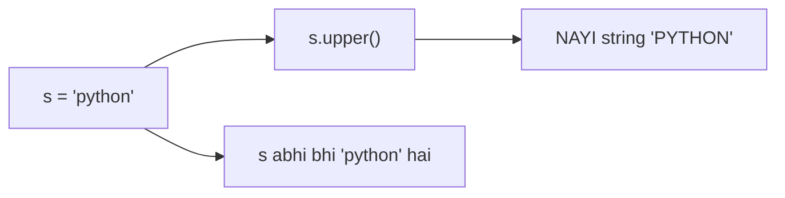

# Chapter 04 · Strings Deep Dive

> Har username, password, chat message, URL, JSON response aur search query jo tum kabhi bhi chhooge, woh ek string hai. Real programs mein strings sabse zyada use hone wala data type hain, aur string problems (palindromes, anagrams, words ulta karna) coding interviews ke sabse common warm-up questions hain. Inhe ek baar, theek se, yahin master kar lo.

**Is chapter mein tum seekhoge:**
- String asal mein kya hai: characters ka ek **immutable sequence**
- **Indexing**, **negative indexes** aur `[start:stop:step]` se **slicing** (mashhoor `[::-1]` ke saath)
- Har woh string method jo tum sach mein use karoge, groups mein taaki yaad rahe
- `split()` aur `join()`, string ke do sabse important tools
- **f-strings** aur format-spec mini-language (`{x:>10}`, `{price:,.2f}`, `{n:08b}`)
- Escape characters, **raw strings** aur multi-line strings
- **Unicode**: `ord()`, `chr()`, aur `len("😀")` 1 kyun hai
- `+=` se strings banana slow kyun ho sakta hai aur `"".join()` iska ilaaj kyun hai
- Classic interview problems: palindrome, anagram, reverse words, vowel count, character frequency

**Isse pehle padho:** [Chapter 02 · Variables, Data Types & Memory](02-variables-types-memory.md) · [Chapter 03 · Operators & Expressions](03-operators-expressions.md)

---

## 🧠 The Big Idea · Asli Baat

Ek **train** socho. Har dabbe (coach) mein bilkul ek character baitha hai, aur dabbon pe aage se number lage hain jo **0** se shuru hote hain. Peeche se bhi number lage hain, jo **-1** se shuru hote hain.

```text
 carriage:    P    Y    T    H    O    N
 from front:  0    1    2    3    4    5
 from back:  -6   -5   -4   -3   -2   -1
```

Teen ideas strings ke baare mein lagbhag sab kuch explain kar dete hain:

1. **Ye ek sequence hai.** Tum dabba number 3 maang sakte ho (**indexing**), ya dabba 1 se 4 tak ki ek line (**slicing**), ya sabhi dabbon se order mein guzar sakte ho (**iteration**, [Chapter 06](06-loops.md) mein).
2. **Ye immutable hai.** Train weld karke band kar di gayi hai. Tum koi dabba badal nahi sakte. Har "badlaav" ek **bilkul nayi train** banata hai. `s.upper()` `s` ko nahi badalta; ek nayi string return karta hai.
3. **Har dabbe mein ek Unicode character hai**, jo asal mein ek number hai (**code point**). `"A"` 65 hai, `"a"` 97, `"😀"` 128512. Strings compare karne ka matlab un numbers ko compare karna hai.



> 🇮🇳 **Desi Analogy:** Railway ka **reservation chart** socho, jo platform pe chipka hota hai. Har seat ka ek number hai (index), aur har seat pe ek naam (character). Tum "seat 3 pe kaun hai?" dekh sakte ho (indexing), "seat 1 se 4 tak ke naam" ki photo le sakte ho (slicing). Lekin chart **chhapa hua** hai: tum pen se kisi ka naam kaat ke doosra nahi likh sakte. Badlaav chahiye toh railway naya chart print karta hai (immutable: har change = nayi string). Aur haan, seat numbers 0 se shuru hote hain, kyunki ye Python ki railway hai.

> 💡 **The core insight:** string characters ki ek numbered, sirf-padhne-wali (read-only) line hai. Indexing ek character padhta hai, slicing ek range copy karta hai, aur har method tumhe ek **nayi** string pakda deta hai.

---

## 🔨 Building It Up · Zero Se Shuru

### 1. Creating strings

```python
single = 'Hello'
double = "Hello"
print(single == double)               # ek hi cheez, do spellings

quote_inside = "It's Riya's laptop"   # andar ' ho toh bahar " use karo
speech = 'She said "wow"'             # aur ulta bhi
empty = ""
print(quote_inside)
print(speech)
print(len(empty), len("Hello"), len("Hi there!"))
print(str(42) + str(3.5) + str(True))
```

```text
True
It's Riya's laptop
She said "wow"
0 5 9
423.5True
```

Abhi kya hua: Python mein single aur double quotes bilkul ek jaise hain; wahi chuno jo text ke andar ke quotes se na takraaye. `len()` characters ginta hai, spaces aur punctuation samet (`"Hi there!"` = 2 + 1 space + 5 + 1 `!` = 9). `str()` kisi bhi value ko uske text form mein badal deta hai.

### 2. Indexing: one character at a time

```python
word = "PYTHON"
print(word[0])      # pehla
print(word[3])      # chautha
print(word[-1])     # aakhri
print(word[-2])     # second-last
print(word[len(word) - 1])   # ye bhi aakhri, lamba tareeka
```

```text
P
H
N
O
N
```

Abhi kya hua: `word[i]` position `i` wala character return karta hai (ek nayi one-character string ki tarah; Python mein alag se koi "char" type nahi hota). Negative indexes end se ginte hain: `word[-1]` aakhri character hai, aur general rule hai `word[-k]` same hai `word[len(word) - k]` ke.

> 🤔 **Mann mein sawaal:** Index 0 se kyun shuru hota hai? Pehla character "1st" hai, toh index 1 hona chahiye na?
>
> **Jawab:** Index ko "kitne kadam aage" samjho, "kaunsa number" nahi. Pehla character start se **0 kadam** door hai, doosra 1 kadam, teesra 2 kadam. Building ka **ground floor** bhi isi tarah 0 hai: wahan pahunchne ke liye lift ko 0 floor upar jaana padta hai. Aur negative indexes ke liye `-1` isliye, kyunki `-0` aur `0` ek hi number hain, toh end se ginti 0 se shuru ho hi nahi sakti.

Jo dabba exist hi nahi karta, use maangna error hai:

```py
word = "PYTHON"
print(word[6])   # ❌ IndexError: string index out of range
                 # valid indexes 0..5 aur -6..-1 hain
```

### 3. Slicing: copying a range

**Slice** `s[start:stop]` tumhe index `start` se lekar `stop` **tak, lekin `stop` ko chhod ke**, characters deta hai.

```python
s = "PYTHONISTA"
print(s[0:6])     # indexes 0,1,2,3,4,5
print(s[6:10])
print(s[:6])      # start nahi diya -> shuru se
print(s[6:])      # stop nahi diya -> end tak
print(s[:])       # sab kuch (conceptually ek poori copy)
print(s[-4:])     # last 4 characters
print(s[:-4])     # last 4 ko chhod ke sab
print(s[3:3])     # khaali: start == stop
print(s[2:100])   # slices kabhi IndexError nahi dete; bas kaat dete hain
```

```text
PYTHON
ISTA
PYTHON
ISTA
PYTHONISTA
ISTA
PYTHON

THONISTA
```

**`stop` ko bahar kyun rakha?** Isse maths khoobsurat ho jaata hai:

- Kisi bhi `k` ke liye `s[:k] + s[k:] == s`: dono halves ekdum fit hote hain, na overlap, na gap.
- `len(s[a:b]) == b - a` (jab dono range mein hon).
- `s[:k]` matlab "pehle k characters", aur `s[-k:]` matlab "aakhri k".

Indexes ko dabbon ke **beech ke gaps** pe ishaara karta hua socho, jaise scale (ruler) ke nishaan:

```text
  | P | Y | T | H | O | N |
  0   1   2   3   4   5   6
 -6  -5  -4  -3  -2  -1
```

`s[1:4]` ka matlab "nishaan 1 aur nishaan 4 pe kaato" → `YTH`.

> 🇮🇳 **Desi Analogy:** Ruler wali picture ko ek lambi **jalebi ki patti** (ya cake) socho jispe 0, 1, 2... nishaan lage hain. `s[1:4]` = chaaku nishaan 1 pe rakho, phir nishaan 4 pe, beech ka tukda tumhara. Tukde mein exactly 4 − 1 = 3 pieces aaye. Aur `s[:3]` + `s[3:]` = patti ko nishaan 3 pe kaato, do tukde jodo, poori patti wapas. Na ek tukda zyada, na kam. Yahi "stop excluded" ka jaadu hai.

### 4. Slicing with a step (and reversing)

Poora slice hai `s[start:stop:step]`. **Step** batata hai ki har baar kitni positions kudna hai (default 1).

```python
s = "0123456789"
print(s[::2])      # har doosra character
print(s[1::2])     # har doosra, index 1 se shuru
print(s[::3])
print(s[::-1])     # step -1: peeche ki taraf chalo -> ulta!
print(s[7:2:-1])   # 7 se neeche 2 tak (2 shaamil nahi)
print(s[-1:-4:-1]) # aakhri teen, ulte
print("racecar"[::-1])
```

```text
02468
13579
0369
9876543210
76543
987
racecar
```

Abhi kya hua: **negative step** ke saath Python right se left chalta hai, toh `start` `stop` ke right mein hona chahiye. Jab step -1 ke saath dono chhod diye jaayein (`[::-1]`), toh woh end se shuru karke shuruaat tak chalta hai: classic ek-line string reversal.

> 💡 `s[::-1]` ko padho "poori string, peeche ki taraf chalte hue". String ulta karne ka ye sabse Pythonic tareeka hai, aur interviewers ise jaante hain. Ye bhi explain karne ko ready raho ki bina slicing ke kaise ulta karoge (two pointers, [DSA Chapter 03](../part-2-dsa/03-two-pointers.md) dekho).

> 🤔 **Mann mein sawaal:** `s[7:2:-1]` mein `7` se shuru, `2` pe ruke. Lekin `s[2:7:-1]` kya dega?
>
> **Jawab:** Khaali string `""`. Step -1 matlab "peeche jao", aur tum 2 se shuru karke 7 tak *peeche* jaa hi nahi sakte (7 toh aage hai). Python error nahi deta, bas kuch nahi deta. Rule: **positive step = start left mein, negative step = start right mein.** Galti hui toh khaali string milegi, crash nahi, isliye ye bug chupa reh sakta hai.

### 5. Strings are immutable

```py
name = "Riya"
name[0] = "P"   # ❌ TypeError: 'str' object does not support item assignment
```

Tum kisi character ko apni jagah pe badal nahi sakte. Uske bajaye ek nayi string banao aur (chaaho toh) name tag shift kar do:

```python
name = "Riya"
name = "P" + name[1:]   # tukdon se nayi string
print(name)

title = "hello world"
shout = title.upper()   # methods nayi strings return karte hain
print(title)            # badla nahi
print(shout)
```

```text
Piya
hello world
HELLO WORLD
```

> ⚠️ **String bug number 1:** method call karna aur uska result ignore kar dena. Akeli line pe `title.upper()` **kuch kaam ka nahi karta**: woh `"HELLO WORLD"` banata hai aur phenk deta hai. Likho `title = title.upper()`.

Immutable kyun? Strings dictionary keys ki tarah use hoti hain, kai variables ke beech share hoti hain, aur poore program mein idhar-udhar pass hoti hain. Agar koi bhi unhe badal sakta, toh dictionary mein baithi ek key chupchaap badal sakti thi. Immutability strings ko share karne ke liye safe banati hai aur Python ko unhe **hash** karne deti hai (zyada [Chapter 09](09-dictionaries.md) mein).

> 🇮🇳 **Desi Analogy:** Dictionary ko ek library ka register socho jahan har kitaab uske title ke hisaab se ek khaas almari mein rakhi hai. Agar koi chupke se kitaab ka title badal de (mutable key), toh register mein woh purane title wali almari mein hi dikhegi, aur naye title se dhoondhoge toh milegi hi nahi. Isliye titles (keys) "chhape hue" hone chahiye, badalne layak nahi.

### 6. Joining strings: +, *, and implicit concatenation

```python
first, last = "Arjun", "Mehta"
full = first + " " + last
print(full)
print("-" * 20)
print("ab" * 3)
print("na" * 8 + " Batman!")
greeting = ("Hello, "
            "world")           # paas-paas rakhe literals compile time pe chipak jaate hain
print(greeting)
```

```text
Arjun Mehta
--------------------
ababab
nananananananana Batman!
Hello, world
```

`+` sirf strings ko strings se jodta hai. `"Age: " + 21` ek `TypeError` hai; pehle convert karo (`"Age: " + str(21)`) ya, kahin behtar, f-string use karo (section 12).

### 7. Changing case

```py
s = "pYthon is FUN"
print(s.upper())
print(s.lower())
print(s.title())        # har word ka pehla letter upper
print(s.capitalize())   # sirf sabse pehla letter upper, baaki lower
print(s.swapcase())
print("Straße".lower(), "Straße".casefold())   # casefold "extra aggressive" lowercase hai
```

```text
PYTHON IS FUN
python is fun
Python Is Fun
Python is fun
PyTHON IS fun
straße strasse
```

Abhi kya hua: `.casefold()` `.lower()` jaisa hai lekin special cases bhi handle karta hai (German `ß` `ss` ban jaata hai). User input ke case-insensitive comparison ke liye `a.casefold() == b.casefold()` sabse sahi choice hai; plain English ke liye `.lower()` theek hai.

### 8. Searching inside strings

```python
s = "banana bandana"
print("nan" in s)            # membership (Chapter 03)
print(s.find("ban"))         # pehle match ka index
print(s.find("ban", 1))      # index 1 se dhoondhna shuru karo
print(s.rfind("an"))         # AAKHRI match ka index
print(s.find("xyz"))         # nahi mila -> -1
print(s.index("dan"))        # find jaisa, lekin...
print(s.count("an"))         # non-overlapping occurrences
print(s.count("a"))
print(s.startswith("ban"), s.endswith("na"))
print(s.startswith(("cat", "ban")))   # kai prefixes mein se koi bhi
```

```text
True
0
7
11
-1
10
4
6
True True
True
```

Abhi kya hua:

- `.find(sub)` pehli occurrence ka index return karta hai, ya missing hone pe **-1**.
- `.index(sub)` wahi karta hai, lekin missing hone pe **`ValueError` raise karta hai**. Jab "nahi mila" normal baat ho toh `find` use karo, jab woh bug ho toh `index`.
- `.count(sub)` **non-overlapping** matches ginta hai: `"aaaa".count("aa")` 2 hai, 3 nahi.
- `startswith`/`endswith` options ka ek tuple accept karte hain (tuples [Chapter 08](08-tuples-sets.md) mein hain).

Indexes khud check karo (ye habit interviews mein bachati hai):

```text
 b  a  n  a  n  a     b  a  n  d  a  n  a
 0  1  2  3  4  5  6  7  8  9 10 11 12 13
```

`"ban"` 0 pe aur 7 pe hai; index 1 se dhoondhna shuru kiya toh 0 wala chhoot gaya, 7 mila. `"an"` 1, 3, 8, 11 pe hai, toh aakhri (`rfind`) 11 aur ginti (`count`) 4.

> 🤔 **Mann mein sawaal:** `"aaaa".count("aa")` 2 kyun? Mujhe toh 3 jagah "aa" dikhta hai: 0-1, 1-2, 2-3.
>
> **Jawab:** `count` ek match milne ke baad uske **aage** se dhoondhna shuru karta hai, usi match ke beech se nahi. Pehla "aa" index 0-1 pe mila, ab woh 2 se dhoondhta hai, doosra 2-3 pe mila. Bas, khatam. Jaise tum ek line mein khade logon ko "jodiyon" mein gin rahe ho: ek banda do jodiyon mein nahi aa sakta. Overlapping matches ginne hon toh loop likhna padega.

### 9. Cleaning: strip, replace, remove prefixes

User input gandagi bhara hota hai. Ye methods use saaf karte hain.

```python
raw = "   hello world  \n"
print("[" + raw.strip() + "]")    # dono ends
print("[" + raw.lstrip() + "]")   # sirf left
print("[" + raw.rstrip() + "]")   # sirf right
print("xxhixx".strip("x"))        # specific characters strip karo
print("www.example.com".strip("w.moc"))   # inme se KOI bhi char ends se hata deta hai!

msg = "I like cats. cats are great."
print(msg.replace("cats", "dogs"))
print(msg.replace("cats", "dogs", 1))     # sirf pehli occurrence
print(msg.replace(" ", ""))               # saare spaces delete

print("report_final.pdf".removesuffix(".pdf"))
print("Mr. Sharma".removeprefix("Mr. "))
```

```text
[hello world]
[hello world  
]
[   hello world]
hi
example
I like dogs. dogs are great.
I like dogs. cats are great.
Ilikecats.catsaregreat.
report_final
Sharma
```

Abhi kya hua: bina argument ke `strip()` ends se **whitespace** (spaces, tabs `\t`, newlines `\n`) hatata hai, beech se kabhi nahi. Argument ke saath, woh use ends se hataane wale **characters ka ek set** maanta hai, ek word nahi; isliye `"www.example.com".strip("w.moc")` ne `.com` aur `www.` dono kha liye. Agar exact prefix ya suffix hatana hai, toh `removeprefix()` / `removesuffix()` use karo (Python 3.9+).

> 🇮🇳 **Desi Analogy:** `strip("w.moc")` ek aise safai wale jaisa hai jisko bola "w, dot, m, o, c, inme se jo bhi kinaare pe dikhe, utha ke phenk do". Woh dono kinaaron se shuru karta hai aur tab tak uthata rehta hai jab tak koi aisi cheez na mile jo list mein nahi hai. Left se: w, w, w, `.` utha liye, `e` list mein nahi, ruk gaya. Right se: m, o, c, `.` utha liye, `e` pe ruk gaya. Bacha `example`. Woh "`.com` word" nahi pehchaanta; bas characters dekhta hai.

### 10. Testing what a string contains

Ye sab `True`/`False` return karte hain, aur empty string ke liye `False` dete hain.

```python
print("12345".isdigit(), "12.5".isdigit(), "-3".isdigit())
print("Hello".isalpha(), "Hello123".isalpha())
print("Hello123".isalnum(), "Hello 123".isalnum())
print("   \t\n".isspace(), "".isspace())
print("HELLO".isupper(), "hello".islower(), "Hello World".istitle())
print("abc".isidentifier(), "2abc".isidentifier())   # valid variable name?
```

```text
True False False
True False
True False
True False
True True True
True False
```

Abhi kya hua: `"12.5"` aur `"-3"` ke liye `isdigit()` `False` hai, kyunki `.` aur `-` digits nahi hain. Toh ye "kya ye number hai?" wala check **nahi** hai. Numbers ko theek se validate karna hai toh `int()`/`float()` se convert karne ki koshish karo aur error handle karo ([Chapter 13](13-exceptions-files.md)).

**isdecimal vs isdigit vs isnumeric** (trivia ka favourite sawaal):

| Method | `"123"` | `"²"` (superscript 2) | `"½"` | `"٣"` (Arabic-Indic 3) |
|---|---|---|---|---|
| `isdecimal()` | True | False | False | True |
| `isdigit()` | True | True | False | True |
| `isnumeric()` | True | True | True | True |

Har ek apne upar wale se zyada broad (dheela) hai. Roz ke "sirf 0-9 digits" checks ke liye `isdecimal()` sabse strict built-in hai, aur `s.isascii() and s.isdecimal()` use plain ASCII 0-9 tak lock kar deta hai. (Haan, Devanagari ke digits bhi `isdecimal()` mein True aate hain, kyunki woh bhi asli base-10 digits hain. Isliye "sirf 0-9" chahiye toh `isascii()` wala lock zaroori hai.)

### 11. Splitting and joining: the power pair

`split()` ek string ko tukdon ki ek **list** mein todta hai. `join()` strings ki list ko wapas chipka deta hai. (Lists ka apna chapter hai, [Chapter 07](07-lists.md); abhi ke liye, list `[ ]` mein items ka ek sequence hai.)

```python
sentence = "  the quick   brown fox  "
print(sentence.split())          # bina argument: KISI bhi whitespace pe todo, khaali tukde hatao
print("a,b,,c".split(","))       # argument ke saath: bilkul usi pe todo, khaali tukde rakho
print("a b  c".split(" "))       # dhyaan: do spaces -> ek khaali tukda
print("k1=v1=v2".split("=", 1))  # maxsplit: zyada se zyada ek baar todo
print("one\ntwo\nthree".splitlines())

words = ["Python", "is", "fun"]
print(" ".join(words))
print("-".join(words))
print("".join(["a", "b", "c"]))
print(", ".join("ABC"))           # string bhi characters ka sequence hai
```

```text
['the', 'quick', 'brown', 'fox']
['a', 'b', '', 'c']
['a', 'b', '', 'c']
['k1', 'v1=v2']
['one', 'two', 'three']
Python is fun
Python-is-fun
abc
A, B, C
```

Abhi kya hua:

- **Bina** argument ka `split()` smart hai: whitespace ki koi bhi run ek separator maani jaati hai, aur shuru/aakhir ka whitespace ignore hota hai. `split(" ")` literal hai aur double spaces ke liye khaali strings banata hai. Interviews mein lagbhag hamesha plain `split()` use karo.
- `join` **separator pe** call hota hai: `" ".join(words)` padho "in words ko space se jodo". Har item string hona chahiye; `" ".join([1, 2])` ek `TypeError` hai.

> 🇮🇳 **Desi Analogy:** `split` aur `join` ko **phool aur maala** socho. `split()` = maala ka dhaaga kaat ke phool alag-alag kar do (list of words). `join` = phoolon ko phir se dhaage mein piro do, aur `" ".join` mein dhaaga hai space, `"-".join` mein dhaaga hai dash. Isliye `join` **dhaage** (separator) pe call hota hai: dhaaga hi toh phoolon ko jodta hai. Aur dhaage mein sirf phool (strings) piro sakte ho, patthar (numbers) nahi: woh `TypeError` hai.

> 🤔 **Mann mein sawaal:** `join` ko `words.join(" ")` kyun nahi likhte? Ye zyada natural lagta hai.
>
> **Jawab:** Kyunki `join` kisi bhi **iterable** ke saath kaam karta hai: list, tuple, string, generator, sab. Agar `join` list ka method hota, toh har collection type mein alag se banana padta. String ka method hone se ek hi jagah likha gaya, aur woh har cheez ke saath chalta hai (dekho upar `", ".join("ABC")`, yahan toh string hi pass ki hai). Thoda ajeeb dikhta hai, lekin design smart hai.

**`partition`** pehli occurrence pe exactly teen hisson mein todta hai, jo "key=value" text ke liye kaam ka hai:

```python
key, sep, value = "name=Riya=Mehta".partition("=")
print(key, "|", sep, "|", value)
print("no-equals".partition("="))
```

```text
name | = | Riya=Mehta
('no-equals', '', '')
```

(Separator na mile, tab bhi teen hi hisse aate hain: poori string, aur do khaali strings. Isliye `a, b, c = ...partition(...)` kabhi unpacking error nahi deta, jabki `split` ke saath de sakta hai.)

### 12. f-strings: the modern way to build text

**f-string** quote se pehle `f` se shuru hoti hai. `{ }` ke andar jo bhi hai woh ek Python expression hai, jo evaluate hoke andar daal diya jaata hai.

```python
name, age, cgpa = "Riya", 21, 8.4567
print(f"{name} is {age} years old.")
print(f"Next year: {age + 1}")
print(f"Shout: {name.upper()}!")
print(f"CGPA: {cgpa:.2f}")          # 2 decimal places
print(f"{age=}, {cgpa=:.1f}")       # '=' expression bhi dikhata hai (debugging)
print(f"Braces: {{literal}}")       # double braces ek brace print karte hain
```

```text
Riya is 21 years old.
Next year: 22
Shout: RIYA!
CGPA: 8.46
age=21, cgpa=8.5
Braces: {literal}
```

> 🇮🇳 **Desi Analogy:** f-string shaadi ke **printed card ka template** hai: "Shubh vivah: `{dulha}` weds `{dulhan}`, date `{date}`". Har khaali `{ }` mein press waala asli naam bhar deta hai. Aur `{age + 1}` jaisa? Wahan press waala pehle hisaab lagata hai, phir chhaapta hai. `{cgpa:.2f}` matlab "bhar do, lekin 2 decimal ke format mein".

### 13. The format-spec mini-language

Braces ke andar colon ke baad, tum control kar sakte ho ki value bilkul kaisi dikhe:

```text
{value:[fill][align][sign][width][,][.precision][type]}
```

```python
n, pi, big, ratio = 42, 3.14159265, 12345678.9, 0.4567
print(f"[{n:5}]")        # width 5 (numbers default mein right align hote hain)
print(f"[{n:<5}]")       # left
print(f"[{n:^5}]")       # centre
print(f"[{n:*^9}]")      # * se bharo, centred, width 9
print(f"[{n:05}]")       # zero-pad
print(f"[{'hi':>6}]")    # strings default mein left align; zabardasti right
print(f"{pi:.3f}")       # 3 decimals
print(f"{big:,.2f}")     # hazaar wale separators
print(f"{ratio:.1%}")    # percentage
print(f"{n:+}")          # sign hamesha dikhao
print(f"{n:b} {n:o} {n:x} {n:X}")   # binary, octal, hex
print(f"{5:08b}")        # leading zeros ke saath 8-bit binary
print(f"{big:.2e}")      # scientific
```

```text
[   42]
[42   ]
[ 42  ]
[***42****]
[00042]
[    hi]
3.142
12,345,678.90
45.7%
+42
101010 52 2a 2A
00000101
1.23e+07
```

Format spec ko left se right padho, jaise ek order form: `{big:,.2f}` = "commas lagao, 2 decimal, fixed-point". `{n:*^9}` = "fill `*`, align centre `^`, width 9". `<` left, `>` right, `^` centre: teer ka nishaan jidhar, text udhar.

> 🤔 **Mann mein sawaal:** `{n:^5}` ne `[ 42  ]` diya: left mein 1 space, right mein 2. Barabar kyun nahi?
>
> **Jawab:** 5 ki width mein `42` (2 characters) ke baad 3 spaces bache. 3 ko barabar baant nahi sakte, toh Python extra wala space **right** mein daalta hai. Isi tarah `{n:*^9}` mein 7 stars bache: 3 left, 4 right. Output match karna ho (jaise competitive programming mein) toh ye chhoti baat bhi yaad rakhna.

Widths use karke ek saaf receipt:

```python
print(f"{'Item':<10}{'Qty':>5}{'Price':>10}")
print(f"{'Chai':<10}{2:>5}{40.0:>10.2f}")
print(f"{'Samosa':<10}{3:>5}{45.5:>10.2f}")
print("-" * 25)
print(f"{'Total':<10}{'':>5}{40.0 + 45.5:>10.2f}")
```

```text
Item        Qty     Price
Chai          2     40.00
Samosa        3     45.50
-------------------------
Total               85.50
```

**Purane styles jo tumhe existing code mein dikhenge:**

```python
name, score = "Arjun", 93.456
print("%s scored %.1f" % (name, score))          # printf-style (sabse purana)
print("{} scored {:.1f}".format(name, score))    # str.format (Python 2.6+)
print(f"{name} scored {score:.1f}")              # f-string (3.6+): yahi prefer karo
```

```text
Arjun scored 93.5
Arjun scored 93.5
Arjun scored 93.5
```

f-strings sabse fast aur sabse readable hain. Naye code mein yahi use karo.

### 14. Escape characters

String ke andar backslash `\` ek **escape sequence** shuru karta hai: un characters ko likhne ka tareeka jo aasaani se type nahi hote.

| Escape | Matlab |
|---|---|
| `\n` | newline |
| `\t` | tab |
| `\\` | ek literal backslash |
| `\'` / `\"` | same kism ke quotes ke andar ek quote |
| `\u20b9` | code se ek Unicode character (yahan ₹) |
| `\r` | carriage return (Windows ke line endings `\r\n` hote hain) |

```py
print("Name:\tRiya\nCity:\tPune")
print("She said \"hi\" and left")
print('It\'s fine')
print("C:\\Users\\riya")
print("Price: \u20b9500")
print(len("a\nb"))      # \n EK character hai
```

```text
Name:	Riya
City:	Pune
She said "hi" and left
It's fine
C:\Users\riya
Price: ₹500
3
```

> 🤔 **Mann mein sawaal:** REPL mein `"a\nb"` type karo toh woh `'a\nb'` dikhata hai, lekin `print("a\nb")` do lines mein `a` aur `b` dikhata hai. Dono alag kyun?
>
> **Jawab:** REPL value ka **developer view** dikhata hai, jise `repr()` kehte hain: quotes ke saath, aur invisible characters ko escape karke (`\n`), taaki tumhe exactly pata chale ki string ke andar kya hai. `print()` **user view** dikhata hai, jise `str()` kehte hain: jaise screen pe dikhna chahiye, newline sach mein nayi line ban jaati hai. Tum khud dekh sakte ho: `print(repr("a\nb"))` bhi `'a\nb'` hi print karega. Debugging mein `repr()` bahut kaam aata hai, kyunki ye chupe hue spaces aur `\n` pakad leta hai. (Apni classes ke liye ye dono views tum [Chapter 15](15-oop-inheritance-magic.md) mein khud define karoge.)

### 15. Raw strings: backslashes taken literally

Quote se pehle `r` lagao, aur backslashes apna special matlab kho dete hain. Windows paths aur **regular expressions** ([Chapter 17](17-modules-stdlib.md)) ke liye perfect.

```python
print("C:\new\table")      # \n aur \t escapes hain: toot gaya!
print(r"C:\new\table")     # raw string: bilkul wahi jo type kiya
print(len(r"\n"), len("\n"))
```

```text
C:
ew	able
C:\new\table
2 1
```

Pehli line mein kya hua dekho: `\n` ne nayi line bana di (isliye `C:` akela reh gaya), aur `\t` ne tab bana diya (isliye `ew` ke baad gap aur phir `able`). Path ka koi naamo-nishaan nahi bacha.

> ⚠️ Raw string **odd number of backslashes pe khatam nahi ho sakti**: `r"C:\folder\"` ek `SyntaxError` hai (parser ke liye aakhri `\"` abhi bhi quote ko escape karta hai). `"C:\\folder\\"` ya `r"C:\folder" + "\\"` use karo. Ya bas forward slashes use karo: Windows `"C:/folder/"` accept karta hai.

### 16. Multi-line strings

Triple quotes (`"""` ya `'''`) se string kai lines tak phail sakti hai; newlines rakh li jaati hain.

```python
poem = """Roses are red,
Violets are blue,
Strings are immutable,
And so are you."""
print(poem)
print(poem.count("\n"), "newlines")
```

```text
Roses are red,
Violets are blue,
Strings are immutable,
And so are you.
3 newlines
```

(4 lines, lekin 3 newlines: newline lines ke *beech* hota hai, aur aakhri line ke baad humne Enter nahi dabaya. Fence posts jaisa: 4 khambe, 3 gaps.)

Triple-quoted strings **docstrings** ke liye bhi use hoti hain, yaani function ya class ki pehli line mein rakha documentation ([Chapter 10](10-functions.md)).

### 17. Unicode, ord() and chr()

Har character ek number ki tarah store hota hai jise uska **code point** kehte hain. `ord()` character ka number deta hai; `chr()` number ka character.

```py
print(ord("A"), ord("Z"), ord("a"), ord("z"), ord("0"))
print(chr(65), chr(97), chr(8377), chr(128512))
print(ord("c") - ord("a"))          # alphabet mein position (0 se shuru)
print(chr(ord("a") + 2))            # letter ko 2 se khiskao
print("apple" < "banana", "Zoo" < "apple", "10" < "9")
print(len("😀"), len("😀".encode("utf-8")))   # 1 character, UTF-8 mein 4 bytes
```

```text
65 90 97 122 48
A a ₹ 😀
2
c
True True True
1 4
```

Abhi kya hua:

- Uppercase `A`–`Z` 65–90 hain, lowercase `a`–`z` 97–122, digits `0`–`9` 48–57. Isliye saare capitals saare lowercase letters se pehle sort hote hain.
- `ord(c) - ord("a")` ek letter ko 0–25 mein badal deta hai. Ye trick DSA mein har jagah hai: jaise anagram problems ke liye 26-slot counting array.
- `"10" < "9"` `True` hai: strings **character by character** compare hoti hain, aur `"1"` (49) < `"9"` (57). Text ki tarah store kiye numbers numerically sort nahi hote!
- String **characters** (code points) ginti hai, bytes nahi. `.encode("utf-8")` text ko storage ya network ke liye **bytes** mein badalta hai; `😀` 4 bytes leta hai. `.decode("utf-8")` bytes ko wapas string banata hai.

> 🇮🇳 **Desi Analogy:** `ord` aur `chr` **Aadhaar number aur insaan** jaisa hai. Har character (insaan) ka ek unique number (Aadhaar) hai. `ord("A")` = "is bande ka Aadhaar batao" → 65. `chr(65)` = "is Aadhaar wala banda bulao" → `A`. Aur `"10" < "9"` dictionary ke order jaisa hai: dictionary mein "10" wala page "9" se pehle aata hai kyunki pehla akshar `1` hai, jo `9` se pehle hai. Dictionary number ki value nahi dekhti, sirf akshar.

### 18. Alignment helpers and zfill

```python
print("[" + "hi".center(10) + "]")
print("[" + "hi".ljust(6, ".") + "]")
print("[" + "hi".rjust(6, ".") + "]")
print("7".zfill(3), "-7".zfill(4), "42".zfill(1))
```

```text
[    hi    ]
[hi....]
[....hi]
007 -007 42
```

`zfill` left mein zeros bharta hai aur sign ka dhyaan rakhta hai (`-7` → `-007`, `0-07` nahi). `"007"` jaise IDs ke liye kaam ka hai. Aur agar string pehle se width se lambi hai (`"42".zfill(1)`), toh kuch nahi kaatta, waisi hi lauta deta hai.

### 19. Building strings efficiently: join vs +=

Kyunki strings immutable hain, `s += "x"` `s` mein kuch jod nahi sakta; woh ek poori **nayi** string banata hai, `s` ka sab kuch plus naya hissa copy karke. Ye loop ke andar n baar karo toh tum 1 + 2 + 3 + ... + n characters copy karte ho: total **O(n²)**.

`"".join(pieces)` pehle total length naapta hai, ek baar memory leta hai, aur har piece ko ek baar copy karta hai: **O(n)**.

> 🇮🇳 **Desi Analogy:** `+=` aisa hai jaise har naya guest aane pe tum poori shaadi ki guest list **naye kaagaz pe dobara likho**, aur phir naya naam jodo. 1000 guests = lagbhag 5 lakh naam likhne padenge (1 + 2 + ... + 1000). `join` aisa hai jaise pehle saare naam alag parchiyon pe jamaa karo, gin lo, ek hi bada kaagaz lo aur ek baar mein sab likh do: 1000 naam, bas.

Ek loop ([Chapter 06](06-loops.md)) aur ek list ([Chapter 07](07-lists.md)) se ek jhalak:

```python
# Slow pattern (conceptually O(n^2)):
result = ""
for i in range(5):
    result += str(i)
print(result)

# Fast pattern (O(n)): tukde jamaa karo, ek baar join karo
pieces = []
for i in range(5):
    pieces.append(str(i))
print("".join(pieces))
```

```text
01234
01234
```

> 💡 CPython ke paas ek special optimisation hai jo kabhi-kabhi strings pe `+=` ko fast bana deta hai (jab string ko koi aur refer nahi kar raha, toh woh usse apni jagah pe bada kar sakta hai). Lekin ye ek implementation detail hai jo har jagah lagu nahi hoti (jaise PyPy mein, ya jab koi doosra naam string ko refer kar raha ho). **Interview answer: tukdon ko list mein jamaa karo aur `"".join()` karo, O(n).**

---

## 🔬 Under the Hood · Andar Ki Kahani

### How CPython stores a string

Ek `str` object apni length, ek cached **hash**, kuch flags, aur phir characters ko ek compact array mein rakhta hai. Python 3.3 se (**PEP 393**, "flexible string representation"), CPython woh **sabse chhoti** width chunta hai jisme string ka sabse "chauda" character fit ho jaaye:

| String ka sabse chauda character | Har character ke bytes |
|---|---|
| Sab ASCII / Latin-1 (code point < 256) | 1 |
| U+FFFF tak (zyaadatar scripts, Hindi samet) | 2 |
| Usse aage (emoji, rare scripts) | 4 |

Toh `"hello"` har character ke liye 1 byte use karta hai, lekin ek akela emoji jodne se poori string har character ke 4 bytes use karne lagti hai. Kyunki kisi ek string mein har character ki width same hoti hai, **indexing `s[i]` O(1) hai**: seedha `start + i × width` pe kood jao. (Jo languages andar UTF-8 store karti hain, jaise Go ya Rust, woh characters ko O(1) mein index nahi kar sakti.)

> 🇮🇳 **Desi Analogy:** Cinema hall socho jahan ek row ki saari seats **ek hi size** ki hain. Seat number 37 dhoondhni hai? Seat ki width × 37, seedha wahan pahuncho, ginna nahi padta (O(1)). Ab agar seats alag-alag size ki hon (UTF-8 jaisa: koi character 1 byte, koi 4), toh seat 37 dhoondhne ke liye pehle 36 seats ginni padengi (O(n)). Python ka trick: agar row mein ek bhi "badi seat wala" (emoji) aa gaya, toh **poori row ki saari seats badi** kar do. Jagah zyada lagti hai, lekin dhoondhna turant hota hai.

### Complexity of common string operations

| Operation | Time | Kyun |
|---|---|---|
| `len(s)` | O(1) | length stored hai |
| `s[i]` | O(1) | fixed-width array |
| `s[a:b]` | O(b − a) | slice ko nayi string mein copy karta hai |
| `s + t` | O(len(s) + len(t)) | nayi string banata hai |
| `s == t` | O(n) worst case | character by character compare karta hai (pehle farak pe, ya length alag ho toh, jaldi ruk jaata hai) |
| `sub in s`, `s.find(sub)` | aam taur pe lagbhag O(n) | optimised search (neeche dekho) |
| `s.count`, `s.replace`, `s.split`, `s.upper`, `s.strip` | O(n) | poori string scan karni padti hai |
| `"".join(parts)` | O(total length) | ek allocation, har piece ki ek copy |
| `s[::-1]` | O(n) | nayi ulti copy |
| `hash(s)` | pehli baar O(n), phir O(1) | hash object mein cache ho jaata hai |

`in`/`find` ke peeche ka substring search ek tuned "fastsearch" algorithm use karta hai jo chalaaki se aage kood jaata hai; Python 3.10 se lambe needles (dhoondhi jaane wali strings) ke liye **Two-Way** algorithm use hota hai, jo linear time guarantee karta hai. Interviews mein bolo "naive search ka worst case O(n·m) hai, lekin Python ka built-in bahut optimised hai"; aur agar tumse khud substring search implement karne ko kaha jaaye, toh [DSA Chapter 24](../part-2-dsa/24-advanced-structures.md) mein KMP dekho.

### Why slicing copies

`s[1:]` ek naya string object banata hai. Matlab jo loop baar-baar `s = s[1:]` karta hai woh O(n²) hai. DSA mein baar-baar slicing ke bajaye ek **index** ko aage badhao. Isi wajah se two-pointer solutions substrings ke bajaye indexes idhar-udhar pass karte hain.

> 🤔 **Mann mein sawaal:** `s[1:]` toh bas "pehla character chhod do" hai. Isme copy karne ki kya zaroorat? Bas start pointer aage kar do!
>
> **Jawab:** Kuch languages aisa karti hain (string "views"), lekin CPython har slice ko ek poori nayi, independent string banata hai. Faayda: original string chahe kitni bhi badi ho, choti slice usse "zinda" nahi rakhti, aur har string simple rehti hai. Nuksaan: `s[1:]` ki keemat O(n) hai. Isliye 10 lakh characters ki string pe loop mein `s = s[1:]` = 10 lakh × 10 lakh / 2 copies. Index use karo: `i += 1` ki keemat O(1) hai.

### Interning

CPython bahut saari chhoti strings ko jo identifiers jaisi dikhti hain, aur tumhare code ke har naam ko, automatically **intern** karta hai (ek shared copy rakhta hai). Isse attribute names pe dictionary lookups fast ho jaate hain, kyunki do interned strings ko compare karna identity pe hi short-circuit ho sakta hai. Isi wajah se `"hello" is "hello"` aksar `True` print karta hai, lekin strings pe `is` bharosemand nahi rehta. `==` use karo ([Chapter 03](03-operators-expressions.md)).

### What f-strings compile to

f-string runtime pe parse nahi hoti. Compiler `f"{a} and {b:.2f}"` ko aise bytecode mein badal deta hai jo `a` evaluate karta hai, use format karta hai, `b` evaluate karta hai, use spec `.2f` se format karta hai (`format(b, ".2f")` call karke, jo `b.__format__(".2f")` call karta hai), aur result ek hi baar mein bana deta hai. Na `.format` ke liye method lookup, na tuple banana: isliye f-strings sabse fast formatting option hain.

---

## 🧩 Pattern Decoder · Pattern Pakdo

### Pythonic string idioms

| Goal | Pythonic | Avoid |
|---|---|---|
| Ulta karo | `s[::-1]` | `+=` se manual loop |
| Palindrome hai? | `s == s[::-1]` | |
| Sentence ke words | `s.split()` | `s.split(" ")` (double spaces pe tootta hai) |
| Tukdon se wapas banao | `" ".join(parts)` | loop mein `+=` |
| User input normalise karo | `s.strip().lower()` (ya `.casefold()`) | |
| Case-insensitive barabar | `a.casefold() == b.casefold()` | `a.upper() == b.upper()` edge cases miss karta hai |
| Prefix check | `s.startswith("http")` | `s[:4] == "http"` |
| Suffix hatao | `s.removesuffix(".txt")` | `s.strip(".txt")` (characters strip karta hai!) |
| Values daalo | `f"{name} is {age}"` | `name + " is " + str(age)` |
| Numbers padding | `f"{n:03}"` ya `str(n).zfill(3)` | haath se zeros jodna |
| Last k characters | `s[-k:]` | `s[len(s)-k:]` |
| Letter index 0–25 | `ord(c) - ord("a")` | `.index` wali lookup string |

### Signals: string problems and the tool to reach for

| Problem bolti hai... | Ye uthao |
|---|---|
| "palindrome" | `s == s[::-1]`, ya O(1) space ke liye two pointers ([DSA 03](../part-2-dsa/03-two-pointers.md)) |
| "anagram", "same letters" | `sorted(a) == sorted(b)` ya frequency count ([DSA 05](../part-2-dsa/05-hashing.md)) |
| "reverse words" | `" ".join(s.split()[::-1])` |
| "count characters / frequency" | dictionary ya `collections.Counter` ([Chapter 09](09-dictionaries.md)) |
| "longest substring without ..." | sliding window ([DSA 04](../part-2-dsa/04-sliding-window.md)) |
| "is rotation of" | `len(a) == len(b) and b in a + a` |
| "only lowercase letters" | `ord(c) - ord("a")` se 26-slot array |
| "build a big output string" | tukde jamaa karo, `"".join()` |

### Worked interview classics

Ye aane wale chapters ke tools ki jhalak dete hain (`for` loops [Chapter 06](06-loops.md) mein, lists [Chapter 07](07-lists.md) mein, dictionaries [Chapter 09](09-dictionaries.md) mein). Abhi idea ke liye padho; jaldi hi ye bilkul natural lagenge.

**1. Valid palindrome (case aur non-letters ignore karke).**

```python
text = "A man, a plan, a canal: Panama"
cleaned = "".join(ch.lower() for ch in text if ch.isalnum())
print(cleaned)
print(cleaned == cleaned[::-1])
```

```text
amanaplanacanalpanama
True
```

Idea: sirf letters/digits rakho, unhe lowercase karo, ulte se compare karo. O(n) time, O(n) space.

**2. Anagram check.** Do words **anagrams** hain agar woh bilkul same letters same number of times use karte hain (`listen` / `silent`).

```python
a, b = "listen", "silent"
print(sorted(a))
print(sorted(a) == sorted(b))
print(sorted("rat") == sorted("car"))
```

```text
['e', 'i', 'l', 'n', 's', 't']
True
False
```

`sorted()` characters ki ek ordered list return karta hai; barabar lists matlab barabar letters. O(n log n). O(n) wala version letters ginta hai ([DSA Chapter 05](../part-2-dsa/05-hashing.md)).

> 🇮🇳 **Desi Analogy:** Anagram check = do bachchon ke **tiffin box** compare karna. Sorting wala tareeka: dono tiffin ki cheezein ek line mein alphabetical order mein rakho (aloo, paratha, roti...) aur line se line milao. Counting wala tareeka: ek register banao, "Riya ke tiffin mein 2 roti, 1 aloo", phir Arjun ke tiffin se har cheez ke liye ek-ek ghatao. Aakhir mein register mein sab zero? Dono ke tiffin mein same maal tha.

**3. Sentence ke words ulte karo.**

```python
s = "  the sky   is blue "
print(" ".join(s.split()[::-1]))
```

```text
blue is sky the
```

`split()` gandi spacing handle karta hai, `[::-1]` words ki list ulti karta hai, aur `join` single spaces wapas daal deta hai.

**4. Vowels gino.**

```python
s = "Programming in Python"
lower = s.lower()
print(lower.count("a") + lower.count("e") + lower.count("i") + lower.count("o") + lower.count("u"))
print(sum(1 for ch in lower if ch in "aeiou"))   # loop wala version jo tum Ch 06 mein likhoge
```

```text
5
5
```

**5. Character frequency.**

```python
s = "mississippi"
freq = {}
for ch in s:
    freq[ch] = freq.get(ch, 0) + 1
print(freq)
```

```text
{'m': 1, 'i': 4, 's': 4, 'p': 2}
```

Ek dictionary har character ko uski ginti se map karti hai. Ye "frequency map" pattern poore DSA ke sabse important tools mein se ek hai.

### Dry run: reversing words

`s = "  hi  there you "` ke liye:

| Step | Expression | Value |
|---|---|---|
| 1 | `s.split()` | `['hi', 'there', 'you']` |
| 2 | `...[::-1]` | `['you', 'there', 'hi']` |
| 3 | `" ".join(...)` | `'you there hi'` |

### When NOT to reach for string tricks

- **Bahut saare repeated edits** (beech mein characters kai baar daalna/hatana): characters ki list mein badlo, edit karo, phir ek baar `join` karo. Strings immutable hain, toh har edit sab kuch copy karta hai.
- **Rules ke saath pattern matching** (emails, phone numbers): `find` aur slicing ki chains ke bajaye **regular expressions** (`re` module, [Chapter 17](17-modules-stdlib.md)) use karo.
- **Structured formats parse karna** (CSV, JSON, HTML): sahi library use karo (`csv`, `json`), kabhi `split(",")` nahi (quotes ke andar ke commas tumhe tod denge, jaise `"Mehta, Riya",21`).

---

## ⚠️ Traps & Common Mistakes · Yahan Sab Phisalte Hain

1. **Return hui string ko ignore karna.**

```py
name = "  riya "
name.strip()          # ❌ result phenk diya; name nahi badla
name = name.strip()   # ✅
```

2. **Ek character modify karne ki koshish.** `s[0] = "X"` → `TypeError`. Nayi string banao: `s = "X" + s[1:]`.

3. **Slices mein off-by-one.** `s[2:5]` mein 3 characters hain (indexes 2, 3, 4), 4 nahi. Stop index bahar rehta hai.

4. **`strip("abc")` se ek word hataana.** Ye `a`, `b`, `c` mein se koi bhi character dono ends se hatata hai. Exact text ke liye `removeprefix`/`removesuffix` use karo.

5. **`split(" ")` vs `split()`.** `"a  b".split(" ")` hai `['a', '', 'b']`. Words ke liye `split()` use karo.

6. **Non-strings pe `join`.** `",".join([1, 2, 3])` → `TypeError: sequence item 0: expected str instance, int found`. Pehle convert karo: `",".join(map(str, nums))` (`map` [Chapter 11](11-comprehensions-functional.md) mein).

7. **Text ki tarah store kiye numbers compare karna.** `"10" < "9"` `True` hai. Compare ya sort karne se pehle `int` mein badlo.

8. **Galti se case-sensitive comparisons.** `"Python" == "python"` `False` hai. Dono taraf normalise karo.

9. **`isdigit()` ko number validator samajhna.** Ye `"-5"` aur `"3.14"` ko reject karta hai aur `"²"` ko accept. Uske bajaye `int()`/`float()` try karo.

10. **Escapes wale Windows paths.** `"C:\new"` mein ek newline hai! `r"C:\new"` ya `"C:/new"` use karo.

11. **Badi strings ke liye loop mein `+=`.** Worst case mein O(n²). Jamaa karo aur `join` karo.

12. **Strings compare karne ke liye `is`.** Interning ki wajah se kabhi chalta hai, kabhi fail. Hamesha `==`.

---

## 💡 Tips & Tricks · Pro Wale Moves

- `s[::-1]` ulta karta hai, `s[::2]` har doosra character leta hai, `s[-k:]` aakhri k leta hai.
- `s[:k] + s[k:] == s`, hamesha. "k se rotate karo" ke liye badhiya: `s[k:] + s[:k]`.
- `b in a + a` (barabar lengths ke saath) check karta hai ki `b` `a` ka rotation hai ya nahi.
- `" ".join(s.split())` whitespace ki saari runs ko single spaces mein badal deta hai.
- `f"{x=}"` `x=value` print karta hai: sabse fast debug print.
- `f"{n:,}"` deta hai `1,000,000`; `f"{n:_}"` deta hai `1_000_000`.
- `f"{n:08b}"` fixed-width binary deta hai, bit-manipulation debugging ke liye perfect.
- `str.maketrans` + `translate` ek hi pass mein kai characters replace/delete karta hai: `"hello".translate(str.maketrans("", "", "aeiou"))` → `"hll"`.
- REPL mein `dir(str)` har string method dikhata hai; `help(str.split)` ek ko explain karta hai.
- Interviews mein apne string operations ki complexity zor se bolo: "slicing is O(k), so I'll use indexes instead."

---

## 🎯 Interview Questions · Interview Mein Yahi Poochenge

### 1. Are strings mutable in Python? Why or why not? 🔥🔥🔥

<details><summary>Answer dekho 👀</summary>

Nahi, strings **immutable** hain. Koi bhi "modification" (`upper()`, `replace()`, `+`, slicing) ek **nayi** string return karta hai; `s[0] = "x"` `TypeError` raise karta hai.

Faayde: strings **hash** ho sakti hain aur dictionary keys aur set members ki tarah use ho sakti hain; variables aur threads ke beech safely share ho sakti hain; CPython unhe **intern** aur cache kar sakta hai; aur hash ek baar calculate karke cache kiya ja sakta hai. Keemat: baar-baar concatenation bahut saari temporary strings banata hai, isliye banane ke liye `"".join()` use karo.

> 🗣️ **Interview mein aise bolo:** "No, strings in Python are immutable: methods like upper or replace, and even slicing, return a new string, and item assignment raises a TypeError. That's a deliberate design choice: it makes strings hashable, so they can be dictionary keys, safe to share across variables and threads, and lets CPython cache the hash and intern common strings. The trade-off is that repeated concatenation creates temporary copies, so I build large strings with join."

</details>

### 2. How do you reverse a string in Python? 🔥🔥🔥

<details><summary>Answer dekho 👀</summary>

Idiomatic tareeka step -1 ke saath slicing hai. Alternatives: `"".join(reversed(s))`, ya characters ki list pe two-pointer swap (jo tum mutable strings wali language mein karte).

```python
s = "interview"
print(s[::-1])
print("".join(reversed(s)))

chars = list(s)
left, right = 0, len(chars) - 1
while left < right:
    chars[left], chars[right] = chars[right], chars[left]
    left += 1
    right -= 1
print("".join(chars))
```

```text
weivretni
weivretni
weivretni
```

Teeno O(n) time aur O(n) space hain (Python ko har haal mein ek nayi string banani padti hai).

> 🗣️ **Interview mein aise bolo:** "The idiomatic way is slicing with a step of minus one, s[::-1], which walks the string backwards. If the interviewer wants the algorithm, I convert the string to a list of characters and swap from both ends with two pointers until they meet, then join. All approaches are O(n) time and O(n) space, because Python strings are immutable and a new string has to be built anyway."

</details>

### 3. Check if a string is a palindrome. 🔥🔥🔥

<details><summary>Answer dekho 👀</summary>

Simple version: `s == s[::-1]`. Interview version ("Valid Palindrome"): case aur non-alphanumeric characters ignore karo.

```python
s = "Was it a car or a cat I saw?"
cleaned = "".join(ch.lower() for ch in s if ch.isalnum())
print(cleaned == cleaned[::-1])
```

```text
True
```

O(n) time, O(n) space. O(1) extra space ke liye, aise two pointers use karo jo non-alphanumeric characters ko skip karein ([DSA Chapter 03](../part-2-dsa/03-two-pointers.md) dekho).

> 🗣️ **Interview mein aise bolo:** "For Valid Palindrome, I first normalise: keep only alphanumeric characters and lowercase them, then compare the cleaned string with its reverse. That's O(n) time and O(n) space. To get O(1) extra space, I'd use two pointers from both ends that skip non-alphanumeric characters and compare lowercase characters as they move inward."

</details>

### 4. Check if two strings are anagrams. 🔥🔥🔥

<details><summary>Answer dekho 👀</summary>

**Approach 1:** dono sort karo, compare karo. O(n log n).

**Approach 2:** characters gino. Lowercase English letters ke liye, `ord(c) - ord("a")` se indexed 26-slot array O(n) time aur O(1) space deta hai.

```python
a, b = "anagram", "nagaram"
print(sorted(a) == sorted(b))

counts = [0] * 26
for ch in a:
    counts[ord(ch) - ord("a")] += 1
for ch in b:
    counts[ord(ch) - ord("a")] -= 1
print(len(a) == len(b) and counts == [0] * 26)
```

```text
True
True
```

One-liner ke roop mein `collections.Counter(a) == Counter(b)` ka zikr karo ([Chapter 17](17-modules-stdlib.md)).

(Space O(1) kyun, jabki array hai? Kyunki array hamesha 26 ka hi rahega, chahe string 10 ki ho ya 10 lakh ki. Input ke saath na badhne wali memory = constant = O(1).)

> 🗣️ **Interview mein aise bolo:** "The simplest approach is to sort both strings and compare, which is O(n log n). The optimal approach is counting: for lowercase letters I keep a 26-slot array, increment for each character of the first string and decrement for the second, and they're anagrams if the lengths match and every count is zero. That's O(n) time and O(1) space, since the array size is fixed at 26."

</details>

### 5. What's the difference between `find()` and `index()`? 🔥🔥

<details><summary>Answer dekho 👀</summary>

Dono us sabse chhote index ko return karte hain jahan substring milti hai. Jab **nahi milti**, `find()` `-1` return karta hai jabki `index()` `ValueError` raise karta hai. `find` tab use karo jab "na milna" ek normal case hai jo tum check karoge; `index` tab jab na milna ek bug hai jise zor se crash hona chahiye. Dhyaan do: Python mein `-1` bhi ek valid index hai, toh agar `x` missing hai, `s[s.find(x)]` chupchaap aakhri character de dega.

</details>

### 6. Why is `"".join(list)` preferred over `+=` in a loop? 🔥🔥🔥

<details><summary>Answer dekho 👀</summary>

Strings immutable hain, toh har `+=` ek nayi string allocate karta hai aur ab tak ka sab kuch copy karta hai: n-character ka result ek-ek tukda karke banane mein 1 + 2 + ... + n = **O(n²)** character copies lagti hain. `join` total size nikaalta hai, **ek baar** allocate karta hai, aur har piece **ek baar** copy karta hai: **O(n)**. CPython kabhi-kabhi `+=` ko optimise karta hai jab string ke koi aur references nahi hote, lekin ye implementation detail hai jispe bharosa nahi karna chahiye.

> 🗣️ **Interview mein aise bolo:** "Because strings are immutable, each += creates a brand-new string and copies everything built so far, so building n characters that way costs 1 plus 2 plus up to n copies, which is O(n squared). join first computes the total length, allocates once and copies each piece once, so it's O(n). CPython sometimes optimises += in place, but that's an implementation detail I wouldn't rely on."

</details>

### 7. What's the difference between `split()` and `split(" ")`? 🔥🔥

<details><summary>Answer dekho 👀</summary>

Bina argument ka `split()` **kisi bhi whitespace ki runs** (spaces, tabs, newlines) pe todta hai aur shuru/aakhir ka whitespace hata deta hai, toh tumhe kabhi khaali strings nahi milti. `split(" ")` **har ek single space** pe todta hai, aur lagaatar spaces ke liye aur kinaaron pe khaali strings banata hai.

```python
s = " a  b "
print(s.split())
print(s.split(" "))
```

```text
['a', 'b']
['', 'a', '', 'b', '']
```

</details>

### 8. Reverse the words in a string ("Reverse Words in a String"). 🔥🔥🔥

<details><summary>Answer dekho 👀</summary>

```python
s = "  hello   world  python "
print(" ".join(reversed(s.split())))
```

```text
python world hello
```

`split()` extra spaces hatata hai, `reversed` words ka order ulat deta hai, `join` single spaces ke saath wapas banata hai. O(n) time aur space. Follow-up "O(1) extra space ke saath in place ulta karo" (mutable char array ke liye): poore array ko ulta karo, phir har word ko ulta karo.

(Follow-up ka jaadu dekho: `"hello world"` → poora ulta → `"dlrow olleh"` → har word ulta → `"world hello"`. Do baar ulta karne se letters seedhe ho gaye, lekin words ka order ulta reh gaya.)

> 🗣️ **Interview mein aise bolo:** "I split on whitespace with no argument, which also removes extra and leading or trailing spaces, reverse the list of words, and join them with single spaces. That's O(n) time and O(n) space. For the in-place follow-up on a mutable character array, I'd reverse the entire array and then reverse each word individually, which uses O(1) extra space."

</details>

### 9. What is a raw string? When would you use one? 🔥🔥

<details><summary>Answer dekho 👀</summary>

`r` prefix wala string literal, jisme backslashes ko escape characters **nahi** maana jaata: `r"\n"` do characters hain, `\` aur `n`. Inhe **regular expressions** (`r"\d+\.\d+"`) aur **Windows paths** (`r"C:\new\data"`) ke liye use karo. Gotcha: raw string ek single backslash pe khatam nahi ho sakti.

</details>

### 10. Compare f-strings, `str.format()` and `%` formatting. 🔥🔥

<details><summary>Answer dekho 👀</summary>

- `%` (`"%s is %d" % (name, age)`): sabse purana, C-style, logging mein abhi bhi dikhta hai.
- `str.format()` (`"{} is {}".format(name, age)`): flexible, Python 2.6+.
- **f-strings** (`f"{name} is {age}"`): Python 3.6+, sabse **readable**, aur sabse **fast** kyunki ye seedhe formatting bytecode mein compile hoti hain. Arbitrary expressions, format specs (`{x:.2f}`), aur debug form `{x=}` (3.8+) support karti hain.

Teeno colon ke baad same format-spec mini-language use karte hain.

</details>

### 11. Count the frequency of each character in a string. 🔥🔥🔥

<details><summary>Answer dekho 👀</summary>

Dictionary ko frequency map ki tarah use karo (ya `collections.Counter`).

```python
s = "hello world"
freq = {}
for ch in s:
    if ch != " ":
        freq[ch] = freq.get(ch, 0) + 1
print(freq)
```

```text
{'h': 1, 'e': 1, 'l': 3, 'o': 2, 'w': 1, 'r': 1, 'd': 1}
```

O(n) time, k distinct characters ke liye O(k) space. Follow-ups: "first non-repeating character" (LeetCode *First Unique Character in a String*): map banao, phir string ko dobara scan karo aur pehla woh index return karo jiska count 1 hai.

`freq.get(ch, 0)` ka matlab: "`ch` ki ginti do, aur agar abhi tak dekha hi nahi toh 0 maan lo". Kirana wale bhaiya ke khate jaisa: naya customer aaya toh uska khata 0 se shuru, purana aaya toh pichli entry mein jodo.

> 🗣️ **Interview mein aise bolo:** "I build a frequency map with a dictionary: for each character I do freq[ch] = freq.get(ch, 0) + 1, or I just use collections.Counter. That's O(n) time and O(k) space for k distinct characters. For the follow-up, first unique character, I build the map in one pass and then scan the string again, returning the first index whose count is one."

</details>

### 12. What's the difference between `isdigit()`, `isdecimal()` and `isnumeric()`? 🔥

<details><summary>Answer dekho 👀</summary>

Ye ek ke baad ek zyada dheele hote jaate hain: `isdecimal()` sirf un characters ko accept karta hai jo base-10 numbers likhne mein use ho sakte hain (kisi bhi script ke 0–9). `isdigit()` iske alawa superscripts jaise digits (`"²"`) bhi accept karta hai. `isnumeric()` iske alawa fractions (`"½"`) aur Roman numerals jaise numeric characters bhi accept karta hai. Inme se koi bhi `-`, `.` ya spaces accept nahi karta, toh koi bhi "kya ye valid number hai" check nahi karta; uske liye `int()`/`float()` try karo.

</details>

### 13. How would you check if one string is a rotation of another? 🔥🔥

<details><summary>Answer dekho 👀</summary>

Agar `b` `a` ka rotation hai, toh `b` `a + a` ke andar zaroor milega (har rotation doubled string ki ek window hai), aur unki lengths match honi chahiye.

```python
a, b, c = "waterbottle", "erbottlewat", "bottlewater!"
print(len(a) == len(b) and b in a + a)
print(len(a) == len(c) and c in a + a)
```

```text
True
False
```

Doubled string ke liye O(n) space; Python ke optimised `in` ke saath search lagbhag linear hai.

Kyun kaam karta hai, dekho: `a + a = "waterbottlewaterbottle"`. Isme `"erbottlewat"` beech mein baitha hai: `wat[erbottlewat]erbottle`. Jaise gol mez pe baithe log: kisi bhi kursi se ginna shuru karo, poora round lagao, toh woh "do baar likhi hui line" ka ek tukda hi hoga.

</details>

---

## 🏋️ Practice · Ab Tumhari Baari

**🟢 1. Initials.** `full_name = "  sachin ramesh tendulkar "` ke liye `S.R.T.` print karo.

<details><summary>Solution dekho 👀</summary>

```python
full_name = "  sachin ramesh tendulkar "
parts = full_name.split()
print(parts[0][0].upper() + "." + parts[1][0].upper() + "." + parts[2][0].upper() + ".")
```

```text
S.R.T.
```

`parts[0][0]` ka matlab "pehle word ka pehla character". Ek loop ([Chapter 06](06-loops.md)) ke saath ye kitne bhi naamon ke liye chalega: `"".join(p[0].upper() + "." for p in parts)`.

</details>

**🟢 2. Mask a card number.** `card = "4111222233334444"` ke liye `************4444` print karo.

<details><summary>Solution dekho 👀</summary>

```python
card = "4111222233334444"
print("*" * (len(card) - 4) + card[-4:])
print(card[-4:].rjust(len(card), "*"))
```

```text
************4444
************4444
```

(Yahi tumhare UPI app ya bank SMS mein hota hai: "A/c XX4444 se ₹500 debit hue". Pehla tareeka: kitne stars chahiye, gino aur jodo. Doosra: aakhri 4 ko right align karo aur khaali jagah `*` se bharo.)

</details>

**🟢 3. Slicing drill.** `s = "ABCDEFGHIJ"` ke liye har ek ke liye ek slice se print karo: `ACEGI`, `JIHGF`, `DEF`, `JHFDB`, `ABCDE` ulta.

<details><summary>Hint chahiye?</summary>

Pehle har letter ka index likho: A=0, B=1, ... J=9. Ulte wale outputs ke liye step negative hoga, aur tab start right mein, stop left mein. Yaad rakho: stop wala index output mein **nahi** aata.

</details>

<details><summary>Solution dekho 👀</summary>

```python
s = "ABCDEFGHIJ"
print(s[::2])
print(s[:4:-1])
print(s[3:6])
print(s[::-2])
print(s[4::-1])
```

```text
ACEGI
JIHGF
DEF
JHFDB
EDCBA
```

`s[:4:-1]` end se peeche chalta hai aur index 4 se pehle ruk jaata hai. `s[4::-1]` index 4 se shuru karta hai aur peeche shuruaat tak chalta hai.

</details>

**🟡 4. Clean and title.** Users ne type kiya `"   hELLO    wORLD from   PYTHON  "`. Ek hi expression mein `"Hello World From Python"` banao (single spaces, title case).

<details><summary>Solution dekho 👀</summary>

```python
raw = "   hELLO    wORLD from   PYTHON  "
print(" ".join(raw.split()).title())
```

```text
Hello World From Python
```

Andar se bahar padho: `raw.split()` gandi spacing hata ke words deta hai, `" ".join(...)` single spaces se jodta hai, aur `.title()` har word ka pehla letter capital, baaki chhote kar deta hai.

</details>

**🟡 5. Email parts.** `email = "Riya.Mehta@ScalerAI.com"` ke liye username lowercase mein, domain lowercase mein, aur kya woh `.com` pe khatam hota hai, print karo.

<details><summary>Solution dekho 👀</summary>

```python
email = "Riya.Mehta@ScalerAI.com"
user, _, domain = email.partition("@")
print(user.lower())
print(domain.lower())
print(domain.lower().endswith(".com"))
```

```text
riya.mehta
scalerai.com
True
```

Jab exactly teen hisse chahiye hon, toh `partition` `split("@")` se zyada safe hai. (Aur `_` Chapter 02 wala "phenk dene wala" naam hai: separator `@` hume nahi chahiye.)

</details>

**🟡 6. Receipt formatter.** f-strings use karke ise bilkul exactly print karo, 10-wide left-aligned name column ke saath, phir price ko 11-wide column mein right-aligned, commas aur 2 decimals ke saath:

```text
Laptop      54,999.00
Mouse          499.50
```

<details><summary>Solution dekho 👀</summary>

```python
print(f"{'Laptop':<10}{54999:>11,.2f}")
print(f"{'Mouse':<10}{499.5:>11,.2f}")
```

```text
Laptop      54,999.00
Mouse          499.50
```

Name column 10 wide hai (left-aligned) aur price column 11 wide (right-aligned, `,` separators aur 2 decimals ke saath). Widths ko tab tak tweak karo jab tak tumhara output kisi bhi target se exactly match na kare: poori skill bas yahi hai. (Gino: `"Laptop"` 6 characters + 4 spaces = 10; `"54,999.00"` 9 characters, toh aage 2 spaces = 11. Beech mein total 6 spaces dikhte hain.)

</details>

**🟡 7. Caesar shift one letter.** Bina loops ke, lowercase letter `c = "y"` ko 3 positions aage khiskao, alphabet ke end pe ghoom ke wapas (`y` → `b`).

<details><summary>Solution dekho 👀</summary>

```python
c, shift = "y", 3
position = ord(c) - ord("a")              # 0..25
new_position = (position + shift) % 26    # % se wrap karo (Chapter 03)
print(chr(ord("a") + new_position))
```

```text
b
```

0–25 mein badlo, khiskao, `% 26` se wrap karo, wapas badlo. Har letter ke liye ye karo (loop ke saath, [Chapter 06](06-loops.md) mein) aur tumhare paas poora Caesar cipher hai. (Trace: `y` = 24, 24 + 3 = 27, 27 % 26 = 1, aur 1 = `b`. Bilkul Chapter 03 ki clock maths: 12 ke baad 1 aata hai, `z` ke baad `a`.)

</details>

**🔴 8. Compress a string (peek at loops).** `"aaabccdddd"` ko `"a3b1c2d4"` mein badlo. Iske liye `for` loop aur `if` chahiye ([Chapter 05](05-conditionals.md), [Chapter 06](06-loops.md)); un chapters ke baad try karo, ya abhi solution padh lo.

<details><summary>Hint chahiye?</summary>

Ek "run" ka matlab hai same character ki lagaatar line (`aaa`, `b`, `cc`, `dddd`). Har character ko pichle se compare karo: same hai toh ginti badhao, alag hai toh pichle run ko `char + count` ki tarah likh do aur ginti 1 se shuru karo. Aakhri run ko likhna mat bhoolna!

</details>

<details><summary>Solution dekho 👀</summary>

```python
s = "aaabccdddd"
pieces = []
count = 1
for i in range(1, len(s) + 1):
    if i < len(s) and s[i] == s[i - 1]:
        count += 1
    else:
        pieces.append(s[i - 1] + str(count))
        count = 1
print("".join(pieces))
```

```text
a3b1c2d4
```

Jab bhi agla character alag hota hai (ya hum end se aage nikal jaate hain), hum ek "run" band karte hain. List aur `join` use karne se ye O(n) rehta hai. (Ye LeetCode ke *String Compression* ka core hai.)

</details>

**🔴 9. Rotation and palindrome combo.** `s = "aab"` ke liye, kya iska koi rotation palindrome hai? Slicing se teeno rotations check karo (length 3 ke liye loop ki zaroorat nahi).

<details><summary>Solution dekho 👀</summary>

```python
s = "aab"
r0 = s
r1 = s[1:] + s[:1]
r2 = s[2:] + s[:2]
print(r0, r0 == r0[::-1])
print(r1, r1 == r1[::-1])
print(r2, r2 == r2[::-1])
```

```text
aab False
aba True
baa False
```

`s[k:] + s[:k]` k se left rotate karta hai. `k in range(len(s))` pe loop ke saath, ye kisi bhi length ke liye general ho jaata hai.

</details>

---

## 🧠 Never-Forget Summary · Kabhi Mat Bhoolna

- String Unicode characters ka ek **immutable sequence** hai. Har "badlaav" ek nayi string return karta hai.
- `s[i]` index karta hai (negative end se ginta hai); `s[start:stop:step]` slice karta hai, **stop bahar**, kabhi error nahi deta.
- `s[::-1]` ulta karta hai. `s[:k] + s[k:] == s`.
- Ye methods neend mein bhi yaad hone chahiye: `upper lower title strip split join replace find index count startswith endswith isdigit isalpha isalnum`.
- Words ke liye `split()` (bina arg); wapas banane ke liye `sep.join(list)`.
- f-strings: `f"{x:>10,.2f}"` = fill/align/width/comma/precision/type.
- `\n`, `\t`, `\\` escapes hain; `r"..."` unhe band kar deta hai.
- `ord("a") == 97`, `chr(97) == "a"`, `ord(c) - ord("a")` → 0–25.
- Strings code points se compare hoti hain: uppercase lowercase se pehle, `"10" < "9"`.
- Badi strings list + `"".join()` se banao (O(n)), `+=` se nahi (O(n²)).
- Indexing O(1) hai; slicing, searching aur zyaadatar methods O(n).

**Memory hooks:**
- **"Strings are a Sealed Train"**: numbered carriages, can't swap one, build a new train instead.
- **"Start IN, Stop OUT"**: `s[start:stop]` includes start, excludes stop.
- **"SPLIT to break, JOIN to make."**
- **"Strip eats Characters, not Words."**
- **"Fill, Align, Width, Comma, .Precision, Type"** → "**F**ast **A**nts **W**alk **C**arefully **P**ast **T**rees".

**🪝 Yaad rakhne ka jugaad:**
- **"String = chhapa hua reservation chart: padh sakte ho, kaat nahi sakte, badlaav = naya chart."**
- **"Start andar, Stop bahar: 9 se 5 ki naukri jaisa. 9 baje kaam shuru (andar), 5 bajte hi ghar (bahar), aur ghante = 17 − 9 = 8, yaani stop − start."** (`len(s[a:b]) == b - a`)
- **"Split = maala todo, Join = dhaage se piro (aur `join` dhaage pe hi call hota hai)."**
- **"`strip` jhaadu hai, kainchi nahi: kinaare ke kachre ke *dane* uthata hai, poora *shabd* nahi kaatta."**
- **"`+=` loop mein = har guest pe poori list dobara likhna. `join` = parchiyan jamaa karo, ek baar likho."**
- Format spec ka Hinglish order: **"Phool Aage, Width, Comma, Point, Type"** → fill, align, width, `,`, `.precision`, type.

**One picture:**

| Task | Tool | Cost |
|---|---|---|
| Ek char padho | `s[i]` | O(1) |
| Range / ulta | `s[a:b]`, `s[::-1]` | O(k) / O(n) |
| Find / count / test | `in`, `find`, `count`, `startswith` | O(n) |
| Saaf karo | `strip`, `replace`, `lower` | O(n), nayi string |
| Todo / wapas banao | `split()`, `"sep".join()` | O(n) |
| Dikhao | `f"{v:fmt}"` | sabse fast formatting |
| Char ↔ number | `ord`, `chr` | O(1) |
| Loop mein banao | list + `join` | O(n) total |

> **Agar sirf ek cheez yaad rakhni hai:** strings kabhi nahi badalti; har operation tumhe ek nayi deta hai. Toh result save karo, "start andar, stop bahar" se slice karo, aur badi strings `join` se banao.

---
**Aage:** [Chapter 05 · Conditionals & Truthiness](05-conditionals.md)  ·  **Wapas** [Contents](../README.md)
