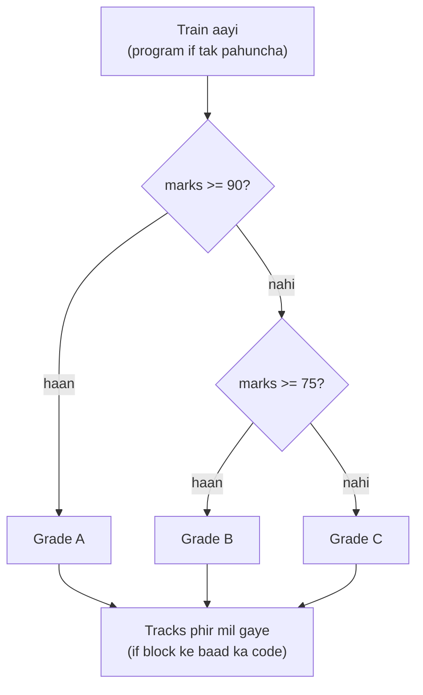

# Chapter 05 · Conditionals & Truthiness

> Ab tak tumhare programs ek seedhi single track pe chalti train jaise the: har line chalti thi, order mein, har baar. Lekin real programs ko **junctions** chahiye. "Agar password galat hai, toh error dikhao. Warna login karwa do." Bas yeh ek chhota sa shabd, *if*, ek script ko aisi cheez bana deta hai jo **decision** le sakti hai. Tum zindagi mein jo bhi app, game ya algorithm likhoge, sab isi ke upar khade hain.

**Is chapter mein tum seekhoge:**
- `if`, `elif` aur `else` kaise kaam karte hain, aur colon aur indentation itne important kyun hain
- Conditions ko kis order mein likhein taaki sahi branch jeete
- **Nesting** vs flat conditions, aur **guard clauses** jo code ko readable rakhte hain
- **Truthiness**: kaun si values true maani jaati hain, kaun si false, aur isko saaf-suthre tareeke se kaise use karein
- Ek line wala **conditional expression** (Python ka "ternary operator")
- `match`/`case` ke saath **structural pattern matching** (Python 3.10+)
- Woh classic logic problems jo interviewers ko bahut pasand hain: leap year, grades, max of three, triangle validity aur aur bhi

**Isse pehle padho:** [Chapter 02 · Variables, Data Types & Memory](02-variables-types-memory.md) · [Chapter 03 · Operators & Expressions](03-operators-expressions.md) · [Chapter 04 · Strings Deep Dive](04-strings.md)

---

## 🧠 The Big Idea · Asli Baat

Ek railway junction socho jahan ek signal operator baitha hai. Train aati hai, operator ek condition check karta hai ("Kya yeh Mumbai express hai?"), aur track switch kar deta hai. Train **sirf ek** raaste pe jaati hai, aur aage jaake saare tracks phir se mil jaate hain.



Conditional bas itna hi hai:

1. **Ek haan/na wala sawaal poocho** (koi bhi expression; Python khud decide karega ki woh true hai ya false).
2. Jawab ke hisaab se **ek block** chalao.
3. Phir baaki program ke saath **aage badho**.

Yeh "haan/na wala sawaal" zaroori nahi ki comparison hi ho. Python *kisi bhi* value ko true-jaisa ya false-jaisa judge kar sakta hai. Khaali string, zero aur `None` "na" maane jaate hain; baaki lagbhag sab kuch "haan" maana jaata hai. Is idea ko **truthiness** kehte hain, aur isi ki wajah se Python ki conditions chhoti aur expressive hoti hain.

> 🇮🇳 **Desi Analogy:** Cricket mein DRS socho. Batsman LBW appeal pe review leta hai. Third umpire ek fixed order mein check karta hai: pehle **no-ball** tha kya? Agar haan, wahi decision, baaki checks hote hi nahi. Nahi, toh **pitching in line** thi? Nahi, toh **not out**, khatam. Haan, toh **impact**? Phir **wickets hitting**? Jaise hi koi check final faisla de deta hai, umpire ruk jaata hai. Yahi `if/elif/else` chain hai: har check ek `elif` hai, upar se neeche chalte hain, aur **pehla** jo decision de de, wahi final. Aur ek baar decision ho gaya toh match aage chalta hai (yaani chain ke baad ka code).

> 💡 **The core insight:** ek `if` chain **zyada se zyada ek** branch chunti hai. Conditions **upar se neeche** check hoti hain, aur jo pehli true mili, wahin ruk jaati hai. **Order hi logic hai.**

---

## 🔨 Building It Up · Zero Se Shuru

### 1. The if statement

```python
temperature = 39

if temperature > 35:
    print("Heatwave alert!")
    print("Stay hydrated.")

print("Weather report done.")
```

```text
Heatwave alert!
Stay hydrated.
Weather report done.
```

Iski anatomy dekho:

```text
if <condition>:          <- keyword, condition, COLON
    <statement>          <- indented block (4 spaces): runs only if condition is true
    <statement>
<next statement>         <- back at the original indentation: always runs
```

Kya hua abhi: `temperature > 35` evaluate hoke `True` bana, isliye dono indented lines chali. Jo `print` indent nahi hai, woh `if` ke bahar hai, aur woh har haal mein chalegi. `temperature` ko `30` kar do, toh sirf aakhri line print hogi.

**Indentation hi block hai.** Python mein curly braces `{}` nahi hote. `if` ke neeche jitni lines indent hain, sab uski hain. Jaise hi koi line wapas bahar wale level pe aayi, block khatam.

> 🤔 **Mann mein sawaal:** Indentation 4 spaces hi kyun? 2 ya tab use karoon toh?
>
> **Jawab:** Python ko bas itna chahiye ki ek block ki saari lines **same** indentation pe hon. 2 spaces bhi technically chalega. Lekin **PEP 8** (Python ka official style guide) 4 spaces bolta hai, aur poori duniya yahi follow karti hai. Tabs aur spaces ko kabhi mix mat karna: dekhne mein same lagenge, lekin Python ke liye alag hain, aur `IndentationError` ya `TabError` aa jaayega. Apne editor ko "Tab dabao toh 4 spaces daalo" pe set kar do, bas.

### 2. if / else: two roads

```python
age = 16

if age >= 18:
    print("You can vote.")
else:
    print("You can vote in", 18 - age, "years.")
```

```text
You can vote in 2 years.
```

`else` ke saath koi condition nahi hoti: jo kuch `if` ne nahi pakda, woh **sab** `else` pakad leta hai. Dono mein se **exactly ek** block chalega. Kabhi dono nahi, kabhi koi bhi nahi aisa nahi.

### 3. elif: many roads

`elif` ("else if" ka short) se tum kai conditions ek order mein test kar sakte ho:

```python
marks = 82

if marks >= 90:
    grade = "A"
elif marks >= 75:
    grade = "B"
elif marks >= 60:
    grade = "C"
elif marks >= 40:
    grade = "D"
else:
    grade = "F"

print("Marks:", marks, "Grade:", grade)
```

```text
Marks: 82 Grade: B
```

Kya hua abhi: Python ne check kiya `82 >= 90` (nahi), phir `82 >= 75` (haan!), `grade = "B"` set kiya, aur **baaki saari branches skip kar di**. Usne `marks >= 60` ki taraf dekha tak nahi, jabki woh bhi true hai. Isi wajah se humein `elif marks >= 75 and marks < 90` likhne ki zaroorat nahi: doosri branch tak pahunchna hi is baat ka *saboot* hai ki pehli false thi.

> 🤔 **Mann mein sawaal:** Toh kya `elif marks >= 75 and marks < 90` likhna galat hai?
>
> **Jawab:** Galat nahi, bas faltu hai. Result same aayega. Lekin jab tum doosri branch pe ho, `marks < 90` already pakka hai, kyunki `marks >= 90` hota toh pehli branch hi pakad leti. Extra condition likhne se code lamba hota hai aur ek nayi jagah ban jaati hai jahan typo (jaise `< 89`) se bug ghus sakta hai. `elif` chain ka poora fayda hi yeh hai ki pichli conditions ka "nahi" automatically saath chalta hai.

### 4. Order matters

Dekho kya hota hai jab conditions galat order mein rakh di:

```python
marks = 95

if marks >= 40:
    grade = "D"        # yeh >= 40 wale SAB ko pehle hi pakad leta hai!
elif marks >= 60:
    grade = "C"
elif marks >= 90:
    grade = "A"
else:
    grade = "F"

print(grade)
```

```text
D
```

95 marks wale ko D mil gaya! Pehli true condition jeet jaati hai, isliye "kam se kam itne" (at least) wale thresholds ko **sabse specific (sabse bade) se sabse kam** ki taraf check karo. Rule of thumb: jab conditions overlap karti hain, **sabse narrow** wali pehle rakho.

> 🇮🇳 **Desi Analogy:** School ka prize distribution socho. Principal bolte hain, "Jinke 40 se upar hain, stage pe aao, participation certificate lo." Topper bhi 40 se upar hai, toh woh bhi certificate leke chala gaya. Ab jab "90 se upar wale, gold medal lo" announce hua, topper toh pehle hi jaa chuka hai. Isliye pehle gold medal (narrowest group: 90+), phir silver (75+), phir participation (40+). Narrow pehle, wide baad mein.

### 5. elif chain vs separate ifs

Yeh dono dikhte similar hain, lekin behave alag karte hain:

```python
n = 15

print("elif chain:")
if n % 3 == 0:
    print("  divisible by 3")
elif n % 5 == 0:
    print("  divisible by 5")

print("separate ifs:")
if n % 3 == 0:
    print("  divisible by 3")
if n % 5 == 0:
    print("  divisible by 5")
```

```text
elif chain:
  divisible by 3
separate ifs:
  divisible by 3
  divisible by 5
```

- **`if/elif/elif`**: mutually exclusive, yaani **zyada se zyada ek** branch chalegi.
- **separate `if`s**: har ek independent sawaal hai, **kitni bhi** chal sakti hain.

Khud se poocho: "Kya inme se ek se zyada true ho sakti hain, *aur* kya ek se zyada chalni chahiye?" Agar haan, toh separate `if`s use karo.

Example: 15 teen se bhi divide hota hai aur paanch se bhi. `elif` chain ne pehla "haan" milte hi baaki chhod diya, isliye "divisible by 5" kabhi print nahi hua. Separate `if`s mein dono sawaal alag-alag poochhe gaye.

### 6. Combining conditions with and, or, not

[Chapter 03](03-operators-expressions.md) mein jo seekha tha, usse tum complex sawaal bana sakte ho:

```python
age, has_id, is_vip = 25, False, True

if age >= 18 and has_id:
    print("Welcome in.")
elif is_vip:
    print("VIP, come right in.")
else:
    print("Sorry, no entry.")

day = "Sunday"
if day == "Saturday" or day == "Sunday":
    print("Weekend!")
if day in ("Saturday", "Sunday"):        # zyada saaf tareeka
    print("Still the weekend!")
if not (0 <= age <= 12):
    print("Not a child.")
```

```text
VIP, come right in.
Weekend!
Still the weekend!
Not a child.
```

Step by step: `age >= 18` true hai, lekin `has_id` False hai, toh `and` ka result False. Doosri branch: `is_vip` True hai, toh "VIP, come right in." Uske baad teen alag `if` hain, aur teeno true hain, toh teeno print hue.

> ⚠️ `if day == "Saturday" or "Sunday":` ek classic bug hai. Iska matlab hai `(day == "Saturday") or "Sunday"`, aur non-empty string `"Sunday"` hamesha truthy hoti hai, isliye condition **hamesha** true rahegi. `day in ("Saturday", "Sunday")` use karo.

### 7. Nested conditions

Ek `if` ke andar doosra `if` bhi daal sakte ho. Har level pe 4 spaces aur badhte hain:

```python
has_ticket = True
age = 15

if has_ticket:
    if age >= 18:
        print("Enjoy the movie!")
    else:
        print("Need an adult with you.")
else:
    print("Buy a ticket first.")
```

```text
Need an adult with you.
```

Do level tak nesting theek hai. Usse zyada hua toh code right side ki taraf khiskta jaata hai aur padhna mushkil ho jaata hai. Programmers isko **arrow anti-pattern** kehte hain (code ki shape `>` jaisi dikhti hai).

```py
# ❌ Arrow code: follow karna mushkil
if user is not None:
    if user_is_active:
        if has_permission:
            if not is_banned:
                print("Access granted")
```

### 8. Flattening: guard clauses and combined conditions

Nested code ko flat karne ke do tareeke hain.

**(a) Conditions ko combine karo** jab sirf ek hi "happy" outcome ho:

```python
user = "riya"
user_is_active, has_permission, is_banned = True, True, False

if user is not None and user_is_active and has_permission and not is_banned:
    print("Access granted")
```

```text
Access granted
```

**(b) Guard clauses: bure cases pehle sambhalo.** Har failure ko alag se check karo, uska message do, aur "sab theek hai" wala case end mein neeche gir jaaye. Script mein yeh kaam ek `if/elif` chain karti hai:

```python
balance, amount = 500, 800
account_locked = False

if account_locked:
    print("Error: account locked")
elif amount <= 0:
    print("Error: amount must be positive")
elif amount > balance:
    print("Error: insufficient balance, short by", amount - balance)
else:
    balance -= amount
    print("Withdrawn. New balance:", balance)
```

```text
Error: insufficient balance, short by 300
```

Har problem ko apna clear message milta hai, aur main logic sabse neeche, bina nesting ke baitha hai. **Functions** ke andar ([Chapter 10](10-functions.md)) guard clauses aur bhi saaf ho jaate hain, kyunki har ek turant `return` kar sakta hai:

```py
def withdraw(balance, amount):
    if amount <= 0:
        return "amount must be positive"     # guard
    if amount > balance:
        return "insufficient balance"        # guard
    return balance - amount                  # happy path, koi nesting nahi
```

> 🇮🇳 **Desi Analogy:** ATM ko dekho. Card daala: pehle check, "card blocked hai?" Haan toh wahin card wapas, kahani khatam. Phir "PIN sahi hai?" Nahi toh wahin "Incorrect PIN". Phir "balance kaafi hai?" Nahi toh "Insufficient funds". In sab guards ke baad hi machine notes ginti hai. ATM kabhi ye nahi karta ki "card theek hai toh andar jaao, PIN theek hai toh aur andar jaao..." Har guard ek gate hai: fail hua toh wahin bahar. **Happy path (paise nikalna) sabse aakhir mein, ekdum flat.**

### 9. Truthiness: every value is true or false

`if` ko `True` ya `False` hi dene ki zaroorat nahi. Tum use jo bhi doge, woh us pe `bool()` call karta hai. Yeh **falsy** values hain (baaki sab **truthy** hai):

| Falsy value | Type |
|---|---|
| `False` | bool |
| `None` | NoneType |
| `0`, `0.0`, `0j` | zero ke barabar numbers |
| `""` | khaali string |
| `[]`, `()`, `{}`, `set()`, `range(0)` | khaali collections |

```python
name = ""
items = []
count = 0
message = "hi"

if name:
    print("name is truthy")
else:
    print("name is empty")

if not items:
    print("no items")

if count:
    print("count is non-zero")
else:
    print("count is zero")

if message:
    print("message:", message)

print(bool("False"), bool("0"), bool(" "), bool([0]), bool(0.0))
```

```text
name is empty
no items
count is zero
message: hi
True True True True False
```

Kya hua abhi: `"False"`, `"0"` aur `" "` teeno non-empty strings hain, isliye truthy hain. Python string ke andar ka matlab nahi padhta, sirf dekhta hai ki khaali hai ya nahi. `[0]` ek list hai jisme ek item hai, isliye truthy hai (chahe woh item zero ho). Sirf **khaali** ya **zero** cheezein falsy hoti hain.

> 🇮🇳 **Desi Analogy:** Truthiness ko kirana store ke dabbe jaisa samjho. Dukaandaar sirf dabba hila ke dekhta hai: "kuch hai andar ya khaali?" Dabbe pe "KHAALI" likha ho (`"False"` string), lekin andar ek chit pada hai, toh dabba khaali nahi hai. Ek dabba jisme sirf ek zero-rupaye ka sikka ho (`[0]`), woh bhi khaali nahi hai. Dabba tabhi "na" hai jab sach mein kuch na ho: `""`, `[]`, `{}`. Aur numbers mein sirf `0` "na" hai.

**Pythonic style** truthiness ko seedha use karta hai:

| Instead of | Write |
|---|---|
| `if len(items) > 0:` | `if items:` |
| `if len(name) == 0:` | `if not name:` |
| `if is_valid == True:` | `if is_valid:` |
| `if is_valid == False:` | `if not is_valid:` |
| `if x != None:` | `if x is not None:` |

### 10. The None-vs-falsy trap

Truthiness convenient hai, lekin `if not x` `None` ko `0` ya `""` se alag nahi pehchaan sakta. Jab 0 ek **valid** value ho, toh `None` ko explicitly check karo:

```python
discount = 0            # ek real value hai: "koi discount nahi"

if not discount:
    print("Truthiness says: discount missing!")      # galat nateeja

if discount is None:
    print("discount was never set")
else:
    print("discount is set to", discount)            # sahi
```

```text
Truthiness says: discount missing!
discount is set to 0
```

Rule: `if x:` tab use karo jab "khaali" aur "missing" ka matlab same ho (jaise search results ki khaali list). `if x is None:` tab use karo jab zero, khaali string ya `False` bhi legit values hon.

> 🤔 **Mann mein sawaal:** `discount = 0` aur `discount = None` mein farak hi kya hai? Dono "kuch nahi" hi toh hain.
>
> **Jawab:** Bilkul nahi. `0` ka matlab hai "humne decide kiya: zero discount". `None` ka matlab hai "abhi tak kisi ne decide hi nahi kiya". Socho exam result: `0` marks ka matlab bachche ne paper diya aur zero aaya. `None` ka matlab paper check hi nahi hua. Dono ko same treat kiya toh zero wale ko "result pending" dikha doge. Isliye jab 0 meaningful ho, `is None` likho.

### 11. The conditional expression (ternary)

Jab tumhe bas **do values mein se ek chunni** ho, toh poora `if/else` block bhaari lagta hai. Python ka **conditional expression** yeh kaam ek line mein karta hai:

```text
value_if_true if condition else value_if_false
```

```python
age = 20
status = "adult" if age >= 18 else "minor"
print(status)

n = -7
print(abs_n := n if n >= 0 else -n)
print("even" if n % 2 == 0 else "odd")

items = 3
print(f"{items} item{'s' if items != 1 else ''} in cart")
```

```text
adult
7
odd
3 items in cart
```

Kya hua abhi: yeh bilkul English jaisa padhta hai, "adult if age >= 18, else minor". C ke `cond ? a : b` se ulta, yahan condition **beech mein** baithti hai. Yeh ek **expression** hai, yaani ek value banata hai jise tum assign kar sakte ho, print kar sakte ho, ya f-string ke andar daal sakte ho. Aur sirf chuni hui side evaluate hoti hai (phir se short-circuit).

Doosri line mein `abs_n := ...` walrus operator hai ([Chapter 03](03-operators-expressions.md)): woh value ko `abs_n` mein save bhi karta hai aur wahi value `print` ko bhi de deta hai. `n = -7` hai, `n >= 0` false, toh `-n` yaani `7` chuna gaya.

Tum inhe chain *kar sakte* ho, lekin readability bahut jaldi girti hai:

```python
marks = 67
grade = "A" if marks >= 90 else "B" if marks >= 75 else "C" if marks >= 60 else "F"
print(grade)
```

```text
C
```

> 💡 Ek condition: ternary badhiya hai. Do: ek baar soch lo. Teen ya zyada: `if/elif/else` use karo. Code jitni baar likha jaata hai, usse kahin zyada baar padha jaata hai.

### 12. The pass statement

Block khaali nahi ho sakta. Agar placeholder chahiye (us code ke liye jo baad mein likhoge), toh `pass` use karo, jo kuch nahi karta:

```python
score = 50
if score > 100:
    pass        # TODO: bonus levels baad mein handle karenge
else:
    print("Normal level")
```

```text
Normal level
```

`pass` ke bina khaali block `SyntaxError` hai (`IndentationError: expected an indented block`).

### 13. match-case: structural pattern matching (Python 3.10+)

Bahut saari languages mein `switch` statement hota hai. Python 3.10 ne usse bhi zyada powerful cheez add ki: **`match`**. Yeh ek value ko **patterns** ki ek series se compare karta hai, aur jo pehla pattern fit ho jaaye, uska block chalata hai.

**Literal patterns** (switch jaisa use):

```python
command = "stop"

match command:
    case "start":
        print("Starting engine")
    case "stop" | "halt":            # | ka matlab "ya"
        print("Stopping")
    case "pause":
        print("Pausing")
    case _:                          # _ wildcard hai: kuch bhi match kar leta hai
        print("Unknown command:", command)
```

```text
Stopping
```

**Guards and capture.** Pattern mein likha ek naam value ko **capture** kar leta hai (us naam mein store kar deta hai); `if` ek extra condition jodta hai (ise **guard** kehte hain):

```python
temperature = -3

match temperature:
    case 0:
        print("Exactly freezing")
    case t if t < 0:
        print(f"Below freezing by {-t} degrees")
    case t if t > 40:
        print("Scorching")
    case _:
        print("Normal")
```

```text
Below freezing by 3 degrees
```

Step by step: `-3` pehle `case 0` se compare hua, match nahi. Phir `case t if t < 0`: `t` ne `-3` capture kiya, guard `-3 < 0` true, toh yeh branch chali aur `-t` yaani `3` print hua.

**Sequence patterns** *shape* se match karte hain: kitne items hain aur unme kya hai. Yahin pe `match` kisi bhi `if` chain ko peeche chhod deta hai. (Lists aur tuples [Chapter 07](07-lists.md) aur [Chapter 08](08-tuples-sets.md) mein aayenge.)

```python
command = "move north 3"

match command.split():
    case ["quit"]:
        print("Bye!")
    case ["look"]:
        print("You see a dark room.")
    case ["move", direction]:
        print("Moving", direction, "by 1 step")
    case ["move", direction, steps]:
        print("Moving", direction, "by", steps, "steps")
    case _:
        print("I don't understand.")
```

```text
Moving north by 3 steps
```

Kya hua abhi: `command.split()` se mila `["move", "north", "3"]`. Pehle do patterns ko exactly ek item chahiye, toh woh fail. `["move", direction]` ko exactly do chahiye, woh bhi fail. `["move", direction, steps]` fit ho gaya: literal `"move"` match hua, aur naam `direction` aur `steps` ne `"north"` aur `"3"` ko **capture** kar liya. (Dhyaan do: `steps` string `"3"` hai, number nahi, kyunki `split()` strings hi deta hai.)

> 🇮🇳 **Desi Analogy:** Sequence pattern ko post office ke sorting counter jaisa socho. Postman letter ko padhta nahi, pehle uski *shape* dekhta hai: "sirf ek line likhi hai? Local dabba. Teen line, pehli line 'Speed Post'? Speed Post wala dabba, aur baaki do lines (naam, sheher) note kar lo." `case ["move", direction, steps]` bilkul yahi hai: shape check (teen items, pehla "move") aur saath mein baaki values nikaal ke variables mein rakh lena.

**Mapping patterns** dictionaries ko keys se match karte hain ([Chapter 09](09-dictionaries.md)), JSON jaise data ke liye perfect:

```python
event = {"type": "click", "x": 120, "y": 45}

match event:
    case {"type": "click", "x": x, "y": y}:
        print(f"Clicked at ({x}, {y})")
    case {"type": "keypress", "key": key}:
        print("Pressed", key)
    case _:
        print("Unknown event")
```

```text
Clicked at (120, 45)
```

Mapping pattern mein dictionary mein *extra* keys hon toh bhi chalega; pattern sirf un keys ko dekhta hai jo usme likhi hain.

> ⚠️ **The famous match trap:** `case` mein akela (bare) naam **capture** karta hai, compare nahi karta.
>
> ```py
> STOP = "stop"
> match command:
>     case STOP:          # ❌ captures ANY value into a new name STOP
>         ...
>     case "go":          # SyntaxError: name capture 'STOP' makes remaining patterns unreachable
>         ...
> ```
>
> Yaani `case STOP:` ka matlab "kya command STOP ke barabar hai?" nahi hai. Iska matlab hai "jo bhi aaye, use ek naye variable `STOP` mein daal do". Kisi constant se compare karna ho toh **dotted name** use karo (jaise Enum ya class ka `Command.STOP`, [Chapter 17](17-modules-stdlib.md)), ya literal, ya guard: `case c if c == STOP:`.

**if/elif vs match**: `match` tab use karo jab tum **ek subject** ko kai **shapes** ya **literal values** se check kar rahe ho. Ranges aur aapas mein unrelated conditions (`marks >= 90`, `is_vip and age > 60`) ke liye `if/elif` use karo.

---

## 🔬 Under the Hood · Andar Ki Kahani

### How if compiles: conditional jumps

CPU blocks ko "skip" nahi karta. Woh **jump** karta hai. Python ek `if` ko bytecode mein compile karta hai jo pehle condition evaluate karta hai, aur agar result falsy hai toh block ke aage jump kar jaata hai:

```py
import dis
dis.dis("if x > 5:\n    y = 1\nelse:\n    y = 2")
```

Simplify karke, bytecode kuch aisa dikhta hai (exact naam Python version ke hisaab se badalte hain):

```text
LOAD_NAME          x
LOAD_CONST         5
COMPARE_OP         >
POP_JUMP_IF_FALSE  -> else_part
LOAD_CONST         1
STORE_NAME         y
JUMP_FORWARD       -> end
else_part:
LOAD_CONST         2
STORE_NAME         y
end:
```

Line by line padho: `x` aur `5` ko stack pe rakho, compare karo. `POP_JUMP_IF_FALSE`: agar result false hai toh seedha `else_part` pe kood jao. Warna `y = 1` karo, aur phir `JUMP_FORWARD` se `else` wale hisse ke upar se kood ke `end` pe pahuncho. Yaani "block skip karna" asal mein bas ek jump hai.

Toh `if/elif/elif/else` chain jisme k branches hain, woh bas sequence mein k tests aur jumps hai. Worst case mein checking ka cost **O(k)** hai, isliye bahut hot code (jo laakhon baar chalta hai) mein **sabse common** case ko pehle rakhna farak daal sakta hai.

### How truthiness is decided

Jab Python ko `bool(x)` chahiye hota hai:

1. Agar `x` `True`, `False` ya `None` hai, toh jawab turant mil jaata hai.
2. Warna, agar `x` ke type mein `__bool__` defined hai, toh usse call karo.
3. Warna, agar `__len__` defined hai, toh object tab truthy hai jab `len(x) != 0`.
4. Warna, woh **truthy** hai (jis object mein yeh dono nahi, use "kuch toh hai" maana jaata hai).

Isi wajah se khaali collections falsy hote hain (unki length 0 hai), aur isi wajah se tumhari apni classes apni truthiness khud define kar sakti hain ([Chapter 15](15-oop-inheritance-magic.md)). `if items:` andar se `len` call karta hai, jo built-in collections ke liye **O(1)** hai (length pehle se stored rehti hai, ginni nahi padti).

### match is not a jump table

C mein integers pe `switch` ek **jump table** mein compile ho sakta hai jo **O(1)** mein seedha sahi case pe pahunch jaata hai. Python ka `match` aisa **nahi** karta: woh har `case` ko **upar se neeche** try karta hai, bilkul `if/elif` chain ki tarah, aur pehla jo match ho use chalata hai. Uski taakat speed mein nahi, **destructuring** mein hai (sequences aur mappings ki shape check karte hue unme se values nikaalna). Agar tumhe bahut saari keys pe O(1) dispatch chahiye, toh ek **dictionary** use karo jo keys ko values ya functions se map kare ([Chapter 09](09-dictionaries.md)):

```python
prices = {"chai": 20, "coffee": 40, "lassi": 50}
order = "coffee"
print(prices.get(order, "not on menu"))
print(prices.get("pizza", "not on menu"))
```

```text
40
not on menu
```

> 🇮🇳 **Desi Analogy:** `if/elif` ya `match` chain waise hai jaise chai tapri wale bhaiya rate batane ke liye menu board pe upar se neeche ungli chalate hain: chai? nahi. coffee? haan, 40. Dictionary waise hai jaise unhe saare rate ratte hue hain: tumne "coffee" bola, turant "40", bina board dekhe. Items 3-4 hon toh farak nahi padta. 300 hon toh dictionary hi jeetegi.

### The ternary is lazy

`a if cond else b` pehle `cond` evaluate karta hai, phir `a` ya `b` mein se **sirf ek**. Isliye `x / y if y != 0 else 0` safe hai: jab `y` 0 hai, division kabhi hota hi nahi, toh `ZeroDivisionError` ka sawaal hi nahi.

---

## 🧩 Pattern Decoder · Pattern Pakdo

### Pythonic conditional idioms

| Situation | Pythonic | Avoid |
|---|---|---|
| Empty check | `if not items:` | `if len(items) == 0:` |
| Boolean flag | `if is_ready:` | `if is_ready == True:` |
| None check | `if x is None:` | `if x == None:` |
| Kai values mein se ek | `if day in ("Sat", "Sun"):` | `if day == "Sat" or "Sun":` |
| Range check | `if 0 <= i < n:` | `if i >= 0 and i < n:` |
| Value chunna | `x = a if cond else b` | sirf assign karne ke liye 4-line if/else |
| Boolean return karna | `is_even = n % 2 == 0` | `if n % 2 == 0: is_even = True else: ...` |
| Bahut saare fixed options | `match cmd:` ya dict lookup | 10-branch `elif ==` chain |
| Default value | `name = name or "Guest"` (agar "" ka matlab missing hai) | |
| Failure cases | pehle handle karo, happy path aakhir mein | deep nesting |

Woh "boolean return karna" wali row ek demo deserve karti hai. Beginners aisa likhte hain:

```py
if age >= 18:
    can_vote = True
else:
    can_vote = False
```

Comparison **khud hi** ek boolean hai:

```python
age = 20
can_vote = age >= 18
print(can_vote)
```

```text
True
```

> 🤔 **Mann mein sawaal:** `name = name or "Guest"` kaise kaam karta hai? `or` toh True/False deta hai na?
>
> **Jawab:** Nahi, Python ka `or` True/False nahi, **operands mein se ek** return karta hai. `a or b`: agar `a` truthy hai toh `a`, warna `b`. Toh `name` khaali string hai (falsy) toh result `"Guest"`; `name = "Riya"` hai toh `"Riya"`. Lekin yaad rakho, yahi trap bhi hai: agar `0` valid value hai (jaise `qty = qty or 1`), toh `0` bhi badal ke `1` ban jaayega.

### How conditionals show up in DSA

- Grids mein **bounds checks**: `if 0 <= r < rows and 0 <= c < cols and grid[r][c] == 1:`. Short-circuiting ka matlab hai ki `grid[r][c]` tabhi padha jaata hai jab indexes valid hon, warna IndexError aa jaata ([DSA Chapter 16](../part-2-dsa/16-graphs-bfs-dfs.md)).
- Binary search mein **three-way comparisons**: `if nums[mid] == target ... elif nums[mid] < target ... else ...` ([DSA Chapter 08](../part-2-dsa/08-binary-search.md)).
- Recursion mein **base cases**: `if n <= 1: return n` ([Chapter 12](12-recursion.md)).
- Two pointers mein **pointer decisions**: "agar sum bahut bada hai, right ko move karo; warna left ko" ([DSA Chapter 03](../part-2-dsa/03-two-pointers.md)).
- **Best answer update karna**: `if current > best: best = current` (ya `best = max(best, current)`).
- **Edge cases pehle**: `if not nums: return 0` zyaadatar interview solutions ki sabse pehli line hoti hai. Interviewers isko dhyaan se dekhte hain.

### Decoding classic logic problems

**Leap year.** 4 se divisible ho, lekin centuries (100 se divisible) nahi, lekin woh centuries chalegi jo 400 se divisible hain.

```python
year = 1900

if year % 400 == 0:
    is_leap = True
elif year % 100 == 0:
    is_leap = False
elif year % 4 == 0:
    is_leap = True
else:
    is_leap = False

print(year, "leap" if is_leap else "not leap")
print((year % 4 == 0 and year % 100 != 0) or year % 400 == 0)   # ek line wala version
```

```text
1900 not leap
False
```

Order dekho: **sabse specific** rule (÷400) pehle, phir ÷100, phir ÷4. Ulta kar do toh 1900 galti se leap year gin liya jaayega (kyunki `1900 % 4 == 0` hai, aur ÷4 wala check pehle hi "haan" bol dega).

Kuch examples dimaag mein fit karne ke liye: 2024 (÷4, century nahi) → leap. 1900 (century, ÷400 nahi) → not leap. 2000 (÷400) → leap. 2023 (÷4 nahi) → not leap.

**Max of three (without `max()`).**

```python
a, b, c = 12, 45, 27

if a >= b and a >= c:
    largest = a
elif b >= c:            # yahan tak pahunche matlab a sabse bada nahi hai
    largest = b
else:
    largest = c

print(largest)
print(max(a, b, c))     # built-in, real code ke liye
```

```text
45
45
```

`>` ki jagah `>=` use karne se ties sahi handle hote hain. (Jaise `a, b, c = 9, 9, 3`: `>=` ke saath pehli hi branch `a` ko largest bana deti hai, saaf aur sahi.) Ek alternative jo scale karta hai: `largest = a` se shuru karo, phir `if b > largest: largest = b`, phir `if c > largest: largest = c`. Yeh "running best" pattern [Chapter 06](06-loops.md) mein loop ban jaayega.

**Triangle validity and type.** Teen sides tabhi triangle banati hain jab **har side baaki do ke sum se chhoti ho** (triangle inequality), aur saari positive hon.

```python
a, b, c = 5, 5, 8

if a <= 0 or b <= 0 or c <= 0:
    print("Sides must be positive")
elif a + b <= c or a + c <= b or b + c <= a:
    print("Not a valid triangle")
elif a == b == c:
    print("Equilateral")
elif a == b or b == c or a == c:
    print("Isosceles")
else:
    print("Scalene")
```

```text
Isosceles
```

Pehle guards (invalid input), phir sabse specific valid type (equilateral, kyunki equilateral triangle technically isosceles bhi hota hai), phir general cases. Isosceles ko upar rakh diya toh 5, 5, 5 wala triangle bhi "Isosceles" bol diya jaayega.

### Dry run: grade calculator for marks = 74

| Check | Condition | Result | Action |
|---|---|---|---|
| 1 | `74 >= 90` | False | aage |
| 2 | `74 >= 75` | False | aage |
| 3 | `74 >= 60` | True | `grade = "C"`, baaki skip |

### When NOT to use a long if/elif chain

- **Key ko value se map karna** (`if code == "IN": ... elif code == "US": ...`) → dictionary use karo.
- **Bahut saare items pe same condition check karna** → loop ke saath `any()`/`all()` ([Chapter 06](06-loops.md), [Chapter 11](11-comprehensions-functional.md)).
- **Behaviour jo object ke type ke hisaab se badalta hai** → polymorphism ([Chapter 15](15-oop-inheritance-magic.md)).

---

## ⚠️ Traps & Common Mistakes · Yahan Sab Phisalte Hain

1. **Colon bhool jaana.** `if x > 5` → `SyntaxError: expected ':'`.

2. **`==` ki jagah `=` likh dena.** `if x = 5:` → `SyntaxError: invalid syntax. Maybe you meant '==' or ':=' instead of '='?`. Shukar hai, Python isse pakad toh leta hai.

3. **Inconsistent indentation.**

```py
if ready:
    print("one")
      print("two")     # ❌ IndentationError: unexpected indent
```

4. **`x == a or x == b` ki jagah `x == a or b`.**

```py
if colour == "red" or "blue":       # ❌ hamesha True
if colour in ("red", "blue"):       # ✅
```

5. Overlapping conditions mein **galat branch order**: `>= 40` ko `>= 90` se pehle rakha toh sabko D milega. Narrowest pehle.

6. **Jab 0 valid ho tab `if not x`.** `if x is None` use karo.

7. **`== True` se compare karna.** `if flag == True:` truthy non-bool values ke saath anjaane mein fail ho jaata hai, jaise `2` ya `"yes"` (`1 == True` toh `True` hai, lekin `2 == True` aur `"yes" == True` dono `False` hain, jabki dono truthy hain). Aur waise bhi yeh bas noise hai. `if flag:` likho.

8. **Conditions mein floats ko `==` se compare karna.** `if 0.1 + 0.2 == 0.3:` `False` deta hai (floating point ki chhoti si rounding ki wajah se `0.1 + 0.2` asal mein `0.30000000000000004` hai). `abs(a - b) < 1e-9` use karo.

9. **Case-sensitive string checks.** `if answer == "yes":` `"Yes"` ke liye fail ho jaayega. Normalise karo: `if answer.strip().lower() == "yes":`.

10. **Nested ternaries ka overuse.** `a if x else b if y else c if z else d` legal hai, lekin padha nahi jaata. `if/elif` use karo.

11. **match mein `case NAME:`** compare karne ki jagah capture karta hai. Literals, dotted names ya guards use karo.

12. **Variables jo sirf ek branch mein define hue.**

```py
if score > 50:
    result = "pass"
print(result)     # ❌ score <= 50 hone pe NameError: result kabhi bana hi nahi
```

Fix: har branch mein usko value do (ek `else` add karo), ya `if` se pehle ek default set kar do.

---

## 💡 Tips & Tricks · Pro Wale Moves

- **Edge cases pehle** likho: khaali input, zero, negative numbers, barabar values. Interviewers un candidates ko pasand karte hain jo bolte hain "first, let me handle the empty case".
- Comparison already ek boolean hai: `is_adult = age >= 18`.
- Bade option lists ke liye `x in {"a", "b", "c"}` (ek set) **O(1)** hai ([Chapter 08](08-tuples-sets.md)).
- `min(max(value, low), high)` kisi value ko bina `if` ke ek range mein clamp kar deta hai. (Jaise volume ko 0 se 100 ke beech rakhna: `min(max(v, 0), 100)`.)
- "Number ka sign" ke liye: `(n > 0) - (n < 0)` 1, 0 ya -1 deta hai (bools bhi ints hain! `True` = 1, `False` = 0).
- Ternary f-strings ke andar chamakte hain: `f"{n} file{'s' if n != 1 else ''}"`.
- Jab ek hi variable pe chain 4–5 `elif ==` branches se lambi ho jaaye, toh dict ya `match` uthao.
- Har branch ko test karo: aise inputs chuno jo har path ko kam se kam ek baar hit karein, plus boundaries (exactly 90, 89, 75...). Boundary values zyaadatar bugs pakad leti hain (`>` vs `>=`).

---

## 🎯 Interview Questions · Interview Mein Yahi Poochenge

### 1. What values are considered falsy in Python? 🔥🔥🔥

<details><summary>Answer dekho 👀</summary>

`False`, `None`, numeric zeros (`0`, `0.0`, `0j`, `Decimal(0)`, `Fraction(0, 1)`), aur khaali collections/sequences (`""`, `[]`, `()`, `{}`, `set()`, `range(0)`, `b""`). Baaki sab default se truthy hai, including `"0"`, `"False"`, `" "` aur `[0]`.

Custom objects ke liye Python `__bool__` call karta hai, woh na mile toh `__len__` pe fallback karta hai; dono na hon toh object truthy hai.

> 🗣️ **Interview mein aise bolo:** "The falsy values are False, None, numeric zeros like 0 and 0.0, and empty containers such as an empty string, list, tuple, dict, set or range. Everything else is truthy, including strings like '0' or 'False' and a list containing a zero. For custom objects, Python calls `__bool__`, then falls back to `__len__`, and otherwise treats the object as truthy."

</details>

### 2. What is the ternary operator in Python? 🔥🔥🔥

<details><summary>Answer dekho 👀</summary>

Python ka **conditional expression**: `value_if_true if condition else value_if_false`. Yeh pehle condition evaluate karta hai aur phir sirf chuni hui branch.

```python
n = 7
parity = "even" if n % 2 == 0 else "odd"
print(parity)
```

```text
odd
```

C ke `cond ? a : b` se alag, yahan condition beech mein hoti hai. Yeh ek expression hai (value banata hai), statement nahi, isliye function calls, f-strings aur comprehensions ke andar ja sakta hai.

> 🗣️ **Interview mein aise bolo:** "Python's ternary is the conditional expression: `a if condition else b`. The condition is evaluated first, and only the chosen branch is evaluated, so it's lazy. Because it's an expression, I can use it inside f-strings, function arguments or comprehensions, but I avoid nesting it for readability."

</details>

### 3. Does Python have a switch statement? 🔥🔥

<details><summary>Answer dekho 👀</summary>

Classic wala nahi. 3.10 se pehle idioms the `if/elif` chains ya **dictionary dispatch** (`handlers.get(key, default)`). Python **3.10** ne `match`/`case` add kiya (**structural pattern matching**, PEP 634), jo woh sab kar sakta hai jo switch karta hai (literal values, `|` alternatives, `_` default), plus sequences, mappings aur objects ki destructuring, captures aur guards. C ke switch se alag, yahan cases ke beech koi fall-through nahi hota, `break` ki zaroorat nahi, aur cases upar se neeche try hote hain (jump table nahi).

> 🗣️ **Interview mein aise bolo:** "Not a classic switch. Before 3.10 we used if/elif chains or dictionary dispatch. Since Python 3.10 there's `match`/`case`, structural pattern matching, which handles literals, alternatives with a pipe, and a wildcard default, and can also destructure sequences and dicts with guards. There's no fall-through, and cases are tried top to bottom rather than through a jump table."

</details>

### 4. What's the difference between `if x:` and `if x is not None:`? 🔥🔥🔥

<details><summary>Answer dekho 👀</summary>

`if x:` **truthiness** test karta hai, toh yeh `None` ke liye **aur** `0`, `""`, `[]`, `False` waghera ke liye bhi false hai. `if x is not None:` **sirf** `None` ke liye false hai. Explicit form tab use karo jab zero/khaali values valid hon (0 ka price, ek khaali string jo user ne jaan-boojh ke daali, ek khaali list jo "abhi load nahi hua" se alag hai). Inko mix karna ek classic production bug hai.

> 🗣️ **Interview mein aise bolo:** "`if x:` checks truthiness, so it's false for None but also for 0, empty strings, empty lists and False. `if x is not None:` is false only for None. I use the explicit None check whenever zero or empty is a legitimate value, like a price of zero, because otherwise that valid value gets treated as missing."

</details>

### 5. What's the difference between multiple if statements and an if/elif chain? 🔥🔥

<details><summary>Answer dekho 👀</summary>

`if/elif/else` chain mein conditions order mein check hoti hain aur **zyada se zyada ek** block chalta hai: pehla jiski condition true ho; baad wali conditions evaluate bhi nahi hoti. Separate `if` statements mein **har** condition evaluate hoti hai aur **har** true wali apna block chalati hai. Mutually exclusive categories (grades) ke liye `elif`, independent checks (validation messages jo saare ek saath apply ho sakte hain) ke liye separate `if`s.

</details>

### 6. Write a program to check if a year is a leap year. 🔥🔥🔥

<details><summary>Answer dekho 👀</summary>

Rules: 400 se divisible → leap; warna 100 se divisible → not leap; warna 4 se divisible → leap; warna not leap.

```python
year = 2024
is_leap = year % 4 == 0 and (year % 100 != 0 or year % 400 == 0)
print(is_leap)
year = 2100
print(year % 4 == 0 and (year % 100 != 0 or year % 400 == 0))
```

```text
True
False
```

Real code mein standard library ka `calendar.isleap(year)` yahi kaam karta hai ([Chapter 17](17-modules-stdlib.md)).

> 🗣️ **Interview mein aise bolo:** "A year is a leap year if it's divisible by 4 and not by 100, unless it's also divisible by 400. In one expression: `year % 4 == 0 and (year % 100 != 0 or year % 400 == 0)`. So 2000 is a leap year, while 1900 and 2100 are not. In production I'd just call `calendar.isleap`."

</details>

### 7. Find the largest of three numbers without using max(). 🔥🔥

<details><summary>Answer dekho 👀</summary>

```python
a, b, c = 8, 21, 21
largest = a
if b > largest:
    largest = b
if c > largest:
    largest = c
print(largest)
```

```text
21
```

"Running best" approach har pair ko compare karne se zyada saaf hai aur naturally n numbers ke loop tak extend ho jaata hai. Edge cases mention karo: ties (handle ho gaye, kyunki humein sirf value chahiye) aur mixed int/float (koi dikkat nahi).

</details>

### 8. What does `pass` do? How is it different from `continue` and `break`? 🔥🔥

<details><summary>Answer dekho 👀</summary>

`pass` **kuch nahi** karta; yeh ek placeholder hai wahan jahan Python syntax ko ek statement chahiye (khaali `if` block, function ya class). `continue` loop ki current iteration ka baaki hissa skip karta hai, aur `break` loop se poori tarah bahar nikal jaata hai ([Chapter 06](06-loops.md)). `pass` ka control flow pe koi asar nahi.

</details>

### 9. Why does `if x == 1 or 2:` always run? 🔥🔥

<details><summary>Answer dekho 👀</summary>

Precedence: yeh `(x == 1) or 2` hai. Jab `x != 1`, expression `2` evaluate hota hai, jo truthy hai, isliye block hamesha chalta hai. `x == 1 or x == 2` ya `x in (1, 2)` likho.

</details>

### 10. In a match statement, why does `case SOME_CONSTANT:` behave strangely? 🔥

<details><summary>Answer dekho 👀</summary>

Pattern mein ek bare (bina dot wala) naam **capture pattern** hota hai: yeh **kuch bhi** match kar leta hai aur value ko us naam se bind kar deta hai, tumhare constant ko overwrite karke. Agar aisa irrefutable (hamesha match hone wala) pattern aakhri na ho, toh Python `SyntaxError` bhi deta hai. Constant se compare karne ke liye **dotted name** (`case Color.RED:` ya `case config.STOP:`), literal, ya guard (`case x if x == STOP:`) use karo.

</details>

### 11. How do you check whether a list or string is empty? 🔥🔥

<details><summary>Answer dekho 👀</summary>

Truthiness use karo: `if not items:` (khaali) aur `if items:` (non-empty). PEP 8 yahi style recommend karta hai; yeh chhota hai aur kisi bhi collection type pe chalta hai. `len(items) == 0` bhi chalta hai lekin kam idiomatic hai. Agar `items` `None` bhi ho sakta hai, toh `if not items:` `None` aur khaali ko same treat karta hai; dono mein farak karna ho toh `if items is None:` use karo.

</details>

### 12. Can you use `and`/`or` instead of if/else? What's the risk? 🔥

<details><summary>Answer dekho 👀</summary>

Purana trick `cond and a or b` ternary ki nakal karta hai, lekin **jab `a` falsy ho tab fail ho jaata hai**: `True and 0 or 5` `5` deta hai, `0` nahi. (Kyunki `True and 0` → `0`, phir `0 or 5` → `5`.) Python 2.5 se asli conditional expression `a if cond else b` use karo, jisme yeh trap nahi hai. Defaults ke liye `x or default` ab bhi badhiya idiom hai, jab har falsy value replace honi chahiye.

</details>

---

## 🏋️ Practice · Ab Tumhari Baari

**🟢 1. Sign of a number.** `n = -12` ke liye `positive`, `negative` ya `zero` print karo. `0` aur `5` se bhi test karo.

<details><summary>Solution dekho 👀</summary>

```python
n = -12
if n > 0:
    print("positive")
elif n < 0:
    print("negative")
else:
    print("zero")
```

```text
negative
```

`else` mein koi condition likhne ki zaroorat nahi: jo na positive hai na negative, woh zero hi hai.

</details>

**🟢 2. Vowel or consonant.** Ek single character `ch = "E"` ke liye print karo ki woh vowel hai, consonant hai, ya letter hi nahi hai.

<details><summary>Solution dekho 👀</summary>

```python
ch = "E"
if not ch.isalpha():
    print("not a letter")
elif ch.lower() in "aeiou":
    print("vowel")
else:
    print("consonant")
```

```text
vowel
```

Guard (letter hi nahi hai) pehle aata hai; `.lower()` check ko case-insensitive bana deta hai. Guard pehle kyun? Kyunki `"7"` jaisa character vowel nahi hai, toh guard ke bina woh galti se "consonant" ban jaata.

</details>

**🟢 3. Ternary drill.** Sirf conditional expressions use karke, `score = 39` ke liye `"pass"`/`"fail"` print karo (pass mark 40), aur `x = 4, y = 9` mein se bada wala.

<details><summary>Solution dekho 👀</summary>

```python
score = 39
print("pass" if score >= 40 else "fail")
x, y = 4, 9
print(x if x > y else y)
```

```text
fail
9
```

</details>

**🟡 4. Electricity bill.** Units slabs mein charge hote hain: pehle 100 units ₹5 pe, agle 100 (101–200) ₹7 pe, 200 se upar sab ₹10 pe. `units = 250` ka bill nikalo.

<details><summary>Solution dekho 👀</summary>

```python
units = 250

if units <= 100:
    bill = units * 5
elif units <= 200:
    bill = 100 * 5 + (units - 100) * 7
else:
    bill = 100 * 5 + 100 * 7 + (units - 200) * 10

print("Bill: Rs", bill)
```

```text
Bill: Rs 1700
```

500 + 700 + 50 × 10 = 1700. Slab problems campus tests ke favourite hain; hamesha boundary values check karo (100, 101, 200, 201). Dhyaan do: 250 units ka matlab poore 250 pe ₹10 nahi. Pehle 100 ka rate alag, agle 100 ka alag, sirf bache hue 50 pe ₹10. Bilkul income tax slabs ki tarah.

</details>

**🟡 5. Quadrant finder.** Point `(x, y) = (-3, 4)` ke liye print karo ki woh kaunse quadrant mein hai, ya kisi axis pe hai, ya origin pe. Isse `if/elif` se bhi karo aur `match` se bhi.

<details><summary>Solution dekho 👀</summary>

```python
x, y = -3, 4

if x == 0 and y == 0:
    print("origin")
elif x == 0:
    print("on the y-axis")
elif y == 0:
    print("on the x-axis")
elif x > 0 and y > 0:
    print("quadrant I")
elif x < 0 and y > 0:
    print("quadrant II")
elif x < 0 and y < 0:
    print("quadrant III")
else:
    print("quadrant IV")

match (x > 0) - (x < 0), (y > 0) - (y < 0):      # signs: -1, 0 ya 1
    case 0, 0:
        print("origin")
    case 0, _:
        print("on the y-axis")
    case _, 0:
        print("on the x-axis")
    case 1, 1:
        print("quadrant I")
    case -1, 1:
        print("quadrant II")
    case -1, -1:
        print("quadrant III")
    case _:
        print("quadrant IV")
```

```text
quadrant II
quadrant II
```

`match` version pehle har coordinate ko uske sign mein badalta hai (`(n > 0) - (n < 0)` -1, 0 ya 1 deta hai), phir us pair ko match karta hai. Yeh ek table jaisa padhta hai. `(-3, 4)` ke liye signs `(-1, 1)` bane, jo `case -1, 1` se match hua.

</details>

**🟡 6. Triangle by angles.** Teen angles `a, b, c = 90, 45, 45` diye hain. Check karo ki yeh valid triangle banate hain (saare positive, sum 180), phir classify karo: right, obtuse ya acute.

<details><summary>Solution dekho 👀</summary>

```python
a, b, c = 90, 45, 45

if a <= 0 or b <= 0 or c <= 0 or a + b + c != 180:
    print("invalid triangle")
elif a == 90 or b == 90 or c == 90:
    print("right triangle")
elif a > 90 or b > 90 or c > 90:
    print("obtuse triangle")
else:
    print("acute triangle")
```

```text
right triangle
```

Pehle guard (invalid), phir specific types. Ek triangle mein ek se zyada 90° ya ek se zyada obtuse angle ho hi nahi sakta (sum 180 se upar chala jaayega), isliye in checks ka order safe hai.

</details>

**🟡 7. Calculator with match.** `a, op, b = 17, "/", 4` diya hai. `op` pe `match` use karke `+ - * / // % **` compute karo. Division by zero aur unknown operators handle karo.

<details><summary>Solution dekho 👀</summary>

```python
a, op, b = 17, "/", 4

match op:
    case "+":
        print(a + b)
    case "-":
        print(a - b)
    case "*":
        print(a * b)
    case "/" | "//" | "%" if b == 0:
        print("Error: division by zero")
    case "/":
        print(a / b)
    case "//":
        print(a // b)
    case "%":
        print(a % b)
    case "**":
        print(a ** b)
    case _:
        print("Unknown operator", op)
```

```text
4.25
```

Guard wala case `"/" | "//" | "%" if b == 0` normal division cases se *pehle* baitha hai, isliye khatarnaak inputs ko pehle hi pakad leta hai. Yahan `b = 4` hai, toh guard false hua, aur `case "/"` ne `17 / 4 = 4.25` print kiya.

</details>

**🔴 8. Valid date checker.** `day, month, year = 29, 2, 2023` diya hai. Print karo ki yeh valid calendar date hai ya nahi. 30/31 din wale months aur leap years ka dhyaan rakho.

<details><summary>Solution dekho 👀</summary>

```python
day, month, year = 29, 2, 2023

is_leap = year % 4 == 0 and (year % 100 != 0 or year % 400 == 0)

if month in (1, 3, 5, 7, 8, 10, 12):
    days_in_month = 31
elif month in (4, 6, 9, 11):
    days_in_month = 30
elif month == 2:
    days_in_month = 29 if is_leap else 28
else:
    days_in_month = 0          # invalid month: koi bhi day valid nahi ho sakta

valid = year >= 1 and 1 <= day <= days_in_month
print(f"{day:02}/{month:02}/{year}:", "valid" if valid else "invalid")
```

```text
29/02/2023: invalid
```

Galat month ke liye `days_in_month = 0` set karna ek badhiya trick hai: aakhri range check `1 <= day <= 0` apne aap false ho jaata hai, toh koi extra branch nahi chahiye. 2023 leap year nahi hai, isliye February mein sirf 28 din, aur 29 invalid.

</details>

**🔴 9. Rock, paper, scissors judge.** `p1, p2 = "rock", "scissors"` diya hai. Print karo kaun jeeta, ya `draw`, ya `invalid move`. Moves ke **pair** pe `match` use karo.

<details><summary>Solution dekho 👀</summary>

```python
p1, p2 = "rock", "scissors"
VALID = ("rock", "paper", "scissors")

if p1 not in VALID or p2 not in VALID:
    print("invalid move")
elif p1 == p2:
    print("draw")
else:
    match p1, p2:
        case ("rock", "scissors") | ("scissors", "paper") | ("paper", "rock"):
            print("player 1 wins")
        case _:
            print("player 2 wins")
```

```text
player 1 wins
```

Pehle guards (invalid, draw), phir sirf teen winning pairs list karne padte hain: agar player 1 nahi jeeta aur draw bhi nahi hai, toh player 2 jeeta. "Sabse chhota cases ka set kya hai?" yeh sochna ek core interview skill hai. 9 combinations ko 9 branches mein likhne ki jagah humne 4 branches mein kaam khatam kar diya.

</details>

---

## 🧠 Never-Forget Summary · Kabhi Mat Bhoolna

- `if cond:` + ek **indented block**. Aur options ke liye `elif`, "baaki sab" ke liye `else`.
- `if/elif/else` chain **zyada se zyada ek** branch chalati hai: upar se neeche, **pehli** true wali.
- Overlapping conditions → **narrowest pehle**.
- Separate `if`s = independent checks; `elif` = mutually exclusive.
- **Falsy:** `False`, `None`, `0`, `0.0`, `""`, aur khaali collections. Baaki sab truthy hai (`"0"` aur `"False"` bhi).
- Khaalipan ke liye `if items:` / `if not items:`; jab 0/"" valid hon tab `if x is None:`.
- **Guard clauses**: failure cases pehle handle karo, happy path flat rakho.
- Ternary: `a if cond else b`. Sirf ek level, please.
- `match`/`case` (3.10+): literals, `|`, `_`, captures, guards, sequence aur mapping shapes. Bare names **capture** karte hain, compare nahi.
- `pass` kuch-na-karne wala placeholder hai.
- Comparison already ek bool hai: `is_adult = age >= 18`.

**Memory hooks:**
- **"First True Wins."**
- **"Narrow before Wide"** (90 before 75 before 60).
- **"Zero, None, Nothing, Nada"**: zeros, `None`, aur khaali cheezein falsy hain.
- **"Bouncer at the door"**: guard clauses bure cases ko entrance pe hi rok dete hain, toh andar ki party simple rehti hai.
- **"Bare names grab, dotted names check"** `match` mein.

**🪝 Yaad rakhne ka jugaad:** **"Pehla sach, baaki bach."** `if/elif` chain mein jo pehli condition sach nikli, wahi chalegi, baaki sab bach jaayengi (skip). Aur falsy ke liye socho **"Khaali dabba, zero paisa, None ka bhaisa"**: khaali cheez, zero aur `None`, teeno "na" bolte hain. Baaki sab "haan". Aur `match` ke liye: **"Akela naam = jhola (sab pakad lo), dot wala naam = tarazu (tol ke compare karo)."**

**One picture:**

| Tool | Shape | Use it for |
|---|---|---|
| `if` | ek optional block | "yeh sirf tab karo jab..." |
| `if/else` | do mein se exactly ek | haan/na decisions |
| `if/elif/else` | kai mein se pehla true | categories, ranges, grades |
| separate `if`s | kitne bhi | independent checks |
| `a if c else b` | value | inline value chunna |
| `match/case` | pehla matching pattern | commands, shapes, fixed options |
| dict lookup | O(1) key → value | bahut saare fixed key mappings |
| truthiness | `if x:` | empty/zero/None checks |

> **Agar sirf ek cheez yaad rakhni hai:** `if/elif` chain upar se check karti hai aur sirf pehli true branch chalati hai, isliye sabse specific conditions pehle rakho, aur bure cases ko acche cases se pehle sambhalo.

---
**Aage:** [Chapter 06 · Loops & Iteration](06-loops.md)  ·  **Wapas** [Contents](../README.md)
