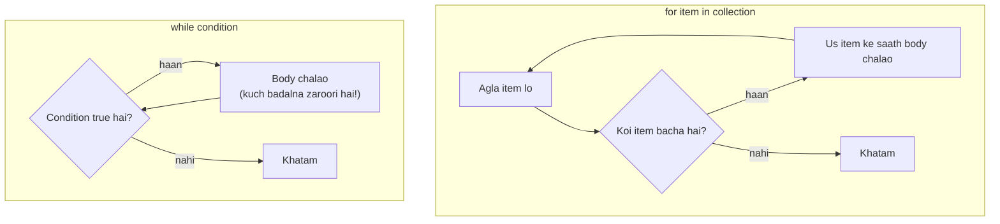

# Chapter 06 · Loops & Iteration

> Kisi insaan ko bolo "I will practise coding" 500 baar likho, toh woh 30 pe haar maan lega. Computer ko bolo, toh palak jhapakne se pehle kaam khatam. **Loops** hi woh jagah hai jahan programming ko uski superpower milti hai: kaam ek baar describe karo, aur machine use laakhon baar dohrayegi, bina bore hue, bina ek bhi typo kiye. Is book ka har algorithm, sorting se leke graph search tak, andar se loops hi loops hai.

**Is chapter mein tum seekhoge:**
- Strings, ranges aur doosre **iterables** pe `for` loops, aur `range()` poori gehraai mein
- `while` loops, aur `for` aur `while` mein se kaunsa chunna hai
- `break`, `continue`, `pass`, aur sabse zyada galat samjha jaane wala **loop `else`**
- `enumerate()` aur `zip()`, woh do helpers jo loops ko Pythonic banate hain
- **Nested loops**, aur kisi bhi star/number pattern ko row/column formula mein *decode* kaise karein
- Loop-based maths: digits, numbers ulta karna, primes, GCD, Fibonacci, factorial, Armstrong aur perfect numbers
- Infinite loops: kab tumhe chahiye, aur jo nahi chahiye unse kaise bachein

**Isse pehle padho:** [Chapter 03 · Operators & Expressions](03-operators-expressions.md) · [Chapter 04 · Strings Deep Dive](04-strings.md) · [Chapter 05 · Conditionals & Truthiness](05-conditionals.md)

---

## 🧠 The Big Idea · Asli Baat

Rozmarra ki zindagi mein repetition do tarah ka hota hai:

1. **"Har ek ke liye..."**: "Class ke har student ki attendance lagao." Tumhe **collection** pehle se pata hai, aur tum usme ek-ek item karke chalte ho. Yeh hai **`for` loop**.
2. **"Jab tak..."**: "Jab tak chai garam nahi hui, garam karte raho." Tumhe nahi pata kitni baar; tum tab tak dohrate ho jab tak koi **condition** badal na jaaye. Yeh hai **`while` loop**.



Body ke har ek chakkar ko ek **iteration** kehte hain. `for` loop items khatam hote hi apne aap ruk jaata hai. `while` loop sirf tab rukta hai jab uski condition false ho jaaye, isliye body ko **kabhi na kabhi** yeh karwana hi padega, warna tumne ek **infinite loop** bana diya.

> 🇮🇳 **Desi Analogy:** `for` loop = **dabbawala ki delivery list**. Subah usko pata hai ki aaj 40 dabbe hain. Woh list ke har naam pe jaata hai, dabba deta hai, agle pe jaata hai. List khatam, kaam khatam. Kitne chakkar? Pehle se pata. `while` loop = **Tatkal booking ke time IRCTC refresh karna**. "Jab tak 'Book Now' button active nahi hota, refresh karte raho." Kitni baar? Koi nahi jaanta. Tum condition badalne ka wait kar rahe ho. Aur agar tum galat train ka page refresh kar rahe ho jahan kabhi seat khulegi hi nahi? Wahi **infinite loop** hai.

> 💡 **The core insight:** jab tum **cheezon** pe chal rahe ho, `for` use karo. Jab tum kisi **condition** ka wait kar rahe ho, `while` use karo. Lagbhag har loop bug teen mein se ek jagah se aata hai: galat start, galat stop, ya ek condition jo kabhi badalti hi nahi.

---

## 🔨 Building It Up · Zero Se Shuru

### 1. Your first for loop

```python
for letter in "CODE":
    print(letter)

print("Loop finished")
```

```text
C
O
D
E
Loop finished
```

Kya hua abhi: string `"CODE"` characters ka ek sequence hai. Har iteration pe Python agla character uthata hai, naam `letter` ko us character se baandh deta hai, aur indented body chalata hai. Aakhri character ke baad loop khatam, aur program neeche aage badhta hai.

Anatomy:

```text
for <name> in <iterable>:     <- the name is (re)assigned each iteration; colon!
    <body>                    <- indented: runs once per item
```

**Iterable** matlab koi bhi cheez jis pe tum loop chala sako: strings, ranges, lists, tuples, sets, dictionaries, files, aur bhi bahut kuch.

### 2. range(): counting loops

Kuch kaam fixed number of times dohrana ho, ya numbers pe chalna ho, toh `range()` use karo:

```python
for i in range(5):
    print("Push-up number", i)
```

```text
Push-up number 0
Push-up number 1
Push-up number 2
Push-up number 3
Push-up number 4
```

`range(5)` deta hai `0, 1, 2, 3, 4`: **paanch** numbers, 0 se shuru, **5 se pehle ruk jaata hai**. Slicing wala hi rule: start andar, stop bahar.

> 🤔 **Mann mein sawaal:** `range(5)` mein 5 kyun nahi aata? Yeh toh ajeeb hai.
>
> **Jawab:** Pehli baar sabko ajeeb lagta hai, lekin yeh design bahut soch-samajh ke hai. (1) `range(5)` mein exactly **5** numbers hain, toh "5 baar karo" = `range(5)`, koi calculation nahi. (2) String ya list ke indexes 0 se `len - 1` tak hote hain, toh `range(len(s))` bilkul saare valid indexes deta hai, ek bhi zyada nahi. (3) `range(0, 5)` aur `range(5, 10)` ko jodo toh `0..9` bina overlap ke milta hai. Agar tumhe 1 se 5 chahiye, toh `range(1, 6)` likho.

### 3. range() in depth

`range` ke teen forms hain:

| Form | Kya deta hai | Example | Values |
|---|---|---|---|
| `range(stop)` | 0 se stop−1 tak | `range(4)` | 0 1 2 3 |
| `range(start, stop)` | start se stop−1 tak | `range(2, 6)` | 2 3 4 5 |
| `range(start, stop, step)` | step ke hisaab se jump | `range(1, 10, 3)` | 1 4 7 |
| negative step | ulti ginti | `range(5, 0, -1)` | 5 4 3 2 1 |

```python
print(list(range(4)))
print(list(range(2, 6)))
print(list(range(0, 20, 5)))
print(list(range(10, 0, -2)))
print(list(range(5, 0)))         # start > stop aur step positive: khaali!
print(list(range(-3, 3)))
r = range(0, 100, 7)
print(len(r), r[3], r[-1], 49 in r, 50 in r)
```

```text
[0, 1, 2, 3]
[2, 3, 4, 5]
[0, 5, 10, 15]
[10, 8, 6, 4, 2]
[]
[-3, -2, -1, 0, 1, 2]
15 21 98 True False
```

Kya hua abhi:

- `list(range(...))` saare numbers ek saath dikha deta hai (lists [Chapter 07](07-lists.md) mein aayengi).
- **Neeche** ginne ke liye negative step **aur** start > stop dono chahiye. `range(5, 0)` khaali hai kyunki default step +1 hai, aur +1 karte-karte 5 se 0 tak kabhi nahi pahunch sakte.
- End value include karni ho toh stop mein 1 jodo: `range(1, n + 1)` deta hai 1..n.
- `range` object `len()`, indexing aur `in` support karta hai. Teeno **O(1)** hain: Python numbers generate karne ki jagah arithmetic se jawab nikaal leta hai. (Aakhri line: 0, 7, 14, ..., 98, kul 15 numbers; index 3 pe 21; aakhri 98; 49 = 7 × 7 toh andar hai; 50 nahi.)

**range lazy hai.** `range(1_000_000_000)` ek arab numbers nahi banata. Woh sirf start, stop aur step yaad rakhta hai, aur jab maango tab ek number banata hai. Kitna bhi bada ho, memory constant.

> 🇮🇳 **Desi Analogy:** `range` ek **token machine** jaisa hai jo bank ya passport office mein hoti hai. Machine ke andar 1 se 500 tak ke token chhape hue pade nahi hain. Usko bas yaad hai "agla number kya hai, kahan rukna hai". Tumne button dabaya, agla token chhap gaya. Isliye `range(10**18)` bhi utni hi jagah leta hai jitna `range(10)`.

### 4. The accumulator pattern

Sabse common loop: ek initial value se shuru karo, aur har item ke saath use update karo.

```python
total = 0                 # 1. initialise
for n in range(1, 11):    # 2. loop
    total += n            # 3. update
print("Sum of 1..10:", total)

product = 1               # product ke liye 1 se shuru karo, 0 se nahi!
for n in range(1, 6):
    product *= n
print("5! =", product)

count = 0
for ch in "mississippi":
    if ch == "s":
        count += 1
print("count of s:", count)
```

```text
Sum of 1..10: 55
5! = 120
count of s: 4
```

Har baar teen steps: loop se pehle **initialise**, andar **update**, baad mein **use**. Initial value "identity" hoti hai (woh value jo result ko badle nahi): sums aur counts ke liye 0, products ke liye 1, strings ke liye `""`, aur max/min ke liye `float("-inf")`/`float("inf")`.

> 🇮🇳 **Desi Analogy:** Accumulator = **kirana store ka khata**. Mahine ki shuruaat mein khata 0 pe khulta hai (initialise). Har baar tum kuch lete ho, dukaandaar entry jodta hai (update). Mahine ke end mein total dekh ke bill banta hai (use). Ab socho agar khata 0 ki jagah pichle customer ke ₹500 se shuru ho gaya? Galat initial value = galat bill. Aur product ke liye 0 se shuru kiya toh? 0 × kuch bhi = 0, poora hisaab zero.

```python
best = float("-inf")
for n in (4, 19, -2, 11):          # numbers ka ek tuple (Chapter 08)
    if n > best:
        best = n
print("max:", best)
```

```text
max: 19
```

`float("-inf")` matlab "minus infinity", ek aisa number jo har number se chhota hai. Isliye pehla hi number usse bada niklega aur `best` ban jaayega. Agar `best = 0` se shuru karte aur saare numbers negative hote, toh galat answer 0 aata.

### 5. while loops

`while` loop tab tak dohrata hai **jab tak** uski condition true hai:

```python
countdown = 5
while countdown > 0:
    print(countdown, end=" ")
    countdown -= 1           # yahi line loop ko khatam karwati hai
print("Liftoff!")
```

```text
5 4 3 2 1 Liftoff!
```

Condition har iteration se **pehle** check hoti hai, pehli wali se bhi. Agar shuru se hi false hai, toh body zero baar chalegi.

(`end=" "` ka matlab: print ke baad newline ki jagah ek space lagao, taaki sab ek hi line pe aaye.)

`while` tab chamakta hai jab tumhe iterations ki ginti pehle se **pata nahi** hoti:

```python
balance = 1000
years = 0
while balance < 2000:        # 8% pe mera paisa double hone mein kitne saal?
    balance *= 1.08
    years += 1
print("Doubled after", years, "years:", round(balance, 2))
```

```text
Doubled after 10 years: 2158.92
```

**for vs while: kaise chunein.**

| `for` use karo jab... | `while` use karo jab... |
|---|---|
| Tumhare paas chalne ke liye ek collection hai | Tum kisi condition ke badalne ka wait kar rahe ho |
| Ginti pata hai (`range(n)`) | Steps ki ginti data pe depend karti hai |
| jaise har character, 1..n ka har number | jaise kisi number ke digits, user retries, binary search |

Agar `for` loop se kaam ho sakta hai, toh wahi lo: woh galti se infinite nahi ban sakta.

### 6. break: leave the loop now

`break` sabse andar wale loop se turant bahar nikal jaata hai, baaki iterations skip karke:

```python
for n in range(2, 100):
    if n % 7 == 0 and n % 5 == 0:
        print("First number divisible by both 5 and 7:", n)
        break
print("Search over")
```

```text
First number divisible by both 5 and 7: 35
Search over
```

`break` ke bina loop bina wajah 99 tak check karta rehta. **Jaise hi answer mil jaaye, ruk jao.**

### 7. continue: skip to the next iteration

`continue` **current** iteration ko wahin chhod ke agli pe kood jaata hai:

```python
for n in range(1, 11):
    if n % 3 == 0:
        continue             # 3 ke multiples skip karo
    print(n, end=" ")
print()
```

```text
1 2 4 5 7 8 10 
```

`continue` loops ke liye ek guard clause hai: "yeh item kaam ka nahi, skip karo", jisse main body nesting se bachi rehti hai.

> ⚠️ `while` loop mein dhyaan rakho ki update `continue` se **pehle** ho, warna update skip ho jaayega aur loop hamesha chalta rahega:
>
> ```py
> i = 0
> while i < 10:
>     if i % 2 == 0:
>         continue     # ❌ i never increases: infinite loop!
>     i += 1
> ```
>
> Yahan `i = 0` hai, `0 % 2 == 0` true, `continue` hua, `i += 1` tak kabhi pahunche hi nahi. Agle chakkar mein `i` phir 0. Hamesha ke liye.

### 8. pass: do nothing

`pass` khaali block ke liye placeholder hai ([Chapter 05](05-conditionals.md) se). Loop pe iska **koi** asar nahi:

```python
for n in range(3):
    pass                 # TODO: baad mein bharna hai
print("pass did nothing; n ended at", n)
```

```text
pass did nothing; n ended at 2
```

| Statement | Asar |
|---|---|
| `break` | loop se poori tarah bahar |
| `continue` | is iteration ka baaki hissa skip, agli pe jao |
| `pass` | kuch bhi nahi (bas syntax placeholder) |

Ek aur cheez dekho: loop variable `n` **loop ke baad bhi zinda hai**, apni aakhri value ke saath. Python loops naya scope nahi banate.

> 🇮🇳 **Desi Analogy:** Wedding buffet ki line socho. Tum har counter (iteration) pe jaate ho. **`continue`** = "yeh paneer wala counter mujhe nahi chahiye, agle counter pe chalo." **`break`** = "pet bhar gaya, line se hi bahar, baaki counters gaye." **`pass`** = counter pe khade hue, kuch nahi liya, lekin phir bhi normally aage badh gaye. `pass` line ko na rokta hai na skip karta hai, bas jagah bharta hai.

### 9. The loop else clause

Python mein ek anokha feature hai: loop ke saath juda hua `else`. Yeh `else` block **sirf tab chalta hai jab loop bina `break` hit kiye poora khatam hua ho**.

Isse "**no break**" samjho (kuch log chahte hain ki iska naam `nobreak` hota):

```python
n = 29
for d in range(2, n):
    if n % d == 0:
        print(n, "is divisible by", d)
        break
else:
    print(n, "is prime")       # sirf tab chalega jab koi divisor nahi mila

target = "z"
for ch in "python":
    if ch == target:
        print("found", target)
        break
else:
    print(target, "not found")
```

```text
29 is prime
z not found
```

Kya hua abhi: 29 ke liye kisi divisor ne `break` trigger nahi kiya, toh loop poora chala aur `else` chal gaya. Yeh purane "flag variable" wale tareeke ki jagah le leta hai:

```py
found = False                  # purana tareeka, flag ke saath
for ch in "python":
    if ch == target:
        found = True
        break
if not found:
    print("not found")
```

`while` loops ke saath bhi `else` lag sakta hai, same rule ke saath.

> 🤔 **Mann mein sawaal:** Loop ka `else` "agar loop nahi chala toh" wala `else` hai kya, jaise `if` ka hota hai?
>
> **Jawab:** Nahi, aur yahi sabse bada confusion hai. `if/else` mein `else` ka matlab "condition false thi". Loop `else` ka matlab hai "**loop ko `break` se beech mein nahi roka gaya**". Search ki language mein socho: loop = dhoondhna, `break` = "mil gaya!", `else` = "poora dhoondh liya, nahi mila". Aur haan, agar loop zero baar chala (khaali collection), tab bhi `break` nahi hua, toh `else` chalega.

### 10. enumerate(): index and value together

Aksar tumhe position aur item dono chahiye hote hain. Beginners `for i in range(len(s))` likhte hain aur phir `s[i]`. Pythonic tareeka hai `enumerate`:

```python
word = "loop"
for i, ch in enumerate(word):
    print(i, ch)

for rank, name in enumerate(("Riya", "Arjun", "Meera"), start=1):
    print(f"#{rank}: {name}")
```

```text
0 l
1 o
2 o
3 p
#1: Riya
#2: Arjun
#3: Meera
```

`enumerate` pairs deta hai `(index, item)`, jinhe hum do naamon mein unpack kar lete hain (jaise [Chapter 02](02-variables-types-memory.md) mein `a, b = 1, 2`). `start=1` se ginti 1 se shuru hoti hai, jo insaanon ke liye numbering ke liye perfect hai.

### 11. zip(): walk several sequences in step

`zip` do ya zyada iterables ke items ko position-by-position jodi mein jodta hai:

```python
names = ("Riya", "Arjun", "Meera")
marks = (91, 78, 85)
for name, mark in zip(names, marks):
    print(f"{name:<6} {mark}")

for a, b, c in zip("abc", "xyz", range(3)):
    print(a, b, c)

for x, y in zip("abcdef", range(3)):     # SABSE CHHOTE pe ruk jaata hai
    print(x, y, end=" | ")
print()
```

```text
Riya   91
Arjun  78
Meera  85
a x 0
b y 1
c z 2
a 0 | b 1 | c 2 | 
```

Kya hua abhi: `zip` tab rukta hai jab **koi bhi** input khatam ho jaaye, aur baaki ko chupchaap ignore kar deta hai. Python 3.10+ mein `zip(a, b, strict=True)` lengths alag hone pe error deta hai, jisse bugs jaldi pakde jaate hain.

> 🇮🇳 **Desi Analogy:** `zip` ko **school ki assembly line** jaisa socho jahan ladke aur ladkiyon ki do lines hain aur teacher bolti hai "ek ladka, ek ladki, jodi banao". Pehli jodi, doosri jodi... Jaise hi kisi ek line mein log khatam hue, jodiyan banana band. Doosri line mein bache hue log bas khade reh jaate hain, unhe koi kuch nahi bolta. Yahi `zip` ka "shortest pe ruk jaana" hai, aur `strict=True` woh teacher hai jo bolti hai "line barabar kyun nahi hai? Pehle yeh theek karo!"

Ek badhiya zip trick: har character ko uske agle character se compare karo.

```python
s = "aabccc"
for current, nxt in zip(s, s[1:]):
    print(current + nxt, "same" if current == nxt else "diff")
```

```text
aa same
ab diff
bc diff
cc same
cc same
```

`s[1:]` hai `"abccc"`, wahi string ek position khiski hui. Dono ko zip karne se har character apne right-hand padosi ke saath milta hai: chhe character ki string se paanch pairs, kyunki `s[1:]` khatam hote hi `zip` ruk gaya.

### 12. reversed() and looping backwards

```python
for ch in reversed("abc"):
    print(ch, end=" ")
print()
for i in range(4, -1, -1):       # 4 se 0 tak: 0 include karne ke liye stop -1 hai
    print(i, end=" ")
print()
```

```text
c b a 
4 3 2 1 0 
```

`range(n - 1, -1, -1)` classic "aakhri se pehle index tak" hai. `reversed(range(n))` wahi kaam karta hai aur padhne mein aasaan hai.

0 tak jaana hai toh stop `0` kyun nahi, `-1` kyun? Kyunki stop hamesha **exclude** hota hai, chahe ulta gino ya seedha. `range(4, 0, -1)` deta hai 4 3 2 1, aur 0 pe ruk jaata hai, use print nahi karta. 0 ko andar laane ke liye stop ko ek aur aage (ulti direction mein) rakhna padta hai, yaani `-1`. Yahan `-1` ka matlab "aakhri element" nahi hai, yeh bas ek number hai.

### 13. Nested loops

Loop ke andar loop: outer loop ki **har** iteration ke liye inner loop **poora** chalta hai.

```python
for row in range(1, 4):
    for col in range(1, 6):
        print(f"{row * col:3}", end="")
    print()                          # har row ke baad newline
```

```text
  1  2  3  4  5
  2  4  6  8 10
  3  6  9 12 15
```

Kya hua abhi: outer loop ne `row = 1` liya, phir inner loop ne `col = 1..5` chalaya, sab ek hi line pe print hua. Phir `print()` ne line khatam ki, aur outer loop `row = 2` pe gaya. Body kul kitni baar chali: 3 × 5 = 15. (`{row * col:3}` matlab har number ko 3 characters ki jagah mein right-align karo, taaki columns seedhe rahein.)

> 🇮🇳 **Desi Analogy:** Nested loop = **ghadi ki sui**. Ghante wali sui (outer loop) ek step aage badhti hai, tab tak minute wali sui (inner loop) poora 60 ka chakkar laga chuki hoti hai. Har ghante ke andar poore 60 minute. 12 ghante × 60 minute = 720 ticks. Isi tarah n × m.

**Cost:** n ka outer loop aur m ka inner loop body ko **n × m** baar chalata hai. Same n items pe do nested loops **O(n²)** hai: n = 1,000 ke liye theek hai (das lakh steps), n = 100,000 ke liye dardnaak hai (das arab). DSA ka bahut bada hissa nested loops ko kisi smarter cheez se replace karne ke baare mein hai ([DSA Chapter 01](../part-2-dsa/01-big-o-complexity.md)).

`break` sirf **sabse andar wale** loop se nikalta hai:

```python
for i in range(3):
    for j in range(3):
        if j == 1:
            break                    # sirf j-loop se bahar
        print(i, j)
```

```text
0 0
1 0
2 0
```

Dono loops se bahar nikalna ho toh flag use karo, ya loops ko ek function mein daal ke `return` karo ([Chapter 10](10-functions.md)).

### 14. Pattern printing: decode the row/column formula

Pattern questions ("yeh pyramid print karo") campus placement tests ka roz ka khaana hain. Patterns ratto mat; ek hi method se unhe **decode** karo:

1. **Outer loop** **row** number `i` hai (aam taur pe 1..n).
2. Har row ke liye poocho: har character **kitni baar**, aur **kaunsa** character? Ise `i` aur `n` ke formula ki tarah likho.
3. Inner loop(s) bilkul wahi print karte hain; phir `print()` row khatam karta hai.

Chalo `n = 4` ke saath practice karte hain.

**Pattern A: square.** Row i mein n stars.

```python
n = 4
for i in range(1, n + 1):
    for j in range(1, n + 1):
        print("*", end=" ")
    print()
```

```text
* * * * 
* * * * 
* * * * 
* * * * 
```

**Pattern B: right triangle.** Row i mein **i** stars.

```python
n = 4
for i in range(1, n + 1):
    print("* " * i)
```

```text
* 
* * 
* * * 
* * * * 
```

([Chapter 04](04-strings.md) wali string repetition inner loop ki jagah le leti hai. Dono theek hain; interviewers kabhi-kabhi explicit loops maangte hain.)

**Pattern C: inverted triangle.** Row i mein **n − i + 1** stars.

```python
n = 4
for i in range(1, n + 1):
    print("* " * (n - i + 1))
```

```text
* * * * 
* * * 
* * 
* 
```

Formula check: row 1 → 4 − 1 + 1 = 4 stars. Row 4 → 4 − 4 + 1 = 1 star. Do rows pe formula check kar liya, matlab sahi hai.

**Pattern D: number triangles.** Kya print hoga, yeh `i` aur `j` pe depend karta hai:

```python
n = 4
for i in range(1, n + 1):
    for j in range(1, i + 1):
        print(j, end=" ")          # column number
    print()
print()
for i in range(1, n + 1):
    for j in range(1, i + 1):
        print(i, end=" ")          # row number
    print()
```

```text
1 
1 2 
1 2 3 
1 2 3 4 

1 
2 2 
3 3 3 
4 4 4 4 
```

Dono patterns ka loop structure same hai. Farak sirf itna: pehle mein `j` (column) print hua, doosre mein `i` (row). **Shape loops se aati hai, content print statement se.**

**Pattern E: Floyd's triangle.** Ek counter jo rows ke paar bhi chalta rehta hai.

```python
n = 4
num = 1
for i in range(1, n + 1):
    for j in range(i):
        print(f"{num:3}", end="")
        num += 1
    print()
```

```text
  1
  2  3
  4  5  6
  7  8  9 10
```

Yahan `num` loops ke **bahar** initialise hua hai, isliye har nayi row mein reset nahi hota, wahin se aage ginta hai jahan pichli row ne chhoda.

**Pattern F: pyramid.** Ab har row mein pehle **spaces** hain, phir **stars**. Ise ek table se decode karo:

```text
   *        row 1: 3 spaces, 1 star
  ***       row 2: 2 spaces, 3 stars
 *****      row 3: 1 space,  5 stars
*******     row 4: 0 spaces, 7 stars
```

| Row `i` | Spaces | Stars |
|---|---|---|
| 1 | 3 | 1 |
| 2 | 2 | 3 |
| 3 | 1 | 5 |
| 4 | 0 | 7 |
| formula | **n − i** | **2i − 1** |

Spaces har row mein 1 kam hote hain (n − i); stars har row mein 2 badhte hain, 1 se shuru hoke (2i − 1).

Formula kaise nikala? Jab koi cheez har row mein **ek fixed amount** se badhti hai, toh formula hamesha `(badhne ki rate) × i + kuch constant` hota hai. Stars 2-2 badh rahe hain, toh `2i + c`. Row 1 pe 1 star chahiye: `2 × 1 + c = 1`, toh `c = −1`. Ho gaya: **2i − 1**. Spaces 1-1 ghat rahe hain, toh `−i + c`; row 1 pe 3: `c = 4 = n`. Toh **n − i**.

```python
n = 4
for i in range(1, n + 1):
    print(" " * (n - i) + "*" * (2 * i - 1))
```

```text
   *
  ***
 *****
*******
```

> 🇮🇳 **Desi Analogy:** Pyramid pattern ko **cricket stadium ki seating** jaisa socho, upar se dekho toh. Sabse upar wali row mein ek VIP seat, beech mein. Har neeche wali row dono taraf ek-ek seat badhti hai (isliye +2), aur khaali jagah dono taraf ek-ek kam hoti hai. Left side ki khaali jagah hi `n − i` spaces hain. Right side ki khaali jagah hum print hi nahi karte, kyunki woh dikhti hi nahi.

**Pattern G: diamond.** Ek pyramid, phir ek ulta pyramid, beech wali row dohraye bina:

```python
n = 4
for i in range(1, n + 1):
    print(" " * (n - i) + "*" * (2 * i - 1))
for i in range(n - 1, 0, -1):
    print(" " * (n - i) + "*" * (2 * i - 1))
```

```text
   *
  ***
 *****
*******
 *****
  ***
   *
```

Dhyaan do: doosra loop `n - 1` se shuru hota hai, `n` se nahi. Warna sabse chaudi row (7 stars) do baar print hoti.

**Pattern H: hollow square.** Star sirf border pe print karo: pehli/aakhri row ya pehla/aakhri column.

```python
n = 5
for i in range(n):
    for j in range(n):
        if i == 0 or i == n - 1 or j == 0 or j == n - 1:
            print("*", end=" ")
        else:
            print(" ", end=" ")
    print()
```

```text
* * * * * 
*       * 
*       * 
*       * 
* * * * * 
```

**Pattern I: alphabet triangle and 0-1 triangle.** Character bhi `i` aur `j` se calculate ho sakta hai:

```python
n = 4
for i in range(n):
    for j in range(i + 1):
        print(chr(ord("A") + j), end=" ")
    print()
for i in range(1, n + 1):
    for j in range(1, i + 1):
        print((i + j) % 2, end=" ")     # checkerboard ki tarah 0/1 badalta hai
    print()
```

```text
A 
A B 
A B C 
A B C D 
0 
1 0 
0 1 0 
1 0 1 0 
```

`ord("A")` 65 deta hai (A ka number), `+ j` karke `chr()` se wapas letter banaya: j = 0 → A, j = 1 → B. Aur `(i + j) % 2`: jab row + column even ho toh 0, odd ho toh 1, bilkul chess board ke kaale-safed khaano jaisa.

> 💡 **The decoding recipe in one line:** har row `i` ke liye "kitne spaces, kitne symbols, column `j` pe kaunsa symbol" ko formulas ki tarah likho, do rows pe check karo, aur code kar do. Har pattern question (butterfly, hourglass, Pascal's triangle, number pyramids) isi se toot jaata hai.

### 15. Loop-based maths: the digit loop

[Chapter 03](03-operators-expressions.md) se yaad karo: `n % 10` aakhri digit hai, `n // 10` use hata deta hai. Ise ek `while` loop mein daal do, aur tum **kitne bhi** lambe numbers process kar sakte ho:

```python
n = 98042
original = n
digit_sum = 0
digit_count = 0
reversed_n = 0
while n > 0:
    digit = n % 10                       # aakhri digit cheel lo
    digit_sum += digit
    digit_count += 1
    reversed_n = reversed_n * 10 + digit # use reversed number pe chadha do
    n //= 10                             # aakhri digit hata do
print(original, "sum:", digit_sum, "count:", digit_count, "reversed:", reversed_n)
```

```text
98042 sum: 23 count: 5 reversed: 24089
```

`n = 123` ke liye reverse ka **dry run**:

| Iteration | `n` | `digit = n % 10` | `reversed_n * 10 + digit` | `n //= 10` |
|---|---|---|---|---|
| 1 | 123 | 3 | 0 × 10 + 3 = **3** | 12 |
| 2 | 12 | 2 | 3 × 10 + 2 = **32** | 1 |
| 3 | 1 | 1 | 32 × 10 + 1 = **321** | 0 → stop |

> 🇮🇳 **Desi Analogy:** Digit loop ko **plate ke stack** jaisa socho jo shaadi ke caterer ke paas hota hai. Ek stack se sabse upar ki plate uthao (`n % 10`, aakhri digit), doosre stack pe rakh do. Pehle stack se woh plate hat gayi (`n //= 10`). Naye stack pe jo pehle rakhi thi woh neeche dab jaati hai (`rev * 10` purane digits ko ek jagah left khiska deta hai, aur `+ digit` naya digit sabse right pe rakh deta hai). Saari plates shift karne ke baad naya stack bilkul ulta hai. Yahi reverse hai.

Notes: `n = 0` ke liye loop zero baar chalta hai (digit count 0 aayega, jabki 0 mein ek digit hai, toh zaroorat ho toh 0 ko alag handle karo). Negatives ke liye `abs(n)` pe kaam karo aur sign baad mein wapas laga do. (Aur dhyaan do: 98042 ka reverse 24089 hai, `240890` nahi. Peeche wala 0 reverse hoke aage chala gaya, aur aage ke zero ki number mein koi value nahi hoti.)

**Palindrome number** (ulta padhne pe bhi same): number ko uske reverse se compare karo.

```python
n = 12321
temp, rev = n, 0
while temp > 0:
    rev = rev * 10 + temp % 10
    temp //= 10
print(n, "palindrome" if rev == n else "not palindrome")
```

```text
12321 palindrome
```

`temp` copy kyun banaya? Kyunki loop number ko kha jaata hai (end mein 0 bacha). Original `n` ko compare ke liye bachana zaroori tha.

### 16. Primes

**Prime** woh number hai jo 1 se bada ho aur jiske divisors sirf 1 aur khud woh hon. Key optimisation: tumhe divisors sirf **√n** tak test karne hain, kyunki agar `n = a × b`, toh `a` ya `b` mein se ek ≤ √n hona hi chahiye.

```python
n = 97
is_prime = n > 1
d = 2
while d * d <= n:            # d <= sqrt(n) jaisa hi, bina floats ke
    if n % d == 0:
        is_prime = False
        break
    d += 1
print(n, "is prime" if is_prime else "is not prime")

print("Primes below 50:", end=" ")
for num in range(2, 50):
    for d in range(2, int(num ** 0.5) + 1):
        if num % d == 0:
            break
    else:                    # loop else: koi divisor nahi mila
        print(num, end=" ")
print()
```

```text
97 is prime
Primes below 50: 2 3 5 7 11 13 17 19 23 29 31 37 41 43 47 
```

Ek number ko is tarah check karna **O(√n)** hai, O(n) nahi: n = 10^12 ke liye das lakh steps, ek trillion (yaani ek lakh crore) nahi. n tak ke **saare** primes list karne ke liye **Sieve of Eratosthenes** kahin zyada fast hai ([DSA Chapter 23](../part-2-dsa/23-bits-math.md)).

`int(num ** 0.5) + 1` mein `+ 1` kyun? Kyunki `range` ka stop exclude hota hai. `num = 49` ke liye `int(7.0) = 7`, aur humein 7 bhi check karna hai (49 = 7 × 7), toh stop 8 hona chahiye.

### 17. GCD and LCM: Euclid's algorithm

Do numbers ka **GCD** (greatest common divisor, yaani HCF jo school mein padha tha) woh sabse bada number hai jo dono ko divide kare. Euclid ne 2,000 saal se bhi pehle notice kiya ki `gcd(a, b) == gcd(b, a % b)`, aur `gcd(a, 0) == a`:

```python
a, b = 84, 36
x, y = a, b
while y:                     # jab tak remainder 0 na ho
    x, y = y, x % y
gcd = x
lcm = a * b // gcd
print("gcd:", gcd, "lcm:", lcm)
```

```text
gcd: 12 lcm: 252
```

| Step | x | y | x % y |
|---|---|---|---|
| 1 | 84 | 36 | 12 |
| 2 | 36 | 12 | 0 |
| 3 | 12 | 0 | stop: gcd = 12 |

Euclid's algorithm **O(log(min(a, b)))** steps leta hai: har do steps mein numbers kam se kam aadhe ho jaate hain. Standard library mein `math.gcd` aur `math.lcm` bhi hain ([Chapter 17](17-modules-stdlib.md)).

`while y:` truthiness hai ([Chapter 05](05-conditionals.md)): `y` jab tak 0 nahi, loop chalta hai. Aur LCM ka formula `a × b = gcd × lcm` se aata hai: 84 × 36 = 3024, 3024 // 12 = 252.

### 18. Fibonacci and factorial

**Fibonacci**: har number pichle do ka sum hai: 0, 1, 1, 2, 3, 5, 8, ...

```python
n = 10
a, b = 0, 1
for _ in range(n):           # _ : loop counter ki zaroorat nahi
    print(a, end=" ")
    a, b = b, a + b          # ek saath update: temp variable ki zaroorat nahi
print()
```

```text
0 1 1 2 3 5 8 13 21 34 
```

Line `a, b = b, a + b` iska dil hai. Right side **purane** `a` aur `b` use karti hai, dono mein se kisi ke update hone se pehle ([Chapter 02](02-variables-types-memory.md) wala tuple assignment). `a = b` aur phir `b = a + b` alag lines mein likhna bug hoga.

> 🤔 **Mann mein sawaal:** Alag lines mein likhne se kya bigad jaata hai? Dikhne mein toh same hai.
>
> **Jawab:** Trace karo. `a, b = 0, 1`. Line 1: `a = b` → `a = 1`. Line 2: `b = a + b` → `b = 1 + 1 = 2`. Lekin sahi `b` toh `0 + 1 = 1` hona chahiye tha! Purana `a` (0) pehli line mein hi mit gaya. `a, b = b, a + b` mein Python pehle **poori right side** calculate karta hai (`(1, 0 + 1)` = `(1, 1)`), aur phir dono ko ek saath assign karta hai. Isliye koi purani value nahi khoti.

**Factorial**: `n! = 1 × 2 × ... × n`, aur `0! = 1`.

```python
n = 20
fact = 1
for k in range(2, n + 1):
    fact *= k
print(f"{n}! = {fact}")
```

```text
20! = 2432902008176640000
```

Python ke big integers ([Chapter 02](02-variables-types-memory.md)) ki wajah se `100!` (158 digits) bhi bas chal jaata hai. C ya Java mein yeh overflow ho jaata.

### 19. Armstrong and perfect numbers

**Armstrong number** (narcissistic number) apne digits ke sum ke barabar hota hai, jahan har digit ko digits ki ginti ki power di gayi ho: `153 = 1³ + 5³ + 3³`.

```python
print("Armstrong numbers below 10000:", end=" ")
for num in range(1, 10000):
    power = len(str(num))
    total, temp = 0, num
    while temp > 0:
        total += (temp % 10) ** power
        temp //= 10
    if total == num:
        print(num, end=" ")
print()
```

```text
Armstrong numbers below 10000: 1 2 3 4 5 6 7 8 9 153 370 371 407 1634 8208 9474 
```

Check karo: 153 → 3 digits → 1 + 125 + 27 = 153. ✅ Aur 1 se 9 tak ke saare single-digit numbers apne aap Armstrong hain (power 1, toh number = khud).

**Perfect number** apne proper divisors (khud ko chhod ke saare divisors) ke sum ke barabar hota hai: `28 = 1 + 2 + 4 + 7 + 14`. Divisors jodiyon mein aate hain `(d, n // d)`, isliye yahan bhi sirf √n tak loop chalate hain:

```python
print("Perfect numbers below 10000:", end=" ")
for n in range(2, 10000):
    total = 1                        # 1 sabko divide karta hai
    d = 2
    while d * d <= n:
        if n % d == 0:
            total += d
            if d != n // d:          # square root ko do baar mat jodo
                total += n // d
        d += 1
    if total == n:
        print(n, end=" ")
print()
```

```text
Perfect numbers below 10000: 6 28 496 8128 
```

Jodi wala trick 28 pe dekho: d = 2 → jodi (2, 14); d = 4 → jodi (4, 7). `5 * 5 = 25 <= 28` toh d = 5 bhi check hua (divide nahi karta), phir d = 6 pe `36 > 28`, ruk gaye. Total = 1 + 2 + 14 + 4 + 7 = 28. ✅ Aur `d != n // d` wala check `36` jaise numbers ke liye hai, jahan d = 6 aur `36 // 6 = 6`: 6 ko do baar nahi jodna.

### 20. Infinite loops: wanted and unwanted

**Unwanted** infinite loops tab hote hain jab condition kabhi false hi nahi hoti:

```py
i = 0
while i < 5:
    print(i)       # ❌ i += 1 bhool gaye: hamesha 0 print hota rahega

n = 10
while n != 0:
    n -= 3         # ❌ 10, 7, 4, 1, -2, ... 0 ko hamesha skip karta hai. n > 0 use karo.
```

Agar program atak jaaye, toh terminal mein **Ctrl+C** dabao (yeh `KeyboardInterrupt` raise karta hai aur program ruk jaata hai).

**Wanted** infinite loops: `while True:` jiske andar ek `break` ho. Yeh sahi shape hai jab exit condition natural tareeke se body ke **beech** mein check hoti hai, jaise menus, games aur servers:

```python
attempts = ["1234", "letmein", "s3cret", "hunter2"]   # maan lo yeh user ke inputs hain
PASSWORD = "s3cret"
i = 0
while True:
    guess = attempts[i]
    i += 1
    if guess == PASSWORD:
        print("Access granted after", i, "attempts")
        break
    print("Wrong:", guess)
```

```text
Wrong: 1234
Wrong: letmein
Access granted after 3 attempts
```

**Infinite loops se bachne ki checklist:**

1. Kya body ka har raasta exit ki taraf badhta hai (increment, decrement, shrink)?
2. Jab step 1 se zyada ho, kya condition `!=` ki jagah `<` / `>` hai?
3. `continue` wale `while` mein, kya update `continue` se pehle hota hai?
4. `while True` mein, kya ek pahunchne layak `break` hai (ya attempts ki limit)?

> ⚠️ **Jis collection pe loop chal raha hai use kabhi modify mat karo** (loop ke beech list mein items add ya remove karna). Isse items skip ho jaate hain ya list kabhi khatam hi nahi hoti. Copy pe loop chalao, ya ek nayi collection banao ([Chapter 07](07-lists.md)).

---

## 🔬 Under the Hood · Andar Ki Kahani

### The iteration protocol: how `for` really works

`for` loop do built-in functions ke upar ek shareef sa wrapper hai:

1. `iter(obj)` iterable se ek **iterator** maangta hai: ek object jo yaad rakhta hai "hum kahan tak pahunche".
2. `next(iterator)` agla item deta hai, ya items khatam hone pe ek special `StopIteration` signal raise karta hai.

```python
it = iter("hi")
print(next(it))
print(next(it))
print(next(it, "no more items"))     # StopIteration ki jagah default value
```

```text
h
i
no more items
```

Toh yeh:

```py
for ch in "hi":
    print(ch)
```

asal mein yeh hai:

```py
it = iter("hi")
while True:
    try:
        ch = next(it)
    except StopIteration:   # try/except Chapter 13 mein aayega
        break
    print(ch)
```

Isi wajah se `for` kisi bhi iterable pe chalta hai (strings, ranges, files, dictionaries, tumhari apni classes), aur isi wajah se woh kabhi index out of range nahi ho sakta. Tum apne khud ke iterators aur generators [Chapter 16](16-iterators-generators-decorators.md) mein banaoge.

> 🇮🇳 **Desi Analogy:** Iterator = **Mumbai local ka TC jiske paas passengers ki list hai** aur ek bookmark. Tum (`for` loop) usse baar-baar bolte ho "agla" (`next()`). Woh bookmark se agla naam deta hai aur bookmark aage khiska deta hai. Jab list khatam, woh bolta hai "bas, koi nahi bacha" (`StopIteration`), aur tum ruk jaate ho. List (iterable) aur bookmark (iterator) alag cheezein hain: ek hi list pe do TC do alag bookmarks ke saath chal sakte hain.

### Why changing the loop variable doesn't change the loop

```python
for i in range(5):
    print(i, end=" ")
    i = 100          # sirf naam ko dobara baandhta hai; iterator ko farak nahi padta
print()
```

```text
0 1 2 3 4 
```

Har iteration pe loop iterator se `i` ko **dobara assign** karta hai. Tumhara `i = 100` bas name tag ko thodi der ke liye khiskata hai, jab tak agla `next()` call use wapas na khiska de. Agar aage skip karna hai, toh apne khud ke index ke saath `while` loop use karo.

### range is a tiny object

`range` sirf `start`, `stop` aur `step` store karta hai. `len(range(...))` lagbhag `(stop - start) / step` round up karke calculate hota hai; `x in range(...)` bounds check karta hai aur `(x - start) % step == 0`. Isi liye dono O(1) hain, aur isi liye `range(10**18)` utni hi memory leta hai jitna `range(10)`. (Python 2 mein `range` asli list banata tha; lazy wala `xrange` tha. Python 3 ka `range` purana `xrange` hi hai.)

Example: `49 in range(0, 100, 7)`: 0 <= 49 < 100 ✅, aur (49 − 0) % 7 == 0 ✅, toh True. Ek bhi number generate nahi hua.

### How fast are Python loops?

Python loop ki har iteration kai bytecode instructions chalati hai (`FOR_ITER`, naam store karna, body, wapas jump). Ek simple loop modern machine pe lagbhag **10 se 50 million** iterations per second karta hai. Interview ke liye rough budget: Python mein lagbhag **10^7 simple operations per second**. Toh:

| n | O(n) | O(n²) |
|---|---|---|
| 10³ | turant | ~turant (10^6) |
| 10⁵ | turant | ~10^10: bahut zyada slow |
| 10⁶ | ek second se kam | impossible |

`sum()`, `max()`, `"".join()` aur `str.count()` jaise built-ins C mein loop karte hain aur aksar same kaam wale Python loop se 10× fast hote hain. Jab fit ho, inhe use karo.

> 🤔 **Mann mein sawaal:** Yeh 10^7 wala number interview mein kaam kaise aata hai?
>
> **Jawab:** Problem mein constraint likha hota hai, jaise "n ≤ 10^5". Tum turant hisaab lagao: O(n²) = 10^10 operations = 10^10 / 10^7 = 1000 seconds. Time limit 1-2 second hoti hai, toh O(n²) fail. Matlab interviewer O(n) ya O(n log n) chahta hai. Constraint dekh ke hi pata chal jaata hai ki kis complexity ka solution sochna hai.

### Why √n is enough for primes (and divisor pairs)

Agar `n = a × b` aur `a ≤ b`, toh `a × a ≤ a × b = n`, toh `a ≤ √n`. Har factor pair ka chhota member √n ya usse neeche hota hai. Wahan tak koi na mile, toh saboot ho gaya ki kahin bhi nahi hai. Yahi argument perfect-number loop ko ek hi step mein `d` aur `n // d` dono jodne deta hai.

Example: 36 ke pairs (1, 36), (2, 18), (3, 12), (4, 9), (6, 6). Har pair ka chhota number 6 (= √36) ya usse kam hai. 6 ke baad wale pairs bas ulte hain: (9, 4), (12, 3)... jo hum dekh chuke.

### Why Euclid's algorithm works

Jo bhi number `a` aur `b` dono ko divide karta hai, woh `a - b` ko bhi divide karta hai, aur isliye `a % b` ko bhi (jo `a` minus `b` ka koi multiple hai). Toh `(a, b)` ke **common divisors ka set** `(b, a % b)` ke common divisors ke set ke barabar hai, aur unka sabse bada member badalta nahi. Numbers chhote hote jaate hain jab tak remainder 0 na ho, aur `gcd(x, 0) = x`.

---

## 🧩 Pattern Decoder · Pattern Pakdo

### Which loop shape?

| Tumhe chahiye... | Shape |
|---|---|
| Har item | `for x in items:` |
| Har index aur item | `for i, x in enumerate(items):` |
| Do sequences saath-saath | `for a, b in zip(xs, ys):` |
| Numbers ki range | `for i in range(start, stop, step):` |
| Ulta | `for x in reversed(items):` ya `range(n - 1, -1, -1)` |
| k baar dohrana, counter ki zaroorat nahi | `for _ in range(k):` |
| Kisi condition tak | `while condition:` |
| Exit body ke beech decide hota hai | `while True:` ... `if done: break` |
| "Nahi mila" handling ke saath search | `for ... : if match: break` + `else:` |
| Padosi pairs | `for a, b in zip(s, s[1:]):` |

### Reusable templates

**Accumulator:**

```py
result = IDENTITY            # sum/count ke liye 0, product ke liye 1, max ke liye float("-inf")
for x in items:
    if keep(x):              # optional filter
        result = combine(result, x)
```

**Digit loop:**

```py
n = abs(number)
while n > 0:
    digit = n % 10
    # ... digit use karo ...
    n //= 10
```

**Search with loop-else:**

```py
for x in items:
    if is_match(x):
        handle(x)
        break
else:
    handle_not_found()
```

**Pattern printing:**

```py
for i in range(1, n + 1):                 # rows
    print(" " * spaces(i, n) + symbols(i, n))
```

### Common pattern formulas (row i from 1 to n)

| Pattern | Spaces | Symbols |
|---|---|---|
| Right triangle | 0 | i |
| Inverted right triangle | 0 | n − i + 1 |
| Right-aligned triangle | n − i | i |
| Pyramid | n − i | 2i − 1 |
| Inverted pyramid | i − 1 | 2(n − i) + 1 |
| Number row "1 2 ... i" | 0 | j for j in 1..i |
| Hollow shape | | border pe ho (`i`/`j` pehla ya aakhri) toh star, warna space |

### Pythonic loop idioms

| Avoid | Prefer |
|---|---|
| `for i in range(len(s)): print(s[i])` | `for ch in s: print(ch)` |
| for ke saath alag se `i = 0` ... `i += 1` | `enumerate` |
| `for i in range(len(a)): a[i], b[i]` | `zip(a, b)` |
| "found" ke liye flag variable | loop `else` |
| numbers pe manual sum/max loop | `sum(...)`, `max(...)` |
| loop mein `s += piece` | pieces collect karo, `"".join()` |
| bina saaf exit wala `while True` | `for` loop ya ek explicit condition |

### How loops show up in DSA

- **Har** array algorithm ek loop hai; sawaal bas yeh hai ki kitne aur kitne nested. Ek pass = O(n), nested = O(n²).
- **Two pointers** ([DSA Chapter 03](../part-2-dsa/03-two-pointers.md)) ek `while left < right` loop hai.
- **Sliding window** ([DSA Chapter 04](../part-2-dsa/04-sliding-window.md)) ek `for` loop hai jiske andar ek `while` window ko chhota karta hai: phir bhi overall O(n), kyunki har element ek baar andar aata hai aur ek baar bahar jaata hai.
- **Binary search** ([DSA Chapter 08](../part-2-dsa/08-binary-search.md)) ek `while lo <= hi` loop hai jo range ko aadha karta hai: O(log n).
- **BFS** ([DSA Chapter 16](../part-2-dsa/16-graphs-bfs-dfs.md)) hai `while queue:`.
- **Digit loops** Reverse Integer, Palindrome Number, Happy Number, Add Digits solve karte hain.
- **Euclid's GCD** aur **√n prime checks** maths wale problems mein aate hain ([DSA Chapter 23](../part-2-dsa/23-bits-math.md)).

---

## ⚠️ Traps & Common Mistakes · Yahan Sab Phisalte Hain

1. **range mein off-by-one.** `range(1, 10)` 9 pe rukta hai. 1..n inclusive ke liye `range(1, n + 1)` likho.

2. **Negative step ke bina ulti ginti.** `range(10, 0)` khaali hai. `range(10, 0, -1)` use karo, aur 0 include karna ho toh `range(10, -1, -1)`.

3. **`while` mein update bhool jaana.** Infinite loop. Condition likhne ke turant baad sabse pehle update likho.

4. **Uneven steps ke saath loop condition mein `!=`.** `while n != 0: n -= 3` 0 ke upar se kood sakta hai. `while n > 0` use karo.

5. **Jahan ek saath update chahiye wahan ek-ek karke update.**

```py
a = b          # ❌ purana a kho gaya
b = a + b
a, b = b, a + b   # ✅ right side purani values use karti hai
```

6. **Product accumulator 0 se shuru.** `product = 0` sab kuch 0 bana deta hai. 1 se shuru karo.

7. **`break` se saare nested loops se nikalne ki umeed.** Woh sirf sabse andar wale se nikalta hai.

8. **Loop `else` ko galat padhna.** Iska matlab "agar loop nahi chala" nahi hai. Iska matlab hai "agar loop **break nahi hua**". Khaali loop (zero iterations) bhi `else` chalata hai.

9. **List pe loop chalate hue use modify karna.** Items skip ho jaate hain. Copy pe loop chalao (`for x in items[:]`) ya nayi list banao ([Chapter 07](07-lists.md)).

10. **Pattern loop mein `end=""` ke bina `print`.** Har symbol apni alag line pe aa jaata hai. Inner loop mein `end=""` (ya `end=" "`) use karo aur uske baad ek khaali `print()`.

11. **Loop variable ka naam reuse karna** jo baad mein chahiye tha. `for i in ...` ke baad `i` aakhri value rakhta hai aur pehle wale kisi bhi `i` ko overwrite kar deta hai.

12. **Jahan ek loop kaafi hai wahan nested loops.** Agar tum check kar rahe ho "kya koi pair X satisfy karta hai?", toh aksar set ya two pointers ke saath O(n) approach hoti hai. Interviewers umeed karte hain ki tum use dhoondhoge.

---

## 💡 Tips & Tricks · Pro Wale Moves

- Jab loop variable ki zaroorat na ho toh `_` use karo: `for _ in range(3):`.
- `for i, x in enumerate(items, start=1)` insaanon wali numbering deta hai.
- `zip(s, s[1:])` har element ko uske agle se jodta hai.
- `sum(1 for ch in s if ch in "aeiou")` ek **generator expression** se ginti karta hai ([Chapter 11](11-comprehensions-functional.md)).
- `any(...)` aur `all(...)` bahut saare search loops ki jagah le lete hain: `any(n % d == 0 for d in range(2, n))`.
- `while d * d <= n` float square roots aur unki rounding errors se bachata hai.
- Patterns ke liye coding se pehle row → spaces → symbols ki ek chhoti table banao. 20 minute ki trial-and-error 2 minute mein badal jaati hai.
- Loop ke andar ek temporary `print(i, j, total)` daalo taaki dikhe kya ho raha hai; samajh aa jaaye toh hata do.
- Loops ko **0, 1 aur 2** iterations ke saath test karo. Zyaadatar loop bugs kinaaron pe rehte hain.
- Agar loop lamba ho raha hai, toh body shayad ek function banna chahti hai ([Chapter 10](10-functions.md)).

---

## 🎯 Interview Questions · Interview Mein Yahi Poochenge

### 1. What's the difference between a for loop and a while loop? 🔥🔥🔥

<details><summary>Answer dekho 👀</summary>

`for` loop ek iterable ke items pe iterate karta hai (**definite iteration**): items khatam hote hi apne aap khatam hota hai, aur iterator protocol (`iter`/`next`) use karta hai. `while` loop tab tak dohrata hai jab tak condition true hai (**indefinite iteration**): state tum manage karte ho aur tumhe pakka karna padta hai ki condition kabhi na kabhi false ho. Collection ya known range pe chalna ho toh `for` lo; jab iterations ki ginti data pe depend kare (digit loops, binary search, convergence, retry loops) toh `while`.

> 🗣️ **Interview mein aise bolo:** "A for loop is definite iteration: it walks over an iterable using the iterator protocol and stops automatically when the items run out. A while loop is indefinite iteration: it repeats as long as a condition is true, so I'm responsible for making progress toward the exit. I default to for loops because they can't accidentally become infinite, and use while for things like binary search or digit processing where the number of steps depends on the data."

</details>

### 2. What's the difference between break, continue and pass? 🔥🔥🔥

<details><summary>Answer dekho 👀</summary>

- `break` sabse andar wale loop se turant bahar nikalta hai (aur loop ka `else` skip karta hai).
- `continue` current iteration ka baaki hissa skip karke agli pe chala jaata hai.
- `pass` kuch nahi karta; yeh ek syntactic placeholder hai.

```python
for n in range(6):
    if n == 1:
        pass          # koi asar nahi
    if n == 2:
        continue      # 2 print karna skip
    if n == 4:
        break         # poori tarah ruk jao
    print(n, end=" ")
print()
```

```text
0 1 3 
```

Trace: 0 print hua. 1 pe `pass` ne kuch nahi kiya, toh 1 bhi print hua. 2 pe `continue`, print skip. 3 print hua. 4 pe `break`, loop khatam, 5 tak pahunche hi nahi.

> 🗣️ **Interview mein aise bolo:** "`break` exits the innermost loop immediately and also skips the loop's else clause. `continue` skips the rest of the current iteration and jumps to the next one. `pass` is a no-op placeholder used where the syntax requires a statement; it has no effect on control flow."

</details>

### 3. When does the else block of a loop execute? 🔥🔥

<details><summary>Answer dekho 👀</summary>

Jab loop **normally** khatam ho: iterable khatam ho jaaye (for) ya condition false ho jaaye (while), **bina** `break` ke. Agar `break` chala, toh `else` skip. Yeh searches ke liye perfect hai: `for ... if found: break` + `else: not found`, flag variable ki jagah. Zero iterations wala loop bhi apna `else` chalata hai.

</details>

### 4. How does range() work in Python 3? Is it a list? 🔥🔥

<details><summary>Answer dekho 👀</summary>

Nahi. `range` ek lazy, immutable **sequence object** hai jo sirf `start`, `stop` aur `step` store karta hai. Yeh numbers maangne pe banata hai, isliye size kuch bhi ho, O(1) memory leta hai. Yeh `len()`, indexing, slicing aur `in` ko O(1) mein support karta hai. Asli list chahiye toh `list(range(n))` use materialise kar deta hai. (Python 2 ka `range` list return karta tha; Python 3 ka `range` Python 2 ke `xrange` jaisa behave karta hai.)

</details>

### 5. Write FizzBuzz. 🔥🔥🔥

1 se 15 tak print karo; 3 ke multiples pe "Fizz", 5 ke pe "Buzz", dono ke pe "FizzBuzz".

<details><summary>Answer dekho 👀</summary>

Sabse specific case (15 se divisible) pehle check karo, ya string build karo:

```python
for n in range(1, 16):
    word = ""
    if n % 3 == 0:
        word += "Fizz"
    if n % 5 == 0:
        word += "Buzz"
    print(word or n, end=" ")
print()
```

```text
1 2 Fizz 4 Buzz Fizz 7 8 Fizz Buzz 11 Fizz 13 14 FizzBuzz 
```

String-building version tab bhi saaf rehta hai jab koi naya rule (jaise 7 → "Bazz") add ho. `word or n` number print karta hai jab `word` khaali ho ([Chapter 05](05-conditionals.md) wali truthiness). Dhyaan do, yahan do **separate** `if` hain, `elif` nahi: 15 pe dono chalne chahiye, tabhi "FizzBuzz" banta hai.

> 🗣️ **Interview mein aise bolo:** "I'll loop from 1 to n and build a string: append 'Fizz' if divisible by 3, 'Buzz' if divisible by 5, using two independent ifs so 15 gets both. Then I print the word, or the number if the word is empty. This avoids a special case for 15 and scales easily if new rules are added. It's O(n) time."

</details>

### 6. Check whether a number is prime. What's the time complexity? 🔥🔥🔥

<details><summary>Answer dekho 👀</summary>

2 se chhote numbers prime nahi hote. Phir 2 se divisors test karo jab tak `d * d <= n`; har factor pair ka ek member ≤ √n hota hai. Optional speed-up: 2 ko alag handle karo aur sirf odd divisors test karo.

```python
n = 221
is_prime = n >= 2
if n > 2 and n % 2 == 0:
    is_prime = False
d = 3
while is_prime and d * d <= n:
    if n % d == 0:
        is_prime = False
    d += 2
print(n, is_prime)
```

```text
221 False
```

(221 = 13 × 17.) Time **O(√n)**, space O(1). Bahut saari queries ke liye ya N tak ke saare primes ke liye Sieve of Eratosthenes use karo, O(N log log N).

> 🗣️ **Interview mein aise bolo:** "Numbers below 2 aren't prime. Otherwise I only need to test divisors up to the square root of n, because any factor pair has one member at most root n. I loop while d squared is at most n, skipping even divisors after 2. That's O(root n) time and O(1) space; for many queries I'd precompute with the Sieve of Eratosthenes."

</details>

### 7. Reverse an integer. 🔥🔥🔥

<details><summary>Answer dekho 👀</summary>

`% 10` se digits cheelo, `rev * 10 + digit` se unhe push karo, sign alag se handle karo:

```python
x = -4210
sign = -1 if x < 0 else 1
n, rev = abs(x), 0
while n > 0:
    rev = rev * 10 + n % 10
    n //= 10
print(sign * rev)
```

```text
-124
```

O(d) jahan d digits ki ginti hai (O(log₁₀ n)). LeetCode ka *Reverse Integer* yeh add karta hai: agar result 32-bit signed range `[-2**31, 2**31 - 1]` se bahar chala jaaye toh 0 return karo. Python overflow nahi karta, isliye yeh check tumhe explicitly karna padega. Shortcut answer: `int(str(abs(x))[::-1]) * sign`, lekin interviewers aam taur pe arithmetic version chahte hain.

> 🗣️ **Interview mein aise bolo:** "I'll store the sign, work on the absolute value, and repeatedly peel off the last digit with mod 10, pushing it onto the result with rev times 10 plus digit, then drop it with integer division by 10. That's O(number of digits), which is O(log n). For the LeetCode version, I'd also check the 32-bit range, since Python integers never overflow on their own."

</details>

### 8. Print the first n Fibonacci numbers. 🔥🔥🔥

<details><summary>Answer dekho 👀</summary>

Sirf aakhri do values rakho aur unhe ek saath update karo:

```python
n = 12
a, b = 0, 1
for _ in range(n):
    print(a, end=" ")
    a, b = b, a + b
print()
```

```text
0 1 1 2 3 5 8 13 21 34 55 89 
```

O(n) time, O(1) space. Naive recursive version O(2ⁿ) hai; kyun, yeh tum dekhoge aur memoisation se theek karoge [Chapter 12](12-recursion.md) aur [DSA Chapter 20](../part-2-dsa/20-dp-1d.md) mein.

> 🗣️ **Interview mein aise bolo:** "I keep just the last two values, a and b, and update them simultaneously with `a, b = b, a + b`, so the right-hand side uses the old values. That's O(n) time and O(1) space, compared with exponential time for naive recursion."

</details>

### 9. Check if a number is a palindrome without converting it to a string. 🔥🔥

<details><summary>Answer dekho 👀</summary>

Negative numbers palindrome nahi hote (`-` sign ki wajah se). Number ko arithmetic se reverse karo aur compare karo:

```python
x = 1221
if x < 0:
    print(False)
else:
    original, rev = x, 0
    while x > 0:
        rev = rev * 10 + x % 10
        x //= 10
    print(original == rev)
```

```text
True
```

Optimised version (LeetCode *Palindrome Number*): sirf **aadhe** digits reverse karo aur dono halves compare karo; fixed-width languages mein isse overflow se bachte hain. O(log n).

</details>

### 10. Find the GCD of two numbers. 🔥🔥

<details><summary>Answer dekho 👀</summary>

Euclid's algorithm: `(a, b)` ko `(b, a % b)` se replace karte raho jab tak `b` 0 na ho.

```python
a, b = 1071, 462
while b:
    a, b = b, a % b
print(a)
```

```text
21
```

O(log(min(a, b))). LCM = `a * b // gcd(a, b)`. Python mein `math.gcd` bhi hai.

(Trace: (1071, 462) → (462, 147) → (147, 21) → (21, 0) → 21.)

</details>

### 11. Check whether a number is an Armstrong number. 🔥🔥

<details><summary>Answer dekho 👀</summary>

Har digit ko digits ki ginti ki power do aur sab jodo; original se compare karo.

```python
num = 9474
k = len(str(num))
total, temp = 0, num
while temp:
    total += (temp % 10) ** k
    temp //= 10
print(num, total == num)
```

```text
9474 True
```

9⁴ + 4⁴ + 7⁴ + 4⁴ = 6561 + 256 + 2401 + 256 = 9474. d digits ke liye O(d) time.

</details>

### 12. Print a pyramid of n rows. 🔥🔥🔥

<details><summary>Answer dekho 👀</summary>

Row i decode karo: **n − i** spaces aur **2i − 1** stars.

```python
n = 5
for i in range(1, n + 1):
    print(" " * (n - i) + "*" * (2 * i - 1))
```

```text
    *
   ***
  *****
 *******
*********
```

Agar string multiplication avoid karne ko bola jaaye, toh do inner loops use karo (ek spaces ke liye, ek stars ke liye) `end=""` ke saath.

> 🗣️ **Interview mein aise bolo:** "I decode each row i: it needs n minus i leading spaces and 2i minus 1 stars, because the stars grow by two per row starting from one. So one loop over the rows prints spaces times n minus i plus stars times 2i minus 1. If string multiplication isn't allowed, I'd use two inner loops with `end=''`."

</details>

### 13. Why does changing the loop variable inside a for loop not affect the iteration? 🔥

<details><summary>Answer dekho 👀</summary>

`for` har value ek **iterator** se `next()` ke through leta hai aur har iteration ki shuruaat mein loop variable ko dobara bind karta hai. Body ke andar variable ko assign karne se naam sirf thodi der ke liye rebind hota hai; iterator ki andar wali position ko koi chhoota bhi nahi. Index ko manually control karna ho (aage skip, peeche jaana), toh apne counter ke saath `while` loop use karo.

</details>

### 14. Sum the digits of a number repeatedly until a single digit remains ("Add Digits"). 🔥🔥

<details><summary>Answer dekho 👀</summary>

Pehle loop version, phir O(1) maths trick (**digital root**):

```python
num = 38
n = num
while n >= 10:
    total = 0
    while n:
        total += n % 10
        n //= 10
    n = total
print(n)
print(0 if num == 0 else 1 + (num - 1) % 9)
```

```text
2
2
```

38 → 3 + 8 = 11 → 1 + 1 = 2. Formula isliye kaam karta hai kyunki ek number aur uske digits ka sum, 9 se divide karne pe same remainder chhodte hain. (`(num - 1) % 9 + 1` likhne ki wajah: 9, 18, 27 jaise numbers ka digital root 9 hai, 0 nahi. Seedha `num % 9` unke liye 0 de deta.)

</details>

---

## 🏋️ Practice · Ab Tumhari Baari

**🟢 1. Multiplication table.** 7 ka table 7 × 1 se 7 × 10 tak print karo, `7 x 3 = 21` jaise format mein, aligned columns ke saath.

<details><summary>Solution dekho 👀</summary>

```python
n = 7
for i in range(1, 11):
    print(f"{n} x {i:>2} = {n * i:>2}")
```

```text
7 x  1 =  7
7 x  2 = 14
7 x  3 = 21
7 x  4 = 28
7 x  5 = 35
7 x  6 = 42
7 x  7 = 49
7 x  8 = 56
7 x  9 = 63
7 x 10 = 70
```

`:>2` matlab "2 characters ki jagah mein right-align karo", isliye 1 aur 10 dono ek hi column mein aate hain.

</details>

**🟢 2. Sum of evens and odds.** 1 se 100 tak ke numbers ke liye even numbers ka sum aur odd numbers ka sum print karo. Ek baar ek loop se karo, phir do `range`s se step use karke.

<details><summary>Solution dekho 👀</summary>

```python
even_total = odd_total = 0
for n in range(1, 101):
    if n % 2 == 0:
        even_total += n
    else:
        odd_total += n
print(even_total, odd_total)
print(sum(range(2, 101, 2)), sum(range(1, 101, 2)))
```

```text
2550 2500
2550 2500
```

</details>

**🟢 3. Count vowels and consonants** `"Loops Are Fun To Learn"` mein.

<details><summary>Solution dekho 👀</summary>

```python
text = "Loops Are Fun To Learn"
vowels = consonants = 0
for ch in text.lower():
    if not ch.isalpha():
        continue
    if ch in "aeiou":
        vowels += 1
    else:
        consonants += 1
print("vowels:", vowels, "consonants:", consonants)
```

```text
vowels: 8 consonants: 10
```

`continue` yahan guard ka kaam kar raha hai: spaces ko ginti se pehle hi bahar kar diya.

</details>

**🟡 4. Number pyramid.** `n = 4` ke liye yeh print karo:

```text
   1
  121
 12321
1234321
```

<details><summary>Solution dekho 👀</summary>

Row i: `n − i` spaces, phir 1 se i tak, phir i − 1 se neeche 1 tak.

```python
n = 4
for i in range(1, n + 1):
    print(" " * (n - i), end="")
    for j in range(1, i + 1):
        print(j, end="")
    for j in range(i - 1, 0, -1):
        print(j, end="")
    print()
```

```text
   1
  121
 12321
1234321
```

</details>

**🟡 5. Primes in a range.** 50 aur 100 ke beech ke saare primes print karo aur batao kitne hain, loop `else` use karke.

<details><summary>Solution dekho 👀</summary>

```python
count = 0
for num in range(50, 101):
    for d in range(2, int(num ** 0.5) + 1):
        if num % d == 0:
            break
    else:
        print(num, end=" ")
        count += 1
print()
print("count:", count)
```

```text
53 59 61 67 71 73 79 83 89 97 
count: 10
```

</details>

**🟡 6. Collatz steps.** `n = 27` se shuru karo. Agar n even hai toh aadha karo; odd hai toh `3n + 1` banao. 1 tak pahunchne ke steps gino, aur sabse badi value jo aayi.

<details><summary>Solution dekho 👀</summary>

```python
n = 27
steps, peak = 0, n
while n != 1:
    n = n // 2 if n % 2 == 0 else 3 * n + 1
    steps += 1
    peak = max(peak, n)
print("steps:", steps, "peak:", peak)
```

```text
steps: 111 peak: 9232
```

(`while n != 1` yahan safe hai kyunki sequence hamesha exactly 1 se guzarta hai; aaj tak kisi ko aisa starting number nahi mila jahan aisa na ho, haalanki yeh ab bhi ek unproven conjecture hai!)

</details>

**🟡 7. Strong numbers.** Strong number apne digits ke factorials ke sum ke barabar hota hai (`145 = 1! + 4! + 5!`). 100,000 se neeche ke saare strong numbers dhoondho.

<details><summary>Solution dekho 👀</summary>

Digit factorials 0!..9! ek baar pehle se calculate kar lo, taaki har digit O(1) mein ho.

```python
fact = [1] * 10                 # fact[d] = d!
for d in range(1, 10):
    fact[d] = fact[d - 1] * d

for num in range(1, 100000):
    total, temp = 0, num
    while temp:
        total += fact[temp % 10]
        temp //= 10
    if total == num:
        print(num, end=" ")
print()
```

```text
1 2 145 40585 
```

Repeated kaam se bachne ke liye chhoti tables pehle se bana lena ek asli optimisation habit hai (aur [Chapter 07](07-lists.md) wali lists ki ek jhalak bhi).

</details>

**🔴 8. Hollow diamond.** `n = 4` ke liye yeh print karo:

```text
   *
  * *
 *   *
*     *
 *   *
  * *
   *
```

<details><summary>Solution dekho 👀</summary>

"Width index" i wali row (1..n phir n−1..1): `n − i` leading spaces, ek star, phir agar i > 1 toh `2i − 3` andar ke spaces aur ek aur star.

```python
n = 4
for i in list(range(1, n + 1)) + list(range(n - 1, 0, -1)):
    line = " " * (n - i) + "*"
    if i > 1:
        line += " " * (2 * i - 3) + "*"
    print(line)
```

```text
   *
  * *
 *   *
*     *
 *   *
  * *
   *
```

Trick: har row ko ek number `i` se describe karo, phir `i` values ka upar-neeche wala sequence banao aur same formula reuse karo. (`2i − 3` kahan se aaya? Bhara hua pyramid row i mein `2i − 1` characters chauda hai; hollow mein do kinaare stars hain, toh beech mein `2i − 1 − 2 = 2i − 3` spaces.)

</details>

**🔴 9. Pascal's triangle.** Pehli 6 rows print karo, centred, pichli rows store kiye bina. (Hint: row i mein agli value hai `value * (i - k) // (k + 1)`.)

<details><summary>Solution dekho 👀</summary>

```python
n = 6
for i in range(n):
    print(" " * (n - i - 1), end="")
    value = 1
    for k in range(i + 1):
        print(value, end=" ")
        value = value * (i - k) // (k + 1)
    print()
```

```text
     1 
    1 1 
   1 2 1 
  1 3 3 1 
 1 4 6 4 1 
1 5 10 10 5 1 
```

Har entry binomial coefficient C(i, k) hai, aur C(i, k+1) = C(i, k) × (i − k) / (k + 1). Division hamesha exact hota hai, isliye `//` safe hai. (Jab numbers do digit ke ho jaate hain toh centring thodi khisak jaati hai; fixed-width f-strings se ise theek karna ek accha extra challenge hai.)

</details>

**🔴 10. Happy number.** Ek number ko uske digits ke squares ke sum se replace karte raho. Agar 1 tak pahunche, toh woh **happy** hai; warna woh ek cycle mein hamesha ghoomta rahega. Har unhappy number kabhi na kabhi 4 pe pahunchta hai. 19 aur 20 check karo.

<details><summary>Solution dekho 👀</summary>

```python
for start in (19, 20):
    n = start
    while n != 1 and n != 4:
        total = 0
        while n:
            total += (n % 10) ** 2
            n //= 10
        n = total
    print(start, "happy" if n == 1 else "not happy")
```

```text
19 happy
20 not happy
```

19 → 82 → 68 → 100 → 1. Interview version (LeetCode *Happy Number*) mein tumse umeed hoti hai ki tumhe "4" wala fact **nahi** pata: cycle ko dekhe hue numbers ke set se detect karo ([Chapter 08](08-tuples-sets.md)) ya fast/slow pointers se ([DSA Chapter 10](../part-2-dsa/10-linked-lists.md)).

</details>

---

## 🧠 Never-Forget Summary · Kabhi Mat Bhoolna

- `for x in iterable:` items pe chalta hai; `while cond:` tab tak dohrata hai jab tak condition false na ho.
- `range(start, stop, step)`: stop excluded, lazy, O(1) `len`/`in`. Ulti ginti negative step se.
- Accumulator: **initialise** (0, 1, `""`, ±inf) → loop mein **update** → baad mein **use**.
- `break` sabse andar wale loop se bahar; `continue` agli iteration pe; `pass` kuch nahi karta.
- Loop `else` sirf tab chalta hai jab loop **break nahi hua**.
- Index + item ke liye `enumerate(items, start=1)`; saath-saath ke liye `zip(a, b)` (sabse chhote pe rukta hai).
- Nested loops multiply hote hain: n × m iterations; same-size nesting O(n²) hai.
- Patterns: har row `i` ke liye spaces aur symbols ke formule likho (pyramid: `n − i` aur `2i − 1`).
- Digit loop: `d = n % 10`, `n //= 10`; reverse `rev = rev * 10 + d` se.
- Primes: divisors test karo jab tak `d * d <= n`. GCD: `a, b = b, a % b` jab tak `b == 0` na ho.
- Fibonacci: `a, b = b, a + b`, ek simultaneous update.
- Har `while` ko exit ki taraf progress chahiye; `while True` ko ek pahunchne layak `break` chahiye.

**Memory hooks:**
- **"FOR the things, WHILE the wait."**
- **"Start in, stop out"**: slicing wala hi rule.
- **"Loop ELSE = NO BREAK."**
- **"Break leaves, Continue skips, Pass sleeps."**
- **"Peel % 10, Drop // 10, Push * 10 +."**
- **"Spaces shrink, stars grow by two"** pyramids ke liye.

**🪝 Yaad rakhne ka jugaad:** **"For = list haath mein, While = intezaar mein."** Dabbawala ke paas list hai (for), IRCTC refresh karne wale ke paas sirf ummeed hai (while). Loop control ke liye: **"Break = ghar chalo, Continue = agla counter, Pass = bas khade raho."** Aur loop else ke liye ek line: **"Mila nahi? Else bolega."** Digit loop ke liye: **"Mod se kaato, floor se hatao, das guna karke jodo."**

**One picture:**

| Tool | Shape | Classic use |
|---|---|---|
| `for x in s` | har item | ginti, accumulate karna |
| `range(a, b, k)` | numbers, lazy | fixed repeats, indexes |
| `while cond` | condition tak | digits, GCD, retries |
| `while True` + `break` | body ke beech exit | menus, input loops |
| `break` / `continue` | exit / skip | early stop / filtering |
| `for ... else` | "no break" | search nahi mila, prime test |
| `enumerate` / `zip` | index+item / pairs | rankings, parallel data |
| nested loops | rows × columns | tables, patterns, O(n²) |

> **Agar sirf ek cheez yaad rakhni hai:** har loop ko ek saaf start, ek saaf stop, aur dono ke beech pakka progress chahiye. Yeh teen sahi kar lo, aur loops tumhe kabhi surprise nahi karenge.

---
**Aage:** [Chapter 07 · Lists](07-lists.md)  ·  **Wapas** [Contents](../README.md)
