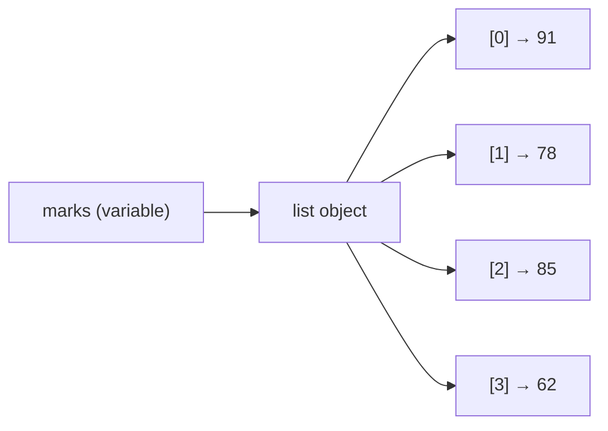
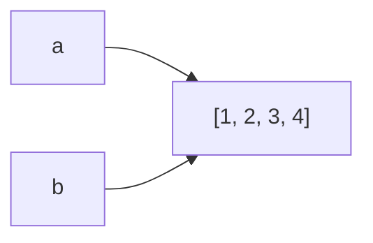
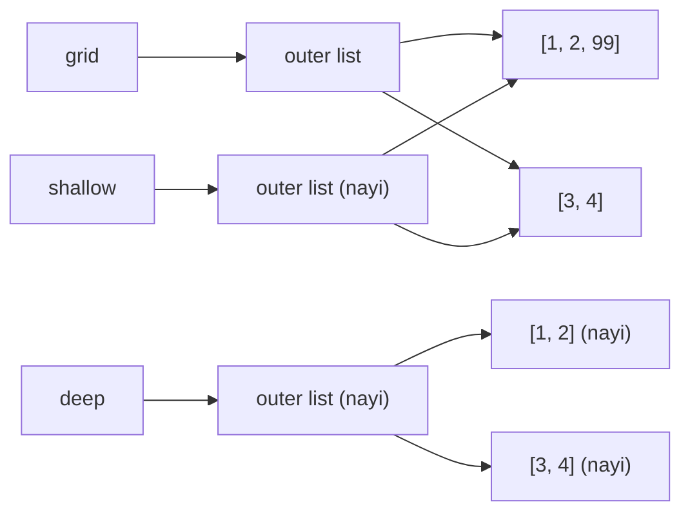
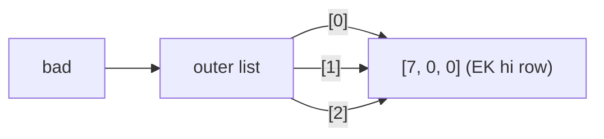
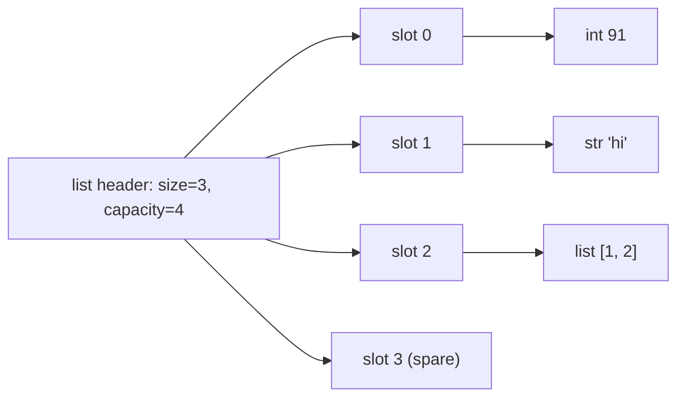

# Chapter 07 · Lists

> Tumhare phone ke contacts, tumhari Spotify queue, class ke 60 students ke marks: real programs *collections* se bhare pade hain. List Python ki sabse mehnati collection hai, aur yeh chupke se wahi cheez hai jo har DSA problem mein "array" kehlaati hai. Ise yahan pakka kar lo, aur aadha DSA apne aap aasaan ho jaayega.

**Is chapter mein tum seekhoge:**
- Lists ko kaise banaayein, padhein, badlein aur slice karein, har method aur uski Big-O cost ke saath
- List memory mein asal mein kaise kaam karti hai: ek **dynamic array** jo zaroorat se zyada jagah pehle se le leta hai (over-allocate), aur `append` "amortized O(1)" kyun hai
- **Aliasing**, **shallow copies** aur **deep copies** ka farak (interview ka top topic)
- 2D lists (grids) aur badnaam `[[0] * n] * m` trap
- Iteration patterns, sorting (`sort` vs `sorted`, `key`, stability) aur list ko stack ki tarah use karna
- Classic list interview problems: second largest, rotate, remove duplicates, missing number, reverse, maximum subarray

**Isse pehle padho:** [Variables, Data Types & Memory](02-variables-types-memory.md) · [Strings](04-strings.md) · [Loops & Iteration](06-loops.md)

---

## 🧠 The Big Idea · Asli Baat

Ek train socho. Har compartment pe ek number paint hai, **0** se shuru. Har compartment mein ek passenger baitha hai. Tum:

- seedha compartment 7 pe jaa sakte ho, 0 se 6 ke beech se guzre bina (yeh **indexing** hai, aur yeh turant hota hai),
- end mein ek naya compartment jod sakte ho (yeh **append** hai, aur yeh sasta hai),
- sabse aage ek naya compartment ghusa sakte ho (yeh **insert at 0** hai, aur yeh mehenga hai, kyunki uske peeche ke har compartment ka number badalna padega).

Yahi list hai: items ka ek **ordered** collection, jahan har item ki ek numbered position hoti hai jise uska **index** kehte hain.



Teen facts jo dimaag pe tattoo kar lo:

1. Lists **ordered** hain: items usi order mein rehte hain jisme tumne daale.
2. Lists **mutable** hain: banane ke baad bhi tum unhe badal sakte ho (strings ke ulat, [Chapter 04](04-strings.md) yaad karo).
3. Lists objects ke **references** rakhti hain, khud objects nahi. Yeh ek fact har "ajeeb" list bug ko samjha deta hai jo tumhe kabhi milega.

> 🇮🇳 **Desi Analogy:** List ko **railway reservation chart** jaisa socho jo platform pe chipka hota hai. Chart mein seat number 0, 1, 2... (index) aur har seat ke saamne passenger ka **naam** likha hai, passenger khud chart pe nahi chipka (yeh "references" wala point hai). TC seat 47 ka naam dekhna chahe toh seedha line 47 pe ungli rakhta hai, upar se ginta nahi (O(1) indexing). Chart ke end mein naya naam likhna aasaan hai (append). Lekin agar sabse upar ek naya naam ghusana ho, toh neeche ke saare naam ek line khiskane padenge (insert at 0, O(n)).

> 💡 DSA books aur doosri languages mein is structure ko **array** kehte hain. Jab interview problem bole "given an array `nums`", toh Python mein woh ek list hai.

---

## 🔨 Building It Up · Zero Se Shuru

### 1. Creating lists

Square brackets, items commas se alag.

```python
empty = []
marks = [91, 78, 85, 62]
names = ["Asha", "Ravi", "Meera"]
mixed = [1, "two", 3.0, True, None]     # allowed hai, lekin aam taur pe acchi idea nahi
nested = [[1, 2], [3, 4]]               # lists ki list

from_string = list("hello")             # koi bhi iterable -> list
from_range = list(range(5))
zeros = [0] * 5                         # repeat

print(empty, len(empty))
print(marks, len(marks))
print(mixed)
print(from_string)
print(from_range)
print(zeros)
```

```text
[] 0
[91, 78, 85, 62] 4
[1, 'two', 3.0, True, None]
['h', 'e', 'l', 'l', 'o']
[0, 1, 2, 3, 4]
[0, 0, 0, 0, 0]
```

Kya hua abhi: `list(...)` koi bhi cheez leta hai jis pe loop chal sake (string, `range`) aur uske items ko ek nayi list mein ikattha kar deta hai. `len()` items ki ginti deta hai. `[0] * 5` list ko paanch baar repeat karta hai, jo fixed size ki list banane ka standard tareeka hai.

Mixed types "acchi idea kyun nahi"? Kyunki list ka asli fayda tab hai jab tum har item ke saath **same** kaam kar sako (sab ko jodo, sab ko sort karo). `[1, "two", 3.0]` ko na jod sakte ho, na sort kar sakte ho. Alag-alag type ki cheezein ek record mein rakhni hon (naam, umar, city), toh uske liye tuple ya dictionary behtar hai (Chapter 08, 09).

### 2. Indexing: getting one item

Indexes **0** se shuru hote hain. Negative indexes end se ginte hain: `-1` aakhri item, `-2` second last.

```text
item:      'a'   'b'   'c'   'd'   'e'
index:      0     1     2     3     4
negative:  -5    -4    -3    -2    -1
```

```python
letters = ["a", "b", "c", "d", "e"]
print(letters[0])      # pehla
print(letters[2])      # teesra
print(letters[-1])     # aakhri
print(letters[-2])     # second last
print(letters[len(letters) - 1])   # aakhri, lamba tareeka
```

```text
a
c
e
d
e
```

Aisa index maangna jo exist hi nahi karta, error hai:

```py
letters = ["a", "b", "c"]
print(letters[3])
# IndexError: list index out of range
```

> 💡 Length n ki list ke liye valid indexes `0` se `n - 1` aur `-n` se `-1` hain. Off-by-one errors bilkul inhi kinaaron pe rehte hain.

> 🤔 **Mann mein sawaal:** Index 0 se kyun shuru hota hai? 1 se hota toh kitna natural lagta.
>
> **Jawab:** Index asal mein "shuruaat se kitne kadam door" hai, "kaunsa number" nahi. Pehla item shuruaat pe hi hai, toh 0 kadam door. Under the Hood mein dekhoge ki computer item ka address `start + i × 8` se nikaalta hai; `i = 0` pe seedha start address. 1 se shuru karte toh har baar ek extra subtraction karna padta. Aur bonus: `-1` aakhri item hai, kyunki woh "end se ek kadam peeche" hai.

### 3. Slicing: getting a piece

Slicing bilkul [Chapter 04](04-strings.md) wali string slicing jaisi chalti hai: `lst[start:stop:step]`. `start` include hota hai, `stop` **exclude**, aur har hisse ka ek samajhdaar default hai.

```python
nums = [10, 20, 30, 40, 50, 60]
print(nums[1:4])     # index 1, 2, 3
print(nums[:3])      # pehle teen
print(nums[3:])      # index 3 se end tak
print(nums[-2:])     # aakhri do
print(nums[::2])     # har doosra item
print(nums[::-1])    # ulti copy
print(nums[4:100])   # slices kabhi IndexError nahi dete
print(nums[5:2])     # jab start stop ke baad ho toh khaali
```

```text
[20, 30, 40]
[10, 20, 30]
[40, 50, 60]
[50, 60]
[10, 30, 50]
[60, 50, 40, 30, 20, 10]
[50, 60]
[]
```

Kya hua abhi: har slice ek **bilkul nayi list** banata hai. Isi wajah se `nums[::-1]` ulti copy deta hai aur `nums` ko chhoota bhi nahi. Iska yeh bhi matlab hai ki k items ka slice O(k) time aur memory leta hai, jo loops ke andar farak daalta hai.

> 💡 Memory trick: `nums[:k]` matlab "pehle k", aur `nums[k:]` matlab "pehle k ke baad sab kuch". Dono milke list ko bina overlap ke do hisson mein baant dete hain.

### 4. Changing items (lists are mutable)

Tum kisi index ko assign kar sakte ho, ya poore slice ko bhi.

```python
colors = ["red", "green", "blue"]
colors[1] = "yellow"            # ek item replace
print(colors)

nums = [1, 2, 3, 4, 5]
nums[1:3] = [20, 30]            # same length ke saath slice replace
print(nums)
nums[1:3] = [7, 7, 7, 7]        # slice assignment length badal sakta hai!
print(nums)
nums[:] = [0]                   # sab kuch replace, list object wahi
print(nums)
```

```text
['red', 'yellow', 'blue']
[1, 20, 30, 4, 5]
[1, 7, 7, 7, 7, 4, 5]
[0]
```

Teesri line dhyaan se dekho: `nums[1:3]` (do items: 20 aur 30) ko chaar 7s se replace kiya, toh list 5 se 7 items ki ho gayi.

Strings se compare karo: `"cat"[0] = "b"` `TypeError` hai kyunki strings immutable hain. Lists ko koi dikkat nahi.

### 5. Adding items: append, extend, insert, +, *

```python
stack = [1, 2]
stack.append(3)            # end mein EK item jodo
print(stack)

stack.append([4, 5])       # poori list EK item ban jaati hai
print(stack)

nums = [1, 2]
nums.extend([3, 4, 5])     # iterable ka HAR item jodo
print(nums)

nums.insert(0, 0)          # insert(index, value): 0 ko sabse aage rakho
nums.insert(3, 99)         # 99 ko index 3 pe rakho, baaki ko right khiskao
print(nums)

a = [1, 2]
b = a + [3]                # + ek NAYI list banata hai
print(a, b)
print([7, 8] * 3)          # * repeat karta hai
```

```text
[1, 2, 3]
[1, 2, 3, [4, 5]]
[1, 2, 3, 4, 5]
[0, 1, 2, 99, 3, 4, 5]
[1, 2] [1, 2, 3]
[7, 8, 7, 8, 7, 8]
```

Kya hua abhi: `append(x)` hamesha exactly ek item jodta hai, chahe `x` khud ek list ho. `extend(iterable)` dabba kholta hai aur har item ek-ek karke jodta hai. `insert(i, x)` `x` ko position `i` pe ghusata hai aur uske baad wale sabko ek step right khiskata hai, isliye yeh O(n) hai.

> ⚠️ `append` vs `extend` ek classic galti hai. Socho: **append ek passenger jodta hai; extend passengers ki poori train ek-ek karke jodta hai.**

> 🇮🇳 **Desi Analogy:** Swiggy order mein socho. `append(combo_box)` = poora combo box ek item ki tarah cart mein gaya; cart mein ab "1 combo" dikhega. `extend(combo_box)` = combo khol ke burger, fries, coke teeno alag-alag cart mein daal diye; cart mein ab 3 items. Isliye `stack.append([4, 5])` ke baad length 4 thi (ek "combo"), aur `extend` ke baad har number alag item bana.

### 6. Removing items: pop, remove, del, clear

```python
nums = [10, 20, 30, 40, 50]

last = nums.pop()          # aakhri item hatao aur RETURN karo
print(last, nums)

first = nums.pop(0)        # index 0 wala item hatao aur return karo
print(first, nums)

nums.remove(30)            # 30 ke BARABAR pehla item hatao (None return karta hai)
print(nums)

del nums[0]                # index se delete (yeh statement hai, method nahi)
print(nums)

data = [1, 2, 3, 4, 5, 6]
del data[1:4]              # poora slice delete
print(data)

data.clear()               # list khaali karo
print(data)
```

```text
50 [10, 20, 30, 40]
10 [20, 30, 40]
[20, 40]
[40]
[1, 5, 6]
[]
```

| Karna hai... | Use | Return | Item na mile toh |
|---|---|---|---|
| **position** se hatao, aur item wapas lo | `pop(i)` (default aakhri) | woh item | `IndexError` |
| **value** se hatao | `remove(x)` | `None` | `ValueError` |
| position ya slice se hatao, item nahi chahiye | `del lst[i]` / `del lst[a:b]` | kuch nahi | `IndexError` |
| sab kuch hatao | `clear()` | `None` | kabhi fail nahi |

```py
nums = [1, 2, 3]
nums.remove(99)     # ValueError: list.remove(x): x not in list
[].pop()            # IndexError: pop from empty list
```

### 7. Searching and counting

```python
nums = [4, 8, 15, 16, 23, 42, 8]

print(15 in nums, 99 in nums)     # membership test: True / False
print(nums.index(8))              # PEHLE 8 ka index
print(nums.index(8, 2))           # index 2 se dhoondhna shuru karo
print(nums.count(8))              # kitne 8 hain
print(len(nums), min(nums), max(nums), sum(nums))
```

```text
True False
1
6
2
7 4 42 116
```

Kya hua abhi: `in`, `index` aur `count` teeno list ko shuru se chalte hain, har item compare karte hue. Yeh **O(n)** hai. Agar tum bade collection pe baar-baar membership test karte ho, toh set kahin zyada fast hai (O(1)). Woh [Chapter 08](08-tuples-sets.md) hai.

`index` value na mile toh `ValueError` raise karta hai, isliye pehle `in` se check karo, ya error ko catch karo (exceptions [Chapter 13](13-exceptions-files.md) mein hain).

### 8. Every list operation and its cost

Yahan `n` list ki length hai aur `k` us doosri cheez ka size jo involve hai.

| Operation | Example | Time | Kyun |
|---|---|---|---|
| Index read / write | `a[i]`, `a[i] = x` | **O(1)** | address arithmetic (Under the Hood dekho) |
| Length | `len(a)` | O(1) | length stored hai, gini nahi jaati |
| Append | `a.append(x)` | **O(1) amortized** | end mein spare capacity |
| Pop last | `a.pop()` | O(1) | kuch shift nahi karna |
| Pop from index i | `a.pop(i)` | O(n − i) | i ke baad sab left shift |
| Pop first | `a.pop(0)` | **O(n)** | sab kuch shift |
| Insert | `a.insert(i, x)` | O(n − i) | i ke baad sab right shift |
| Remove by value | `a.remove(x)` | O(n) | search + shift |
| Delete by index | `del a[i]` | O(n − i) | shift |
| Membership | `x in a` | O(n) | linear scan |
| Find index | `a.index(x)` | O(n) | linear scan |
| Count | `a.count(x)` | O(n) | sab scan karta hai |
| Slice | `a[i:j]` | O(j − i) | items copy karta hai |
| Copy | `a.copy()`, `a[:]`, `list(a)` | O(n) | har reference copy karta hai |
| Extend / `+=` | `a.extend(b)` | O(k) amortized | k items append |
| Concatenate | `a + b` | O(n + k) | bilkul nayi list banata hai |
| Repeat | `a * k` | O(n·k) | bilkul nayi list banata hai |
| Reverse in place | `a.reverse()` | O(n) | pairs swap karta hai |
| Sort | `a.sort()`, `sorted(a)` | O(n log n) | Timsort |
| min / max / sum | `max(a)` | O(n) | sab dekhta hai |
| Clear | `a.clear()` | O(n) | har reference chhodta hai |
| Equality | `a == b` | O(n) | item by item compare |

> 💡 Do line ka summary: **list ka end sasta hai, aage ka hissa mehenga. Index se padhna turant hai, value se dhoondhna slow.**

### 9. Iteration patterns

Loops tumne [Chapter 06](06-loops.md) mein seekhe. Yeh rahe woh paanch tareeke jinse tum hamesha lists pe loop chalaoge.

```python
fruits = ["apple", "banana", "cherry"]
prices = [120, 40, 300]

# 1. Sirf items (default; jab positions ki zaroorat na ho)
for fruit in fruits:
    print(fruit, end=" ")
print()

# 2. Index AUR item: enumerate
for i, fruit in enumerate(fruits):
    print(i, fruit, end=" | ")
print()

# 3. Sirf index (jab padosiyon ko dekhna ho ya wapas likhna ho)
for i in range(1, len(prices)):
    print(prices[i] - prices[i - 1], end=" ")
print()

# 4. Do lists parallel mein: zip
for fruit, price in zip(fruits, prices):
    print(f"{fruit}={price}", end=" ")
print()

# 5. Bina copy kiye ulta: reversed
for fruit in reversed(fruits):
    print(fruit, end=" ")
print()
```

```text
apple banana cherry 
0 apple | 1 banana | 2 cherry | 
-80 260 
apple=120 banana=40 cherry=300 
cherry banana apple 
```

Kya hua abhi: `enumerate` tumhe `(index, item)` pairs deta hai, `zip` har list se ek-ek item ek saath deta hai (aur chhoti list pe ruk jaata hai), aur `reversed` bina copy banaye ulta chalta hai. `zip` aur `enumerate` mein aur gehraai se [Chapter 11](11-comprehensions-functional.md) mein jaayenge.

**Loop se nayi list banana** sabse common pattern hai: khaali se shuru karo, chalte-chalte append karo.

```python
marks = [91, 34, 78, 25, 66]
passed = []
for m in marks:
    if m >= 40:
        passed.append(m)
print(passed)
```

```text
[91, 78, 66]
```

> 💡 [Chapter 11](11-comprehensions-functional.md) mein tum ise ek line mein likhoge: `[m for m in marks if m >= 40]`. Same idea, chhota syntax.

**List pe loop chalate hue uski length kabhi mat badlo.** Loop andar ek index use karta hai, aur item hatane se sab kuch left khisak jaata hai, toh loop us item ko skip kar deta hai jo khaali jagah mein khisak ke aaya:

```python
nums = [1, 2, 2, 3, 2, 4]
for x in nums:            # BUG: iterate karte hue remove karna
    if x == 2:
        nums.remove(x)
print(nums)               # ek 2 bach gaya!

nums = [1, 2, 2, 3, 2, 4]
kept = []
for x in nums:            # FIX: nayi list banao
    if x != 2:
        kept.append(x)
print(kept)
```

```text
[1, 3, 2, 4]
[1, 3, 4]
```

Dry run se dekho bug kaise hua (loop ka internal index har step pe 1 badhta hai):

| Loop index | List us waqt | `x` | Kya hua |
|---|---|---|---|
| 0 | `[1, 2, 2, 3, 2, 4]` | 1 | kuch nahi |
| 1 | `[1, 2, 2, 3, 2, 4]` | 2 | `remove(2)` → `[1, 2, 3, 2, 4]`; doosra 2 khisak ke index 1 pe aa gaya |
| 2 | `[1, 2, 3, 2, 4]` | 3 | index 1 wala 2 **skip** ho gaya, kabhi dekha hi nahi |
| 3 | `[1, 2, 3, 2, 4]` | 2 | `remove(2)` pehla 2 hatata hai (index 1 wala) → `[1, 3, 2, 4]` |
| 4 | `[1, 3, 2, 4]` | – | index 4 exist hi nahi karta, loop khatam |

Aakhri 2 khisak ke index 2 pe aa gaya tha, jahan loop pehle hi jaa chuka tha. Isliye ek 2 bach gaya. Items khiskte rahe, loop ka index aage badhta raha, aur beech mein cheezein chhoot gayi.

> 🇮🇳 **Desi Analogy:** Yeh bilkul aisa hai jaise queue mein khade logon ko ek-ek karke ginte hue tum "jinke haath mein ticket nahi, bahar jao" bol rahe ho. Tumhari ungli position 2 pe hai, woh banda bahar gaya, aur peeche wala aage khisak ke position 2 pe aa gaya. Tumne ungli position 3 pe kar di. Jo banda khisak ke aaya tha, woh bina check hue bach gaya. Solution: purani line ko chhedo mat, ek nayi line banao jisme sirf ticket wale jaayein.

### 10. Sorting: sort vs sorted

Do tools hain, aur unka farak interview ka favourite sawaal hai.

| | `lst.sort()` | `sorted(iterable)` |
|---|---|---|
| Kya hai | list **method** | built-in **function** |
| Original badalta hai? | **Haan**, in place | Nahi |
| Return | `None` | ek **nayi** sorted list |
| Kis pe chalta hai | sirf lists | koi bhi iterable (string, tuple, set, dict...) |

```python
nums = [5, 2, 9, 1]
result = nums.sort()
print(nums, result)            # in place sort hua, None return hua

scores = [70, 95, 60]
ranked = sorted(scores, reverse=True)
print(scores, ranked)          # original ko chhua bhi nahi

print(sorted("python"))        # kisi bhi iterable pe chalta hai
```

```text
[1, 2, 5, 9] None
[70, 95, 60] [95, 70, 60]
['h', 'n', 'o', 'p', 't', 'y']
```

**`key` parameter** batata hai *kis cheez se sort karna hai*. Tum use ek function dete ho, Python har item pe use ek baar call karta hai, aur results ke hisaab se sort karta hai. Functions [Chapter 10](10-functions.md) mein hain; abhi bas itna jaano ki tum function ka naam bina call kiye (bina `()` ke) pass kar sakte ho.

```python
words = ["banana", "Apple", "kiwi", "cherry"]
print(sorted(words))                  # capital letters lowercase se pehle aate hain!
print(sorted(words, key=str.lower))   # case-insensitive
print(sorted(words, key=len))         # length se
print(sorted(words, key=len, reverse=True))
```

```text
['Apple', 'banana', 'cherry', 'kiwi']
['Apple', 'banana', 'cherry', 'kiwi']
['kiwi', 'Apple', 'banana', 'cherry']
['banana', 'cherry', 'Apple', 'kiwi']
```

Kya hua abhi: default mein strings character codes se compare hoti hain, aur `'A'` (65) `'b'` (98) se chhota hai. `key=len` ke saath Python lengths 6, 5, 4, 6 compare karta hai. `'banana'` aur `'cherry'` dekho: dono ki length 6 hai, aur woh apne **original order** mein rehte hain. Yahi stability hai.

(Pehli do lines ka output yahan same aaya, lekin sirf isliye ki is list mein sirf ek hi capital word hai. `["banana", "Cherry", "apple"]` try karo: default `['Cherry', 'apple', 'banana']` dega, `key=str.lower` dega `['apple', 'banana', 'Cherry']`.)

**Stability** ka matlab: jo items barabar compare hote hain, woh apna original relative order banaye rakhte hain. Python ka sort hamesha stable hai, jisse tum kai cheezon se steps mein sort kar sakte ho:

```python
students = [["Ravi", 85], ["Asha", 92], ["Meera", 85], ["Kabir", 92]]
# Proper multi-key sorting Chapter 11 mein aayega. Abhi ke liye, ek stable two-step:
step1 = sorted(students, key=lambda row: row[0])                 # naam se
step2 = sorted(step1, key=lambda row: row[1], reverse=True)      # phir marks se
for name, mark in step2:
    print(name, mark)
```

```text
Asha 92
Kabir 92
Meera 85
Ravi 85
```

Kya hua abhi: humne pehle naam se sort kiya, phir marks se. Kyunki doosra sort stable hai, barabar marks wale students naam ke order mein hi rehte hain. `lambda row: row[1]` ek chhota sa bina naam ka function hai jo marks return karta hai; `lambda` se proper mulaqaat [Chapter 10](10-functions.md) mein hogi.

> 🇮🇳 **Desi Analogy:** Board exam ka merit list socho. Clerk pehle saari answer sheets roll number ke order mein lagata hai. Phir marks ke hisaab se sort karta hai, lekin **stable** tareeke se: do bachchon ke 92 aaye toh unhe aapas mein nahi chhedta. Result: merit list marks se sorted hai, aur barabar marks waale roll number ke order mein. Isliye **pehle secondary key se sort karo (naam), phir primary key se (marks)**. Ulta order lagta hai, lekin yahi sahi hai.

**Reversing**, teen tareeke:

```python
a = [1, 2, 3]
a.reverse()              # in place, None return karta hai
print(a)
print(a[::-1])           # nayi ulti list
print(list(reversed(a))) # reverse iterator se nayi list
```

```text
[3, 2, 1]
[1, 2, 3]
[1, 2, 3]
```

(Pehli line ke baad `a` khud `[3, 2, 1]` ban gaya, isliye agle do tareekon ne use phir se ulta karke `[1, 2, 3]` dikhaya, aur `a` ko badla nahi.)

> ⚠️ Jo list aise types mix karti hai jinhe compare nahi kar sakte, use sort nahi kar sakte: `sorted([3, "a"])` `TypeError: '<' not supported between instances of 'str' and 'int'` raise karta hai.

### 11. Aliasing vs copying

Yeh is chapter ka sabse important section hai. [Chapter 02](02-variables-types-memory.md) se yaad karo ki variable ek object pe chipka hua **name tag** hai. Toh:

```python
a = [1, 2, 3]
b = a            # copy NAHI hai! b usi SAME list pe doosra name tag hai
b.append(4)
print(a)         # a bhi badal gaya
print(a is b)    # same object hai?
```

```text
[1, 2, 3, 4]
True
```



Ek object pe do naam point karein, ise **aliasing** kehte hain. Yeh bug nahi hai; Python aise hi kaam karta hai. Bug tab banta hai jab tumne *socha* ki tumhare paas do alag lists hain.

> 🇮🇳 **Desi Analogy:** Joint family ka ek hi **WhatsApp group** hai. Mummy use "Family ❤️" naam se save karti hain, tum "Ghar wale" naam se. Do naam, group ek. Chacha ne group mein photo daali, toh dono ke phone mein dikhegi. `b = a` yahi hai: naya group nahi bana, bas ek aur naam se save ho gaya. Naya group chahiye (copy), toh "Create group" karke members alag se add karne padenge.

**`==` vs `is`:** `==` poochta hai "kya inme barabar values hain?" aur `is` poochta hai "kya yeh sach mein ek hi object hain?"

```python
x = [1, 2]
y = [1, 2]
print(x == y, x is y)    # values barabar, objects alag
```

```text
True False
```

**Shallow copy**: ek nayi bahar wali list, lekin andar ke items **wahi** objects. Ise banane ke chaar tareeke:

```python
import copy

original = [1, 2, 3]
c1 = original.copy()
c2 = original[:]
c3 = list(original)
c4 = copy.copy(original)

c1.append(99)
print(original, c1)
print(c1 is original, c2 is original, c3 is original, c4 is original)
```

```text
[1, 2, 3] [1, 2, 3, 99]
False False False False
```

Numbers ya strings ki list ke liye shallow copy hi kaafi hai, kyunki numbers aur strings immutable hain: unhe koi in place badal hi nahi sakta. Lekin lists ki list ke saath:

```python
import copy

grid = [[1, 2], [3, 4]]
shallow = grid.copy()
deep = copy.deepcopy(grid)

shallow[0].append(99)     # woh inner list badli jo DONO share karte hain
print(grid)
print(shallow)
print(deep)               # deep copy ki apni inner lists hain

print(shallow[0] is grid[0], deep[0] is grid[0])
```

```text
[[1, 2, 99], [3, 4]]
[[1, 2, 99], [3, 4]]
[[1, 2], [3, 4]]
True False
```



Kya hua abhi: shallow copy **ek level** copy karta hai: bahar wali list nayi hai, lekin uske slots wahi inner lists ki taraf point karte hain. `copy.deepcopy` recursively neeche tak jaata hai aur sab kuch copy karta hai, toh kuch bhi share nahi hota.

> 🇮🇳 **Desi Analogy:** Shallow copy = **photocopy of an address book**. Nayi diary mil gayi (nayi outer list), lekin usme likhe address wahi ghar hain. Kisi ne us ghar ko paint kar diya (inner list badli), toh dono diary wale wahan jaake naya rang hi dekhenge. Deep copy = har ghar ka ek naya duplicate ghar banwa lena. Mehenga hai (O(total size)), lekin ab koi kuch bhi badle, tumhara alag hai.

| | `b = a` | shallow copy | deep copy |
|---|---|---|---|
| Nayi outer list? | ❌ | ✅ | ✅ |
| Naye inner objects? | ❌ | ❌ | ✅ |
| Cost | O(1) | O(n) | O(total size) |
| Numbers/strings ki flat lists ke liye safe? | ❌ | ✅ | ✅ (zaroorat se zyada) |
| Nested lists ke liye safe? | ❌ | ❌ | ✅ |

> 🤔 **Mann mein sawaal:** Numbers ki list mein shallow copy safe kyun hai? Andar ke numbers bhi toh share ho rahe hain na?
>
> **Jawab:** Haan, share ho rahe hain, lekin farak nahi padta, kyunki koi `5` ko "badal" hi nahi sakta. Jab tum `c1[0] = 99` karte ho, toh `5` object nahi badalta; `c1` ka slot 0 bas ek naye object `99` ki taraf point karne lagta hai. `original` ka slot 0 ab bhi purane `5` pe hai. Problem sirf tab hai jab andar ka object **mutable** ho (jaise list) aur tum use **in place** badlo (`.append`). Tab dono list ek hi badli hui cheez dekhti hain.

**Functions ko bhi aliases milte hain.** Jab tum ek list function mein pass karte ho, function ko usi list pe ek name tag milta hai, isliye woh tumhari list badal sakta hai. ([Chapter 10](10-functions.md) mein aur.)

```python
def add_bonus(marks):
    for i in range(len(marks)):
        marks[i] += 5

scores = [70, 80]
add_bonus(scores)
print(scores)
```

```text
[75, 85]
```

### 12. 2D lists (grids, matrices) and the `[[0] * n] * m` trap

**2D list** woh list hai jiske items khud lists hain: rows of columns. Board games, images, maps, DP tables: sab grids hain.

```python
grid = [
    [1, 2, 3],
    [4, 5, 6],
]
rows, cols = len(grid), len(grid[0])
print(rows, cols)
print(grid[1][2])           # row 1, column 2

for r in range(rows):
    for c in range(cols):
        print(grid[r][c], end=" ")
    print()

for row in grid:            # jab indexes ki zaroorat na ho, Pythonic tareeka
    print(sum(row))
```

```text
2 3
6
1 2 3 
4 5 6 
6
15
```

`grid[r][c]` aise padho: pehle row list `grid[r]` uthao, phir usme se item `c`. Jaise cinema ticket: pehle row "F" dhoondho, phir usme seat 12.

**Ab trap.** Tumhe zeros ka 3×3 grid chahiye, toh tum "obvious" cheez likhte ho:

```python
bad = [[0] * 3] * 3
bad[0][0] = 7
print(bad)
print(bad[0] is bad[1])
```

```text
[[7, 0, 0], [7, 0, 0], [7, 0, 0]]
True
```

Har row badal gayi! `[0] * 3` **ek** row banata hai, aur `* 3` us row ka **reference** teen baar copy karta hai. Tumhare paas ek row pe teen name tags hain.



Toh phir `[0] * 3` sahi kyun chalta hai? Woh bhi same `0` ka reference teen baar copy karta hai, lekin `0` immutable hai. `row[0] = 7` likhne se `0` object nahi badalta; slot 0 bas ek doosre object ki taraf point karne lagta hai. Row lekin mutable hai, aur `bad[0][0] = 7` khud shared row ko badal deta hai.

**Fix:** har line ke liye alag row banao.

```python
rows, cols = 3, 3
good = []
for _ in range(rows):
    good.append([0] * cols)       # har baar ek NAYI row
good[0][0] = 7
print(good)

# Ek line wala version jo tum roz use karoge (comprehensions: Chapter 11)
also_good = [[0] * cols for _ in range(rows)]
also_good[1][1] = 5
print(also_good)
```

```text
[[7, 0, 0], [0, 0, 0], [0, 0, 0]]
[[0, 0, 0], [0, 5, 0], [0, 0, 0]]
```

Farak kahan hai? Loop wale version mein `[0] * cols` **har iteration pe dobara chalta hai**, toh har baar ek nayi list banti hai. `* 3` wale version mein `[0] * 3` sirf **ek baar** chala tha.

**Grid essentials:** transpose karna (rows columns ban jaati hain) aur ek cell ke chaar padosiyon pe chalna, jo tum [Graphs](../part-2-dsa/16-graphs-bfs-dfs.md) mein lagataar karoge.

```python
matrix = [[1, 2, 3],
          [4, 5, 6]]

transposed = []
for c in range(len(matrix[0])):
    new_row = []
    for r in range(len(matrix)):
        new_row.append(matrix[r][c])
    transposed.append(new_row)
print(transposed)
print([list(col) for col in zip(*matrix)])   # pro version (Chapter 08 * samjhayega)

# Cell (r, c) ke 4 padosi, grid ke andar rehte hue
r, c = 0, 1
for dr, dc in [(-1, 0), (1, 0), (0, -1), (0, 1)]:
    nr, nc = r + dr, c + dc
    if 0 <= nr < len(matrix) and 0 <= nc < len(matrix[0]):
        print((nr, nc), matrix[nr][nc])
```

```text
[[1, 4], [2, 5], [3, 6]]
[[1, 4], [2, 5], [3, 6]]
(1, 1) 5
(0, 0) 1
(0, 2) 3
```

Padosi wale loop ko samjho: `(dr, dc)` chaar directions hain: upar `(-1, 0)`, neeche `(1, 0)`, left `(0, -1)`, right `(0, 1)`. Cell (0, 1) se upar jaana `(-1, 1)` hai jo grid ke bahar hai, toh bounds check ne use chhaant diya. Baaki teen andar hain, toh print hue.

### 13. A list as a stack

**Stack** plates ka dher hai: upar rakho, upar se uthao. Last In, First Out (**LIFO**). Python list ka end hi top hai: `append` push karta hai, `pop` pop karta hai, `[-1]` jhaank ke dekhta hai (peek). Sab O(1).

```python
history = []
history.append("google.com")      # push
history.append("youtube.com")
history.append("github.com")
print("peek:", history[-1])
print("back to:", history.pop())  # pop
print("back to:", history.pop())
print("left:", history)
print("empty?", not history)
```

```text
peek: github.com
back to: github.com
back to: youtube.com
left: ['google.com']
empty? False
```

**Queue** (first in, first out, jaise ticket ki line) alag kahani hai. `pop(0)` O(n) hai kyunki bache hue saare items left khiskte hain. Queues ke liye `collections.deque` use karo, jiska `popleft()` O(1) hai. Queues aur deques ko apna chapter milta hai: [Chapter 12 of DSA](../part-2-dsa/12-queues-deques.md). Stacks ko [Chapter 11 of DSA](../part-2-dsa/11-stacks.md).

```python
from collections import deque

line = deque(["Asha", "Ravi"])
line.append("Meera")          # peeche line mein lago
print(line.popleft())         # aage se niklo, O(1)
print(list(line))
```

```text
Asha
['Ravi', 'Meera']
```

> 🇮🇳 **Desi Analogy:** Stack = **shaadi mein plates ka dher**. Jo plate sabse baad mein dhul ke upar rakhi gayi, wahi sabse pehle uthegi. Browser ka back button bhi yahi hai. Queue = **IRCTC counter ki line**. Jo pehle aaya, pehle ticket. Ab socho list ko queue bana diya: har baar aage wala banda gaya toh poori line ko ek kadam aage khiskana pada (`pop(0)`, O(n)). `deque` mein line khiskti nahi, counter wala bas agle bande ki taraf dekh leta hai (`popleft()`, O(1)).

### 14. Handy built-ins and tricks for lists

```python
nums = [3, 1, 4, 1, 5, 9, 2, 6]

print(sum(nums) / len(nums))          # average
print(max(nums), nums.index(max(nums)))   # sabse badi value aur woh kahan hai
print(sorted(nums)[-2])               # second largest (duplicates allowed ke saath)
print(nums[-3:])                      # aakhri teen
first, *middle, last = nums           # star unpacking (Chapter 08 mein aur)
print(first, last, len(middle))
print(", ".join(str(x) for x in nums[:3]))   # numbers ki list -> string
print("a,b,c".split(","))                    # string -> list
```

```text
3.875
9 5
6
[9, 2, 6]
3 6 6
3, 1, 4
['a', 'b', 'c']
```

`first, *middle, last = nums`: `first` ko pehla item mila (3), `last` ko aakhri (6), aur `*middle` ne beech ke baaki saare 6 items ek list mein samet liye. Aur `join` sirf strings jodta hai, isliye pehle `str(x)` se har number ko string banaya.

---

## 🔬 Under the Hood · Andar Ki Kahani

### A list is an array of pointers

Memory mein CPython list ko ek chhote header aur memory slots ke ek alag **contiguous block** (lagataar, beech mein koi gap nahi) ki tarah store karta hai. Har slot 8 bytes ka hai (64-bit machine pe) aur ek **pointer** (memory address) rakhta hai jo kahin aur pade object ki taraf point karta hai.



Yeh teen cheezein ek saath samjha deta hai:

1. **Indexing O(1) kyun hai.** Slots ek ke baad ek hain aur sab same size ke. Slot `i` dhoondhne ke liye CPU calculate karta hai `start_address + i × 8`. Ek multiplication aur ek addition, chahe list mein 10 items hon ya 1 crore.
2. **List mixed types kyun rakh sakti hai.** Har slot bas ek address hai, aur address 8 bytes ka hota hai chahe woh kisi bhi cheez ki taraf point kare.
3. **Aliasing aur shallow copies aise kyun behave karte hain.** List copy karne se *addresses* copy hote hain, objects nahi.

Example: maan lo list ka block address 1000 pe shuru hota hai. `a[3]` chahiye? 1000 + 3 × 8 = 1024. Seedha address 1024 pe jao, pointer uthao, object mil gaya. Koi ginti nahi, koi search nahi.

### Dynamic array: why append is cheap

Ek plain array ka size fixed hota hai. Toh list hamesha kaise badh sakti hai? Trick hai **over-allocation**: jab list ke slots khatam ho jaate hain, Python ek bada block allocate karta hai, purane pointers wahan copy karta hai, aur kuch **spare capacity** rakh leta hai taaki agle kuch appends mein copy na karna pade.

- **size** = tumhare paas kitne items hain (`len`)
- **capacity** = kitne slots reserved hain

Tum `sys.getsizeof` se capacity ko jump karte dekh sakte ho (list object khud kitne bytes leta hai, uske items nahi):

```python
import sys

a = []
last = sys.getsizeof(a)
print(f"len={len(a):2}  bytes={last}")
for i in range(26):
    a.append(i)
    size = sys.getsizeof(a)
    if size != last:                     # capacity badhi
        print(f"len={len(a):2}  bytes={size}")
        last = size
```

```text
len= 0  bytes=56
len= 1  bytes=88
len= 5  bytes=120
len= 9  bytes=184
len=17  bytes=248
len=25  bytes=312
```

Kya hua abhi (numbers 64-bit CPython 3.11+ ke hain; doosre builds mein thoda alag ho sakte hain): khaali list 56 bytes ki hai. Pehle append pe woh 4 pointers ki jagah reserve karti hai (56 + 4×8 = 88). Append 2, 3, 4 ka koi extra kharcha nahi. 5th pe woh 8 slots tak badhti hai, phir 16, 24, 32... CPython lagbhag 1.125× plus ek chhote constant se badhta hai; kai doosri languages double karti hain. Dono tareeke mein growth **current size ke proportional** hai, aur yahi asli baat hai.

(Bytes se slots kaise nikale? 120 − 56 = 64 bytes = 8 slots. 184 − 56 = 128 = 16 slots. 248 → 24 slots. 312 → 32 slots.)

> 🇮🇳 **Desi Analogy:** Over-allocation = **shaadi ke liye hall book karna**. Tumhe abhi 100 guests pata hain, lekin smart log 120 ki capacity wala hall lete hain, kyunki "aur log aayenge hi". 101-120 tak ke guests ko bina kuch kiye jagah mil jaati hai (sasta append). Agar 121st guest aa gaya, toh pura function bade hall mein shift karna padega, saare guests ko le jaana padega (mehenga resize). Lekin naya hall bhi bada lete ho, toh aisa shift kabhi-kabhi hi hota hai.

### Amortized O(1), explained like a phone bill

Ek badkismat append jo resize trigger kare, O(n) ka padta hai (saare n pointers copy karo). Toh hum append ko O(1) kyun bolte hain?

Aasaani ke liye doubling maan lo. n items tak pahunchne ke liye tum sizes 1, 2, 4, 8, ..., n pe resize karte ho. Kul copying ka kaam = 1 + 2 + 4 + ... + n < **2n**. Ise n appends mein baant do, toh har append pe **2 se kam copies**: ek constant. **Amortized** ka yahi matlab hai: "operations ki ek lambi sequence pe average karo, toh har operation ki cost constant hai", chahe koi ek operation kabhi-kabhi mehenga ho. Bilkul monthly phone plan jaisa: ek baar badi payment, lekin per day sasta.

1 + 2 + 4 + ... + n < 2n kyun? Kyunki har term apne se pehle ke saare terms ke sum se 1 zyada hai (8 = 1 + 2 + 4 + 1). Toh poora sum, aakhri term ke double se kam hi rehta hai.

Constant amount se badhna (jaise har baar +10 slots) kaam **nahi** karega: tum n/10 baar resize karoge, 10 + 20 + 30 + ... ≈ n²/20 items copy karoge, jo per append O(n) hai. **Proportionally** badhna hi hai jo maths ko kaam karwata hai.

> 🤔 **Mann mein sawaal:** "Amortized O(1)" aur "average O(1)" ek hi cheez hai kya?
>
> **Jawab:** Nahi, aur interviewer yeh farak pakad sakta hai. **Average** case ka matlab hota hai "random inputs pe aam taur pe" (jaise hash table lookup, jahan bad luck se collisions ho sakte hain). **Amortized** ek **guarantee** hai: kisi bhi n operations ki sequence ka kul kharcha O(n) hi hoga, chahe kuch bhi ho. Koi bad luck nahi. Ek single append mehenga ho sakta hai, lekin poori sequence ka total kabhi nahi bigadta.

### Why the front is expensive

`insert(0, x)` aur `pop(0)` ko block contiguous rakhne ke liye har pointer ek slot khiskana padta hai. Yeh n moves hain: O(n). Ise n iterations ke loop ke andar karo aur tumne galti se O(n²) program likh diya. Isi wajah se queues `deque` use karti hain (ek alag structure jo linked blocks se bana hai).

### Shrinking

Jab tum bahut saare items pop karte ho, toh agar list apni capacity ke aadhe se neeche gir jaaye toh CPython allocation ko chhota bhi kar deta hai, taaki memory hamesha ke liye waste na ho. `clear()` poora block chhod deta hai.

### How sorting works

`list.sort()` aur `sorted()` **Timsort** use karte hain, merge sort aur insertion sort ka ek hybrid jo Tim Peters ne 2002 mein Python ke liye design kiya. Yeh tumhare data mein pehle se sorted "runs" dhoondhta hai aur unhe merge karta hai, isliye yeh worst case mein O(n log n), already-sorted data pe **O(n)**, aur hamesha **stable** hai. Merge sort tum khud [Sorting Algorithms](../part-2-dsa/07-sorting.md) mein banaoge.

---

## 🧩 Pattern Decoder · Pattern Pakdo

### Pythonic list idioms

| Iski jagah... | Yeh likho | Kyun |
|---|---|---|
| `lst[len(lst) - 1]` | `lst[-1]` | chhota, matlab same |
| `for i in range(len(lst)): print(lst[i])` | `for x in lst:` | index ka shor nahi |
| manual counter + loop | `for i, x in enumerate(lst):` | index aur value saath |
| `if len(lst) == 0:` | `if not lst:` | khaali lists falsy hain ([Chapter 05](05-conditionals.md)) |
| `temp = a[i]; a[i] = a[j]; a[j] = temp` | `a[i], a[j] = a[j], a[i]` | ek line ka swap |
| loop se copy karna | `b = a.copy()` ya `a[:]` | zyada saaf, zyada fast |
| loop mein `result = result + [x]` | `result.append(x)` | `+` har baar nayi list banata hai: kul O(n²) |
| loop mein `pop(0)` | `collections.deque.popleft()` | O(n) ki jagah O(1) |
| `x = x.sort()` | `x.sort()` ya `x = sorted(x)` | `sort()` `None` return karta hai |

### The four list "shapes" you'll use in DSA

**1. Running answer** (ek baar scan karo, ab tak ka best rakho): max, min, second largest, best profit.

```python
def best_time_to_buy_and_sell(prices):
    lowest = prices[0]
    best = 0
    for p in prices:
        lowest = min(lowest, p)          # ab tak khareedne ka sabse accha din
        best = max(best, p - lowest)     # aaj bechein toh best profit
    return best

print(best_time_to_buy_and_sell([7, 1, 5, 3, 6, 4]))
```

```text
5
```

Dry run: prices 7 → lowest 7, best 0. 1 → lowest 1. 5 → profit 4, best 4. 3 → profit 2. 6 → profit 5, best 5. 4 → profit 3. Answer 5 (1 pe khareedo, 6 pe becho). Ek hi pass, O(n).

**2. Nayi list banao** (filter ya transform): `[]` se shuru karo, jo rakhna hai use `append` karo.

**3. In place reader/writer** (O(1) extra memory ke saath filter): [Two Pointers](../part-2-dsa/03-two-pointers.md) dekho.

**4. Stack** (`append`/`pop`): matching brackets, undo, [Stacks](../part-2-dsa/11-stacks.md) mein "next greater element".

```python
def is_balanced(text):
    pairs = {")": "(", "]": "[", "}": "{"}     # ek dict: Chapter 09
    stack = []
    for ch in text:
        if ch in "([{":
            stack.append(ch)
        elif ch in pairs:
            if not stack or stack.pop() != pairs[ch]:
                return False
    return not stack

print(is_balanced("{[()()]}"), is_balanced("([)]"), is_balanced("(("))
```

```text
True False False
```

Logic: har khulne wala bracket stack pe rakho. Har band hone wala bracket stack ke top se match hona chahiye. `"([)]"` mein `)` aaya jab top pe `[` tha: mismatch, False. `"(("` mein end mein stack khaali nahi hua (do brackets kabhi band hi nahi hue): False.

### How lists show up later

| Aage ka topic | Wahan list kya karti hai |
|---|---|
| [Arrays & Strings](../part-2-dsa/02-arrays-strings.md) | har problem ka "array" |
| [Two Pointers](../part-2-dsa/03-two-pointers.md), [Sliding Window](../part-2-dsa/04-sliding-window.md) | list pe chalte hue indexes |
| [Prefix Sums](../part-2-dsa/06-prefix-sums.md) | running totals ki ek doosri list |
| [Stacks](../part-2-dsa/11-stacks.md) | `append` / `pop` |
| [Heaps](../part-2-dsa/15-heaps.md) | `heapq` ek plain list ke andar heap store karta hai |
| [Graphs](../part-2-dsa/16-graphs-bfs-dfs.md) | grids aur adjacency lists (`list` of `list`) |
| [Dynamic Programming](../part-2-dsa/20-dp-1d.md) | `dp = [0] * (n + 1)` tables |

---

## ⚠️ Traps & Common Mistakes · Yahan Sab Phisalte Hain

1. **Yeh sochna ki `b = a` copy karta hai.** Yeh alias banata hai. Flat lists ke liye `a.copy()` aur nested ke liye `copy.deepcopy(a)` use karo.

2. **Grid trap.** `[[0] * n] * m` ek hi row ke m references banata hai.

```py
grid = [[0] * 3] * 3                 # ❌ ek shared row
grid = [[0] * 3 for _ in range(3)]   # ✅ teen alag rows
```

3. **`sort()` ka result assign karna.** Woh `None` return karta hai.

```py
nums = nums.sort()      # ❌ nums ab None hai
nums.sort()             # ✅ in place
nums = sorted(nums)     # ✅ nayi list
```

Yahi baat `append`, `extend`, `insert`, `remove`, `reverse`, `clear` pe bhi lagu hai: jo methods list badalte hain, woh `None` return karte hain.

4. **`extend` chahiye tha aur `append` kar diya.** `a.append([4, 5])` ek item (ek list) jodta hai. `a.extend([4, 5])` do items jodta hai.

5. **Iterate karte hue items hatana.** Elements skip ho jaate hain. Nayi list banao, copy pe iterate karo (`for x in nums[:]`), ya reader/writer use karo.

6. **`remove` sirf pehla match hatata hai**, aur koi na mile toh `ValueError` raise karta hai. Saare hatane hon toh nayi list mein filter karo.

7. **Loop mein `pop(0)` ya `insert(0, x)` use karna.** Har ek O(n) hai, toh loop O(n²) ban jaata hai. `deque` use karo.

8. **Alias pe `+=` shared list badalta hai, lekin `= a + ...` nahi.** `a += [1]` `a` ko in place mutate karta hai (`extend` jaisa), toh har alias ko dikhta hai. `a = a + [1]` ek nayi list banata hai aur sirf naam `a` ko khiskata hai.

```python
a = [1, 2]
b = a
a += [3]          # in place: b ko dikhega
print(b)
a = a + [4]       # nayi list: b ko NAHI dikhega
print(a, b)
```

```text
[1, 2, 3]
[1, 2, 3, 4] [1, 2, 3]
```

9. **`range(len(lst))` ke saath off-by-one.** `lst[i]` ko `lst[i + 1]` se compare kar rahe ho? `len(lst) - 1` tak loop chalao, warna aakhri step pe `IndexError` milega.

10. **Built-in ko shadow karna.** Variable ka naam `list = [1, 2]` rakhne se baaki program ke liye `list()` function chhup jaata hai. `nums`, `items`, `values` jaise naam use karo.

> 🤔 **Mann mein sawaal:** `a += [3]` aur `a = a + [3]` toh maths mein same hote hain. Python mein alag kyun?
>
> **Jawab:** Kyunki `+=` ek alag operation hai (`__iadd__`), jise list "khud ko badlo" ki tarah implement karti hai, bilkul `extend` jaisa. `a + [3]` (`__add__`) hamesha ek nayi list banata hai, aur `a = ...` phir naam `a` ko us nayi list pe chipka deta hai. Jab tak koi alias nahi hai, tumhe farak nahi dikhega. Alias hai (`b = a`, ya function ka parameter), toh `+=` uske liye bhi badlega, `= a +` nahi. (Ints aur strings ke liye `+=` hamesha nayi value banata hai, kyunki woh immutable hain.)

---

## 💡 Tips & Tricks · Pro Wale Moves

- `lst[-1]` aakhri item hai, `lst[-k:]` aakhri k, `lst[:k]` pehle k. Out-of-range bounds pe slices kabhi crash nahi karte.
- Fixed-size list chahiye? `[0] * n`, `[None] * n`, ya `[False] * n`. Immutable fillers ke liye theek; lists ke liye kabhi nahi.
- `if not lst:` idiomatic empty check hai.
- `sorted(x, key=..., reverse=True)` kisi bhi iterable pe chalta hai aur original ko chhoota nahi. Jab original ki zaroorat na ho aur memory bachani ho, `.sort()` use karo.
- `min(lst)` aur `max(lst)` khaali list pe crash karte hain. `default=` pass karo: `max(lst, default=0)`.
- Do items swap karne ke liye: `a[i], a[j] = a[j], a[i]`.
- k se right rotate karne ke liye: `a[-k:] + a[:-k]` (pehle `k %= len(a)` karke).
- Order rakhte hue duplicates hatane ke liye: `list(dict.fromkeys(a))` (kyun chalta hai: [Chapter 09](09-dictionaries.md)).
- Ek level flatten karne ke liye: loop aur `extend`, ya `[x for row in grid for x in row]` ([Chapter 11](11-comprehensions-functional.md)).
- Interviews mein cost zor se bolo: "`pop(0)` is O(n), so I'll use a deque."

---

## 🎯 Interview Questions · Interview Mein Yahi Poochenge

### 1. What's the difference between a list and an array? Between a list and a tuple? 🔥🔥🔥

<details><summary>Answer dekho 👀</summary>

- **Python list** ek *dynamic array of references* hai: yeh badh sakti hai, aur mixed types rakh sakti hai kyunki har slot ek pointer hai.
- Classic **array** (C, Java `int[]`, Python ka `array` module, NumPy) **ek type** ki raw values ko ek ke baad ek store karta hai, aksar fixed size ke saath. Yeh kam memory leta hai aur number-crunching ke liye fast hai.
- **Tuple** list jaisa hai lekin **immutable**: banne ke baad items add, remove ya replace nahi kar sakte. Isse woh hashable ban jaata hai (dict key ki tarah use ho sakta hai) jab uske items hashable hon. Details [Chapter 08](08-tuples-sets.md) mein.

> 🗣️ **Interview mein aise bolo:** "A Python list is a dynamic array of references: it resizes automatically and can hold mixed types because each slot is just a pointer. A classic array, like in C or NumPy, stores raw values of a single type contiguously, so it's more compact and faster for numeric work. A tuple is an immutable sequence, which makes it hashable when its items are, so it can be a dict key or set element."

</details>

### 2. Why is `append` O(1) when the list sometimes has to be copied? 🔥🔥🔥

<details><summary>Answer dekho 👀</summary>

Lists over-allocate karti hain. Jab bhar jaati hain, CPython proportionally bada block allocate karta hai (lagbhag 1.125× + ek constant) aur pointers copy karta hai. Copy O(n) hai, lekin kabhi-kabhi hi hota hai: proportional growth ke saath n appends ki kul copying O(n) hai, isliye har append ki **amortized** cost O(1) hai. Agar growth fixed amount se hoti, toh kul copying O(n²) hoti aur append O(n) amortized hota.

> 🗣️ **Interview mein aise bolo:** "A list over-allocates spare capacity. When it fills up, it allocates a block proportionally larger and copies the pointers, which is O(n), but that happens rarely. Because growth is geometric, the total copying across n appends is O(n), so each append is amortized O(1). With fixed-size growth it would degrade to O(n) per append."

</details>

### 3. What does this print? 🔥🔥🔥

```py
grid = [[0] * 2] * 2
grid[0][0] = 1
print(grid)
```

<details><summary>Answer dekho 👀</summary>

`[[1, 0], [1, 0]]`. Bahar wala `* 2` same inner list ka reference copy karta hai. Fix: `[[0] * 2 for _ in range(2)]`.

> 🗣️ **Interview mein aise bolo:** "It prints `[[1, 0], [1, 0]]`. The outer multiplication copies the reference to one inner list, so both rows are the same object, and changing one changes both. The fix is a comprehension, `[[0] * 2 for _ in range(2)]`, which creates a new row on each iteration."

</details>

### 4. Shallow copy vs deep copy? 🔥🔥🔥

<details><summary>Answer dekho 👀</summary>

**Shallow copy** (`a.copy()`, `a[:]`, `list(a)`, `copy.copy(a)`) ek nayi outer list banata hai jiske slots **same** inner objects ki taraf point karte hain. **Deep copy** (`copy.deepcopy(a)`) inner objects ko bhi recursively copy karta hai. Immutable items ki flat list ke liye dono same behave karte hain. Nested mutable items ke liye, shallow copy ke through inner list badalne se original bhi badalta hai; deep copy ke saath nahi.

> 🗣️ **Interview mein aise bolo:** "A shallow copy creates a new outer container but reuses the same inner objects, so it's one level deep. A deep copy, with `copy.deepcopy`, recursively copies everything, so nothing is shared. For a flat list of immutable values a shallow copy is enough; for nested mutable structures like a list of lists, I need a deep copy to avoid changes leaking back into the original."

</details>

### 5. `sort()` vs `sorted()`? Is Python's sort stable? 🔥🔥

<details><summary>Answer dekho 👀</summary>

`lst.sort()` in place sort karta hai aur `None` return karta hai; yeh sirf lists pe exist karta hai. `sorted(iterable)` nayi list return karta hai aur kisi bhi iterable pe chalta hai. Dono `key=` aur `reverse=` lete hain, dono Timsort use karte hain, worst case O(n log n), already-sorted input pe O(n), aur dono **stable** hain: barabar items apna original relative order rakhte hain.

</details>

### 6. `remove` vs `pop` vs `del`? 🔥🔥

<details><summary>Answer dekho 👀</summary>

`remove(x)` **x ke barabar** pehla item delete karta hai (na mile toh ValueError), `None` return karta hai. `pop(i)` **index i** wala item delete karta hai (default aakhri) aur **use return karta hai**. `del lst[i]` / `del lst[a:b]` ek statement hai jo index ya slice se delete karta hai aur kuch return nahi karta. Costs: `pop()` O(1) hai; `pop(i)`, `del lst[i]` aur `remove` aam taur pe O(n) hain shifting ki wajah se (aur `remove` mein searching bhi).

</details>

### 7. Find the second largest element 🔥🔥🔥

Second largest **distinct** value return karo, ya `None` agar woh exist na kare. Ek pass mein karo.

<details><summary>Answer dekho 👀</summary>

Do variables rakho. Jab naya maximum dikhe, purana maximum second ban jaata hai.

```python
def second_largest(nums):
    first = second = None
    for x in nums:
        if first is None or x > first:
            first, second = x, first
        elif x != first and (second is None or x > second):
            second = x
    return second

print(second_largest([12, 35, 1, 10, 34, 1]))
print(second_largest([10, 10, 10]))
print(second_largest([5, 9]))
```

```text
34
None
5
```

Time O(n), space O(1). Sorting (`sorted(set(nums))[-2]`) bhi chalta hai lekin O(n log n) hai; use quick version ki tarah mention karo.

Dry run `[12, 35, 1, 10, 34, 1]`: 12 → first 12. 35 → first 35, second 12 (purana first neeche aaya). 1 → kuch nahi. 10 → kuch nahi (10 < 12). 34 → `34 != 35` aur `34 > 12`, second 34. Answer 34. `x != first` wala check hi `[10, 10, 10]` mein duplicate 10 ko second banne se rokta hai.

> 🗣️ **Interview mein aise bolo:** "I'll do a single pass keeping two variables, first and second. When I see a value bigger than first, the old first moves down to second. Otherwise, if it's distinct from first and bigger than second, it becomes second. That's O(n) time and O(1) space, and it handles duplicates and the case where no second distinct value exists by returning None."

</details>

### 8. Rotate Array (LeetCode 189) 🔥🔥🔥

`nums` ko `k` steps right rotate karo, in place. `[1,2,3,4,5,6,7]`, k=3 → `[5,6,7,1,2,3,4]`.

<details><summary>Answer dekho 👀</summary>

**Reversal trick:** poori list ulti karo, phir pehle k ulte karo, phir baaki. `k %= n` yaad rakho (n se rotate karne se kuch nahi badalta).

```python
def rotate(nums, k):
    n = len(nums)
    k %= n

    def reverse(lo, hi):
        while lo < hi:
            nums[lo], nums[hi] = nums[hi], nums[lo]
            lo += 1
            hi -= 1

    reverse(0, n - 1)     # [7,6,5,4,3,2,1]
    reverse(0, k - 1)     # [5,6,7,4,3,2,1]
    reverse(k, n - 1)     # [5,6,7,1,2,3,4]
    return nums

print(rotate([1, 2, 3, 4, 5, 6, 7], 3))
print(rotate([-1, -100, 3, 99], 6))
```

```text
[5, 6, 7, 1, 2, 3, 4]
[3, 99, -1, -100]
```

Time O(n), space O(1). Slicing version `nums[:] = nums[-k:] + nums[:-k]` O(n) time hai lekin O(n) extra space. (Dhyaan do, `nums[:] =` usi list mein likhta hai, toh caller ko change dikhta hai; `nums = ...` aisa nahi karta.)

Reversal trick kaam kyun karta hai? Rotate ke baad aakhri k items aage aate hain. Poori list ulti karne se woh aage aa toh gaye, lekin ulte order mein, aur baaki bhi ulte. Dono hisson ko alag-alag phir se ulta karne se har hissa seedha ho jaata hai. Doosre example mein k = 6 % 4 = 2.

> 🗣️ **Interview mein aise bolo:** "First I reduce k modulo n. Then I use the reversal trick: reverse the whole array, then reverse the first k elements, then reverse the remaining n minus k. The last k elements end up at the front in the correct order. It's O(n) time and O(1) extra space, all done in place with a two-pointer swap helper."

</details>

### 9. Remove duplicates from an unsorted list, keeping order 🔥🔥

`[3, 1, 3, 2, 1]` → `[3, 1, 2]`.

<details><summary>Answer dekho 👀</summary>

Jo dekh chuke ho use ek set mein track karo (O(1) membership, [Chapter 08](08-tuples-sets.md)).

```python
def dedupe(nums):
    seen = set()
    out = []
    for x in nums:
        if x not in seen:
            seen.add(x)
            out.append(x)
    return out

print(dedupe([3, 1, 3, 2, 1]))
print(list(dict.fromkeys([3, 1, 3, 2, 1])))   # one-liner, same result
```

```text
[3, 1, 2]
[3, 1, 2]
```

Time O(n), space O(n). **Sorted** list ke liye in place, reader/writer use karo ([Two Pointers](../part-2-dsa/03-two-pointers.md)). `if x not in out` se bacho (woh har check pe O(n) hai, kul O(n²)).

</details>

### 10. Missing Number (LeetCode 268) 🔥🔥🔥

`nums` mein `0..n` se n distinct numbers hain. Ek missing hai. Use dhoondho.

<details><summary>Answer dekho 👀</summary>

`0..n` ka sum `n(n+1)/2` hai. Usme se asli sum ghatao.

```python
def missing_number(nums):
    n = len(nums)
    return n * (n + 1) // 2 - sum(nums)

print(missing_number([3, 0, 1]))
print(missing_number([9, 6, 4, 2, 3, 5, 7, 0, 1]))
```

```text
2
8
```

Time O(n), space O(1). Fixed-size integers wali languages mein interviewers XOR version pasand karte hain (`x ^ x = 0`), jo overflow se bachata hai: har index aur har value ko XOR karo; jo bacha, wahi answer. Python ints kabhi overflow nahi karte, lekin ise mention zaroor karo ([Bit Manipulation](../part-2-dsa/23-bits-math.md)).

Pehle example mein: n = 3, expected sum 0+1+2+3 = 6, actual 3+0+1 = 4, missing = 2.

> 🗣️ **Interview mein aise bolo:** "The numbers 0 to n should sum to n times n plus one over two, so the missing number is that expected sum minus the actual sum. That's O(n) time and O(1) space. In a language with fixed-width integers I'd use XOR instead, XOR-ing all indices and values so pairs cancel out, which avoids overflow."

</details>

### 11. Reverse a list in place without slicing or `reverse()` 🔥🔥

<details><summary>Answer dekho 👀</summary>

Dono kinaaron se two pointers, swap karte hue.

```python
def reverse_in_place(a):
    left, right = 0, len(a) - 1
    while left < right:
        a[left], a[right] = a[right], a[left]
        left += 1
        right -= 1
    return a

print(reverse_in_place([1, 2, 3, 4, 5]))
print(reverse_in_place([]))
```

```text
[5, 4, 3, 2, 1]
[]
```

O(n) time, O(1) space. (Khaali list ke liye `right = -1`, toh `0 < -1` false, loop chala hi nahi: edge case apne aap handle.)

</details>

### 12. Maximum Subarray (LeetCode 53), preview of Kadane's algorithm 🔥🔥🔥

Ek **contiguous** (lagataar) non-empty subarray ka sabse bada sum dhoondho. `[-2,1,-3,4,-1,2,1,-5,4]` → 6 (`[4,-1,2,1]`).

<details><summary>Answer dekho 👀</summary>

Left se right chalo, `current` = **yahan khatam hone wale** subarray ka best sum rakhte hue. Har number pe, ya toh pichla subarray aage badhao ya naya shuru karo: `current = max(x, current + x)`. Agar running sum negative ho gaya, toh woh aage aane wale ko sirf nuksaan pahunchayega, toh use chhod do.

```python
def max_subarray(nums):
    current = best = nums[0]
    for x in nums[1:]:
        current = max(x, current + x)
        best = max(best, current)
    return best

print(max_subarray([-2, 1, -3, 4, -1, 2, 1, -5, 4]))
print(max_subarray([-3, -1, -2]))
```

```text
6
-1
```

Time O(n), space O(1). Brute force saare O(n²) subarrays try karta hai. Kadane's algorithm asal mein chhupa hua dynamic programming hai; kyun, yeh [DP I](../part-2-dsa/20-dp-1d.md) mein dekhoge.

> 🇮🇳 **Desi Analogy:** Kadane ko ek batsman ki **partnership** jaisa socho. Har over (number) pe tum decide karte ho: "purani partnership mein yeh runs jodo, ya purani partnership itni kharab hai (negative) ki naye sire se shuru karna behtar hai?" Aur scoreboard pe ab tak ki **best partnership** alag se likhi rehti hai (`best`). Partnership toot bhi jaaye, record wahin rehta hai.

| x | `current = max(x, current + x)` | best |
|---|---|---|
| -2 | -2 (start) | -2 |
| 1 | max(1, -1) = 1 | 1 |
| -3 | max(-3, -2) = -2 | 1 |
| 4 | max(4, 2) = 4 | 4 |
| -1 | 3 | 4 |
| 2 | 5 | 5 |
| 1 | 6 | **6** |
| -5 | 1 | 6 |
| 4 | 5 | 6 |

> 🗣️ **Interview mein aise bolo:** "I'll use Kadane's algorithm. I track the best sum of a subarray ending at the current index: at each element I either extend the previous subarray or start fresh, whichever is larger, and I keep a global best. That's O(n) time and O(1) space, and initialising with the first element handles all-negative arrays correctly."

</details>

### 13. `a = a + [x]` vs `a += [x]`: what's the difference? 🔥

<details><summary>Answer dekho 👀</summary>

`a += [x]` list ka in-place add call karta hai (`extend` jaisa): same object, aliases ko change dikhta hai, amortized O(k). `a = a + [x]` ek **nayi** list banata hai (O(n)) aur `a` ko rebind karta hai; aliases ko ab bhi purani list dikhti hai. Loop ke andar `a = a + [x]` kul O(n²) hai.

</details>

---

## 🏋️ Practice · Ab Tumhari Baari

**🟢 1. Running sum.** `[1, 2, 3, 4]` diya hai, `[1, 3, 6, 10]` return karo (har item us tak ke sab kuch ka sum hai).

<details><summary>Solution dekho 👀</summary>

```python
def running_sum(nums):
    out = []
    total = 0
    for x in nums:
        total += x
        out.append(total)
    return out

print(running_sum([1, 2, 3, 4]))
print(running_sum([3, 1, 2, 10, 1]))
```

```text
[1, 3, 6, 10]
[3, 4, 6, 16, 17]
```

Yeh ek **prefix sum** hai, DSA ki sabse kaam ki tricks mein se ek ([Chapter 06](../part-2-dsa/06-prefix-sums.md)).

</details>

**🟢 2. Count evens and odds** ek list mein, dono counts return karo.

<details><summary>Solution dekho 👀</summary>

```python
def count_even_odd(nums):
    even = 0
    for x in nums:
        if x % 2 == 0:
            even += 1
    return even, len(nums) - even

print(count_even_odd([1, 2, 3, 4, 5, 6, 7]))
```

```text
(3, 4)
```

Chhota sa smart move: odd alag se ginne ki zaroorat nahi, `len(nums) - even` hi odd hai.

</details>

**🟢 3. Is it sorted?** True return karo agar list non-decreasing order mein hai, use sort kiye bina.

<details><summary>Solution dekho 👀</summary>

```python
def is_sorted(nums):
    for i in range(len(nums) - 1):        # ek pehle ruko: hum i + 1 dekhte hain
        if nums[i] > nums[i + 1]:
            return False
    return True

print(is_sorted([1, 2, 2, 5]), is_sorted([3, 1, 2]), is_sorted([]))
```

```text
True False True
```

`nums == sorted(nums)` ke O(n log n) ki jagah O(n).

</details>

**🟡 4. Move zeroes** ko end mein in place bhejo, baaki items ka order banaye rakhte hue.

<details><summary>Solution dekho 👀</summary>

```python
def move_zeroes(nums):
    write = 0
    for x in nums:
        if x != 0:
            nums[write] = x
            write += 1
    for i in range(write, len(nums)):
        nums[i] = 0
    return nums

print(move_zeroes([0, 1, 0, 3, 12]))
```

```text
[1, 3, 12, 0, 0]
```

O(n) time, O(1) space. `write` ek "agla non-zero kahan likhna hai" wala pointer hai. Saare non-zeros aage likh diye (order wahi), phir bachi hui jagah zeros se bhar di.

</details>

**🟡 5. Rotate a matrix 90° clockwise** (n × n), nayi matrix return karte hue.

<details><summary>Solution dekho 👀</summary>

Clockwise rotate = transpose, phir har row ulti.

```python
def rotate_matrix(m):
    n = len(m)
    out = [[0] * n for _ in range(n)]
    for r in range(n):
        for c in range(n):
            out[c][n - 1 - r] = m[r][c]
    return out

for row in rotate_matrix([[1, 2, 3], [4, 5, 6], [7, 8, 9]]):
    print(row)
```

```text
[7, 4, 1]
[8, 5, 2]
[9, 6, 3]
```

Cell `(r, c)` `(c, n-1-r)` pe jaata hai. O(n²) time. In-place version (LeetCode 48, Rotate Image) in place transpose karta hai phir har row ulti karta hai. (Check: `1` (0, 0) pe tha → (0, 2) pe gaya, yaani pehli row ka aakhri. Output mein `[7, 4, 1]` ka aakhri 1 hi hai. ✅)

</details>

**🟡 6. Merge two sorted lists** ek sorted list mein, `sort` call kiye bina.

<details><summary>Solution dekho 👀</summary>

```python
def merge(a, b):
    i = j = 0
    out = []
    while i < len(a) and j < len(b):
        if a[i] <= b[j]:
            out.append(a[i])
            i += 1
        else:
            out.append(b[j])
            j += 1
    out.extend(a[i:])
    out.extend(b[j:])
    return out

print(merge([1, 4, 9], [2, 3, 10, 12]))
```

```text
[1, 2, 3, 4, 9, 10, 12]
```

O(n + m). Yahi merge sort ka dil hai. (`<=` use karne se barabar values mein `a` wali pehle aati hai, jisse merge stable rehta hai.)

</details>

**🔴 7. Spiral order.** m × n matrix ke items clockwise spiral order mein return karo (LeetCode 54).

<details><summary>Solution dekho 👀</summary>

Chaar deewaarein rakho (`top`, `bottom`, `left`, `right`) aur ek-ek layer chheelo.

```python
def spiral_order(matrix):
    out = []
    top, bottom = 0, len(matrix) - 1
    left, right = 0, len(matrix[0]) - 1
    while top <= bottom and left <= right:
        for c in range(left, right + 1):
            out.append(matrix[top][c])
        top += 1
        for r in range(top, bottom + 1):
            out.append(matrix[r][right])
        right -= 1
        if top <= bottom:
            for c in range(right, left - 1, -1):
                out.append(matrix[bottom][c])
            bottom -= 1
        if left <= right:
            for r in range(bottom, top - 1, -1):
                out.append(matrix[r][left])
            left += 1
    return out

print(spiral_order([[1, 2, 3], [4, 5, 6], [7, 8, 9]]))
print(spiral_order([[1, 2, 3, 4], [5, 6, 7, 8], [9, 10, 11, 12]]))
```

```text
[1, 2, 3, 6, 9, 8, 7, 4, 5]
[1, 2, 3, 4, 8, 12, 11, 10, 9, 5, 6, 7]
```

Do `if` checks bottom row / left column ko do baar add hone se rokte hain jab sirf ek row ya column bacha ho. O(m·n). Har side padhne ke baad us deewaar ko andar khiskao: top row padhi → `top += 1`, right column padha → `right -= 1`, waghera.

</details>

**🔴 8. Product of Array Except Self** (LeetCode 238): ek list return karo jahan `out[i]` `nums[i]` ko chhod ke baaki sab items ka product ho, division ke bina, O(n) mein.

<details><summary>Solution dekho 👀</summary>

`out[i]` = (i ke left ke sab ka product) × (i ke right ke sab ka product). Ek pass mein left products bharo, phir ek ulte pass mein right products multiply karo.

```python
def product_except_self(nums):
    n = len(nums)
    out = [1] * n
    left = 1
    for i in range(n):
        out[i] = left
        left *= nums[i]
    right = 1
    for i in range(n - 1, -1, -1):
        out[i] *= right
        right *= nums[i]
    return out

print(product_except_self([1, 2, 3, 4]))
print(product_except_self([-1, 1, 0, -3, 3]))
```

```text
[24, 12, 8, 6]
[0, 0, 9, 0, 0]
```

O(n) time, output ke alawa O(1) extra space.

`[1, 2, 3, 4]` ke liye: left pass ke baad `out = [1, 1, 2, 6]` (har position ke left ka product). Right pass ise `[24, 12, 4, 1]` (right ke products) se multiply karta hai: `[24, 12, 8, 6]`. ✅

</details>

---

## 🧠 Never-Forget Summary · Kabhi Mat Bhoolna

- List ek **ordered, mutable** sequence hai; indexes `0..n-1` aur `-n..-1` chalte hain.
- Slices `a[start:stop:step]` start include, stop exclude karte hain, kabhi crash nahi karte, aur hamesha **nayi** list banate hain.
- Andar se list ek **dynamic array of pointers** hai: O(1) indexing, mixed types allowed.
- **Over-allocation** `append` ko **amortized O(1)** banata hai. End sasta hai; aage ka hissa (`insert(0)`, `pop(0)`) O(n).
- `in`, `index`, `count`, `remove` O(n) scans hain. Fast membership ke liye set use karo.
- `b = a` ek **alias** hai. `a.copy()` / `a[:]` **shallow copy** hai. `copy.deepcopy(a)` saare levels copy karta hai.
- `[[0] * n] * m` ek row share karta hai. `[[0] * n for _ in range(m)]` use karo.
- `sort()` in place badalta hai aur `None` return karta hai; `sorted()` nayi list return karta hai. Dono stable Timsort hain, O(n log n), `key=` aur `reverse=` ke saath.
- List pe loop chalate hue uski length mat badlo.
- List ek perfect **stack** hai (`append`/`pop`); **queue** ke liye `deque` use karo.

**Memory hooks:**
- **"Back is cheap, front is steep."** (end pe append/pop vs index 0 pe insert/pop)
- **"Equals is twins, `is` is the same person."** (`==` values compare karta hai, `is` identity)
- **"Times-star grid? Shared row, big cry."** (`[[0]*n]*m`)
- **"sort() says nothing."** (`None` return karta hai)

**🪝 Yaad rakhne ka jugaad:** **"Peeche se lo, peeche daalo, aage chhedo toh sab khisakao."** List ki train ka end free hai, aage ka darwaza mehenga. Copies ke liye: **"`=` matlab naya naam, `copy()` matlab nayi diary purane pate, `deepcopy` matlab naye ghar."** Aur grid trap ke liye bas yeh tasveer: **teen khidkiyan, ek hi kamra.** `[[0]*3]*3` mein teen rows dikhti hain, lekin andar ek hi kamra hai, ek mein jhaanko toh teeno mein wahi dikhega.

**One picture:**

| Tumhe karna hai... | Use | Cost |
|---|---|---|
| position i padhna/likhna | `a[i]` | O(1) |
| end mein jodna / end se hatana | `append` / `pop()` | O(1)* |
| aage ya beech mein jodna/hatana | `insert` / `pop(i)` / `del` | O(n) |
| value se dhoondhna | `in`, `index`, `count`, `remove` | O(n) |
| list ka ek tukda | `a[i:j]` | O(j−i) |
| independent copy | `copy()` (flat) / `deepcopy` (nested) | O(n) |
| order mein lagana | `sort()` / `sorted()` | O(n log n) |
| stack / queue | list / `deque` | O(1) |

\*amortized

> **Agar sirf ek cheez yaad rakhni hai:** list ek badhne wale array mein *references* rakhti hai, isliye end fast hai, aage ka hissa slow hai, aur list copy karne se uske andar ki cheezein kabhi copy nahi hoti jab tak tum deep copy na maango.

---
**Aage:** [Chapter 08 · Tuples & Sets](08-tuples-sets.md)  ·  **Wapas** [Contents](../README.md)
