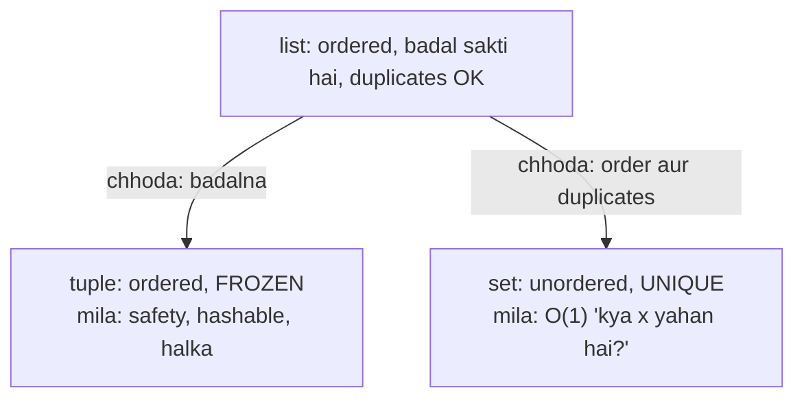
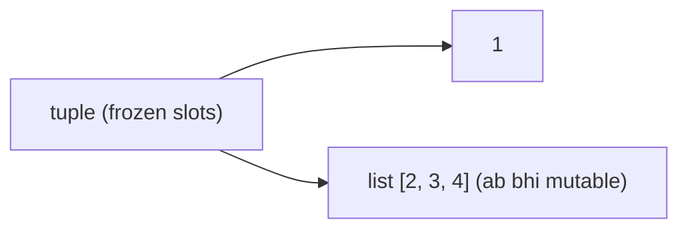
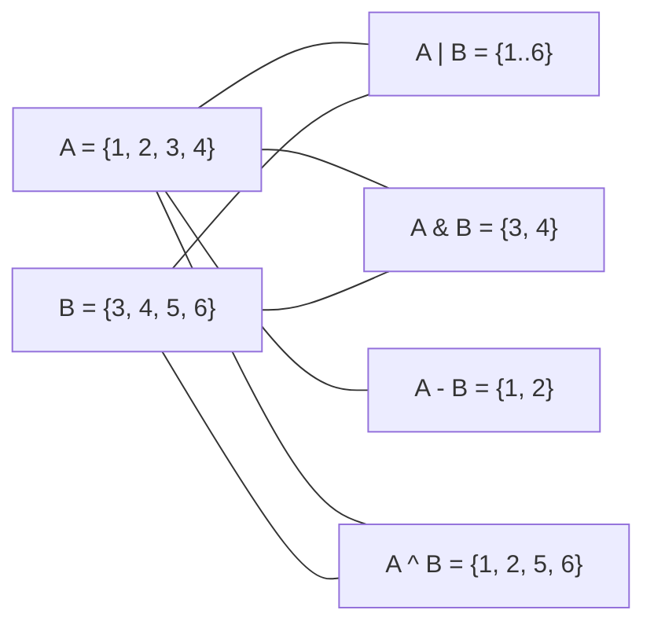
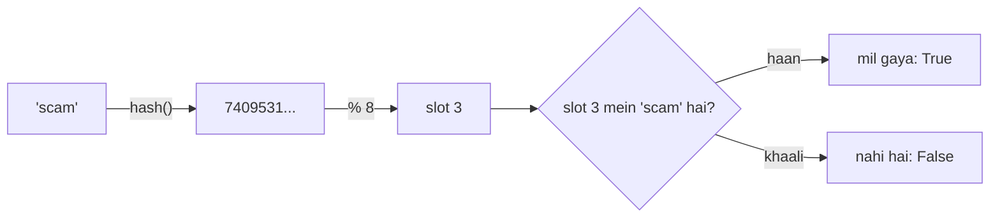

# Chapter 08 · Tuples & Sets

> List ek notebook hai: likho, mitao, naye pages jodo. Lekin kabhi tumhe ek **sealed envelope** chahiye jisse koi chhed-chhaad na kar sake (tuple), aur kabhi ek **bouncer wali guest list** chahiye, jahan bouncer turant jaan le ki naam list mein hai ya nahi, aur kisi ko do baar andar na jaane de (set). Sahi cheez chunna hi woh farak hai jo 1 second mein chalne wale code aur 1 ghante mein chalne wale code ke beech hota hai.

**Is chapter mein tum seekhoge:**
- Tuples: unhe kaise banaayein, woh immutable kyun hain, aur kab yeh ek superpower ban jaata hai
- Packing aur unpacking, `*star` unpacking, swapping aur kai values return karna bhi
- `namedtuple`: readable field names wale tuples
- **Hashable** ka kya matlab hai, aur tuples dict keys kyun ban sakte hain lekin lists kyun nahi
- Sets: O(1) membership, add/remove, aur maths wale operations (union, intersection, difference...)
- `frozenset`, set comprehensions, aur har operation ki exact cost
- List, tuple, set aur dict mein se kaise chunein, plus classic set interview problems

**Isse pehle padho:** [Variables, Data Types & Memory](02-variables-types-memory.md) · [Loops](06-loops.md) · [Lists](07-lists.md)

---

## 🧠 The Big Idea · Asli Baat

Lists tum jaante ho. Tuples aur sets unke do cousins hain, aur dono kuch chhod ke kuch paate hain:



- **Tuple** ek fixed record hai: ek date `(2026, 10, 31)`, ek point `(3, 4)`, database ki ek row. Ek baar bana, toh kabhi nahi badalta. Aur kyunki kabhi nahi badalta, Python use dictionary key ya set member ki tarah bharose se use kar sakta hai.
- **Set** **unique** items ka ek thaila hai, bina kisi order ke. Iski superpower: "kya x yahan hai?" ka jawab average **O(1)** time mein dena, chahe usme 10 items hon ya 1 crore. List ko ek-ek karke check karna padta hai: O(n).

Ek club ka bouncer socho. 10,000 guests ki **list** ke saath, darwaze pe har insaan ke liye woh poori list padhta hai. **Set** ke saath, uske paas ek jaadui kitaab hai jo insaan ka naam sunte hi seedha sahi page pe khul jaati hai. Us jaadu ko **hashing** kehte hain, aur woh exactly kaise kaam karta hai, yeh tum [Chapter 09](09-dictionaries.md) mein dekhoge.

> 🇮🇳 **Desi Analogy:** **Aadhaar** socho. Aadhaar card pe chhapa bundle (number, naam, DOB) ek fixed record hai jise koi bhi raaste mein badal nahi sakta: yeh **tuple** jaisa hai. Aur kyunki Aadhaar number kabhi nahi badalta, har system (bank, SIM, gas connection) use bharose se "key" ki tarah use karta hai, bilkul jaise immutable tuple dict key ban sakta hai. Ab socho UIDAI ka database: koi bhi Aadhaar number do, system crore records mein ek-ek karke nahi dhoondhta, seedha us record pe pahunch jaata hai, aur ek number ke do records ho hi nahi sakte. Yeh **set** jaisa hai: unique, aur turant "hai ya nahi" ka jawab. Aur dhyaan do, Aadhaar database ka koi "pehla, doosra, teesra" order nahi hota; tum "index 5 wala Aadhaar do" nahi maang sakte. Sets bhi bilkul aise hi hain.

---

## 🔨 Building It Up · Zero Se Shuru

**Part A: Tuples**

### 1. Creating tuples

Tuple commas se likha jaata hai, aam taur pe parentheses ke andar.

```python
point = (3, 4)
date = (2026, 10, 31)
mixed = ("Asha", 21, True)
empty = ()
single = (5,)              # comma hi ise tuple banata hai!
not_a_tuple = (5)          # bas brackets mein number 5
no_parens = 1, 2, 3        # asal mein comma hi tuple banata hai
from_list = tuple([1, 2, 3])
from_string = tuple("abc")

print(point, type(point))
print(single, type(single))
print(not_a_tuple, type(not_a_tuple))
print(no_parens)
print(from_list, from_string, empty)
```

```text
(3, 4) <class 'tuple'>
(5,) <class 'tuple'>
5 <class 'int'>
(1, 2, 3)
(1, 2, 3) ('a', 'b', 'c') ()
```

Kya hua abhi: **comma** tuple banata hai; parentheses bas use group karte hain. `(5)` maths wale brackets hain 5 ke around, jaise `(2 + 3) * 4` mein. Ek item wale tuple ke liye peeche comma chahiye: `(5,)`.

> 🤔 **Mann mein sawaal:** List aur tuple dono same dikhte hain, indexing bhi same, toh tuple kyun? Sab jagah list hi use kar lo.
>
> **Jawab:** Teen solid wajah hain (section 3 mein detail mein). (1) **Guarantee:** tuple pass kiya toh pakka hai ki koi function use chupke se nahi badlega. (2) **Hashable:** tuple dictionary key ya set member ban sakta hai; list nahi. Grid ke cell `(row, col)` ko visited set mein daalna hai? Sirf tuple chalega. (3) **Matlab:** tuple bolta hai "yeh ek record hai jiski shape fixed hai" (naam, umar, branch); list bolti hai "yeh ek jaisi cheezon ka collection hai jo badh sakta hai" (saare students ke marks). Sahi type chunne se code khud apni kahani bataata hai.

### 2. Reading a tuple: same as a list

Indexing, slicing, `len`, `in`, looping, `+` aur `*` sab bilkul lists jaise chalte hain. Sirf do methods hain: `count` aur `index`.

```python
t = (10, 20, 30, 20, 40)
print(t[0], t[-1])
print(t[1:4])
print(len(t), 30 in t)
print(t.count(20), t.index(30))
print(t + (50,))           # ek NAYA tuple banata hai
print((0,) * 3)
for x in t[:2]:
    print(x)
```

```text
10 40
(20, 30, 20)
5 True
2 2
(10, 20, 30, 20, 40, 50)
(0, 0, 0)
10
20
```

Dhyaan do: tuple ka slice (`t[1:4]`) bhi tuple hi hai, list nahi.

### 3. Immutability: you can't change a tuple

Na `append`, na `remove`, na item assignment.

```py
t = (1, 2, 3)
t[0] = 99
# TypeError: 'tuple' object does not support item assignment
t.append(4)
# AttributeError: 'tuple' object has no attribute 'append'
```

Tuple ko "badalne" ke liye tum ek naya banate ho:

```python
t = (1, 2, 3)
t = (99,) + t[1:]       # naya tuple, naam t ab uski taraf point karta hai
print(t)
```

```text
(99, 2, 3)
```

Yahan purana tuple `(1, 2, 3)` badla nahi. Ek bilkul naya tuple `(99, 2, 3)` bana, aur name tag `t` utha ke uspe chipka diya gaya.

**Savdhaan:** tuple immutable hai, lekin uske *andar* ke objects zaroori nahi ki immutable hon. Tuple references rakhta hai (bilkul list ki tarah). References nahi badal sakte, lekin agar unme se koi ek list ki taraf point karta hai, toh woh list ab bhi badal sakti hai.

```python
t = (1, [2, 3])
t[1].append(4)          # allowed: hum list badal rahe hain, tuple nahi
print(t)
```

```text
(1, [2, 3, 4])
```



> 💡 "Immutable" ka matlab hai **slots frozen hain**, yeh nahi ki "jahan tak pahunch sako sab frozen hai". Yeh ek favourite trick question hai.

> 🇮🇳 **Desi Analogy:** Tuple ko ek **sealed envelope** samjho jisme teen chits hain, aur ek chit pe likha hai "locker number 12 ki chaabi andar hai". Envelope seal hai: tum chits badal nahi sakte, nayi chit daal nahi sakte (slots frozen). Lekin chit sirf locker ka **pata** batati hai. Locker 12 ke andar ka saamaan koi bhi badal sakta hai (andar ki list mutable hai). Envelope wahi ka wahi hai; locker ka saamaan badal gaya.

**Jo cheez badal hi nahi sakti, woh kyun chahiye?**
1. **Safety.** Tuple kisi bhi function ko do, tum jaante ho woh bina badle wapas aayega. [Chapter 07](07-lists.md) wale aliasing surprises nahi.
2. **Hashable.** Sirf (poori tarah) immutable cheezein dict keys ya set members ban sakti hain. Section 6 mein aur.
3. **Halka aur thoda fast.** Tuple ko spare capacity nahi chahiye, isliye woh barabar ki list se kam memory leta hai.
4. **Matlab.** Tuple bolta hai "yeh fixed shape wala ek record hai". List bolti hai "yeh ek jaisi cheezon ka collection hai jo badh sakta hai".

### 4. Packing and unpacking

**Packing**: kai values ko ek tuple mein daalna. **Unpacking**: unhe ek line mein alag-alag variables mein nikaalna.

```python
student = ("Ravi", 20, "CSE")        # packing
name, age, branch = student          # unpacking
print(name, age, branch)

x, y = 1, 2                          # right pe pack, left pe unpack
x, y = y, x                          # famous swap, bina temp variable ke
print(x, y)

def min_max(nums):
    return min(nums), max(nums)      # "do values" return karna = ek tuple return karna

lo, hi = min_max([4, 9, 1, 7])
print(lo, hi)
print(min_max([4, 9, 1, 7]))
```

```text
Ravi 20 CSE
2 1
1 9
(1, 9)
```

Kya hua abhi: `x, y = y, x` mein Python pehle right side pe tuple `(y, x)` banata hai (*purani* values ke saath), phir use `x` aur `y` mein unpack karta hai. Isi wajah se swap bina temporary variable ke kaam karta hai.

Aur aakhri line dekho: function ne asal mein ek hi cheez return ki thi, tuple `(1, 9)`. "Kai values return karna" Python mein bas ek tuple return karke usse unpack karna hai.

Naamon ki ginti items ki ginti se match honi chahiye:

```py
a, b = (1, 2, 3)
# ValueError: too many values to unpack (expected 2)
a, b, c = (1, 2)
# ValueError: not enough values to unpack (expected 3, got 2)
```

**Star unpacking**: `*` wala ek naam "baaki sab kuch" ek **list** mein samet leta hai.

```python
first, *rest = [1, 2, 3, 4, 5]
print(first, rest)

*init, last = [1, 2, 3, 4, 5]
print(init, last)

head, *middle, tail = "python"
print(head, middle, tail)

a, *b = [1]                  # star kuch bhi capture na kare, yeh bhi chalega
print(a, b)

name, _, marks = ("Meera", "ignored", 88)   # _ ka matlab "is wale ki mujhe parwah nahi"
print(name, marks)
```

```text
1 [2, 3, 4, 5]
[1, 2, 3, 4] 5
p ['y', 't', 'h', 'o'] n
1 []
Meera 88
```

Dhyaan do: string `"python"` ko unpack kiya, phir bhi `middle` ek **list** hai (`['y', 't', 'h', 'o']`), string nahi. Star wala naam hamesha list hi banta hai.

> 🇮🇳 **Desi Analogy:** Star unpacking ko **cricket ki batting order** jaisa socho. `opener, *middle_order, tailender = team`. Pehla naam opener ko mila, aakhri tailender ko, aur beech mein jitne bhi hain, sab "middle order" ke group mein chale gaye, chahe 9 hon ya 0. Captain ko har ek ka naam alag se nahi bolna padta.

**Loops mein unpacking** har jagah hai: `enumerate`, `zip`, aur pairs ki lists ke saath.

```python
points = [(1, 2), (3, 4), (5, 6)]
for x, y in points:
    print(x + y, end=" ")
print()

pairs = [("a", (1, 2)), ("b", (3, 4))]
for label, (x, y) in pairs:          # nested unpacking
    print(label, x * y)
```

```text
3 7 11 
a 2
b 12
```

`for label, (x, y) in pairs`: har item `("a", (1, 2))` hai. Bahar ka shape `label, (...)` aur andar ka shape `(x, y)` item ki shape se match karta hai, toh ek hi line mein teeno values nikal aayi.

**Call mein star** list ya tuple ko alag-alag arguments mein faila deta hai:

```python
nums = [3, 1, 2]
print(*nums)             # print(3, 1, 2) jaisa hi
print(*nums, sep="-")
merged = [*nums, 9, *"ab"]   # list literal ke andar failana
print(merged)
```

```text
3 1 2
3-1-2
[3, 1, 2, 9, 'a', 'b']
```

### 5. namedtuple: tuples with names

`point[0]` aur `point[1]` padh ke kuch samajh nahi aata. `point.x` aur `point.y` turant samajh aate hain. `collections.namedtuple` ek aisa tuple type banata hai jiske fields ke naam hote hain.

```python
from collections import namedtuple

Point = namedtuple("Point", ["x", "y"])
p = Point(3, 4)
print(p)
print(p.x, p.y)          # naam se
print(p[0], p[1])        # ab bhi tuple hai: indexing chalti hai
x, y = p                 # aur unpacking bhi
print(x + y)

Student = namedtuple("Student", "name age branch")   # space se alag karna bhi OK
s = Student("Asha", 21, "ECE")
s2 = s._replace(age=22)  # immutable hai, toh "badalna" ek naya banata hai
print(s.age, s2.age)
print(s2._asdict())
```

```text
Point(x=3, y=4)
3 4
3 4
7
21 22
{'name': 'Asha', 'age': 22, 'branch': 'ECE'}
```

Kya hua abhi: `namedtuple` tumhe readability **aur** tuple ki saari properties (immutable, hashable, halka) deta hai. Chhote records ke liye perfect hai. Jab methods aur mutable fields chahiye, tab classes ([Chapter 14](14-oop-classes-objects.md)) ya dataclasses use karoge.

`s.age` ab bhi 21 hai: `_replace` ne `s` ko nahi chheda, ek naya `s2` bana diya jisme age 22 hai.

### 6. Tuples as dictionary keys and set members (hashable)

Ek object **hashable** hai agar Python uske liye ek fixed number calculate kar sake, uska **hash**, jo uski poori zindagi mein kabhi na badle. Sets aur dicts us number se decide karte hain ki item kahan store karna hai. Immutable built-ins (ints, floats, strings, hashable cheezon ke tuples) hashable hain. Mutable wale (lists, sets, dicts) nahi.

```python
print(hash((1, 2)) == hash((1, 2)))    # same value -> same hash, hamesha

visited = set()
visited.add((0, 0))                    # grid cell ek tuple ki tarah
visited.add((0, 1))
print((0, 1) in visited, (5, 5) in visited)

distance = {("Delhi", "Agra"): 233, ("Mumbai", "Pune"): 148}   # dict: Chapter 09
print(distance[("Delhi", "Agra")])
```

```text
True
True False
233
```

```py
bad = {[1, 2]: "nope"}
# TypeError: unhashable type: 'list'
s = {(1, [2])}
# TypeError: unhashable type: 'list'   (tuple tabhi hashable hai jab uske SAARE items hashable hon)
```

**Keys immutable kyun honi chahiye?** Set har item ko uske hash ke neeche file karta hai, jaise library kitaab ko uske title ke hisaab se shelf pe rakhti hai. Agar shelf pe rakhne ke baad tum kitaab ka title badal sako, toh library galat shelf pe dhoondhegi aur kitaab kabhi nahi milegi. Isliye Python mutable objects ko hash karne se seedha mana kar deta hai. Poori kahani [Chapter 09](09-dictionaries.md) mein hai.

> 🤔 **Mann mein sawaal:** Hash aur "hashable" sunne mein bhaari lagta hai. Simple mein kya hai?
>
> **Jawab:** Hash ek **fingerprint** hai: object ki value se nikla ek integer. Same value ka fingerprint hamesha same. `hash("chai")` jitni baar bhi nikaalo (ek run ke andar), same number aayega. Set us number se seedha "drawer number" nikaalta hai. "Hashable" ka matlab bas itna: "is object ka fingerprint uski poori zindagi ek hi rahega". List ka content badal sakta hai, toh uska fingerprint bhi badal jaata, aur set use galat drawer mein dhoondhta. Isliye list hashable nahi.

### 7. Comparing tuples (lexicographic order)

Tuples item by item compare hote hain, left se right, bilkul dictionary (shabdkosh) ke words ki tarah. Pehla farak hi faisla karta hai.

```python
print((1, 2, 3) < (1, 3, 0))      # 2 < 3 se faisla ho gaya
print((1, 2) < (1, 2, 0))         # prefix chhota hota hai
print(("Asha", 90) == ("Asha", 90))

# Isse kai keys se sort karna bachchon ka khel ban jaata hai:
students = [("Ravi", 85), ("Asha", 92), ("Meera", 85)]
print(sorted(students, key=lambda s: (-s[1], s[0])))   # marks desc, phir naam asc
```

```text
True
True
True
[('Asha', 92), ('Meera', 85), ('Ravi', 85)]
```

Kya hua abhi: key ek tuple `(-marks, name)` return karti hai. Marks ko negative karne se woh hissa descending ho jaata hai, jabki naam ascending hi rehta hai. Yeh trick har serious Python codebase mein hai; [Chapter 11](11-comprehensions-functional.md) ise gehraai se cover karta hai.

Keys dekho: Ravi → `(-85, "Ravi")`, Asha → `(-92, "Asha")`, Meera → `(-85, "Meera")`. Ascending sort mein `-92` sabse chhota, toh Asha pehle. Phir `-85` wale do hain, toh unka faisla doosre item (naam) se: "Meera" < "Ravi". Isliye Meera, phir Ravi.

**Part B: Sets**

### 8. Creating sets

Items ke saath curly braces, ya `set(iterable)`. Duplicates apne aap gayab ho jaate hain.

```python
primes = {2, 3, 5, 7}
from_list = set([3, 1, 3, 2, 1])
letters = set("banana")
empty_set = set()          # {} NAHI -- woh khaali dict hai
empty_dict = {}

print(primes, len(primes))
print(from_list)
print(sorted(letters))     # display order predictable rakhne ke liye sorted()
print(type(empty_set), type(empty_dict))
```

```text
{2, 3, 5, 7} 4
{1, 2, 3}
['a', 'b', 'n']
<class 'set'> <class 'dict'>
```

`set("banana")` mein 6 letters the, lekin unique sirf 3: `b`, `a`, `n`. Baaki duplicates chupchaap gayab.

> ⚠️ **Sets ka koi order nahi hota.** Set jis order mein print hota hai, us pe bharosa mat karo. Chhote integers aksar sorted *dikhte* hain (unke hashes ke kaam karne ke tareeke ki wajah se), lekin strings Python ke har run pe alag order mein aati hain, jaan-boojh ke (ek security feature jise hash randomisation kehte hain). Set display karte waqt hamesha `sorted(s)` use karo. Isi wajah se yeh book strings ke sets ko `sorted()` ke through print karti hai.

Order nahi hai, toh indexing bhi nahi:

```py
s = {1, 2, 3}
s[0]
# TypeError: 'set' object is not subscriptable
```

### 9. Adding and removing

```python
s = {1, 2}
s.add(3)               # ek item jodo
s.add(2)               # pehle se hai: kuch nahi hota, koi error nahi
print(s)

s.update([4, 5, 5])    # kai jodo (koi bhi iterable)
print(s)

s.remove(5)            # hatao; missing ho toh KeyError
s.discard(99)          # ho toh hatao; missing ho toh chup
print(s)

x = s.pop()            # KOI item hatao aur return karo (kaunsa, guarantee nahi)
print(len(s))

s.clear()
print(s)
```

```text
{1, 2, 3}
{1, 2, 3, 4, 5}
{1, 2, 3, 4}
3
set()
```

Kya hua abhi: `add` duplicates ko chupchaap ignore karta hai, aur exactly isi wajah se sets "unique cheezein ikattha karo" ke liye badhiya hain. `remove` vs `discard` waise hi hai jaise dict pe `[]` vs `.get()`: ek item missing hone pe chillata hai, doosra nahi. Dhyaan do, khaali set `set()` ki tarah print hota hai, kyunki `{}` ka matlab pehle se "khaali dict" hai.

> 🇮🇳 **Desi Analogy:** `remove` vs `discard` = do tarah ke class monitors. Teacher bolti hai "Rahul ka naam attendance se kaato." **`remove` wala monitor**: Rahul ka naam list mein hai hi nahi? Seedha teacher ke paas: "Ma'am, galti hai, Rahul toh list mein hai hi nahi!" (`KeyError`). **`discard` wala monitor**: naam nahi mila? Koi baat nahi, chup-chaap aage. Jab "missing hona" normal hai, `discard` lo. Jab missing hona kisi gadbad ka sign hai, `remove` lo taaki gadbad pakdi jaaye.

### 10. Membership: the reason sets exist

```python
banned = {"spam", "scam", "fake"}
for word in ["hello", "scam", "world"]:
    if word in banned:          # average O(1)
        print("blocked:", word)
```

```text
blocked: scam
```

`x in some_list` items ek-ek karke check karta hai: O(n). `x in some_set` seedha wahan kood jaata hai jahan `x` hona chahiye: average O(1). Loop ke andar yahi O(n²) aur O(n) ka farak hai.

```python
def has_common_slow(a, b):
    for x in a:              # n iterations
        if x in b:           # b ek list hai: har baar O(m)
            return True
    return False             # kul O(n * m)

def has_common_fast(a, b):
    b_set = set(b)           # ek baar O(m)
    for x in a:
        if x in b_set:       # har baar O(1)
            return True
    return False             # kul O(n + m)

print(has_common_slow([1, 2, 3], [7, 8, 3]), has_common_fast([1, 2, 3], [7, 8, 9]))
```

```text
True False
```

Numbers mein socho: n = m = 1,00,000. Slow version: 10^10 comparisons, Python mein ~1000 second. Fast version: ~2,00,000 steps, ek second ka chhota sa hissa. Code mein bas ek line ka farak: `b_set = set(b)`.

> 💡 **Python interviews ki #1 performance trick:** "I'll put these in a set so lookups are O(1)."

### 11. Set operations: the Venn diagram toolkit



```python
a = {1, 2, 3, 4}
b = {3, 4, 5, 6}

print(a | b)    # union: a mein YA b mein
print(a & b)    # intersection: a mein AUR b mein
print(a - b)    # difference: a mein lekin b mein NAHI
print(b - a)    # difference mein order matter karta hai
print(a ^ b)    # symmetric difference: dono mein se exactly ek mein

# Method versions KOI BHI iterable lete hain, sirf sets nahi
print(a.union([7, 8]), a.intersection(range(3)))
```

```text
{1, 2, 3, 4, 5, 6}
{3, 4}
{1, 2}
{5, 6}
{1, 2, 5, 6}
{1, 2, 3, 4, 7, 8} {1, 2}
```

> 🇮🇳 **Desi Analogy:** Do dosto ki **shaadi ki guest lists** socho: A = Riya ke guests, B = Arjun ke guests (dono ki joint shaadi hai). **`A | B`** = caterer ko total kitne log batane hain (dono lists mila ke, common log ek hi baar). **`A & B`** = woh log jo dono taraf se invited hain (common dost). **`A - B`** = sirf Riya ki taraf ke log. **`A ^ B`** = woh log jo sirf ek taraf ke hain, common wale nikaal ke. Aur common dost ko caterer do plate nahi deta: set duplicates ginta hi nahi.

Sets ke beech **comparisons** poochte hain "kya ek doosre ke andar hai?"

```python
small = {1, 2}
big = {1, 2, 3}
print(small <= big, small.issubset(big))     # subset
print(big >= small, big.issuperset(small))   # superset
print(small < big, big < big)                # proper subset (sach mein chhota)
print({1, 2}.isdisjoint({3, 4}))             # koi common item nahi?
print({1, 2, 3} == {3, 2, 1})                # order kabhi matter nahi karta
```

```text
True True
True True
True False
True
True
```

`big < big` False kyun? Proper subset ka matlab hai "andar bhi hai **aur** sach mein chhota bhi". Koi set khud se chhota nahi ho sakta. `big <= big` True hota.

**In-place versions** naya set banane ki jagah left wale set ko badal dete hain: `|=`, `&=`, `-=`, `^=` (methods: `update`, `intersection_update`, `difference_update`, `symmetric_difference_update`).

```python
skills = {"python", "sql"}
skills |= {"git", "python"}
skills -= {"sql"}
print(sorted(skills))
```

```text
['git', 'python']
```

### 12. What can go in a set?

Sirf hashable items: numbers, strings, tuples (hashable cheezon ke), `frozenset`s, `None`, booleans. Lists, dicts ya sets nahi.

```python
ok = {1, 2.5, "hi", (1, 2), None}
print(len(ok))
print({1, 1.0, True})      # 1 == 1.0 == True, toh yeh EK item gine jaate hain
```

```text
5
{1}
```

Kya hua abhi: `1`, `1.0` aur `True` barabar hain (Python mein `True == 1`) aur unka hash bhi same hai, isliye set sirf pehla wala rakhta hai. Quizzes ke liye ek pyaara sa trap.

### 13. frozenset: the immutable set

`frozenset` ka `set` se wahi rishta hai jo tuple ka list se: padhne ki saari abilities, badalna mana, aur isliye hashable.

```python
vowels = frozenset("aeiou")
print("e" in vowels, len(vowels))
print(sorted(vowels | {"y"}))          # operations naye frozensets return karte hain

groups = {frozenset({"a", "b"}): "team 1"}    # dict key ki tarah use ho sakta hai
print(groups[frozenset({"b", "a"})])          # order matter nahi karta

sets_of_sets = {frozenset({1, 2}), frozenset({2, 1}), frozenset({3})}
print(len(sets_of_sets))
```

```text
True 5
['a', 'e', 'i', 'o', 'u', 'y']
team 1
2
```

`sets_of_sets` mein teen frozensets daale, lekin `{1, 2}` aur `{2, 1}` ek hi set hain (order matter nahi), toh sirf 2 bache.

```py
vowels.add("y")
# AttributeError: 'frozenset' object has no attribute 'add'
```

### 14. Set comprehensions (a preview)

[Chapter 07](07-lists.md) wale list-building loop jaisa, lekin set mein ikattha karta hai. Poora treatment [Chapter 11](11-comprehensions-functional.md) mein.

```python
words = ["Apple", "avocado", "Banana", "blueberry", "cherry"]
first_letters = {w[0].lower() for w in words}
print(sorted(first_letters))

squares_mod_10 = {(n * n) % 10 for n in range(100)}
print(sorted(squares_mod_10))    # perfect square sirf inhi digits pe khatam ho sakta hai
```

```text
['a', 'b', 'c']
[0, 1, 4, 5, 6, 9]
```

Doosra example ek mazedaar fact deta hai: koi bhi perfect square 2, 3, 7 ya 8 pe khatam nahi hota. Toh agar koi number 7 pe khatam ho raha hai, tum bina calculation ke bol sakte ho ki woh perfect square nahi hai.

### 15. When to use what

| Zaroorat | Use | Kyun |
|---|---|---|
| Ordered items jinhe add/remove/change karoge | **list** | mutable, ordered, indexable |
| Fixed record: point, date, RGB, DB row | **tuple** | immutable, halka, unpack ho sakta hai |
| Function se kai return values | **tuple** | `return a, b` |
| Composite dict key ya set member | **tuple** | hashable |
| Readable field names wala record | **namedtuple** | `p[0]` ki jagah `p.x` |
| Unique items, fast "kya yeh hai?" | **set** | O(1) membership |
| Duplicates hatao (order matter nahi) | **set** | `set(lst)` |
| Groups compare karo: common, missing, extra | **set** | `&`, `-`, `^` |
| Set ke andar set, ya set as a key | **frozenset** | hashable |
| Key se kuch dhoondhna | **dict** | [Chapter 09](09-dictionaries.md) |

| Property | list | tuple | set | frozenset |
|---|---|---|---|---|
| Ordered | ✅ | ✅ | ❌ | ❌ |
| Mutable | ✅ | ❌ | ✅ | ❌ |
| Duplicates | ✅ | ✅ | ❌ | ❌ |
| Indexing `x[0]` | ✅ | ✅ | ❌ | ❌ |
| Hashable | ❌ | ✅* | ❌ | ✅ |
| `x in c` | O(n) | O(n) | O(1) avg | O(1) avg |
| Literal | `[1, 2]` | `(1, 2)` | `{1, 2}` | `frozenset({1, 2})` |

\*agar uske saare items hashable hon

---

## 🔬 Under the Hood · Andar Ki Kahani

### Tuples are lighter than lists

List spare capacity rakhti hai taaki badh sake ([Chapter 07](07-lists.md)); tuple ko apna exact size hamesha ke liye pata hai, isliye woh exactly n pointers store karta hai, usse ek bhi zyada nahi.

```python
import sys

t = (1, 2, 3)
l = [1, 2, 3]
print(sys.getsizeof(t) < sys.getsizeof(l))
print(sys.getsizeof(()), "bytes for an empty tuple vs", sys.getsizeof([]), "for an empty list")
```

```text
True
40 bytes for an empty tuple vs 56 for an empty list
```

(Exact byte counts 64-bit CPython ke hain aur version ke hisaab se badal sakte hain.) CPython chhote tuples ko **cache** bhi karta hai, aur constants se bane tuple literals ko compile time pe hi constant maan leta hai, toh loop ke andar `(1, 2, 3)` har iteration pe dobara nahi banta.

### How a tuple's hash is computed

`hash((a, b, c))` ek mixing formula se `hash(a)`, `hash(b)` aur `hash(c)` ko milata hai. Toh barabar tuples ko barabar hashes milte hain, aur agar koi bhi item unhashable hai (jaise list), toh poora tuple unhashable hai. Isi wajah se `(1, [2])` set mein nahi ja sakta.

### A set is a hash table

Andar se set slots ka ek array hai (ek **hash table**). `x` add karne ke liye:

1. `hash(x)` calculate karo, ek bada integer.
2. Use slot number mein badlo, lagbhag `hash(x) % number_of_slots`.
3. Slot khaali hai toh `x` wahan rakh do. Agar kisi doosre item ne le rakha hai (**collision**), toh ek fixed rule se doosra slot probe karo jab tak khaali na mile.

`x in s` check karne ke liye steps 1–2 dohrao aur us slot mein dekho (zaroorat ho toh probe karo). Tum ek ya kuch slots dekhte ho, saare n items nahi. Yahi hai **O(1) average**.



Table ko zyada se zyada lagbhag 60% bhara rakha jaata hai; usse zyada bhare toh Python ek bada table allocate karke sab kuch dobara daalta hai (list ke resize ki tarah, yeh kabhi-kabhi hota hai, isliye `add` **amortized O(1)** hai). Agar koi bahut kharab hash function sab kuch ek hi slot mein bhejta, toh har lookup ko saare items se probe karna padta: **worst case O(n)**. Python ke hashes isse practice mein lagbhag namumkin bana dete hain.

> 🇮🇳 **Desi Analogy:** Hash table = **railway parcel office ki almirah jisme 100 khaane hain**. Parcel aaya, clerk uske PNR ke aakhri do digits dekhta hai (hash % 100) aur seedha usi khaane mein rakh deta hai. Tum parcel lene aaye? Clerk tumhara PNR dekh ke seedha us khaane pe jaata hai, poori almirah nahi chhaanta (O(1)). Agar khaana pehle se bhara hai (collision), toh agle khaane mein rakh deta hai, ek fixed rule se. Almirah 60% bhar gayi? Nayi badi almirah aati hai aur saare parcels naye khaanon mein shift hote hain (resize, kabhi-kabhi).

Yeh exactly wahi machinery hai jo dictionary use karti hai, aur [Chapter 09](09-dictionaries.md) ek chhota hash table scratch se banata hai taaki tum har step dekh sako.

### Why sets lose order

Items wahan rehte hain jahan unka hash unhe bhejta hai, insertion order mein nahi. Instant lookup ki yahi keemat hai. (Dictionaries insertion order yaad rakhne ke liye ek extra trick lagati hain; sets yeh takleef nahi uthate.)

### Set operation costs

Yahan `len(s) = n` aur `len(t) = m`.

| Operation | Example | Average time |
|---|---|---|
| Membership | `x in s` | **O(1)** |
| Add / remove / discard | `s.add(x)` | O(1) (add amortized hai) |
| Build from iterable | `set(lst)` | O(n) |
| Union | `s \| t` | O(n + m) |
| Intersection | `s & t` | **O(min(n, m))** (yeh chhote wale pe loop chalata hai) |
| Difference | `s - t` | O(n) |
| Symmetric difference | `s ^ t` | O(n + m) |
| Subset test | `s <= t` | O(n) |
| Equality | `s == t` | O(min(n, m)) |
| Length | `len(s)` | O(1) |
| Iterate | `for x in s` | O(capacity), lagbhag O(n) |
| Copy | `s.copy()` | O(n) |

Hash-based operations ka worst case har lookup pe O(n) hai, lekin interviews mein average quote karo aur poochha jaaye toh worst case mention karo.

Intersection O(min(n, m)) kaise? Python chhote set ke har item ko utha ke bade set mein O(1) mein check karta hai. 10 items aur 10 lakh items ka intersection? Sirf 10 checks.

---

## 🧩 Pattern Decoder · Pattern Pakdo

### Pythonic idioms

| Kaam | Idiom |
|---|---|
| Do variables swap karna | `a, b = b, a` |
| Kai values return karna | `return total, count` phir `t, c = f()` |
| Pehla / aakhri / baaki | `first, *rest = items` · `*rest, last = items` |
| Ek value ignore karna | `_, value = pair` |
| Pairs pe loop | `for key, value in pairs:` |
| Duplicates hatana (order nahi chahiye) | `set(items)` |
| Order rakhte hue duplicates hatana | `list(dict.fromkeys(items))` |
| Baar-baar fast lookups | `allowed = set(big_list)` phir `x in allowed` |
| Common items | `set(a) & set(b)` |
| a mein hain lekin b mein nahi | `set(a) - set(b)` |
| Kya saare items unique hain? | `len(set(items)) == len(items)` |
| Grid cell as a key | `visited.add((r, c))` |
| Multi-key sort | `sorted(rows, key=lambda r: (-r.score, r.name))` |

### The "seen set" template

DSA mein sabse common set pattern: data pe ek baar chalo, aur jo dekh liya use yaad rakho.

```py
seen = set()
for x in items:
    if x in seen:          # O(1)
        ...                # repeat / cycle / pair mil gaya
    seen.add(x)
```

> 🇮🇳 **Desi Analogy:** Seen set = **society gate ka visitor register**, lekin super-fast wala. Guard har aane wale ka naam dekhta hai: "yeh aaj pehle aa chuka hai?" Haan, toh "dobara aaya, note karo" (repeat mila). Nahi, toh register mein naam likh lo aur andar jaane do. Register purana kaagaz wala hota toh har baar poora padhna padta (list, O(n)). Hamara register set hai, toh naam bolte hi pata chal jaata hai (O(1)).

Worked example, **Happy Number** (LeetCode 202): ek number ko uske digits ke squares ke sum se baar-baar replace karo. Agar 1 tak pahuncha, toh happy hai. Agar hamesha ghoomta rahe, toh nahi. "Hamesha" ko detect kaise karein? Ek **seen set** se: agar koi number wapas aa gaya, toh hum cycle mein hain.

```python
def is_happy(n):
    seen = set()
    while n != 1 and n not in seen:
        seen.add(n)
        n = sum(int(d) ** 2 for d in str(n))   # generator expression: Chapter 11
    return n == 1

print(is_happy(19), is_happy(2))
```

```text
True False
```

19 ke liye trace: 19 → 1² + 9² = 82 → 64 + 4 = 68 → 36 + 64 = 100 → 1. Happy!

| step | n | seen mein? | baad mein seen |
|---|---|---|---|
| 1 | 19 | nahi | {19} |
| 2 | 82 | nahi | {19, 82} |
| 3 | 68 | nahi | {19, 82, 68} |
| 4 | 100 | nahi | {19, 82, 68, 100} |
| 5 | 1 | loop rukta hai | answer True |

(2 ke liye: 2 → 4 → 16 → 37 → 58 → 89 → 145 → 42 → 20 → 4. Yeh 4 pehle seen mein hai, toh cycle pakdi gayi, answer False. [Chapter 06](06-loops.md) ke "har unhappy number 4 pe aata hai" wale fact ki zaroorat hi nahi padi.)

### The "visited set" in graphs and grids

[Graphs](../part-2-dsa/16-graphs-bfs-dfs.md) mein tum jo bhi BFS/DFS likhoge, woh nodes ya `(row, col)` tuples ka ek `visited` set rakhega taaki ek hi jagah do baar process na ho. Tuples perfect grid keys hain kyunki woh hashable hain.

### How this shows up in DSA

| Problem family | Tool |
|---|---|
| Contains Duplicate, Happy Number, cycle detection | seen set |
| Intersection of Two Arrays, missing/extra items | set operations |
| Longest Consecutive Sequence | O(1) "kya x+1 exist karta hai?" ke liye set |
| Graphs aur grids pe BFS / DFS | tuples ka visited set |
| Do parameters wali DP memo keys | dict mein tuple keys `(i, j)` |
| Priorities wale heaps | tuples `(priority, item)` lexicographically compare hote hain |

### When NOT to use a set

- Tumhe **order** ya **position** chahiye → list.
- Tumhe **duplicates ya counts** chahiye → list ya `Counter` ([Chapter 09](09-dictionaries.md)).
- Items **unhashable** hain (lists, dicts) → pehle unhe tuples mein badlo, ya phir se socho.
- Collection chhota hai aur sirf ek baar check karna hai → list theek hai; set banana khud O(n) ka kharcha hai.

---

## ⚠️ Traps & Common Mistakes · Yahan Sab Phisalte Hain

1. **`(5)` tuple nahi hai.** `(5,)` use karo. Isi tarah `x = 5,` chupchaap ek tuple bana deta hai.

2. **`{}` khaali dict hai, khaali set nahi.** `set()` use karo.

3. **Set ke order pe bharosa karna.** Set ko kabhi index mat karo, ya yeh mat maano ki woh sorted print hoga. Display ke liye `sorted(s)` use karo.

4. **Missing item pe `remove` `KeyError` raise karta hai.** Agar "shayad missing ho" normal hai, toh `discard` use karo.

5. **List ko set mein ya dict key ki tarah daalna.** `TypeError: unhashable type: 'list'`. `tuple(lst)` se convert karo.

6. **Yeh sochna ki tuple ka content nahi badal sakta.** `t = (1, [2])` `t[1].append(3)` karne deta hai. Aur yeh aur ajeeb hota hai:

```py
t = (1, [2])
t[1] += [3]
# TypeError: 'tuple' object does not support item assignment
print(t)        # (1, [2, 3])  <- list PHIR BHI badal gayi!
```

`+=` pehle list ko in place extend karta hai (safal), phir result ko wapas `t[1]` mein store karne ki koshish karta hai (fail). Dono steps hote hain, isliye tumhe error *aur* change dono milte hain.

7. **`set("hello")` letters deta hai, word nahi.** Word wala set chahiye toh `{"hello"}` likho.

8. **`1`, `1.0` aur `True` takraate hain.** `{1, True}` mein ek hi item hai. Bools aur ints ko set members ya dict keys mein mix karna surprises deta hai.

9. **Unpacking count mismatches.** `a, b = [1, 2, 3]` crash karta hai. Sirf pehle do chahiye toh `a, b, *_ = ...` use karo.

10. **Dedupe ke liye set mein convert karke original order wapas expect karna.** Uski jagah `list(dict.fromkeys(items))` use karo.

> 🤔 **Mann mein sawaal:** `t[1] += [3]` mein error bhi aaya aur change bhi hua? Error aaya toh kaam ruk jaana chahiye tha na?
>
> **Jawab:** `t[1] += [3]` asal mein do alag steps hai: (1) `temp = t[1].__iadd__([3])`, yaani list khud ko extend karti hai, jo bilkul allowed hai, toh list `[2, 3]` ban gayi; (2) `t[1] = temp`, yaani tuple ke slot mein wapas likhna, jo mana hai, toh `TypeError`. Error step 2 pe aaya, lekin step 1 tab tak ho chuka tha. Python "undo" nahi karta. Isliye sabak: tuple ke andar ki list ko badalna ho toh seedha `t[1].append(3)` ya `t[1].extend([3])` likho, `+=` nahi.

---

## 💡 Tips & Tricks · Pro Wale Moves

- **Heterogeneous** (alag-alag type ke) fixed records ke liye tuples (`("Asha", 21, "CSE")`), **homogeneous** (ek jaise) badhte collections ke liye lists (`[85, 90, 72]`).
- `return a, b` + `x, y = f()` kai values return karne ka saaf tareeka hai.
- `for i, (x, y) in enumerate(points):` enumerate ko nested unpacking ke saath jodta hai.
- `len(set(nums)) != len(nums)` ek line ka duplicate check hai.
- List ko set mein **ek baar, loop ke bahar** convert karo, kabhi andar nahi.
- `s1 & s2` chhote set pe iterate karta hai, isliye ek bahut bade set ka ek chhote se intersection fast hai.
- Sorted unique list chahiye? `sorted(set(items))`.
- Sort key mein `-value` wale tuples us hisse ko descending kar dete hain: `key=lambda r: (-r[1], r[0])`.
- `print(*items)` list ke items spaces se alag print karta hai, bina brackets ke.

---

## 🎯 Interview Questions · Interview Mein Yahi Poochenge

### 1. List vs tuple: what are the differences and when do you use each? 🔥🔥🔥

<details><summary>Answer dekho 👀</summary>

| | list | tuple |
|---|---|---|
| Mutable | haan | nahi |
| Hashable | nahi | haan, agar saare items hon |
| Memory | zyada (over-allocate karti hai) | kam (exact size) |
| Methods | bahut saare (`append`, `sort`...) | `count`, `index` |
| Typical use | ek jaisi cheezon ka badhta collection | fixed record, multiple return values, dict keys |

Tuples banane aur iterate karne mein thode fast hain, aur CPython constant tuples ko compile-time constants maan sakta hai. **Matlab** ke hisaab se chuno: agar cheez badalni nahi chahiye, toh tuple banao.

> 🗣️ **Interview mein aise bolo:** "Lists are mutable and over-allocate so they can grow; tuples are immutable, use exactly the memory they need, and are hashable when all their items are, so they can be dict keys or set members. I use a list for a growing collection of similar items and a tuple for a fixed record, like a coordinate or multiple return values. Choosing a tuple also signals to readers that the data shouldn't change."

</details>

### 2. Can a tuple be a dictionary key? What about a tuple containing a list? 🔥🔥🔥

<details><summary>Answer dekho 👀</summary>

Tuple valid key hai agar uske **saare** items hashable hon: `{(1, 2): "a"}` chalta hai. `(1, [2])` hashable nahi hai kyunki uska hash list se calculate hota, jo badal sakti hai. `hash((1, [2]))` `TypeError: unhashable type: 'list'` raise karta hai.

> 🗣️ **Interview mein aise bolo:** "Yes, a tuple can be a dictionary key as long as every item inside it is hashable, so `(1, 2)` works. A tuple containing a list is not hashable, because its hash would depend on the list, which could change and break the lookup; Python raises `TypeError: unhashable type: 'list'`."

</details>

### 3. Is a tuple truly immutable? What does `t[1] += [3]` do for `t = (1, [2])`? 🔥🔥

<details><summary>Answer dekho 👀</summary>

Tuple ke slots immutable hain; jin objects ki taraf woh point karte hain, woh zaroori nahi. `t[1] += [3]` do kaam karta hai: (1) list ka in-place add call karta hai, jo safal hota hai aur list `[2, 3]` ban jaati hai; (2) `t[1] = <result>` try karta hai, jo `TypeError` raise karta hai. Toh tumhe error **aur** `t` `(1, [2, 3])` ban jaata hai, dono.

</details>

### 4. How does a set check membership in O(1)? What's the worst case? 🔥🔥🔥

<details><summary>Answer dekho 👀</summary>

Set ek hash table hai. Yeh `hash(x)` calculate karta hai, use slot index mein map karta hai, aur wahan dekhta hai (collisions pe paas ke kuch slots probe karta hai). Probes ki ginti n pe depend nahi karti, isliye lookups average O(1) hain. Table zyada bharne se pehle resize ho jaata hai taaki collisions kam rahein. Worst case mein, agar bahut saare items collide karein, lookup **O(n)** tak gir sakta hai.

> 🗣️ **Interview mein aise bolo:** "A set is a hash table. To check membership, Python hashes the item, maps the hash to a slot, and looks there, probing a few nearby slots on a collision. The number of probes doesn't grow with n, so it's O(1) on average, and the table resizes to stay sparse. In the worst case, if many items collide, a lookup degrades to O(n), but that's very unlikely with Python's hash functions."

</details>

### 5. set vs frozenset? 🔥🔥

<details><summary>Answer dekho 👀</summary>

Dono hash-based unordered collections hain jinme unique hashable items hote hain. `set` mutable hai (`add`, `remove`, `|=`...) aur isliye unhashable. `frozenset` immutable aur hashable hai, toh woh dict key ya kisi doosre set ka element ban sakta hai. Constant lookup tables ya "set of sets" ke liye `frozenset` use karo.

</details>

### 6. Contains Duplicate (LeetCode 217) 🔥🔥🔥

True return karo agar koi value kam se kam do baar aati hai.

<details><summary>Answer dekho 👀</summary>

```python
def contains_duplicate(nums):
    seen = set()
    for x in nums:
        if x in seen:
            return True       # ek milte hi jaldi bahar
        seen.add(x)
    return False

print(contains_duplicate([1, 2, 3, 1]), contains_duplicate([1, 2, 3, 4]))
print(len(set([1, 2, 3, 1])) != 4)    # one-liner version
```

```text
True False
True
```

O(n) time, O(n) space. Loop version jaldi ruk sakta hai; one-liner hamesha poora set banata hai. Alternative: sort karo aur padosiyon ko compare karo, O(n log n) time, O(1) extra space.

> 🗣️ **Interview mein aise bolo:** "I'll scan the array once with a seen set. For each number, if it's already in the set I return True immediately; otherwise I add it. That's O(n) time and O(n) space with an early exit. If memory were tight, I could sort and compare adjacent elements instead, which is O(n log n) time and O(1) extra space."

</details>

### 7. Intersection of Two Arrays (LeetCode 349) 🔥🔥🔥

Woh unique elements return karo jo dono arrays mein hain.

<details><summary>Answer dekho 👀</summary>

```python
def intersection(nums1, nums2):
    return sorted(set(nums1) & set(nums2))   # sorted sirf output predictable banane ke liye

print(intersection([1, 2, 2, 1], [2, 2]))
print(intersection([4, 9, 5], [9, 4, 9, 8, 4]))
```

```text
[2]
[4, 9]
```

O(n + m) time. Agar arrays pehle se sorted hain aur memory tight hai, toh two pointers use karo ([Two Pointers](../part-2-dsa/03-two-pointers.md)). Agar duplicates rakhne hain (LeetCode 350), toh counts chahiye: [Chapter 09](09-dictionaries.md) mein `Counter`.

> 🗣️ **Interview mein aise bolo:** "I'll convert both arrays to sets and take their intersection, which gives the unique common elements in O(n + m) time and space. If the inputs were already sorted and memory mattered, I'd use two pointers instead. If duplicates had to be preserved, I'd count with a Counter."

</details>

### 8. Longest Consecutive Sequence (LeetCode 128) 🔥🔥🔥

Unsorted array; consecutive integers ki sabse lambi run ki length dhoondho, O(n) mein. `[100, 4, 200, 1, 3, 2]` → 4 (`1,2,3,4`).

<details><summary>Answer dekho 👀</summary>

Sab kuch ek set mein daalo. Koi number run tabhi shuru karta hai jab `x - 1` set mein **nahi** hai. Har start se upar ki taraf gino jab tak `x + 1` exist kare.

```python
def longest_consecutive(nums):
    num_set = set(nums)
    best = 0
    for x in num_set:
        if x - 1 not in num_set:          # x ek run ka start hai
            length = 1
            while x + length in num_set:
                length += 1
            best = max(best, length)
    return best

print(longest_consecutive([100, 4, 200, 1, 3, 2]))
print(longest_consecutive([0, 3, 7, 2, 5, 8, 4, 6, 0, 1]))
```

```text
4
9
```

Andar wale `while` ke bawajood O(n) kyun? Har number andar ke loop mein sirf us ek run ke dwara gina jaata hai jisme woh hai, aur ginti sirf starts se shuru hoti hai. Toh andar ke kul steps ≤ n. Sorting O(n log n) hoti.

Pehle example mein: 100 ka `99` set mein nahi → start, length 1. 4 ka `3` set mein hai → start nahi, skip. 200 → start, length 1. 1 ka `0` nahi → start, gino 1, 2, 3, 4 → length 4. 3 aur 2 skip. Best = 4.

> 🇮🇳 **Desi Analogy:** Railway platform pe coaches bikhre khade hain (S3, S1, S4, S2, B1...). Tumhe sabse lambi lagataar train dhoondhni hai. Har coach pe jaake ginti shuru mat karo. Sirf us coach se gino jiske peeche koi coach nahi hai (S1, kyunki "S0" nahi hai). Wahan se aage chalo: S2 hai? S3? S4? Beech ke coaches (S2, S3) se ginti shuru karne ka matlab hi nahi, kyunki woh kisi lambi train ka hissa hain jo S1 se gin li jaayegi.

> 🗣️ **Interview mein aise bolo:** "I put all numbers in a set for O(1) lookups. A number only starts a sequence if x minus one isn't in the set; from each such start I count upward while x plus length exists. Every number is visited by at most one inner count, so the total work is O(n), versus O(n log n) if I sorted."

</details>

### 9. Jewels and Stones (LeetCode 771) 🔥🔥

`jewels = "aA"`, `stones = "aAAbbbb"`: kitne stones jewels hain? → 3.

<details><summary>Answer dekho 👀</summary>

```python
def num_jewels(jewels, stones):
    jewel_set = set(jewels)
    count = 0
    for s in stones:
        if s in jewel_set:
            count += 1
    return count

print(num_jewels("aA", "aAAbbbb"), num_jewels("z", "ZZ"))
```

```text
3 0
```

String pe `in jewels` ke O(j × s) ki jagah O(j + s). (Aur dhyaan do, `"z"` aur `"Z"` alag characters hain, isliye doosra answer 0.)

</details>

### 10. How do you remove duplicates from a list? Does it keep order? 🔥🔥

<details><summary>Answer dekho 👀</summary>

`list(set(items))` duplicates hatata hai lekin **order kho deta hai**. Pehli baar dikhne wala order rakhna ho toh: `list(dict.fromkeys(items))` (dicts insertion order yaad rakhte hain, [Chapter 09](09-dictionaries.md)), ya seen set ke saath ek loop. Sab O(n) hain.

</details>

### 11. What is `{}`? What is `type((1))`? What does `a, *b = "x"` give? 🔥

<details><summary>Answer dekho 👀</summary>

`{}` ek khaali **dict** hai. `(1)` int 1 hai (comma nahi, toh tuple nahi). `a, *b = "x"` deta hai `a = "x"` aur `b = []` (star zero items ko ek khaali list ki tarah capture karta hai).

</details>

### 12. Why does `{1, True, 1.0}` have only one element? 🔥

<details><summary>Answer dekho 👀</summary>

Sets items ko duplicate maante hain jab woh barabar (`==`) hon aur unka hash same ho. `1 == True == 1.0` aur `hash(1) == hash(True) == hash(1.0) == 1`, toh set sirf pehla daala hua rakhta hai, `1`.

</details>

---

## 🏋️ Practice · Ab Tumhari Baari

**🟢 1. Swap and stats.** `stats(nums)` likho jo `(min, max, average)` ek tuple ki tarah return kare, phir use teen variables mein unpack karo.

<details><summary>Solution dekho 👀</summary>

```python
def stats(nums):
    return min(nums), max(nums), sum(nums) / len(nums)

lo, hi, avg = stats([4, 8, 15, 16, 23, 42])
print(lo, hi, avg)
```

```text
4 42 18.0
```

</details>

**🟢 2. Unique count.** `"the cat and the hat and the bat"` mein kitne distinct words hain?

<details><summary>Solution dekho 👀</summary>

```python
sentence = "the cat and the hat and the bat"
unique = set(sentence.split())
print(len(unique), sorted(unique))
```

```text
5 ['and', 'bat', 'cat', 'hat', 'the']
```

`split()` ne 8 words ki list di, set ne duplicates (`the` teen baar, `and` do baar) hata ke 5 chhode.

</details>

**🟢 3. Pangram.** Kya ek sentence pangram hai (har letter a–z kam se kam ek baar use karta hai)?

<details><summary>Solution dekho 👀</summary>

```python
import string

def is_pangram(sentence):
    letters = set(sentence.lower())
    return set(string.ascii_lowercase) <= letters     # subset test

print(is_pangram("The quick brown fox jumps over the lazy dog"))
print(is_pangram("Hello world"))
```

```text
True
False
```

Idea: "kya poori alphabet sentence ke letters ke **andar** hai?" Yeh seedha ek subset test hai. Sentence mein spaces ya punctuation bhi hon toh farak nahi padta; superset mein extra cheezein allowed hain.

</details>

**🟡 4. Find the Difference of Two Arrays** (LeetCode 2215): `[sirf a mein jo items hain, sirf b mein jo items hain]` return karo, dono unique aur sorted.

<details><summary>Solution dekho 👀</summary>

```python
def find_difference(a, b):
    sa, sb = set(a), set(b)
    return [sorted(sa - sb), sorted(sb - sa)]

print(find_difference([1, 2, 3], [2, 4, 6]))
print(find_difference([1, 2, 3, 3], [1, 1, 2, 2]))
```

```text
[[1, 3], [4, 6]]
[[3], []]
```

</details>

**🟡 5. Pair with a given sum (unsorted).** True return karo agar koi do **alag** items milke `target` banate hain, O(n) mein.

<details><summary>Solution dekho 👀</summary>

Har `x` ke liye humein jo partner chahiye woh hai `target - x`. Check karo ki kya hum use pehle dekh chuke hain.

```python
def has_pair_sum(nums, target):
    seen = set()
    for x in nums:
        if target - x in seen:
            return True
        seen.add(x)
    return False

print(has_pair_sum([8, 3, 5, 1], 9), has_pair_sum([5], 10), has_pair_sum([5, 5], 10))
```

```text
True False True
```

Check karne ke **baad** `x` add karne se koi item khud ke saath pair nahi ban paata. (`[5]`, target 10: 5 ko `5` chahiye, lekin seen abhi khaali hai, toh False. `[5, 5]`: doosre 5 ko pehla 5 seen mein mil jaata hai, toh True.) *Indexes* return karna famous Two Sum hai, jo [Chapter 09](09-dictionaries.md) mein dict se solve hota hai.

</details>

**🟡 6. Count distinct grid cells visited.** Ek robot `(0, 0)` se shuru hota hai aur moves `"UURDDL"` follow karta hai (U = up, waghera). Start ko milake woh kitne distinct cells visit karta hai?

<details><summary>Solution dekho 👀</summary>

```python
def distinct_cells(moves):
    step = {"U": (0, 1), "D": (0, -1), "L": (-1, 0), "R": (1, 0)}
    x, y = 0, 0
    visited = {(x, y)}
    for m in moves:
        dx, dy = step[m]
        x, y = x + dx, y + dy
        visited.add((x, y))
    return len(visited)

print(distinct_cells("UURDDL"), distinct_cells("UDUD"))
```

```text
6 2
```

Tuples natural hashable "coordinate" type hain. (Path: (0,0) → (0,1) → (0,2) → (1,2) → (1,1) → (1,0) → (0,0). Aakhri cell start hi hai, toh set use dobara nahi ginta: 6.)

</details>

**🔴 7. Group words that are the same set of letters.** `["abc", "cab", "aab", "ab", "ba", "bca"]` diya hai. Kitne distinct groups hain, jahan do words ek group mein hain agar woh exactly same set of letters use karte hain (counts ignore karke)?

<details><summary>Solution dekho 👀</summary>

Word ka group `frozenset(word)` se pehchaana jaata hai, jo hashable hai, isliye unhe ek set mein daal sakte hain.

```python
def count_letter_groups(words):
    return len({frozenset(w) for w in words})

print(count_letter_groups(["abc", "cab", "aab", "ab", "ba", "bca"]))
```

```text
2
```

Groups: `{a, b, c}` (abc, cab, bca) aur `{a, b}` (aab, ab, ba). O(total characters). Yahan normal `set` kaam nahi karta, kyunki set ke andar set nahi ja sakta (unhashable); `frozenset` ja sakta hai.

</details>

**🔴 8. First repeated character.** Left se right padhte hue woh pehla character return karo jo doosri baar aata hai, ya `None`. `"abcbad"` → `"b"`.

<details><summary>Solution dekho 👀</summary>

```python
def first_repeated(s):
    seen = set()
    for ch in s:
        if ch in seen:
            return ch
        seen.add(ch)
    return None

print(first_repeated("abcbad"), first_repeated("abc"))
```

```text
b None
```

O(n) time. Dhyaan do, yeh "repeat hone wale characters mein jiski pehli occurrence sabse pehle hai" se alag hai (woh `a` hota): problem statements dhyaan se padho. Yahan sawaal hai "doosri baar sabse pehle kaun aaya?" `b` index 3 pe doosri baar aaya, `a` index 4 pe. Toh `b`.

</details>

---

## 🧠 Never-Forget Summary · Kabhi Mat Bhoolna

- **Tuple** = ordered, **immutable**, halka. **Comma** use banata hai: `(5,)`.
- Immutable matlab **slots** frozen hain; tuple ke andar ki list phir bhi badal sakti hai.
- **Packing/unpacking**: `a, b = b, a`, `return x, y`, `first, *rest = items`, ignore ki gayi values ke liye `_`.
- `namedtuple` tuples ko readable field names deta hai: `p.x`.
- **Hashable** = jiska hash kabhi nahi badalta. Immutable built-ins hashable hain; lists, sets, dicts nahi. Sirf hashables set members ya dict keys ban sakte hain.
- Tuples **lexicographically** compare hote hain, jo multi-key sorting ko power deta hai.
- **Set** = unordered, **unique**, andar hash table, **average O(1)** membership.
- `add`/`update`, `remove` (chillata hai) / `discard` (chup), `|` `&` `-` `^`, `<=` `>=`.
- `{}` dict hai; `set()` khaali set hai. `frozenset` hashable set hai.
- Set ke order pe kabhi bharosa mat karo; `sorted()` se print karo.

**Memory hooks:**
- **"Comma makes the tuple, brackets just hug it."**
- **"Tuple = sealed envelope. Set = bouncer with a magic book."**
- **"If it can change, it can't be a key."**
- **"Pipe joins, ampersand shares, minus removes, caret = one or the other but not both."**

**🪝 Yaad rakhne ka jugaad:** **"Comma hai toh tuple hai, bracket toh bas pyaar hai."** Aur sets ke liye: **"Set mein na line, na repeat; bas 'hai ya nahi' ka turant receipt."** Set operators ke liye shaadi yaad rakho: **`|` = sabko bulao, `&` = common dost, `-` = sirf meri taraf wale, `^` = common ko chhod ke baaki sab.** Aur hashable ke liye: **"Jo badle, woh chaabi nahi bane."**

**One picture:**

| | list `[ ]` | tuple `( , )` | set `{ }` | frozenset |
|---|---|---|---|---|
| Ordered | ✅ | ✅ | ❌ | ❌ |
| Badal sakte hain | ✅ | ❌ | ✅ | ❌ |
| Duplicates | ✅ | ✅ | ❌ | ❌ |
| Hashable (key ban sakta hai) | ❌ | ✅ | ❌ | ✅ |
| `in` cost | O(n) | O(n) | O(1) | O(1) |
| Aise socho | notebook | sealed envelope | guest list | laminated guest list |

> **Agar sirf ek cheez yaad rakhni hai:** jab bhi suno "kya maine yeh pehle dekha hai?", **set** uthao, aur jab tumhe values ka ek fixed bundle chahiye (ya kai hisson se bani ek key), **tuple** uthao.

---
**Aage:** [Chapter 09 · Dictionaries & Hashing](09-dictionaries.md)  ·  **Wapas** [Contents](../README.md)
