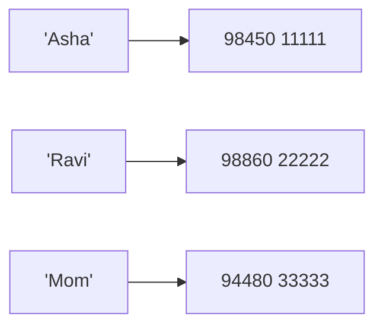
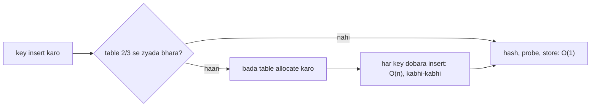

# Chapter 09 · Dictionaries & Hashing

> Tumhara phone tumhe "Mom" dhoondhne ke liye 800 contacts scroll nahi karwata. Tum naam type karte ho, aur number turant saamne aa jaata hai. Python ki **dictionary** tumhare kisi bhi data ke saath bilkul yahi karti hai: key do, value wapas lo, woh bhi **O(1)** mein. Interviews mein ye sabse kaam ka data structure hai. "Isko fast karo" wale sawaalon ke kaafi bade hisse ka jawab yahin se shuru hota hai: "I'll use a hash map".

**Is chapter mein tum seekhoge:**
- Dictionary kya hai (key → value), aur use create, read, update aur delete karne ka har tareeka
- **Hash table** zero se kaise kaam karta hai: hash functions, slots, collisions, load factor, resizing
- Keys immutable kyun honi chahiye, aur dicts insertion order kyun yaad rakhte hain
- `get`, `setdefault`, views, iteration, dict comprehensions, aur har method ka Big-O
- `collections` se `Counter`, `defaultdict` aur `OrderedDict`
- Woh chaar patterns jin par DSA chalta hai: **counting, grouping, index lookup, memoization**
- Nested dicts aur JSON, aur saath mein classic interview problems (Two Sum, Group Anagrams...)

**Isse pehle padho:** [Lists](07-lists.md) · [Tuples & Sets](08-tuples-sets.md)

---

## 🧠 The Big Idea · Asli Baat

List ek hi type ka sawaal achhe se answer karti hai: "**position** 3 pe kya hai?" Lekin real life ke sawaal aise hote hain: "Asha ka phone number kya hai?" ya "*the* word kitni baar aaya?" Yahan tum cheez ko ek **naam** se dhoondhna chahte ho, position se nahi.

**Dictionary** (short mein **dict**) **key → value** pairs store karti hai. Tum use key dete ho, woh tumhe value wapas deti hai.



Asli jaadu ye hai: value dhoondhne mein utna hi chhota sa time lagta hai, chahe dict mein 5 pairs hon ya 5 crore. Kaise? Dict key ko ek **hash function** ki madad se ek number mein badal deti hai, aur woh number seedha batata hai ki kaunsa drawer kholna hai. Koi searching nahi. Is trick ko **hashing** kehte hain, aur chapter khatam hote-hote tum ise khud bana paoge.

> 🇮🇳 **Desi Analogy:** Railway station ka **parcel office** socho, jahan har parcel ek numbered rack mein jaata hai. Clerk ek fixed rule follow karta hai: "PNR ke last do digits = rack number". Tum PNR bolte ho (ye hai **key**), clerk dimaag mein last do digits nikalta hai (ye hai **hash function**), seedha us rack pe jaata hai (ye hai **slot**), aur parcel utha laata hai (ye hai **value**). Use poore godown mein ghoomna nahi padta. Godown mein 50 parcels hon ya 50,000, rack tak pahunchne ka time same rehta hai. Bas yahi dict ka **O(1) lookup** hai. Aur agar do PNR ke last do digits same nikle? Dono parcel ek hi rack mein jaayenge, clerk us rack mein do-teen parcel check karega. Isse **collision** kehte hain, ise hum Under the Hood mein detail mein dekhenge.

> 💡 Same idea ke doosre naam: **hash map** (Java, interviews), **hash table** (textbooks), **associative array**, **map**. Python mein iska naam hai `dict`.

---

## 🔨 Building It Up · Zero Se Shuru

### 1. Creating dictionaries

```python
empty = {}
phone = {"Asha": "98450", "Ravi": "98860"}
ages = dict(asha=21, ravi=22)                 # keyword style: keys strings ban jaati hain
pairs = dict([("x", 1), ("y", 2)])            # (key, value) pairs se
zipped = dict(zip(["a", "b", "c"], [1, 2, 3]))
defaults = dict.fromkeys(["math", "physics"], 0)

print(phone)
print(ages)
print(pairs)
print(zipped)
print(defaults)
print(len(phone), type(empty))
```

```text
{'Asha': '98450', 'Ravi': '98860'}
{'asha': 21, 'ravi': 22}
{'x': 1, 'y': 2}
{'a': 1, 'b': 2, 'c': 3}
{'math': 0, 'physics': 0}
2 <class 'dict'>
```

Kya hua yahan: dict literal ka format hai `{key: value, ...}`. Do lists ko jodi banane ka standard tareeka hai `dict(zip(keys, values))`: `zip` pehli list ka pehla item doosri list ke pehle item ke saath jodta hai, phir doosre ko doosre ke saath, aur `dict` un jodiyon se dictionary bana deta hai. `dict.fromkeys(keys, 0)` har key ko ek hi starting value de deta hai. Aur `len` **pairs** ginta hai, keys aur values alag-alag nahi.

**Keys aur values ke rules:**
- **Keys** ka **hashable** hona zaroori hai (yaani immutable built-ins: str, int, float, hashable cheezon wala tuple, frozenset, bool, None). Keys **unique** hoti hain: kisi existing key ko dobara assign karoge toh uski purani value replace ho jaayegi.
- **Values** kuch bhi ho sakti hain: lists, doosri dicts, functions...

```python
d = {"a": 1, "a": 2}          # duplicate key: aakhri wali jeet-ti hai
print(d)
grid_costs = {(0, 0): 5, (0, 1): 3}   # composite keys ke liye tuples ekdum perfect hain
print(grid_costs[(0, 1)])
```

```text
{'a': 2}
3
```

> 🤔 **Mann mein sawaal:** Tuple key ban sakta hai, list nahi. Dono toh ek jaise dikhte hain, phir ye bhedbhaav kyun?
>
> **Jawab:** Fark "badal sakta hai ya nahi" ka hai. Tuple ek baar bana toh kabhi nahi badalta, isliye uska hash bhi kabhi nahi badalta. List mein tum kabhi bhi `append` kar sakte ho, toh uska hash bhi badal jaata. Dict key ka hash dekh ke hi decide karti hai ki use kis drawer mein rakhna hai. Agar key baad mein badal gayi, toh dict use galat drawer mein dhoondhegi. Isliye Python list ko key banne hi nahi deta. Poori kahani Under the Hood ke Step 6 mein hai.

### 2. Reading values: `[]`, `get`, `in`

```python
stock = {"apple": 10, "banana": 0}

print(stock["apple"])               # direct lookup
print(stock.get("mango"))           # missing -> None, koi crash nahi
print(stock.get("mango", 0))        # missing -> tumhara diya hua default
print("banana" in stock)            # 'in' KEYS check karta hai
print(10 in stock)                  # 10 ek value hai, key nahi
print(10 in stock.values())         # values mein explicitly search karo (O(n))
```

```text
10
None
0
True
False
True
```

```py
stock["mango"]
# KeyError: 'mango'
```

Dhyaan do: `"banana"` ki value `0` hai, phir bhi `"banana" in stock` `True` hai. `in` sirf ye poochta hai ki **key hai ya nahi**, value kya hai isse use koi matlab nahi.

| Tum chahte ho | Use karo |
|---|---|
| Key **honi hi chahiye** (missing key matlab bug hai) | `d[key]` (zor se crash karo, taaki bug turant dikhe) |
| Key missing ho sakti hai; default chal jaayega | `d.get(key, default)` |
| Bas existence check karna hai | `key in d` |

### 3. Adding, updating and merging

```python
marks = {"math": 80}
marks["physics"] = 75          # nayi key add karo
marks["math"] = 90             # existing key update karo
print(marks)

marks.update({"chem": 88, "math": 95})   # ek saath kai add/overwrite
print(marks)

extra = {"bio": 70}
merged = marks | extra         # Python 3.9+: naya merged dict
marks |= {"cs": 99}            # in-place merge
print(merged)
print(marks)
print({**extra, "eng": 60})    # ** unpacking se bhi merge hota hai (purana style)
```

```text
{'math': 90, 'physics': 75}
{'math': 95, 'physics': 75, 'chem': 88}
{'math': 95, 'physics': 75, 'chem': 88, 'bio': 70}
{'math': 95, 'physics': 75, 'chem': 88, 'cs': 99}
{'bio': 70, 'eng': 60}
```

Kya hua yahan: `d[k] = v` ka matlab hai "add karo, ya pehle se hai toh replace karo". Python ye nahi poochta ki key nayi hai ya purani. Merge karte waqt agar dono taraf same key ho, toh **right-hand side** wali value jeet-ti hai (jaise `update` mein `"math": 95` ne 90 ko hata diya). Ek aur baat: `marks | extra` ek **naya** dict banata hai, `marks` waisa hi rehta hai. Isliye `merged` mein `bio` hai lekin `cs` nahi, aur `marks` mein `cs` hai lekin `bio` nahi.

### 4. Removing

```python
d = {"a": 1, "b": 2, "c": 3, "d": 4}

del d["a"]                 # key hatao (missing ho toh KeyError)
print(d)

val = d.pop("b")           # hatao aur value return karo
print(val, d)

print(d.pop("zzz", None))  # default ke saath: missing ho toh bhi error nahi

last = d.popitem()         # SABSE AAKHRI insert hua pair hatao aur return karo
print(last, d)

d.clear()
print(d)
```

```text
{'b': 2, 'c': 3, 'd': 4}
2 {'c': 3, 'd': 4}
None
('d', 4) {'c': 3}
{}
```

Yaad rakhne layak: `del` kuch return nahi karta, `pop` value return karta hai, aur `popitem` poora `(key, value)` tuple return karta hai, woh bhi sabse naye wala (stack ki tarah, last in first out).

### 5. Iterating: keys, values, items

```python
prices = {"tea": 15, "coffee": 40, "samosa": 20}

for item in prices:                    # dict pe loop chalao toh KEYS milti hain
    print(item, end=" ")
print()

for price in prices.values():
    print(price, end=" ")
print()

for item, price in prices.items():     # sabse zyada yahi use karoge
    print(f"{item}: Rs {price}")

print(list(prices.keys()))
print(list(prices.items()))
```

```text
tea coffee samosa 
15 40 20 
tea: Rs 15
coffee: Rs 40
samosa: Rs 20
['tea', 'coffee', 'samosa']
[('tea', 15), ('coffee', 40), ('samosa', 20)]
```

`keys()`, `values()` aur `items()` **views** return karte hain: dict ke andar jhaankne wali live khidkiyan, copies nahi. Dict badlega toh view mein bhi turant dikhega.

```python
d = {"a": 1}
keys = d.keys()
d["b"] = 2
print(keys)                 # view ne khud ko update kar liya
print(keys & {"b", "z"})    # key views set operations bhi support karte hain!
```

```text
dict_keys(['a', 'b'])
{'b'}
```

> 🤔 **Mann mein sawaal:** View aur copy mein fark kya hai? `list(d.keys())` aur `d.keys()` dono keys hi toh dete hain.
>
> **Jawab:** `list(d.keys())` us pal ki **photo** hai: dict baad mein badle, photo nahi badlegi. `d.keys()` ek **CCTV feed** hai: dict mein jo bhi badlega, woh live dikhega. View banana O(1) hai aur extra memory nahi leta. List banana O(n) hai. Isliye jab dict ko loop ke andar badalna ho, tab photo (`list(d)`) lo, warna view hi kaafi hai.

> ⚠️ **Dict pe loop chalate waqt keys add ya remove mat karo.** Python `RuntimeError: dictionary changed size during iteration` de dega. Ek copy pe loop chalao (`for k in list(d):`) ya ek naya dict banao. Existing keys ki **values** loop ke andar badalna bilkul theek hai, kyunki usse size nahi badalta.

```python
scores = {"a": 50, "b": 20, "c": 70}
for name in list(scores):        # list(...) keys ki snapshot hai
    if scores[name] < 40:
        del scores[name]
print(scores)
```

```text
{'a': 50, 'c': 70}
```

### 6. Order: dicts remember insertion order

Python 3.7 se dicts ki **guarantee** hai ki keys usi order mein rahengi jis order mein woh pehli baar insert hui thi. Existing key ko update karne se uski jagah nahi badalti. Lekin delete karke dobara add karoge toh woh end mein chali jaayegi.

```python
d = {}
d["z"] = 1
d["a"] = 2
d["m"] = 3
d["z"] = 99          # update: apni position pe hi rehti hai
print(d)
del d["a"]
d["a"] = 2           # re-insert: end mein chali jaati hai
print(d)
```

```text
{'z': 99, 'a': 2, 'm': 3}
{'z': 99, 'm': 3, 'a': 2}
```

Dhyaan do: order **insertion** ka hai, alphabetical nahi. `"z"` pehle aaya tha, isliye `"a"` se pehle print hua.

> 🇮🇳 **Desi Analogy:** Shaadi ki **guest register** socho. Jo pehle aaya, uska naam pehle likha gaya. Sharma ji ne baad mein shagun ka amount badal diya? Unki line wahi rehti hai, bas amount kaat ke naya likh diya gaya (ye hai **update**). Lekin agar Sharma ji ka naam poora kaat diya gaya aur woh baad mein dobara aaye, toh unka naam ab register mein **sabse neeche** likha jaayega (ye hai **delete + re-insert**).

**Dict ko sort karna** matlab tumhare chahe order mein ek naya dict banana:

```python
marks = {"Ravi": 72, "Asha": 95, "Meera": 88}
by_name = dict(sorted(marks.items()))
by_marks_desc = dict(sorted(marks.items(), key=lambda kv: kv[1], reverse=True))
print(by_name)
print(by_marks_desc)
print(max(marks, key=marks.get))      # sabse badi value wali key
```

```text
{'Asha': 95, 'Meera': 88, 'Ravi': 72}
{'Asha': 95, 'Meera': 88, 'Ravi': 72}
Asha
```

Kya hua yahan: `dict(sorted(d.items()))` `(key, value)` pairs ko sort karta hai (tuples pehle key se compare hote hain) aur us order mein ek naya dict bana deta hai. `by_marks_desc` mein `key=lambda kv: kv[1]` bolta hai "har pair ke doosre item, yaani marks, se compare karo", aur `reverse=True` order ko bade se chhota kar deta hai. (Is example mein dono outputs same dikh rahe hain, woh sirf ittefaq hai: naamon ka alphabetical order aur marks ka ulta order yahan coincidentally match ho gaye.) `max(marks, key=marks.get)` keys pe loop chalata hai, lekin unhe `marks.get(key)` se compare karta hai, yaani unki values se. Isliye ye sabse badi value wali **key** return karta hai, value nahi.

### 7. `get` and `setdefault`: the two workhorses

**`get` se counting:**

```python
votes = ["red", "blue", "red", "green", "red", "blue"]
count = {}
for v in votes:
    count[v] = count.get(v, 0) + 1     # pehli baar 0, phir +1
print(count)
```

```text
{'red': 3, 'blue': 2, 'green': 1}
```

Step by step dekho: pehla `"red"` aaya, dict mein nahi hai, toh `count.get("red", 0)` ne `0` diya, `+1` hua, `count["red"] = 1`. Teesre vote pe `"red"` phir aaya, ab `get` ne `1` diya, `+1` hua, `2`. Bas yahi chalta rehta hai.

**`setdefault` se grouping:** `d.setdefault(key, default)` agar key hai toh `d[key]` return karta hai; nahi hai toh `default` ko insert karta hai aur wahi return karta hai. "Ek list mein append karo jo shayad abhi bani hi nahi" wale kaam ke liye ekdum perfect.

```python
words = ["apple", "avocado", "banana", "blueberry", "cherry"]
by_letter = {}
for w in words:
    by_letter.setdefault(w[0], []).append(w)
print(by_letter)
```

```text
{'a': ['apple', 'avocado'], 'b': ['banana', 'blueberry'], 'c': ['cherry']}
```

Kya hua yahan: pehli baar `'a'` dikha, toh `setdefault` ne `'a'` ke neeche `[]` banaya aur wahi list return ki, aur humne usme append kar diya. Agli baar `'a'` aaya toh usne pehle se bani list return kar di. Ek line, `if key not in d: d[key] = []` wale poore naach ki jagah.

> 🤔 **Mann mein sawaal:** `setdefault` ne list return ki, humne us list mein append kiya. Toh dict ke andar wali list kaise badal gayi?
>
> **Jawab:** Kyunki `setdefault` dict ke andar wali **wahi list object** return karta hai, uski copy nahi. Tumhare haath mein aur dict ke andar ek hi list hai (yaad hai [Chapter 07](07-lists.md) wali baat, ki variable sirf ek label hai jo object pe chipka hai?). Toh jab tum `.append(w)` karte ho, dict wali list hi badalti hai.

### 8. Dict comprehensions (a preview)

Ek line mein dict banane ka tareeka. Poori detail [Chapter 11](11-comprehensions-functional.md) mein milegi.

```python
squares = {n: n * n for n in range(1, 6)}
print(squares)

prices = {"tea": 15, "coffee": 40, "samosa": 20}
cheap = {k: v for k, v in prices.items() if v < 30}
inverted = {v: k for k, v in prices.items()}       # keys aur values ki adla-badli
print(cheap)
print(inverted)
```

```text
{1: 1, 2: 4, 3: 9, 4: 16, 5: 25}
{'tea': 15, 'samosa': 20}
{15: 'tea', 40: 'coffee', 20: 'samosa'}
```

Padhne ka tareeka: `{n: n * n for n in range(1, 6)}` ko bolo "har `n` ke liye, key `n` aur value `n * n`". `if v < 30` ek filter hai: jo pair condition fail kare, woh dict mein aata hi nahi.

> ⚠️ Invert tabhi saaf-saaf kaam karta hai jab values unique aur hashable hon. Duplicate values ek hi key mein simat jaati hain (aakhri wali jeet-ti hai).

### 9. Every dict operation and its cost

Average case; `n` = keys ki ginti.

| Operation | Example | Time |
|---|---|---|
| Lookup | `d[k]`, `d.get(k)` | **O(1)** |
| Insert / update | `d[k] = v` | **O(1)** amortized |
| Delete | `del d[k]`, `d.pop(k)` | O(1) |
| Membership (keys) | `k in d` | **O(1)** |
| Membership (values) | `v in d.values()` | O(n) |
| Length | `len(d)` | O(1) |
| `setdefault` | `d.setdefault(k, [])` | O(1) |
| `popitem` | `d.popitem()` | O(1) amortized |
| Iterate | `for k, v in d.items()` | O(n) |
| Copy | `d.copy()`, `dict(d)` | O(n) |
| Update / merge | `d.update(e)`, `d \| e` | O(len(e)) / O(n + len(e)) |
| Build from pairs | `dict(pairs)` | O(n) |
| Clear | `d.clear()` | O(n) |
| Equality | `d == e` | O(n) |

Lookup/insert/delete ka worst case O(n) hai, agar keys buri tarah collide karein. Practice mein, **O(1) average** bolo.

Table se ek baat nikaal ke rakh lo: **keys mein search O(1), values mein search O(n)**. Kyunki dict ka poora system key ke hash pe bana hai. Values ka koi index nahi hai, toh unhe ek-ek karke dekhna padta hai.

Method reference: `get`, `setdefault`, `pop`, `popitem`, `update`, `keys`, `values`, `items`, `copy`, `clear`, `fromkeys` (class method).

### 10. `collections`: Counter, defaultdict, OrderedDict

Standard library mein dict ke teen upgraded versions hain jo tum baar-baar use karoge. (Modules import karna poori tarah [Chapter 17](17-modules-stdlib.md) mein cover hai; abhi ke liye bas itna samjho ki `from collections import X` se `X` use karne ke liye available ho jaata hai.)

**`Counter`**: ginti ke liye hi bani hui dict.

```python
from collections import Counter

c = Counter("mississippi")
print(c)
print(c["s"], c["z"])               # missing keys 0 maani jaati hain, KeyError nahi
print(c.most_common(2))             # top 2, sabse zyada wala pehle

words = "the cat and the hat and the bat".split()
wc = Counter(words)
print(wc.most_common(1))

a, b = Counter("aab"), Counter("abc")
print(a + b)                        # counts jodo
print(a - b)                        # ghatao, zero/negative counts hata do
print(Counter("listen") == Counter("silent"))   # anagram check
```

```text
Counter({'i': 4, 's': 4, 'p': 2, 'm': 1})
4 0
[('i', 4), ('s', 4)]
[('the', 3)]
Counter({'a': 3, 'b': 2, 'c': 1})
Counter({'a': 1})
True
```

`a - b` ko dhyaan se dekho: `a` mein `a:2, b:1` hai, `b` mein `a:1, b:1, c:1`. Ghatane pe `a:1, b:0, c:-1` bachta hai, aur Counter zero aur negative counts phenk deta hai, isliye sirf `{'a': 1}` bacha.

**`defaultdict`**: aisi dict jo missing keys ke liye default value khud bana deti hai. Tum use ek **factory** dete ho: koi aisi cheez jise woh call karke default bana sake (`int` se 0 milta hai, `list` se `[]`, `set` se `set()`).

```python
from collections import defaultdict

counts = defaultdict(int)
for ch in "banana":
    counts[ch] += 1           # KeyError nahi: missing keys int() == 0 se shuru hoti hain
print(dict(counts))

graph = defaultdict(list)
for u, v in [(1, 2), (1, 3), (2, 3)]:
    graph[u].append(v)        # missing keys list() == [] se shuru hoti hain
print(dict(graph))
print(graph[99])              # savdhaan: sirf DEKHNE se bhi key ban jaati hai!
print(len(graph))
```

```text
{'b': 1, 'a': 3, 'n': 2}
{1: [2, 3], 2: [3]}
[]
3
```

Dhyaan do: factory mein `int` likha hai, `int()` nahi. Tum function **dete** ho, khud call nahi karte. Har missing key pe defaultdict khud `int()` call karke ek naya `0` banata hai. Aur aakhri do lines ka sabak: `graph` mein pehle 2 keys thi (1 aur 2). `graph[99]` ko humne sirf padha, phir bhi ab 3 keys hain.

> 🇮🇳 **Desi Analogy:** `defaultdict(list)` aise **kirana store wale bhaiya** hain jinke register mein har customer ka khata hai. Naya customer aaya jiska khata nahi hai? Bhaiya "tumhara khata hi nahi hai" bol ke bhagate nahi (plain dict yahi karti: `KeyError`). Woh turant ek naya khaali page khol dete hain (ye hai `list()` factory) aur entry likh dete hain. Bas ek dikkat hai: koi sirf poochne aaya "mera khata hai kya?", toh bhi bhaiya naya page khol dete hain. Yahi `graph[99]` wala trap hai.

**`OrderedDict`**: 3.7 se pehle ordering chahiye hoti thi toh yahi tareeka tha. Aaj plain dicts bhi ordered hain, lekin `OrderedDict` ke paas abhi bhi do trick hain: `move_to_end(key)` aur `popitem(last=False)` (jo sabse **purani** entry hatata hai). Yahi do cheezein ise **LRU cache** (Least Recently Used: jo sabse lambe time se use nahi hua, use bahar karo) ka classic building block banati hain ([Caching](../part-3-system-design/04-caching-cdn.md)).

```python
from collections import OrderedDict

recent = OrderedDict()
for page in ["home", "about", "blog"]:
    recent[page] = True
recent.move_to_end("home")          # "home" abhi dobara use hua
print(list(recent))
oldest = recent.popitem(last=False)  # least recently used ko bahar karo
print(oldest, list(recent))
```

```text
['about', 'blog', 'home']
('about', True) ['blog', 'home']
```

| Tool | Kab use karo | Missing key pe |
|---|---|---|
| `dict` | general key → value | `KeyError` (ya `get` ka default) |
| `Counter` | cheezein ginni hain | 0 return karta hai (insert nahi karta) |
| `defaultdict(factory)` | grouping / lists, sets, counts banana | `factory()` insert karta hai |
| `OrderedDict` | `move_to_end` / sabse purana pop karna (LRU) | `KeyError` |

### 11. Nested dicts and JSON-like data

Real-world data (API responses, configs) aisa hota hai: dicts ke andar lists, lists ke andar dicts. Is shape ko **JSON** (JavaScript Object Notation) kehte hain, aur Python ka `json` module JSON text aur dicts/lists ke beech conversion karta hai.

```python
import json

user = {
    "name": "Asha",
    "skills": ["python", "sql"],
    "address": {"city": "Pune", "pin": "411001"},
    "projects": [
        {"title": "Chatbot", "stars": 42},
        {"title": "Tracker", "stars": 7},
    ],
}

print(user["address"]["city"])                # lookups ko chain karo
print(user["projects"][0]["title"])
print(user.get("phone", {}).get("mobile", "N/A"))   # missing hisson ke liye safe chain

total_stars = 0
for p in user["projects"]:
    total_stars += p["stars"]
print(total_stars)

text = json.dumps(user["address"])             # dict -> JSON string
print(text, type(text))
back = json.loads('{"ok": true, "items": [1, 2], "none": null}')   # JSON -> dict
print(back)
```

```text
Pune
Chatbot
N/A
49
{"city": "Pune", "pin": "411001"} <class 'str'>
{'ok': True, 'items': [1, 2], 'none': None}
```

Kya hua yahan: nested data ko tum `[...]` chain karke padhte ho, ek-ek level andar utarte hue: `user["address"]` ek dict deta hai, phir uspe `["city"]`. Safe chain wali line mein `user.get("phone", {})` ne missing `"phone"` ki jagah khaali dict `{}` diya, aur us khaali dict pe `.get("mobile", "N/A")` ne `"N/A"` de diya. Koi crash nahi. `json.dumps` Python data ko string bana deta hai (dhyaan do: double quotes); `json.loads` string ko wapas parse karta hai (JSON ke `true`/`null` ban jaate hain `True`/`None`). JSON **files** padhna [Chapter 13](13-exceptions-files.md) mein aayega.

> ⚠️ `d.copy()` **shallow** hai: nested lists/dicts share hote hain, bilkul [list copies](07-lists.md) ki tarah. Nested data ko modify karna hai toh `copy.deepcopy` use karo.

---

## 🔬 Under the Hood · Andar Ki Kahani

Yahi woh section hai jo "main dicts use karta hoon" ko "main hash tables samajhta hoon" mein badalta hai, aur interviewers asal mein yahi test karte hain.

### Step 1: The problem

Hum pairs store karna chahte hain aur unhe key se O(1) mein dhoondhna chahte hain. List humein O(1) access deti hai, lekin sirf **integer index** se. Toh agar hum kisi bhi key ko ek chhote integer index mein badal paayein, toh key se bhi O(1) lookup mil jaayega. Bas yahi conversion poora idea hai.

### Step 2: The hash function

**Hash function** ek key ko integer mein badalta hai. Uski teen zarooratein:
1. **Deterministic**: same key hamesha same number de (ek program run ke dauraan).
2. **Equal keys ke equal hashes**: agar `a == b` hai, toh `hash(a) == hash(b)` hona chahiye.
3. **Keys ko phailaata hai**: alag keys aam taur pe alag numbers dein.

```python
print(hash(42))           # chhote ints ka hash wahi number hota hai
print(hash(-1))           # siwaay -1 ke, kyunki CPython ke andar -1 errors ke liye reserved hai
print(hash(1) == hash(1.0) == hash(True))
print(hash("abc") == hash("abc"))          # ek run ke andar stable
print(hash((1, 2)) == hash((1, 2)))
```

```text
42
-2
True
True
True
```

(String hashes har program run mein jaan-boojh ke badalte hain, isliye hum yahan unhe print nahi karte, sirf compare karte hain.)

Ye "jaan-boojh ke" kyun? Security ke liye. Agar string hashes hamesha fix hote, toh koi attacker pehle se aisi hazaaron keys bana ke bhej sakta tha jo sab ek hi slot mein girein, aur tumhare server ki dict O(1) se O(n) pe gir jaati. Har run mein ek random "salt" milane se ye attack mushkil ho jaata hai.

### Step 3: From hash to slot

Table `m` **slots** ka ek array hai (inhe **buckets** bhi kehte hain). Kisi key ka slot hota hai `hash(key) % m`. `%` (remainder) ka kaam bas itna hai ki koi bhi bada number `0` se `m-1` ke beech aa jaaye, yaani ek valid index ban jaaye. Chalo ek chhota sa made-up hash function leke ek toy hash table banate hain, taaki tum har step apni aankhon se dekh sako. Hum **chaining** use karenge: har slot mein `(key, value)` pairs ki ek chhoti list hogi.

```python
def toy_hash(key):
    # Ek simple, deterministic string hash (asli wale bits ko kahin behtar mix karte hain).
    h = 0
    for ch in key:
        h = h * 31 + ord(ch)
    return h

def make_table(m):
    return [[] for _ in range(m)]      # m khaali buckets

def put(table, key, value):
    bucket = table[toy_hash(key) % len(table)]
    for i, (k, _) in enumerate(bucket):
        if k == key:                    # key pehle se hai: replace karo
            bucket[i] = (key, value)
            return
    bucket.append((key, value))         # nayi key (shayad collision ho)

def get(table, key):
    bucket = table[toy_hash(key) % len(table)]
    for k, v in bucket:                 # aam taur pe 0 ya 1 item hi check karna hota hai
        if k == key:
            return v
    return None

table = make_table(4)
for name, num in [("Asha", 1), ("Ravi", 2), ("Mom", 3), ("Dev", 4), ("Kai", 5)]:
    put(table, name, num)

for i, bucket in enumerate(table):
    print(i, bucket)
print(get(table, "Mom"), get(table, "Zoe"))
```

```text
0 []
1 [('Dev', 4)]
2 [('Ravi', 2)]
3 [('Asha', 1), ('Mom', 3), ('Kai', 5)]
3 None
```

Ek key ka safar haath se dekh lo, `"Mom"` ke liye (`ord("M")` = 77, `ord("o")` = 111, `ord("m")` = 109):

| Step | Character | `h = h * 31 + ord(ch)` |
|---|---|---|
| shuru | | `h = 0` |
| 1 | `M` | `0 * 31 + 77 = 77` |
| 2 | `o` | `77 * 31 + 111 = 2498` |
| 3 | `m` | `2498 * 31 + 109 = 77547` |
| slot | | `77547 % 4 = 3` |

Toh `"Mom"` bucket 3 mein gaya. Aur `get(table, "Mom")` bilkul yahi hisaab dobara karta hai, seedha bucket 3 kholta hai, wahan teen pairs mein `==` se `"Mom"` dhoondhta hai, aur `3` return karta hai. `"Zoe"` ka bucket jo bhi bane, usme `"Zoe"` naam ki koi key nahi milti, isliye `None`.

Kya hua yahan: 5 keys, 4 buckets, toh collisions hona tay tha (4 dabbon mein 5 cheezein daaloge toh kisi ek dabbe mein do toh jaayengi hi). Upar se humare kamzor toy hash ne haalat aur kharab kar di: "Asha", "Mom" aur "Kai" teeno bucket 3 mein gire, jabki bucket 0 khaali pada hai. Achha hash function keys ko barabar phailaata hai; bura wala unka dher laga deta hai. Lookup pehle bucket calculate karta hai, phir sirf usi ek chhote bucket ke andar keys ko `==` se compare karta hai. Jab tak buckets chhote rehte hain, ye O(1) hai.

### Step 4: Collisions, two ways to handle them

Jab do alag keys ek hi slot pe aa jaayein, use **collision** kehte hain. Isse nipatne ke do mashhoor tareeke hain:

| Strategy | Idea | Kaun use karta hai |
|---|---|---|
| **Separate chaining** | har slot mein entries ki ek list hoti hai; collision hua toh list mein append | Java `HashMap`, humara toy |
| **Open addressing** | har slot mein zyada se zyada ek entry; collision pe ek fixed sequence mein doosre slots **probe** karo jab tak khaali slot na mile | **CPython** dict aur set |

CPython open addressing use karta hai, ek smart probe sequence ke saath jo hash ke upar wale bits ko bhi mix karta hai ("perturbation"). Isse jo keys ek baar takraayi, woh baar-baar nahi takraati. Jab tum koi key delete karte ho, CPython us slot mein ek **dummy marker** chhod deta hai, taaki baad ke probes ko pata rahe ki "yahan ruko mat, aage dekhte raho".

> 🇮🇳 **Desi Analogy:** **Chaining** ek dabbawala ki tarah hai jiske paas ek building ka ek hi slot hai: us building ke saare tiffin ek hi crate mein rakh do, crate mein naam padh ke sahi tiffin nikaal lo. **Open addressing** cinema hall ki seating hai: tumhari seat (slot) pe koi pehle se baitha hai? Toh ek fixed rule se agli seat dekho, phir agli, jab tak khaali na mile. Aur **dummy marker** samjho seat pe rakha "reserved, aage jao" ka rumaal: agar koi beech mein se uth ke chala gaya aur seat ekdum khaali chhod di, toh tumhe dhoondhne wala dost wahin ruk jaayega aur sochega "yahan tak koi nahi hai, toh aage bhi nahi hoga", jabki tum aage wali seat pe baithe ho. Rumaal usko batata hai ki "aage dekhte raho".

### Step 5: Load factor and resizing

**Load factor** hota hai `items / slots`, yaani table kitna bhara hua hai. Ye jitna badhta hai, collisions utne badhte hain aur lookups slow hote hain. CPython dict ko zyada se zyada lagbhag **2/3 bhara** rakhta hai. Jab koi insert is limit ko paar karne wala ho, toh woh ek bada table allocate karta hai (proportionally badha ke) aur har key ko usme dobara **rehash** karta hai. Bilkul list ke resize ki tarah ([Chapter 07](07-lists.md)), ye kaam O(n) hai lekin kabhi-kabhi hi hota hai, isliye insert **amortized O(1)** hai.

Rehash kyun zaroori hai, sirf copy kyun nahi? Kyunki slot `hash(key) % m` se nikalta hai. Jab `m` badla (maan lo 8 se 16), toh har key ka slot bhi badal sakta hai. Purani jagah pe hi chhod diya toh lookup galat slot mein dhoondhega.



> 🤔 **Mann mein sawaal:** Resize mein toh O(n) lagta hai. Toh insert ko O(1) kehna cheating nahi hai?
>
> **Jawab:** Nahi, isiliye "**amortized**" word lagate hain. Table har baar double jaisa badhta hai, toh resize 8, 16, 32, 64... items pe hi hota hai. n inserts mein total rehash ka kaam 8 + 16 + 32 + ... + n hota hai, jo 2n se kam hai. Ye extra kaam n inserts mein baant do, toh har insert ke hisse mein constant kaam aata hai. Jaise mahine ka ek bada bill, 30 din mein baant do toh roz ka chhota sa kharcha.

### Step 6: Why keys must be immutable

Maan lo tum list ko key bana sakte. Tumne `[1, 2]` store kiya; woh `hash([1, 2])` wale slot mein chala gaya. Phir tumne us list mein append kar diya: ab woh `[1, 2, 3]` hai, jiska hash kisi aur slot ki taraf ishaara karta hai. Entry purane slot mein padi hai, lekin har lookup ab naye slot mein dhoondhta hai. Value **hamesha ke liye kho gayi**: table mein maujood hai, lekin wahan tak koi pahunch nahi sakta. Python ye hone hi nahi deta, mutable built-ins ko unhashable bana ke.

Iske peeche ka rule: **agar `a == b` hai, toh `hash(a)` ko `hash(b)` ke barabar hona hi chahiye, aur jab tak koi object key hai, uska hash kabhi nahi badalna chahiye.** [Chapter 15](15-oop-inheritance-magic.md) mein tum apni classes ke liye khud `__hash__` aur `__eq__` likhoge, aur tab tumhe is rule ki izzat karni padegi.

> 🇮🇳 **Desi Analogy:** Locker room socho jahan locker number tumhare **chehre** se tay hota hai. Tumne bag rakha, machine ne tumhara chehra dekh ke locker 17 diya. Ab tum mooch mundwa ke aaye. Machine naya chehra dekh ke locker 42 kholti hai. Bag locker 17 mein pada hai, lekin tumhe kabhi milega nahi. Isliye locker system sirf us cheez pe chalna chahiye jo kabhi na badle, jaise tumhara Aadhaar number. Tuple Aadhaar hai, list chehra hai.

### Step 7: How a dict remembers order (the compact layout)

Python 3.6 se CPython ek dict ko **do arrays** mein store karta hai:

- ek ghana (dense) **entries** array, jisme `(hash, key, value)` rows insertion order mein append hoti hain;
- ek chhitra hua (sparse) **indices** array (yahi asli hash table hai), jiske slots mein sirf chhote integers hote hain jo entries ki taraf ishaara karte hain.

```text
indices (hash table, 8 slots):  [ -, 1, -, -, 0, -, 2, - ]
entries (insertion order):
   0: (hash('tea'),    'tea',    15)
   1: (hash('coffee'), 'coffee', 40)
   2: (hash('samosa'), 'samosa', 20)
```

Lookup ka raasta: hash → indices mein slot → entry number → key compare → value. Example: maan lo `'coffee'` ka hash slot 1 pe le gaya. `indices[1]` mein `1` likha hai, toh entries ki row 1 dekho, key match hui, value `40`. Iteration bas entries array ko upar se neeche padhta hai, isliye order bacha rehta hai, aur isliye iteration fast bhi hai. Ye layout memory bhi bachata hai, kyunki badi-badi rows ek zyaadatar-khaali table mein bikhri nahi padi rehti; khaali jagah sirf chhote integers wale indices array mein hoti hai.

> 🇮🇳 **Desi Analogy:** Railway ka **reservation chart** aur **coach** socho. Coach (entries) mein log usi order mein baithte jaate hain jaise unhone ticket book kiya. Chart (indices) ek chhoti si list hai jo batati hai "is naam ka banda coach ki seat 2 pe hai". TTE ko kisi ko dhoondhna hai toh chart dekhta hai (hash table), seedha seat pe jaata hai. Aur agar sab ko booking order mein ginna hai, toh bas coach ke shuru se end tak chal deta hai.

### Step 8: `==` happens too

Slot dhoondh lena kaafi nahi hai: do alag keys ek hi jagah aa sakti hain. Isliye hash match hone ke baad Python `==` se confirm karta hai. (Woh pehle `is` check karta hai, isliye bilkul wahi string object dobara dhoondhna extra fast hota hai.) Isi wajah se upar wala hash/eq rule itna important hai.

Poora order yaad rakho: **pehle `is` (same object?), phir hash compare (sasta number check), phir `==` (asli comparison)**. Sasti checks pehle, mehngi baad mein.

---

## 🧩 Pattern Decoder · Pattern Pakdo

Jo interview problems hash map se solve hote hain, unme se zyaadatar in chaar patterns mein se ek hote hain. Inhe pehchaanna seekh lo, aur [Hashing Patterns](../part-2-dsa/05-hashing.md) ka aadha kaam pehle hi ho gaya.

### Signals

| Tumhe dikhe... | Pattern |
|---|---|
| "how many times", "frequency", "most common", "anagram", "majority" | **Counting** |
| "group", "categorise", "bucket by", "all words with the same..." | **Grouping** |
| "find a pair / complement", "return indexes", "kya x pehle dekha hai, aur kahan?" | **Index lookup** |
| "same sub-question baar-baar compute ho raha hai" | **Memoization** |
| "O(1) lookup", "O(n²) ki jagah O(n) mein" | upar wale mein se koi bhi |

### Pattern 1: Counting

```py
counts = {}
for x in items:
    counts[x] = counts.get(x, 0) + 1      # ya phir: Counter(items)
```

**Example: Valid Anagram (LeetCode 242).** Do strings anagrams hain agar har character dono mein utni hi baar aata hai.

```python
from collections import Counter

def is_anagram(s, t):
    if len(s) != len(t):
        return False
    counts = {}
    for ch in s:
        counts[ch] = counts.get(ch, 0) + 1
    for ch in t:
        counts[ch] = counts.get(ch, 0) - 1
        if counts[ch] < 0:                 # t mein ch, s se zyada baar hai
            return False
    return True

print(is_anagram("anagram", "nagaram"), is_anagram("rat", "car"))
print(Counter("anagram") == Counter("nagaram"))
```

```text
True False
True
```

Idea: `s` ke characters ginti mein **jodo**, `t` ke **ghatao**. Agar kabhi koi count negative hua, matlab `t` ke paas woh character zyada hai. Aur length pehle hi barabar check ho chuki hai, toh agar koi count negative nahi hua, toh sab zero pe khatam hue, yaani anagram.

**O(n)** time, O(k) space, jahan k = distinct characters.

### Pattern 2: Grouping

```py
groups = defaultdict(list)
for x in items:
    groups[signature(x)].append(x)        # same signature -> same group
```

Asli kala hai sahi **signature** (key) chunna. Anagrams ke liye woh hai sorted letters. "Same pehla letter" ke liye `w[0]`. "Same length" ke liye `len(w)`. Sawaal khud se poochho: "Ek hi group ke saare items mein aisa kya hai jo bilkul same hai, aur alag groups mein alag?" Wahi tumhari key hai.

### Pattern 3: Index lookup (complement / seen-with-position)

```py
seen = {}                                 # value -> jis index pe dekha
for i, x in enumerate(items):
    need = target - x                     # answer poora karne ke liye kya chahiye?
    if need in seen:
        return seen[need], i
    seen[x] = i
```

**Two Sum dry run**, `nums = [2, 7, 11, 15]`, target 9 ke liye:

| i | x | need = 9 − x | need seen mein hai? | baad mein seen |
|---|---|---|---|---|
| 0 | 2 | 7 | nahi | {2: 0} |
| 1 | 7 | 2 | **haan, 0 pe** | return (0, 1) |

> 🇮🇳 **Desi Analogy:** Wedding mein tum dance partner dhoondh rahe ho jiski height tumhari height ke saath milke exactly 340 cm bane. Har aane wale se poochna (nested loop, O(n²)) thaka dega. Smart tareeka: entry gate pe ek register rakho, "height → naam". Har naya banda aata hai, tum bas register mein dekhte ho "340 minus meri height wala koi aaya hai kya?" Haan, toh jodi mil gayi. Nahi, toh apna naam register mein likho aur aage badho. Register hai `seen`, aur "340 minus meri height" hai `need`.

### Pattern 4: Memoization (remember answers)

Agar koi function same input ke saath baar-baar call hota hai, toh pehli baar answer ek dict mein store kar lo aur baad mein wahi reuse karo. Ise **memoization** kehte hain, aur yahi dynamic programming ka darwaza hai. Functions [Chapter 10](10-functions.md) mein hain aur recursion [Chapter 12](12-recursion.md) mein, toh yahan bas shape dekh lo:

```python
memo = {}

def slow_square(n):
    if n in memo:                 # pehle compute ho chuka? O(1) lookup
        return memo[n]
    result = n * n                # socho ki ye bahut mehnga kaam tha
    memo[n] = result
    return result

print(slow_square(12), slow_square(12), memo)
```

```text
144 144 {12: 144}
```

Pehli call ne `12 * 12` compute kiya aur `memo` mein likh diya. Doosri call ne `n in memo` check kiya, `True` mila, aur seedha `144` utha liya, bina dobara compute kiye. Tum dekhoge ki yahi pattern exponential Fibonacci ko linear bana deta hai, [Recursion](12-recursion.md) aur [DP I](../part-2-dsa/20-dp-1d.md) mein.

### Pythonic dict idioms

| Kaam | Idiom |
|---|---|
| Count | `Counter(items)` ya `d[x] = d.get(x, 0) + 1` |
| Group | `defaultdict(list)` + `append` |
| Sabse badi value wali key | `max(d, key=d.get)` |
| Value se sort | `sorted(d.items(), key=lambda kv: kv[1])` |
| Invert | `{v: k for k, v in d.items()}` |
| Do lists ki jodi | `dict(zip(keys, values))` |
| Order rakhte hue duplicates hatao | `list(dict.fromkeys(items))` |
| Merge | `a \| b` (right jeet-ta hai) |
| Safe nested read | `d.get("a", {}).get("b")` |
| Ho toh hata do | `d.pop(k, None)` |

`list(dict.fromkeys(items))` wala trick samjho: `fromkeys` har item ko key banata hai (duplicate keys apne aap ek ho jaati hain), aur dicts insertion order yaad rakhti hain. Toh keys ki list = pehli baar dikhne ke order mein unique items.

### When NOT to use a dict

- Keys chhote, lagaataar integers `0..n-1` hain → **list** simple bhi hai aur fast bhi.
- Tumhe cheezein hamesha **key se sorted** chahiye, range queries ke saath → sorted list + binary search, ya ek balanced tree ([BST](../part-2-dsa/14-binary-search-trees.md)).
- Sirf membership chahiye, values nahi → **set**.

---

## ⚠️ Traps & Common Mistakes · Yahan Sab Phisalte Hain

1. **Missing key pe `d[key]` `KeyError` deta hai.** `get`, `in`, ya `defaultdict` use karo.

2. **Iterate karte waqt dict ka size badalna.** `RuntimeError`. Iski jagah `list(d)` pe loop chalao.

3. **Unhashable keys.** Lists, sets aur dicts key nahi ban sakte. `tuple(lst)` ya `frozenset(s)` use karo.

```py
d = {}
d[[1, 2]] = "x"        # ❌ TypeError: unhashable type: 'list'
d[(1, 2)] = "x"        # ✅
```

4. **`defaultdict` padhne pe hi key bana deta hai.** `if dd[k]:` chupchaap `k` insert kar deta hai. Test karne ke liye `k in dd` use karo.

5. **`in` keys check karta hai, values nahi.** `"Asha" in phone` O(1) hai; `"98450" in phone` `False` hai, chahe woh value ke roop mein maujood ho.

6. **`dict.fromkeys(keys, [])` EK hi list share karta hai.** `[[]] * n` wala hi trap:

```python
bad = dict.fromkeys(["a", "b"], [])
bad["a"].append(1)
print(bad)
good = {k: [] for k in ["a", "b"]}
good["a"].append(1)
print(good)
```

```text
{'a': [1], 'b': [1]}
{'a': [1], 'b': []}
```

Kyun? `fromkeys` ko tumne ek list di, aur usne wahi ek list dono keys ko de di. Comprehension mein `[]` har key ke liye dobara chalta hai, toh har key ko apni nayi list milti hai.

7. **Nested dicts ki shallow copies.** `d.copy()` andar ki lists/dicts share karta hai. `copy.deepcopy` use karo.

8. **`1`, `1.0` aur `True` ek hi key hain.** `{1: "a", True: "b"}` asal mein `{1: 'b'}` hai. (Teeno `==` hain aur teeno ka hash same hai, toh dict ki nazar mein ek hi key. Pehli key ka naam `1` reh jaata hai, value aakhri wali.)

9. **Empty set ke liye `{}` likhna.** Woh empty dict hai. `set()` use karo.

10. **Loop ke andar values mein search.** Loop ke andar `if v in d.values()` har baar O(n) hai, total O(n²). Agar values se fast lookup chahiye, toh ek ulta (reverse) dict alag se rakho.

---

## 💡 Tips & Tricks · Pro Wale Moves

- Interviews mein default reflex: "Kya ek hash map is O(n²) ko O(n) bana sakta hai?"
- Hamesha `for k, v in d.items():`, `for k in d: v = d[k]` nahi.
- "Top k" wale sawaal `Counter(x).most_common(k)` se ek line mein.
- Grouping ke liye `defaultdict(list)`, counting ke liye `defaultdict(int)`, unique neighbours ke liye `defaultdict(set)`.
- Composite keys ke liye **tuples**: `memo[(i, j)]`, `visited[(r, c)]`.
- `max(d, key=d.get)` → sabse badi value wali key. `min` bhi aise hi.
- `d.pop(k, None)` bina kisi risk ke delete karta hai.
- Bada nested dict saaf-suthra print karna ho toh `json.dumps(d, indent=2)`.
- Keys sorted chahiye? `sorted(d)` keys ki sorted list return karta hai.

---

## 🎯 Interview Questions · Interview Mein Yahi Poochenge

### 1. How does a Python dict work internally? 🔥🔥🔥

<details><summary>Answer dekho 👀</summary>

Ye ek **hash table** hai jo **open addressing** use karta hai. `key` store karne ke liye Python `hash(key)` nikalta hai, use indices array ke ek slot pe map karta hai, aur collision hone pe (ek perturbation scheme ke saath) doosre slots probe karta hai. Slot mein ek index hota hai jo ek dense entries array ki taraf ishaara karta hai; us array mein `(hash, key, value)` rows insertion order mein rakhi hoti hain. Lookup yahi hash aur probe dobara karta hai, pehle stored hashes compare karta hai aur phir keys ko `==` se. Table ko zyada se zyada lagbhag 2/3 bhara rakha jaata hai; usse zyada hone wala ho toh ek bada table allocate karke sab kuch dobara insert hota hai, jisse inserts **amortized O(1)** rehte hain. Average lookup/insert/delete **O(1)** hai; bahut zyada collisions ho toh worst case O(n).

> 🗣️ **Interview mein aise bolo:** "A Python dict is a hash table using open addressing. The key's hash picks a slot in a sparse indices array, collisions are resolved by probing, and the slot points into a dense entries array kept in insertion order, which is why dicts are ordered. The table is kept at most about two-thirds full and resized by rehashing, so lookup, insert and delete are O(1) on average and O(n) in the worst case."

</details>

### 2. Why must dictionary keys be immutable (hashable)? 🔥🔥🔥

<details><summary>Answer dekho 👀</summary>

Slot insertion ke waqt key ke hash se chuna jaata hai. Agar key badal sakti, toh uska hash badal jaata, aur baad ke lookups galat slot mein dhoondhte: entry wahan tak pahunchne layak hi nahi bachti. Isliye keys ka hash kabhi nahi badalna chahiye, aur equal keys ke hashes equal hone chahiye. Mutable built-ins (list, dict, set) jaan-boojh ke unhashable banaye gaye hain; tuples tabhi hashable hain jab unke saare items hashable hon. (Matlab `(1, [2])` key nahi ban sakta, kyunki andar ek list chhupi hai.)

> 🗣️ **Interview mein aise bolo:** "The slot is computed from the key's hash at insertion time. If a key could mutate, its hash would change and later lookups would probe the wrong slot, so the entry would be lost. That's why keys must be hashable: equal keys must have equal hashes and the hash must never change, which is why lists, sets and dicts can't be keys but tuples of hashables can."

</details>

### 3. Are dictionaries ordered? 🔥🔥

<details><summary>Answer dekho 👀</summary>

Haan. Python 3.7 se language insertion order ki **guarantee** deti hai (3.6 mein ye sirf CPython ka implementation detail tha). Value update karne se key ki position wahi rehti hai; delete karke dobara insert karne se woh end mein chali jaati hai. `OrderedDict` upar se `move_to_end` aur `popitem(last=False)` deta hai, aur uska equality check order-sensitive hai (do `OrderedDict` same items alag order mein hon toh `==` `False` deta hai, plain dicts mein `True`).

</details>

### 4. `get()` vs `[]`, and `setdefault()` vs `defaultdict`? 🔥🔥

<details><summary>Answer dekho 👀</summary>

`d[k]` key missing ho toh `KeyError` deta hai; `d.get(k, default)` default return karta hai (na diya ho toh None) aur kuch insert nahi karta. `d.setdefault(k, default)` key ho toh `d[k]` return karta hai, warna `default` **insert** karke return karta hai, har call pe alag se. `defaultdict(factory)` yahi kaam har missing key ke access pe apne aap karta hai, `factory()` call karke. Ek baarik baat: `setdefault(k, [])` har call pe ek naya khaali list banata hai, chahe key pehle se ho (kyunki argument call se pehle hi evaluate ho jaata hai); `defaultdict` list tabhi banata hai jab sach mein zaroorat ho.

</details>

### 5. Two Sum (LeetCode 1) 🔥🔥🔥

`target` tak judne wale do numbers ke indexes return karo. Exactly ek solution hai; same element do baar use nahi kar sakte.

<details><summary>Answer dekho 👀</summary>

Index-lookup pattern: har value ka index yaad rakho; har `x` ke liye check karo ki `target - x` pehle dekha gaya hai ya nahi.

```python
def two_sum(nums, target):
    seen = {}                          # value -> index
    for i, x in enumerate(nums):
        need = target - x
        if need in seen:
            return [seen[need], i]
        seen[x] = i                    # check KE BAAD store karo: khud se jodi nahi banegi
    return []

print(two_sum([2, 7, 11, 15], 9))
print(two_sum([3, 2, 4], 6))
print(two_sum([3, 3], 6))
```

```text
[0, 1]
[1, 2]
[0, 1]
```

Store "check ke baad" kyun? `[3, 2, 4]`, target 6 dekho. Agar pehle store karte, toh `i = 0` pe `3` khud ko hi `seen` mein dhoondh leta (`6 - 3 = 3`) aur galat answer `[0, 0]` deta. Aur `[3, 3]` wala case bhi isi wajah se sahi chalta hai: pehla `3` store hua, doosre `3` ne use dhoondha.

**O(n)** time, O(n) space, brute force ke O(n²) ke muqable. Agar array sorted hota, toh two pointers se O(1) space mil jaata ([Two Pointers](../part-2-dsa/03-two-pointers.md)).

> 🗣️ **Interview mein aise bolo:** "I'll make one pass with a hash map from value to index. For each number I check whether its complement, target minus the number, is already in the map; if so, I return both indexes. I insert the current number only after the check so an element never pairs with itself. That's O(n) time and O(n) space instead of the O(n²) brute force."

</details>

### 6. First Unique Character in a String (LeetCode 387) 🔥🔥🔥

Pehle non-repeating character ka index return karo, ya -1.

<details><summary>Answer dekho 👀</summary>

Do passes: pehle sab kuch gino, phir pehla character dhoondho jiska count 1 ho.

```python
from collections import Counter

def first_uniq_char(s):
    counts = Counter(s)
    for i, ch in enumerate(s):
        if counts[ch] == 1:
            return i
    return -1

print(first_uniq_char("leetcode"), first_uniq_char("loveleetcode"), first_uniq_char("aabb"))
```

```text
0 2 -1
```

Doosra pass **string** pe chalta hai, Counter pe nahi, kyunki "pehla" ka matlab string mein pehla hai. `"loveleetcode"` mein `l` aur `o` repeat hote hain, `v` (index 2) pehla aisa hai jiska count 1 hai.

**O(n)** time, fixed alphabet ke liye O(1) space (lowercase letters ke liye zyada se zyada 26 keys).

> 🗣️ **Interview mein aise bolo:** "I'll do two passes. First I count every character with a hash map, then I scan the string again in order and return the first index whose count is one. That's O(n) time, and O(1) extra space because the alphabet is fixed at 26 letters."

</details>

### 7. Group Anagrams (LeetCode 49) 🔥🔥🔥

Jo words ek doosre ke anagrams hain, unhe group karo.

<details><summary>Answer dekho 👀</summary>

Grouping pattern. Signature = sorted letters ka tuple (ya string), jo saare anagrams ke liye bilkul same hota hai.

```python
from collections import defaultdict

def group_anagrams(words):
    groups = defaultdict(list)
    for w in words:
        groups[tuple(sorted(w))].append(w)
    return list(groups.values())

print(group_anagrams(["eat", "tea", "tan", "ate", "nat", "bat"]))
```

```text
[['eat', 'tea', 'ate'], ['tan', 'nat'], ['bat']]
```

`"eat"`, `"tea"`, `"ate"` teeno ka `sorted` hai `['a', 'e', 't']`, toh teeno ek hi key `('a', 'e', 't')` ke neeche gaye.

n words, har ek ki length zyada se zyada k, toh **O(n · k log k)**. Faster signature: 26 letter counts ka tuple, jisse O(n · k) milta hai. Key hashable honi chahiye, isliye `tuple`, `list` nahi.

> 🗣️ **Interview mein aise bolo:** "Anagrams share the same multiset of letters, so I give each word a canonical signature, its sorted letters as a tuple, and group words in a hash map keyed by that signature. With n words of length up to k that's O(n · k log k); using a 26-count tuple as the key brings it down to O(n · k)."

</details>

### 8. Word frequency / Top K Frequent Elements (LeetCode 347) 🔥🔥🔥

k sabse zyada baar aane wale elements return karo.

<details><summary>Answer dekho 👀</summary>

Gino, phir top k uthao. `Counter.most_common(k)` andar se ek heap use karta hai: **O(n log k)**.

```python
from collections import Counter

def top_k_frequent(nums, k):
    return [x for x, _ in Counter(nums).most_common(k)]

print(top_k_frequent([1, 1, 1, 2, 2, 3], 2))

text = "the quick brown fox jumps over the lazy dog the end"
print(Counter(text.split()).most_common(2))
```

```text
[1, 2]
[('the', 3), ('quick', 1)]
```

(Doosre output mein `'quick'` isliye aaya kyunki count 1 wale kai words hain, aur barabari mein jo pehle dikha woh pehle aata hai.)

O(n) bucket-sort solution: `buckets[f]` = un numbers ki list jinki frequency f hai (f ≤ n), phir sabse oonche bucket se neeche chalo jab tak k numbers na mil jaayein. Ye O(n) isliye hai kyunki frequency kabhi n se zyada nahi ho sakti, toh sirf n+1 buckets chahiye. Heaps [Chapter 15](../part-2-dsa/15-heaps.md) mein hain.

> 🗣️ **Interview mein aise bolo:** "First I count frequencies with a hash map in O(n). Then I need the k largest counts: a size-k heap gives O(n log k), or bucket sort by frequency gives O(n), because a frequency can never exceed n. I'd mention both and implement whichever the interviewer prefers."

</details>

### 9. Ransom Note (LeetCode 383) 🔥🔥

Kya `ransom_note` ko `magazine` ke letters se banaya ja sakta hai (har letter ek hi baar use ho)?

<details><summary>Answer dekho 👀</summary>

```python
from collections import Counter

def can_construct(ransom_note, magazine):
    have = Counter(magazine)
    for ch in ransom_note:
        if have[ch] == 0:
            return False
        have[ch] -= 1
    return True

print(can_construct("aa", "aab"), can_construct("aa", "ab"))
print(not (Counter("aa") - Counter("aab")))    # one-liner: kuch bhi nahi bacha
```

```text
True False
True
```

One-liner ka logic: `Counter(note) - Counter(magazine)` woh letters deta hai jo note ko chahiye lekin magazine mein kam pade. Khaali Counter falsy hota hai, toh `not (...)` `True` matlab "kuch kam nahi pada".

**O(n + m)**.

</details>

### 10. Isomorphic Strings (LeetCode 205) 🔥🔥

`"egg"` aur `"add"` isomorphic hain (e→a, g→d). `"foo"` aur `"bar"` nahi hain.

<details><summary>Answer dekho 👀</summary>

**Do** maps rakho, taaki mapping dono directions mein one-to-one rahe.

```python
def is_isomorphic(s, t):
    s_to_t, t_to_s = {}, {}
    for a, b in zip(s, t):
        if s_to_t.get(a, b) != b or t_to_s.get(b, a) != a:
            return False
        s_to_t[a] = b
        t_to_s[b] = a
    return True

print(is_isomorphic("egg", "add"), is_isomorphic("foo", "bar"), is_isomorphic("badc", "baba"))
```

```text
True False False
```

`s_to_t.get(a, b) != b` ki trick samjho: agar `a` ka mapping abhi tak nahi hai, toh `get` `b` hi return karta hai aur condition false rehti hai (sab theek). Agar mapping hai aur woh `b` nahi hai, toh mismatch.

`"badc"`/`"baba"` wala case dikhata hai ki ek map kaafi kyun nahi: b→b aur d→b dono allow ho jaate. **O(n)**.

</details>

### 11. Subarray Sum Equals K (LeetCode 560), preview 🔥🔥🔥

Aise contiguous subarrays gino jinka sum k ho (numbers negative bhi ho sakte hain).

<details><summary>Answer dekho 👀</summary>

Counting + prefix sums: agar abhi running sum `s` hai, toh pehle ka koi bhi prefix sum jo `s - k` ke barabar tha, ek aise subarray ka shuruaati point hai jiska sum k hai. Har prefix sum kitni baar aaya hai, woh gino.

Kyun? Agar shuru se index j tak ka sum `s - k` tha, aur shuru se abhi tak ka sum `s` hai, toh beech ka hissa (j ke baad se abhi tak) ka sum `s - (s - k) = k` hai.

```python
def subarray_sum(nums, k):
    seen = {0: 1}            # khaali prefix
    running = count = 0
    for x in nums:
        running += x
        count += seen.get(running - k, 0)
        seen[running] = seen.get(running, 0) + 1
    return count

print(subarray_sum([1, 1, 1], 2), subarray_sum([1, 2, 3], 3), subarray_sum([1, -1, 0], 0))
```

```text
2 2 3
```

`{0: 1}` se shuru kyun? Taaki woh subarrays bhi gine jaayein jo bilkul index 0 se shuru hote hain: unke liye "pehle ka prefix" khaali prefix hai, jiska sum 0 hai.

Dry run `[1, 1, 1]`, k = 2:

| x | running | running − k | seen se kitne mile | count | seen baad mein |
|---|---|---|---|---|---|
| 1 | 1 | -1 | 0 | 0 | {0: 1, 1: 1} |
| 1 | 2 | 0 | 1 | 1 | {0: 1, 1: 1, 2: 1} |
| 1 | 3 | 1 | 1 | 2 | {0: 1, 1: 1, 2: 1, 3: 1} |

**O(n)**. Poori detail [Prefix Sums](../part-2-dsa/06-prefix-sums.md) mein.

> 🗣️ **Interview mein aise bolo:** "Sliding window fails because numbers can be negative, so I use prefix sums with a hash map. If the running sum is s, every earlier prefix equal to s minus k starts a subarray that sums to k, so I add the count of that prefix from the map. I seed the map with zero mapped to one for subarrays starting at index zero. One pass, O(n) time and O(n) space."

</details>

---

## 🏋️ Practice · Ab Tumhari Baari

**🟢 1. Character frequency.** `"hello world"` ka har character (spaces chhod ke) uske count ke saath print karo, first-seen order mein, bina `Counter` ke.

<details><summary>Solution dekho 👀</summary>

```python
freq = {}
for ch in "hello world":
    if ch != " ":
        freq[ch] = freq.get(ch, 0) + 1
for ch, n in freq.items():
    print(ch, n)
```

```text
h 1
e 1
l 3
o 2
w 1
r 1
d 1
```

First-seen order free mein mila, kyunki dicts insertion order yaad rakhti hain.

</details>

**🟢 2. Phone book ko invert karo** `{"Asha": "111", "Ravi": "222"}`, taaki number se naam dhoondh sako.

<details><summary>Solution dekho 👀</summary>

```python
book = {"Asha": "111", "Ravi": "222"}
by_number = {num: name for name, num in book.items()}
print(by_number["222"])
```

```text
Ravi
```

</details>

**🟢 3. Majority element.** `[2, 2, 1, 1, 1, 2, 2]` mein woh element return karo jo n/2 se zyada baar aata hai.

<details><summary>Solution dekho 👀</summary>

```python
from collections import Counter

def majority(nums):
    value, freq = Counter(nums).most_common(1)[0]
    return value

print(majority([2, 2, 1, 1, 1, 2, 2]))
```

```text
2
```

**O(n)** time, O(n) space. O(1)-space wali trick hai **Boyer–Moore voting algorithm** (ek candidate aur ek counter rakho; match pe +1, warna −1, aur counter 0 pe aaye toh candidate badal do). Ye kyun chalta hai? Majority element baaki sab ke total se zyada hai, toh har "ek mera, ek doosre ka" kat-ne ke baad bhi woh hi bachta hai, jaise election mein jiske paas aadhe se zyada vote hon, woh har vote-cancellation ke baad bhi aage rahega.

</details>

**🟡 4. Students ko grade se group karo.** `[("Asha", "A"), ("Ravi", "B"), ("Meera", "A"), ("Kabir", "C")]` diya hai, `{"A": ["Asha", "Meera"], ...}` banao.

<details><summary>Solution dekho 👀</summary>

```python
from collections import defaultdict

records = [("Asha", "A"), ("Ravi", "B"), ("Meera", "A"), ("Kabir", "C")]
by_grade = defaultdict(list)
for name, grade in records:
    by_grade[grade].append(name)
print(dict(by_grade))
```

```text
{'A': ['Asha', 'Meera'], 'B': ['Ravi'], 'C': ['Kabir']}
```

</details>

**🟡 5. Word Pattern** (LeetCode 290): kya `"dog cat cat dog"` pattern `"abba"` follow karta hai?

<details><summary>Solution dekho 👀</summary>

Isomorphic Strings wala hi do-map idea, bas characters ki jagah words.

```python
def word_pattern(pattern, s):
    words = s.split()
    if len(words) != len(pattern):
        return False
    p_to_w, w_to_p = {}, {}
    for p, w in zip(pattern, words):
        if p_to_w.setdefault(p, w) != w or w_to_p.setdefault(w, p) != p:
            return False
    return True

print(word_pattern("abba", "dog cat cat dog"), word_pattern("abba", "dog dog dog dog"))
```

```text
True False
```

Yahan `setdefault` dohri duty kar raha hai: mapping nahi hai toh bana deta hai (aur wahi return karta hai, toh comparison pass), mapping hai toh purani return karta hai jise hum naye se compare karte hain.

</details>

**🟡 6. Nested totals.** Ek orders dict `{"Asha": [{"item": "pen", "qty": 2, "price": 10}, ...], ...}` diya hai, har customer ka total kharcha nikaalo.

<details><summary>Solution dekho 👀</summary>

```python
orders = {
    "Asha": [{"item": "pen", "qty": 2, "price": 10}, {"item": "book", "qty": 1, "price": 250}],
    "Ravi": [{"item": "bag", "qty": 1, "price": 900}],
    "Meera": [],
}
totals = {}
for customer, items in orders.items():
    total = 0
    for line in items:
        total += line["qty"] * line["price"]
    totals[customer] = total
print(totals)
print(max(totals, key=totals.get))
```

```text
{'Asha': 270, 'Ravi': 900, 'Meera': 0}
Ravi
```

</details>

**🔴 7. Longest Substring Without Repeating Characters** (LeetCode 3): sabse lambe aise substring ki length jisme saare characters alag hon. `"abcabcbb"` → 3.

<details><summary>Solution dekho 👀</summary>

Har character ka **last index** ek dict mein rakho. Jab koi aisa character mile jo current window ke andar pehle se hai, toh window ka start uske last occurrence ke ek aage kood jaata hai. (Ye sliding-window pattern hai, [Chapter 04](../part-2-dsa/04-sliding-window.md).)

```python
def length_of_longest_substring(s):
    last = {}
    start = best = 0
    for i, ch in enumerate(s):
        if ch in last and last[ch] >= start:
            start = last[ch] + 1
        last[ch] = i
        best = max(best, i - start + 1)
    return best

print(length_of_longest_substring("abcabcbb"), length_of_longest_substring("bbbbb"),
      length_of_longest_substring("pwwkew"), length_of_longest_substring(""))
```

```text
3 1 3 0
```

`last[ch] >= start` wali condition sabse zaroori hai: agar character ka last occurrence window ke **bahar** (start se pehle) hai, toh woh current window mein repeat nahi hai, aur start ko peeche nahi le jaana. Bina is check ke `"abba"` jaise input pe start ulta peeche chala jaata.

**O(n)** time.

</details>

**🔴 8. Apna khud ka hash map banao**, chaining ke saath, jo load factor 0.75 se zyada hote hi **resize** ho (buckets double kare). Sirf lists aur functions use karo. Table ko ek dict `{"buckets": [...], "size": 0}` mein store karo.

<details><summary>Solution dekho 👀</summary>

```python
def new_map(capacity=2):
    return {"buckets": [[] for _ in range(capacity)], "size": 0}

def _index(m, key):
    return hash(key) % len(m["buckets"])

def _resize(m):
    old = m["buckets"]
    m["buckets"] = [[] for _ in range(len(old) * 2)]
    for bucket in old:
        for k, v in bucket:
            m["buckets"][_index(m, k)].append((k, v))   # naye table mein rehash karo

def put(m, key, value):
    bucket = m["buckets"][_index(m, key)]
    for i, (k, _) in enumerate(bucket):
        if k == key:
            bucket[i] = (key, value)
            return
    bucket.append((key, value))
    m["size"] += 1
    if m["size"] / len(m["buckets"]) > 0.75:
        _resize(m)

def get(m, key, default=None):
    for k, v in m["buckets"][_index(m, key)]:
        if k == key:
            return v
    return default

m = new_map()
for i in range(10):
    put(m, i, i * i)
put(m, 3, "three")
print(get(m, 3), get(m, 9), get(m, 42, "missing"))
print(m["size"], len(m["buckets"]))
```

```text
three 81 missing
10 16
```

Buckets ka safar: 2 se shuru. 2 items pe load 1.0 > 0.75, toh 4. 4 items pe 1.0, toh 8. 7 items pe 0.875, toh 16. 10 items pe 10/16 = 0.625, ruk gaye. `put(m, 3, "three")` ne existing key replace ki, isliye size 10 hi raha.

Har resize buckets ko double karta hai, toh total rehash ka kaam O(n) rehta hai aur `put` **amortized O(1)** hai. (Integer keys isliye use ki hain taaki output deterministic rahe; string hashes har run mein badalte hain.)

</details>

---

## 🧠 Never-Forget Summary · Kabhi Mat Bhoolna

- Dict **unique, hashable keys** ko kisi bhi values se map karti hai. `d[k]` padhta/likhta hai, `k in d` keys check karta hai.
- `d[k]` missing key pe crash karta hai; `d.get(k, default)` nahi karta. `setdefault` missing ho toh insert karta hai.
- `items()` se iterate karo. Views live hote hain. Iterate karte waqt size mat badlo.
- Dicts **insertion order** yaad rakhti hain (3.7 se guaranteed).
- Andar: ek **hash table**. `hash(key) % slots` slot chunta hai; collisions probing (CPython) ya chaining se suljhaaye jaate hain.
- ≤ ~2/3 bhara rakha jaata hai; resizing sab kuch rehash karta hai lekin kabhi-kabhi hota hai, isliye inserts **amortized O(1)**.
- Lookup/insert/delete: **O(1) average**, O(n) worst.
- Keys immutable honi chahiye, kyunki badla hua hash galat slot ki taraf ishaara karega.
- `Counter` ginta hai, `defaultdict` khud bana deta hai, `OrderedDict` move-to-end aur pop-oldest kar sakta hai.
- Chaar DSA patterns: **counting, grouping, index lookup, memoization**.

**Memory hooks:**
- **"Hash it, mod it, find it."** (har lookup aise hi chalta hai)
- **"Keys are frozen, values are free."**
- **"Count, Group, Find, Remember"** → hash map ke chaar patterns (**CGFR**: "Can Good Friends Remember?")
- **"get is gentle, brackets are brutal."**

**🪝 Yaad rakhne ka jugaad:** **"Gino, Baanto, Dhoondho, Yaad Rakho"** — dict ke chaar kaam, bilkul ek shaadi ki tarah: mehmaan **gino** (counting), unhe table ke hisaab se **baanto** (grouping), apne jode ka partner **dhoondho** (index lookup, Two Sum), aur kisne kitna shagun diya, woh **yaad rakho** taaki dobara hisaab na karna pade (memoization). Aur key ka rule: **"Key Aadhaar jaisi, value jhola jaisa"**: Aadhaar kabhi nahi badalta (immutable key), jhole mein kuch bhi bhar lo (koi bhi value).

**One picture:**

| Pattern | Key | Value | Classic problems |
|---|---|---|---|
| Counting | item | kitni baar | Valid Anagram, Top K Frequent, First Unique Char |
| Grouping | signature | items ki list | Group Anagrams, grade se group |
| Index lookup | dekhi hui value | kahan/kab dekhi | Two Sum, Longest Substring w/o Repeats |
| Memoization | input | compute kiya hua answer | Fibonacci, DP |

> **Agar sirf ek cheez yaad rakhni hai:** dict key ko ek slot number mein badal ke "sab kuch search karo" ko "seedha wahan jump karo" bana deti hai. Jab bhi tum kuch dhoondhne ke liye nested loop likhne wale ho, ruko aur poochho: kya ek dict ye tumhare liye yaad rakh sakti hai?

---
**Aage:** [Chapter 10 · Functions](10-functions.md)  ·  **Wapas** [Contents](../README.md)
