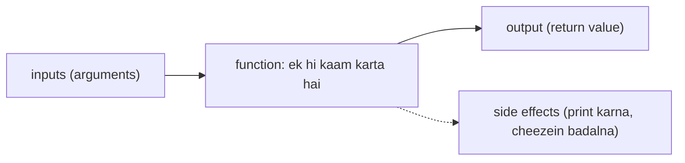
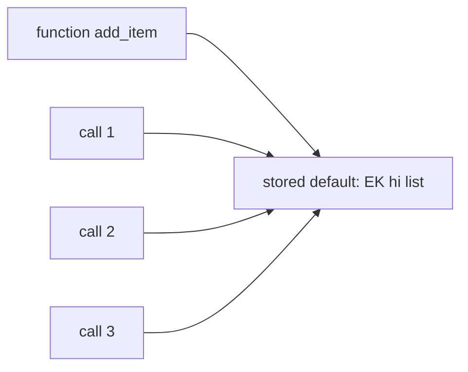
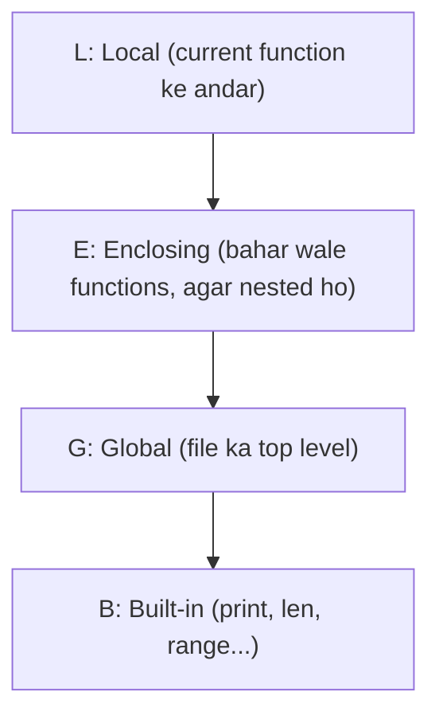
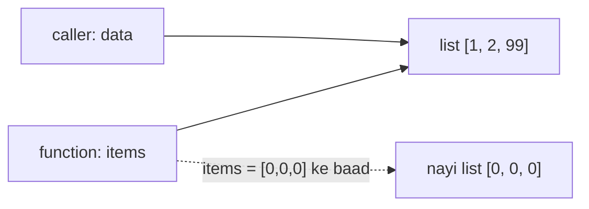
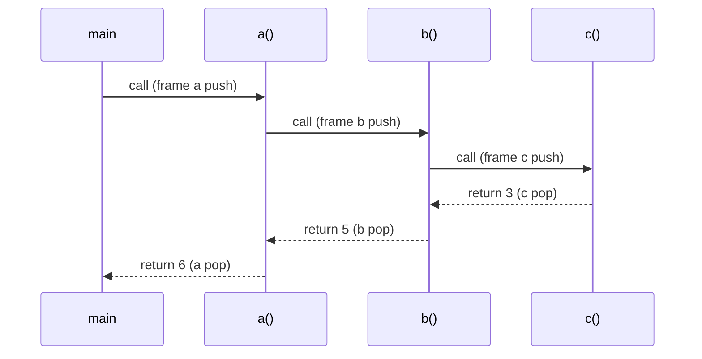

# Chapter 10 · Functions

> Jo bhi app tumhe pasand hai, woh hazaaron chhoti-chhoti machines se bani hai, aur har machine ek hi kaam karti hai: "GST calculate karo", "check karo password strong hai ya nahi", "sabse chhota route dhoondho". Python mein ye machines **functions** kehlaati hain. Inhe achhe se likho, toh bada program LEGO bricks ka ek saaf-suthra dher ban jaata hai. Bura likho, toh aisi spaghetti banti hai jise koi debug nahi kar sakta.

**Is chapter mein tum seekhoge:**
- Functions define aur call kaise karte hain, aur `return` aur `print` ka asli fark
- Parameters vs arguments; positional, keyword aur default arguments
- `*args`, `**kwargs`, keyword-only (`*`) aur positional-only (`/`) parameters
- **Mutable default argument trap**, aur ye exactly kyun hota hai
- Scope (**LEGB**), `global` aur `nonlocal`
- Functions as objects, **closures**, `lambda`, docstrings aur type hints
- Pure functions vs side effects, arguments kaise pass hote hain, aur call stack
- Aise functions design karna jo padhne, test karne aur reuse karne mein aasaan hon

**Isse pehle padho:** [Variables & Memory](02-variables-types-memory.md) · [Loops](06-loops.md) · [Lists](07-lists.md) · [Dictionaries](09-dictionaries.md)

---

## 🧠 The Big Idea · Asli Baat

Function ek **vending machine** hai. Tum kuch andar daalte ho (sikke aur button ka choice), woh andar kuch kaam karti hai jo tumhe dekhne ki zaroorat nahi, aur bahar kuch nikalta hai (snack).



Functions hote kyun hain, teen wajah:

1. **Don't Repeat Yourself (DRY).** Logic ek baar likho, 100 baar use karo. Bug ek jagah fix karo, har jagah fix ho jaata hai.
2. **Idea ko naam do.** `is_prime(n)` English jaisa padhta hai. Bees lines ka loop nahi padhta.
3. **Details chhupaao.** Tum `sorted()` use kar lete ho bina Timsort jaane. Doosre log tumhara function bina padhe use kar sakte hain.

> 🇮🇳 **Desi Analogy:** Function ek **chai tapri** hai. Tum order dete ho: "do cutting, ek kam cheeni" (ye hain **arguments**). Andar bhaiya kya karte hain, kitna adrak, kitni der ubaala, ye tumhe jaanna zaroori nahi (ye hai function ki **body**, chhupi hui details). Tumhare haath mein chai aati hai (ye hai **return value**). Aur agar bhaiya chai banate-banate radio pe gaana bhi bajaate hain, toh woh **side effect** hai: tumhare order ka hissa nahi, lekin duniya mein kuch badal gaya. Har roz same order do, same chai milni chahiye. Achha function bhi aisa hi hota hai.

> 💡 Sabse achhe functions achhi vending machines jaise hote hain: ek saaf kaam, saaf inputs, predictable output, aur koi surprise nahi, jaise chupke se tumhara purse khaali kar dena.

---

## 🔨 Building It Up · Zero Se Shuru

### 1. Defining and calling

```python
def greet(name):
    message = f"Hello, {name}!"
    return message

result = greet("Asha")
print(result)
print(greet("Ravi"))
```

```text
Hello, Asha!
Hello, Ravi!
```

Anatomy (function ke hisse):
- `def` definition shuru karta hai. `greet` naam hai. `(name)` **parameter** list hai. Colon aur uske neeche ka indented block milke **body** banate hain.
- Function define karne se uski body **nahi** chalti. Python bas function banata hai aur use ek naam de deta hai. (Recipe likhne se khaana nahi banta.)
- `greet("Asha")` use **call** karta hai: Python body ko `name = "Asha"` ke saath chalata hai aur jo bhi `return` deta hai, woh wapas haath mein de deta hai.

### 2. `return` vs `print`

Ye lagbhag har beginner ko confuse karta hai, toh chalo ise hamesha ke liye settle kar dete hain.

- `print` screen pe kuch **dikhata** hai. Program baad mein use use nahi kar sakta.
- `return` ek value function ko call karne wale ke **haath mein wapas deta hai**, taaki program use store kar sake, uspe calculation kar sake, aage bhej sake.

```python
def add_print(a, b):
    print(a + b)          # 5 dikhata hai, return kuch nahi karta

def add_return(a, b):
    return a + b          # 5 wapas deta hai

x = add_print(2, 3)
y = add_return(2, 3)
print("x =", x)
print("y =", y)
print(add_return(2, 3) * 10)   # return hui value ko hum USE kar sakte hain
```

```text
5
x = None
y = 5
50
```

Kya hua yahan: jis function mein `return` nahi hai (ya sirf khaali `return` hai), woh **`None`** wapas deta hai. Pehli line ka `5` `add_print` ke andar wale `print` ne dikhaya, lekin `x` ke haath mein `None` aaya. Isliye `x * 10` crash kar jaata. Ek calculator jo answer screen pe dikha de, insaan ke liye theek hai, lekin doosra program us screen ko padh nahi sakta. Return values programs ke liye hoti hain.

> 🇮🇳 **Desi Analogy:** `print` hai cricket stadium ka **scoreboard**: sab dekh lete hain ki score 250 hai, lekin scoreboard tumhari jeb mein nahi aata. `return` hai scorer ka tumhe **parchi pe likh ke dena** "250": ab tum us number se run rate nikaal sakte ho, use WhatsApp group mein bhej sakte ho, kuch bhi. Scoreboard dikhane ke liye, parchi kaam mein lene ke liye.

> 🤔 **Mann mein sawaal:** Toh kya function mein `print` likhna hi galat hai?
>
> **Jawab:** Nahi. Galat tab hai jab tumhe result ka **istemaal** karna hai aur tumne sirf print kar diya. Agar function ka kaam hi screen pe kuch dikhana hai (jaise ek report print karna), toh `print` bilkul sahi hai. Rule of thumb: **calculation wale functions return karein, aur print sirf ek jagah ho, end mein.**

**`return` function ko turant khatam kar deta hai.** Isse tum jaldi bahar nikal sakte ho:

```python
def find_first_negative(nums):
    for i, x in enumerate(nums):
        if x < 0:
            return i          # yahin ruk jao
    return -1                 # yahan tabhi pahunchte hain jab loop ko kuch nahi mila

print(find_first_negative([3, 8, -2, 5, -9]), find_first_negative([1, 2]))
```

```text
2 -1
```

Dhyaan do: `-9` bhi negative hai, lekin loop wahan tak pahuncha hi nahi. Index 2 pe `-2` milte hi `return` ne poora function band kar diya.

**Kai values return karna** asal mein ek tuple return karna hai ([Chapter 08](08-tuples-sets.md)), jise tum unpack karte ho:

```python
def divide(a, b):
    return a // b, a % b

q, r = divide(17, 5)
print(q, r, divide(17, 5))
```

```text
3 2 (3, 2)
```

### 3. Parameters vs arguments

- **Parameter** definition mein likha naam hai: `def area(width, height)`. Ye khaali jagah hai.
- **Argument** woh asli value hai jo tum call mein bhejte ho: `area(3, 4)`. Ye us jagah ko bharta hai.

Memory hook: **P**arameter = **P**laceholder, **A**rgument = **A**ctual value.

Desi version: exam ka **form** socho. "Naam: ______" wali khaali line parameter hai. Tumne jo "Asha" likha, woh argument hai.

### 4. Positional, keyword and default arguments

```python
def make_profile(name, age, city="Bengaluru"):
    return f"{name}, {age}, {city}"

print(make_profile("Asha", 21))                    # positional; city default use karta hai
print(make_profile("Ravi", 22, "Pune"))            # positional, default ko override kiya
print(make_profile(age=23, name="Meera"))          # keyword: order se fark nahi padta
print(make_profile("Kabir", city="Delhi", age=20)) # mix: pehle positional, phir keyword
```

```text
Asha, 21, Bengaluru
Ravi, 22, Pune
Meera, 23, Bengaluru
Kabir, 20, Delhi
```

Rules:
- **Positional** arguments parameters se position ke hisaab se match hote hain (pehla pehle se, doosra doosre se).
- **Keyword** arguments naam se match hote hain (`age=23`) aur call ko khud samjhaane wala bana dete hain.
- Call mein positional arguments keyword arguments se **pehle** aane chahiye.
- Definition mein default **wale** parameters, bina default walon ke **baad** aane chahiye.

```py
make_profile(name="Asha", 21)
# SyntaxError: positional argument follows keyword argument

def bad(city="Pune", name):
# SyntaxError: non-default argument follows default argument (wording version ke hisaab se badalti hai)

make_profile("Asha")
# TypeError: make_profile() missing 1 required positional argument: 'age'

make_profile("Asha", 21, name="X")
# TypeError: make_profile() got multiple values for argument 'name'
```

Aakhri error samjho: `"Asha"` position se pehle hi `name` mein chala gaya, phir `name="X"` ne dobara `name` bharne ki koshish ki. Ek parameter, do values: Python confuse, error.

Default wala rule kyun? `def bad(city="Pune", name)` socho, aur call `bad("Asha")`. Ab `"Asha"` kahan jaaye: `city` mein ya `name` mein? Ambiguity se bachne ke liye Python ye likhne hi nahi deta.

### 5. The mutable default argument trap

Ye Python ka sabse mashhoor gotcha hai. Dekho:

```python
def add_item(item, basket=[]):
    basket.append(item)
    return basket

print(add_item("apple"))
print(add_item("banana"))      # umeed thi ['banana'] ...
print(add_item("cherry"))
```

```text
['apple']
['apple', 'banana']
['apple', 'banana', 'cherry']
```

Kyun? **Default values sirf ek baar evaluate hoti hain, jab `def` wali line chalti hai**, har call pe nahi. Function ke andar exactly **ek** list object store hota hai, aur har woh call jo default use karti hai, usi ek list mein append karti hai.



> 🇮🇳 **Desi Analogy:** Office mein ek **shared tiffin dabba** socho jo pantry mein rakha hai, aur rule hai "agar tum apna dabba nahi laaye, toh pantry wala use karo". Pehle din Asha ne usme rajma rakha. Doosre din Ravi apna dabba nahi laaya, pantry wala uthaya, aur usme rajma pehle se pada hai, upar se usne chawal daal diye. Teesre din jo bhi pantry wala dabba uthayega, use pehle se rajma aur chawal dono mile hue milenge. Kyunki pantry mein naya dabba roz nahi aata, **ek hi dabba** office khulne ke din rakha gaya tha (ye hai `def` ke waqt bana default). Fix: rule badlo, "apna dabba nahi laaye toh ek **naya** dabba lo" (yahi `None` wala fix hai).

**Fix:** default mein `None` rakho aur andar ek naya object banao.

```python
def add_item(item, basket=None):
    if basket is None:
        basket = []            # har call pe ek NAYI list
    basket.append(item)
    return basket

print(add_item("apple"))
print(add_item("banana"))
my_basket = ["mango"]
print(add_item("kiwi", my_basket))
```

```text
['apple']
['banana']
['mango', 'kiwi']
```

Ab `basket = []` body ke andar hai, aur body har call pe chalti hai, toh har call ko apni nayi list milti hai. Aur jab caller apni list deta hai (`my_basket`), toh usi mein append hota hai, jaisa chahiye.

> ⚠️ Rule: **kabhi bhi mutable object (list, dict, set) ko default value mat banao.** Immutable defaults (`0`, `""`, `None`, tuples) bilkul safe hain, kyunki unhe koi badal hi nahi sakta.

### 6. `*args` and `**kwargs`: any number of arguments

Kabhi-kabhi tumhe pata nahi hota kitne arguments aayenge. Jaise `print()` kitne bhi arguments le leta hai.

- `*args` **extra positional** arguments ko ek **tuple** mein ikattha karta hai.
- `**kwargs` **extra keyword** arguments ko ek **dict** mein ikattha karta hai.

(`args` aur `kwargs` naam sirf convention hain; asli kaam `*` aur `**` karte hain.)

```python
def total(*numbers):
    print("got:", numbers)
    s = 0
    for n in numbers:
        s += n
    return s

print(total())
print(total(1, 2, 3))

def describe(name, **details):
    print(name, details)

describe("Asha", age=21, city="Pune")
describe("Ravi")
```

```text
got: ()
0
got: (1, 2, 3)
6
Asha {'age': 21, 'city': 'Pune'}
Ravi {}
```

Dhyaan do: kuch na bhejo toh `*numbers` khaali tuple `()` ban jaata hai aur `**details` khaali dict `{}`. Kabhi `None` nahi, toh loop chalane mein koi dikkat nahi.

**Call karte waqt `*` aur `**` ulta kaam karte hain: woh phailaate hain (spread).**

```python
def area(width, height):
    return width * height

dims = [3, 4]
opts = {"width": 5, "height": 6}
print(area(*dims))       # area(3, 4)
print(area(**opts))      # area(width=5, height=6)

def log(level, *messages, **context):
    print(level, "|", " ".join(messages), "|", context)

log("INFO", "user", "logged", "in", user_id=42)
```

```text
12
30
INFO | user logged in | {'user_id': 42}
```

> 🇮🇳 **Desi Analogy:** `*args` shaadi ke **gift counter** jaisa hai: kitne bhi lifafe aayein, sab ek tokri (tuple) mein jaate hain, line se. `**kwargs` **naam likhe gifts** ka counter hai: "Sharma ji: mixer", "Verma ji: dinner set", sab ek register (dict) mein naam ke saath. Aur call ke waqt `*` ulta hai: tokri ulta karke saare lifafe ek-ek karke counter pe rakh do.

Iska ek bahut common real use hai ek **wrapper** jo sab kuch kisi doosre function ko aage pass kar de: `def wrapper(*args, **kwargs): return original(*args, **kwargs)`. Tum exactly yahi use karke [Chapter 16](16-iterators-generators-decorators.md) mein decorators banaoge.

### 7. Keyword-only (`*`) and positional-only (`/`) parameters

Clarity aur safety ke liye tum callers ko naam use karne pe majboor kar sakte ho (ya naam use karne se rok sakte ho).

- **Akele `*` ke baad** wale parameters **keyword-only** hain: unhe naam se hi bhejna padega.
- **`/` se pehle** wale parameters **positional-only** hain: unhe naam se nahi bhej sakte (Python 3.8+).

```python
def transfer(amount, *, to_account, dry_run=False):
    return f"send {amount} to {to_account} (dry_run={dry_run})"

print(transfer(500, to_account="ACC-9"))

def power(base, exp, /):
    return base ** exp

print(power(2, 10))
```

```text
send 500 to ACC-9 (dry_run=False)
1024
```

```py
transfer(500, "ACC-9")
# TypeError: transfer() takes 1 positional argument but 2 were given
power(base=2, exp=10)
# TypeError: power() got some positional-only arguments passed as keyword arguments: 'base, exp'
```

Ye jhanjhat kyun? `transfer(500, "ACC-9", True)` padhne mein bekaar hai: ye `True` kis cheez ka hai? Keyword-only tumhe `dry_run=True` likhne pe majboor karta hai, jo khud apna matlab bata deta hai. Positional-only library authors ko aage chal ke parameters ka naam badalne deta hai bina kisi ka code tode (kai built-ins, jaise `len(obj, /)`, positional-only hain). Socho: agar kisi ne `len(obj=x)` likha hota aur Python team ne naam `obj` se `o` kar diya, toh duniya bhar ka code toot jaata.

**Signature ka poora order:**

```py
def f(pos_only, /, normal, *args, kw_only, **kwargs):
    ...
```

| Hissa | Kaise pass hota hai | Example |
|---|---|---|
| `/` se pehle | sirf position se | `pos_only` |
| `/` aur `*` ke beech | position ya keyword | `normal` |
| `*args` | extra positionals → tuple | |
| `*` ya `*args` ke baad | sirf keyword | `kw_only` |
| `**kwargs` | extra keywords → dict | |

```python
def f(a, /, b, *args, c, d=4, **kwargs):
    return a, b, args, c, d, kwargs

print(f(1, 2, 3, 4, c=5))
print(f(1, b=2, c=3, e=99))
```

```text
(1, 2, (3, 4), 5, 4, {})
(1, 2, (), 3, 4, {'e': 99})
```

Pehli call ko trace karo: `1` → `a` (positional-only), `2` → `b`, bache hue `3, 4` → `args` tuple mein, `c=5` naam se, `d` ko kuch nahi mila toh default `4`, aur koi extra keyword nahi toh `kwargs = {}`. Doosri call mein `e=99` kisi parameter ka naam nahi hai, toh woh `kwargs` mein gaya.

### 8. Scope: where a name lives (LEGB)

Function ke andar bana variable **local** hota hai: woh sirf function chalne tak zinda rehta hai aur bahar dikhta hi nahi.

```python
def make_tea():
    sugar = 2            # make_tea ka local
    return sugar

make_tea()
print("sugar" in globals())   # kya sugar naam ka koi global hai?
```

```text
False
```

Jab Python koi naam dekhta hai, toh chaar jagah, is order mein dhoondhta hai: **LEGB**.



> 🇮🇳 **Desi Analogy:** Ghar mein chaabi dhoondh rahe ho. Pehle **apni jeb** (Local). Nahi mili? **Apne kamre** mein (Enclosing). Wahan bhi nahi? **Poore ghar** mein (Global). Phir bhi nahi? **Society ke security guard** ke paas, jahan sabki common cheezein hoti hain (Built-in). Jahan pehli baar mili, wahin ruk jaate ho. Isliye agar tumhari jeb mein "x" naam ki chaabi hai, toh ghar wali "x" tak kabhi pahunchoge hi nahi.

```python
x = "global"

def outer():
    x = "enclosing"
    def inner():
        x = "local"
        print("inner sees:", x)
    inner()
    print("outer sees:", x)

outer()
print("module sees:", x)
print(len("abc"))        # 'len' Built-ins mein milta hai
```

```text
inner sees: local
outer sees: enclosing
module sees: global
3
```

Teen alag `x` hain, teen alag scopes mein, aur ek doosre ko chhoote bhi nahi. `inner` ka `x = "local"` likhne se `outer` ka `x` nahi badla.

Bahar wale variable ko **padhna** theek hai. Lekin function ke andar kisi naam ko **assign** karna use **poore** function ke liye local bana deta hai, aur isse ye classic error aata hai:

```py
count = 0

def increment():
    count = count + 1     # 'count' yahan local hai (kyunki hum isme assign kar rahe hain) ...
    return count          # ... lekin value milne se pehle hi hum ise padh rahe hain

increment()
# UnboundLocalError: cannot access local variable 'count' where it is not associated with a value
```

> 🤔 **Mann mein sawaal:** Global `count = 0` toh hai na! Python use kyun nahi padh leta?
>
> **Jawab:** Kyunki Python function chalane se **pehle** hi poori body dekh ke decide kar leta hai ki kaunse naam local hain. Usne `count = ...` dekha, toh `count` ko poore function ke liye local maan liya, line 1 se. Ab `count + 1` padhte waqt woh local `count` dhoondhta hai, jisme abhi tak kuch nahi hai. Global wale tak jaata hi nahi. Isliye error. Under the Hood mein iski poori wajah hai.

### 9. `global` and `nonlocal`

`global name` kehta hai "jab main `name` assign karun, toh mera matlab module-level wale se hai". `nonlocal name` kehta hai "mera matlab enclosing function wale se hai".

```python
count = 0

def increment():
    global count
    count += 1

increment()
increment()
print(count)

def counter_demo():
    total = 0
    def add(n):
        nonlocal total       # counter_demo wala 'total', koi naya local nahi
        total += n
    add(5)
    add(10)
    return total

print(counter_demo())
```

```text
2
15
```

> 💡 `global` aam taur pe ek code smell hai: chhupa hua shared state bugs dhoondhna mushkil bana deta hai. Values andar pass karo aur results bahar return karo, yahi behtar hai. Doosri taraf `nonlocal` nested helper functions ke andar common aur saaf hai, khaaskar DSA mein (DFS solutions mein dikhega).

Dhyaan do, bahar wali list ya dict ko **mutate** karne ke liye `global` ya `nonlocal` ki **zaroorat nahi**; unki zaroorat sirf naam ko **rebind** karne (naam pe naya object chipkaane) ke liye hai.

```python
seen = []

def remember(x):
    seen.append(x)    # list ko mutate kar rahe hain, 'seen' ko reassign nahi: koi keyword nahi chahiye

remember(1)
remember(2)
print(seen)
```

```text
[1, 2]
```

Fark aise samjho: `seen.append(x)` mein `seen` naam sirf **padha** ja raha hai (LEGB se global list mili), phir us list ke andar kuch daala. Naam ko koi naya object nahi diya. Lekin `seen = [x]` likhte, toh woh assignment hai, aur woh `seen` ko local bana deta.

### 10. Functions are objects (first-class functions)

Python mein function bhi baaki values jaisi ek value hai. Tum use variable mein store kar sakte ho, list ya dict mein rakh sakte ho, doosre function ko pass kar sakte ho, aur function se return kar sakte ho. Fark dhyaan se dekho: `shout` khud function hai; `shout("hi")` use **call** karta hai.

```python
def shout(text):
    return text.upper() + "!"

def whisper(text):
    return text.lower() + "..."

speak = shout                    # brackets nahi: hum function ko hi pass kar rahe hain
print(speak("hello"))
print(shout.__name__, type(shout).__name__)

def apply_twice(func, value):    # aisa function jo function leta hai
    return func(func(value))

print(apply_twice(shout, "hey"))

def add_one(n):
    return n + 1

print(apply_twice(add_one, 5))

styles = {"loud": shout, "soft": whisper}    # ek "dispatch table"
for mood in ["soft", "loud"]:
    print(styles[mood]("Good morning"))
```

```text
HELLO!
shout function
HEY!!
7
good morning...
GOOD MORNING!
```

`apply_twice(shout, "hey")` ko andar se kholo: pehle `shout("hey")` = `"HEY!"`, phir `shout("HEY!")` = `"HEY!!"`. Isliye do exclamation marks.

Jo function doosra function leta hai ya return karta hai, use **higher-order function** kehte hain. Tum ek use kar bhi chuke ho: `sorted(words, key=len)` function `len` ko `sorted` ke haath mein deta hai. Dispatch table (functions ki dict) lambi `if/elif` chains ka saaf replacement hai.

> 🤔 **Mann mein sawaal:** `speak = shout` aur `speak = shout()` mein kya fark hai?
>
> **Jawab:** `speak = shout` ka matlab hai "`speak` bhi usi machine ka doosra naam hai", machine chalayi nahi gayi. `speak = shout()` ka matlab hai "machine abhi chalao aur jo nikle woh `speak` mein rakho". Yahan toh `shout()` error dega, kyunki `text` argument diya hi nahi. Rule: **brackets = abhi chalao. Bina brackets = machine ko hi aage do.**

### 11. Closures: functions that remember

Ek function ke andar define kiya gaya function, bahar wale function ke variables ko **yaad** rakh sakta hai, tab bhi jab bahar wala function khatam ho chuka ho. Is yaad rakhe hue environment ko **closure** kehte hain.

```python
def make_multiplier(factor):
    def multiply(n):
        return n * factor        # 'factor' enclosing scope se aata hai
    return multiply              # andar wala function hi return karo

double = make_multiplier(2)
triple = make_multiplier(3)
print(double(10), triple(10))

def make_counter():
    count = 0
    def tick():
        nonlocal count
        count += 1
        return count
    return tick

c1 = make_counter()
c2 = make_counter()
print(c1(), c1(), c1(), c2())     # har counter ka apna private 'count' hai
```

```text
20 30
1 2 3 1
```

Kya hua yahan: `make_multiplier(2)` chal ke khatam ho gaya, lekin jo `multiply` usne return kiya, use ab bhi `factor = 2` yaad hai. `make_counter` ki har call ek naya `count` banati hai, isliye `c1` aur `c2` ek doosre mein dakhal nahi dete: `c1` teen baar chala toh 3 tak pahuncha, `c2` ki apni ginti 1 se shuru hui. Closures tumhe bina classes ke private state dete hain, aur decorators ka engine yahi hain ([Chapter 16](16-iterators-generators-decorators.md)).

> 🇮🇳 **Desi Analogy:** Closure ek **dabbawala ka tiffin** hai. Maa ne subah ghar pe (outer function) tiffin pack kiya: dal, sabzi, aur ek parchi "beta, paani peete rehna" (ye hai captured variable). Maa ka kaam khatam, woh ghar pe hai. Lekin tiffin office pahunch ke jab khulta hai (inner function call), toh parchi wahi hai. Har ghar ka tiffin apni parchi le ke aata hai, isliye `double` ke paas "2" ki parchi hai aur `triple` ke paas "3" ki. Ek ka tiffin doosre ka nahi khulta.

### 12. `lambda`: tiny anonymous functions

`lambda params: expression` ek line mein ek chhota function banata hai, bina naam ke aur bina `return` keyword ke (expression ki value apne aap return ho jaati hai).

```python
square = lambda x: x * x
print(square(7))

pairs = [("Ravi", 72), ("Asha", 95), ("Meera", 88)]
print(sorted(pairs, key=lambda p: p[1]))           # marks se sort
print(max(pairs, key=lambda p: p[1])[0])           # topper ka naam

add = lambda a, b=10: a + b                        # defaults bhi chalte hain
print(add(1), add(1, 2))
```

```text
49
[('Ravi', 72), ('Meera', 88), ('Asha', 95)]
Asha
11 3
```

`lambda p: p[1]` ko aise padho: "ek `p` lo, uska `p[1]` (marks) wapas do". Ye bilkul `def get_marks(p): return p[1]` jaisa hai, bas naam ke bina, ek line mein.

`lambda` ko **chhote, ek-baar-use-karke-phenk-do wale functions** ke liye use karo jo kisi doosre function ko diye jaate hain (`key=`, `map`, `filter`, [Chapter 11](11-comprehensions-functional.md)). Agar use naam chahiye, koi statement chahiye, ya ek simple expression se zyada chahiye, toh `def` use karo. (Lambda ko naam pe assign karna, jaise upar `square`, chalta toh hai, lekin style guides uske liye `def` pasand karti hain.)

### 13. Docstrings

**Docstring** woh string literal hai jo function ka pehla statement ho. Ye batata hai ki function kya karta hai, aur tools (`help()`, editors) use dikhate hain.

```python
def bmi(weight_kg, height_m):
    """Return the Body Mass Index.

    weight_kg: weight in kilograms (must be positive)
    height_m:  height in metres (must be positive)
    """
    return weight_kg / height_m ** 2

print(round(bmi(70, 1.75), 1))
print(bmi.__doc__.splitlines()[0])
```

```text
22.9
Return the Body Mass Index.
```

Achhi docstrings batati hain function **kya** return karta hai, parameters ka matlab kya hai, aur koi surprise (kaunse errors aa sakte hain, side effects). Woh code ko line-by-line dohraati nahi.

### 14. Type hints

**Type hints** batate hain ki function kaunse types expect karta hai aur kya return karta hai. Python unhe runtime pe **enforce nahi** karta; ye insaano, editors aur `mypy` jaise checkers ke liye hain.

```python
def average(marks: list[float]) -> float:
    return sum(marks) / len(marks)

def find_user(users: dict[str, int], name: str) -> int | None:
    return users.get(name)

def greet(name: str, times: int = 1) -> str:
    return ("Hi " + name + "! ") * times

print(average([80.0, 90.0]))
print(find_user({"asha": 1}, "ravi"))
print(greet("Asha", 2))
print(average.__annotations__)
print(average((1, 2)))      # ints ka tuple, list[float] nahi: phir bhi chalta hai, hints enforce nahi hote
```

```text
85.0
None
Hi Asha! Hi Asha! 
{'marks': list[float], 'return': <class 'float'>}
1.5
```

Common hints: `int`, `str`, `list[int]`, `dict[str, int]`, `tuple[int, int]`, `set[str]`, `X | None` (`None` bhi ho sakta hai, Python 3.10+), aur `typing` se `Callable[[int], int]`, matlab "aisa function jo int leta hai aur int return karta hai". Interviewers aur teams type-hinted code pasand karte hain, kyunki woh documentation jaisa padhta hai.

> 🤔 **Mann mein sawaal:** Jab Python hints check hi nahi karta, toh likhne ka fayda kya?
>
> **Jawab:** Hints **sign board** jaise hain, police nahi. Board "No Parking" bolta hai, gaadi phir bhi khadi ho sakti hai, lekin har driver ko pata hai ki rule kya hai. Waise hi hints padhne wale ko (aur tumhare editor ko) batate hain ki kya bhejna hai. Editor galat type pe laal line dikha deta hai, aur `mypy` jaisa tool poore project mein galtiyan pakad leta hai, code chalane se pehle hi.

### 15. How arguments are passed: "pass by object reference"

Python "pass by value" hai ya "pass by reference"? Exactly dono mein se koi nahi. Function ka parameter tumhare bheje hue **usi object pe ek naya name tag** ban jaata hai ([Chapter 02](02-variables-types-memory.md)). Phir:

- Agar function us object ko **mutate** karta hai (jaise `lst.append`), toh caller ko badlav dikhta hai.
- Agar function parameter ko **rebind** karta hai (`lst = [...]`, `n = n + 1`), toh woh sirf apna name tag hilaata hai; caller ko kuch nahi dikhta.

```python
def mutate(items):
    items.append(99)          # shared object ko badalta hai

def rebind(items):
    items = [0, 0, 0]         # sirf local naam ko hilaata hai

def bump(n):
    n += 1                    # ints immutable hain: ye rebind karta hai
    return n

data = [1, 2]
mutate(data)
print(data)
rebind(data)
print(data)

x = 5
print(bump(x), x)
```

```text
[1, 2, 99]
[1, 2, 99]
6 5
```



> 🇮🇳 **Desi Analogy:** Tumne apne dost ko apne **ghar ka address** ek parchi pe likh ke diya (ye hai argument pass karna; ghar copy nahi hua, sirf address gaya). Dost ne us address pe jaake deewar pe paint kar diya: tumhara ghar badal gaya (ye hai **mutate**, `append`). Lekin agar dost ne parchi pe tumhara address kaat ke kisi aur ghar ka likh liya, toh tumhare ghar pe koi asar nahi (ye hai **rebind**, `items = [0, 0, 0]`). Aur `int` ek aisa ghar hai jiska paint ho hi nahi sakta: `n += 1` karna matlab parchi pe doosre ghar ka address likhna.

### 16. Pure functions vs side effects

**Pure function**:
1. same input ke liye hamesha same output deta hai, aur
2. apne bahar kuch nahi badalta (no printing, arguments ya globals ko modify nahi karta, files nahi chhoota).

Iske alawa function bahar ki duniya pe jo bhi asar daalta hai, woh **side effect** hai.

```python
def pure_add_tax(prices, rate):
    return [round(p * (1 + rate), 2) for p in prices]   # NAYI list banata hai (list comprehension: Chapter 11)

def impure_add_tax(prices, rate):
    for i in range(len(prices)):
        prices[i] = round(prices[i] * (1 + rate), 2)    # caller ki list modify karta hai

original = [100, 250]
print(pure_add_tax(original, 0.18), original)
impure_add_tax(original, 0.18)
print(original)
```

```text
[118.0, 295.0] [100, 250]
[118.0, 295.0]
```

Pure functions test karna aasaan hai (input → expected output), unke baare mein sochna aasaan hai, aur unhe cache karna safe hai (memoization sirf pure functions ke saath hi kaam karta hai!). Side effects zaroori hain (jo program kabhi kuch print ya save na kare, woh bekaar hai), lekin **unhe kinaaron pe rakho**: calculation pure functions se karo, phir print/save ek jagah karo. Agar koi function apna input mutate karta hai, toh ye uske naam ya docstring mein bata do (jaise `list.sort()` vs `sorted()`).

Memoization pure function pe hi kyun? Maan lo function current time bhi use karta hai. Aaj ka cached answer kal galat hoga. Pure function ka answer sirf input pe depend karta hai, isliye ek baar yaad kar liya toh hamesha sahi.

### 17. The call stack

Jab ek function doosre function ko call karta hai, toh Python ko yaad rakhna padta hai ki wapas kahan aana hai. Iske liye woh **call stack** use karta hai: har call ek **frame** push karti hai (jisme us call ke local variables aur current line hoti hai), aur har `return` use pop kar deta hai.

```python
def c():
    print("  in c: doing the work")
    return 3

def b():
    print(" in b: calling c")
    return c() + 2

def a():
    print("in a: calling b")
    return b() + 1

print("result:", a())
```

```text
in a: calling b
 in b: calling c
  in c: doing the work
result: 6
```



Sabse gehre point pe stack (upar wala abhi chal raha function hai):

```text
| c  (no locals)   |  <- running
| b  (waiting on c)|
| a  (waiting on b)|
| main module      |
```

> 🇮🇳 **Desi Analogy:** Shaadi mein **plates ka stack**. Har nayi call ek nayi plate upar rakhti hai. Neeche wali plates intezaar karti hain, unhe tab tak koi nahi chhoo sakta jab tak upar wali hat na jaaye. `c` sabse upar hai, pehle khatam hota hai, plate hatti hai (pop), phir `b` ki baari, phir `a` ki. **Last In, First Out.**

Jab koi error aata hai, toh Python jo **traceback** print karta hai, woh literally yahi stack hai, sabse bahar wali call se leke us line tak jo fail hui. Tracebacks ko **neeche se upar** padho: aakhri line error hai, uske upar wali line batati hai kahan hua. Call stack hi [Recursion](12-recursion.md) samajhne ki chaabi hai, jahan function khud ko call karta hai aur stack gehra hota jaata hai.

### 18. Designing good functions

| Principle | Matlab | Toota toh smell |
|---|---|---|
| **One job** | ek hi kaam, jo ek sentence mein bina "and" ke bata sako | `load_and_clean_and_plot()` |
| **Good name** | actions ke liye verb (`send_email`), booleans ke liye `is_`/`has_` | `do_stuff`, `process2` |
| **Small** | ek screen mein aa jaaye, aam taur pe ~20 lines se kam | padhne ke liye scroll karna pade |
| **Few parameters** | ideally ≤ 3–4; baaki ko ek dict/object mein group karo | 9 positional arguments |
| **Return, don't print** | caller ko decide karne do ki kya dikhana hai | result reuse nahi ho sakta |
| **No hidden state** | inputs andar, outputs bahar; `global` se bacho | sirf ek khaas order mein chalao toh hi chalta hai |
| **Guard clauses** | bure/edge cases pehle handle karo aur jaldi return karo | gehre nested `if`s |
| **Documented** | docstring + type hints | "ye return kya karta hai?" |

```python
def letter_grade(marks: int) -> str:
    """Convert 0-100 marks to a letter grade."""
    if not 0 <= marks <= 100:          # guard clause: galat input pehle hi reject karo
        return "invalid"
    if marks >= 90:
        return "A"
    if marks >= 75:
        return "B"
    if marks >= 50:
        return "C"
    return "F"

for m in [95, 80, 51, 12, 150]:
    print(m, letter_grade(m))
```

```text
95 A
80 B
51 C
12 F
150 invalid
```

Dhyaan do, yahan `elif` ki zaroorat nahi padi. Har `if` `return` pe khatam hota hai, toh agla `if` tabhi chalta hai jab pichla fail hua ho. Code seedha, ek level ka, bina nesting ke.

---

## 🔬 Under the Hood · Andar Ki Kahani

### `def` is a statement that runs

Jab Python `def` wali line execute karta hai, toh woh ek **function object** banata hai aur use naam se jod deta hai. Us object ke andar hota hai:

- `__code__`: body ka compiled bytecode (ek baar banta hai, jab file compile hoti hai),
- `__defaults__`: **pehle se evaluate ho chuki** default values,
- `__name__`, `__doc__`, `__annotations__`,
- `__closure__`: closures ke liye, captured variables ko pakad ke rakhne wale "cells".

Mutable-default trap ko tum apni aankhon se dekh sakte ho:

```python
def add_item(item, basket=[]):
    basket.append(item)
    return basket

print(add_item.__defaults__)
add_item("apple")
add_item("pear")
print(add_item.__defaults__)      # stored default object khud badal gaya
```

```text
([],)
(['apple', 'pear'],)
```

Ye hai poore trap ka saboot: default list function object ke saath chipki hui hai, `__defaults__` ke andar. Har call usi ko badal rahi hai.

Aur ek closure ka captured variable:

```python
def make_multiplier(factor):
    def multiply(n):
        return n * factor
    return multiply

triple = make_multiplier(3)
print(triple.__code__.co_freevars)            # bahar se capture kiye gaye naam
print(triple.__closure__[0].cell_contents)    # yaad rakhi hui value
```

```text
('factor',)
3
```

Yahi woh "tiffin ki parchi" hai jiski humne baat ki thi: `__closure__` mein ek cell hai, aur uske andar `3`.

### Frames and fast locals

Har call ek **frame object** banati hai: ek chhota record jisme function ke local variables hote hain, current bytecode instruction ka pointer hota hai, aur caller ke frame ki taraf wapas ek pointer hota hai. Frames ki yahi judi hui chain **hi** call stack hai.

CPython **compile time** pe hi decide kar leta hai ki kaunse naam local hain (function mein jo bhi naam assign hota hai). Locals frame ke andar ek fixed-size array mein rakhe jaate hain aur position se access hote hain, jo fast hai. Globals aur built-ins dictionaries mein dhoondhe jaate hain ([Chapter 09](09-dictionaries.md)), jo thoda slow hai. Isi compile-time decision ki wajah se `UnboundLocalError` aata hai: compiler ne `count = ...` dekha, `count` ko poore function ke liye local mark kar diya, toh assignment se pehle use padhna fail ho jaata hai, chahe ek global `count` maujood ho.

### Late binding in closures

Closures **variables** capture karte hain, values nahi. Value tab dhoondhi jaati hai jab andar wala function **chalta** hai:

```python
funcs = []
for i in range(3):
    funcs.append(lambda: i)       # teeno same variable i capture karte hain
print([f() for f in funcs])       # jab tak ye chalte hain, i 2 ho chuka hai

funcs = []
for i in range(3):
    funcs.append(lambda i=i: i)   # default argument current value ki photo le leta hai
print([f() for f in funcs])
```

```text
[2, 2, 2]
[0, 1, 2]
```

`i=i` wali trick exactly *isi wajah se* kaam karti hai ki defaults definition ke waqt ek hi baar evaluate hote hain, wahi fact jo mutable-default trap ke peeche hai. Ek hi niyam, ek jagah dushman, doosri jagah dost.

> 🤔 **Mann mein sawaal:** `lambda i=i: i` mein do `i` hain. Kaunsa kaunsa hai?
>
> **Jawab:** Left wala `i` (`=` se pehle) lambda ka **parameter** ka naam hai. Right wala `i` loop ka variable hai, jiski value **abhi, lambda banate waqt** padh li jaati hai aur default ke roop mein save ho jaati hai. Samajhne ke liye aise likh ke dekho: `lambda saved=i: saved`. Bilkul same kaam karega.

### Call overhead

Python function call karna free nahi hai: frame banana, arguments bind karna aur return karna, mota-mota dasiyon nanoseconds ya usse zyada leta hai. Ye lagbhag kabhi matter nahi karta, aur readable code jeet-ta hai. Python 3.11 ne frame memory reuse karke aur interpreter mein pure-Python calls ko inline karke calls ko kaafi sasta bana diya. Default **recursion limit** (lagbhag 1000 nested calls) isliye hai taaki calls ki bhaagti hui chain process ko crash karne ki jagah ek saaf `RecursionError` de. Aur detail [Chapter 12](12-recursion.md) mein.

---

## 🧩 Pattern Decoder · Pattern Pakdo

### Pythonic function idioms

| Situation | Idiom |
|---|---|
| Optional mutable parameter | `def f(x, items=None): if items is None: items = []` |
| Kai results return karne hain | `return total, count` |
| Edge cases pe jaldi bahar niklo | top pe guard clauses |
| Behaviour chunne wale bahut saare `if/elif` | functions ki dict (dispatch table) |
| `key=` ke liye chhota throwaway function | `lambda` |
| Flag arguments | unhe keyword-only banao: `def f(x, *, verbose=False)` |
| Saare arguments aage bhejo | `def wrapper(*args, **kwargs): return f(*args, **kwargs)` |
| Bina class ke private state | closure + `nonlocal` |
| Helper jo sirf ek function use karta hai | use andar hi define karo (nested function) |

### How functions show up in DSA

Interviews mein lagbhag har recursive ya graph solution ek **`nonlocal` wala nested helper** ya input ke upar ek closure use karta hai:

```python
def count_islands(grid):
    rows, cols = len(grid), len(grid[0])
    seen = set()

    def explore(r, c):                       # nested helper: grid aur seen dono dikhte hain
        if not (0 <= r < rows and 0 <= c < cols):
            return
        if grid[r][c] != "1" or (r, c) in seen:
            return
        seen.add((r, c))
        explore(r + 1, c)
        explore(r - 1, c)
        explore(r, c + 1)
        explore(r, c - 1)

    islands = 0
    for r in range(rows):
        for c in range(cols):
            if grid[r][c] == "1" and (r, c) not in seen:
                explore(r, c)
                islands += 1
    return islands

grid = ["11000",
        "11000",
        "00100",
        "00011"]
print(count_islands(grid))
```

```text
3
```

Recursion ki abhi chinta mat karo ([Chapter 12](12-recursion.md) aur [Graphs](../part-2-dsa/16-graphs-bfs-dfs.md) mein cover hai). **Shape** dekho: bahar wala function shared data set up karta hai; andar wala helper use bina pass kiye use karta hai; `seen` mutate hota hai (isliye `nonlocal` ki zaroorat nahi). Agar helper ko koi counter **reassign** karna hota, toh woh `nonlocal` declare karta.

Grid mein dekho: top-left ke chaar `1` ek island, beech ka akela `1` doosra, neeche-right ke do `1` teesra. `explore` ek `1` se shuru hoke uske saare jude hue `1` ko `seen` mein daal deta hai, taaki unhe dobara na gina jaaye.

DSA mein functions aur kahan kaam aate hain:
- Sorting aur heaps ke liye **`key=` functions** ([Chapter 11](11-comprehensions-functional.md)).
- DP ke liye **pure functions + memoization** ([Chapter 12](12-recursion.md), [DP I](../part-2-dsa/20-dp-1d.md)).
- Interview code readable rakhne ke liye **helper functions**: `is_valid(r, c)`, `neighbors(node)`.

---

## ⚠️ Traps & Common Mistakes · Yahan Sab Phisalte Hain

1. **Mutable default arguments.** `def f(x, acc=[])` saari calls mein ek hi list share karta hai. `None` use karo.

2. **Return ki jagah print karna.** Caller ko `None` milta hai.

```py
def square(n):
    print(n * n)      # ❌ caller result use nahi kar sakta
def square(n):
    return n * n      # ✅
```

3. **Kisi raaste pe `return` bhool jaana.** Ek branch value return karti hai, doosri end tak gir jaati hai aur `None` return karti hai. (Example: `if n > 0: return "positive"` aur `elif n < 0: return "negative"`, aur `n = 0` ke liye kuch nahi. Toh `0` pe `None`.)

4. **Call karne ki jagah reference dena, ya reference ki jagah call karna.** `sorted(words, key=len())` galat hai (`len` ko bina arguments call kar deta hai); `key=len` sahi hai. `if is_ready:` (hamesha truthy, woh toh function hai!) vs `if is_ready():`.

5. **`UnboundLocalError`**, jab function ke andar global naam pe bina `global` ke assign karte ho. Behtar: use andar pass karo aur nayi value return karo.

6. **Loops mein late-binding closures.** Loop ke andar `lambda: i` aakhri `i` dekhta hai. `lambda i=i: i` use karo.

7. **Surprise mein arguments mutate karna.** Aisa function jo caller ki list ko bina bataaye sort ya clear kar de. Pehle copy karo (`items = list(items)`) ya document karo.

8. **Built-ins ko shadow karna.** `list`, `dict`, `str`, `sum`, `max`, `input`, `id` naam ke parameters function ke andar built-ins ko chhupa dete hain. (Phir andar `sum(...)` likha toh tumhara variable call hoga, aur error.)

9. **Bahut saari zimmedaariyan ya parameters.** Naam mein "and" chahiye, toh function tod do. 8 positional arguments leta hai, toh koi use sahi se call nahi kar paayega.

10. **Ye sochna ki type hints enforce hote hain.** `def f(x: int)` khushi-khushi `"hello"` le leta hai. Inhe pakadne ke liye type checker use karo, ya khud explicitly validate karo.

---

## 💡 Tips & Tricks · Pro Wale Moves

- Pehle woh **call** likho jo tum chahte ho ki exist kare (`total = cart_total(items, coupon="NEW10")`), phir use implement karo. Naam aur signatures behtar banenge.
- Booleans aur numbers ke liye call site pe keyword arguments use karo: `connect(timeout=5, retry=True)`.
- `help(func)` signature aur docstring print karta hai. VS Code mein naam pe hover karo.
- Global modify karne se behtar hai value return karna. Input ko mutate karne se behtar hai nayi list return karna, jab tak memory ka sawaal na ho.
- Signature mein akela `*`, jaise `def f(a, *, b)`, code ko self-documenting banane ka sasta tareeka hai.
- Function ko jaldi test karna hai? Edge case se call karo: khaali list, zero, negative, ek item.
- Interviews mein chhote helpers define karo (`in_bounds(r, c)`), isse solution readable banta hai aur achhi engineering dikhti hai.
- `functools.partial(f, x)` arguments pehle se bhar deta hai ([Chapter 11](11-comprehensions-functional.md)).

---

## 🎯 Interview Questions · Interview Mein Yahi Poochenge

### 1. What are `*args` and `**kwargs`? 🔥🔥🔥

<details><summary>Answer dekho 👀</summary>

Definition mein, `*args` saare extra positional arguments ko ek tuple mein ikattha karta hai aur `**kwargs` saare extra keyword arguments ko ek dict mein. Call mein, `*seq` ek sequence ko positional arguments mein phaila deta hai aur `**mapping` ek dict ko keyword arguments mein. Inka use flexible APIs ke liye hota hai, aur un wrappers/decorators ke liye jo arguments aage forward karte hain: `def wrapper(*args, **kwargs): return f(*args, **kwargs)`.

> 🗣️ **Interview mein aise bolo:** "In a function definition, `*args` packs extra positional arguments into a tuple and `**kwargs` packs extra keyword arguments into a dict. At a call site the stars do the reverse and unpack a sequence or a dict into arguments. The classic use is a wrapper or decorator that forwards everything with `f(*args, **kwargs)`."

</details>

### 2. What's wrong with `def f(x, items=[])`? 🔥🔥🔥

<details><summary>Answer dekho 👀</summary>

Default values **ek baar** evaluate hoti hain, jab `def` statement chalta hai, aur function pe store ho jaati hain (`f.__defaults__`). Har woh call jo default pe bharosa karti hai, usi ek list object ko paati hai, toh pichli calls ke appends agli calls mein leak ho jaate hain. Fix: `items=None` aur body ke andar `if items is None: items = []`.

> 🗣️ **Interview mein aise bolo:** "Default values are evaluated once, when the def statement runs, and stored on the function object in `__defaults__`. So every call that uses the default shares the same list, and mutations leak between calls. The fix is to default to None and create a fresh list inside the body."

</details>

### 3. Is Python pass-by-value or pass-by-reference? 🔥🔥🔥

<details><summary>Answer dekho 👀</summary>

Dono mein se koi nahi: ye **pass by object reference** hai (ise "call by sharing" bhi kehte hain). Parameter usi object se bind hota hai jis se argument. Us object ko mutate karna (jaise `lst.append`) caller ko dikhta hai; parameter ko rebind karna (`lst = [...]`) nahi dikhta. Immutable objects (ints, strings, tuples) ko tum mutate kar hi nahi sakte, isliye woh pass-by-value jaise *dikhte* hain.

> 🗣️ **Interview mein aise bolo:** "Python is pass by object reference, also called call by sharing. The parameter becomes a new name bound to the same object, so mutating it, like appending to a list, is visible to the caller, but rebinding the parameter to a new object is not. Immutable types like ints and strings can't be mutated, so they behave as if passed by value."

</details>

### 4. Explain the LEGB rule. What are `global` and `nonlocal`? 🔥🔥🔥

<details><summary>Answer dekho 👀</summary>

Name lookup ka order: **L**ocal → **E**nclosing function scopes → **G**lobal (module) → **B**uilt-in. Function ke andar kisi naam pe assign karna use poore function ke liye local bana deta hai. `global x` assignments ko module-level `x` pe bhejta hai; `nonlocal x` unhe sabse paas wale enclosing function scope ke `x` pe bhejta hai (woh wahan pehle se exist karna chahiye). Object ko mutate karne ke liye in dono mein se kisi keyword ki zaroorat nahi, sirf naam ko rebind karne ke liye chahiye.

> 🗣️ **Interview mein aise bolo:** "Python resolves names in LEGB order: local, enclosing function scopes, global, then built-ins. Any assignment inside a function makes that name local for the whole function, which is why reading it first raises UnboundLocalError. `global` and `nonlocal` let you rebind a module-level or enclosing-function name; you don't need them just to mutate an object."

</details>

### 5. What is a closure? Give an example. 🔥🔥

<details><summary>Answer dekho 👀</summary>

Closure ek andar wala function hai jo bahar wale function ke return ho jaane ke baad bhi uske scope ke variables yaad rakhta hai. Example:

```python
def make_adder(n):
    def add(x):
        return x + n
    return add

add5 = make_adder(5)
print(add5(10))
```

```text
15
```

`add5` apne `__closure__` mein `n = 5` le ke chalta hai. Closures private state dete hain aur decorators ko chalate hain. Gotcha: ye variables capture karte hain, values nahi (late binding).

> 🗣️ **Interview mein aise bolo:** "A closure is an inner function that keeps access to variables from its enclosing scope even after the outer function has returned. For example, `make_adder(5)` returns a function that remembers n equals 5. Closures give you private state and are how decorators work, but they capture variables, not values, so watch out for late binding in loops."

</details>

### 6. `lambda` vs `def`? 🔥🔥

<details><summary>Answer dekho 👀</summary>

Dono function objects banate hain. `lambda` ek **expression** hai jiski body sirf ek expression ho sakti hai, uska koi naam nahi hota (`__name__` hai `'<lambda>'`), aur usme statements nahi aa sakte (no `return`, loops ya assignments, siwaay `:=` operator ke). Ye chhote throwaway functions ke liye hai jo inline pass kiye jaate hain, jaise `key=lambda p: p[1]`. Jo bhi reusable ho, multi-line ho, ya naam aur documentation ke layak ho, uske liye `def` use karo.

</details>

### 7. What does a function return if it has no `return` statement? 🔥🔥

<details><summary>Answer dekho 👀</summary>

`None`. Khaali `return` ya kisi bhi branch ke end tak gir jaane pe bhi yahi hota hai.

</details>

### 8. What does this print? 🔥🔥

```py
funcs = [lambda: i for i in range(3)]
print([f() for f in funcs])
```

<details><summary>Answer dekho 👀</summary>

`[2, 2, 2]`. Har lambda `i` ko tab dhoondhta hai jab use call kiya jaata hai, aur tab tak loop `i = 2` pe khatam ho chuka hota hai. Fix: `lambda i=i: i`, taaki current value default ke roop mein capture ho jaaye, aur output `[0, 1, 2]` aaye.

</details>

### 9. What are positional-only and keyword-only parameters? 🔥

<details><summary>Answer dekho 👀</summary>

`/` se pehle wale parameters positional-only hain: callers unhe naam se nahi bhej sakte (isse authors unka naam kabhi bhi badal sakte hain; kai built-ins yahi use karte hain). `*` (ya `*args`) ke baad wale parameters keyword-only hain: callers ko unhe naam se hi bhejna padega (flags aur options ke liye readability badhti hai). Poora order: `def f(pos_only, /, normal, *args, kw_only, **kwargs)`.

</details>

### 10. What does "functions are first-class objects" mean? 🔥🔥

<details><summary>Answer dekho 👀</summary>

Functions aam objects hain: unhe variables mein assign kar sakte ho, data structures mein rakh sakte ho, arguments ke roop mein pass kar sakte ho, doosre functions se return kar sakte ho, aur unke attributes hote hain (`__name__`, `__doc__`). Isi se higher-order functions (`sorted(key=...)`, `map`), dispatch tables, closures aur decorators possible hote hain.

</details>

### 11. What is a pure function and why do we like them? 🔥

<details><summary>Answer dekho 👀</summary>

Pure function ka output sirf uske inputs pe depend karta hai aur uske koi side effects nahi hote (arguments ya globals ka mutation nahi, koi I/O nahi). Fayde: test karna aasaan, sochna aasaan, parallel mein chalana safe, aur memoize/cache karna safe, kyunki same input hamesha same output deta hai.

</details>

### 12. What is the call stack? What causes a `RecursionError`? 🔥🔥

<details><summary>Answer dekho 👀</summary>

Call stack abhi active function calls ke frames ka stack hai; har call ek frame push karti hai jisme uske locals aur return position hoti hai, har return ek pop karta hai. Traceback yahi stack dikhata hai. `RecursionError` tab aata hai jab nested calls Python ki recursion limit paar kar jaati hain (default 1000, `sys.getrecursionlimit()` dekho), aam taur pe isliye ki recursive function mein koi pahunch-ne layak base case nahi hai. [Chapter 12](12-recursion.md) dekho.

</details>

---

## 🏋️ Practice · Ab Tumhari Baari

**🟢 1. Temperature converter.** `c_to_f(c)` aur `f_to_c(f)` likho jo values **return** karein; dikhao ki `f_to_c(c_to_f(37))` wapas 37 deta hai.

<details><summary>Solution dekho 👀</summary>

```python
def c_to_f(c: float) -> float:
    return c * 9 / 5 + 32

def f_to_c(f: float) -> float:
    return (f - 32) * 5 / 9

print(c_to_f(37), f_to_c(c_to_f(37)))
```

```text
98.6 37.0
```

Ye tabhi possible hua kyunki dono functions **return** karte hain: ek ka output seedha doosre ka input ban gaya. Agar `c_to_f` sirf print karta, toh `f_to_c` ko `None` milta aur crash hota.

</details>

**🟢 2. `is_prime(n)`**, n < 2 ke liye guard clauses ke saath, divisors sirf √n tak check karte hue.

<details><summary>Solution dekho 👀</summary>

```python
def is_prime(n: int) -> bool:
    if n < 2:
        return False
    d = 2
    while d * d <= n:          # sqrt(n) se bada factor hamesha kisi chhote factor ke saath jodi banata hai
        if n % d == 0:
            return False
        d += 1
    return True

print([n for n in range(20) if is_prime(n)])
```

```text
[2, 3, 5, 7, 11, 13, 17, 19]
```

√n tak hi kyun? 36 lo: factors ki jodiyan hain 2×18, 3×12, 4×9, 6×6. Har jodi mein ek number 6 (yaani √36) ya usse chhota hai. Toh agar √n tak koi factor nahi mila, toh aage bhi nahi milega.

Har call **O(√n)**.

</details>

**🟢 3. Flexible average.** `average(*nums)` kitne bhi arguments ka mean return kare, ya koi argument na ho toh `None`.

<details><summary>Solution dekho 👀</summary>

```python
def average(*nums):
    if not nums:
        return None
    return sum(nums) / len(nums)

print(average(1, 2, 3, 4), average())
```

```text
2.5 None
```

Guard clause `if not nums` zaroori hai: khaali tuple pe `len` 0 hai, aur `0 / 0` `ZeroDivisionError` deta.

</details>

**🟡 4. Dispatch table wala calculator.** `calculate(a, op, b)` `+ - * /` support kare, `if/elif` ki jagah functions ki dict use karke, aur baaki kisi bhi cheez ke liye `"unknown op"` return kare.

<details><summary>Solution dekho 👀</summary>

```python
def calculate(a, op, b):
    ops = {
        "+": lambda x, y: x + y,
        "-": lambda x, y: x - y,
        "*": lambda x, y: x * y,
        "/": lambda x, y: x / y if y != 0 else "division by zero",
    }
    func = ops.get(op)
    if func is None:
        return "unknown op"
    return func(a, b)

print(calculate(6, "*", 7), calculate(1, "/", 0), calculate(2, "^", 3))
```

```text
42 division by zero unknown op
```

Naya operator jodna ho (jaise `"%"`), toh bas dict mein ek line jodo. `if/elif` chain ko chhoona hi nahi padta.

</details>

**🟡 5. Closures se bank account.** `make_account(balance)` do functions return kare, `deposit(x)` aur `withdraw(x)`, jo ek private balance share karein. Jo withdrawal balance ko negative kar de, use mana kar do.

<details><summary>Solution dekho 👀</summary>

```python
def make_account(balance):
    def deposit(amount):
        nonlocal balance
        balance += amount
        return balance

    def withdraw(amount):
        nonlocal balance
        if amount > balance:
            return "insufficient funds"
        balance -= amount
        return balance

    return deposit, withdraw

deposit, withdraw = make_account(100)
print(deposit(50), withdraw(30), withdraw(500))
```

```text
150 120 insufficient funds
```

Bahar se koi `balance` ko seedha chhoo nahi sakta: ye bina class ke encapsulation hai (classes [Chapter 14](14-oop-classes-objects.md) mein). Dono functions **ek hi** `balance` cell share karte hain, isliye `deposit` ka badlav `withdraw` ko dikhta hai.

</details>

**🟡 6. Bugs theek karo.** Ye function har naam ko capitalise karke ek nayi list return karne wala hai, aur jo bhi naam usne kabhi dekha ho, use `history` mein record karne wala hai. Dono bugs dhoondho aur theek karo.

```py
def tidy(names, history=[]):
    for n in names:
        history.append(n)
        n = n.capitalize()
    return names
```

<details><summary>Solution dekho 👀</summary>

Bug 1: `n = n.capitalize()` sirf loop variable ko rebind karta hai; `names` kabhi nahi badalta, aur function original list hi return kar deta hai. (Yaad karo: rebind karna sirf name tag hilaata hai.) Bug 2: `history=[]` ek mutable default hai jo saari calls mein share hota hai (ye galti se "chal" jaata hai, lekin alag-alag callers ke beech state leak karta hai aur reset nahi ho sakta). Fix:

```python
def tidy(names, history=None):
    if history is None:
        history = []
    result = []
    for n in names:
        history.append(n)
        result.append(n.capitalize())
    return result, history

print(tidy(["asha", "RAVI"]))
print(tidy(["meera"]))
```

```text
(['Asha', 'Ravi'], ['asha', 'RAVI'])
(['Meera'], ['meera'])
```

Doosri call ki history mein sirf `'meera'` hai, pichli call ke naam nahi. Yahi saboot hai ki shared default wala leak band ho gaya.

</details>

**🔴 7. Kisi bhi one-argument function ko memoize karo.** `memoize(func)` likho jo ek naya function return kare, jo results ek dict mein cache kare. Dikhao ki ek slow function har distinct input ke liye sirf ek baar asal mein call hota hai.

<details><summary>Solution dekho 👀</summary>

```python
def memoize(func):
    cache = {}
    def wrapper(x):
        if x not in cache:
            cache[x] = func(x)
        return cache[x]
    return wrapper

calls = 0
def slow_square(n):
    global calls
    calls += 1
    return n * n

fast_square = memoize(slow_square)
print(fast_square(9), fast_square(9), fast_square(4), fast_square(9))
print("real calls:", calls)
```

```text
81 81 16 81
real calls: 2
```

Chaar calls hui, lekin `slow_square` sirf do baar chala: ek baar 9 ke liye, ek baar 4 ke liye. Baaki do baar `cache` se jawab aaya.

Ye `cache` ke upar ek closure hai, aur exactly yahi ek **decorator** hota hai ([Chapter 16](16-iterators-generators-decorators.md)). Python ek production version ke saath aata hai: `functools.lru_cache` ([Chapter 12](12-recursion.md)). Memoize karna sirf pure functions ke liye samajhdaari hai.

</details>

**🔴 8. `compose(*funcs)`.** Ek function return karo jo diye gaye functions ko right-to-left apply kare: `compose(f, g, h)(x) == f(g(h(x)))`. Koi function na diya ho, toh input waisa hi wapas de.

<details><summary>Solution dekho 👀</summary>

```python
def compose(*funcs):
    def composed(x):
        for f in reversed(funcs):
            x = f(x)
        return x
    return composed

def add_one(n):
    return n + 1

def double(n):
    return n * 2

print(compose(add_one, double)(5))    # add_one(double(5))
print(compose(double, add_one)(5))    # double(add_one(5))
print(compose()(5))
```

```text
11
12
5
```

Trace: `compose(add_one, double)(5)` mein `reversed` pehle `double` chalata hai (5 → 10), phir `add_one` (10 → 11). Order ulta karo toh 5 → 6 → 12. Aur khaali `funcs` pe loop chalta hi nahi, toh `x` waisa hi lautta hai.

</details>

---

## 🧠 Never-Forget Summary · Kabhi Mat Bhoolna

- `def` ek function object banata hai; use call karne se body chalti hai. `return` value wapas deta hai aur bahar nikal jaata hai; `return` nahi toh `None`.
- **Parameters** placeholders hain, **arguments** asli values.
- Calls mein positional → keyword; definitions mein non-default → default.
- **Defaults ek hi baar evaluate hote hain.** Mutable default kabhi nahi; `None` use karo.
- `*args` → tuple, `**kwargs` → dict; call sites pe `*`/`**` phailaate hain.
- `/` = usse pehle positional-only, `*` = uske baad keyword-only.
- **LEGB** lookup; assign karna naam ko local bana deta hai; bahar ke naam rebind karne ke liye `global`/`nonlocal`.
- Functions objects hain: unhe pass karo, return karo, store karo. **Closures** enclosing variables yaad rakhte hain (late binding!).
- `lambda` = ek-expression wala anonymous function, `key=` jaise kaamon ke liye.
- Arguments **by object reference** pass hote hain: mutation dikhta hai, rebinding nahi.
- **Pure** functions ko tarjeeh do; side effects kinaaron pe rakho.
- Har call call stack pe ek **frame** push karti hai; return use pop karta hai.

**Memory hooks:**
- **"Print shows, return gives."**
- **"Defaults are baked once, so never bake a basket."** (mutable default trap)
- **"Look Every Good Book."** (Local, Enclosing, Global, Built-in)
- **"Star packs in a def, star unpacks in a call."**
- **"Slash before = position only. Star after = names only."**

**🪝 Yaad rakhne ka jugaad:**
- **"Print dikhata hai, return deta hai. Dikhawa nahi, dena seekho."**
- **"Default ek baar pakta hai, roz ka tiffin nahi."** Mutable default = office ka ek hi shared dabba, sabka khaana usi mein mil jaata hai.
- **LEGB = chaabi dhoondhne ka raasta: "Jeb, Kamra, Ghar, Society. Jahan mili, wahin ruko."** Jeb = Local, Kamra = Enclosing, Ghar = Global, Society ka guard = Built-in.
- **Closure = dabbawala ki parchi:** maa ghar pe reh gayi, parchi tiffin ke saath office pahunch gayi.

**One picture:**

```py
def f(a, /, b, c=0, *args, d, e=1, **kwargs) -> int:
#     │     │  │      │      │  │      └─ extra keywords → dict
#     │     │  │      │      └──┴─ keyword-only (* ke baad)
#     │     │  │      └─ extra positionals → tuple
#     │     │  └─ default (def ke waqt EK BAAR evaluate hota hai)
#     │     └─ positional ya keyword
#     └─ positional-only (/ se pehle)
    """Docstring: what it returns."""
    ...
```

| Concept | Ek line mein matlab |
|---|---|
| return vs print | value wapas dena vs sirf dikhana |
| mutable default | saari calls mein ek shared object |
| LEGB | naam kahan-kahan dhoondhe jaate hain |
| closure | andar wala function + yaad rakhe variables |
| lambda | anonymous ek-expression function |
| pass by object reference | mutate = dikhta hai, rebind = nahi dikhta |
| pure function | same input → same output, koi side effect nahi |
| call stack | call pe frame push, return pe pop |

> **Agar sirf ek cheez yaad rakhni hai:** achha function inputs leta hai, output **return** karta hai, ek hi kaam karta hai, aur kisi ko surprise nahi karta. Aur Python mein, function ko jo arguments milte hain, woh caller ke asli objects hain, copies nahi.

---
**Aage:** [Chapter 11 · Comprehensions & Functional Tools](11-comprehensions-functional.md)  ·  **Wapas** [Contents](../README.md)
