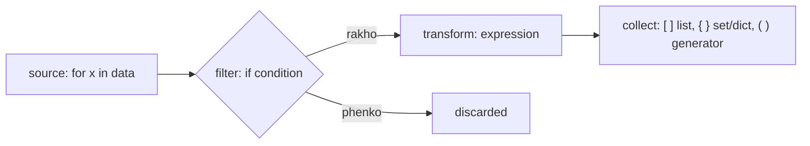
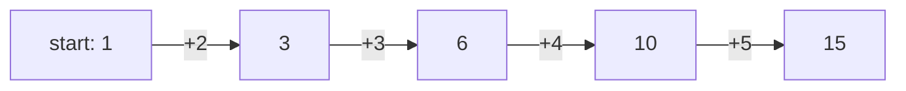

# Chapter 11 · Comprehensions & Functional Tools

> "Ek khaali list banao, loop chalao, check karo, append karo" wali paanch lines, ek padhne layak line ban jaati hain. Students ko marks se, phir naam se sort karna, ek `key=` ban jaata hai. Yahi woh chapter hai jahan tumhara Python "C se translate kiya hua" dikhna band karta hai aur Python jaisa dikhne lagta hai. Interviewers ye notice karte hain.

**Is chapter mein tum seekhoge:**
- List, dict aur set comprehensions, conditions, `if/else` aur nested loops ke saath
- Generator expressions: aisi comprehensions jo poori list nahi banati (ek preview)
- `map`, `filter` aur `functools.reduce`, aur kab comprehension behtar hai
- `key=` ke saath `sorted`, `min`, `max`, jisme alag-alag directions wale **multi-key** sorts bhi hain
- `any` / `all`, `zip` / `enumerate`, `operator.itemgetter`, `functools.partial`, `cmp_to_key`
- Readability rules: kab comprehension zaroorat se zyada "smart" ho jaati hai
- Performance: comprehensions fast kyun hain, aur generators memory kab bachaate hain

**Isse pehle padho:** [Lists](07-lists.md) · [Tuples & Sets](08-tuples-sets.md) · [Dictionaries](09-dictionaries.md) · [Functions](10-functions.md)

---

## 🧠 The Big Idea · Asli Baat

Ek factory ka conveyor belt socho. Kachcha maal ek **source** se aata hai. Ek **quality checker** kuch items phenk deta hai. Ek **machine** baaki items ko badal deti hai. End mein ek **box** results ikattha karta hai.



Comprehension woh poori factory hai, ek line mein likhi hui, jo lagbhag English jaisi padhi jaati hai:

```py
[x * x   for x in nums   if x % 2 == 0]
#  ^ transform   ^ source      ^ filter
# "x ka square, nums ke har x ke liye, agar x even hai"
```

> 🇮🇳 **Desi Analogy:** Mandi se aam aaye hain (ye hai **source**: `for x in nums`). Chhantne wala sirf pake hue aam rakhta hai, kachche wapas (ye hai **filter**: `if x % 2 == 0`). Pake aamon ka juice banta hai (ye hai **transform**: `x * x`). Juice bottles ek crate mein bharta hai (ye hai **collect**: `[ ]`). Comprehension ka order bas itna hai ki tum pehle bolte ho "**kya** chahiye" (juice), phir "**kahan se**" (mandi ke aam), phir "**sirf kaunse**" (pake wale).

Functional tools (`map`, `filter`, `sorted(key=...)`, `any`, `zip`...) bhi isi soch pe chalte hain: tum batao **kya** chahiye, ye nahi ki uske liye **kaise** loop chalana hai. Ise **declarative** style kehte hain, aur ye chhota, saaf aur aam taur pe fast hota hai.

---

## 🔨 Building It Up · Zero Se Shuru

### 1. Your first list comprehension

Woh loop jo tum [Chapter 07](07-lists.md) se sau baar likh chuke ho:

```python
nums = [1, 2, 3, 4, 5]

squares = []
for n in nums:
    squares.append(n * n)
print(squares)

squares = [n * n for n in nums]     # bilkul wahi cheez
print(squares)

print([ch.upper() for ch in "hey"])
print([len(w) for w in "the quick brown fox".split()])
print([0 for _ in range(4)])        # _ = "main loop variable use nahi karta"
```

```text
[1, 4, 9, 16, 25]
[1, 4, 9, 16, 25]
['H', 'E', 'Y']
[3, 5, 5, 3]
[0, 0, 0, 0]
```

**Translation ka rule:** loop lo, jo cheez tum `append` karte ho use aage le aao, aur `append` hata do.

```text
result = []
for ITEM in SOURCE:          ──►   [ EXPR  for ITEM in SOURCE ]
    result.append(EXPR)
```

Is rule ko ek baar haath se karke dekho: `squares.append(n * n)` mein append hone wali cheez `n * n` hai. Use aage rakho: `[n * n ...]`. Phir loop ki line `for n in nums` jaisi ki taisi: `[n * n for n in nums]`. Ho gaya.

### 2. Filtering with `if`

Sirf kuch items rakhne ke liye **end** mein ek `if` lagao.

```python
nums = [5, 12, 7, 20, 3, 18]
print([n for n in nums if n > 10])
print([n * 2 for n in nums if n % 2 == 1])

words = ["Apple", "bat", "Cat", "dog"]
print([w for w in words if w[0].isupper()])
```

```text
[12, 20, 18]
[10, 14, 6]
['Apple', 'Cat']
```

Doosri line dhyaan se: pehle filter chalta hai (sirf odd: 5, 7, 3), phir transform (`* 2`): 10, 14, 6. Filter un items pe lagta hai jo source se aaye, transform ke **pehle**.

### 3. Choosing a value with `if/else`

**Har item ko** do mein se ek tareeke se badalna hai, toh conditional expression (`A if cond else B`, [Chapter 05](05-conditionals.md) se) ko **aage** rakho.

```python
nums = [5, 12, 7, 20]
print(["big" if n > 10 else "small" for n in nums])
print([n if n >= 0 else 0 for n in [3, -1, 4, -5]])    # negatives ko 0 pe clamp karo
```

```text
['small', 'big', 'small', 'big']
[3, 0, 4, 0]
```

> 💡 **`if` kahan jaata hai?**
> - **End** mein `if` = **filter**: kuch items gaayab ho jaate hain. Wahan `else` allowed nahi.
> - **Aage** `if ... else` = **choice**: har item bachta hai, do mein se ek roop mein.
>
> Dono saath bhi use kar sakte ho: `[x if x > 0 else 0 for x in nums if x != 99]`.

```py
[n for n in nums if n > 10 else 0]
# SyntaxError: invalid syntax  (filter wali jagah pe else allowed nahi hai)
```

> 🤔 **Mann mein sawaal:** End wale `if` mein `else` kyun nahi chal sakta? Dono `if` hi toh hain.
>
> **Jawab:** Kyunki dono ka kaam alag hai. End wala `if` ek **darbaan** hai: "andar aao" ya "bahar raho". "Bahar raho, lekin 0 ban ke aao" ka koi matlab nahi banta. Aage wala `A if c else B` ek **expression** hai jo hamesha ek value deta hai, toh uske paas `else` hona zaroori hai. Yaad rakho: **"Else lives up front."**

### 4. Nested loops in a comprehension

Kai `for` clauses nested loops ki tarah chalte hain, **usi order mein jis order mein tum unhe loops ki tarah likhte**: bahar wala pehle.

```python
pairs = [(x, y) for x in [1, 2, 3] for y in "ab"]
print(pairs)

# Iske barabar:
pairs2 = []
for x in [1, 2, 3]:          # bahar wala
    for y in "ab":           # andar wala
        pairs2.append((x, y))
print(pairs == pairs2)

grid = [[1, 2, 3], [4, 5, 6], [7, 8, 9]]
flat = [x for row in grid for x in row]          # flatten: "for row ... for x in row"
print(flat)

print([(i, j) for i in range(4) for j in range(i + 1, 4)])   # saari pairs jahan i < j
```

```text
[(1, 'a'), (1, 'b'), (2, 'a'), (2, 'b'), (3, 'a'), (3, 'b')]
True
[1, 2, 3, 4, 5, 6, 7, 8, 9]
[(0, 1), (0, 2), (0, 3), (1, 2), (1, 3), (2, 3)]
```

Flatten karne ka memory trick: ise padho **"x, grid ki har row ke liye, row ke har x ke liye."** Agar order ulta kar diya (`for x in row for row in grid`), toh Python shikayat karega ki `row` abhi tak define hi nahi hua.

> 🇮🇳 **Desi Analogy:** Railway coach mein TTE tickets check kar raha hai. Woh pehle ek **coach** mein jaata hai (bahar wala loop: `for row in grid`), phir us coach ki har **seat** check karta hai (andar wala loop: `for x in row`). Ulta nahi ho sakta: "har seat check karo, har coach ke liye" bolne pe sawaal uthega "kaunse coach ki seat?", kyunki coach abhi chuna hi nahi. Yahi Python ka "`row` is not defined" error hai.

**Comprehension ke andar comprehension** ek 2D structure banati hai (lists ki list). Grid banane ka yahi sahi tareeka hai ([Chapter 07](07-lists.md) mein samjhaaya tha ki `[[0] * n] * m` kyun toota hua hai):

```python
rows, cols = 3, 4
grid = [[0] * cols for _ in range(rows)]      # har baar ek NAYI row
grid[0][0] = 1
print(grid)

table = [[r * c for c in range(1, 4)] for r in range(1, 4)]   # pahada (times table)
for row in table:
    print(row)

matrix = [[1, 2, 3], [4, 5, 6]]
transposed = [[row[c] for row in matrix] for c in range(len(matrix[0]))]
print(transposed)
```

```text
[[1, 0, 0, 0], [0, 0, 0, 0], [0, 0, 0, 0]]
[1, 2, 3]
[2, 4, 6]
[3, 6, 9]
[[1, 4], [2, 5], [3, 6]]
```

Fark dhyaan se dekho: `[x for row in grid for x in row]` (ek hi comprehension mein do `for`) ek **flat** list banata hai; `[[... for c ...] for r ...]` (expression ki jagah ek poori comprehension) ek **nested** list banata hai.

Transpose ko padhne ka tareeka: bahar wala `for c` har **column number** pe chalta hai. Har `c` ke liye andar wali comprehension har row se `row[c]` uthaati hai. Column 0 ke liye `[1, 4]`, column 1 ke liye `[2, 5]`, aur aage. Purane columns naye rows ban gaye.

### 5. Dict and set comprehensions

Wahi idea, curly braces ke saath. **Dict comprehension** mein aage `key: value` hota hai.

```python
words = ["apple", "banana", "cherry"]
lengths = {w: len(w) for w in words}
print(lengths)

prices = {"tea": 15, "coffee": 40, "samosa": 20}
discounted = {item: p * 0.9 for item, p in prices.items() if p > 18}
print(discounted)

swapped = {v: k for k, v in prices.items()}
print(swapped)

index_of = {ch: i for i, ch in enumerate("hello")}   # baad wale duplicates overwrite karte hain
print(index_of)

remainders = {n % 3 for n in range(10)}              # set comprehension
print(remainders)
```

```text
{'apple': 5, 'banana': 6, 'cherry': 6}
{'coffee': 36.0, 'samosa': 18.0}
{15: 'tea', 40: 'coffee', 20: 'samosa'}
{'h': 0, 'e': 1, 'l': 3, 'o': 4}
{0, 1, 2}
```

`index_of` mein `'l'` ki value `3` kyun hai, `2` kyun nahi? `"hello"` mein `l` index 2 aur 3 dono pe hai. Pehle `'l': 2` likha gaya, phir `'l': 3` ne use overwrite kar diya. Dict mein key ek hi baar rehti hai, aakhri value jeet-ti hai.

> ⚠️ `{x for x in ...}` ek **set** hai; `{k: v for ...}` ek **dict** hai. "Tuple comprehension" jaisi koi cheez nahi hoti: `(x for x in ...)` ek generator expression hai (agla section). Tuple chahiye toh `tuple(x for x in ...)` likho.

### 6. Generator expressions (a preview)

Square brackets ki jagah **round brackets** lagao, aur tumhe milta hai ek **generator expression**. Ye list nahi banata. Ye items **ek-ek karke, maangne pe** banata hai, jise **lazy** evaluation kehte hain.

```python
nums = [1, 2, 3, 4]
gen = (n * n for n in nums)
print(type(gen).__name__)
print(next(gen), next(gen))     # ek-ek karke items kheencho
print(list(gen))                # BAAKI bache items
print(list(gen))                # khatam: generators ek hi baar use hote hain!

print(sum(n * n for n in range(1, 101)))   # akela argument ho toh extra brackets ki zaroorat nahi
print(max(len(w) for w in ["hi", "hello", "hey"]))
```

```text
generator
1 4
[9, 16]
[]
338350
5
```

Kya hua yahan: generator yaad rakhta hai ki woh kahan ruka tha. `next()` ek aur item maangta hai. Do `next` ke baad 1 aur 4 nikal chuke the, toh `list(gen)` ko sirf bache hue 9 aur 16 mile. Jab woh sab kuch de chuka, toh hamesha ke liye khaali hai. Jab generator expression kisi function (jaise `sum`, `max`, `any`) ka akela argument ho, toh uske apne brackets hata sakte ho.

> 🇮🇳 **Desi Analogy:** List ek **buffet** hai: saara khaana pehle hi bana ke table pe saja diya, chahe koi khaaye ya nahi (poori memory pehle hi bhar gayi). Generator ek **tawa-roti counter** hai: tum plate aage karte ho (`next()`), ek garam roti milti hai. Bhaiya ko sirf ye yaad rakhna hai ki kitni roti de chuke, poora dher banana nahi padta. Aur jab aata khatam, toh khatam: dobara line mein lagne se roti nahi milegi (generator single-use hai).

**Iski zaroorat kyun?** Memory. Das lakh squares ki list das lakh numbers store karti hai. Generator sirf "main loop mein kahan hoon" store karta hai.

```python
import sys

as_list = [n * n for n in range(1_000_000)]
as_gen = (n * n for n in range(1_000_000))
print(sys.getsizeof(as_list) > 1_000_000)   # megabytes mein pointers
print(sys.getsizeof(as_gen) < 1_000)        # kuch sau bytes, size chahe jitna ho
print(sum(as_gen) == sum(as_list))
```

```text
True
True
True
```

Rule of thumb: agar result pe sirf **ek baar** loop chalana hai (`sum`, `max`, `any`, `"".join` ko dena, ya ek `for` loop), toh generator expression use karo. Agar index karna hai, do baar loop chalana hai ya length check karni hai, toh list use karo. Generators ko unka poora chapter [Chapter 16](16-iterators-generators-decorators.md) mein milega.

### 7. `map` and `filter`

Ye transform aur filter karne ke purane, functional-programming wale tareeke hain.

- `map(func, iterable)` har item pe `func` call karta hai.
- `filter(func, iterable)` sirf woh items rakhta hai jahan `func(item)` truthy ho.

Dono generators ki tarah **lazy** hain: ye ek iterator return karte hain, isliye values dekhne ke liye inhe `list()` mein lapeto.

```python
nums = ["4", "8", "15"]
ints = list(map(int, nums))           # har string pe int() call karo
print(ints)

print(list(map(lambda x: x * 10, ints)))
print(list(filter(lambda x: x % 2 == 0, ints)))
print(list(filter(None, [0, 1, "", "hi", None, [], [3]])))   # None = truthy items rakho

print(list(map(pow, [2, 3, 4], [5, 2, 1])))   # 2 iterables ke saath map: pow(2,5), pow(3,2), pow(4,1)

line = "3 9 27"
a, b, c = map(int, line.split())      # competitive programming ka classic input parsing
print(a + b + c)
```

```text
[4, 8, 15]
[40, 80, 150]
[4, 8]
[1, 'hi', [3]]
[32, 9, 4]
39
```

`map(int, nums)` mein dhyaan do: `int` likha hai, `int()` nahi. Tum function **dete** ho, `map` use har item pe khud call karta hai ([Chapter 10](10-functions.md) ka "brackets = abhi chalao" rule).

**map/filter vs comprehension:**

| | comprehension | `map` / `filter` |
|---|---|---|
| Pehle se bane naam wale function ke saath | `[int(x) for x in s]` | `map(int, s)` ✅ chhota |
| Lambda ke saath | `[x * 2 for x in s]` ✅ zyada saaf | `map(lambda x: x * 2, s)` |
| Transform + filter saath mein | `[f(x) for x in s if g(x)]` ✅ | `map(f, filter(g, s))` |
| Result | turant ek list | ek lazy iterator |

Zyaadatar Python style guides comprehensions pasand karti hain, siwaay built-in ya naam wale function ke saath `map` ke, jo achha padhta hai.

### 8. `functools.reduce`

`reduce(func, iterable, initial)` ek two-argument function ko baar-baar laga ke poori sequence ko ek value mein **fold** (samet) deta hai: `func(func(func(initial, a), b), c)`.

```python
from functools import reduce
import operator

nums = [1, 2, 3, 4, 5]
print(reduce(lambda acc, x: acc + x, nums))       # ((((1+2)+3)+4)+5)
print(reduce(operator.mul, nums, 1))              # product, initial value 1 ke saath
print(reduce(lambda a, b: a if a > b else b, nums))   # max, lambe raaste se
print(reduce(operator.add, [], 0))                # initial value HO toh khaali input bhi theek hai
```

```text
15
120
5
0
```



> 🇮🇳 **Desi Analogy:** `reduce` shaadi ke **shagun ka hisaab** hai. Ek register aur ek running total (`acc`). Pehla lifafa khula, total mein joda. Doosra khula, naye total mein joda. Har step pe sirf do cheezein: "ab tak ka total" aur "naya lifafa". End mein ek hi number bachta hai. `initial` matlab hisaab kis number se shuru hua: shagun ke liye 0, product ke liye 1 (kyunki 0 se guna karoge toh sab 0).

Common folds ke liye dedicated built-ins ko tarjeeh do: `sum`, `max`, `min`, `any`, `all`, `math.prod`, `"".join`. `reduce` tab use karo jab tumhare fold ke liye koi built-in na ho. Initial value ke bina, khaali list pe `reduce` `TypeError` deta hai (kyunki shuru karne ke liye koi pehla item hi nahi hai).

### 9. Sorting with `key`: single and multi-key

`sorted(..., key=...)` se tum [Chapter 07](07-lists.md) mein mil chuke ho. Key function har item ko us **cheez** mein badal deta hai jise compare karna hai.

```python
students = [("Ravi", 85, 20), ("Asha", 92, 21), ("Meera", 85, 19), ("Kabir", 92, 22)]

print(sorted(students, key=lambda s: s[1]))                 # marks se, ascending
print(sorted(students, key=lambda s: s[1], reverse=True))   # marks se, descending
```

```text
[('Ravi', 85, 20), ('Meera', 85, 19), ('Asha', 92, 21), ('Kabir', 92, 22)]
[('Asha', 92, 21), ('Kabir', 92, 22), ('Ravi', 85, 20), ('Meera', 85, 19)]
```

Dhyaan do: Ravi aur Meera dono ke 85 hain, aur output mein Ravi pehle hai, kyunki input mein bhi Ravi pehle tha. Python ka sort **stable** hai: barabar keys wale items apna purana order rakhte hain. Ye baat thodi der mein bahut kaam aayegi.

**Multi-key sort:** key se ek **tuple** return karo. Tuples element-by-element compare hote hain ([Chapter 08](08-tuples-sets.md)), toh pehla element faisla karta hai, doosra barabari todta hai, aur aise hi aage.

```python
students = [("Ravi", 85, 20), ("Asha", 92, 21), ("Meera", 85, 19), ("Kabir", 92, 22)]

# marks DESCENDING, phir naam ASCENDING: number ko negate karo taaki uski direction palat jaaye
for s in sorted(students, key=lambda s: (-s[1], s[0])):
    print(s)
```

```text
('Asha', 92, 21)
('Kabir', 92, 22)
('Meera', 85, 19)
('Ravi', 85, 20)
```

Minus ka jaadu: 92 aur 85 ascending mein 85 pehle aata hai. Lekin -92 aur -85 mein -92 chhota hai, toh -92 (yaani 92 wala) pehle aata hai. Sort ascending hi chal raha hai, bas numbers ulte kar diye toh result descending ho gaya.

> 🇮🇳 **Desi Analogy:** **Board exam merit list.** Pehle total marks dekho (zyada wala upar). Barabar marks? Toh naam ki alphabetical order (tie-breaker). Yahi tuple key hai: `(-marks, naam)`. Tuple pehle element pe faisla karta hai; sirf barabari pe doosre element tak jaata hai, bilkul jaise merit list mein naam tabhi dekha jaata hai jab marks same hon.

String ko negate nahi kar sakte. Strings ko **descending** sort karna ho aur saath mein doosri key ascending ho, toh do **stable** sorts use karo: pehle **secondary** key se sort karo, phir **primary** key se.

```python
students = [("Ravi", 85), ("Asha", 92), ("Meera", 85), ("Kabir", 92)]
step1 = sorted(students, key=lambda s: s[0], reverse=True)   # secondary: naam Z->A
step2 = sorted(step1, key=lambda s: s[1])                    # primary: marks ascending
print(step2)
```

```text
[('Ravi', 85), ('Meera', 85), ('Kabir', 92), ('Asha', 92)]
```

Kya hua yahan: step1 ke baad order hai Ravi, Meera, Kabir, Asha (naam Z se A). Step2 marks se sort karta hai, aur stability ki wajah se barabar marks wale students step1 ka naam wala order rakhte hain: 85 walon mein Ravi phir Meera, 92 walon mein Kabir phir Asha. "Sabse kam important key se pehle sort karo" ulta lagta hai, lekin stable multi-pass sorting aise hi kaam karti hai.

> 🤔 **Mann mein sawaal:** Primary key toh zyada important hai, toh use pehle sort kyun nahi karte?
>
> **Jawab:** Kyunki **aakhri sort hi final order decide karta hai**, aur pichle sort sirf barabari mein bache rehte hain. Agar pehle marks se sort karte aur phir naam se, toh naam wala sort marks wale order ko poora ulat-pulat kar deta. Isliye jo key sabse zyada important hai, use **aakhri** sort mein rakho, taaki uski baat final ho. Baaki keys pehle, taaki woh sirf tie-breaker ki tarah bachein.

**`cmp_to_key` se custom comparison:** kabhi-kabhi "kaun pehle aayega" ko ek key ki tarah nahi likh sakte, sirf do items ki aapas mein tulna ki tarah. `functools.cmp_to_key` ek purane style ke compare function ko adapt karta hai, jo negative / zero / positive return karta hai.

```python
from functools import cmp_to_key

def compare(a, b):
    # a pehle aana chahiye agar a+b, b+a se bada number banata hai
    if a + b > b + a:
        return -1
    if a + b < b + a:
        return 1
    return 0

nums = [3, 30, 34, 5, 9]
parts = sorted(map(str, nums), key=cmp_to_key(compare))
print("".join(parts))
```

```text
9534330
```

Ye classic **Largest Number** problem hai (LeetCode 179). Compare function ka convention: **-1 matlab `a` pehle, 1 matlab `b` pehle, 0 matlab barabar**. Example: `"3"` aur `"30"` mein `"330"` > `"303"`, toh `"3"` pehle aata hai. Ye "pehle kaun" kisi akele number ki property nahi hai, dono ko saath dekh ke hi pata chalta hai, isliye normal key kaam nahi karti.

### 10. `min` and `max` with `key` (and `default`)

`min`/`max` bhi `sorted` jaisa hi `key=` lete hain, aur **item** return karte hain, key value nahi.

```python
words = ["kiwi", "banana", "fig", "cherry"]
print(max(words, key=len))             # barabari mein pehla longest jeet-ta hai
print(min(words, key=len))

points = [(3, 4), (1, 1), (-2, 2)]
print(min(points, key=lambda p: p[0] ** 2 + p[1] ** 2))   # origin ke sabse paas

scores = {"Asha": 92, "Ravi": 85}
print(max(scores, key=scores.get))      # sabse badi value wali key

print(max([], default=0))               # khaali input pe crash nahi
print(max(3, 9, 4))                     # alag-alag arguments ke saath bhi chalta hai
```

```text
banana
fig
(1, 1)
Asha
0
9
```

`banana` aur `cherry` dono 6 letters ke hain; `max` ne `banana` diya kyunki woh pehle aaya. `max(words, key=len)` ne `6` nahi diya, **word** diya: key sirf compare karne ke liye hai.

Max dhoondhna O(n) hai; sirf `[-1]` lene ke liye sort karna O(n log n) hai. `max` ko tarjeeh do.

### 11. `any` and `all`

- `any(iterable)`: True agar **kam se kam ek** item truthy ho.
- `all(iterable)`: True agar **har** item truthy ho.

Dono **short-circuit** karte hain: jaise hi answer pata chalta hai, ruk jaate hain. Inhe generator expressions khilaao.

```python
marks = [72, 45, 90, 38]
print(any(m < 40 for m in marks))       # kya koi fail hua?
print(all(m >= 35 for m in marks))      # kya sabne grace mark paar kiya?

password = "Secr3t!x"
checks = [
    len(password) >= 8,
    any(c.isdigit() for c in password),
    any(c.isupper() for c in password),
    any(not c.isalnum() for c in password),
]
print(all(checks))

print(any([]), all([]))                 # khaali input wala edge case
```

```text
True
True
True
False True
```

`all([])` `True` hai ("khaali list ka har item theek hai": shikayat karne ko kuch hai hi nahi). Ise **vacuous truth** kehte hain, aur ye interview ka classic trick question hai.

> 🇮🇳 **Desi Analogy:** `all` ek **strict principal** hai: "kya **sab** students ne uniform pehna hai?" Pehla bina uniform wala dikha, ruk gaye, jawab "nahi" (short-circuit). `any` ek **talent scout** hai: "kya **koi bhi** gaana ga sakta hai?" Pehla gaane wala mila, ruk gaye, jawab "haan". Aur khaali classroom pe principal ka jawab? "Haan, sab ne uniform pehna hai", kyunki ek bhi bina uniform wala nahi mila. Yahi vacuous truth hai. Scout ka jawab khaali class pe "nahi", kyunki koi gaane wala mila hi nahi.

### 12. `zip` and `enumerate`, properly

```python
names = ["Asha", "Ravi", "Meera"]
marks = [92, 85, 88]
cities = ["Pune", "Delhi"]

print(list(zip(names, marks)))
print(list(zip(names, marks, cities)))       # SABSE CHHOTE input pe ruk jaata hai
print(dict(zip(names, marks)))               # do lists se ek dict banao

for rank, name in enumerate(names, start=1): # ginti 1 se shuru
    print(rank, name)

pairs = [("a", 1), ("b", 2), ("c", 3)]
letters, numbers = zip(*pairs)               # "unzip": unpack ki hui pairs ka zip
print(letters, numbers)

nums = [3, 5, 9, 10]
print([b - a for a, b in zip(nums, nums[1:])])   # padosiyon ke beech ka fark
```

```text
[('Asha', 92), ('Ravi', 85), ('Meera', 88)]
[('Asha', 92, 'Pune'), ('Ravi', 85, 'Delhi')]
{'Asha': 92, 'Ravi': 85, 'Meera': 88}
1 Asha
2 Ravi
3 Meera
('a', 'b', 'c') (1, 2, 3)
[2, 4, 1]
```

Kya hua yahan: `zip(*pairs)` list ko phaila ke `zip(("a", 1), ("b", 2), ("c", 3))` bana deta hai, jo saare pehle elements ko ek saath aur saare doosre elements ko ek saath group karta hai: yaani transpose. Yahi trick matrix ko transpose karti hai: `[list(col) for col in zip(*matrix)]`. Aur `zip(nums, nums[1:])` har element ko uske agle padosi ke saath jodta hai, ek pattern jo tum baar-baar use karoge.

`zip(nums, nums[1:])` ko khol ke dekho: `nums` = `[3, 5, 9, 10]`, `nums[1:]` = `[5, 9, 10]`. Zip banata hai `(3, 5), (5, 9), (9, 10)` (aur `10` ka koi saathi nahi, toh woh chhoot jaata hai). Har pair mein `b - a`: 2, 4, 1.

> 🇮🇳 **Desi Analogy:** `zip` ek **zipper** hi hai, jacket wala. Do taraf ke daant, ek-ek karke aapas mein judte hain. Ek taraf ke daant khatam, toh zipper wahin ruk jaata hai, doosri taraf bache daant khule reh jaate hain. Isliye `cities` mein do hi shehar the, toh teen-wala zip do pe ruk gaya, Meera chhoot gayi.

> ⚠️ `zip` lambe inputs ke bache hue items chupchaap gira deta hai. Python 3.10+ mein `zip(a, b, strict=True)` likh sakte ho, jo lengths alag hone pe `ValueError` dega.

### 13. `operator.itemgetter` and friends

`operator` module common lambdas ke liye ready-made functions deta hai. Ye thode fast hote hain aur aksar zyada saaf bhi.

```python
from operator import itemgetter, attrgetter, add, mul
from collections import namedtuple

rows = [("Ravi", 85), ("Asha", 92), ("Meera", 85)]
print(sorted(rows, key=itemgetter(1)))          # key=lambda r: r[1] jaisa hi
print(sorted(rows, key=itemgetter(1, 0)))       # multi-key: (r[1], r[0])

get_name = itemgetter(0)
print(get_name(("Asha", 92)))

records = [{"name": "Zed", "age": 30}, {"name": "Amy", "age": 25}]
print([r["name"] for r in sorted(records, key=itemgetter("age"))])   # dicts pe bhi chalta hai

Point = namedtuple("Point", "x y")
pts = [Point(3, 1), Point(1, 2)]
print(min(pts, key=attrgetter("x")))            # attribute se (OOP chapters mein aur)

print(list(map(add, [1, 2], [10, 20])), list(map(mul, [1, 2], [10, 20])))
```

```text
[('Ravi', 85), ('Meera', 85), ('Asha', 92)]
[('Meera', 85), ('Ravi', 85), ('Asha', 92)]
Asha
['Amy', 'Zed']
Point(x=1, y=2)
[11, 22] [10, 40]
```

`itemgetter(1)` ek function **banata** hai jo kisi bhi cheez ka `[1]` nikaalta hai. `get_name = itemgetter(0)` ke baad `get_name(x)` bilkul `x[0]` jaisa hai. Doosri line mein `itemgetter(1, 0)` ne pehle marks, phir naam pe sort kiya, isliye 85 walon mein Meera (M) Ravi (R) se pehle aayi.

### 14. `functools.partial`: pre-filling arguments

`partial(func, *some_args, **some_kwargs)` ek naya function return karta hai jisme kuch arguments pehle se bhare hote hain.

```python
from functools import partial

def power(base, exponent):
    return base ** exponent

square = partial(power, exponent=2)
cube = partial(power, exponent=3)
print(square(5), cube(2))

to_int_from_binary = partial(int, base=2)
print(to_int_from_binary("1011"))

print(list(map(partial(power, 2), range(6))))   # 2**0 ... 2**5 (base 2 pe fixed)
```

```text
25 8
11
[1, 2, 4, 8, 16, 32]
```

Ye [Chapter 10](10-functions.md) ke closure `make_multiplier` wala hi idea hai, bas ready-made. Callbacks ke liye aur `map` ke liye kaam ka hai, jab function ko ek extra fixed argument chahiye.

> 🇮🇳 **Desi Analogy:** `partial` ek **pre-filled form** hai. College ka admission form jisme "College ka naam" aur "Shehar" pehle se chhapa hua hai; tumhe sirf apna naam aur marks bharne hain. `partial(power, exponent=2)` ne "exponent = 2" pehle se chhaap diya, ab sirf `base` bharna hai.

### 15. Readability rules

Comprehensions tab tak shandaar hain jab tak woh nahi rehti. Strong teams ye guidelines follow karti hain:

1. **Ek loop aur ek condition sweet spot hai.** Do loops chalega. Teen, ya conditions ke saath nested comprehensions, ek normal loop mein jaane chahiye.
2. **Ek line mein (ya do, achhe se tooti hui) fit na ho, toh loop use karo.**
3. **Sirf side effects ke liye comprehension kabhi mat use karo.** `[print(x) for x in items]` `None`s ki ek bekaar list banata hai. `for` loop likho.
4. **Tukdon ko naam do.** Ek complicated condition ko ek achhe naam wale function mein nikaal do: `[u for u in users if is_active(u)]`.
5. **Comprehension ke andar `if/else` ke andar `if/else` mat ghusaao.**

```python
data = [3, -1, 8, 0, -7, 12]

# ❌ Smart hai lekin padhna mushkil
labels = ["pos" if x > 0 else "zero" if x == 0 else "neg" for x in data]

# ✅ Ek chhota naam wala function sab saaf kar deta hai
def sign_label(x):
    if x > 0:
        return "pos"
    if x == 0:
        return "zero"
    return "neg"

labels2 = [sign_label(x) for x in data]
print(labels == labels2, labels2)
```

```text
True ['pos', 'neg', 'pos', 'zero', 'neg', 'pos']
```

Dono same result dete hain (`True`), lekin doosra wala koi bhi naya banda pehli nazar mein samajh lega. Code likha ek baar jaata hai, padha sau baar.

---

## 🔬 Under the Hood · Andar Ki Kahani

### A comprehension has its own scope

Comprehension ka loop variable aas-paas ke code mein **leak nahi** hota (normal `for` loop se alag, jiska variable loop ke baad bhi zinda rehta hai).

```python
x = "before"
squares = [x * x for x in range(3)]
print(x)                 # koi badlav nahi: comprehension ka x alag tha

for y in range(3):
    pass
print(y)                 # normal for-loop ka variable bach jaata hai
```

```text
before
2
```

Python 3.11 tak, CPython ise har comprehension ko ek chhote chhupe hue function mein compile karke aur use call karke implement karta tha. Python 3.12 (PEP 709) speed ke liye list, dict aur set comprehensions ko "inline" kar deta hai, lekin loop variable ki wahi isolation rakhta hai. Generator expressions ab bhi alag function-jaise objects hain.

### Why comprehensions are faster than append loops

Loop mein, har `result.append(x)` ko list pe `append` attribute dhoondhna padta hai aur phir ek method call karni padti hai. Comprehension ek special bytecode instruction (`LIST_APPEND`) mein compile hoti hai jo item seedha add kar deti hai, bina attribute lookup aur bina call ke. Big-O mein har item ka kaam same hai (dono O(n)), lekin constant factor chhota hai: simple bodies ke liye comprehensions aam taur pe naapne layak fast hoti hain. Agar body bhaari kaam karti hai, toh ye fark gaayab ho jaata hai.

**Built-in** function ke saath `map` (`map(int, strings)`) sabse fast bhi ho sakta hai, kyunki har item ki call C mein hoti hai. **Lambda** ke saath `map` har item pe ek Python function call ki keemat chukata hai aur aam taur pe comprehension se fast nahi hota.

> 🇮🇳 **Desi Analogy:** Append loop ek aisa waiter hai jo har plate ke liye kitchen jaake poochta hai "plate kahan rakhni hai?" (attribute lookup), phir rakhta hai (method call). Comprehension wala waiter ko pehle se pata hai, seedha rakh deta hai (`LIST_APPEND`). Dono 100 plates rakhenge (O(n) dono), lekin doosra jaldi khatam karega.

### Laziness: iterators

`map`, `filter`, `zip`, `enumerate`, `reversed` aur generator expressions sab **iterators** return karte hain: aise objects jo maangne pe (`next()`) agli value dete hain, aur apni position yaad rakhte hain. Ye pehle se kuch compute nahi karte, input chahe jitna bada ho O(1) memory use karte hain, aur sirf **ek baar** chal sakte hain.

```python
squares = map(lambda n: n * n, [1, 2, 3])
print(list(squares))
print(list(squares))    # pehle hi khatam ho chuka

z = zip("ab", [1, 2])
print(next(z), next(z))
```

```text
[1, 4, 9]
[]
('a', 1) ('b', 2)
```

`for` loop khud bhi aise hi kaam karta hai: pehle `iter()` call karta hai, phir baar-baar `next()`, jab tak iterator signal na de ki woh khatam ho gaya. Apne khud ke iterators tum [Chapter 16](16-iterators-generators-decorators.md) mein banaoge.

### Complexity cheat sheet

| Tool | Time | Extra memory |
|---|---|---|
| n items pe list/set/dict comprehension | O(n) × expression ki cost | result ke liye O(n) |
| generator expression | banane mein O(1), khatam karne mein O(n) | O(1) |
| `map` / `filter` / `zip` / `enumerate` | banane mein O(1), khatam karne mein O(n) | O(1) |
| `sorted(key=f)` | O(n log n) (key **har item ke liye ek baar** compute hoti hai) | O(n) |
| `min` / `max(key=f)` | O(n) | O(1) |
| `any` / `all` | worst O(n), jaldi ruk jaata hai | generator ke saath O(1) |
| `reduce` | O(n) × func ki cost | O(1) |

Note: `sorted` key function ko exactly n baar call karta hai (woh keys cache kar leta hai), O(n log n) baar nahi. Isliye mehngi key bhi chalegi.

---

## 🧩 Pattern Decoder · Pattern Pakdo

### Translation table: loop → idiom

| Loop pattern | Pythonic version |
|---|---|
| append karke list banana | `[f(x) for x in xs]` |
| sirf kuch items append karna | `[x for x in xs if cond(x)]` |
| output ke do roop | `[a if cond(x) else b for x in xs]` |
| kisi cheez ka total | `sum(f(x) for x in xs)` |
| matches ginna | `sum(1 for x in xs if cond(x))` ya `sum(cond(x) for x in xs)` |
| "kya koi…hai?" | `any(cond(x) for x in xs)` |
| "kya sab…hain?" | `all(cond(x) for x in xs)` |
| kisi measure se best item | `max(xs, key=measure)` |
| lookup dict banana | `{key(x): x for x in xs}` |
| unique values | `{f(x) for x in xs}` |
| parallel lists | `for a, b in zip(as_, bs):` |
| padosi | `zip(xs, xs[1:])` |
| flatten | `[x for row in grid for x in row]` |
| transpose | `list(zip(*matrix))` |
| line se numbers parse karna | `list(map(int, line.split()))` |
| strings jodna | `", ".join(str(x) for x in xs)` |

`sum(cond(x) for x in xs)` isliye chalta hai kyunki `True` 1 gina jaata hai aur `False` 0.

### How this shows up in DSA

```python
from collections import defaultdict

# 1. Grids aur DP tables
n, m = 3, 4
dp = [[0] * m for _ in range(n)]

# 2. Edge list se adjacency list (graphs chapter)
edges = [(0, 1), (0, 2), (1, 2)]
graph = defaultdict(list)
for u, v in edges:
    graph[u].append(v)
    graph[v].append(u)
print(dict(graph))

# 3. Intervals ko start se sort karo, Merge Intervals ka pehla step
intervals = [[8, 10], [1, 3], [2, 6]]
intervals.sort(key=lambda iv: iv[0])
print(intervals)

# 4. Ek line mein validation
board_row = ["5", "3", ".", "7"]
digits = [c for c in board_row if c != "."]
print(len(digits) == len(set(digits)))     # koi digit repeat toh nahi?

# 5. Padosiyon ki tulna
nums = [1, 3, 5, 4]
print(all(a < b for a, b in zip(nums, nums[1:])))   # strictly increasing?
```

```text
{0: [1, 2], 1: [0, 2], 2: [0, 1]}
[[1, 3], [2, 6], [8, 10]]
True
False
```

Aakhri wala `False` kyun? Pairs hain `(1, 3), (3, 5), (5, 4)`. Teesre pair mein `5 < 4` false hai, toh `all` wahin ruk ke `False` de deta hai.

Tum `key=` ko heaps ke saath bhi use karoge ([Heaps](../part-2-dsa/15-heaps.md), tuples push karke), greedy problems mein `sorted(..., key=...)` ([Greedy & Intervals](../part-2-dsa/22-greedy-intervals.md)), aur `sum`/`max` ke andar generator expressions har jagah.

### When NOT to use these tools

- Logic ko `try/except`, kai statements, ya `break` chahiye → loop likho.
- Side effects chahiye (printing, database mein likhna) → loop likho.
- Comprehensions teen level gehri nest ho rahi hain → achhe variable names ke saath loop likho.
- Lazy object pe do baar iterate karoge → pehle use list mein badal lo.

---

## ⚠️ Traps & Common Mistakes · Yahan Sab Phisalte Hain

1. **Filter wali jagah pe `else`.** `[x for x in xs if c else y]` SyntaxError hai. `[x if c else y for x in xs]` use karo.

2. **Nested `for`s ka galat order.** Bahar wala loop pehle: `[x for row in grid for x in row]`.

3. **Khatam ho chuke iterator ko dobara use karna.** `map`, `filter`, `zip` aur generators sirf ek baar chalte hain.

```py
evens = filter(lambda x: x % 2 == 0, range(10))
print(len(list(evens)))   # 5
print(len(list(evens)))   # 0   <- ye pehle hi use ho chuka tha
```

4. **Side effects ke liye comprehensions.** `[print(x) for x in xs]` `None`s ki list banata hai. `for` loop use karo.

5. **`map`/`filter` ke around `list()` bhool jaana.** `print(map(int, ["1"]))` `<map object at 0x...>` dikhata hai, values nahi.

6. **`zip` chupchaap kaat deta hai.** Alag lengths bina warning ke data kho deti hain. Jab lengths match honi hi chahiye, toh `strict=True` (3.10+) use karo.

7. **Khaali input pe `max()` / `min()` / `reduce()`** errors dete hain. `default=` do (ya `reduce` ko initial value).

8. **Grid wala trap phir se.** `[[0] * m] * n` rows share karta hai; `[[0] * m for _ in range(n)]` nahi karta.

9. **Comprehensions ke andar lambda late binding.** `[lambda: i for i in range(3)]` → sab 2 return karte hain. `lambda i=i: i` use karo ([Chapter 10](10-functions.md)).

10. **Aisi key se sort karna jo mixed types return kare.** `key=lambda r: r[1]` jahan kuch values `None` hain, comparison mein `TypeError` deta hai. Data saaf karo ya `(r[1] is None, r[1] or 0)` jaisi tuple key use karo. (Ye tuple pehle `False`/`True` pe sort karta hai, toh saare `None` wale end mein chale jaate hain, aur `r[1] or 0` ensure karta hai ki doosra element hamesha number ho.)

11. **`sort(key=...)` `None` return karta hai.** [Chapter 07](07-lists.md) jaisa hi: ise assign mat karo.

---

## 💡 Tips & Tricks · Pro Wale Moves

- Shak ho toh pehle simple loop likho, phir rule se translate karo: "append hone wali cheez ko aage le aao".
- `sum(1 for x in xs if cond)` bina list banaye ginta hai.
- Multi-key sort: numbers `-` se palat-te hain, baaki sab ek alag stable pass se.
- Tuples aur lists ke liye `itemgetter(1, 0)` sabse saaf multi-key key hai.
- `dict(zip(keys, values))` aur `{v: k for k, v in d.items()}` dict banane ki zyaadatar zarooratein poori kar dete hain.
- `zip(*matrix)` transpose karta hai; `zip(xs, xs[1:])` padosiyon ki jodi banata hai; `enumerate(xs, 1)` 1 se ginta hai.
- `any`/`all` + generator expression ek readable, short-circuit karne wala validation check hai.
- String ulta karne ke liye `"".join(reversed(s))` ya `s[::-1]`; numbers print karne ke liye `" ".join(map(str, nums))`.
- `sum`/`max`/`min` ke andar generator expression memory bachata hai aur extra brackets nahi maangta.

---

## 🎯 Interview Questions · Interview Mein Yahi Poochenge

### 1. List comprehension vs generator expression? 🔥🔥🔥

<details><summary>Answer dekho 👀</summary>

`[ ... ]` poori list turant bana deta hai: O(n) memory, index kar sakte ho, `len` se naap sakte ho, aur kitni bhi baar iterate kar sakte ho. `( ... )` ek lazy generator banata hai: items maangne pe bante hain, memory O(1) hai, sirf ek baar iterate ho sakta hai aur uska na `len` hai na indexing. Generator tab use karo jab result ek hi baar consume karna ho (jaise `sum(x*x for x in xs)`), khaaskar bade ya infinite data ke liye; list tab jab use reuse ya index karna ho.

> 🗣️ **Interview mein aise bolo:** "A list comprehension builds the whole list in memory right away, so it's O(n) space but can be indexed, measured and iterated many times. A generator expression is lazy: it yields items on demand in O(1) space but can only be consumed once. I use a generator when I'm feeding the result straight into something like sum, max or any, and a list when I need to reuse it."

</details>

### 2. `map`/`filter` vs comprehensions: which is better? 🔥🔥

<details><summary>Answer dekho 👀</summary>

Dono ek hi kaam karte hain. Comprehensions aam taur pe zyada readable hoti hain, khaaskar jab transform + filter saath ho ya jab function ek lambda hota. Pehle se maujood (khaaskar built-in) function ke saath `map` chhota hai aur thoda fast bhi ho sakta hai (`map(int, parts)`). Dhyaan do: Python 3 mein `map`/`filter` lazy iterators return karte hain; list comprehension turant ek list return karti hai.

</details>

### 3. How do you sort by multiple keys, one ascending and one descending? 🔥🔥🔥

<details><summary>Answer dekho 👀</summary>

Agar descending wali key numeric hai, toh use negate karke ek tuple return karo: `sorted(rows, key=lambda r: (-r.score, r.name))`. Warna stability pe bharosa karo aur do baar sort karo, sabse kam important key pehle: `rows.sort(key=lambda r: r.name, reverse=True)` phir `rows.sort(key=lambda r: r.score)`. Jo comparisons key ki tarah likhe hi nahi ja sakte, unke liye `functools.cmp_to_key` use karo.

> 🗣️ **Interview mein aise bolo:** "I return a tuple from the key function, since tuples compare element by element. If the descending field is numeric I just negate it, like minus score, then name. If it's a string, I rely on Python's stable sort and do two passes, sorting by the least important key first and the most important key last. For pairwise rules like Largest Number, I use `functools.cmp_to_key`."

</details>

### 4. What do `any([])` and `all([])` return? 🔥🔥

<details><summary>Answer dekho 👀</summary>

`any([])` `False` hai (koi truthy item hai hi nahi). `all([])` `True` hai (koi falsy item nahi hai; "vacuous truth"). Dono short-circuit karte hain: `any` pehle truthy item pe ruk jaata hai, `all` pehle falsy pe.

</details>

### 5. How do you flatten a list of lists? Transpose a matrix? 🔥🔥

<details><summary>Answer dekho 👀</summary>

```python
import itertools

grid = [[1, 2, 3], [4, 5, 6]]
print([x for row in grid for x in row])
print(list(itertools.chain.from_iterable(grid)))
print([list(col) for col in zip(*grid)])
```

```text
[1, 2, 3, 4, 5, 6]
[1, 2, 3, 4, 5, 6]
[[1, 4], [2, 5], [3, 6]]
```

`sum(grid, [])` se bacho: ye chalta toh hai lekin O(n²) hai, kyunki har step pe ek nayi list banata hai (`[] + row1`, phir `(that) + row2`, aur har baar poori purani list copy hoti hai).

</details>

### 6. Does a comprehension's loop variable leak? 🔥

<details><summary>Answer dekho 👀</summary>

Nahi (Python 3 mein). Comprehensions ka apna scope hota hai, toh `[x for x in range(3)]` bahar wale `x` ko nahi badalta. Normal `for` loop ka variable loop ke baad bhi bacha rehta hai. (Python 2 mein list comprehensions leak karti thi, ye ek purana trivia point hai.)

</details>

### 7. What does `reduce` do? Give an example. 🔥

<details><summary>Answer dekho 👀</summary>

`functools.reduce(f, iterable, initial)` iterable ko left se right `f(accumulator, item)` laga ke ek value mein fold kar deta hai. Example: `reduce(operator.mul, [1, 2, 3, 4], 1)` → 24. `initial` ke bina ye pehle item se shuru karta hai aur khaali iterable pe `TypeError` deta hai. Jab built-ins (`sum`, `max`, `math.prod`) maujood hon, toh unhe tarjeeh do.

</details>

### 8. K Closest Points to Origin (LeetCode 973) 🔥🔥🔥

`(0, 0)` ke sabse paas ke k points return karo.

<details><summary>Answer dekho 👀</summary>

Squared distance se sort karo (square root ki zaroorat nahi: usse order nahi badalta).

```python
def k_closest(points, k):
    return sorted(points, key=lambda p: p[0] ** 2 + p[1] ** 2)[:k]

print(k_closest([[1, 3], [-2, 2]], 1))
print(k_closest([[3, 3], [5, -1], [-2, 4]], 2))
```

```text
[[-2, 2]]
[[3, 3], [-2, 4]]
```

Square root kyun nahi? Agar `a < b` (dono positive), toh `√a < √b` bhi. Order same rehta hai, aur `sqrt` ka kharcha aur floating-point ki gadbad dono bach jaate hain. Pehle example mein: `[1, 3]` ka 1 + 9 = 10, `[-2, 2]` ka 4 + 4 = 8, toh `[-2, 2]` paas hai.

**O(n log n)**. Heap se **O(n log k)** milta hai ([Heaps](../part-2-dsa/15-heaps.md)): `heapq.nsmallest(k, points, key=...)`.

> 🗣️ **Interview mein aise bolo:** "I compare points by squared distance, x squared plus y squared, since the square root doesn't change the ordering. The simplest solution sorts by that key and takes the first k, which is O(n log n). If k is much smaller than n, I'd use a heap of size k for O(n log k), for example `heapq.nsmallest` with the same key."

</details>

### 9. Sort Array by Increasing Frequency (LeetCode 1636) 🔥🔥

Frequency ke hisaab se ascending sort karo; barabari pe value **descending**. `[1,1,2,2,2,3]` → `[3,1,1,2,2,2]`.

<details><summary>Answer dekho 👀</summary>

Multi-key, descending wale hisse ke liye negated number ke saath.

```python
from collections import Counter

def frequency_sort(nums):
    freq = Counter(nums)
    return sorted(nums, key=lambda x: (freq[x], -x))

print(frequency_sort([1, 1, 2, 2, 2, 3]))
print(frequency_sort([2, 3, 1, 3, 2]))
```

```text
[3, 1, 1, 2, 2, 2]
[1, 3, 3, 2, 2]
```

Doosre example mein `2` aur `3` dono do-do baar hain (barabari), toh `-x` ki wajah se bada wala `3` pehle aaya.

**O(n log n)**.

</details>

### 10. Largest Number (LeetCode 179) 🔥🔥

Non-negative integers ko aise arrange karo ki sabse bada number bane (string ke roop mein).

<details><summary>Answer dekho 👀</summary>

Order kisi simple key se nahi banta: `a` ko `b` se pehle aana chahiye agar strings ke roop mein `a + b > b + a` ho. `cmp_to_key` use karo. Edge case: saare zeros ka answer `"0"` hona chahiye, `"000"` nahi.

```python
from functools import cmp_to_key

def largest_number(nums):
    strs = [str(n) for n in nums]
    strs.sort(key=cmp_to_key(lambda a, b: (b + a > a + b) - (b + a < a + b)))
    result = "".join(strs)
    return "0" if result[0] == "0" else result

print(largest_number([10, 2]), largest_number([3, 30, 34, 5, 9]), largest_number([0, 0]))
```

```text
210 9534330 0
```

Expression `(x > y) - (x < y)` -1, 0 ya 1 banane ka compact tareeka hai (`True - False` = 1, `False - True` = -1, `False - False` = 0). Agar sort ke baad sabse pehla character `"0"` hai, toh sab zeros hi the (kyunki koi bhi non-zero digit aage aa jaata). k-digit numbers ke liye **O(n log n · k)**.

</details>

### 11. What will this print? 🔥

```py
nums = [1, 2, 3]
it = map(lambda x: x * 2, nums)
nums.append(4)
print(list(it))
```

<details><summary>Answer dekho 👀</summary>

`[2, 4, 6, 8]`. `map` lazy hai: `list(it)` chalne tak kuch compute nahi hota, aur tab tak `nums` mein 4 aa chuka hota hai. (Kisi list ko badalte waqt uspe iterate karna phir bhi buri idea hai; ye example sirf laziness dikhata hai.)

</details>

---

## 🏋️ Practice · Ab Tumhari Baari

**🟢 1. One-liners.** Comprehensions use karke: (a) 1–5 ke cubes, (b) `"programming"` ke vowels, (c) `"a big brown fox jumped"` mein 3 se lambe words.

<details><summary>Solution dekho 👀</summary>

```python
print([n ** 3 for n in range(1, 6)])
print([ch for ch in "programming" if ch in "aeiou"])
print([w for w in "a big brown fox jumped".split() if len(w) > 3])
```

```text
[1, 8, 27, 64, 125]
['o', 'a', 'i']
['brown', 'jumped']
```

</details>

**🟢 2. Ek comprehension mein FizzBuzz**, 1–15 ke liye (har number ke liye ek string).

<details><summary>Solution dekho 👀</summary>

```python
def fizzbuzz(n):
    if n % 15 == 0:
        return "FizzBuzz"
    if n % 3 == 0:
        return "Fizz"
    if n % 5 == 0:
        return "Buzz"
    return str(n)

print(" ".join(fizzbuzz(n) for n in range(1, 16)))
```

```text
1 2 Fizz 4 Buzz Fizz 7 8 Fizz Buzz 11 Fizz 13 14 FizzBuzz
```

Naam wala function comprehension ko readable rakhta hai (rule 4). `n % 15` pehle check kyun? Kyunki 15 dono se divide hota hai; agar `% 3` pehle check karte, toh 15 pe sirf "Fizz" milta.

</details>

**🟢 3. Word lengths dict.** Ek sentence ke words ke liye `{word: length}` banao, lekin sirf length ≥ 4 wale words, lowercase mein.

<details><summary>Solution dekho 👀</summary>

```python
sentence = "Python Makes Hard Things Feel Easy"
print({w.lower(): len(w) for w in sentence.split() if len(w) >= 4})
```

```text
{'python': 6, 'makes': 5, 'hard': 4, 'things': 6, 'feel': 4, 'easy': 4}
```

</details>

**🟡 4. Leaderboard.** `(name, score, time_seconds)` tuples diye hain; rank karo score descending, phir time ascending, phir naam ascending. Ranks 1 se print karo.

<details><summary>Solution dekho 👀</summary>

```python
results = [("Ravi", 90, 300), ("Asha", 95, 280), ("Meera", 90, 250), ("Kabir", 90, 250)]
ranked = sorted(results, key=lambda r: (-r[1], r[2], r[0]))
for rank, (name, score, t) in enumerate(ranked, start=1):
    print(rank, name, score, t)
```

```text
1 Asha 95 280
2 Kabir 90 250
3 Meera 90 250
4 Ravi 90 300
```

Teen-level tie-breaking: Kabir, Meera, Ravi teeno ke 90. Time pe Ravi (300) peeche gaya. Kabir aur Meera dono 250, toh naam se Kabir pehle.

</details>

**🟡 5. Matrix tools.** One-liners likho: square matrix ka diagonal, har column ka sum, aur har element double kiya hua matrix.

<details><summary>Solution dekho 👀</summary>

```python
m = [[1, 2, 3],
     [4, 5, 6],
     [7, 8, 9]]
print([m[i][i] for i in range(len(m))])
print([sum(col) for col in zip(*m)])
print([[x * 2 for x in row] for row in m])
```

```text
[1, 5, 9]
[12, 15, 18]
[[2, 4, 6], [8, 10, 12], [14, 16, 18]]
```

</details>

**🟡 6. Parse aur validate.** `"10,20,abc,30,,40"` diya hai; valid integers nikaalo, phir batao ki kya sab 10 ke multiples hain, aur unka total.

<details><summary>Solution dekho 👀</summary>

```python
raw = "10,20,abc,30,,40"
nums = [int(p) for p in raw.split(",") if p.isdigit()]
print(nums, all(n % 10 == 0 for n in nums), sum(nums))
```

```text
[10, 20, 30, 40] True 100
```

`split(",")` deta hai `['10', '20', 'abc', '30', '', '40']`. `isdigit()` ne `'abc'` aur khaali string `''` dono ko filter kar diya (khaali string pe `isdigit()` `False` hai), toh `int()` kabhi crash nahi hua.

</details>

**🔴 7. Pascal's triangle** (LeetCode 118): pehli n rows return karo, har row pichli row se `zip` ke saath banao.

<details><summary>Solution dekho 👀</summary>

Andar ka har number apne upar wale do numbers ka sum hota hai. Pichli row ke dono taraf ek 0 lagao aur padosiyon ko jodi mein jodo.

```python
def pascal(n):
    rows = [[1]]
    for _ in range(n - 1):
        prev = rows[-1]
        rows.append([a + b for a, b in zip([0] + prev, prev + [0])])
    return rows[:n]

for row in pascal(5):
    print(row)
```

```text
[1]
[1, 1]
[1, 2, 1]
[1, 3, 3, 1]
[1, 4, 6, 4, 1]
```

Ek row bana ke dekho, `prev = [1, 2, 1]`:

```text
[0] + prev  =  [0, 1, 2, 1]
prev + [0]  =  [1, 2, 1, 0]
zip + jodo  =  [1, 3, 3, 1]
```

Padding ki wajah se kinaaron pe `0 + 1 = 1` apne aap aa jaata hai, alag se special case nahi likhna padta.

Total **O(n²)**.

</details>

**🔴 8. Har pehle letter ke liye top word.** Ek sentence diya hai; har pehle letter ke liye, us letter se shuru hone wala sabse zyada baar aane wala word dhoondho (barabari: alphabetically pehla). Output ek dict ho, letter se sorted.

<details><summary>Solution dekho 👀</summary>

```python
from collections import Counter

text = "the tiger ate the apple and the ant ate another apple"
counts = Counter(text.split())
letters = sorted({w[0] for w in counts})
best = {
    letter: min((w for w in counts if w[0] == letter), key=lambda w: (-counts[w], w))
    for letter in letters
}
print(best)
```

```text
{'a': 'apple', 't': 'the'}
```

Key `(-count, word)` ke saath `min` sabse zyada count wala word chunta hai aur, barabari mein, alphabetically sabse chhota (`apple` aur `ate` dono do baar aate hain; `apple` jeet-ta hai). Yahan `max` ki jagah `min` isliye, kyunki count ko minus kiya hai: sabse bada count = sabse chhota `-count`. Aur word pe hum chhota hi chahte the, toh `min` dono shartein ek saath poori kar deta hai. L letters aur W distinct words ke liye ye **O(L × W)** hai, jo chhote inputs ke liye theek hai. Bade inputs ke liye pehle words ko letter se group karo ([Chapter 09](09-dictionaries.md)).

</details>

---

## 🧠 Never-Forget Summary · Kabhi Mat Bhoolna

- `[expr for x in src if cond]`: **transform** aage, **source** beech mein, **filter** end mein.
- Aage `A if c else B` **chunta** hai; end mein `if c` **filter** karta hai.
- Kai `for` bahar se andar chalte hain, nested loops wale order mein hi. Expression ki jagah *andar* ek comprehension 2D list banati hai.
- `{k: v ...}` dict, `{x ...}` set, `(x ...)` **generator**: lazy, O(1) memory, ek baar use.
- `map`/`filter`/`zip`/`enumerate` lazy iterators hain; dekhne ke liye `list()` mein lapeto.
- `reduce` sequence ko ek value mein fold karta hai; jab available ho toh `sum`/`max`/`math.prod` ko tarjeeh do.
- `sorted`/`min`/`max` + `key=` decide karte hain kya compare hoga. Tuple keys = multi-key; `-x` numbers palat-ta hai; strings ke liye stable two-pass; pairwise rules ke liye `cmp_to_key`.
- `any`/`all` short-circuit karte hain; `all([])` True hai.
- `zip(*m)` transpose karta hai; `zip(xs, xs[1:])` padosiyon ki jodi; `enumerate(xs, 1)` ranks.
- `itemgetter` `lambda r: r[i]` ki jagah leta hai; `partial` arguments pehle se bharta hai.
- Readable, smart se behtar hai: ek loop + ek condition sweet spot hai; side effects ke liye comprehensions kabhi nahi.

**Memory hooks:**
- **"What, From where, Only if"** → `[WHAT for x in FROM_WHERE if ONLY_IF]`
- **"Else lives up front."**
- **"Square brackets store, round brackets stream."**
- **"Minus flips numbers, stability flips the rest."**

**🪝 Yaad rakhne ka jugaad:**
- **"Kya, Kahan Se, Sirf Kaunse"** = `[KYA for x in KAHAN_SE if SIRF_KAUNSE]`. Mandi ka aam-juice yaad karo: juice (kya), mandi ke aam (kahan se), sirf pake wale (sirf kaunse).
- **"Else aage baithta hai, darbaan peeche khada hota hai."** `if/else` choice aage, akela `if` filter end mein.
- **"Square bracket = buffet, round bracket = tawa roti."** Buffet sab pehle bana deta hai; tawa ek-ek garam roti deta hai, aur aata khatam toh khatam.
- **"Merit list ka rule: aakhri sort ka faisla final."** Stable multi-pass mein sabse important key sabse aakhir mein.

**One picture:**

| Goal | Tool |
|---|---|
| har item badlo | `[f(x) for x in xs]` / `map(f, xs)` |
| kuch rakho | `[x for x in xs if p(x)]` / `filter(p, xs)` |
| ek value mein samet do | `sum`, `max`, `reduce` |
| kisi cheez se order karo | `sorted(xs, key=...)` |
| kisi cheez se best | `max(xs, key=...)`, `min(xs, key=...)` |
| koi bhi / har ek | `any(...)`, `all(...)` |
| saath-saath chalo | `zip`, `enumerate` |
| bahut bada ya ek-baar wala data | generator expression `( ... )` |
| ready-made key / pehle se bhara function | `itemgetter`, `partial` |

> **Agar sirf ek cheez yaad rakhni hai:** batao tumhe kya chahiye, ye nahi ki uske liye loop kaise chalana hai. `[transform for item in source if condition]` aur `key=` tumhare likhe zyaadatar loops ki jagah le lenge, aur tumhara code problem statement jaisa padhega.

---
**Aage:** [Chapter 12 · Recursion](12-recursion.md)  ·  **Wapas** [Contents](../README.md)
