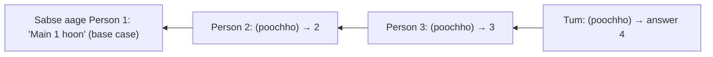
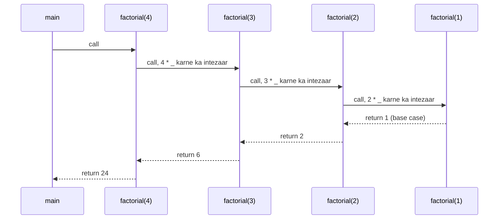
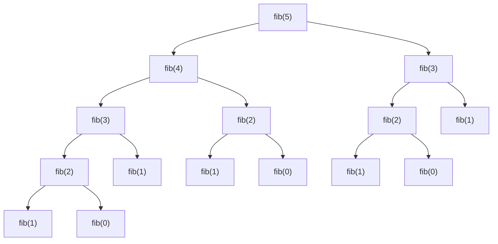
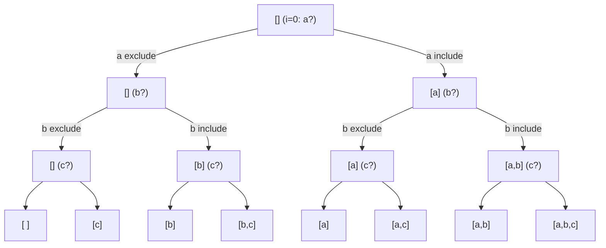
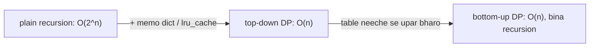

# Chapter 12 · Recursion

> Tum cinema hall ki ek lambi queue mein khade ho aur jaanna chahte ho ki tumhara number kya hai. Aage tak dikhta nahi. Toh tum aage wale se poochte ho, "Bhai, tumhara number kya hai?" Use bhi nahi pata, toh woh apne aage wale se poochta hai... jab tak bilkul aage khada banda bolta hai "Main number 1 hoon". Phir jawab wapas aate hain: 2, 3, 4... aur aakhir mein tumhe pata chal jaata hai. Tumne abhi insaano ke saath ek recursive algorithm chala diya.

**Is chapter mein tum seekhoge:**
- Recursion kya hai: ek function jo problem ko apne hi ek **chhote** version pe khud ko call karke solve karta hai
- Har recursive function ke do zaroori hisse: **base case** aur **recursive case**
- Recursion ke dauraan **call stack** kaise badhta aur ghatta hai (pictures ke saath), aur use trace kaise karte hain
- **Leap of faith**: woh mindset jo recursion likhna aasaan bana deta hai
- Classic problems: factorial, Fibonacci, fast power, digits, reverse, palindrome, binary search, Tower of Hanoi, subsets
- Recursion trees, recursive functions ki complexity, aur `lru_cache` ke saath **memoization**
- Recursion vs iteration, recursion limit, aur Python tail recursion ko optimise kyun nahi karta

**Isse pehle padho:** [Functions](10-functions.md) (khaaskar call stack) · [Lists](07-lists.md) · [Dictionaries](09-dictionaries.md)

---

## 🧠 The Big Idea · Asli Baat

**Recursion** ka matlab hai ek problem ko **usi problem ki ek chhoti copy** mein badal ke solve karna, tab tak jab tak copy itni chhoti na ho jaaye ki answer seedha dikh jaaye.

Cinema queue ek picture mein:



Sawaal **aage** jaate hain (yahi recursive calls hain jo gehre utarti jaati hain). Jawab **wapas** aate hain (yahi returns hain), aur raaste mein har banda 1 jodta hai. Do cheezon ne ise kaam karwaya:

1. **Base case:** koi aisa jise answer **bina pooche** pata hai (sabse aage wala banda).
2. **Recursive case:** baaki sab sawaal ka ek **chhota** version poochte hain (aage wala banda front se ek step paas hai) aur answer ke saath thoda sa kaam karte hain (+1).

Russian nesting dolls bhi yahi idea hain: ek doll kholo, andar ek chhoti doll milti hai, dohraao, jab tak woh chhoti si thos doll na mil jaaye jo khulti hi nahi.

> 🇮🇳 **Desi Analogy:** Joint family ke WhatsApp group mein Dadi poochti hain: "Hamare khaandan mein kul kitne log hain?" Dadi khud nahi ginti. Woh har bete se poochti hain: "Tumhare parivaar mein kitne?" Har beta apne bachchon se poochta hai. Sabse chhote bachche, jinke koi bachche nahi, seedha bolte hain "sirf main, 1" (ye hai **base case**). Phir jawab upar chadhte hain: har beta apne bachchon ke jawab jodta hai aur khud ko +1 karta hai (ye hai **combine**). Dadi tak sirf kuch numbers pahunchte hain, aur woh unhe jod ke final answer bata deti hain. Kisi ek insaan ne poora khaandan nahi gina, sabne bas apna chhota hissa kiya.

> 💡 Recursion koi jaadu nahi hai aur loop bhi nahi hai. Ye bas **ek function ka ek function ko call karna** hai, jo tum [Chapter 10](10-functions.md) ke call stack se pehle hi samajhte ho. Bas call hone wale function ka naam same hota hai.

---

## 🔨 Building It Up · Zero Se Shuru

### 1. Your first recursive function

```python
def countdown(n):
    if n == 0:                 # base case: ruk jao
        print("Liftoff!")
        return
    print(n)
    countdown(n - 1)           # recursive case: ek chhoti problem

countdown(3)
```

```text
3
2
1
Liftoff!
```

Kya hua yahan: `countdown(3)` ne 3 print kiya aur `countdown(2)` ko call kiya, jisne 2 print karke `countdown(1)` call kiya, jisne 1 print karke `countdown(0)` call kiya, jo base case pe pahuncha aur ruk gaya. Har call ek **alag** call hai, apne khud ke `n` ke saath. Jab `countdown(2)` chal raha hai, tab `countdown(3)` ka `n` ab bhi 3 hi hai, bas woh intezaar kar raha hai.

### 2. The three laws of recursion

Har sahi recursive function ye teen niyam maanta hai:

1. **Uska ek base case hota hai**: ek aisa input jiska answer woh seedha deta hai, bina recursion ke.
2. **Woh base case ki taraf badhta hai**: har recursive call ek "chhota" input use karti hai (chhota n, chhoti list, chhota range).
3. **Woh khud ko call karta hai** (aur result ka istemaal karta hai).

Niyam 1 ya 2 todo, toh function khud ko hamesha call karta rahega, jab tak Python use rok na de:

```py
def forever(n):
    return forever(n - 1)      # koi base case nahi!

forever(5)
# RecursionError: maximum recursion depth exceeded
```

`forever(5)` → `forever(4)` → ... → `forever(-1)` → `forever(-2)`... Koi rukne ki jagah nahi, toh stack lagbhag 1000 frames pe bhar jaata hai aur Python `RecursionError` de deta hai.

### 3. Returning values: factorial

n ka **factorial** hota hai `n! = n × (n-1) × ... × 1`, aur `0! = 1`. Dhyaan do ki `5! = 5 × 4!`. Problem ke andar hi uski ek chhoti copy chhupi hai. Yahi recursive case hai.

```python
def factorial(n):
    if n <= 1:                     # base case: 0! = 1! = 1
        return 1
    return n * factorial(n - 1)    # recursive case

print(factorial(5))
print([factorial(i) for i in range(7)])
```

```text
120
[1, 1, 2, 6, 24, 120, 720]
```

Chalo indentation ke saath print karke dekhte hain ki ye kaise **neeche utarta** (wind) hai aur kaise **wapas upar chadhta** (unwind) hai:

```python
def factorial(n, depth=0):
    pad = "    " * depth
    print(f"{pad}factorial({n}) called")
    if n <= 1:
        print(f"{pad}base case -> 1")
        return 1
    result = n * factorial(n - 1, depth + 1)
    print(f"{pad}factorial({n}) returns {result}")
    return result

factorial(4)
```

```text
factorial(4) called
    factorial(3) called
        factorial(2) called
            factorial(1) called
            base case -> 1
        factorial(2) returns 2
    factorial(3) returns 6
factorial(4) returns 24
```

Output ki shape dekho: ek "V" ki tarah. Upar se andar ki taraf jaate hue saare "called", sabse andar base case, phir bahar ki taraf aate hue saare "returns". Har level ek `depth` hai, jitna gehra utna zyada indent.

### 4. The call stack, visualised

Har call ko call stack pe apna **frame** milta hai ([Chapter 10](10-functions.md)), jisme uska apna `n` hota hai, aur woh multiplication pe **ruk ke intezaar** karti hai jab tak neeche wali call return na kare.



Sabse gehre pal pe stack:

```text
┌──────────────────────────┐
│ factorial(1)  n=1        │  ← running: returns 1
├──────────────────────────┤
│ factorial(2)  n=2  2 * ? │  ← waiting
├──────────────────────────┤
│ factorial(3)  n=3  3 * ? │  ← waiting
├──────────────────────────┤
│ factorial(4)  n=4  4 * ? │  ← waiting
├──────────────────────────┤
│ main                     │
└──────────────────────────┘
```

> 🇮🇳 **Desi Analogy:** Office mein ek file ka **approval chain** socho. Clerk (factorial(4)) file manager ko bhejta hai aur apni table pe "4 × ?" likh ke intezaar karta hai. Manager (factorial(3)) use senior manager ko bhejta hai, "3 × ?" likh ke intezaar karta hai. Aise hi upar tak. Sabse upar wala director (factorial(1)) seedha sign kar deta hai: "1". Ab file **wapas neeche** aati hai: har banda apna "?" bharta hai, multiply karta hai, aur neeche bhej deta hai. Har table pe ek frame hai, aur jab tak upar se jawab na aaye, woh table aage nahi badh sakti.

Do phases:
- **Winding** (neeche utarna): calls push hoti hain. Recursive call se **pehle** likha code abhi chalta hai, order 4, 3, 2, 1 mein.
- **Unwinding** (wapas upar aana): calls return hoke pop hoti hain. Recursive call ke **baad** likha code abhi chalta hai, ulte order 1, 2, 3, 4 mein.

```python
def show(n):
    if n == 0:
        return
    print("going down", n)    # call se pehle: winding ke waqt chalta hai
    show(n - 1)
    print("coming up", n)     # call ke baad: unwinding ke waqt chalta hai

show(3)
```

```text
going down 3
going down 2
going down 1
coming up 1
coming up 2
coming up 3
```

Ye ek example samjhaata hai ki recursion cheezon ko "free mein" ulta kaise print kar deta hai, aur [Binary Trees](../part-2-dsa/13-binary-trees.md) mein tree traversals (pre-order vs post-order) ki chaabi yahi hai.

> 🤔 **Mann mein sawaal:** "coming up" wali lines `1, 2, 3` order mein kyun aayi? `show(3)` toh sabse pehle call hua tha.
>
> **Jawab:** Haan, `show(3)` sabse pehle **shuru** hua, lekin sabse **aakhir mein khatam** hua. Woh `show(2)` ke return hone ka intezaar kar raha tha, aur `show(2)` `show(1)` ka. `show(1)` sabse pehle khatam hua (uske neeche sirf base case tha), isliye uski "coming up 1" sabse pehle chhapi. Stack hai: **jo sabse baad mein aaya, woh sabse pehle gaya**.

### 5. The leap of faith

Recursion ko **likhna aasaan** banane wala raaz ye hai: **ise dimaag mein trace mat karo**. Iski jagah:

1. **Define karo** ki tumhara function exactly kya return karta hai, ek sentence mein. ("`total(nums)` list `nums` ka sum return karta hai.")
2. **Base case handle karo** (sabse chhota input).
3. **Bharosa karo** ki chhote input pe recursive call pehle se sahi kaam karti hai, jaisa tumhare sentence ne vaada kiya. Sirf ye poochho: "Agar mere paas chhoti problem ka answer hota, toh main is problem ka answer kaise banaata?"

```python
def total(nums):
    """Return the sum of the list nums."""
    if not nums:                    # base case: khaali list ka sum 0 hai
        return 0
    # Leap of faith: total(nums[1:]) pehle item ke baad wale sab items ka sahi sum deta hai.
    return nums[0] + total(nums[1:])

print(total([4, 8, 15, 16, 23, 42]), total([]))
```

```text
108 0
```

Tumhe chhe nested calls imagine karne ki zaroorat nahi padi. Tumne `total(nums[1:])` pe bharosa kiya aur bas ek number joda. Yahi leap of faith hai, aur experienced engineers trees, graphs aur divide-and-conquer ke baare mein aise hi sochte hain.

> 🇮🇳 **Desi Analogy:** Tum **class monitor** ho aur teacher ne poocha "poori class ki fees ka total kya hai?" Tum pehli bench ka paisa ginte ho, aur baaki class ka total apne deputy se pooch lete ho. Tum ye check nahi karte ki deputy ne kaise gina. Tum **bharosa** karte ho ki uska number sahi hai, aur bas apna hissa jod dete ho. Deputy bhi wahi karta hai. Yahi leap of faith hai: apna chhota kaam karo, baaki pe bharosa rakho.

> 💡 Ye kaam karta hai, iska proof bilkul mathematical induction jaisa hai: base case sahi hai, aur *agar* chhota case sahi hai toh bada case bhi sahi hai, isliye har case sahi hai. (Seedhi ki tarah: pehli seedhi pe chadh sakte ho, aur kisi bhi seedhi se agli pe ja sakte ho, toh har seedhi tak pahunch sakte ho.)

### 6. Warm-up classics: digits, reverse, palindrome

**Digits ka sum:** aakhri digit hai `n % 10`; baaki number hai `n // 10`.

```python
def digit_sum(n):
    if n < 10:                       # ek digit ka sum woh khud hi hai
        return n
    return n % 10 + digit_sum(n // 10)

print(digit_sum(9875), digit_sum(7))
```

```text
29 7
```

Trace: `9875` → `5 + digit_sum(987)` → `5 + 7 + digit_sum(98)` → `5 + 7 + 8 + digit_sum(9)` → `5 + 7 + 8 + 9` = 29.

**String ulta karo:** `"hello"` ka ulta = `"ello"` ka ulta + `"h"`.

```python
def reverse(s):
    if len(s) <= 1:
        return s
    return reverse(s[1:]) + s[0]

print(reverse("hello"), reverse(""), reverse("a"))
```

```text
olleh  a
```

(Beech wali value khaali string hai, isliye tumhe do spaces dikhte hain.)

**Palindrome:** ek string palindrome hai agar uske pehle aur aakhri characters match karein **aur** beech ka hissa bhi palindrome ho.

```python
def is_palindrome(s):
    if len(s) <= 1:
        return True
    if s[0] != s[-1]:
        return False
    return is_palindrome(s[1:-1])

print(is_palindrome("racecar"), is_palindrome("abca"), is_palindrome(""))
```

```text
True False True
```

`"racecar"` → `r == r`, andar `"aceca"` → `a == a`, andar `"cec"` → `c == c`, andar `"e"` → length 1, `True`. Aur `"abca"` → `a == a`, andar `"bc"` → `b != c`, `False`.

### 7. Avoiding slicing cost: pass indexes

`s[1:]` string ki copy banata hai, jiska kharcha **har call pe** O(n) hai. Isse upar wale `reverse` aur `is_palindrome` total O(n²) ho jaate hain. Fix: original ko waisa hi rakho aur **indexes** pass karo jo range ko chhota karte jaayein. Extra parameters wala ek **helper function** iska standard tareeka hai.

```python
def is_palindrome(s):
    def check(left, right):
        if left >= right:               # 0 ya 1 character bache
            return True
        if s[left] != s[right]:
            return False
        return check(left + 1, right - 1)
    return check(0, len(s) - 1)

def total(nums, i=0):
    if i == len(nums):                  # base case: koi item nahi bacha
        return 0
    return nums[i] + total(nums, i + 1)

print(is_palindrome("level"), is_palindrome("levels"))
print(total([1, 2, 3, 4]))
```

```text
True False
10
```

Ab har call O(1) kaam karti hai: total time O(n).

O(n²) kahan se aaya tha? n calls, aur har call mein slicing ki copy: pehli baar n-1 characters, phir n-2, phir n-3... Total `(n-1) + (n-2) + ... + 1` ≈ n²/2. Indexes ke saath copy hoti hi nahi, sirf do numbers aage-peeche hote hain.

### 8. Power: slow and fast

**Slow power:** `x^n = x × x^(n-1)`. Ye n calls hain: O(n).

**Fast power** (exponentiation by squaring): n even ho toh `x^n = (x^(n/2))²`, aur n odd ho toh `x × x^(n-1)`. Har step n ko aadha kar deta hai: **O(log n)**.

```python
def power_slow(x, n):
    if n == 0:
        return 1
    return x * power_slow(x, n - 1)

def power_fast(x, n):
    if n == 0:
        return 1
    if n < 0:
        return 1 / power_fast(x, -n)
    half = power_fast(x, n // 2)        # aadha wala EK BAAR compute karo
    if n % 2 == 0:
        return half * half
    return half * half * x

print(power_slow(2, 10), power_fast(2, 10), power_fast(3, 13), power_fast(2, -2))
```

```text
1024 1024 1594323 0.25
```

**Dry run**, `power_fast(3, 13)` ka:

| call | n | n // 2 | half (neeche wali call se) | returns |
|---|---|---|---|---|
| 1 | 13 (odd) | 6 | 729 | 729 × 729 × 3 = 1,594,323 |
| 2 | 6 (even) | 3 | 27 | 27 × 27 = 729 |
| 3 | 3 (odd) | 1 | 3 | 3 × 3 × 3 = 27 |
| 4 | 1 (odd) | 0 | 1 | 1 × 1 × 3 = 3 |
| 5 | 0 | | | 1 (base case) |

13 ki jagah 5 calls. n = 1,000,000,000 ke liye ye lagbhag 31 calls hain, ek arab ki jagah.

Odd wale case mein extra `* x` kyun? `13 // 2 = 6`, toh `half * half` = `3^12` deta hai. Ek `3` kam pad gaya, isliye `* x` se `3^13` banta hai.

> ⚠️ `power_fast(x, n // 2) * power_fast(x, n // 2)` likhna (`half` store karne ki jagah do calls) chupchaap O(log n) ko wapas O(n) bana deta hai. Ek baar compute karo, dobara use karo.

### 9. Fibonacci and the recursion tree

Fibonacci sequence: `0, 1, 1, 2, 3, 5, 8, 13...`, jahan `fib(n) = fib(n-1) + fib(n-2)`, aur `fib(0) = 0`, `fib(1) = 1`. Jo function khud ko **do baar** call karta hai, woh ek **recursion tree** banata hai:

```python
def fib(n):
    if n < 2:
        return n
    return fib(n - 1) + fib(n - 2)

print([fib(i) for i in range(10)])
```

```text
[0, 1, 1, 2, 3, 5, 8, 13, 21, 34]
```



Tree ko dekho: `fib(3)` **do baar** compute hua, `fib(2)` **teen baar**. Tree har level pe lagbhag double hota hai, isliye calls ki ginti **O(2ⁿ)** jaise badhti hai (zyada exactly, lagbhag 1.618ⁿ). Chalo ginte hain:

```python
calls = 0

def fib(n):
    global calls
    calls += 1
    if n < 2:
        return n
    return fib(n - 1) + fib(n - 2)

for n in [10, 20, 25]:
    calls = 0
    fib(n)
    print(f"fib({n}) needed {calls:,} calls")
```

```text
fib(10) needed 177 calls
fib(20) needed 21,891 calls
fib(25) needed 242,785 calls
```

`fib(50)` ko 40 arab (40 billion) se zyada calls chahiye hongi. Ghante lag jaayenge. Section 13 ise theek karta hai.

> 🇮🇳 **Desi Analogy:** Socho tumhari maths teacher ne homework diya aur class ke 30 bachchon ne **ek hi sawaal** alag-alag baith ke solve kiya, kisi ne doosre se poocha tak nahi. 30 guna mehnat, answer ek hi. Naive Fibonacci yahi karta hai: `fib(3)` ka answer ek baar nikal chuka hai, lekin doosri branch ko pata hi nahi, toh woh phir se shuru se nikaalti hai. Ilaaj? Board pe likh do (memoization), taaki agla poochne wala seedha padh le.

### 10. Recursive binary search

**Binary search** ek **sorted** list mein value dhoondhta hai: beech wala element check karo aur woh aadha hissa phenk do jisme value ho hi nahi sakti. Har call range ko aadha kar deti hai: O(log n). (Poora chapter: [Binary Search](../part-2-dsa/08-binary-search.md).)

```python
def binary_search(nums, target, lo=0, hi=None):
    if hi is None:
        hi = len(nums) - 1
    if lo > hi:                          # base case: khaali range, nahi mila
        return -1
    mid = (lo + hi) // 2
    if nums[mid] == target:              # base case: mil gaya
        return mid
    if nums[mid] < target:
        return binary_search(nums, target, mid + 1, hi)   # right half mein dhoondho
    return binary_search(nums, target, lo, mid - 1)       # left half mein dhoondho

data = [2, 5, 8, 12, 16, 23, 38, 56, 72, 91]
print(binary_search(data, 23), binary_search(data, 2), binary_search(data, 7))
```

```text
5 0 -1
```

`23` ke liye trace: `lo=0, hi=9, mid=4` → `nums[4]=16 < 23`, right jao. `lo=5, hi=9, mid=7` → `nums[7]=56 > 23`, left jao. `lo=5, hi=6, mid=5` → `nums[5]=23`, mil gaya, `5`. Teen calls, das items mein.

`return binary_search(...)` pe dhyaan do. Ye `return` bhoolna recursion ka #1 bug hai: sabse gehri call answer dhoondh leti hai, lekin bahar wali calls use phenk deti hain aur `None` return karti hain.

> 🤔 **Mann mein sawaal:** Andar wali call ne toh `5` return kar diya. Woh bahar tak apne aap kyun nahi pahunchta?
>
> **Jawab:** Kyunki `return` sirf **ek level** upar jaata hai, apne caller tak. Caller ko us value ka kuch karna padta hai. Agar caller ne `binary_search(...)` likha bina `return` ke, toh `5` uske haath mein aaya aur wahin gir gaya. Phir caller ke function ka end aaya, aur bina `return` wala function `None` deta hai. Relay race socho: baton sirf agle runner tak jaata hai. Agar ek runner ne baton nahi pakda, toh finish line tak kuch nahi pahunchega.

### 11. Tower of Hanoi

Teen pegs: A, B, C. A pe n disks hain, sabse badi neeche. Sabko C pe le jaao. Rules: ek baar mein ek hi disk move karo, aur kabhi bhi badi disk ko chhoti ke upar mat rakho.

Plan karna namumkin lagta hai, lekin leap of faith ke saath ye teen lines hai. n disks ko A se C le jaane ke liye:
1. Upar ki n−1 disks ko A se **B** le jao (recursion pe bharosa; C helper hai).
2. Sabse badi disk ko A se C le jao.
3. n−1 disks ko B se C le jao (phir se recursion pe bharosa; A helper hai).

```python
def hanoi(n, source, target, helper, moves):
    if n == 0:
        return
    hanoi(n - 1, source, helper, target, moves)
    moves.append(f"disk {n}: {source} -> {target}")
    hanoi(n - 1, helper, target, source, moves)

moves = []
hanoi(3, "A", "C", "B", moves)
for m in moves:
    print(m)
print(len(moves), "moves")

for n in [1, 2, 3, 10, 20]:
    moves = []
    hanoi(n, "A", "C", "B", moves)
    print(n, "disks:", len(moves), "moves")
```

```text
disk 1: A -> C
disk 2: A -> B
disk 1: C -> B
disk 3: A -> C
disk 1: B -> A
disk 2: B -> C
disk 1: A -> C
7 moves
1 disks: 1 moves
2 disks: 3 moves
3 disks: 7 moves
10 disks: 1023 moves
20 disks: 1048575 moves
```

Moves ki ginti `2ⁿ − 1` hai, kyunki `moves(n) = 2 × moves(n−1) + 1`. Time: **O(2ⁿ)**, aur koi bhi algorithm isse behtar nahi kar sakta, kyunki itni moves to zaroori hi hain.

3 disks ke output ko teen hisson mein dekho: pehli 3 moves (disk 1, 2, 1) ne upar ki do disks ko B pe pahunchaya (step 1). Chauthi move ne disk 3 ko C pe rakha (step 2). Aakhri 3 moves ne do disks ko B se C pe pahunchaya (step 3). Bilkul plan ke mutaabik.

### 12. Print all subsets (a preview of backtracking)

Har item ke liye tumhare paas exactly do choices hain: use **include** karo ya **exclude** karo. Recursion dono explore karta hai, aur ek aisa tree banata hai jisme 2ⁿ leaves hain, har subset ke liye ek.

```python
def subsets(items):
    result = []

    def explore(i, current):
        if i == len(items):              # har item ka faisla ho gaya: ek subset record karo
            result.append(current[:])    # copy! current badalta rehta hai
            return
        explore(i + 1, current)          # choice 1: items[i] ko exclude karo
        current.append(items[i])         # choice 2: items[i] ko include karo
        explore(i + 1, current)
        current.pop()                    # choice wapas lo (backtrack)

    explore(0, [])
    return result

print(subsets(["a", "b", "c"]))
```

```text
[[], ['c'], ['b'], ['b', 'c'], ['a'], ['a', 'c'], ['a', 'b'], ['a', 'b', 'c']]
```



"Chuno, explore karo, wapas lo" wala pattern **backtracking** hai, aur permutations, combinations, N-Queens aur Sudoku solvers ke peeche yahi engine hai. Iska poora chapter hai: [Recursion & Backtracking](../part-2-dsa/09-backtracking.md).

> 🇮🇳 **Desi Analogy:** Shaadi ki **thaali** bana rahe ho aur menu mein teen items hain: aloo, biryani, chhole. Har item pe ek hi sawaal: "lena hai ya nahi?" Pehle aloo pe "nahi" bolke aage chalo, sab combinations dekh lo. Phir wapas aao, aloo pe "haan" bolo, aur phir aage ke sab combinations. `current.pop()` matlab plate se item wapas rakhna, taaki agli koshish saaf plate se ho. Teen items, har ek pe do choice: 2 × 2 × 2 = 8 thaaliyan.

### 13. Memoization: remember, don't recompute

Fibonacci sirf isliye slow hai kyunki woh same sub-problems baar-baar solve karta hai. Har answer pehli baar mein store kar lo ([Chapter 09](09-dictionaries.md) ka memo pattern), aur har sub-problem sirf **ek baar** solve hoga.

```python
def fib_memo(n, memo=None):
    if memo is None:
        memo = {}
    if n < 2:
        return n
    if n in memo:
        return memo[n]
    memo[n] = fib_memo(n - 1, memo) + fib_memo(n - 2, memo)
    return memo[n]

print(fib_memo(50))
print(fib_memo(100))
```

```text
12586269025
354224848179261915075
```

Dhyaan do: `memo=None` aur andar `memo = {}`. Ye [Chapter 10](10-functions.md) ka mutable-default fix hai. Aur har recursive call ko wahi `memo` dict aage pass ki jaati hai, taaki saari calls ek hi "board" pe likhein aur padhein.

Python mein ye built-in hai. Function ke upar wali `@lru_cache` line ek **decorator** hai ([Chapter 16](16-iterators-generators-decorators.md) mein samjhaaya hai); abhi ke liye ise aise padho: "is function ka har result yaad rakho".

```python
from functools import lru_cache

@lru_cache(maxsize=None)        # unlimited cache; functools.cache bhi yahi hai (3.9+)
def fib(n):
    if n < 2:
        return n
    return fib(n - 1) + fib(n - 2)

print(fib(80))
print(fib.cache_info())
```

```text
23416728348467685
CacheInfo(hits=78, misses=81, maxsize=None, currsize=81)
```

Kya hua yahan: 81 alag sub-problems (`fib(0)` se `fib(80)` tak) har ek sirf ek baar compute hue ("misses"), aur 78 dohraaye gaye sawaalon ka jawab cache se turant mil gaya ("hits"). Lagbhag 7.6 × 10¹⁶ calls se ghat ke sirf 159. Time O(2ⁿ) se **O(n)** pe aa gaya.



Ye teer literally **dynamic programming** ke paida hone ki kahani hai. Tum ise [DP I: The Framework & 1D DP](../part-2-dsa/20-dp-1d.md) mein master karoge. Memoization ke do rules: function **pure** hona chahiye ([Chapter 10](10-functions.md)), aur uske arguments **hashable** hone chahiye (woh dict keys bante hain, isliye tuples bhejo, lists nahi).

> 🤔 **Mann mein sawaal:** 78 hits aur 81 misses. Ye numbers kahan se aaye?
>
> **Jawab:** **Misses** = pehli baar poocha gaya sawaal, jise sach mein compute karna pada. `fib(0)` se `fib(80)` tak 81 alag sawaal hain, toh 81 misses. **Hits** = dobara poocha gaya sawaal. `fib(n)` jab chalta hai toh `fib(n-1)` (miss, pehli baar) aur `fib(n-2)` (hit, kyunki `fib(n-1)` ke andar woh pehle hi compute ho chuka) dono poochta hai. `fib(2)` se `fib(80)` tak 79 functions mein se har ek ka doosra sawaal hit hai, lekin `fib(2)` ka doosra sawaal `fib(0)` pehli baar poocha gaya tha (miss). Toh 78 hits. Total calls = 81 + 78 = 159.

### 14. Recursion vs iteration

Jo kuch bhi recursive hai, use loop se likha ja sakta hai (zaroorat pade toh apne stack ke saath), aur ulta bhi.

```python
def factorial_iter(n):
    result = 1
    for k in range(2, n + 1):
        result *= k
    return result

def fib_iter(n):
    a, b = 0, 1
    for _ in range(n):
        a, b = b, a + b
    return a

print(factorial_iter(5), fib_iter(10), fib_iter(80))
```

```text
120 55 23416728348467685
```

Kuch problems **naturally recursive** hoti hain, kyunki data khud recursive hota hai (aisa structure jiske andar usi type ke chhote structures hon): nested lists, folders ke andar folders, trees, JSON. Inhe simple loops se iterate karna dard hai; recursion natural hai:

```python
def flatten(nested):
    flat = []
    for item in nested:
        if isinstance(item, list):        # usi problem ki ek chhoti copy
            flat.extend(flatten(item))
        else:
            flat.append(item)
    return flat

def depth(nested):
    if not isinstance(nested, list):
        return 0
    return 1 + max((depth(x) for x in nested), default=0)

data = [1, [2, [3, 4], 5], [[6]], 7]
print(flatten(data))
print(depth(data))
```

```text
[1, 2, 3, 4, 5, 6, 7]
3
```

`depth` ka `3` kyun? Sabse bahar wali list = 1 level. `[2, [3, 4], 5]` = 2 level. `[3, 4]` = 3 level. (`[[6]]` bhi 3 hi level gehra hai.) Function ka sentence: "list ki depth = 1 + uske sabse gehre bachche ki depth; number ki depth 0".

> 🇮🇳 **Desi Analogy:** Tumhare laptop ka **Downloads folder** socho, jisme files bhi hain aur folders bhi, aur un folders ke andar aur folders. "Saari files ka total size batao" ka sabse natural tareeka: har cheez dekho; file hai toh size jodo; folder hai toh **wahi sawaal us folder se poochho** (recursion). Loop se likhne ki koshish karo toh tumhe khud yaad rakhna padega ki kaunse folder mein kahan tak pahunche the, jo exactly stack hai.

| | Recursion | Iteration |
|---|---|---|
| Kahan best | trees, graphs, nested data, divide & conquer, backtracking | linear scans, simple counting, bahut gehre processes |
| Readability | aksar chhota, definition ko hi dohraata hai | state saaf dikhti hai, koi chhupa stack nahi |
| Memory | O(depth) stack frames | aam taur pe O(1) extra |
| Python mein speed | har step pe function-call ka overhead | har step tez |
| Risk | ~1000 levels ke baad `RecursionError` | condition gadbad ki toh infinite loop |

Rule of thumb: Python mein agar depth badi ho sakti hai (jaise linked list ya simple count ke liye n = 100,000), toh loop use karo. Agar depth chhoti hai (jaise binary search ke liye log n, ya balanced tree ki height), toh recursion perfect hai.

### 15. The recursion limit

Python call-stack ki depth pe ek limit lagata hai (default **1000**), taaki bhaagti hui recursion poore interpreter ko crash karne ki jagah ek saaf error de.

```python
import sys

print(sys.getrecursionlimit())

depth = 0

def dive():
    global depth
    depth += 1
    dive()

try:
    dive()
except RecursionError:
    print("RecursionError after about", depth // 100 * 100, "calls")
```

```text
1000
RecursionError after about 900 calls
```

(Exact number 1000 se thoda kam hai, kyunki kuch frames pehle se use mein hain. `try/except` se errors pakadna [Chapter 13](13-exceptions-files.md) mein hai.)

Tum ise `sys.setrecursionlimit(10_000)` se badha *sakte* ho, lekin ye bas ek patti (band-aid) hai: bahut gehri recursion ab bhi asli C-level stack ko khatam karke Python ko seedha crash kar sakti hai. Agar tumhe hazaaron-dasiyon hazaar ki depth chahiye, toh iteration mein badal do.

### 16. Tail recursion (and why Python doesn't care)

Ek call **tail call** hai agar woh function ka bilkul **aakhri** kaam ho, aur uske return hone ke baad karne ko kuch na bache. Jis function ki recursive call tail call ho, woh **tail recursive** hai.

```python
def factorial_tail(n, acc=1):
    if n <= 1:
        return acc
    return factorial_tail(n - 1, acc * n)    # tail call: baad mein karne ko kuch nahi

def factorial_not_tail(n):
    if n <= 1:
        return 1
    return n * factorial_not_tail(n - 1)     # tail call NAHI: baad mein multiply karna hai

print(factorial_tail(10), factorial_not_tail(10))
```

```text
3628800 3628800
```

Accumulator `acc` partial result ko **neeche** le jaata hai, use **upar** aate hue banaane ki jagah. Scheme jaisi languages mein (aur aksar C compilers mein), tail call naya frame push karne ki jagah current frame ko hi **reuse** kar sakti hai ("tail call optimisation", TCO), toh tail recursion O(1) stack use karti hai, bilkul loop ki tarah.

Fark ek trace mein dekho, `factorial_tail(4)`: `(4, 1)` → `(3, 4)` → `(2, 12)` → `(1, 24)` → return `24`. Har call apne saath poora hisaab le ke jaati hai, wapas aate waqt karne ko kuch nahi bachta. Jabki `factorial_not_tail` mein har frame ko "n × ?" yaad rakhna padta hai.

**Python TCO nahi karta.** `factorial_tail(5000)` ab bhi `RecursionError` deta hai. Python ke creator ne ye jaan-boojh ke chuna: TCO tracebacks se frames mita deta, jisse debugging mushkil hoti, aur Python iteration ke liye loops pasand karta hai. Toh Python mein, agar tumne tail-recursive function likha hai, toh tumne asal mein ek loop hi likha hai; seedha loop hi likh do:

```python
def factorial_loop(n):
    acc = 1
    while n > 1:          # tail call "factorial_tail(n - 1, acc * n)" ban jaati hai:
        acc *= n          #   parameters update karo...
        n -= 1            #   ...aur phir se chakkar lagao
    return acc

print(factorial_loop(10))
```

```text
3628800
```

---

## 🔬 Under the Hood · Andar Ki Kahani

### What each recursive call costs

Har call ek naya **frame** object banati hai (locals, arguments, current instruction pointer, caller ka link). CPython mein har Python-level frame lagbhag sau bytes ya usse zyada leta hai, plus uske local variables jo bhi refer karte hain. Toh:

- Recursive function ki **space complexity** = **stack ki maximum depth** × har frame ki space. `factorial(n)` O(n) space hai, chahe woh koi list na banaye. Binary search recursion O(log n) space hai. Loop wale versions O(1) hain.
- **Time** mein har call ka overhead bhi shaamil hai, isliye simple linear recursion ke liye Python mein loops aksar fast hote hain.

### How to find the complexity of a recursive function

**Time = (calls ki ginti) × (ek call ke andar ka kaam, recursive calls ko chhod ke).** Recursion tree banao aur gino. Common shapes, **recurrences** ki tarah likhe hue (T(n) = input size n ke liye time):

| Recurrence | Example | Calls | Time | Stack space |
|---|---|---|---|---|
| T(n) = T(n−1) + O(1) | factorial, index wala list sum | n | **O(n)** | O(n) |
| T(n) = T(n−1) + O(n) | slicing `nums[1:]` wala sum/reverse | n | **O(n²)** | O(n) (+ slices) |
| T(n) = T(n/2) + O(1) | binary search, fast power | log n | **O(log n)** | O(log n) |
| T(n) = 2T(n/2) + O(n) | merge sort | ~2n | **O(n log n)** | O(log n) frames (+ merging ke liye O(n)) |
| T(n) = 2T(n−1) + O(1) | Hanoi, subsets, 2 choices wala naive tree | 2ⁿ | **O(2ⁿ)** | O(n) |
| T(n) = T(n−1) + T(n−2) + O(1) | naive Fibonacci | ~1.6ⁿ | **O(φⁿ) ⊂ O(2ⁿ)** | O(n) |
| memoized fib | `@lru_cache` fib | 2n | **O(n)** | O(n) |

Key insight: **stack space depth hai (root se leaf tak ka sabse lamba raasta), calls ki total ginti nahi.** Naive `fib(30)` das lakh se zyada calls karta hai, lekin stack kabhi 30 se gehra nahi hota, kyunki har branch agli branch shuru hone se pehle khatam hoke pop ho jaati hai.

> 🤔 **Mann mein sawaal:** Lakhon calls hui, toh memory bhi lakhon frames ki lagni chahiye na?
>
> **Jawab:** Nahi, kyunki saare frames **ek saath** stack pe kabhi nahi hote. `fib(5)` pehle poori `fib(4)` wali branch khatam karta hai, uske saare frames pop ho jaate hain, **phir** `fib(3)` wali branch shuru hoti hai. Kisi bhi pal stack pe sirf ek raasta hota hai: root se current call tak. Isliye memory = sabse lambe raaste ki lambaai = depth. Time = poore tree ke nodes, kyunki har node kabhi na kabhi chala.

T(n) = aT(n/b) + f(n) jaise divide-and-conquer recurrences ke liye ek general formula hai, **Master Theorem**; woh [Big-O](../part-2-dsa/01-big-o-complexity.md) aur [Sorting](../part-2-dsa/07-sorting.md) mein cover hai.

### Why the limit exists

CPython kai situations mein Python function calls ko C stack use karke chalata hai, aur C stack ka size operating system fix karta hai (aksar 1–8 MB ke aas-paas). Use overflow karna ek hard crash hoga (ek "segmentation fault"). Recursion limit us khaai se kaafi pehle lagi ek safety railing hai. Python 3.11+ zyaadatar pure-Python-se-Python calls ke liye C stack use nahi karta, lekin limit infinite recursion ke khilaaf guard ki tarah bani rehti hai.

### Turning recursion into iteration with your own stack

Har recursive algorithm ko ek explicit stack (ek list) khud manage karke iterative banaya ja sakta hai, kyunki Python tumhare liye bas yahi kar raha hota hai. 1,000,000 nodes wale graph pe bina `RecursionError` ke gehra DFS aise hi likhoge:

```python
def flatten_iterative(nested):
    stack = [iter(nested)]           # iterators ka humara apna "call stack"
    flat = []
    while stack:
        for item in stack[-1]:
            if isinstance(item, list):
                stack.append(iter(item))   # "recursive call": aur gehre jao
                break
            flat.append(item)
        else:
            stack.pop()                    # ye level khatam: "return"
    return flat

print(flatten_iterative([1, [2, [3, 4], 5], [[6]], 7]))
```

```text
[1, 2, 3, 4, 5, 6, 7]
```

(`for ... else` mein `else` tabhi chalta hai jab loop `break` se na ruka ho; tum ise [Chapter 06](06-loops.md) mein mil chuke ho.)

Yahan `iter(...)` kyun, seedhi list kyun nahi? Kyunki iterator **yaad rakhta hai ki woh kahan ruka tha**. Jab hum andar wali list khatam karke wapas aate hain, toh bahar wala iterator wahin se aage badhta hai jahan chhoda tha, bilkul jaise recursive call ke baad function wahin se chalta hai. Yahi frame ka "current instruction pointer" hai, haath se banaya hua.

---

## 🧩 Pattern Decoder · Pattern Pakdo

### Signals: when to think recursively

| Tumhe dikhe... | Socho |
|---|---|
| "tree", "nested", "hierarchy", "folders", "JSON" | recursion structure ke saath-saath chalta hai |
| aisi definition jo khud ko use kare: "n! = n × (n−1)!", "fib = fib + fib" | seedha translate karo |
| "all subsets / permutations / combinations / ways" | backtracking: include/exclude recursion |
| "split in half", "divide and conquer", "merge sort", "binary search" | aadhe hisson pe recurse karo |
| overlapping sub-problems ke saath "number of ways to reach...", "min cost to..." | recursion + memo → DP |
| "flood fill", "connected region", "islands" | neighbours pe DFS recursion |

### The template

```py
def solve(problem):
    # 1. BASE CASE(S): sabse chhote inputs, seedha answer
    if is_small(problem):
        return direct_answer(problem)

    # 2. SHRINK: ek ya zyada strictly chhote sub-problems banao
    smaller = shrink(problem)

    # 3. LEAP OF FAITH: maan lo ki solve() unpe kaam karta hai
    sub_answer = solve(smaller)

    # 4. COMBINE: sub-answer(s) se is problem ka answer banao
    return combine(problem, sub_answer)
```

### The five shapes of recursion

**1. Linear (ek call, size − 1):** factorial, sum, reverse, linked-list traversal. O(n) time, O(n) stack.

**2. Halving (ek call, size / 2):** binary search, fast power. O(log n).

**3. Divide & conquer (aadhe hisson pe do calls, phir combine):** merge sort.

```python
def merge_sort(nums):
    if len(nums) <= 1:
        return nums
    mid = len(nums) // 2
    left = merge_sort(nums[:mid])       # leap of faith: dono halves sorted wapas aayenge
    right = merge_sort(nums[mid:])
    merged, i, j = [], 0, 0             # combine: do sorted lists ko merge karo
    while i < len(left) and j < len(right):
        if left[i] <= right[j]:
            merged.append(left[i]); i += 1
        else:
            merged.append(right[j]); j += 1
    return merged + left[i:] + right[j:]

print(merge_sort([38, 27, 43, 3, 9, 82, 10]))
```

```text
[3, 9, 10, 27, 38, 43, 82]
```

O(n log n) time. Poori detail [Sorting](../part-2-dsa/07-sorting.md) mein.

Merge step ko aise socho: do sorted line mein khade log, dono lines ke aage wale ko compare karo, chhote ko final line mein bhejo, aur uski line ek aage badhao. Jab ek line khaali ho jaaye, doosri line ke bache hue log seedhe peeche jod do (`left[i:] + right[j:]`).

**4. Multiple branches (tree recursion):** Fibonacci, subsets, Hanoi. Exponential, jab tak sub-problems overlap na karein aur tum memoize na karo.

**5. Recursion + memo (top-down DP):** jab same arguments repeat hon, toh `@lru_cache` lagao.

**Worked example: Climbing Stairs (LeetCode 70).** Tum ek baar mein 1 ya 2 seedhiyan chadh sakte ho. Seedhi n tak pahunchne ke kitne alag tareeke hain?

*Idea:* seedhi n tak pahunchne ki aakhri move ya toh seedhi n−1 se thi (ek 1-step), ya seedhi n−2 se (ek 2-step). Toh `ways(n) = ways(n−1) + ways(n−2)`, aur `ways(0) = 1` (ek tareeka: kuch mat karo) aur `ways(1) = 1`. Ye bhes badla hua Fibonacci hai, aur ise memo chahiye.

```python
from functools import lru_cache

@lru_cache(maxsize=None)
def climb_stairs(n):
    if n <= 1:
        return 1
    return climb_stairs(n - 1) + climb_stairs(n - 2)

print([climb_stairs(n) for n in range(1, 8)], climb_stairs(45))
```

```text
[1, 2, 3, 5, 8, 13, 21] 1836311903
```

Memo ke saath O(n) time aur space; uske bina O(2ⁿ).

`ways(3)` ko gin ke confirm karo: 1+1+1, 1+2, 2+1. Teen tareeke. Formula: `ways(2) + ways(1)` = 2 + 1 = 3. Match.

### When NOT to use recursion (in Python)

- **Depth ~1000 se zyada ho sakti hai** (n = 10⁵ items pe loop, lambi linked list, bahut bade path-jaise graph pe DFS) → iterate karo ya explicit stack use karo.
- **Simple loop utna hi saaf hai** (list ka sum, counting) → loop use karo.
- **Branching recursion jisme overlapping sub-problems nahi, phir bhi exponential hai** → koi smarter algorithm dhoondho, sirf cache nahi.

---

## ⚠️ Traps & Common Mistakes · Yahan Sab Phisalte Hain

1. **Base case hi nahi, ya aisa base case jahan kabhi pahuncho hi nahi.** `def f(n): return f(n - 2)`, odd n ke saath, 0 ko skip karke aage nikal jaata hai agar base case `n == 0` hai. `n <= 0` use karo ya dono check karo. (5 → 3 → 1 → -1 → ... kabhi 0 pe nahi rukega.)

2. **Base case ki taraf na badhna.** `f(n - 1)` ki jagah `return f(n)`. Infinite recursion.

3. **Recursive call ka result `return` karna bhool jaana.**

```py
def search(nums, t, lo, hi):
    ...
    search(nums, t, mid + 1, hi)          # ❌ result phenk diya: function None return karta hai
    return search(nums, t, mid + 1, hi)   # ✅
```

4. **Same sub-problem ko do baar call karna jab ek baar kaafi tha.** `power(x, n//2) * power(x, n//2)` O(n) hai, O(log n) nahi. Result store karo.

5. **Har call mein slicing.** `f(nums[1:])` har baar O(n) copy karta hai, O(n) ko O(n²) bana deta hai. Index pass karo.

6. **Overlapping sub-problems ko baar-baar compute karna.** Naive Fibonacci exponential hai. Memoize karo.

7. **Mutable default accumulators.** `def collect(node, acc=[])` calls ke beech leak karta hai ([Chapter 10](10-functions.md)). `acc=None` use karo.

8. **Path record karte waqt copy bhool jaana.** Subsets mein `result.append(current)` us list ka reference store karta hai jise tum badalte ja rahe ho; end mein saari entries ek hi (khaali) list hoti hain. `current[:]` use karo.

9. **Backtracking mein choice wapas lena bhool jaana.** `current.append(x)` aur recursive call ke baad, `current.pop()` agli branch ke liye state wapas theek karta hai.

10. **Edge inputs ke liye galat base case.** `n = 0`, `n = 1`, khaali list, khaali string, ek element ke saath test karo.

11. **Tail-call optimisation ki umeed rakhna.** Python ye nahi karta. Gehri tail recursion ab bhi crash karti hai; use loop mein badlo.

---

## 💡 Tips & Tricks · Pro Wale Moves

- Code likhne se pehle **ek-sentence ka contract** likho: "`f(x)` ... return karta hai". Phir base case, phir combine. Dimaag mein do level se zyada kabhi trace mat karo.
- Kisi bhi recursion ko debug karne ke liye ek `depth` parameter jodo aur `"  " * depth` ke saath print karo. Indentation tree dikha deta hai.
- **Sabse chhote inputs** se shuru karo: f(0), f(1), f(2) haath se nikaalo. Pattern aur base case khud saamne aa jaate hain.
- Extra parameters (indexes, accumulators, memo) ko caller se chhupaane ke liye ek nested **helper** use karo.
- Interviews mein memoize karne ka sabse tez tareeka hai `@lru_cache(maxsize=None)` (ya `@functools.cache`). Arguments hashable hone chahiye.
- Space complexity = maximum depth. Interview mein zor se bolo: "O(n) time and O(n) stack space."
- Interviewer pooche "kya recursion avoid kar sakte ho?", toh jawab hai explicit stack (DFS ke liye) ya bottom-up loop (DP ke liye).
- Hanoi ke liye `2ⁿ − 1` moves, `2ⁿ` subsets, `n!` permutations: ye counts ratt lo.

---

## 🎯 Interview Questions · Interview Mein Yahi Poochenge

### 1. What is recursion? What is a base case and why is it needed? 🔥🔥🔥

<details><summary>Answer dekho 👀</summary>

Recursion tab hota hai jab ek function kisi problem ko usi problem ke chhote instances pe khud ko call karke solve karta hai. **Base case** woh input hai jise bina aur recursion ke seedha handle kiya jaata hai; yahi calls ki chain ko rokta hai. Agar koi pahunch-ne layak base case na ho, toh calls kabhi khatam nahi hoti aur stack depth recursion limit paar karte hi Python `RecursionError` de deta hai.

> 🗣️ **Interview mein aise bolo:** "Recursion is when a function solves a problem by calling itself on a smaller instance of the same problem and combining the result. The base case is the smallest input that's answered directly; it's what stops the calls. Every recursive call must move toward the base case, otherwise the stack keeps growing until Python raises a RecursionError."

</details>

### 2. Recursion vs iteration: pros and cons? 🔥🔥🔥

<details><summary>Answer dekho 👀</summary>

Recursion aksar chhota hota hai aur recursive definitions aur data (trees, nested structures, divide and conquer, backtracking) ko hi dohraata hai. Keemat: function-call overhead, O(depth) stack memory, aur depth limit (Python mein default ~1000). Iteration explicit loops/state use karta hai, aam taur pe O(1) extra space aur koi depth limit nahi, lekin tree-shaped problems ke liye bhadda ho sakta hai. Koi bhi recursion explicit stack ke saath iteration mein badli ja sakti hai.

> 🗣️ **Interview mein aise bolo:** "Recursion is usually shorter and matches recursive structures like trees, nested data, divide and conquer and backtracking. The costs are call overhead, O(depth) stack space and, in Python, a recursion limit around a thousand. Iteration is typically faster with O(1) extra space, and any recursion can be converted to iteration with an explicit stack, which is what I'd do if the depth could be large."

</details>

### 3. Does Python support tail call optimisation? 🔥🔥

<details><summary>Answer dekho 👀</summary>

Nahi. Recursive call aakhri operation ho, tab bhi CPython uske liye naya frame banata hai, isliye gehri tail recursion ab bhi `RecursionError` pe pahunchti hai. Ye jaan-boojh ke liya gaya design decision hai (poore tracebacks bane rehte hain; Python loops ko tarjeeh deta hai). Tail recursion ko ek `while` loop mein badlo jo parameters update kare.

</details>

### 4. What are the time and space complexities of naive recursive Fibonacci? How do you improve it? 🔥🔥🔥

<details><summary>Answer dekho 👀</summary>

Time exponential hai, O(φⁿ) ≈ O(1.618ⁿ), jise aam taur pe O(2ⁿ) bola jaata hai, kyunki har call do mein bant jaati hai aur sub-problems dobara compute hote hain. Space O(n) hai, yaani maximum stack depth. Memoization (`@lru_cache` ya ek dict) ise O(n) time aur O(n) space bana deta hai. Do variables ke saath bottom-up iteration O(n) time aur O(1) space deta hai. (Matrix exponentiation ya fast doubling O(log n) deta hai.)

> 🗣️ **Interview mein aise bolo:** "Naive recursive Fibonacci is exponential, roughly O(1.6 to the n), usually quoted as O(2^n), because the same sub-problems are recomputed in both branches, while the space is only O(n) for the stack depth. Memoizing with lru_cache makes it O(n) time and space, and a bottom-up loop with two variables gets O(n) time and O(1) space."

</details>

### 5. Pow(x, n) (LeetCode 50) 🔥🔥🔥

`x` ki power `n` implement karo (n negative bhi ho sakta hai), O(n) se tez.

<details><summary>Answer dekho 👀</summary>

Exponentiation by squaring: `half = pow(x, n // 2)` ek baar compute karo; even n ke liye `half * half` return karo aur odd n ke liye `half * half * x`. Negative n: `1 / pow(x, -n)`.

```python
def my_pow(x, n):
    if n < 0:
        return 1 / my_pow(x, -n)
    if n == 0:
        return 1.0
    half = my_pow(x, n // 2)
    return half * half if n % 2 == 0 else half * half * x

print(my_pow(2.0, 10), my_pow(2.1, 3), my_pow(2.0, -2))
```

```text
1024.0 9.261000000000001 0.25
```

**O(log n)** time aur O(log n) stack. (`9.2610...01` normal floating-point rounding hai, [Chapter 02](02-variables-types-memory.md) dekho.)

> 🗣️ **Interview mein aise bolo:** "I'll use exponentiation by squaring. I recursively compute half equals pow of x and n over 2 exactly once, then return half times half for even n, or half times half times x for odd n, and handle negative n as one over pow of x and minus n. Since n halves each call, it's O(log n) time and O(log n) stack space."

</details>

### 6. Fibonacci Number (LeetCode 509) and Climbing Stairs (LeetCode 70) 🔥🔥🔥

<details><summary>Answer dekho 👀</summary>

Dono `f(n) = f(n−1) + f(n−2)` follow karte hain. Interviewer jo progression sunna chahta hai, woh dikhao: naive recursion O(2ⁿ) → memoized recursion O(n) time/space → do variables ke saath bottom-up, O(n) time, O(1) space.

```python
def climb_stairs(n):
    a, b = 1, 1          # seedhi 0 aur seedhi 1 tak pahunchne ke tareeke
    for _ in range(n - 1):
        a, b = b, a + b
    return b

print(climb_stairs(2), climb_stairs(3), climb_stairs(5))
```

```text
2 3 8
```

> 🗣️ **Interview mein aise bolo:** "The last move to step n came from step n minus 1 or n minus 2, so ways of n equals ways of n minus 1 plus ways of n minus 2, which is Fibonacci. Naive recursion is O(2^n), memoization brings it to O(n) time and space, and since each step only needs the previous two values, a bottom-up loop with two variables gives O(n) time and O(1) space."

</details>

### 7. Reverse String (LeetCode 344), recursively, in place 🔥🔥

<details><summary>Answer dekho 👀</summary>

Dono kinaaron ko swap karo, phir andar wali range pe recurse karo.

```python
def reverse_string(chars):
    def helper(left, right):
        if left >= right:
            return
        chars[left], chars[right] = chars[right], chars[left]
        helper(left + 1, right - 1)
    helper(0, len(chars) - 1)
    return chars

print(reverse_string(list("hello")))
```

```text
['o', 'l', 'l', 'e', 'h']
```

O(n) time, O(n) stack. Iterative two-pointer version O(1) space hai ([Two Pointers](../part-2-dsa/03-two-pointers.md)), aur production mein wahi use karoge.

</details>

### 8. Subsets (LeetCode 78) 🔥🔥🔥

Distinct integers ki list ke saare subsets return karo.

<details><summary>Answer dekho 👀</summary>

Include/exclude recursion (section 12). 2ⁿ subsets hain, har ek n tak lamba, toh **O(n · 2ⁿ)** time aur output size; O(n) recursion depth.

```python
def subsets(nums):
    result, current = [], []
    def backtrack(i):
        if i == len(nums):
            result.append(current[:])
            return
        current.append(nums[i])      # include
        backtrack(i + 1)
        current.pop()                # wapas lo
        backtrack(i + 1)             # exclude
    backtrack(0)
    return result

print(subsets([1, 2, 3]))
```

```text
[[1, 2, 3], [1, 2], [1, 3], [1], [2, 3], [2], [3], []]
```

Section 12 se output ka order ulta kyun? Wahan pehle exclude tha, yahan pehle include hai. Tree wahi hai, bas branches ka order badla.

Poora pattern: [Recursion & Backtracking](../part-2-dsa/09-backtracking.md).

> 🗣️ **Interview mein aise bolo:** "For each element I make two choices, include it or exclude it, and recurse to the next index. When the index reaches the end I append a copy of the current path. After exploring the include branch I pop the element to backtrack. There are 2^n subsets each up to length n, so it's O(n · 2^n) time, with O(n) recursion depth."

</details>

### 9. How many moves does the Tower of Hanoi take for n disks? Why? 🔥🔥

<details><summary>Answer dekho 👀</summary>

`2ⁿ − 1`. n disks move karne ke liye n−1 disks ko sabse badi disk ke upar se hatana padta hai, sabse badi ko move karna padta hai, phir n−1 ko wapas uske upar le jaana padta hai: `M(n) = 2M(n−1) + 1`, `M(1) = 1`, jiska solution `2ⁿ − 1` hai. Time O(2ⁿ), stack depth O(n). Ye provably minimum bhi hai.

Solution check: M(1)=1, M(2)=2·1+1=3, M(3)=2·3+1=7, M(4)=15. Har baar "2 ki power minus 1".

</details>

### 10. What happens in memory when a recursive function runs? What's a stack overflow? 🔥🔥

<details><summary>Answer dekho 👀</summary>

Har call call stack pe ek naya frame push karti hai (apne locals aur return position ke saath); har return use pop karta hai. Pending computations (jaise `n * ...`) apne frames mein tab tak intezaar karti hain jab tak gehri calls return na ho jaayein. Agar recursion bahut gehri ho, toh stack ki jagah khatam ho jaati hai: zyaadatar languages mein ye ek **stack overflow** crash hai; Python ise ek recursion limit (`sys.getrecursionlimit()`, default 1000) se guard karta hai aur pehle hi `RecursionError` de deta hai.

</details>

### 11. Power of Two (LeetCode 231), recursively 🔥

<details><summary>Answer dekho 👀</summary>

`n` power of two hai agar `n == 1`, ya agar `n` even hai aur `n / 2` power of two hai.

```python
def is_power_of_two(n):
    if n == 1:
        return True
    if n <= 0 or n % 2 == 1:
        return False
    return is_power_of_two(n // 2)

print(is_power_of_two(1), is_power_of_two(16), is_power_of_two(18), is_power_of_two(0))
```

```text
True True False False
```

O(log n). O(1) wali bit trick: `n > 0 and n & (n - 1) == 0` ([Bit Manipulation](../part-2-dsa/23-bits-math.md)).

</details>

### 12. How do you find the time complexity of a recursive function? 🔥🔥

<details><summary>Answer dekho 👀</summary>

Total time = calls ki ginti × har call ka kaam (recursive calls chhod ke). Ek recurrence likho aur/ya recursion tree banao: size n−1 ki ek call → O(n); size n/2 ki ek call → O(log n); size n/2 ki do calls plus O(n) merging → O(n log n); size n−1 ki do calls → O(2ⁿ). Space = maximum recursion depth × har frame ki space (plus jo bhi data tum allocate karo).

</details>

---

## 🏋️ Practice · Ab Tumhari Baari

**🟢 1. 1 se n tak ka sum** recursively. Phir uski time aur space complexity batao.

<details><summary>Solution dekho 👀</summary>

```python
def sum_to(n):
    if n <= 0:
        return 0
    return n + sum_to(n - 1)

print(sum_to(100), sum_to(0))
```

```text
5050 0
```

O(n) time, O(n) stack space. (Formula `n * (n + 1) // 2` O(1) hai: recursion hamesha sabse achha tool nahi hota!)

</details>

**🟢 2. Ek character kitni baar aaya**, string mein recursively gino, index use karke (bina slicing).

<details><summary>Solution dekho 👀</summary>

```python
def count_char(s, ch, i=0):
    if i == len(s):
        return 0
    return (1 if s[i] == ch else 0) + count_char(s, ch, i + 1)

print(count_char("mississippi", "s"), count_char("", "a"))
```

```text
4 0
```

</details>

**🟢 3. GCD (Euclid's algorithm).** `gcd(a, b) = gcd(b, a % b)`, aur `gcd(a, 0) = a`.

<details><summary>Solution dekho 👀</summary>

```python
def gcd(a, b):
    if b == 0:
        return a
    return gcd(b, a % b)

print(gcd(48, 18), gcd(17, 5), gcd(10, 0))
```

```text
6 1 10
```

Trace: `gcd(48, 18)` → `gcd(18, 12)` → `gcd(12, 6)` → `gcd(6, 0)` → `6`.

O(log(min(a, b))) calls: numbers kam se kam utni tezi se chhote hote hain jitni tezi se Fibonacci numbers ulte chalte hain.

</details>

**🟡 4. Decimal se binary**, string ki tarah, recursively. `13` → `"1101"`.

<details><summary>Solution dekho 👀</summary>

Aakhri binary digit hai `n % 2`; baaki hissa `n // 2` ka binary hai.

```python
def to_binary(n):
    if n < 2:
        return str(n)
    return to_binary(n // 2) + str(n % 2)

print(to_binary(13), to_binary(0), to_binary(255), bin(13)[2:])
```

```text
1101 0 11111111 1101
```

Yahan unwinding ka jaadu dekho: hum digits **ulte** order mein nikaalte hain (13 % 2 = 1 pehle), lekin unhe recursive call ke **baad** jodte hain, toh woh sahi order mein lagte hain. Section 4 ka "coming up" wala trick.

</details>

**🟡 5. Nested list ka sum**, kisi bhi depth ki: `[1, [2, [3, [4]]], 5]` → 15.

<details><summary>Solution dekho 👀</summary>

```python
def nested_sum(data):
    total = 0
    for item in data:
        if isinstance(item, list):
            total += nested_sum(item)      # andar wali list pe leap of faith
        else:
            total += item
    return total

print(nested_sum([1, [2, [3, [4]]], 5]), nested_sum([]))
```

```text
15 0
```

</details>

**🟡 6. Grid mein unique paths** (LeetCode 62): m × n grid ke top-left pe ek robot hai jo sirf right ya down ja sakta hai. Bottom-right tak kitne paths pahunchte hain? Recursion + `lru_cache` use karo.

<details><summary>Solution dekho 👀</summary>

`paths(r, c) = paths(r − 1, c) + paths(r, c − 1)` (tum upar se aaye ya left se); first row ya first column ke kisi bhi cell tak exactly 1 path hai.

```python
from functools import lru_cache

def unique_paths(m, n):
    @lru_cache(maxsize=None)
    def paths(r, c):
        if r == 0 or c == 0:
            return 1
        return paths(r - 1, c) + paths(r, c - 1)
    return paths(m - 1, n - 1)

print(unique_paths(3, 7), unique_paths(3, 2), unique_paths(10, 10))
```

```text
28 3 48620
```

First row mein sirf 1 path kyun? Wahan pahunchne ke liye sirf right-right-right jaana pada, neeche se aane ka koi raasta nahi. First column ke liye bhi same, sirf down-down-down.

Memo ke saath O(m · n) time aur space; bina memo exponential. Ye 2D DP hai ([DP II](../part-2-dsa/21-dp-2d-advanced.md)).

</details>

**🔴 7. Saare permutations**, distinct characters wali string ke. `"abc"` → 6 permutations.

<details><summary>Solution dekho 👀</summary>

Har character ko baari-baari pehla banao, phir baaki ka permutation nikaalo (leap of faith).

```python
def permutations(s):
    if len(s) <= 1:
        return [s]
    result = []
    for i, ch in enumerate(s):
        rest = s[:i] + s[i + 1:]
        for p in permutations(rest):
            result.append(ch + p)
    return result

print(permutations("abc"))
print(len(permutations("abcde")))
```

```text
['abc', 'acb', 'bac', 'bca', 'cab', 'cba']
120
```

n! permutations hain, isliye O(n · n!) time. `used` array wala backtracking version [Recursion & Backtracking](../part-2-dsa/09-backtracking.md) mein hai.

</details>

**🔴 8. Saare valid parentheses generate karo** (LeetCode 22), n pairs ke liye. n = 3 → 5 strings.

<details><summary>Solution dekho 👀</summary>

String ek-ek character karke banao. `(` tab jod sakte ho jab tumne n se kam use kiye hon; `)` tabhi jod sakte ho jab woh khole hue se zyada band na kare. Ye do rules har invalid branch ko pehle hi kaat dete hain.

```python
def generate_parentheses(n):
    result = []

    def build(current, opened, closed):
        if len(current) == 2 * n:
            result.append(current)
            return
        if opened < n:
            build(current + "(", opened + 1, closed)
        if closed < opened:
            build(current + ")", opened, closed + 1)

    build("", 0, 0)
    return result

print(generate_parentheses(3))
print(len(generate_parentheses(4)))
```

```text
['((()))', '(()())', '(())()', '()(())', '()()()']
14
```

Counts 1, 2, 5, 14, 42... **Catalan numbers** hain. Strings immutable hain, isliye `current + "("` har branch ke liye ek nayi string banata hai, toh koi "undo" step nahi chahiye (subsets wale `current.pop()` ki zaroorat yahan nahi).

</details>

---

## 🧠 Never-Forget Summary · Kabhi Mat Bhoolna

- Recursion = problem ko uski hi ek **chhoti copy** ke answer se solve karna.
- Har recursive function ko ek **base case** chahiye aur use uski **taraf badhna** chahiye.
- Har call ko apna **frame** milta hai; stack neeche **wind** hota hai (call se pehle wala code) aur upar **unwind** hota hai (call ke baad wala code).
- **Leap of faith:** define karo function kya return karta hai, base case handle karo, chhoti call pe bharosa karo, combine karo.
- Recursive result ko hamesha `return` karo. Slicing ki jagah indexes pass karo.
- **Time = calls × har call ka kaam. Space = maximum depth.**
- Halving → O(log n); size − 1 → O(n); size − 1 ki do branches → O(2ⁿ); halves + merge → O(n log n).
- Overlapping sub-problems → **memoize** (`dict` ya `@lru_cache`) → yahi dynamic programming hai.
- Python ki recursion limit ~1000 hai; Python mein **koi tail-call optimisation nahi**. Gehra hai → loop ya explicit stack use karo.
- Classic set: factorial, fib, fast power, digits, reverse, palindrome, binary search, Hanoi (2ⁿ − 1), subsets (2ⁿ), permutations (n!).

**Memory hooks:**
- **"Base, Shrink, Trust, Combine."**
- **"Down the stairs you ask, up the stairs you answer."** (winding vs unwinding)
- **"Depth is space, calls are time."**
- **"Same question twice? Write it down once."** (memoization)
- **"Python won't eat its tail."** (no TCO)

**🪝 Yaad rakhne ka jugaad:**
- **"Rukna, Chhota, Bharosa, Jodna"** (Base, Shrink, Trust, Combine): pehle tay karo kahan **rukna** hai, phir problem ko **chhota** karo, chhoti call pe **bharosa** rakho, aur answer **jodo**. Cinema queue yaad karo: sabse aage wala ruka, baaki sab ne pichle se poocha aur +1 joda.
- **"Seedhi utarte waqt sawaal, chadhte waqt jawab."** Call se pehle ka code utarte waqt chalta hai, baad ka chadhte waqt.
- **"Gehraai = memory, ginti = time."** Lakhon calls ho sakti hain, lekin memory sirf sabse lambe raaste ki lagti hai.
- **"Ek sawaal do baar? Board pe likh do."** Class ke 30 bachche ek hi sum alag-alag na karein: yahi memoization hai.
- **"Python apni poonch nahi khaata."** Tail recursion ko bhi frame chahiye, toh gehri ho toh loop likho.

**One picture:**

| Shape | Har level pe calls | Example | Time | Stack |
|---|---|---|---|---|
| Linear | 1, size − 1 | factorial, sum | O(n) | O(n) |
| Halving | 1, size / 2 | binary search, fast pow | O(log n) | O(log n) |
| Divide & conquer | 2, size / 2 + merge | merge sort | O(n log n) | O(log n) |
| Branching | 2, size − 1 | fib, Hanoi, subsets | O(2ⁿ) | O(n) |
| Branching + memo | sirf distinct sub-problems | fib, stairs, grid paths | O(#states) | O(depth) |

> **Agar sirf ek cheez yaad rakhni hai:** base case pehle likho, har call ko chhota banao, aur recursive call pe *bharosa* karo ki woh apna kaam karegi. Phir poochho "kya ye kaam dohra raha hai?", aur agar haan, toh memoize karo.

---
**Aage:** [Chapter 13 · Errors, Exceptions & Files](13-exceptions-files.md)  ·  **Wapas** [Contents](../README.md)
