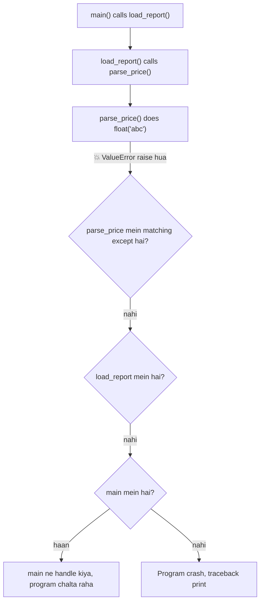
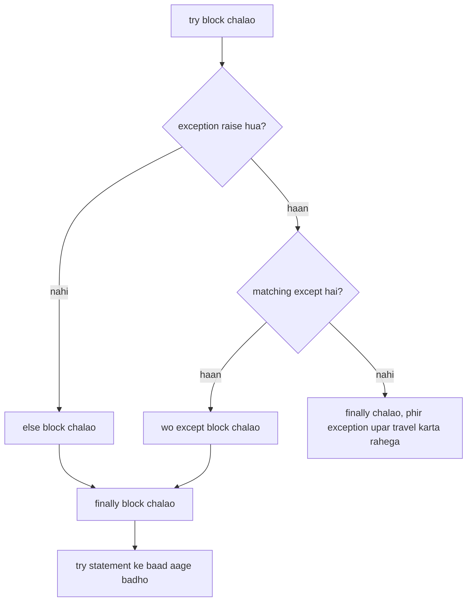
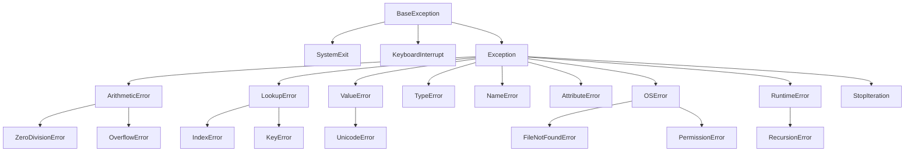
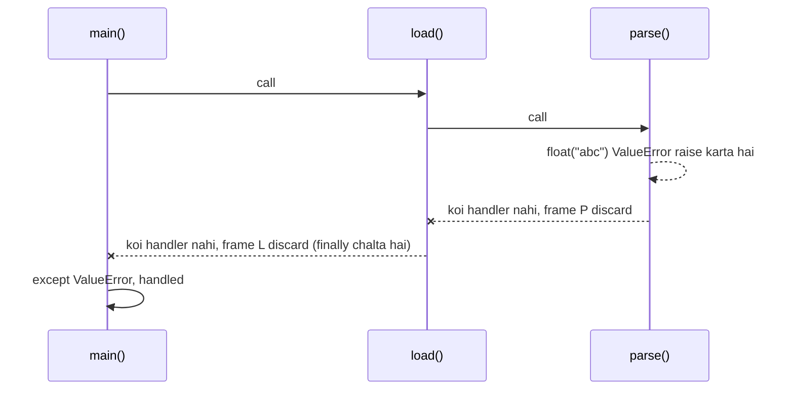
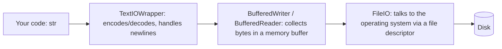

# Chapter 13 · Errors, Exceptions & Files

> Ab tak tumne jitne bhi programs likhe, sab ek perfect duniya mein rehte the: user number hi type karta tha, dictionary mein key hamesha milti thi, file hamesha exist karti thi. Asli programs ek messy duniya mein rehte hain. Ye chapter tumhare code ko teen cheezein sikhata hai: jab fail hona chahiye tab **zor se fail hona**, jab sambhal sakta hai tab **izzat se sambhalna**, aur program band hone ke baad bhi cheezein **yaad rakhna**.

**Is chapter mein tum seekhoge:**
- **Syntax error** aur **exception** mein kya fark hai, aur traceback ko ek detective ki tarah kaise padhte hain
- `try` / `except` / `else` / `finally`: kaunsa block kab chalta hai, ekdum exact
- Exceptions ka family tree, aur kyun hamesha *sabse narrow* exception pakadna chahiye
- `raise`, re-raising, custom exceptions aur exception chaining (`raise ... from ...`)
- `assert`, aur do philosophies: **EAFP** vs **LBYL**
- Files ko safely padhna aur likhna: `with`, `pathlib` aur sahi **encoding** ke saath
- Structured data ko `json` aur `csv` mein save karna, aur `print` wali debugging ki jagah `logging` use karna

**Isse pehle padho:** [Functions](10-functions.md) · [Dictionaries & Hashing](09-dictionaries.md) · [Strings Deep Dive](04-strings.md)

---

## 🧠 The Big Idea · Asli Baat

Ek bada hotel socho. Room 412 mein kuch gadbad ho gayi: chhoti si kitchen fire. Room 412 ka guest khud handle kar sakta hai (fire extinguisher utha ke), ya phir **fire alarm** kheench sakta hai. Alarm floor manager ke paas jaata hai. Floor manager se nahi sambhla, toh hotel manager ke paas. Aur agar koi bhi handle nahi karta, toh poora hotel khaali karwa diya jaata hai.

Python bilkul aise hi kaam karta hai:

- **Exception** hi fire alarm hai. Ye ek *object* hai jo bolta hai "kuch galat ho gaya, ye rahi details."
- Exception **raise** karna matlab alarm kheenchna.
- Alarm **function calls ki chain mein upar ki taraf** travel karta hai (room → floor → hotel), aur dhoondhta hai koi aisa jo bole "is type ki problem main sambhal lunga." Wo "koi" ek `except` block hota hai.
- Agar koi handle nahi karta, toh program ruk jaata hai aur ek **traceback** print karta hai: poori report ki aag kahan se shuru hui aur kin-kin rooms se guzri.



> 🇮🇳 **Desi Analogy:** Cricket mein DRS socho. Field umpire (tumhara current function) ko lagta hai kuch gadbad hai, par khud decide nahi kar pa raha. Wo decision **upar bhejta hai** third umpire (caller function) ke paas. Third umpire ke paas replay ka setup hai (matching `except`), toh wo faisla deta hai aur match aage chalta hai. Ab socho third umpire ka system bhi down hai aur match referee ke paas bhi koi rule nahi: match ruk jaata hai, aur scorecard pe likha jaata hai ki kya hua, kis over mein, kis ball pe. Wahi scorecard **traceback** hai. Mapping: problem detect karna = `raise`, decision upar bhejna = propagation, jo decide kar sake = `except`, koi na mile = crash + traceback.

Chapter ka doosra hissa **files** ke baare mein hai: yahi wo tareeka hai jisse tumhara program khatam hone ke baad bhi cheezein yaad rakhta hai. Files aur exceptions ek saath isliye padhte hain kyunki sabse zyada gadbad files mein hi hoti hai: file missing hai, permission nahi hai, disk full hai, text kisi ajeeb encoding mein hai. Dono seekh lo, toh tum aise programs likh paoge jo asli duniya ko touch karte hain aur gir nahi padte.

---

## 🔨 Building It Up · Zero Se Shuru

### 1. "Toot gaya" ke do type: syntax errors vs exceptions

**Syntax error** ka matlab hai Python tumhara code *samajh hi nahi pa raha*. Jaise ek sentence jisme verb hi nahi hai. Python isse **ek bhi line chalane se pehle** pakad leta hai.

```py
print("hello"      # SyntaxError: '(' kabhi close hi nahi hua
if x > 3           # SyntaxError: ':' chahiye tha
```

**Exception** program ke **chalte waqt** hota hai. Code grammar ke hisaab se bilkul theek hai, par us moment pe kuch impossible ho gaya.

```py
print(10 / 0)          # ZeroDivisionError: division by zero
int("forty-two")       # ValueError: invalid literal for int() with base 10: 'forty-two'
[1, 2, 3][10]          # IndexError: list index out of range
{"a": 1}["b"]          # KeyError: 'b'
"age: " + 25           # TypeError: can only concatenate str (not "int") to str
undefined_name         # NameError: name 'undefined_name' is not defined
```

| | Syntax error | Exception |
|---|---|---|
| Kab pakda jaata hai? | Chalne se pehle (parsing ke time) | Chalte waqt |
| `try/except` pakad sakta hai? | Nahi (file shuru hi nahi hoti) | Haan |
| Example | missing `:` ya `)` | zero se divide, missing key |
| Fix | Code theek karo | Code theek karo **ya** situation handle karo |

> 💡 Log casually dono ko "error" bol dete hain. Strictly bolein toh Python mein **exception** wo object hai jo raise hota hai, aur "errors" exceptions ka wo subset hain jinka matlab hai kuch galat hua (zyaadatar built-in exception names `Error` pe khatam hote hain).

> 🤔 **Mann mein sawaal:** Agar main poori file ko `try` mein daal doon, toh kya syntax error bhi pakda jaayega?
>
> **Jawab:** Nahi. Python pehle poori file ko **parse** karta hai (padh ke samajhta hai), aur uske baad hi chalata hai. Syntax error parsing mein hi pakda jaata hai, yaani us waqt tak tumhara `try` ek baar bhi execute nahi hua. Jo code chala hi nahi, wo kuch pakad kaise sakta hai? Syntax error ka ek hi ilaaj hai: code theek karo.

### 2. Traceback ko detective ki tarah padhna

Jab koi exception handle nahi hota, Python ek **traceback** print karta hai. Beginners isse dekh ke ghabra jaate hain. Pros isse **neeche se upar** padhte hain.

```py
def parse_price(text):
    return float(text)

def total(prices):
    return sum(parse_price(p) for p in prices)

print(total(["10.5", "abc", "3"]))
```

```text
Traceback (most recent call last):
  File "shop.py", line 7, in <module>
    print(total(["10.5", "abc", "3"]))
  File "shop.py", line 5, in total
    return sum(parse_price(p) for p in prices)
  File "shop.py", line 2, in parse_price
    return float(text)
ValueError: could not convert string to float: 'abc'
```

Isse aise padho:

1. **Sabse pehle last line:** exception ka type (`ValueError`) aur message (`could not convert string to float: 'abc'`). Ye batata hai *kya* galat hua.
2. **Uske theek upar wali line:** *kahan* galat hua (`line 2, in parse_price`).
3. **Aur upar ki lines:** *wahan tak pahunche kaise* (call chain). Sabse purani call sabse upar hoti hai. "most recent call last" ka literally matlab hai sabse nayi frame sabse neeche hai.

> 💡 Das mein se nau baar, bug sabse neeche wali us frame mein hota hai jo **tumhara** code hai (library ka code nahi). Wahin se shuru karo.

> 🇮🇳 **Desi Analogy:** Swiggy order late aaya. Tum complaint karte ho, aur support tumhe poori tracking history dikhata hai. Sabse neeche likha hai "Delivery failed: address not found" (**kya** hua). Uske upar "Rider stuck at Gate 3" (**kahan** hua). Aur upar "Restaurant ne order pack kiya", "Order placed" (**kaise** wahan tak pahunche). Asli kahaani neeche se padhne pe turant samajh aati hai. Traceback bhi exactly yahi hai: neeche result, upar history.

### 3. Tumhara pehla `try` / `except`

`try` block mein wo code hota hai jo fail ho sakta hai. `except` block mein plan B hota hai.

```python
def safe_divide(a, b):
    try:
        result = a / b
        print("division worked")
        return result
    except ZeroDivisionError:
        print("can't divide by zero, returning None")
        return None

print(safe_divide(10, 2))
print(safe_divide(10, 0))
```

```text
division worked
5.0
can't divide by zero, returning None
None
```

Abhi hua kya: doosri call mein `a / b` ne `ZeroDivisionError` raise kiya. Python ne `try` block ka baaki hissa **turant chhod diya** (isliye `"division worked"` kabhi print hi nahi hua), matching `except` dhoondha, mil gaya, aur use chala diya. `except` block khatam hone ke baad program normal tarah aage chalta hai, jaise kuch hua hi nahi.

> 🤔 **Mann mein sawaal:** Exception aane ke baad kya Python `try` mein wapas jaake baaki lines chalata hai?
>
> **Jawab:** Kabhi nahi. Jis line pe exception aaya, `try` ka safar wahin khatam. Uske neeche ki lines (yahan `print("division worked")` aur `return result`) skip ho jaati hain. Control seedha `except` mein jaata hai, aur `except` ke baad poore `try` statement ke **neeche** wale code pe. Isliye `try` ke andar wahi rakho jiska fail hone pe skip hona theek hai.

### 4. Specific exceptions pakadna (aur `as` se details nikalna)

Tum ek se zyada `except` clauses rakh sakte ho, aur `as` se exception object ko pakad sakte ho:

```python
def to_int(value):
    try:
        return int(value)
    except ValueError as e:
        print(f"ValueError: {e}")
    except TypeError as e:
        print(f"TypeError: {e}")
    return None

to_int("42")
to_int("forty-two")
to_int([4, 2])
print(to_int("7") + 1)
```

```text
ValueError: invalid literal for int() with base 10: 'forty-two'
TypeError: int() argument must be a string, a bytes-like object or a real number, not 'list'
8
```

Python `except` clauses ko **upar se neeche** check karta hai aur **pehla** match hone wala chalata hai. Sirf ek hi chalta hai.

Dhyaan do: `to_int("42")` ne kuch print nahi kiya. Usne `42` return kiya, par humne uska result print hi nahi kiya, isliye output mein kuch nahi dikha. Aakhri line mein `to_int("7")` ne `7` diya aur `+ 1` se `8` print hua.

Kai types ko ek hi code se handle karna hai? **Tuple** use karo:

```python
def lookup(data, key):
    try:
        return data[key]
    except (KeyError, IndexError) as e:
        print(f"missing: {type(e).__name__} {e}")
        return None

lookup({"a": 1}, "b")
lookup([10, 20], 5)
print(lookup({"a": 1}, "a"))
```

```text
missing: KeyError 'b'
missing: IndexError list index out of range
1
```

Exception object `e` ek normal Python object hai. `type(e).__name__` uski class ka naam deta hai, `str(e)` uska message deta hai, aur `e.args` wo arguments deta hai jinke saath wo bana tha.

> ⚠️ Bas `except:` likh do, aage kuch nahi, toh kya problem hai? Problem ye hai ki ye **sab kuch** pakad leta hai: typos (`NameError`), wo bugs jo tumhe dikhne chahiye the, yahan tak ki Ctrl+C bhi. Ye poore hotel ka fire alarm hi band kar dene jaisa hai. Hamesha naam lo ki tum kya expect kar rahe ho.

### 5. `else` aur `finally`: poori shape

Poore statement ke chaar hisse hote hain:

```py
try:
    risky_thing()          # wo code jo fail ho sakta hai
except SomeError:
    handle_it()            # SIRF tab chalta hai jab matching exception aaya
else:
    celebrate()            # SIRF tab chalta hai jab try mein KOI exception nahi aaya
finally:
    clean_up()             # HAMESHA chalta hai: success, failure, return, kuch bhi
```



Chalo events ka order dekhte hain:

```python
def demo(x):
    print(f"--- demo({x!r})")
    try:
        print("  try: start")
        value = 100 / x
        print("  try: end")
    except ZeroDivisionError:
        print("  except: divided by zero")
    else:
        print(f"  else: result is {value}")
    finally:
        print("  finally: always runs")
    print("  after the try statement")

demo(4)
demo(0)
```

```text
--- demo(4)
  try: start
  try: end
  else: result is 25.0
  finally: always runs
  after the try statement
--- demo(0)
  try: start
  except: divided by zero
  finally: always runs
  after the try statement
```

**`else` kyun hai?** Tum "success" wala code `try` ke end mein bhi daal sakte the. Problem ye hai ki tab *us code* ka koi bhi exception bhi tumhare `except` mein pakda jaayega, aur bugs chhup jaayenge. `else` se `try` block **chhota** rehta hai, usme sirf wahi line hoti hai jiske fail hone ki tumhe ummeed hai.

**`finally` kyun hai?** Us **clean-up ke liye jo har haal mein hona hi chahiye**: file band karna, lock chhodna, database connection close karna. `finally` tab bhi chalta hai jab `try` block `return` kar de:

```python
def get_value():
    try:
        print("returning from try")
        return "from try"
    finally:
        print("finally runs before the function actually returns")

print(get_value())
```

```text
returning from try
finally runs before the function actually returns
from try
```

> 🇮🇳 **Desi Analogy:** Railway ticket counter socho. **`try`** = Tatkal ticket book karne ki koshish. **`except`** = seat nahi mili, toh waiting list ya doosri train ka plan B. **`else`** = ticket confirm ho gaya, ab ghar pe sabko WhatsApp group mein message bhejo (sirf success pe!). **`finally`** = chahe ticket mila ya nahi, counter chhodne se pehle apna wallet aur ID wapas jeb mein daalna. Wallet uthana kabhi skip nahi hota. Yahi `finally` hai: clean-up jo har raaste pe hota hai.

> 🤔 **Mann mein sawaal:** `else` aur "`try` ke end mein code likhna" toh same hi hua na? Phir `else` alag se kyun?
>
> **Jawab:** Output same dikh sakta hai, par safety alag hai. Maan lo `try` ke end mein `celebrate()` likha, aur `celebrate()` ke andar khud ek `ZeroDivisionError` ka bug hai. Tab tumhara `except ZeroDivisionError` us bug ko bhi chupchaap pakad lega, aur tum sochoge "division fail hua", jabki asli problem kahin aur thi. `else` mein rakha code `except` ki **protection ke bahar** hota hai, toh uske bugs zor se crash karte hain aur tumhe dikhte hain.

### 6. Exceptions ka family tree

Exceptions ek **hierarchy** (family tree) mein organised hote hain. Jab tum `except ArithmeticError` likhte ho, toh uske saare bachche bhi pakde jaate hain: `ZeroDivisionError`, `OverflowError` aur baaki. Tree ka wo hissa jo tumhe sabse zyada milega:



Do important baatein:

- **`BaseException`** root hai. Uske direct bachche `SystemExit` (jo `sys.exit()` raise karta hai) aur `KeyboardInterrupt` (Ctrl+C) asal mein errors *nahi* hain: ye "please ruk jao" wale signals hain. Isliye ye `Exception` ke **bahar** baithte hain.
- **`Exception`** har "normal" error ka parent hai. Agar kabhi "jo bhi galat hua sab" pakadna hi pade, toh `Exception` pakdo, `BaseException` kabhi nahi.

Family relationships code mein check kar sakte ho:

```python
print(issubclass(ZeroDivisionError, ArithmeticError))
print(issubclass(KeyError, LookupError))
print(issubclass(KeyboardInterrupt, Exception))
print(issubclass(FileNotFoundError, OSError))

try:
    [1, 2, 3][99]
except LookupError as e:          # parent ne child ko pakad liya
    print("caught", type(e).__name__)
```

```text
True
True
False
True
caught IndexError
```

**Order matter karta hai**: kyunki pehla match jeet jaata hai, isliye **specific (child) exceptions ko general (parent) se pehle** rakho:

```py
# ❌ doosra clause kabhi chal hi nahi sakta: ArithmeticError ne pehle hi pakad liya
try:
    1 / 0
except ArithmeticError:
    print("arithmetic problem")
except ZeroDivisionError:
    print("never reached")

# ✅ pehle specific, aakhir mein general
try:
    1 / 0
except ZeroDivisionError:
    print("divide by zero")
except ArithmeticError:
    print("some other arithmetic problem")
```

Yaad rakhne ka simple tareeka: **jaali (net) pehle chhoti, phir badi**. Badi jaali pehle daalogi toh chhoti machhli bhi usi mein phas jaayegi, chhoti jaali tak kuch pahunchega hi nahi.

### 7. `raise`: alarm khud kheenchna

Ab tak exceptions Python hamare liye raise kar raha tha. Tum bhi kar sakte ho, jab bhi tumhare function ko kuch aisa mile jise wo samajhdaari se handle nahi kar sakta:

```python
def set_age(age):
    if not isinstance(age, int):
        raise TypeError(f"age must be an int, got {type(age).__name__}")
    if age < 0 or age > 150:
        raise ValueError(f"age must be between 0 and 150, got {age}")
    return age

for candidate in [25, -3, "twenty"]:
    try:
        print("ok:", set_age(candidate))
    except (TypeError, ValueError) as e:
        print("rejected:", e)
```

```text
ok: 25
rejected: age must be between 0 and 150, got -3
rejected: age must be an int, got str
```

Kya raise karein, iske thumb rules:

| Situation | Raise karo |
|---|---|
| Type sahi, value galat (age ke liye `-3`) | `ValueError` |
| Type hi galat (age ke liye `"twenty"`) | `TypeError` |
| Tumhare apne container mein key / index missing | `KeyError` / `IndexError` |
| "Ye toh impossible hona chahiye" / abhi supported nahi | `RuntimeError` / `NotImplementedError` |
| Tumhari app ki koi specific cheez | ek **custom exception** (section 9) |

> 💡 **Fail fast.** Jahan se kharab data andar aa raha hai, usi boundary pe jaldi raise karo. Ye kahin behtar hai ki kharab data program mein gehra chala jaaye aur 200 lines baad kisi confusing jagah crash kare.

> 🇮🇳 **Desi Analogy:** Metro station ka security gate socho. Bag mein koi mana ki hui cheez hai toh **gate pe hi** rok dete hain (fail fast). Agar gate pe na roka, toh wo banda train ke andar pahunch jaayega aur problem teen stations baad kisi aur coach mein hogi, jahan pata lagana bahut mushkil hai ki wo andar aaya kaise. `raise ValueError` tumhare function ka security gate hai.

### 8. Re-raising: thoda handle karo, phir aage bhej do

Kabhi kabhi tum exception ko *notice* karna chahte ho (log karna, clean-up karna) par phir bhi chahte ho ki caller hi usse deal kare. `except` block ke andar akela `raise` likhne se **wahi** exception apne original traceback ke saath dobara raise hota hai:

```python
def risky():
    return {"a": 1}["b"]

def wrapper():
    try:
        return risky()
    except KeyError:
        print("wrapper: noticed a KeyError, passing it upward")
        raise                      # wahi exception object, aage travel karta rahega

try:
    wrapper()
except KeyError as e:
    print("top level handled:", repr(e))
```

```text
wrapper: noticed a KeyError, passing it upward
top level handled: KeyError('b')
```

Ye wahi floor manager hai jo log book mein "412 mein aag" likhta hai, aur phir bhi alarm hotel manager tak forward kar deta hai.

### 9. Custom exceptions

Apne programs ke liye built-in exceptions aksar bahut vague hote hain. Bank transfer fail hua aur tumne `ValueError` diya, toh caller ko kuch khaas pata nahi chalta. Tum **apne khud ke exception types** bana sakte ho.

Iske liye ek chhota sa syntax chahiye jo humne abhi formally nahi padha: `class`. Tension mat lo: classes ko hum [Chapter 14](14-oop-classes-objects.md) mein aur inheritance ko [Chapter 15](15-oop-inheritance-magic.md) mein theek se padhenge. Abhi ke liye `class InsufficientFunds(BankError):` ko aise padho: "ek naya exception type banao jiska naam `InsufficientFunds` hai, aur jo `BankError` ka bachcha hai".

```python
class BankError(Exception):
    """Base class for every error in our bank app."""

class InsufficientFunds(BankError):
    pass

class AccountFrozen(BankError):
    pass

def withdraw(balance, amount, frozen=False):
    if frozen:
        raise AccountFrozen("account is frozen")
    if amount > balance:
        raise InsufficientFunds(f"need {amount}, have only {balance}")
    return balance - amount

print(withdraw(100, 30))

for args in [(100, 500), (100, 10, True)]:
    try:
        withdraw(*args)
    except InsufficientFunds as e:
        print("Please top up:", e)
    except BankError as e:            # baaki har bank error ko pakadta hai
        print("Bank problem:", type(e).__name__, "-", e)
```

```text
70
Please top up: need 500, have only 100
Bank problem: AccountFrozen - account is frozen
```

Abhi hua kya: humne ek mini family tree banaya (`BankError` → `InsufficientFunds`, `AccountFrozen`). Caller chahe toh kuch specific pakde, ya ek hi `except BankError` se poori family. Bade libraries bhi exactly yahi karte hain: jaise popular `requests` library mein ek `RequestException` base hai, aur uske bachche hain `ConnectionError` aur `Timeout` jaise.

(Chhota sa side note: `withdraw(*args)` mein `*` tuple ko kholke alag-alag arguments bana deta hai. `(100, 10, True)` ban jaata hai `withdraw(100, 10, True)`. Ye tumne [Functions](10-functions.md) mein dekha tha.)

> 🇮🇳 **Desi Analogy:** UPI payment fail hone pe app sirf "Error" nahi bolta. Wo bolta hai "Insufficient balance", "Bank server down", "Daily limit exceeded". Ye sab ek hi family ke bachche hain: "Payment failed". App sirf "Insufficient balance" pe "Add money" button dikhata hai (specific `except`), aur baaki sab pe generic "Try again later" (`except BankError`). Custom exceptions tumhe exactly yahi power dete hain.

> 💡 Custom exceptions jo errors represent karte hain, unke naam ke end mein `Error` lagao (`PaymentError`), `Exception` se inherit karo (`BaseException` se kabhi nahi), aur **har project ka ek base exception** banao taaki users tumhare saare exceptions ek saath pakad sakein.

### 10. Exception chaining: `raise ... from ...`

Aksar tum ek low-level exception pakadte ho aur uski jagah ek **higher-level, zyada meaningful** exception raise karte ho. Par original suraag (clue) khona nahi chahte. `raise NewError(...) from original` dono ko jod deta hai:

```python
class ConfigError(Exception):
    pass

def read_port(settings):
    try:
        return int(settings["port"])
    except (KeyError, ValueError) as e:
        raise ConfigError("port setting is missing or not a number") from e

try:
    read_port({"port": "eighty"})
except ConfigError as e:
    print("error:", e)
    print("caused by:", repr(e.__cause__))
```

```text
error: port setting is missing or not a number
caused by: ValueError("invalid literal for int() with base 10: 'eighty'")
```

Agar ye crash hota, toh traceback mein **dono** exceptions dikhte, beech mein ye sentence hota: *"The above exception was the direct cause of the following exception"*. Original exception `e.__cause__` mein store hota hai.

Teen variations jaanne layak hain:

| Tum likhte ho | Traceback kehta hai | Kahan store hota hai |
|---|---|---|
| `raise New(...) from e` | "...was the **direct cause** of..." | `__cause__` |
| `except` ke andar `raise New(...)` (bina `from`) | "**During handling** of the above exception, another exception occurred" | `__context__` (implicit) |
| `raise New(...) from None` | sirf naya exception (original chhupa diya) | `__suppress_context__ = True` |

```python
def implicit():
    try:
        {}["x"]
    except KeyError:
        raise RuntimeError("something else broke while handling")

def hidden():
    try:
        {}["x"]
    except KeyError:
        raise LookupError("clean message for the user") from None

for f in (implicit, hidden):
    try:
        f()
    except Exception as e:
        print(type(e).__name__, "| context:", repr(e.__context__),
              "| suppressed:", e.__suppress_context__)
```

```text
RuntimeError | context: KeyError('x') | suppressed: False
LookupError | context: KeyError('x') | suppressed: True
```

Dhyaan do: `from None` ke baad bhi `__context__` mein `KeyError('x')` pada hai. `from None` original ko delete nahi karta, bas `__suppress_context__ = True` set karke traceback mein usse **dikhana band** kar deta hai.

Errors translate karte waqt `from e` use karo (ye default accha choice hai). `from None` sirf tab use karo jab andar wala error ekdum implementation detail ho jo padhne wale ko confuse karega.

> 🤔 **Mann mein sawaal:** Bina `from` likhe bhi toh original `__context__` mein save ho jaata hai. Toh `from e` likhne ki zaroorat hi kya hai?
>
> **Jawab:** Fark **intention** ka hai. Bina `from` ke traceback kehta hai "handle karte waqt *ek aur* error aa gaya", jo aisa lagta hai jaise tumhare `except` block mein hi koi bug hai. `from e` likhne se traceback kehta hai "ye error *jaan-boojh ke* us error ki wajah se raise kiya gaya". Padhne wale ko turant samajh aata hai ki ye translation hai, accident nahi.

### 11. `assert`: sanity check *tumhare* liye, users ke liye nahi

`assert condition, message` ka matlab hai "ye sach hona hi chahiye; agar nahi hai, toh mere code mein bug hai." Agar condition false hai, toh ye `AssertionError` raise karta hai.

```python
def average(numbers):
    assert len(numbers) > 0, "average() needs at least one number"
    return sum(numbers) / len(numbers)

print(average([2, 4, 9]))
try:
    average([])
except AssertionError as e:
    print("AssertionError:", e)
```

```text
5.0
AssertionError: average() needs at least one number
```

> ⚠️ **Jab Python `python -O` (optimise mode) se chalta hai, toh wo har `assert` hata deta hai.** Isliye user input validate karne ya security checks ke liye `assert` kabhi use mat karo. `assert` ko internal "ye ho hi nahi sakta" wale checks aur tests ke liye rakho; asli validation ke liye `if ...: raise ValueError(...)` use karo.

### 12. EAFP vs LBYL: do philosophies

Jo cheez shayad kaam na kare, usse deal karne ke do tareeke hain:

- **LBYL** = "**Look Before You Leap**" (koodne se pehle dekh lo): pehle check karo, phir kaam karo.
- **EAFP** = "**Easier to Ask Forgiveness than Permission**" (permission lene se aasaan hai maafi maangna): seedha kar do, aur fail ho toh exception handle karo.

```python
stock = {"apple": 5, "banana": 0}

# LBYL: pehle check, phir kaam
def price_lbyl(item):
    if item in stock:
        return stock[item]
    return "not sold here"

# EAFP: pehle kaam, failure ho toh handle
def price_eafp(item):
    try:
        return stock[item]
    except KeyError:
        return "not sold here"

for item in ["apple", "mango"]:
    print(item, price_lbyl(item), price_eafp(item))
```

```text
apple 5 5
mango not sold here not sold here
```

> 🇮🇳 **Desi Analogy:** Kirana store pe do type ke customers. **LBYL wala** pehle poochta hai "Bhaiya, Parle-G hai?", jawab sunta hai, phir bolta hai "toh do de do." Do baar baat hui. **EAFP wala** seedha bolta hai "Bhaiya, do Parle-G dena", aur agar nahi hai toh dukaandaar bolega "khatam ho gaya", tab wo plan B sochega. Jab cheez zyaadatar milti hai, EAFP wala time bachata hai. Par agar dukaan mein aadhi cheezein hoti hi nahi, toh har baar "khatam ho gaya" sunna (exception) mehenga pad jaata hai; wahan pehle pooch lena behtar hai.

Python culture **EAFP** ki taraf jhukta hai, teen wajah se:

1. **Race conditions nahi hote.** Files ke saath, `if path.exists(): open(path)` phir bhi fail ho sakta hai agar check aur open ke beech koi aur program file delete kar de. EAFP seedha open karta hai aur `FileNotFoundError` handle karta hai.
2. Jab success hi common case hai, toh **do lookups ki jagah ek**.
3. **Duck typing** ([Chapter 15](15-oop-inheritance-magic.md)): "isse number ki tarah use karke dekho; agar number jaisa behave nahi kiya toh handle karo" kisi bhi type ke saath kaam karta hai.

Par LBYL bhi theek hai (aur zyada clear hai) jab failure **common** ho aur check sasta ho. Exception raise karna aur pakadna ek `if` se mehenga hai. Toh agar dictionary lookup mein aadhi baar key missing hoti hai, toh `dict.get(key, default)` ya `in` behtar hai. Apna judgement use karo: sabse pehle **clarity** ke liye optimise karo.

> 🤔 **Mann mein sawaal:** "Race condition" matlab kya? `exists()` ne toh abhi bola tha file hai!
>
> **Jawab:** "Abhi" aur "agli line" ke beech bhi time hota hai. Tumhara program `exists()` check karta hai: True. Usi microsecond mein koi doosra program (ya user, ya antivirus) file delete kar deta hai. Ab tumhari agli line `open()` chalti hai aur crash. Do kaamon ke beech ki ye chhoti si khidki hi **race condition** hai. EAFP mein check aur kaam ek hi step hai (`open` khud hi check hai), toh khidki hai hi nahi.

### 13. Files: kyun aur kaise

Program khatam hote hi variables gayab ho jaate hain. **Files** bachi rehti hain. Har file operation teen steps follow karta hai: **open → read/write → close**.

```py
f = open("notes.txt", "w", encoding="utf-8")   # 1. open (banao/overwrite karo)
f.write("Buy milk\n")                          # 2. likho
f.close()                                      # 3. close (disk pe flush karo, file chhod do)
```

Problem: agar `write` exception raise kar de, toh `close()` kabhi chalega hi nahi. File locked reh sakti hai ya buffer mein pada data kho sakta hai. Iska ilaaj hai **`with` statement**, jo file ko **automatically** close karta hai, chahe andar exception hi kyun na aa jaaye:

```py
with open("notes.txt", "w", encoding="utf-8") as f:
    f.write("Buy milk\n")
    f.write("Call mom\n")
# yahan f pakka close ho chuka hai, exception aaye ya na aaye
```

`with` basically ek built-in `try/finally` hai. (Jo objects `with` ke saath kaam karte hain unhe **context managers** kehte hain; apna khud ka tum [Chapter 16](16-iterators-generators-decorators.md) mein banaoge.)

> 🇮🇳 **Desi Analogy:** Library se book issue karna socho. `open` = book issue karwana, `read/write` = padhna ya notes banana, `close` = book wapas jama karna. Bina `with` ke, agar beech mein tumhe emergency mein bhaagna pada (exception), toh book tumhare paas hi reh gayi, aur library ke register mein wo "issued" dikhti rahegi (file locked). `with` ek aise librarian jaisa hai jo **gate pe khada hai**: tum kaise bhi niklo, aaram se ya bhaagte hue, book wahin jama karwa leta hai.

**Mode** string `open` ko batata hai ki tum kya karna chahte ho:

| Mode | Matlab | File exist karti hai toh | File exist nahi karti toh |
|---|---|---|---|
| `"r"` | read (default) | padh leta hai | `FileNotFoundError` |
| `"w"` | write | **pehle usse mita deta hai!** | bana deta hai |
| `"a"` | append | end mein likhta hai | bana deta hai |
| `"x"` | exclusive create | `FileExistsError` | bana deta hai |
| `"r+"` | read aur write | wahin padhta/likhta hai | `FileNotFoundError` |
| `"b"` jodo | binary (`"rb"`, `"wb"`) | bytes, str nahi | |
| `"t"` jodo | text (default) | str | |

> ⚠️ `"w"` file ko open karte hi chupchaap **saaf kar deta hai**, chahe tum kuch bhi na likho. Kuch add karna ho toh `"a"` use karo, aur jab overwrite bilkul nahi hona chahiye tab `"x"`.

### 14. Padhne ki strategies

Text file padhne ke chaar tareeke hain. Kaunsa use karna hai, ye file ke size pe depend karta hai.

```py
with open("poem.txt", encoding="utf-8") as f:
    everything = f.read()          # 1. poori file EK string mein

with open("poem.txt", encoding="utf-8") as f:
    first = f.readline()           # 2. ek baar mein ek line ("\n" saath rehta hai)

with open("poem.txt", encoding="utf-8") as f:
    lines = f.readlines()          # 3. saari lines ki list (har line mein "\n" rehta hai)

with open("poem.txt", encoding="utf-8") as f:
    for line in f:                 # 4. lazily iterate, line by line  ⭐ badi files ke liye best
        print(line.rstrip("\n"))
```

Is book ka checker asli files allow nahi karta, par Python ke paas ek perfect stand-in hai: **`io.StringIO`**, ek in-memory "file" jiske methods bilkul same hain. Neeche ka sab kuch `open()` se khuli asli file pe bhi exactly aise hi kaam karta hai.

```python
import io

text = "Twinkle twinkle\nlittle star\nhow I wonder\n"

f = io.StringIO(text)
print(repr(f.read()))
print(repr(f.read()))        # cursor ab end pe hai: kuch bacha hi nahi

f = io.StringIO(text)
print(repr(f.readline()))
print(repr(f.readline()))

f = io.StringIO(text)
print(f.readlines())

f = io.StringIO(text)
for number, line in enumerate(f, start=1):
    print(number, line.rstrip("\n"))
```

```text
'Twinkle twinkle\nlittle star\nhow I wonder\n'
''
'Twinkle twinkle\n'
'little star\n'
['Twinkle twinkle\n', 'little star\n', 'how I wonder\n']
1 Twinkle twinkle
2 little star
3 how I wonder
```

Abhi hua kya:

- File ka ek **cursor** (position) hota hai. Padhne se wo aage badhta hai. Doosre `read()` ne `''` diya kyunki cursor pehle hi end pe tha. (`f.seek(0)` usse wapas shuru pe le jaata hai.)
- Lines apna trailing `"\n"` saath rakhti hain. `line.rstrip("\n")` use karo (ya `.strip()` agar spaces bhi hatane hain).
- `for line in f` **ek baar mein ek line** padhta hai. 50 GB ki log file bhi sirf ek line jitni memory leti hai. `read()` aur `readlines()` **poori file** memory mein load karte hain: chhoti files ke liye theek, badi files ke liye crash.

> 🇮🇳 **Desi Analogy:** File ka cursor cassette tape ke head jaisa hai (ya Netflix ka progress bar). Ek baar poora gaana sun liya, toh tape end pe hai. Dobara "play" dabaoge toh kuch nahi bajega, jab tak **rewind** (`f.seek(0)`) na karo. `read()` ne poori tape chala di, isliye doosra `read()` khaali `''` laaya.

| Method | Kya return karta hai | Memory | Kab use karo |
|---|---|---|---|
| `f.read()` | ek `str` | poori file | chhoti file, ek single string chahiye |
| `f.read(n)` | `n` characters tak | `n` | fixed-size chunks mein process karna |
| `f.readline()` | agli line | ek line | pehle header padhna, phir kuch aur |
| `f.readlines()` | `list[str]` | poori file | chhoti file, lines pe random access chahiye |
| `for line in f` | har loop mein ek line | ek line | **default choice**, kisi bhi size ke liye |

### 15. Files mein likhna

```py
lines = ["alpha", "beta", "gamma"]

with open("out.txt", "w", encoding="utf-8") as f:
    f.write("header\n")                    # write() tumhare liye "\n" NAHI jodta
    for line in lines:
        f.write(line + "\n")

with open("out.txt", "a", encoding="utf-8") as f:
    f.writelines(l + "\n" for l in lines)  # writelines bhi "\n" nahi jodta
    print("printed into the file", file=f) # print() bhi file mein likh sakta hai
```

Phir se, `io.StringIO` se hum exactly dekh sakte hain ki kya likha jaata:

```python
import io

buffer = io.StringIO()
buffer.write("header\n")
for word in ["alpha", "beta"]:
    buffer.write(word + "\n")
print("done", 3, "items", file=buffer, sep=", ")
print(repr(buffer.getvalue()))
```

```text
'header\nalpha\nbeta\ndone, 3, items\n'
```

`write()` likhe gaye characters ki ginti return karta hai aur kabhi newline nahi jodta. `print(..., file=f)` aksar sabse convenient hota hai kyunki spaces, newlines aur non-string values ko wo khud sambhal leta hai. (Yahan `sep=", "` ne items ke beech space ki jagah `", "` lagaya, aur `print` ne end mein `"\n"` khud joda.)

> 💡 File mein likha data aksar pehle memory ke ek **buffer** mein jaata hai, aur bade chunks mein disk pe push hota hai (bahut tez). Disk tak pahunchne ki guarantee tab hai jab file close ho (ya tum `f.flush()` call karo). `with` use karne ki ek aur wajah.

### 16. `pathlib`: paths as objects

Strings jod-jod ke paths banana (`folder + "/" + name`) alag operating systems pe toot jaata hai (Windows `\` use karta hai). Modern tareeka hai **`pathlib.Path`**, jo path ko ek object ki tarah treat karta hai, kaam ke methods ke saath. `/` operator paths ko jodta hai.

```python
from pathlib import PurePosixPath

# PurePosixPath sirf path ka hisaab-kitaab karta hai "/" separators ke saath, disk ko touch nahi karta.
# Asli code mein tum Path use karoge, jo same tarah kaam karta hai aur disk ko bhi touch karta hai.
report = PurePosixPath("/home/riya/projects") / "sales" / "report_2024.csv"

print(report)
print(report.name)        # aakhri hissa
print(report.stem)        # suffix ke bina naam
print(report.suffix)      # extension
print(report.parent)      # wo folder jisme ye rehta hai
print(report.parts[-2:])
print(report.with_suffix(".json"))
print(report.match("*.csv"))
```

```text
/home/riya/projects/sales/report_2024.csv
report_2024.csv
report_2024
.csv
/home/riya/projects/sales
('sales', 'report_2024.csv')
/home/riya/projects/sales/report_2024.json
True
```

> 🇮🇳 **Desi Analogy:** Path ko ek postal address samjho: "Riya, Flat 12, Sunshine Society, Pune". String se address banana matlab har baar khud comma aur spelling lagana, aur kisi doosre shehar ka postman (doosra OS) format hi na samjhe. `Path` ek aisa form hai jisme har line ka alag khaana hai: `.name` = flat ka naam, `.parent` = society, `.suffix` = PIN code jaisa tag. Postman (OS) kaunsa bhi ho, form sahi format mein chhap jaata hai.

Asli `Path` ke saath disk operations bhi milte hain:

```py
from pathlib import Path

base = Path("data")
base.mkdir(parents=True, exist_ok=True)       # folder banao (exist karta hai toh koi error nahi)

notes = base / "notes.txt"
notes.write_text("hello\n", encoding="utf-8") # open + write + close ek hi call mein
print(notes.read_text(encoding="utf-8"))      # open + read + close ek hi call mein
print(notes.exists(), notes.is_file(), notes.stat().st_size)

for csv_file in base.glob("*.csv"):           # folder ki saari CSVs
    print(csv_file.name)
for py_file in Path(".").rglob("*.py"):       # recursive search
    print(py_file)

with notes.open("a", encoding="utf-8") as f:  # Path ka apna open() hai
    f.write("more\n")

notes.unlink()                                # file delete karo
Path.cwd(), Path.home()                       # current folder, tumhara home folder
```

> 💡 `Path` objects har us jagah chalte hain jahan path string accept hoti hai (`open()` mein bhi), isliye ab strings se path banane ki koi wajah nahi bachi.

### 17. Encoding: text vs bytes

Computer letters nahi, **bytes** (0–255 ke numbers) store karte hain. **Encoding** wo rulebook hai jo text ko bytes mein aur bytes ko wapas text mein badalti hai. **UTF-8** world standard hai: ye har language ka har character (aur emoji bhi) store kar sakta hai, aur English letters sirf 1 byte lete hain.

```python
word = "café ₹"
data = word.encode("utf-8")       # str -> bytes
print(data)
print(len(word), "characters,", len(data), "bytes")
print(data.decode("utf-8") == word)   # bytes -> str, round trip kaam karta hai

try:
    data.decode("ascii")          # galat rulebook
except UnicodeDecodeError as e:
    print("UnicodeDecodeError:", e.reason)

garbled = data.decode("ascii", errors="replace")
print(ascii(garbled))             # ascii() chhupe characters ko escapes ki tarah dikhata hai
```

```text
b'caf\xc3\xa9 \xe2\x82\xb9'
6 characters, 9 bytes
True
UnicodeDecodeError: ordinal not in range(128)
'caf\ufffd\ufffd \ufffd\ufffd\ufffd'
```

Abhi hua kya: UTF-8 mein `é` 2 bytes leta hai aur `₹` 3 bytes. Ginti karo: `c`, `a`, `f` (3 bytes) + `é` (2) + space (1) + `₹` (3) = **9 bytes**, jabki characters sirf **6** hain. Galat encoding se decode karoge toh fail hoga, ya `errors="replace"` ke saath kachra niklega: har byte jo decode nahi ho payi, wo replacement character `�` (Unicode code point U+FFFD) ban jaati hai. Ye `�` encoding mix-up ka pakka nishaan hai, jo tumne websites pe zaroor dekha hoga.

> 🇮🇳 **Desi Analogy:** Encoding ek morse code ya "secret language" ki chit jaisi hai. Tumne apne dost ko chit likhi ek code-book (UTF-8) se. Agar dost doosri code-book (ASCII) se padhega, toh ya toh wo bolega "ye toh padha hi nahi ja raha" (`UnicodeDecodeError`), ya zabardasti padhega toh bakwas niklegi (`���`). Text aur bytes ke beech hamesha **wahi code-book** chahiye dono taraf.

> ⚠️ **Text files ke liye `open()` ko hamesha `encoding="utf-8"` do.** Agar nahi doge, toh Python operating system ka default use karta hai. Bahut saari Windows machines pe ye abhi bhi ek purani encoding hai (jaise `cp1252`). Natija: jo file tumhare dost ke Mac pe chal rahi thi, wo tumhare laptop pe `UnicodeDecodeError` se crash. Explicit likhoge toh code har jagah same behave karega.

Binary mode (`"rb"`, `"wb"`) encoding ko poori tarah skip karta hai aur tumhe raw `bytes` deta hai: images, PDFs, zip files, jo bhi text nahi hai uske liye ye use karo.

### 18. `json`: Python data ko text ki tarah save karna

**JSON** (JavaScript Object Notation) programs ke beech aur web pe data exchange karne ka sabse common format hai. Ye almost bilkul Python dicts aur lists jaisa dikhta hai.

```python
import json

student = {
    "name": "Aarav",
    "age": 20,
    "marks": [91, 78, 88],
    "graduated": False,
    "mentor": None,
}

text = json.dumps(student)                  # Python -> JSON string
print(text)
print(json.dumps(student, indent=2, sort_keys=True))

back = json.loads(text)                     # JSON string -> Python
print(back == student, type(back))
```

```text
{"name": "Aarav", "age": 20, "marks": [91, 78, 88], "graduated": false, "mentor": null}
{
  "age": 20,
  "graduated": false,
  "marks": [
    91,
    78,
    88
  ],
  "mentor": null,
  "name": "Aarav"
}
True <class 'dict'>
```

Dhyaan do output mein: Python ka `False` JSON mein `false` ban gaya aur `None` ban gaya `null`. `sort_keys=True` ne keys ko alphabetical order mein laga diya.

`dumps`/`loads` mein **s** ka matlab hai **string**. Bina s ke, `dump`/`load` seedha files ke saath kaam karte hain:

```py
with open("student.json", "w", encoding="utf-8") as f:
    json.dump(student, f, indent=2)

with open("student.json", encoding="utf-8") as f:
    student = json.load(f)
```

Types kaise translate hote hain:

| Python | JSON | Wapas kya aata hai |
|---|---|---|
| `dict` | object `{}` | `dict` |
| `list`, **`tuple`** | array `[]` | `list` (tuples kho jaate hain!) |
| `str` | string | `str` |
| `int`, `float` | number | `int`, `float` |
| `True` / `False` | `true` / `false` | `True` / `False` |
| `None` | `null` | `None` |
| `set`, `datetime`, custom objects | ❌ `TypeError` | inhe khud convert karna padega |

Do classic surprises:

```python
import json

data = {1: "one", "pair": (1, 2)}
round_trip = json.loads(json.dumps(data))
print(round_trip)                  # int key str ban gayi, tuple list ban gaya

try:
    json.dumps({"tags": {"a", "b"}})
except TypeError as e:
    print("TypeError:", e)

try:
    json.loads("{'name': 'single quotes'}")
except json.JSONDecodeError as e:
    print("JSONDecodeError:", e.msg)
```

```text
{'1': 'one', 'pair': [1, 2]}
TypeError: Object of type set is not JSON serializable
JSONDecodeError: Expecting property name enclosed in double quotes
```

JSON keys hamesha strings hoti hain, JSON mein tuples ya sets nahi hote, aur JSON strings mein **double quotes** zaroori hain. (`json.JSONDecodeError`, `ValueError` ka bachcha hai, isliye `except ValueError` bhi isse pakad leta hai.)

> 🤔 **Mann mein sawaal:** JSON toh bilkul Python dict jaisa dikhta hai. Toh `str(my_dict)` likh ke save kyun nahi kar dete?
>
> **Jawab:** Kyunki dikhna aur hona alag hai. `str({"ok": True, "x": None})` deta hai `{'ok': True, 'x': None}`: single quotes, `True`, `None`. Ye valid JSON hai hi nahi (JSON ko double quotes, `true` aur `null` chahiye). JavaScript, Java, ya koi bhi API isse padh nahi payega. `json.dumps` ek **standard** format likhta hai jo poori duniya samajhti hai. `str()` sirf Python ki apni bhasha hai.

### 19. `csv`: spreadsheets as text

**CSV** (comma-separated values) wo format hai jisme spreadsheets aur databases tables export karte hain. Tumhe lagega `line.split(",")` kaafi hai, jab tak koi value khud comma na rakhe: `"Mumbai, India"`. `csv` module quoting ko sahi tarah handle karta hai.

```python
import csv
import io

raw = '''name,city,score
Asha,"Mumbai, India",88
Ben,Pune,92
'''

reader = csv.reader(io.StringIO(raw))
header = next(reader)
print(header)
for row in reader:
    print(row)

# DictReader: har row ek dict ban jaati hai, header ki keys ke saath
rows = list(csv.DictReader(io.StringIO(raw)))
print(rows[0]["city"], "|", sum(int(r["score"]) for r in rows))

# DictWriter: dicts -> CSV text
out = io.StringIO()
writer = csv.DictWriter(out, fieldnames=["name", "score"], lineterminator="\n")
writer.writeheader()
writer.writerow({"name": "Chen", "score": 75})
writer.writerows([{"name": "Dia, Jr.", "score": 81}])
print(out.getvalue(), end="")
```

```text
['name', 'city', 'score']
['Asha', 'Mumbai, India', '88']
['Ben', 'Pune', '92']
Mumbai, India | 180
name,score
Chen,75
"Dia, Jr.",81
```

Abhi hua kya: reader samajh gaya ki quotes ke andar wala comma value ka hissa hai. Saari values **strings** ki tarah aati hain (`"88"`), isliye `int()` se khud convert karo. Writer ne `"Dia, Jr."` ke around quotes apne aap laga diye.

Agar `split(",")` use karte, toh `Asha,"Mumbai, India",88` toot ke chaar tukde ban jaata: `['Asha', '"Mumbai', ' India"', '88']`. Isliye CSV ke liye hamesha `csv` module.

Asli files ke saath, unhe `newline=""` ke saath kholo (csv module line endings khud handle karta hai; iske bina Windows pe rows ke beech khaali lines aa sakti hain):

```py
with open("scores.csv", "w", newline="", encoding="utf-8") as f:
    writer = csv.writer(f)
    writer.writerow(["name", "score"])
    writer.writerows([["Asha", 88], ["Ben", 92]])

with open("scores.csv", newline="", encoding="utf-8") as f:
    for row in csv.DictReader(f):
        print(row["name"], int(row["score"]))
```

### 20. `logging`: bada ho chuka `print`

`print` se debugging chalti hai, par asli programs mein tum chahte ho: messages ko delete kiye bina on/off karna, timestamps jodna, messages ko file mein bhejna, aur har message kitna serious hai ye mark karna. Yahi hai **`logging`**.

Paanch standard **levels** hain, sabse kam se sabse zyada serious:

| Level | Kiske liye |
|---|---|
| `DEBUG` | problems diagnose karne ke liye detailed info |
| `INFO` | "sab expected tarah chal raha hai" wale milestones |
| `WARNING` | kuch unexpected hua, par program chal raha hai (**default threshold**) |
| `ERROR` | asli problem; koi operation fail hua |
| `CRITICAL` | program khud shayad aage nahi chal payega |

> 🇮🇳 **Desi Analogy:** Joint family ka WhatsApp group socho, alag-alag seriousness ke messages ke saath. `DEBUG` = "Maine aaj 3 baje chai pi" (sirf detective ko chahiye). `INFO` = "Ghar pahunch gaya". `WARNING` = "Train 20 minute late hai". `ERROR` = "Train chhoot gayi". `CRITICAL` = "Ghar mein paani bhar gaya, sab aao!". `level=` ek **mute filter** hai: `WARNING` set kiya toh chai aur ghar-pahunch-gaya wale messages dikhenge hi nahi, par train chhootne wala zaroor dikhega. Message delete nahi hua, bas filter laga.

```python
import logging
import sys

logging.basicConfig(
    level=logging.INFO,                              # INFO aur usse upar dikhao
    format="%(levelname)s:%(name)s:%(message)s",
    stream=sys.stdout,                               # default stderr hai
)
log = logging.getLogger("payments")

log.debug("raw request body: ...")                   # INFO se neeche -> chhupa
log.info("payment started for order %s", 1042)
log.warning("retrying, attempt %d of %d", 2, 3)

try:
    1 / 0
except ZeroDivisionError:
    log.error("payment failed for order %s", 1042)
```

```text
INFO:payments:payment started for order 1042
WARNING:payments:retrying, attempt 2 of 3
ERROR:payments:payment failed for order 1042
```

Abhi hua kya:

- `basicConfig` program ke shuru mein ek baar logging setup karta hai. `level=logging.INFO` `DEBUG` ko chhupa deta hai. Ek word badal ke `DEBUG` kar do aur tumhare saare debug messages wapas aa jaayenge, koi code delete nahi hua.
- `getLogger("payments")` ek naam wala logger deta hai. Asli modules mein tum `log = logging.getLogger(__name__)` likhte ho, taaki har message bataye ki wo kis file se aaya (`__name__` [Chapter 17](17-modules-stdlib.md) mein samjhaya gaya hai).
- Values ko **arguments** ki tarah pass karo (`"order %s", 1042`), f-strings ki tarah nahi: text sirf tab banta hai jab message sach mein dikhaya jaane wala ho.
- `except` block ke andar `log.exception("message")` `ERROR` level pe log karta hai **aur** saath mein poora traceback jod deta hai. Production mein ye sabse kaam ki logging call hai.
- Ek typical real-world format time bhi jodta hai: `format="%(asctime)s %(levelname)s %(name)s: %(message)s"`, aur `filename="app.log"` sab kuch ek file mein bhej deta hai.

---

## 🔬 Under the Hood · Andar Ki Kahani

### `raise` asal mein kya karta hai: stack unwinding

Har function call ko ek **frame** milta hai: ek chhota sa dabba jisme uske local variables hote hain aur "main apne code mein kahan hoon" ki info. Ye frames milke ek **call stack** banate hain (tumne ye [Recursion](12-recursion.md) mein dekha tha). Jab exception raise hota hai:

1. Python exception ka **object** banata hai (ye ek ordinary object hai: iska ek type hai, `args` hain, aur ek `__traceback__` attribute hai).
2. Current frame check karta hai: kya hum kisi `try` ke andar hain jiska `except` match karta hai?
3. Agar nahi, toh current frame **phenk diya jaata hai** (uske local variables release ho jaate hain, aur koi `finally` blocks pehle chal jaate hain), aur Python caller ke frame mein wahi check dohraata hai. Isse **stack unwinding** kehte hain.
4. Jis-jis frame se ye guzarta hai, wo traceback mein record hota hai. Isiliye traceback poora raasta dikhata hai.
5. Agar ye bilkul top (module level) se bhi aage unwind ho jaaye, toh Python traceback print karta hai aur non-zero status code ke saath exit karta hai.



> 🇮🇳 **Desi Analogy:** Thaali ka dher (stack) socho shaadi ke buffet mein. Har function call ek nayi plate upar rakhta hai. Exception aaya toh Python upar se plates hatana shuru karta hai, ek-ek karke, aur har plate pe dekhta hai "kya is plate pe `except` ka label hai?" Har hatayi gayi plate ka naam ek register mein likha jaata hai (traceback). Label mil gaya toh wahin ruk jaata hai. Poora dher khaali ho gaya aur label nahi mila, toh program crash.

### Kya `try` slow hai?

Python 3.11 aur uske baad, jab koi exception raise nahi hota, toh `try` block mein enter karne ki cost **almost zero** hai. CPython ek side table (the "exception table") compile karta hai, jo sirf tab dekha jaata hai jab sach mein kuch galat hota hai. Purane versions har `try` ke liye ek chhota setup instruction chalate the. Mehenga hissa hai **raise karna aur pakadna**: ek object banta hai, traceback record hota hai, aur frames unwind hote hain. Isiliye EAFP ka rule hai "exceptions ko *exceptional* cases ke liye use karo": agar ek hot loop ke zyaadatar iterations mein failure ho raha hai, toh ek `if` check tez hai.

### File object asal mein kya hai

Text mode mein `open()` tumhe actually ek ke upar ek rakhi **teen layers** deta hai:



- **TextIOWrapper** tumhari encoding se `str` ko bytes mein badalta hai, aur likhte waqt `"\n"` ko OS ki line ending mein convert karta hai (Windows pe `"\r\n"`), aur padhte waqt wapas. Isiliye `"\n"` har jagah chalta hai.
- **Buffer** chhote-chhote writes ko jod ke bade writes banata hai, kyunki operating system tak har trip slow hai. Jo data abhi flush nahi hua, wo sirf memory mein hai. Isiliye bina close ki gayi file apne aakhri kuch writes kho sakti hai.
- **FileIO** ek **file descriptor** rakhta hai: ek chhota integer jisse OS khuli files ko track karta hai. OS limit karta hai ki ek process kitni files khol sakta hai (aksar lagbhag ek hazaar). Loop mein files close karna bhool gaye, toh aakhir mein `OSError: Too many open files` aayega. `with` isse bachata hai.

Binary mode (`"rb"`) TextIOWrapper layer skip kar deta hai: tumhe buffer se seedha bytes milte hain.

> 🇮🇳 **Desi Analogy:** Ye teen layers dabbawala system jaisi hain. **TextIOWrapper** = ghar wali aunty jo khaana (tumhara `str`) dabbe mein pack karti hai (bytes). **Buffer** = station pe dabbawala jo ek-ek dabba alag train mein nahi bhejta, balki saare dabbe ek bade crate mein jama karke ek saath bhejta hai (trip kam, speed zyada). **FileIO** = wo token number (file descriptor) jisse railway (OS) crate ko track karti hai. Agar crate bhejne se pehle dabbawala chala gaya (file close nahi hui), toh crate mein pade dabbe kabhi office nahi pahunchenge.

### `with` kaise kaam karta hai (ek preview)

`with open(...) as f:` mote taur pe iska shorthand hai:

```py
f = open("notes.txt", encoding="utf-8")
try:
    ...                 # with block ki body
finally:
    f.close()
```

Aur precisely bolein toh, `with` shuru mein object ka `__enter__` method call karta hai aur end mein uska `__exit__` method, aur jo bhi exception hua wo `__exit__` ko pass karta hai. Aise objects tum khud [Chapter 16](16-iterators-generators-decorators.md) mein likhoge.

---

## 🧩 Pattern Decoder · Pattern Pakdo

### Errors ke Pythonic idioms

**1. `try` blocks ekdum chhote rakho.** Andar sirf wahi line jo fail ho sakti hai.

```py
# ❌ process() ya save() ka koi bhi bug galti se "bad number" bata diya jaayega
try:
    n = int(text)
    result = process(n)
    save(result)
except ValueError:
    print("bad number")

# ✅
try:
    n = int(text)
except ValueError:
    print("bad number")
else:
    save(process(n))
```

**2. Module boundaries pe low-level errors translate karo** `raise HighLevelError(...) from e` se. Tumhare `config` module ke callers ko `ConfigError` dikhna chahiye, andar gehraai se aaya koi random `KeyError` nahi.

**3. Jab failure normal ho, toh wo tool chuno jo exception se bachata hai:**

| Iski jagah | Ye prefer karo |
|---|---|
| `try: d[k] except KeyError: default` | `d.get(k, default)` |
| `try/except KeyError` se counting | `collections.Counter` / `defaultdict` ([Chapter 17](17-modules-stdlib.md)) |
| `if os.path.exists(p): open(p)` | `try: open(p) except FileNotFoundError:` (koi race nahi) |
| `f = open(...)` … `f.close()` | `with open(...) as f:` |
| `"folder" + "/" + name` | `Path("folder") / name` |

**4. "Parse karo aur errors collect karo" pattern**: sab kuch process karo, jo fail hua usse record karo, end mein report karo. Asli data pipelines ek kharab row se isi tarah bach jaati hain.

```python
def parse_all(items):
    good, bad = [], []
    for index, item in enumerate(items):
        try:
            good.append(int(item))
        except ValueError:
            bad.append((index, item))
    return good, bad

numbers, problems = parse_all(["4", "x", "15", "", "-2"])
print(numbers)
print(problems)
```

```text
[4, 15, -2]
[(1, 'x'), (3, '')]
```

**5. "Default ke saath config padho" pattern:**

```py
import json
from pathlib import Path

def load_settings(path):
    defaults = {"theme": "light", "font_size": 14}
    try:
        with Path(path).open(encoding="utf-8") as f:
            user = json.load(f)
    except FileNotFoundError:
        return defaults                 # pehli baar chal raha hai: settings file abhi nahi hai
    except json.JSONDecodeError as e:
        raise ValueError(f"settings file {path} is corrupted") from e
    return {**defaults, **user}         # user ki values defaults ko override karti hain
```

Yahan dekho do failures ka alag-alag treatment: file **missing** hona normal hai (pehli baar app chal rahi hai), toh chupchaap defaults. File **corrupted** hona asli problem hai, toh zor se error, original cause ke saath.

### DSA mein ye kaise dikhta hai

- **Coding platforms pe input parsing.** Competitive programming standard input se bade inputs padhta hai, jo bas ek file hi hai. Usse line by line iterate karna (ya `sys.stdin.read().split()` se ek saath padhna) wahi file API hai jo tumne yahan seekhi. [Chapter 17](17-modules-stdlib.md) fast-input trick dikhata hai.
- **Empty-structure edge cases.** `max([])` `ValueError` raise karta hai, `heapq.heappop([])` aur `[].pop()` `IndexError` raise karte hain. Interviewers dekhte hain ki tum empty input se guard karte ho ya nahi. Ya toh pehle check karo (`if not nums: return 0`) ya default pass karo (`max(nums, default=0)`).
- **`RecursionError`** tab milta hai jab recursive DFS bahut gehra chala jaaye (default limit lagbhag 1000 frames). Limit badhana ya explicit stack pe switch karna tum [Chapter 17](17-modules-stdlib.md) aur graphs chapters mein seekhoge.
- **`StopIteration`** iterators ka "main khatam" bolne ka tareeka hai: `next(iter([]))` ise raise karta hai. Ye tumhe [Chapter 16](16-iterators-generators-decorators.md) mein phir milega.
- Interview code mein normal control flow ke liye exceptions use **mat** karo (jaise array ka end detect karne ke liye `IndexError` pakadna). Bounds checks zyada clear aur tez hain.

---

## ⚠️ Traps & Common Mistakes · Yahan Sab Phisalte Hain

1. **Bare `except:` ya `except Exception: pass`.** Ise errors ko "nigalna" (swallowing) kehte hain: program kharab data ke saath chalta rehta hai, aur tumhe kabhi pata hi nahi chalta kyun.

```py
# ❌ typos, bugs aur Ctrl+C tak chhupa deta hai
try:
    total = compute_totl()     # NameError: typo, chupchaap ignore ho gaya!
except:
    pass

# ✅ sirf wahi pakdo jo expect karte ho, aur baaki ko kam se kam log karo
try:
    total = compute_total()
except ZeroDivisionError:
    total = 0
```

2. **Child se pehle parent pakadna.** `except ValueError:` ke upar `except Exception:` likha, toh doosra clause kabhi nahi chalega. Pehle specific.

3. **Purana Python 2 syntax.** `except ValueError, TypeError:` Python 3 mein syntax error hai. Tuple use karo: `except (ValueError, TypeError):`.

4. **`finally` ke andar `return` exceptions ko nigal jaata hai.** `finally` mein `return` upar jaate hue kisi bhi exception ko cancel kar deta hai. Ye legal hai par lagbhag hamesha bug hota hai (naye Python versions iske baare mein warning dete hain).

```python
def broken():
    try:
        raise ValueError("important!")
    finally:
        return "everything is fine"     # ValueError chupchaap gayab ho jaata hai

print(broken())
```

```text
everything is fine
```

5. **`"a"` chahiye tha, `"w"` se khol diya.** `"w"` file ko turant mita deta hai. Koi undo nahi hai.

6. **`encoding="utf-8"` bhool jaana.** Tumhari machine pe chalta hai, kisi aur ki pe toot jaata hai. Text files ke saath hamesha explicit raho.

7. **File do baar padhi aur kuch nahi mila.** `f.read()` ke baad cursor end pe hai; doosra `f.read()` `''` return karta hai. Result store karo, ya `f.seek(0)`.

8. **`write()` ke saath `"\n"` bhool jaana.** `f.write("a"); f.write("b")` ek hi line pe `ab` banata hai. `write` kuch nahi jodta; `print(..., file=f)` newline jodta hai.

9. **Tuple ke around parentheses ke saath assert.** `assert (x > 0, "x must be positive")` ek non-empty tuple hai, jo **hamesha truthy** hota hai, isliye ye assert kabhi fail ho hi nahi sakta. Likho `assert x > 0, "x must be positive"`.

10. **Input validation ke liye `assert` use karna.** `python -O` ise hata deta hai. `raise ValueError` use karo.

11. **Original error kho dena.** Handler ke andar `except KeyError: raise ConfigError("bad config")` context toh rakhta hai, par `from e` relationship ko explicit aur readable bana deta hai. `from None` se cause tabhi chhupao jab pakka pata ho ki wo sirf noise hai.

12. **String concatenation se paths banana.** `"data" + "\\" + name` Linux/Mac pe toot jaata hai. `Path("data") / name` use karo.

---

## 💡 Tips & Tricks · Pro Wale Moves

- Tracebacks **neeche se upar** padho: type aur message, phir tumhare apne code ki sabse neeche wali frame.
- Program ke **bilkul top** pe (sirf ek jagah) `except Exception as e: log.exception("context")` theek hai: ye "last line of defence" hai jo crash ko record karta hai. Baaki har jagah specific raho.
- `repr(e)` type aur message dono saath dikhata hai (`KeyError('b')`); `str(e)` sirf message dikhata hai. `KeyError` ke liye `str(e)` quoted key hoti hai, jo logon ko surprise karti hai.
- Ek hi `with` mein do files kholne ke liye `with open(a) as src, open(b, "w") as dst:` use karo.
- `Path.read_text()` / `Path.write_text()` chhoti files ke liye perfect hain: ek line, `with` ki zaroorat nahi (file wo khud close karte hain).
- Badi files ke liye `for line in f` O(1) memory use karta hai. 10 GB ki file pe kabhi `readlines()` mat karo.
- `json.dumps(obj, indent=2, ensure_ascii=False)` non-English characters ko readable rakhta hai (`"caf\u00e9"` ki jagah `"café"`).
- `csv` values hamesha strings hoti hain. Padhte waqt types explicitly convert karo.
- Python 3.11 ne **`ExceptionGroup`** aur `except*` add kiye, ek saath kai exceptions handle karne ke liye (zyaadatar concurrent tasks ke saath use hote hain), aur `e.add_note("extra info")` exception pe context jodne ke liye. Beginners ko kam hi chahiye, par pehchaan lena accha hai.
- "Ctrl+C pe bhi clean-up" chahiye? `finally` `KeyboardInterrupt` ke liye bhi chalta hai, kyunki ye block se nikalne ke *har* tareeke pe chalta hai.

---

## 🎯 Interview Questions · Interview Mein Yahi Poochenge

### 1. What's the difference between a syntax error and an exception? 🔥🔥

<details><summary>Answer dekho 👀</summary>

**Syntax error** tab pakda jaata hai jab Python code ko **parse** kar raha hota hai, kuch bhi chalne se pehle: code valid Python hai hi nahi (missing colon, band na hua bracket). Usi file ka apna `try/except` ise pakad nahi sakta, kyunki wo code kabhi execute hona shuru hi nahi hota.

**Exception** **runtime** pe raise hota hai, jab ek valid statement complete nahi ho pata (zero se division, missing key, file not found). Ise `try/except` se pakda aur handle kiya ja sakta hai. Exceptions objects hain, un classes ke instances jo `BaseException` se inherit karti hain.

> 🗣️ **Interview mein aise bolo:** "A syntax error is caught by the parser before any code runs, so the same file can't catch it with try/except. An exception is raised at runtime when a valid statement fails, like dividing by zero or a missing key. Exceptions are objects deriving from BaseException, and they can be caught and handled."

</details>

### 2. Explain `try`, `except`, `else` and `finally`. When does each run? 🔥🔥🔥

<details><summary>Answer dekho 👀</summary>

- `try`: wo code jo raise kar sakta hai.
- `except X`: sirf tab chalta hai jab `try` mein type `X` (ya uski subclass) ka exception raise hua. Pehla matching clause jeet jaata hai.
- `else`: sirf tab chalta hai jab `try` **bina** exception ke khatam hua. Ye `try` ko chhota rakhta hai taaki follow-up code ke exceptions galti se na pakde jaayein.
- `finally`: **hamesha** chalta hai: success ke baad, handled exception ke baad, unhandled exception ke baad (uske propagate hone se pehle), aur `try` ke andar `return`, `break` ya `continue` ke baad bhi. Clean-up ke liye use hota hai.

Success pe order: try → else → finally. Handled error pe: try (aadha) → except → finally. Unhandled error pe: try (aadha) → finally → exception propagate hota hai.

> 🗣️ **Interview mein aise bolo:** "The try block holds code that might fail. An except clause runs only if a matching exception was raised, and the first match wins. The else block runs only when try finished without an exception, which keeps the try block small. Finally always runs, even after a return, so it's where clean-up goes."

</details>

### 3. What does this function return? 🔥🔥

```py
def f():
    try:
        return 1
    finally:
        return 2
```

<details><summary>Answer dekho 👀</summary>

Ye **2** return karta hai. `try` block ka `return 1` ek return value set karta hai, par function ke actually nikalne se pehle `finally` hamesha chalta hai, aur uska apna `return 2` us value ko replace kar deta hai. Agar `try` ne return ki jagah exception raise kiya hota, toh `finally` ka `return` us exception ko bhi **nigal** jaata. Isiliye `finally` se return karna bug-magnet maana jaata hai.

```python
def f():
    try:
        return 1
    finally:
        return 2

print(f())
```

```text
2
```

> 🗣️ **Interview mein aise bolo:** "It returns 2. The return in try sets a pending value, but finally runs before the function exits and its own return overrides it. The same mechanism would silently swallow an exception, which is why returning from finally is considered a bug."

</details>

### 4. Why shouldn't you use a bare `except:`? What's the difference between `Exception` and `BaseException`? 🔥🔥🔥

<details><summary>Answer dekho 👀</summary>

Bare `except:` `BaseException` ko pakadta hai, jo **saare** exceptions ka root hai, jisme `KeyboardInterrupt` (user ne Ctrl+C dabaya), `SystemExit` (`sys.exit()` call hua) aur `GeneratorExit` bhi shaamil hain. Inhe pakadne se programs ko rokna namumkin ho jaata hai, aur typos se aaye `NameError` jaise asli bugs chhup jaate hain.

`Exception` ordinary errors ki base class hai. `KeyboardInterrupt` aur `SystemExit` jaan-boojh ke seedha `BaseException` se inherit karte hain, taaki `except Exception:` unhe na pakde. Agar sach mein catch-all chahiye (jaise program ke top level pe crashes log karne ke liye), toh `except Exception as e:` use karo aur use log ya re-raise karo.

> 🗣️ **Interview mein aise bolo:** "A bare except catches BaseException, which includes KeyboardInterrupt and SystemExit, so the program can't be stopped and real bugs like NameError get hidden. Exception is the base for ordinary errors, and those two control-flow signals deliberately sit outside it. If I need a catch-all, I use except Exception at the top level and log or re-raise."

</details>

### 5. How do you create a custom exception, and why would you? 🔥🔥🔥

<details><summary>Answer dekho 👀</summary>

`Exception` (ya `ValueError` jaisa koi zyada specific built-in) ko subclass karo:

```python
class AppError(Exception):
    """Base for all errors in this app."""

class ValidationError(AppError):
    def __init__(self, field, message):
        super().__init__(f"{field}: {message}")
        self.field = field

try:
    raise ValidationError("email", "must contain @")
except AppError as e:
    print(type(e).__name__, "|", e, "|", e.field)
```

```text
ValidationError | email: must contain @ | email
```

Kyun: specific types se callers specific failures handle kar sakte hain (`except ValidationError`), ek shared base class se wo tumhari library ka sab kuch ek saath pakad sakte hain, aur extra attributes (`field`) structured details le jaate hain. (`__init__` aur `super()` Chapters 14 aur 15 mein cover hote hain.)

> 🗣️ **Interview mein aise bolo:** "I subclass Exception, usually with one base class per project and specific children under it. Callers can then catch a precise failure like ValidationError, or everything from my code with the base class. I can also add attributes, like the field name, so the handler gets structured details instead of parsing a message."

</details>

### 6. What is exception chaining? What's the difference between `raise X from e` and `raise X from None`? 🔥🔥

<details><summary>Answer dekho 👀</summary>

Jab tum ek exception handle karte hue naya exception raise karte ho, Python dono ko link kar deta hai:

- **Implicitly**: `except` block ke andar raise karne se original `__context__` mein store hota hai. Traceback kehta hai "During handling of the above exception, another exception occurred".
- **Explicitly** `raise X from e` se: `e` `__cause__` mein store hota hai. Traceback kehta hai "The above exception was the direct cause of the following exception". Ise tab use karo jab ek low-level error ko meaningful error mein translate kar rahe ho.
- `raise X from None` `__suppress_context__ = True` set karta hai, toh traceback sirf `X` dikhata hai. Ise tab use karo jab original error ek irrelevant implementation detail ho.

</details>

### 7. What's EAFP vs LBYL? Which is more Pythonic? 🔥🔥

<details><summary>Answer dekho 👀</summary>

**LBYL** (Look Before You Leap) kaam karne se pehle conditions check karta hai: `if key in d: return d[key]`. **EAFP** (Easier to Ask Forgiveness than Permission) seedha kaam karta hai aur failure handle karta hai: `try: return d[key] except KeyError: ...`.

EAFP ko generally zyada Pythonic maana jaata hai: ye **race conditions** se bachata hai ("exists?" aur "open" ke beech file delete ho sakti hai), lookup do baar nahi karta, aur duck typing ke saath naturally kaam karta hai. LBYL tab behtar hai jab failure **frequent** ho (raise/catch ek `if` se slow hai) ya jab check se code zyada clear hota ho. `dict.get` jaise tools is sawaal se hi bacha lete hain.

</details>

### 8. What does the `with` statement do when opening a file? Why use it? 🔥🔥🔥

<details><summary>Answer dekho 👀</summary>

`with open(path) as f:` guarantee karta hai ki block khatam hone pe file **close** ho jaayegi, chahe block normally khatam ho, `return` se, ya exception se. Close karne se buffer mein pade writes disk pe flush hote hain aur OS ka file descriptor release hota hai. Bina `with` ke, `open()` aur `close()` ke beech koi exception aaya toh file leak ho jaati.

Technically, `with` shuru mein `f.__enter__()` call karta hai (jo file return karta hai) aur end mein `f.__exit__(exc_type, exc_value, traceback)`, jo usse close karta hai. Jis bhi object mein ye do methods hain wo **context manager** hai aur `with` ke saath kaam karta hai (locks, database connections, timers…).

> 🗣️ **Interview mein aise bolo:** "The with statement guarantees the file is closed when the block exits, whether normally, via return, or via an exception. That flushes buffered writes and releases the OS file descriptor. Under the hood it calls __enter__ at the start and __exit__ at the end, so any context manager, like a lock or a DB connection, works the same way."

</details>

### 9. How would you process a 20 GB log file on a machine with 8 GB of RAM? 🔥🔥🔥

<details><summary>Answer dekho 👀</summary>

Poori file load mat karo: `read()` aur `readlines()` ko 20 GB memory chahiye hogi. File object pe iterate karo, jo buffer ke through ek baar mein ek line padhta hai:

```py
error_count = 0
with open("server.log", encoding="utf-8", errors="replace") as f:
    for line in f:                       # har line ke liye O(1) memory
        if " ERROR " in line:
            error_count += 1
```

Binary data ya bina line breaks wali files ke liye fixed-size chunks padho: `while chunk := f.read(1024 * 1024): ...`. Ye bhi mention karo: un logs ke liye `errors="replace"` jinmein toote hue bytes ho sakte hain, aur lazy processing pipelines banane ke liye generators ([Chapter 16](16-iterators-generators-decorators.md)).

> 🗣️ **Interview mein aise bolo:** "I'd never call read or readlines, because they load the whole file. I'd iterate over the file object line by line, which streams through a small buffer and uses constant memory. For binary data or files without newlines I'd read fixed-size chunks in a loop, and I'd pass errors='replace' so a few corrupt bytes don't crash the job."

</details>

### 10. Difference between `read()`, `readline()` and `readlines()`? 🔥🔥

<details><summary>Answer dekho 👀</summary>

- `read()` baaki bachi **poori** file ek string ki tarah return karta hai (`read(n)` n characters tak return karta hai).
- `readline()` **agli line** return karta hai, uske `"\n"` ke saath, ya file ke end pe `''`.
- `readlines()` **baaki saari lines ki list** return karta hai, har ek `"\n"` ke saath.

Pehla aur aakhri sab kuch memory mein load karte hain. Lines process karne ka idiomatic tareeka `for line in f` hai, jo lazy hai.

</details>

### 11. What's the difference between `json.dump` and `json.dumps`? What can't JSON represent? 🔥🔥

<details><summary>Answer dekho 👀</summary>

`dumps` ek JSON **string** return karta hai; `dump` JSON ko ek **file object** mein likhta hai. Isi tarah `loads` string parse karta hai aur `load` file se padhta hai.

JSON mein sirf objects, arrays, strings, numbers, booleans aur null hote hain. Isliye: tuples lists ban ke wapas aate hain, non-string dict keys strings ban jaati hain, aur sets, `datetime`, bytes aur custom objects `TypeError` raise karte hain jab tak tum unhe convert na karo (jaise `json.dumps(obj, default=str)`, ya set ko pehle sorted list bana do).

</details>

### 12. Should you use `assert` to validate function arguments? 🔥

<details><summary>Answer dekho 👀</summary>

Nahi, kisi bhi aisi cheez ke liye nahi jo enforce honi hi chahiye. Jab Python `-O` ke saath chalta hai toh assertions hata diye jaate hain, toh "optimised" production runs mein validation chupchaap gayab ho jaayegi. `assert` ko **internal invariants** ("is point pe ye list sorted honi chahiye, warna mere code mein bug hai") aur tests ke liye use karo. Inputs ko `if not ...: raise ValueError(...)` / `TypeError(...)` se validate karo.

</details>

---

## 🏋️ Practice · Ab Tumhari Baari

**🟢 1. Safe integer parsing.** `parse_int(text, default=0)` likho jo `int(text)` return kare, ya agar text valid integer nahi hai toh `default`. Aage-peeche ke spaces chalne chahiye.

<details><summary>Solution dekho 👀</summary>

```python
def parse_int(text, default=0):
    try:
        return int(text)        # int() aas-paas ke whitespace ko pehle se hi ignore karta hai
    except (ValueError, TypeError):
        return default

print(parse_int(" 42 "), parse_int("4.2"), parse_int(None, -1), parse_int("x", default=None))
```

```text
42 0 -1 None
```

`TypeError` `None` aur baaki non-string types ko cover karta hai. (Aur `"4.2"`? `int("4.2")` `ValueError` deta hai, kyunki `int()` decimal wali string nahi leta, isliye default `0` aaya.)

</details>

**🟢 2. Flow trace karo.** Bina chalaye likho ki ye kya print karega. Phir chala ke dekho.

```python
def check(n):
    try:
        print("A", end=" ")
        if n == 0:
            raise ValueError
        print("B", end=" ")
    except ValueError:
        print("C", end=" ")
    else:
        print("D", end=" ")
    finally:
        print("E")

check(1)
check(0)
```

<details><summary>Solution dekho 👀</summary>

```text
A B D E
A C E
```

Success: try → else → finally. Failure: try (raise pe ruk jaata hai) → except → finally.

</details>

**🟡 3. Bank errors.** `InsufficientFundsError` aur `InvalidAmountError` banao (dono `BankError` ke bachche). `withdraw(balance, amount)` likho jo ≤ 0 amounts pe `InvalidAmountError` raise kare, aur amount balance se zyada ho toh `InsufficientFundsError`, warna naya balance return kare. Ek loop se test karo jo `BankError` pakde.

<details><summary>Solution dekho 👀</summary>

```python
class BankError(Exception):
    pass

class InvalidAmountError(BankError):
    pass

class InsufficientFundsError(BankError):
    pass

def withdraw(balance, amount):
    if amount <= 0:
        raise InvalidAmountError(f"amount must be positive, got {amount}")
    if amount > balance:
        raise InsufficientFundsError(f"balance {balance} is less than {amount}")
    return balance - amount

for amount in [40, -5, 500]:
    try:
        print("new balance:", withdraw(100, amount))
    except BankError as e:
        print(f"{type(e).__name__}: {e}")
```

```text
new balance: 60
InvalidAmountError: amount must be positive, got -5
InsufficientFundsError: balance 100 is less than 500
```

</details>

**🟡 4. Ek "file" se word frequency.** Ek file-like object diya hai (`io.StringIO` use karo), 3 sabse common words return karo, case aur punctuation `.,!?` ko ignore karke. Ise line by line process karo (jaise ek badi file ko karte).

<details><summary>Solution dekho 👀</summary>

```python
import io

def top_words(f, k=3):
    counts = {}
    for line in f:                                   # lazy, line by line
        for word in line.lower().split():
            word = word.strip(".,!?")
            if word:
                counts[word] = counts.get(word, 0) + 1
    ranked = sorted(counts.items(), key=lambda kv: (-kv[1], kv[0]))
    return ranked[:k]

text = io.StringIO("The cat sat.\nThe cat ran!\nA dog? The dog.\n")
print(top_words(text))
```

```text
[('the', 3), ('cat', 2), ('dog', 2)]
```

`(-count, word)` se sort karne pe sabse zyada count pehle aata hai, aur ties mein alphabetical order. (`-` lagane se bada count "chhota" ban jaata hai, isliye ascending sort mein wo pehle aata hai.) ([Chapter 17](17-modules-stdlib.md) mein `collections.Counter` ye ek line mein karta hai.)

</details>

**🟡 5. Bad rows ke saath CSV report.** `item,qty,price` columns wala CSV text diya hai, total value `qty * price` nikalo. Invalid numbers wali rows skip karo, aur total ke saath skipped line numbers ki list return karo.

<details><summary>Solution dekho 👀</summary>

```python
import csv
import io

def order_total(f):
    total = 0.0
    skipped = []
    for line_no, row in enumerate(csv.DictReader(f), start=2):   # line 1 header hai
        try:
            total += int(row["qty"]) * float(row["price"])
        except (ValueError, TypeError):
            skipped.append(line_no)
    return round(total, 2), skipped

data = io.StringIO("item,qty,price\npen,3,10.5\nbook,two,200\nbag,1,499\nink,2,\n")
print(order_total(data))
```

```text
(530.5, [3, 5])
```

Khaali `price` se `float("")` banta hai, jo `ValueError` hai. Jis row mein column *missing* ho, wahan value `None` aati hai, jisse `int()`/`float()` `TypeError` raise karte hain, isliye hum dono pakadte hain. (Hisaab: pen `3 × 10.5 = 31.5`, bag `1 × 499 = 499`, total `530.5`. Line 3 `"two"` ki wajah se aur line 5 khaali price ki wajah se skip hui.)

</details>

**🟡 6. JSON settings merge.** `load_settings(json_text)` likho jo defaults `{"theme": "light", "font": 12}` se shuru kare aur JSON mein jo bhi ho usse override kare. Agar JSON invalid hai, toh ek `SettingsError` raise karo jo original error se `from` chained ho.

<details><summary>Solution dekho 👀</summary>

```python
import json

class SettingsError(Exception):
    pass

DEFAULTS = {"theme": "light", "font": 12}

def load_settings(json_text):
    try:
        user = json.loads(json_text)
    except json.JSONDecodeError as e:
        raise SettingsError("settings are not valid JSON") from e
    return {**DEFAULTS, **user}

print(load_settings('{"theme": "dark"}'))
try:
    load_settings("{theme: dark}")
except SettingsError as e:
    print(e, "| cause:", type(e.__cause__).__name__)
```

```text
{'theme': 'dark', 'font': 12}
settings are not valid JSON | cause: JSONDecodeError
```

`{**DEFAULTS, **user}` mein baad wali dict jeet-ti hai: dono mein `"theme"` hai, toh `user` ka `"dark"` bacha.

</details>

**🔴 7. Log analyser.** Log ki har line aisi dikhti hai: `2024-05-01 12:00:03 ERROR payment timeout`. `summarise(f)` likho jo ek dict return kare jisme har level (`INFO`, `WARNING`, `ERROR`) ki lines gini hon, aur malformed lines ki list (4 se kam parts ya unknown level). Ye kisi bhi size ki file pe kaam kare (lazy reading) aur kisi kharab line pe kabhi crash na kare.

<details><summary>Solution dekho 👀</summary>

```python
import io

LEVELS = {"DEBUG", "INFO", "WARNING", "ERROR", "CRITICAL"}

def summarise(f):
    counts = {}
    malformed = []
    for line_no, line in enumerate(f, start=1):
        parts = line.split(maxsplit=3)             # date, time, level, message
        if len(parts) < 4 or parts[2] not in LEVELS:
            malformed.append(line_no)
            continue
        level = parts[2]
        counts[level] = counts.get(level, 0) + 1
    return counts, malformed

log = io.StringIO(
    "2024-05-01 12:00:01 INFO server started\n"
    "2024-05-01 12:00:03 ERROR payment timeout\n"
    "garbage line\n"
    "2024-05-01 12:00:09 WARNING slow response 2.3s\n"
    "2024-05-01 12:00:10 OOPS what is this\n"
    "2024-05-01 12:00:11 ERROR db connection lost\n"
)
print(summarise(log))
```

```text
({'INFO': 1, 'ERROR': 2, 'WARNING': 1}, [3, 5])
```

`split(maxsplit=3)` message ko (jisme spaces hain) ek hi tukde mein rakhta hai. Line by line padhne se memory constant rehti hai, aur har line pe bharosa karne ki jagah usse validate karne se ek kharab line poore run ko crash nahi kar sakti.

</details>

---

## 🧠 Never-Forget Summary · Kabhi Mat Bhoolna

- **Syntax errors** Python ko chalne se pehle hi rok dete hain; **exceptions** chalte waqt hote hain aur pakde ja sakte hain.
- Tracebacks **neeche se upar** padho: kya galat hua, phir kahan, phir wahan tak kaise pahunche.
- `try` → `except` (failure pe) / `else` (success pe) → `finally` (hamesha). `try` ekdum chhota rakho.
- **Sabse narrow** exception pakdo; specific pehle, general baad mein; bare `except:` kabhi nahi.
- `Exception` errors ke liye hai; `KeyboardInterrupt` aur `SystemExit` jaan-boojh ke uske bahar rehte hain.
- Fail fast ke liye `raise`; re-raise ke liye akela `raise`; cause rakhte hue translate karne ke liye `raise New from e`.
- Custom exceptions: har project ki ek base class, specific bachche.
- `assert` *tumhare* bugs ke liye hai, users ki galtiyon ke liye nahi (`-O` se gayab ho jaata hai).
- Python **EAFP** pasand karta hai (try karo, failure handle karo), par jab failure common ho toh `if`/`.get` use karo.
- Files: hamesha `with open(path, mode, encoding="utf-8")`. `"w"` mitata hai, `"a"` jodta hai, `"x"` overwrite karne se mana karta hai.
- Memory-safe padhne ka tareeka `for line in f` hai. Paths ke liye `pathlib.Path`. Structured data ke liye `json`, tables ke liye `csv`, `print` ki jagah `logging`.

**Memory hooks:**
- **"Try, Catch, Else Celebrate, Finally Clean"** → try / except / else / finally.
- **"Bottom-up, like reading a crime scene backwards."** → tracebacks.
- **"W = Wipe, A = Add, X = eXclusive."** → file modes.
- **"S for String."** → `dumps`/`loads` strings pe kaam karte hain, `dump`/`load` files pe.

**🪝 Yaad rakhne ka jugaad:** **"Koshish karo, gire toh sambhlo, jeete toh jashn, aur jaate-jaate jhaadu."** Koshish = `try`, gire toh sambhlo = `except`, jeete toh jashn = `else`, jaate-jaate jhaadu = `finally` (clean-up, chahe party hui ho ya jhagda). Aur file modes ke liye: **"W = Wipe-out, A = Aage jodo, X = eXtra careful."** Traceback ke liye: **"Neeche se padho, jaise Swiggy ki tracking: pehle 'delivery failed', phir kahani."**

**Ek picture:**

| Zaroorat | Tool | Yaad rakho |
|---|---|---|
| Failure handle karna | `try` / `except SpecificError` | narrowest type, chhota try |
| Sirf success ka code | `else` | try ko chhota rakhta hai |
| Har haal mein clean-up | `finally` / `with` | return pe bhi chalta hai |
| Problem signal karna | `raise ValueError(...)` | boundary pe fail fast |
| Apne error types | `class MyError(Exception)` | har project ka ek base |
| Low-level error wrap karna | `raise New(...) from e` | cause bacha rehta hai |
| Internal sanity check | `assert cond, msg` | `-O` se hat jaata hai |
| Badi text files padhna | `for line in f` | O(1) memory |
| Paths | `Path("a") / "b.txt"` | har OS pe chalta hai |
| Structured data | `json.dumps` / `json.loads` | keys strings ban jaati hain, tuples lists ban jaate hain |
| Tables | `csv.DictReader` / `DictWriter` | values strings hain; `newline=""` |
| Severity wale messages | `logging.getLogger(__name__)` | DEBUG < INFO < WARNING < ERROR < CRITICAL |

> **Agar sirf ek cheez yaad rakhni hai:** sirf wahi pakdo jo tum expect karte ho, utna paas jitna ho sake jahan tum usse sach mein fix kar sako, aur baaki sab ko zor se crash hone do. Zor ka crash ek bug report hai; chupchaap `except: pass` ek jhooth hai.

---
**Aage:** [Chapter 14 · OOP I: Classes & Objects](14-oop-classes-objects.md)  ·  **Wapas** [Contents](../README.md)
