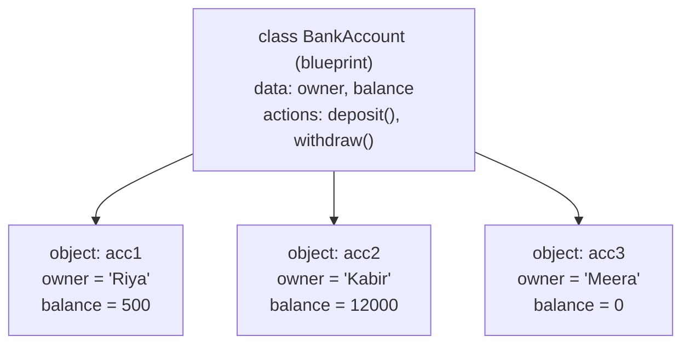
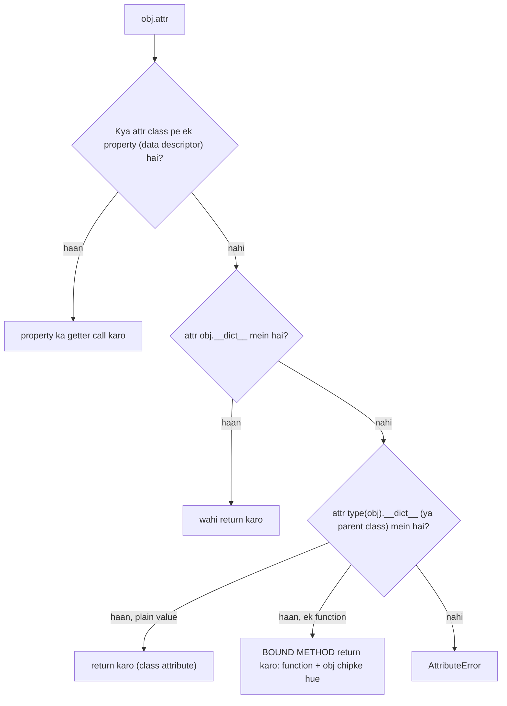

# Chapter 14 · OOP I: Classes & Objects

> Ab tak tumhare programs variables aur functions ka ek dher the, jaise ek kitchen jahan ingredients ek shelf pe hain aur recipes doosre kamre mein. Classes har ingredient ko uske saath hone wale kaamon ke *saath* rakh deti hain. Yahi ek idea hai jisse har bada Python codebase organised hota hai, Instagram ke backend se lekar LeetCode ke `TreeNode` tak.

**Is chapter mein tum seekhoge:**
- **Object-oriented programming (OOP)** kyun exist karta hai, aur ye kaunsi problem solve karta hai
- **Class** vs **object**, `__init__`, aur `self` asal mein kya hai (koi magic nahi!)
- **Instance attributes** vs **class attributes**, aur wo chupa hua bug jo dono ko mix kar deta hai
- Methods, aur `__str__` aur `__repr__` taaki tumhare objects achhe se print hon
- **Encapsulation**: `_internal`, `__mangled` names aur `@property` getters/setters
- `@classmethod` aur `@staticmethod`, aur kab kaunsa use karna hai
- Object identity (`is`, `id`, aliasing) aur asli cheezon ko model karna: bank account, student, inventory

**Isse pehle padho:** [Functions](10-functions.md) · [Dictionaries & Hashing](09-dictionaries.md) · [Errors, Exceptions & Files](13-exceptions-files.md)

---

## 🧠 The Big Idea · Asli Baat

**Class** ek **blueprint** (naksha) hai. **Object** us **blueprint se bana hua ghar** hai.

"2BHK flat" ka ek blueprint sau flats bana sakta hai. Har flat ka *layout same* hai (do bedrooms, ek kitchen, ek darwaza jo lock hota hai), par har flat ka *apna* paint colour hai, apna owner hai, apna furniture hai. Flat 101 ko neela paint karne se flat 102 nahi badalta.



> 🇮🇳 **Desi Analogy:** Builder ki society socho, jaise "Sunshine Heights". Builder ke office mein ek **naksha** pada hai (class): har flat mein 2 bedroom, 1 kitchen, 1 balcony, aur "darwaza lock karo", "geyser on karo" jaise kaam. Us naksha se 200 flats bane (objects). Flat A-101 mein Sharma ji rehte hain, peela paint hai; A-102 mein Iyer family, neela paint. **Layout aur kaam sabke same** (methods), **andar ka saamaan sabka alag** (instance data). Aur naksha khud mein koi ghar nahi hai: naksha mein koi reh nahi sakta, rehne ke liye flat banana padta hai (`BankAccount()` call karna).

Har object do cheezein saath le ke chalta hai:

- **Data** (inhe **attributes** ya **state** bhi kehte hain): object kya *jaanta* hai. `owner`, `balance`.
- **Behaviour** (inhe **methods** bhi kehte hain): object kya *kar sakta* hai. `deposit()`, `withdraw()`.

Tum shuru se objects use kar rahe ho, bas notice nahi kiya. List ek object hai: uska data hai items, uska behaviour hai `.append()`, `.sort()`, `.pop()`. String ek object hai jiske paas `.upper()` aur `.split()` hain. Is chapter mein tum apne **khud ke** types design karna seekhoge, bilkul `list` aur `str` jaise.

> 💡 `type([])` print karta hai `<class 'list'>`. Python ki apni list literally ek class hai. Tum bas is club mein join hone wale ho.

---

## 🔨 Building It Up · Zero Se Shuru

### 1. OOP kyun? Bikhre hue data ki problem

Chalo students ko model karte hain, us cheez se jo hum pehle se jaante hain: dictionaries aur functions.

```python
def make_student(name, marks):
    return {"name": name, "marks": marks}

def average(student):
    return sum(student["marks"]) / len(student["marks"])

riya = make_student("Riya", [90, 82, 77])
kabir = {"nmae": "Kabir", "marks": [60, 70]}     # key mein typo: koi rokne wala nahi

print(average(riya))
print(kabir.get("name"))                          # chupchaap None
```

```text
83.0
None
```

Ye chalta hai, par isme problems hain jo program bada hone ke saath badtar hoti jaati hain:

1. **Shape ko koi enforce nahi karta.** Kisi bhi keys wali koi bhi dict andar ghus sakti hai (`"nmae"`).
2. **Data aur behaviour alag rehte hain.** Kaunse functions "student dict" pe kaam karte hain? Pata karne ke liye poora codebase chhaanna padega.
3. **Koi protection nahi.** Koi bhi `riya["marks"] = "lots"` set kar sakta hai, aur `average` baad mein toot jaayega.

OOP teeno ko fix karta hai: data aur us pe kaam karne wale functions ko **ek unit ke andar** rakh ke, ek clear shape ke saath. Yahi core promise hai: **state ko us behaviour ke saath bundle karo jise use badalne ki ijaazat hai**.

### 2. Tumhari pehli class aur pehle objects

```python
class Dog:
    pass                 # abhi ke liye ek khaali blueprint

rex = Dog()              # class ko "call" karo, object ban jaayega
bruno = Dog()

print(type(rex))
print(isinstance(rex, Dog))
print(rex is bruno)      # do alag-alag objects
```

```text
<class '__main__.Dog'>
True
False
```

Abhi hua kya:

- `class Dog:` `Dog` naam ka ek naya type define karta hai. Class names **CapitalizedWords** (inhe PascalCase bhi kehte hain) mein likhe jaate hain, functions ke ulat jo `snake_case` use karte hain.
- `Dog()` us type ka ek naya object banata hai. Object banane ko **instantiation** kehte hain, aur wo object class ka ek **instance** hai. "Object" aur "instance" ka matlab same hai.
- `__main__` us file ka naam hai jo abhi chal rahi hai (ye hume [Chapter 17](17-modules-stdlib.md) mein phir milega).

### 3. `__init__`: naye object ko setup karna

Khaali kutta kis kaam ka. Hum chahte hain ki har dog ki zindagi ek naam aur ek age ke saath shuru ho. Python object banane ke turant baad **`__init__`** naam ka ek special method automatically call karta hai. (Jin methods ke naam double underscores se shuru aur khatam hote hain unhe **dunder methods** kehte hain, "double underscore" ka short. Bahut saare tumhe [Chapter 15](15-oop-inheritance-magic.md) mein milenge.)

```python
class Dog:
    def __init__(self, name, age):
        self.name = name         # data ko IS particular dog pe chipkao
        self.age = age

rex = Dog("Rex", 3)
bruno = Dog("Bruno", 5)

print(rex.name, rex.age)
print(bruno.name, bruno.age)

rex.age = 4                      # ek dog ko badlo...
print(rex.age, bruno.age)        # ...doosre ko kuch nahi hua
```

```text
Rex 3
Bruno 5
4 5
```

Abhi hua kya: `Dog("Rex", 3)` do kaam karta hai:

1. Ek bilkul naya, khaali `Dog` object banata hai.
2. `Dog.__init__(that_new_object, "Rex", 3)` call karta hai, jo `name` aur `age` ko object **pe** store karta hai.

`self.name = name` ko aise padho: "is object pe `name` naam ka ek attribute banao, jisme `name` ki value ho." Baayein wala `name` attribute hai; daayein wala `name` parameter hai. Dono ka same hona zaroori nahi, par aksar same hi rakhte hain.

> 🇮🇳 **Desi Analogy:** Naya SIM card lena socho. Shop wala pehle ek **khaali SIM** nikalta hai (object bana, `__new__`). Phir counter pe tumhara form bharta hai: naam, Aadhaar number, address, aur SIM ko activate karta hai (`__init__` ne attributes set kiye). Form bharne wala kaam SIM banata nahi, sirf pehle se bani SIM ko *tumhari* banata hai. Isiliye `__init__` asal mein **initialiser** hai, constructor nahi.

> 💡 `__init__` ko aksar "constructor" bola jaata hai, par technically ye **initialiser** hai: jab `__init__` chalta hai tab tak object exist kar chuka hota hai. Jo method object ko asal mein *banata* hai wo `__new__` hai, jise tumhe lagbhag kabhi touch nahi karna padega. (Interviewers ko ye distinction bahut pasand hai.)

### 4. `self` koi magic nahi hai

`self` bas **wo object hai jis pe method call hua**, jo pehle argument ki tarah pass hota hai. Ye do lines exactly same kaam karti hain:

```python
class Greeter:
    def __init__(self, name):
        self.name = name

    def greet(self, greeting):
        return f"{greeting}, I'm {self.name}"

g = Greeter("Asha")
print(g.greet("Hello"))              # normal tareeka
print(Greeter.greet(g, "Hello"))     # Python asal mein yahi karta hai
```

```text
Hello, I'm Asha
Hello, I'm Asha
```

Jab tum `g.greet("Hello")` likhte ho, Python class pe `greet` dhoondhta hai aur chupke se `g` ko pehle argument ki tarah pass kar deta hai. Isiliye har method ka pehla parameter `self` hota hai: ye wo slot hai jisme object aata hai.

`self` naam sirf ek **convention** hai; Python `this` ya `me` bhi accept kar lega. Par har Python programmer `self` use karta hai, toh tum bhi wahi karo.

> 🇮🇳 **Desi Analogy:** School mein ek hi "homework register" (class ka method) hai, par har bachcha apni copy leke aata hai. Teacher bolti hai "Riya, apna homework dikhao", toh asal mein wo register ka "homework check karo" wala kaam **Riya ki copy pe** chalati hai. `riya.show_homework()` = `Student.show_homework(riya)`. `self` wo copy hai jo us waqt table pe rakhi hai.

> 🤔 **Mann mein sawaal:** Jab method define karte waqt `self` likhna padta hai, toh call karte waqt `g.greet(g, "Hello")` kyun nahi likhte?
>
> **Jawab:** Kyunki `g.` wala dot hi `self` pass kar deta hai. `g.greet` likhte hi Python samajh jaata hai "is method ka object `g` hai" aur use pehle slot mein khud daal deta hai. Tum bas baaki arguments do. Agar class ke through call karo (`Greeter.greet(...)`), tab koi object "dot ke peeche" nahi hai, isliye wahan `g` khud pass karna padta hai.

> ⚠️ Agar definition mein `self` bhool gaye (`def greet(greeting):`), toh `g.greet("Hi")` call karna `TypeError: Greeter.greet() takes 1 positional argument but 2 were given` se fail hoga. Wo "2" hain `g` plus `"Hi"`. Ab ye error message samajh aata hai!

### 5. Methods: behaviour jo state ko use aur change karta hai

**Methods** wo functions hain jo class ke andar define hote hain. Ye `self` ke through object ke attributes padh aur badal sakte hain.

```python
class Counter:
    def __init__(self):
        self.count = 0

    def increment(self, step=1):
        self.count += step
        return self              # self return karne se chaining possible hoti hai

    def reset(self):
        self.count = 0

    def is_zero(self):
        return self.count == 0

clicks = Counter()
clicks.increment()
clicks.increment(5).increment(10)    # chaining chalti hai kyunki increment self return karta hai
print(clicks.count, clicks.is_zero())
clicks.reset()
print(clicks.count, clicks.is_zero())
```

```text
16 False
0 True
```

Chaining ko step by step dekho: `clicks.increment(5)` count ko 6 karta hai (1 + 5) aur **`clicks` hi wapas deta hai**. Toh `clicks.increment(5).increment(10)` asal mein ban jaata hai `clicks.increment(10)`, aur count 16.

Methods `self` ke through ek doosre ko bhi call kar sakte hain: method ke andar `self.other_method()` likho.

### 6. Instance attributes vs class attributes

Ab tak har attribute ek object ka tha. Kabhi kabhi data **poori class** ka hota hai: har instance mein shared. Use seedha class body mein rakho, kisi method ke bahar:

```python
class Employee:
    company = "Acme Corp"        # class attribute: saare employees mein shared
    headcount = 0                # class attribute: ek shared counter

    def __init__(self, name, salary):
        self.name = name         # instance attributes: har employee ka apna
        self.salary = salary
        Employee.headcount += 1  # SHARED counter ko class ke through update karo

a = Employee("Ana", 50000)
b = Employee("Ben", 65000)

print(a.company, b.company, Employee.company)
print(Employee.headcount)

Employee.company = "Acme Global"        # class pe badlo...
print(a.company, b.company)             # ...sabko badlav dikhta hai
```

```text
Acme Corp Acme Corp Acme Corp
2
Acme Global Acme Global
```

**Python attribute kaise dhoondhta hai** (ise yaad rakho, neeche ka sab kuch isi se samajh aata hai): jab tum `a.company` likhte ho, Python dekhta hai

1. pehle **object ke apne** attributes mein,
2. phir **class** mein.

`a` ke paas apna `company` nahi hai, isliye Python class wala dhoondh leta hai.

> 🇮🇳 **Desi Analogy:** Hostel ka kamra socho. Har student ki apni **almirah** hai (instance `__dict__`), aur corridor mein ek **common shelf** hai (class). Tumhe chai ka cup chahiye toh pehle apni almirah dekhte ho; nahi mila toh common shelf se utha lete ho. Ab agar tum apni almirah mein apna cup rakh do, toh agli baar wahi milega, common shelf wala dikhega hi nahi (shadowing). Aur agar tumne common shelf ke **dabbe** (shared list) mein apni Maggi daal di, toh poore hostel ko wo Maggi dikhegi. Neeche ke dono traps bilkul yahi hain.

Ab classic trap:

```python
class Employee:
    company = "Acme Corp"

a = Employee()
b = Employee()

a.company = "Startup Inc"       # sirf a pe ek NAYA instance attribute banata hai!
print(a.company, b.company, Employee.company)
print(a.__dict__, b.__dict__)   # __dict__ object ke apne attributes dikhata hai
```

```text
Startup Inc Acme Corp Acme Corp
{'company': 'Startup Inc'} {}
```

Instance ke through assign karna (`a.company = ...`) class ko kabhi touch nahi karta. Ye us **instance pe ek naya attribute** bana deta hai jo class wale ko **shadow** karta hai (chhupa deta hai). Shared data badalna hai toh class ke naam se assign karo.

Aur *sach mein* khatarnak version, ek **mutable** class attribute ke saath:

```python
class Team:
    members = []                      # ❌ har Team ke liye EK hi list shared!

    def __init__(self, name):
        self.name = name

    def add(self, person):
        self.members.append(person)   # shared list ko mutate karta hai (assignment nahi, isliye shadowing nahi)

red = Team("red")
blue = Team("blue")
red.add("Ana")
print(blue.members)                   # blue ko red ka member dikh raha hai!
```

```text
['Ana']
```

> 🤔 **Mann mein sawaal:** `a.company = "X"` ne naya attribute banaya, toh `self.members.append(...)` ne bhi naya kyun nahi banaya?
>
> **Jawab:** Kyunki dono alag operations hain. `a.company = ...` ek **assignment** hai: "is object pe ye naam rakho", toh Python object ke `__dict__` mein likhta hai. `self.members.append(...)` assignment nahi hai, ye pehle `self.members` ko **padhta** hai (lookup: instance mein nahi mila, class mein mil gaya), aur phir usi list ko andar se badalta hai. Koi naya naam bana hi nahi. Rule: `obj.x = ...` = naya/apna attribute; `obj.x.something(...)` = jo mila use mutate karo.

Fix: mutable data **`__init__` ke andar** banao, taaki har object ko apna mile:

```python
class Team:
    def __init__(self, name):
        self.name = name
        self.members = []             # ✅ har team ke liye ek fresh list

    def add(self, person):
        self.members.append(person)

red, blue = Team("red"), Team("blue")
red.add("Ana")
print(red.members, blue.members)
```

```text
['Ana'] []
```

| | Class attribute | Instance attribute |
|---|---|---|
| Kahan define hota hai | class body mein | `__init__` (ya kisi bhi method) mein `self.x = ...` se |
| Shared? | saare instances mein | har instance ka ek |
| Kiske liye accha | constants, counters, defaults | object ki apni state |
| Mutable values (list/dict)? | ⚠️ shared, aksar bug | ✅ safe |

### 7. `__str__` aur `__repr__`: objects ko achhe se print karwana

Object print karo toh kuch bhadda sa milta hai:

```python
class Point:
    def __init__(self, x, y):
        self.x = x
        self.y = y

p = Point(2, 3)
print(type(p).__name__, p.x, p.y)
print(str(p).startswith("<__main__.Point object at 0x"))
```

```text
Point 2 3
True
```

Default text hota hai `<__main__.Point object at 0x7f3a...>`: type plus ek memory address (har run mein alag). Do dunder methods ise fix karte hain:

- **`__repr__`**: ek unambiguous, developer ke liye description. Ideally ye us code jaisa dikhe jo object ko dobara bana de. REPL, debuggers, aur **containers ke andar** (jab tum points ki list print karte ho) yahi use hota hai.
- **`__str__`**: ek friendly, insaan ke liye description. `print()` aur `str()` yahi use karte hain. Agar tum ise define nahi karte, toh Python `__repr__` pe fall back karta hai.

```python
class Point:
    def __init__(self, x, y):
        self.x = x
        self.y = y

    def __repr__(self):
        return f"Point({self.x!r}, {self.y!r})"

    def __str__(self):
        return f"({self.x}, {self.y})"

p = Point(2, 3)
print(p)                 # __str__ use karta hai
print(repr(p))           # __repr__ use karta hai
print([p, Point(0, 0)])  # containers apne items ke liye __repr__ use karte hain
print(f"{p} and {p!r}")  # f-strings: default str, !r se repr
```

```text
(2, 3)
Point(2, 3)
[Point(2, 3), Point(0, 0)]
(2, 3) and Point(2, 3)
```

> 🇮🇳 **Desi Analogy:** Hospital ka patient socho. `__str__` wo hai jo reception pe bola jaata hai: "Sharma ji, 45 saal, Room 12." Friendly aur short. `__repr__` wo hai jo doctor ki file pe likha hai: "Patient(name='R. Sharma', age=45, room=12, blood_group='B+')". Exact, koi confusion nahi, aur isi se file dobara banayi ja sakti hai. Ghar walon ko `__str__` chahiye, doctor ko `__repr__`.

> 💡 Agar sirf ek likhna hai, toh **`__repr__`** likho. Ye har jagah use hota hai, aur `print` bhi isi pe fall back karta hai. Apne `__repr__` mein `!r` use karne se strings pe quotes lagte hain: confusing `User(ana)` ki jagah `User('ana')`.

### 8. Encapsulation: andar ki cheezein chhupana

**Encapsulation** ka matlab: object apne data ka access khud control karta hai. Bahar wale object ke methods (uska **public interface**) use karte hain, uske andar ungli nahi daalte. TV remote encapsulation hai: tum "volume up" dabate ho, andar ke wires solder nahi karte.

> 🇮🇳 **Desi Analogy:** ATM machine perfect example hai. Tum sirf buttons (public methods) use kar sakte ho: "Withdraw", "Balance Enquiry". Andar ki cash tray (internal data) tak tumhara haath nahi pahunchta. Aur machine khud rules enforce karti hai: PIN galat toh nahi, balance se zyada toh nahi nikaal rahe. Agar har koi seedha tray se paise utha sakta, toh rules ka koi matlab nahi rehta. Encapsulation = data tak sirf un "buttons" se pahuncho jo rules check karte hain.

Java ya C++ ke ulat, Python mein **sach mein private attributes nahi hote**. Iske bajaye ye naming **conventions** use karta hai:

| Naam | Matlab | Enforce hota hai? |
|---|---|---|
| `balance` | public: interface ka hissa, aaram se use karo | n/a |
| `_balance` | "internal hai, please bahar se mat chhuo" | Nahi, bas ek polite ishaara |
| `__balance` | "sach mein internal": **name mangling** trigger karta hai | Thoda: naam rewrite ho jaata hai |
| `__init__` | dunder: Python ke liye special method | n/a (apne khud ke mat banao) |

**Name mangling**: class body ke andar, `__secret` jaisa koi bhi naam (shuru mein do underscores, end mein zyada se zyada ek underscore) automatically `_ClassName__secret` mein rename ho jaata hai. Iska main maqsad hai **subclasses** ([Chapter 15](15-oop-inheritance-magic.md)) ko galti se attribute overwrite karne se rokna, secrets rakhna nahi.

```python
class Vault:
    def __init__(self):
        self.public = "anyone can read me"
        self._internal = "please don't touch"
        self.__secret = "mangled"

    def reveal(self):
        return self.__secret          # class ke andar short naam chalta hai

v = Vault()
print(v.public)
print(v._internal)                    # chalta hai; underscore bas ek hint hai
try:
    print(v.__secret)
except AttributeError as e:
    print("AttributeError:", e)
print(v.reveal())
print(v._Vault__secret)               # mangled naam: privacy asli nahi hai
print(sorted(v.__dict__))
```

```text
anyone can read me
please don't touch
AttributeError: 'Vault' object has no attribute '__secret'
mangled
mangled
['_Vault__secret', '_internal', 'public']
```

> 💡 Yahan Python ka motto hai "**we're all consenting adults**" (hum sab samajhdaar log hain): language tum pe bharosa karti hai ki tum `_internal` cheezon ko nahi chhuoge. Practice mein, internal cheezon ke liye **single underscore** use karo. Double underscores sirf tab jab tum aisi class design kar rahe ho jise subclass kiya jaana hai aur tum name clashes se bachna chahte ho.

### 9. `@property`: smart attributes

Maan lo ek `Temperature` class Celsius store karti hai, aur tum absolute zero (−273.15 °C) se neeche ki values block karna chahte ho. Java mein tum `get_celsius()` aur `set_celsius()` methods likhte, aur har caller ko wahi use karne padte. Python mein tum sundar `t.celsius = 30` syntax rakhte ho aur **phir bhi** validation chalate ho, **`@property`** use karke.

`def` ke upar wali `@something` line ko **decorator** kehte hain. Decorators exactly kaise kaam karte hain ye tum [Chapter 16](16-iterators-generators-decorators.md) mein seekhoge; abhi ke liye bas recipe seekh lo.

```python
class Temperature:
    def __init__(self, celsius):
        self.celsius = celsius            # neeche wale setter se guzarta hai, toh ye bhi validate hota hai

    @property
    def celsius(self):                    # GETTER: t.celsius pe chalta hai
        return self._celsius

    @celsius.setter
    def celsius(self, value):             # SETTER: t.celsius = value pe chalta hai
        if value < -273.15:
            raise ValueError(f"{value} is below absolute zero")
        self._celsius = value

    @property
    def fahrenheit(self):                 # ek COMPUTED property, setter nahi = read-only
        return self._celsius * 9 / 5 + 32

t = Temperature(25)
print(t.celsius, t.fahrenheit)
t.celsius = 100                           # simple assignment jaisa dikhta hai, setter chalata hai
print(t.celsius, t.fahrenheit)

try:
    t.celsius = -300
except ValueError as e:
    print("ValueError:", e)

try:
    t.fahrenheit = 50
except AttributeError as e:
    print("AttributeError:", e)
```

```text
25 77.0
100 212.0
ValueError: -300 is below absolute zero
AttributeError: property 'fahrenheit' of 'Temperature' object has no setter
```

Abhi hua kya:

- Asli data `self._celsius` mein rehta hai (underscore = internal). **Property** `celsius` uska public chehra hai.
- `t.celsius` padhne se getter chalta hai; `t.celsius = ...` assign karne se setter. Caller ko pata hi nahi chalta ki ye method hai.
- `fahrenheit` ka koi setter nahi, toh ye **read-only** hai aur hamesha `_celsius` se fresh compute hota hai. Dono values ke out of sync hone ka koi risk nahi.
- `__init__` bhi `self.celsius = celsius` use karta hai, toh validation janam se hi lagu hai.

> 🇮🇳 **Desi Analogy:** Bank ka cashier socho. Tum counter pe bolte ho "₹5000 jama karo" (`t.celsius = 5000` jaisa simple). Tumhe lagta hai bas paise de diye. Par andar cashier (setter) note check karta hai: nakli toh nahi, phate toh nahi. Sab theek hai tabhi locker (`_celsius`) mein jaate hain. Aur passbook ka "balance in USD" (computed property `fahrenheit`) koi alag se store nahi karta, wo har baar rupee balance se calculate hota hai, isliye kabhi galat nahi ho sakta.

**Ye kyun matter karta hai:** tum ek plain attribute (`self.celsius = c`) se shuru kar sakte ho, aur baad mein jab validation chahiye, use property mein badal sakte ho, **class use karne wale kisi bhi code ko badle bina**. Isiliye Pythonistas pehle se `get_x()`/`set_x()` methods nahi likhte.

> ⚠️ Getter ko `self._celsius` (underscore ke saath) return karna chahiye, `self.celsius` nahi. `celsius` getter ke andar `return self.celsius` likha, toh wo getter ko phir se call karega, hamesha ke liye: `RecursionError`.

> 🤔 **Mann mein sawaal:** Property ka naam `celsius` aur andar ka data `_celsius`: do naam kyun? Ek hi se kaam nahi chalega?
>
> **Jawab:** Nahi, kyunki `celsius` naam pe ab property baithi hai. `self.celsius` likhoge toh Python property ka getter chalayega, data nahi dega. Agar getter khud `self.celsius` padhe, toh getter → getter → getter... infinite loop. Isliye asli value ko ek **alag** naam chahiye jo property se takraye nahi; convention hai wahi naam underscore ke saath. Socho: `celsius` = dukaan ka counter, `_celsius` = godown. Counter godown se maal laata hai, khud se nahi.

### 10. `@classmethod` aur `@staticmethod`

Normal methods ko **instance** (`self`) milta hai. Do aur kism ke methods hote hain:

- **`@classmethod`** ko **class** khud milti hai (convention se naam `cls`). Main use: **alternative constructors**, object banane ke extra tareeke.
- **`@staticmethod`** ko **kuch bhi automatic nahi** milta. Ye ek plain function hai jo class ke andar isliye rehta hai kyunki logically wahin ka hai.

```python
class Date:
    def __init__(self, year, month, day):
        if not Date.is_valid(year, month, day):
            raise ValueError(f"invalid date {year}-{month}-{day}")
        self.year, self.month, self.day = year, month, day

    @classmethod
    def from_string(cls, text):           # alternative constructor: "2024-08-15"
        year, month, day = map(int, text.split("-"))
        return cls(year, month, day)      # cls Date hai (ya koi subclass!)

    @classmethod
    def new_year(cls, year):
        return cls(year, 1, 1)

    @staticmethod
    def is_leap(year):
        return year % 4 == 0 and (year % 100 != 0 or year % 400 == 0)

    @staticmethod
    def is_valid(year, month, day):
        days = [31, 29 if Date.is_leap(year) else 28, 31, 30, 31, 30,
                31, 31, 30, 31, 30, 31]
        return 1 <= month <= 12 and 1 <= day <= days[month - 1]

    def __repr__(self):
        return f"Date({self.year}, {self.month}, {self.day})"

print(Date(2024, 8, 15))
print(Date.from_string("2024-02-29"))
print(Date.new_year(2025))
print(Date.is_leap(1900), Date.is_leap(2000))
try:
    Date.from_string("2023-02-29")
except ValueError as e:
    print("ValueError:", e)
```

```text
Date(2024, 8, 15)
Date(2024, 2, 29)
Date(2025, 1, 1)
False True
ValueError: invalid date 2023-2-29
```

Leap year rule ko dhyaan se padho: 4 se divide ho, **lekin** 100 se nahi, **jab tak** 400 se na ho. Isliye 1900 leap nahi (100 se divide, 400 se nahi), aur 2000 leap hai (400 se divide). Aur 2023 leap nahi hai, toh 29 Feb invalid.

| Kism | Decorator | Pehla parameter | Kya access kar sakta hai | Typical use |
|---|---|---|---|---|
| Instance method | (koi nahi) | `self` (object) | object + class | lagbhag sab kuch |
| Class method | `@classmethod` | `cls` (class) | class, koi specific object nahi | alternative constructors, class-wide counters |
| Static method | `@staticmethod` | koi nahi | dono nahi (jab tak naam se explicitly na bulao) | class se jude helpers/utilities |

> 🇮🇳 **Desi Analogy:** Ek restaurant chain socho, jaise "Sharma Dhaba". **Instance method** = ek specific branch ka waiter, jo *usi* table ka order leta hai (`self` = wo table). **Class method** = head office, jo nayi branch kholne ke alag-alag tareeke jaanta hai: "franchise form se kholo" ya "purani dukaan convert karo" (`from_string`, `new_year`). Head office ko kisi ek table se matlab nahi, use poori chain (`cls`) se matlab hai. **Static method** = deewar pe laga GST calculator: dhabe ka hissa hai, par na kisi table ko jaanta hai na head office ko, bas number lo, number do (`is_leap`).

> 💡 `return Date(...)` ki jagah `return cls(...)` kyun? Agar koi baad mein ek subclass `IndianDate(Date)` banaye, toh `IndianDate.from_string(...)` sahi tarah ek `IndianDate` banayega. Ye kyun matter karta hai, tum [Chapter 15](15-oop-inheritance-magic.md) mein dekhoge. Python ke apne `dict.fromkeys(...)` aur `datetime.fromtimestamp(...)` class methods hain.

> 🤔 **Mann mein sawaal:** Static method aur class ke bahar ek normal function mein fark hi kya hai?
>
> **Jawab:** Kaam mein koi fark nahi, **jagah** mein fark hai. `is_leap` sirf dates ke baare mein hai, toh use `Date` ke andar rakhne se code organised rehta hai: `Date.is_leap(2024)` padh ke turant pata chalta hai ye date wala helper hai. Ye ek "address" ka faayda hai, power ka nahi. Agar function ka class se koi logical rishta nahi hai, toh use bahar hi rakho.

### 11. Object identity: `is`, `id`, aur aliasing

Har object ki ek **identity** hoti hai: uski poori life ke liye ek unique number, jo `id()` dikhata hai. (CPython mein ye memory address hai.) `a is b` poochta hai "kya ye **same object** hain?", jabki `a == b` poochta hai "kya ye **value mein barabar** hain?"

Tumhari apni classes ke liye, `==` by default `is` pe fall back karta hai, kyunki jab tak tum na batao, Python ko pata hi nahi ki `Point` ke liye "barabar" ka matlab kya hai. (Ye tum use [Chapter 15](15-oop-inheritance-magic.md) mein `__eq__` se sikhaoge.)

```python
class Point:
    def __init__(self, x, y):
        self.x, self.y = x, y

p1 = Point(1, 2)
p2 = Point(1, 2)
p3 = p1                       # copy NAHI: same object ka doosra naam

print(p1 == p2, p1 is p2)     # same values, alag objects
print(p1 is p3, id(p1) == id(p3))

p3.x = 99                     # ek naam se badlo...
print(p1.x)                   # ...doosre naam se dikhta hai
```

```text
False False
True True
99
```

> 🇮🇳 **Desi Analogy:** Ghar mein Rahul ko sab "Pappu" bulate hain. "Rahul" aur "Pappu" do naam hain, banda ek hi hai (`p3 = p1`, `p1 is p3`). Pappu ne baal katwaye toh Rahul ke bhi kat gaye, kyunki ek hi insaan hai. Ab padosi ke ghar bhi ek Rahul hai, same age, same height (`p2`, same values). Par wo alag insaan hai: `p1 is p2` False. Aur jab tak tum Python ko "barabar" ka rule nahi batate (`__eq__`), wo bolta hai "alag insaan hain toh barabar nahi" (`p1 == p2` False).

Ye **aliasing** hai, bilkul waisa jaisa [Chapter 7](07-lists.md) mein lists ke saath dekha tha: assignment kabhi objects copy nahi karta; wo bas same object pe ek aur naam chipka deta hai. Ye sabse zyada tab matter karta hai jab tum objects functions ko pass karte ho: function ko **wahi object** milta hai, toh wo use badal sakta hai.

```python
class Account:
    def __init__(self, balance):
        self.balance = balance

def apply_fee(account):
    account.balance -= 50          # caller ke object ko mutate karta hai

def replace(account):
    account = Account(0)           # sirf LOCAL naam ko rebind karta hai; caller pe koi asar nahi

acc = Account(1000)
apply_fee(acc)
replace(acc)
print(acc.balance)
```

```text
950
```

Fark samjho: `apply_fee` ne object ke **andar** badlav kiya (`account.balance -= 50`), toh caller ko dikha. `replace` ne sirf local naam `account` ko ek **naye** object pe chipka diya; purana object (`acc`) waisa ka waisa raha. "Andar se badalna" vs "naam ko kahin aur chipkana": yahi poora khel hai.

### 12. Andar jhaankna: `__dict__`, `getattr`, `setattr`, `hasattr`

Object ke attributes sach mein `__dict__` naam ki ek dictionary mein store hote hain. Python tumhe attributes ke saath **naam se** (strings ki tarah) kaam karne ke functions deta hai, jo tab kaam aate hain jab attribute ka naam sirf runtime pe pata chalta hai:

```python
class Config:
    def __init__(self):
        self.debug = False
        self.port = 8080

c = Config()
print(c.__dict__)
print(getattr(c, "port"))                 # c.port jaisa hi
print(getattr(c, "host", "localhost"))    # missing ho toh default (koi AttributeError nahi)
setattr(c, "debug", True)                 # c.debug = True jaisa hi
print(hasattr(c, "debug"), hasattr(c, "host"))

overrides = {"port": 9000, "host": "0.0.0.0"}
for key, value in overrides.items():      # ek dict se settings apply karo
    setattr(c, key, value)
print(vars(c))                            # vars(obj) obj.__dict__ jaisa hi hai
```

```text
{'debug': False, 'port': 8080}
8080
localhost
True False
{'debug': True, 'port': 9000, 'host': '0.0.0.0'}
```

Dhyaan do ki tum kisi bhi waqt object pe attributes add kar sakte ho (`host` kahin se bhi aa gaya). Python ise allow karta hai, par accha style ye hai ki **saare** attributes `__init__` mein banao, taaki padhne wala object ki poori shape ek hi jagah dekh sake.

### 13. Asli cheezein model karna I: bank account

Ab sab kuch jodne ka time. Requirements: account ka ek owner aur ek balance hai; tum positive amounts deposit aur withdraw kar sakte ho; overdraw nahi kar sakte; balance bahar se seedha set nahi ho sakta; aur ek transaction history hai.

```python
class InsufficientFundsError(Exception):
    pass

class BankAccount:
    interest_rate = 0.04                       # class attribute: saare accounts ke liye same
    _next_number = 1001                        # account numbers ke liye internal counter

    def __init__(self, owner, opening_balance=0):
        self.owner = owner
        self.number = BankAccount._next_number
        BankAccount._next_number += 1
        self._balance = 0
        self._history = []                     # har account ki apni fresh list
        if opening_balance:
            self.deposit(opening_balance)

    @property
    def balance(self):                         # bahar se read-only
        return self._balance

    def deposit(self, amount):
        self._check_positive(amount)
        self._balance += amount
        self._history.append(("deposit", amount))

    def withdraw(self, amount):
        self._check_positive(amount)
        if amount > self._balance:
            raise InsufficientFundsError(
                f"cannot withdraw {amount}, balance is {self._balance}")
        self._balance -= amount
        self._history.append(("withdraw", amount))

    def transfer_to(self, other, amount):
        self.withdraw(amount)                  # agar ye fail hua, toh kuch deposit nahi hoga
        other.deposit(amount)

    def add_interest(self):
        self.deposit(round(self._balance * self.interest_rate, 2))

    def statement(self):
        return list(self._history)             # ek copy, taaki callers hamari list edit na kar sakein

    @staticmethod
    def _check_positive(amount):
        if amount <= 0:
            raise ValueError("amount must be positive")

    def __repr__(self):
        return f"BankAccount({self.owner!r}, number={self.number}, balance={self._balance})"

riya = BankAccount("Riya", 1000)
kabir = BankAccount("Kabir")
riya.transfer_to(kabir, 300)
kabir.add_interest()
print(riya)
print(kabir)
print(kabir.statement())

try:
    kabir.withdraw(10_000)
except InsufficientFundsError as e:
    print("Declined:", e)

try:
    riya.balance = 1_000_000                   # koshish acchi thi
except AttributeError:
    print("balance is read-only")
```

```text
BankAccount('Riya', number=1001, balance=700)
BankAccount('Kabir', number=1002, balance=312.0)
[('deposit', 300), ('deposit', 12.0)]
Declined: cannot withdraw 10000, balance is 312.0
balance is read-only
```

Hisaab check karo: Riya ne 1000 se shuru kiya, 300 Kabir ko bheje, bacha 700. Kabir ke paas 300, uspe 4% interest = 12.0, total 312.0. Aur Riya ka opening deposit bhi `deposit()` se hi gaya, isliye wo bhi validate hua aur history mein gaya (Riya ki history mein).

Design decisions jo churaane layak hain:

- **Har badlav ke liye ek hi darwaza.** Balance ke saare badlav `deposit`/`withdraw` se guzarte hain, toh rules (positive amounts, no overdraft, history record karna) exactly ek jagah rehte hain.
- `balance` ke liye **read-only property**: bahar wale dekh sakte hain, chhoo nahi sakte.
- Internal lists ki **copy return karo** (`list(self._history)`), taaki callers hamari peeth peeche hamari state mutate na kar sakein.
- `transfer_to` mein **kuch bhi badalne se pehle validate karo**: agar `withdraw` raise karta hai, toh `deposit` kabhi chalta hi nahi, toh paisa na kabhi banta hai na gayab hota hai.

> 🤔 **Mann mein sawaal:** `transfer_to` mein agar `other.deposit` fail ho jaaye toh? Paisa toh nikal chuka hoga!
>
> **Jawab:** Bahut sahi sawaal, interviewer bhi yahi poochega. Yahan `deposit` sirf tab fail hota hai jab amount positive na ho, aur wo check `withdraw` mein pehle hi ho chuka hai, isliye is code mein ye case aata hi nahi. Par asli banking systems mein (do alag databases, network) ye khatra sach hai. Wahan **transactions** use hote hain: dono kaam ek saath ho, ya dono undo ho jaayein. Ye "atomicity" tum System Design part mein padhoge.

### 14. Asli cheezein model karna II: student aur gradebook

Objects aksar **doosre objects ko contain** karte hain. Ek `Course` `Student` objects rakhta hai. Is "has-a" (iske paas hai) relationship ko **composition** kehte hain (iske baare mein aur [Chapter 15](15-oop-inheritance-magic.md) mein).

```python
class Student:
    def __init__(self, name, roll):
        self.name = name
        self.roll = roll
        self.marks = {}                        # subject -> mark

    def add_mark(self, subject, mark):
        if not 0 <= mark <= 100:
            raise ValueError("mark must be between 0 and 100")
        self.marks[subject] = mark

    @property
    def average(self):
        return sum(self.marks.values()) / len(self.marks) if self.marks else 0.0

    def __repr__(self):
        return f"Student({self.name!r}, roll={self.roll})"

class Course:
    def __init__(self, title):
        self.title = title
        self._students = {}                    # roll -> Student

    def enroll(self, student):
        self._students[student.roll] = student

    def topper(self):
        return max(self._students.values(), key=lambda s: s.average)

    def report(self):
        for s in sorted(self._students.values(), key=lambda s: -s.average):
            print(f"{s.roll:>3} {s.name:<6} {s.average:6.2f}")

dsa = Course("DSA")
for roll, name, marks in [(1, "Asha", {"arrays": 91, "trees": 85}),
                          (2, "Ben", {"arrays": 70, "trees": 95}),
                          (3, "Chen", {"arrays": 99, "trees": 92})]:
    s = Student(name, roll)
    for subject, mark in marks.items():
        s.add_mark(subject, mark)
    dsa.enroll(s)

dsa.report()
print("Topper:", dsa.topper())
```

```text
  3 Chen    95.50
  1 Asha    88.00
  2 Ben     82.50
Topper: Student('Chen', roll=3)
```

Format string ko decode karo: `{s.roll:>3}` = roll ko 3 chars mein right-align, `{s.name:<6}` = naam ko 6 chars mein left-align, `{s.average:6.2f}` = 6 chars wide, 2 decimal places. Isiliye columns ekdum seedhe aate hain (ye [Strings](04-strings.md) wala f-string formatting hai).

### 15. Asli cheezein model karna III: inventory

Ek aur, kyunki "ek shop / library / parking lot design karo" interview ka favourite warm-up hai (poore machine-coding rounds hum [Chapter 14 of System Design](../part-3-system-design/14-low-level-design.md) mein karenge).

```python
class Product:
    def __init__(self, sku, name, price):
        if price < 0:
            raise ValueError("price cannot be negative")
        self.sku = sku
        self.name = name
        self.price = price

    def __repr__(self):
        return f"Product({self.sku!r}, {self.name!r}, {self.price})"

class Inventory:
    def __init__(self, low_stock_threshold=5):
        self._products = {}            # sku -> Product
        self._stock = {}               # sku -> quantity
        self.low_stock_threshold = low_stock_threshold

    def add_product(self, product, quantity=0):
        self._products[product.sku] = product
        self._stock[product.sku] = self._stock.get(product.sku, 0) + quantity

    def sell(self, sku, quantity):
        if sku not in self._products:
            raise KeyError(f"unknown product {sku}")
        if self._stock[sku] < quantity:
            raise ValueError(f"only {self._stock[sku]} left of {sku}")
        self._stock[sku] -= quantity
        return self._products[sku].price * quantity

    def total_value(self):
        return sum(p.price * self._stock[sku] for sku, p in self._products.items())

    def low_stock(self):
        return [sku for sku, qty in self._stock.items() if qty <= self.low_stock_threshold]

shop = Inventory()
shop.add_product(Product("PEN", "Gel pen", 20), 50)
shop.add_product(Product("NB", "Notebook", 60), 8)
shop.add_product(Product("BAG", "Backpack", 900), 2)

print("Bill:", shop.sell("NB", 4))
print("Stock value:", shop.total_value())
print("Reorder:", shop.low_stock())
try:
    shop.sell("BAG", 5)
except ValueError as e:
    print("Error:", e)
```

```text
Bill: 240
Stock value: 3040
Reorder: ['NB', 'BAG']
Error: only 2 left of BAG
```

Hisaab: 4 notebooks × 60 = 240. Bachi stock value: pens 50 × 20 = 1000, notebooks 4 × 60 = 240, bags 2 × 900 = 1800, total 3040. Notebooks 4 aur bags 2 bache, dono threshold 5 se kam ya barabar, isliye reorder list mein.

> 🇮🇳 **Desi Analogy:** Ye bilkul kirana store ka **khata** hai. `_products` = rate list (kaunsi cheez, kya daam). `_stock` = godown register (kitna maal pada hai). `sell` = counter pe bill banana, jo pehle godown check karta hai. `low_stock` = Monday ki "maal mangwana hai" wali list. Do alag dicts isliye kyunki rate aur quantity alag cheezein hain: daam badalne se maal nahi badalta.

---

## 🔬 Under the Hood · Andar Ki Kahani

### Classes bhi objects hain

Python mein **sab kuch object hai**, classes aur functions bhi. `class Dog:` class body ko chalata hai (ek mini-program chalane jaisa), usme define hue har naam ko ek dictionary mein jama karta hai, aur usse ek **class object** banata hai. Wo class object `Dog` variable mein store hota hai.

```python
class Dog:
    species = "Canis familiaris"
    def bark(self):
        return "Woof"

print(type(Dog))                               # class ki class 'type' hai
print("species" in Dog.__dict__, "bark" in Dog.__dict__)
Alias = Dog                                    # classes ko kisi bhi value ki tarah assign kar sakte ho
print(Alias().bark())
```

```text
<class 'type'>
True True
Woof
```

### Attribute lookup, step by step

Jab tum `obj.attr` likhte ho, Python (simplified) ye karta hai:



Do takeaways:

1. **Instance class se pehle** se shadowing samajh aati hai: `a.company = ...` `a.__dict__` mein likhta hai, jo uske baad hamesha pehle milta hai.
2. **Properties instance dict se jeet-ti hain.** Isiliye `t.celsius = 5` tumhara setter chalata hai, seedha `t.__dict__` mein nahi likhta. (Properties ek **descriptor** ka example hain, wo mechanism jo methods, properties, `classmethod` aur `staticmethod` ke peeche hai.)

### "Bound method" kya hai

Class mein define hue functions sirf **class** mein store hote hain, har object mein copy nahi hote. Jab tum `g.greet` access karte ho, Python ek chhota **bound method** object banata hai jo function aur instance `g` dono ko yaad rakhta hai. Use call karne se function `g` ko pehle argument ki tarah leke chalta hai.

```python
class Greeter:
    def greet(self):
        return f"hi from {id(self) == id(g)}"

g = Greeter()
m = g.greet                         # ek bound method, abhi call nahi hua
print(type(m).__name__)
print(m.__self__ is g, m.__func__ is Greeter.__dict__["greet"])
print(m())
```

```text
method
True True
hi from True
```

Isiliye 1,000,000 objects ko har method ki 1,000,000 copies nahi chahiye: methods class pe ek baar rehte hain; sirf data har object ka alag hota hai.

> 🇮🇳 **Desi Analogy:** Bound method ek **pre-filled UPI QR** jaisa hai. Normal function ek blank payment form hai: "kisko bhejna hai?" bharna padta hai. `g.greet` likhte hi Python ek QR bana deta hai jisme "kisko" (`__self__ = g`) pehle se bhara hai, aur "kya karna hai" (`__func__`) bhi. Ab bas scan karo (`m()`), aur kaam ho gaya. Form (function) ek hi hai poore shehar ke liye; har QR bas usme ek naam chipka deta hai.

### Memory: har object ek dict leke chalta hai (jab tak `__slots__` use na karo)

Har instance ka normally apna `__dict__` hota hai, ek poori hash table ([Chapter 9](09-dictionaries.md)). Ye flexible hai (kabhi bhi attributes add kar sakte ho) par memory khata hai. Agar tum laakhon chhote objects bana rahe ho (jaise ek geometry problem mein `Point`s), toh tum **`__slots__`** declare kar sakte ho, ye bolne ke liye ki "bas yahi attributes hain, inhe dict ki jagah ek fixed compact array mein store karo":

```python
class SlimPoint:
    __slots__ = ("x", "y")
    def __init__(self, x, y):
        self.x, self.y = x, y

p = SlimPoint(1, 2)
print(p.x, hasattr(p, "__dict__"))
try:
    p.z = 3
except AttributeError:
    print("AttributeError: can't add new attribute 'z'")
```

```text
1 False
AttributeError: can't add new attribute 'z'
```

Slotted objects kaafi kam memory use karte hain aur attribute access thoda tez hota hai, flexibility ki keemat pe. Inhe tabhi use karo jab tumne memory problem measure ki ho.

### `Dog("Rex", 3)` asal mein kya karta hai

1. `Dog.__new__(Dog, "Rex", 3)` call karta hai, jo **heap** pe ek naya khaali object allocate karta hai (memory ka wo hissa jahan saare Python objects rehte hain; dekho [Chapter 18](18-internals-concurrency.md)).
2. Agar wo object `Dog` ka instance hai, toh use bharne ke liye `obj.__init__("Rex", 3)` call karta hai.
3. Object return karta hai. `__init__` ko `None` return karna hi chahiye; kuch aur return kiya toh `TypeError`.

---

## 🧩 Pattern Decoder · Pattern Pakdo

### Kab koi cheez class honi chahiye?

| Signal | Use karo |
|---|---|
| Bas ek calculation, koi yaad rakhi hui state nahi | ek **function** |
| Values ka ek fixed bundle, koi behaviour nahi | ek `tuple`, `namedtuple` ([Chapter 17](17-modules-stdlib.md)) ya `@dataclass` ([Chapter 15](15-oop-inheritance-magic.md)) |
| State **plus** rules ki wo kaise badal sakti hai | ek **class** |
| Ek hi kism ki bahut saari "cheezein", har ek ki apni state | ek **class**, har cheez ka ek instance |
| Functions ka ek group jo sab wahi 3 arguments idhar-udhar pass karte hain | shayad ek class, jiske attributes wahi 3 values hain |

### Pythonic class idioms

- **Plain public attributes se shuru karo.** `@property` baad mein tabhi jodo jab validation ya computation chahiye. Callers ko switch ka pata bhi nahi chalega.
- **`@classmethod` alternative constructors use karo** (`from_string`, `from_dict`, `from_json`), complicated `__init__` signatures ki jagah.
- **Hamesha ek `__repr__` likho.** Raat 2 baje debug karta hua future-tum shukriya bolega.
- **Invariants ko ek jagah protect karo.** `balance` ke saare badlav ek hi method se guzarein jo rules enforce kare.
- Getters se **internal mutable data ki copies** (ya read-only views) **return karo**.
- **Invalid operations pe exceptions raise karo**, `-1` jaise error codes return mat karo ([Chapter 13](13-exceptions-files.md)).

### DSA mein classes kaise dikhti hain

Lagbhag har data-structure chapter mein tum chhoti classes likhoge:

- **Nodes.** Linked lists ([Chapter 10](../part-2-dsa/10-linked-lists.md)) aur trees ([Chapter 13](../part-2-dsa/13-binary-trees.md)) chhoti-chhoti node classes se bante hain. LeetCode tumhe exactly yahi deta hai:

```python
class ListNode:
    def __init__(self, val=0, next=None):
        self.val = val
        self.next = next

class TreeNode:
    def __init__(self, val=0, left=None, right=None):
        self.val = val
        self.left = left
        self.right = right

# 1 -> 2 -> 3 banao
head = ListNode(1, ListNode(2, ListNode(3)))
node, values = head, []
while node:
    values.append(node.val)
    node = node.next
print(values)

root = TreeNode(2, TreeNode(1), TreeNode(3))
print(root.left.val, root.val, root.right.val)
```

```text
[1, 2, 3]
1 2 3
```

> 🇮🇳 **Desi Analogy:** `ListNode` Mumbai local ka ek dabba (coach) hai: andar passengers (`val`), aur aage wale dabbe se juda coupling (`next`). Poori train = linked list. `TreeNode` joint family ka family tree hai: har insaan (`val`) ke do bachche ho sakte hain, `left` aur `right`. Dono mein class sirf ek "dabba" ka naksha hai; structure tab banta hai jab tum objects ko ek doosre se jodte ho.

- **"Design" problems.** LeetCode ki ek poori category hai ("Design a ...") jisme tum specific methods aur complexity guarantees wali class implement karte ho: Min Stack, LRU Cache, Implement Queue using Stacks, Design HashMap, Design Twitter. Asli skill hai ye chunna ki **kaunse attributes** rakhein taaki har method fast ho. Example, **Min Stack** (LeetCode 155): `push`, `pop`, `top` aur `get_min` sab O(1) mein.

```python
class MinStack:
    def __init__(self):
        self._stack = []         # (value, yahan tak stack ka minimum)

    def push(self, val):
        current_min = min(val, self._stack[-1][1]) if self._stack else val
        self._stack.append((val, current_min))

    def pop(self):
        self._stack.pop()

    def top(self):
        return self._stack[-1][0]

    def get_min(self):
        return self._stack[-1][1]

s = MinStack()
for v in [5, 3, 7, 2]:
    s.push(v)
print(s.get_min())   # 2
s.pop()
print(s.get_min())   # 3: minimum apni purani value "yaad" rakhta hai
print(s.top())       # 7
```

```text
2
3
7
```

Trick: har value ke bagal mein, wo minimum store karo jo **us value ke push hone ke moment pe** tha. Jab pop karte ho, purana minimum apne aap wapas aa jaata hai. Extra attributes speed khareedte hain.

Stack ko andar se dekho: `[(5,5), (3,3), (7,3), (2,2)]`. Top pe `(2,2)` hai toh min 2. Pop kiya, ab top `(7,3)`, toh min 3. Kisi ko dobara search nahi karna pada.

- LeetCode pe **`class Solution:`** bas tumhare function ka ek namespace hai; `self` ka koi use nahi. Isse confuse mat hona.

---

## ⚠️ Traps & Common Mistakes · Yahan Sab Phisalte Hain

1. **Pehle parameter ki tarah `self` bhool jaana.**

```py
class Dog:
    def bark():                 # ❌ rex.bark() call karne pe TypeError
        print("Woof")

class Dog:
    def bark(self):             # ✅
        print("Woof")
```

2. **Attribute use karte waqt `self.` bhool jaana.** Method ke andar `balance += 10` ek *local* variable ko refer karta hai (aur `UnboundLocalError` se fail hota hai). Tumhe `self.balance += 10` chahiye.

3. **Mutable class attributes** (class body mein `members = []`) har instance mein shared hote hain. Lists/dicts `__init__` mein banao.

4. `__init__` mein **mutable default arguments** ([Chapter 10](10-functions.md)) bhi aise hi kaat-te hain:

```py
class Cart:
    def __init__(self, items=[]):       # ❌ bina args wale saare Cart() EK hi list share karte hain
        self.items = items

class Cart:
    def __init__(self, items=None):     # ✅
        self.items = list(items) if items else []
```

5. **Instance ke through class attribute assign karna** (`a.company = "X"`) sirf ek shadowing instance attribute banata hai. Shared badlav ke liye `ClassName.attr = ...` use karo.

6. **Property getter khud ko return kar raha hai.** `celsius` property ke andar `return self.celsius` hamesha ke liye recurse karta hai. Asli value `self._celsius` mein rakho.

7. **Parentheses bhool jaana.** `acc.deposit` (bina call) ek bound method object hai, deposit nahi. `if acc.is_empty:` hamesha truthy hai kyunki method object truthy hota hai. `acc.is_empty()` likho.

8. **`__init__` se kuch return karna.** `__init__` ko `None` return karna hi chahiye. Alag tarah se bana object "return" karna hai toh `@classmethod` constructor use karo.

9. **Ye sochna ki `__x` private hai.** Ye bas `_Class__x` mein rename hota hai. Subclass clashes se bachne ke liye use karo, security ke liye nahi.

10. **`==` se objects compare karke value equality expect karna.** Bina `__eq__` ke, `==` ka matlab hai "same object". `Point(1, 2) == Point(1, 2)` `False` hai, [Chapter 15](15-oop-inheritance-magic.md) tak.

11. **Har jagah Java-style getters aur setters** (`get_name()`, `set_name()`). Pythonic nahi. Plain attributes use karo, phir zaroorat ho toh `@property`.

---

## 💡 Tips & Tricks · Pro Wale Moves

- Debug karte waqt `vars(obj)` (ya `obj.__dict__`) object ka data turant dikha deta hai.
- `dir(obj)` har available attribute aur method list karta hai, inherited dunders samet.
- Types check karne ka sahi tareeka `isinstance(obj, ClassName)` hai, `type(obj) == ClassName` nahi (ye inheritance ko bhi respect karta hai, jaisa tum Chapter 15 mein dekhoge).
- `__repr__` ke andar `type(self).__name__` repr ko subclasses ke liye bhi sahi rakhta hai: `f"{type(self).__name__}({self.x!r})"`.
- `getattr(obj, name, default)` aise attribute ko safely padhta hai jo shayad exist na kare.
- Loop variables ke liye ek-letter abbreviations theek hain, par classes aur methods ko descriptive naam do: `BankAccount.withdraw`, `BA.w` nahi.
- Class ka code ek predictable order mein rakho: class attributes → `__init__` → properties → public methods → private helpers → `__repr__` jaise dunders.
- Bina `__init__`/`__repr__` likhe ek quick record class chahiye? [Chapter 15](15-oop-inheritance-magic.md) mein `@dataclass` ka intezaar karo. Haath se likhne ke baad wo magic lagega.

---

## 🎯 Interview Questions · Interview Mein Yahi Poochenge

### 1. What is the difference between a class and an object? 🔥🔥🔥

<details><summary>Answer dekho 👀</summary>

**Class** ek blueprint/type hai jo define karta hai ki uske instances kaunsa data rakhenge aur unke paas kaunse methods honge. **Object** (instance) us class se bani ek concrete cheez hai, apne instance data ki apni copy ke saath. `list` ek class hai; `[1, 2]` us class ka ek object hai. Ek class, bahut objects; har object apni class jaanta hai (`type(obj)`), aur methods class pe ek baar store hote hain aur share hote hain.

> 🗣️ **Interview mein aise bolo:** "A class is a blueprint that defines what data its instances hold and what methods they support. An object is a concrete instance of that class with its own state. For example, list is a class and [1, 2] is an object. Methods live once on the class and are shared, while each object carries its own data."

</details>

### 2. What is `self`? Is it a keyword? 🔥🔥🔥

<details><summary>Answer dekho 👀</summary>

`self` instance method ka pehla parameter hai aur us instance ko refer karta hai jis pe method call hua. `obj.method(a)` translate hota hai `type(obj).method(obj, a)` mein, toh `self` ko `obj` milta hai. Ye **keyword nahi hai**: bas ek strong convention hai. Koi bhi naam chalega, par hamesha `self` use karo. Python mein ye explicit hai (Java ke `this` ke ulat) kyunki language ki philosophy hai "explicit is better than implicit".

> 🗣️ **Interview mein aise bolo:** "self is the instance a method was called on. Python translates obj.method(a) into type(obj).method(obj, a), so self simply receives obj as the first argument. It's not a keyword, just a strong convention, and it's explicit because Python prefers explicit over implicit."

</details>

### 3. Is `__init__` a constructor? What is `__new__`? 🔥🔥

<details><summary>Answer dekho 👀</summary>

Strictly bolein toh `__new__` constructor hai: ek static method jo naye instance ko **banata aur return karta** hai. `__init__` **initialiser** hai: ise pehle se bana instance `self` ki tarah milta hai aur ye uske attributes setup karta hai; ise `None` return karna hi chahiye.

`__new__` ko override sirf rare cases mein karte ho: `int`, `str` ya `tuple` jaise immutable types ko subclass karna (unki value banate waqt hi set honi chahiye), ya singletons jaise patterns implement karna. Roz ki classes ke liye `__init__` hi kaafi hai, isiliye log casually use constructor bol dete hain.

</details>

### 4. Difference between class attributes and instance attributes? 🔥🔥🔥

<details><summary>Answer dekho 👀</summary>

Class attributes class body mein define hote hain aur saare instances mein **shared** hote hain. Instance attributes `self` pe set hote hain (aksar `__init__` mein) aur **ek** object ke hote hain. Lookup pehle instance check karta hai, phir class, toh same naam ka instance attribute class attribute ko **shadow** kar deta hai.

Classic bug: mutable class attribute (`items = []`) shared hota hai, toh ek instance se append karo toh sabmein dikhta hai. Fix: use `__init__` mein banao.

```python
class A:
    shared = []
    def __init__(self):
        self.own = []

x, y = A(), A()
x.shared.append(1)
x.own.append(1)
print(y.shared, y.own)
```

```text
[1] []
```

> 🗣️ **Interview mein aise bolo:** "Class attributes are defined in the class body and shared by all instances; instance attributes are set on self and belong to one object. Lookup checks the instance first, then the class, so assigning through an instance creates a shadowing attribute. The classic bug is a mutable class attribute like a list, which every instance ends up sharing, so mutable state should be created in __init__."

</details>

### 5. What's the difference between `__str__` and `__repr__`? 🔥🔥🔥

<details><summary>Answer dekho 👀</summary>

`__repr__` **unambiguous, developer** wala representation hai, ideally valid Python jo object ko dobara bana de (`Point(1, 2)`). Ise `repr()`, interactive shell, debuggers use karte hain, aur jab object kisi container ke andar ho tab bhi. `__str__` **readable, end-user** wala representation hai jo `print()` aur `str()` use karte hain. Agar `__str__` missing hai, toh Python `__repr__` use karta hai; ulta sach nahi hai. Rule: hamesha `__repr__` implement karo; jab friendly display chahiye tab `__str__` jodo.

> 🗣️ **Interview mein aise bolo:** "__repr__ is the unambiguous developer view, ideally code that recreates the object, and it's used by the shell, debuggers and inside containers. __str__ is the friendly user view used by print and str. If __str__ is missing Python falls back to __repr__, but not the other way round, so I always implement __repr__ first."

</details>

### 6. Explain `@classmethod` vs `@staticmethod` vs instance methods. 🔥🔥🔥

<details><summary>Answer dekho 👀</summary>

- **Instance method**: instance (`self`) milta hai; object aur class dono ki state padh/badal sakta hai.
- **Class method**: class (`cls`) milti hai; kisi particular instance ko nahi dekh sakta. Main uses: **alternative constructors** (`Date.from_string("2024-08-15")`, `dict.fromkeys`) aur class-level state. Kyunki ise `cls` milta hai, subclass pe call karne pe bhi sahi type banata hai.
- **Static method**: automatically kuch nahi milta. Ye ek regular function hai jo class namespace mein isliye rakha hai kyunki logically juda hai (jaise validation helper `Date.is_leap(year)`).

> 🗣️ **Interview mein aise bolo:** "An instance method receives self and works on one object's state. A class method receives cls, so it's ideal for alternative constructors like from_string, and it builds the correct subclass when called on one. A static method receives nothing automatically; it's just a helper function grouped inside the class because it belongs there logically."

</details>

### 7. Does Python have private variables? What is name mangling? 🔥🔥

<details><summary>Answer dekho 👀</summary>

Sach mein private variables nahi hote. Conventions: `_name` ka matlab "internal hai, bahar se use mat karo" (enforce nahi hota). `__name` (shuru mein do underscores, end mein do nahi) **name mangling** trigger karta hai: class ke andar ise `_ClassName__name` mein rewrite kar diya jaata hai. Isse un subclasses ke saath galti se hone wale name clashes bachte hain jo same naam use karti hain; ye security nahi deta, kyunki `obj._ClassName__name` phir bhi chalta hai. Python ki philosophy hai "we're all consenting adults".

</details>

### 8. What is `@property` and why use it instead of getters/setters? 🔥🔥

<details><summary>Answer dekho 👀</summary>

`@property` ek method ko **managed attribute** bana deta hai: `obj.x` padhna getter call karta hai, `obj.x = v` `@x.setter` call karta hai, `del obj.x` `@x.deleter` call karta hai. Faayde:

- Callers ke liye clean attribute syntax, phir bhi validation ya computation chalti hai.
- **Backward compatibility**: plain attribute se shuru karo, baad mein property mein badlo, bina koi calling code badle.
- Read-only attributes (sirf getter) aur computed attributes (`width * height` se `area`) jo kabhi stale nahi ho sakte.

</details>

### 9. What's the difference between `is` and `==` for objects? 🔥🔥🔥

<details><summary>Answer dekho 👀</summary>

`is` **identity** compare karta hai (kya dono naam same object hain? same `id()`?). `==` `__eq__` call karke **value** compare karta hai. Bina `__eq__` wali custom class ke liye, `==` identity pe fall back karta hai, toh do alag-alag bane par same dikhne wale objects barabar nahi hote. `is` sirf `None` jaise singletons ke liye use karo (`if x is None`), aur values ke liye `==`.

> 🗣️ **Interview mein aise bolo:** "is checks identity, whether two names point to the very same object, while == checks value equality by calling __eq__. For a custom class without __eq__, == falls back to identity, so two identical-looking objects compare unequal. I use is only for singletons like None and == for values."

</details>

### 10. What is encapsulation, and how is it done in Python? 🔥🔥

<details><summary>Answer dekho 👀</summary>

Encapsulation hai **data ko us pe kaam karne wale methods ke saath bundle karna aur internal state tak direct access ko restrict karna**, taaki object apne rules (invariants) khud enforce kar sake. Python mein ye hard enforcement ki jagah conventions aur tools se hota hai: internals pe `_` prefix lagao, methods ka ek public interface expose karo, controlled/read-only access ke liye `@property` use karo, aur internal mutable data ki copies return karo. Example: `BankAccount` `deposit`/`withdraw` aur ek read-only `balance` property expose karta hai, toh balance kabhi negative nahi ho sakta.

</details>

### 11. Min Stack (LeetCode 155) 🔥🔥🔥

Design a stack supporting `push`, `pop`, `top` and retrieving the minimum element, all in O(1) time.

<details><summary>Answer dekho 👀</summary>

Har value ko **us point pe stack ke minimum ke saath** store karo. Tab `get_min` bas top wale pair ko dekhna hai, aur pop karne se pichla minimum apne aap wapas aa jaata hai. Upar Pattern Decoder mein `MinStack` class dekho. Saare operations O(1) time; O(n) space.

Ek alternative ek doosra stack use karta hai jo sirf minimums rakhta hai (usme tab push karo jab `val <= current min`, aur usse tab pop karo jab pop hui value current min ke barabar ho), jo jagah bachata hai jab bahut saari badi values hon.

> 🗣️ **Interview mein aise bolo:** "I store each value together with the minimum of the stack at the moment it was pushed. Then get_min just reads the top pair, and popping automatically restores the previous minimum. Every operation is O(1) time with O(n) extra space; a second stack of only minimums can save space."

</details>

### 12. Implement Queue using Stacks (LeetCode 232) 🔥🔥

Implement a FIFO queue with `push`, `pop`, `peek`, `empty` using only stack operations (append to end, pop from end).

<details><summary>Answer dekho 👀</summary>

Do stacks: `inbox` pushes leta hai; `outbox` pops serve karta hai. Jab `outbox` khaali ho aur hume front chahiye, toh `inbox` se **sab kuch** `outbox` mein daal do, jisse order ulat jaata hai, aur sabse purana item top pe aa jaata hai.

```python
class MyQueue:
    def __init__(self):
        self._inbox = []
        self._outbox = []

    def push(self, x):
        self._inbox.append(x)

    def _shift(self):
        if not self._outbox:
            while self._inbox:
                self._outbox.append(self._inbox.pop())

    def pop(self):
        self._shift()
        return self._outbox.pop()

    def peek(self):
        self._shift()
        return self._outbox[-1]

    def empty(self):
        return not self._inbox and not self._outbox

q = MyQueue()
q.push(1); q.push(2); q.push(3)
print(q.pop(), q.peek())
q.push(4)
print(q.pop(), q.pop(), q.pop(), q.empty())
```

```text
1 2
2 3 4 True
```

Har element inbox se outbox mein zyada se zyada ek baar move hota hai, toh har operation **amortised O(1)** hai (ek single `pop` O(n) ho sakta hai, par n pops ki total cost O(n) hai).

> 🇮🇳 **Desi Analogy:** Shaadi mein plates ka dher (inbox): naya plate upar rakha jaata hai. Waiter ko sabse **purani** plate chahiye (queue ka front). Wo poora dher ulta karke doosri jagah rakh deta hai (outbox), ab sabse purani plate upar hai. Jab tak doosra dher khaali nahi hota, dobara palatne ki zaroorat nahi. Har plate zindagi mein sirf ek baar palti jaati hai, isliye average cost O(1).

</details>

---

## 🏋️ Practice · Ab Tumhari Baari

**🟢 1. Rectangle.** `Rectangle(width, height)` banao jisme read-only properties `area` aur `perimeter` hon, ek `is_square()` method aur ek `__repr__`.

<details><summary>Solution dekho 👀</summary>

```python
class Rectangle:
    def __init__(self, width, height):
        self.width = width
        self.height = height

    @property
    def area(self):
        return self.width * self.height

    @property
    def perimeter(self):
        return 2 * (self.width + self.height)

    def is_square(self):
        return self.width == self.height

    def __repr__(self):
        return f"Rectangle({self.width}, {self.height})"

r = Rectangle(3, 4)
print(r, r.area, r.perimeter, r.is_square())
r.width = 4                       # area aur perimeter apne aap update ho jaate hain
print(r, r.area, r.perimeter, r.is_square())
```

```text
Rectangle(3, 4) 12 14 False
Rectangle(4, 4) 16 16 True
```

</details>

**🟢 2. Instance counter.** Ek `Robot` class banao jo har robot ko ek serial naam de `"RX-1"`, `"RX-2"`, ... aur jisme ek class method `count()` ho jo bataye kitne robots exist karte hain.

<details><summary>Solution dekho 👀</summary>

```python
class Robot:
    _made = 0

    def __init__(self):
        Robot._made += 1
        self.name = f"RX-{Robot._made}"

    @classmethod
    def count(cls):
        return cls._made

    def __repr__(self):
        return f"Robot({self.name})"

army = [Robot() for _ in range(3)]
print(army, Robot.count())
```

```text
[Robot(RX-1), Robot(RX-2), Robot(RX-3)] 3
```

Dhyaan do `Robot._made += 1`, `self._made += 1` nahi: doosra wala ek shadowing instance attribute bana deta aur shared counter 0 pe hi ruka rehta. (`self._made += 1` asal mein hai `self._made = self._made + 1`: right side class se 0 padhta hai, left side instance pe naya `_made = 1` likh deta hai. Assignment = shadow!)

</details>

**🟡 3. Time of day.** `Clock(hours, minutes)` apne inputs validate kare (0–23, 0–59), class method ki tarah `from_string("09:05")` ho, `add_minutes(n)` ho jo midnight ke paar wrap ho jaaye, aur `09:05` ki tarah print ho.

<details><summary>Solution dekho 👀</summary>

```python
class Clock:
    def __init__(self, hours, minutes):
        if not (0 <= hours < 24 and 0 <= minutes < 60):
            raise ValueError(f"invalid time {hours}:{minutes}")
        self._total = hours * 60 + minutes      # ek hi number store karo: maths aasaan

    @classmethod
    def from_string(cls, text):
        h, m = text.split(":")
        return cls(int(h), int(m))

    def add_minutes(self, n):
        self._total = (self._total + n) % (24 * 60)
        return self

    def __str__(self):
        return f"{self._total // 60:02d}:{self._total % 60:02d}"

    def __repr__(self):
        return f"Clock.from_string('{self}')"

c = Clock.from_string("23:45")
print(c.add_minutes(30))
print(repr(c.add_minutes(-1500)))
```

```text
00:15
Clock.from_string('23:15')
```

Total minutes store karna aur `% 1440` use karna aage aur peeche dono taraf wrapping handle karta hai (positive divisor ke saath Python ka `%` kabhi negative nahi hota). Hisaab: 00:15 = 15 minutes. 15 − 1500 = −1485. −1485 % 1440 = 1395 = 23 ghante 15 minute.

</details>

**🟡 4. Library.** Ek `Book(title, author)` aur ek `Library` jo `add(book)`, `checkout(title, member)` (unavailable ho toh exception raise kare), `return_book(title)` kar sake aur `available()` titles sorted order mein list kare.

<details><summary>Solution dekho 👀</summary>

```python
class Book:
    def __init__(self, title, author):
        self.title = title
        self.author = author
        self.borrower = None

    @property
    def available(self):
        return self.borrower is None

class Library:
    def __init__(self):
        self._books = {}

    def add(self, book):
        self._books[book.title] = book

    def checkout(self, title, member):
        book = self._books.get(title)
        if book is None:
            raise KeyError(f"no such book: {title}")
        if not book.available:
            raise ValueError(f"{title!r} is with {book.borrower}")
        book.borrower = member

    def return_book(self, title):
        self._books[title].borrower = None

    def available(self):
        return sorted(t for t, b in self._books.items() if b.available)

lib = Library()
for t, a in [("Dune", "Herbert"), ("Emma", "Austen"), ("Ulysses", "Joyce")]:
    lib.add(Book(t, a))
lib.checkout("Dune", "Asha")
try:
    lib.checkout("Dune", "Ben")
except ValueError as e:
    print("Sorry:", e)
print(lib.available())
lib.return_book("Dune")
print(lib.available())
```

```text
Sorry: 'Dune' is with Asha
['Emma', 'Ulysses']
['Dune', 'Emma', 'Ulysses']
```

Design note: book ka "available hai ya nahi" alag se store nahi kiya, wo `borrower` se **compute** hota hai (property). Do jagah same baat store karoge toh kabhi na kabhi dono alag ho jaayengi.

</details>

**🟡 5. Bug pakdo.** Ye shopping cart ajeeb behave kar raha hai. Samjhao aur fix karo.

```py
class Cart:
    items = []
    def add(self, item):
        self.items.append(item)

a, b = Cart(), Cart()
a.add("apple")
print(b.items)        # ['apple'] ?!
```

<details><summary>Solution dekho 👀</summary>

`items` ek **class attribute** hai: ek hi list jo har cart mein shared hai. `self.items.append` use class pe dhoondhta hai (koi instance attribute exist nahi karta) aur usi ko mutate karta hai. Fix: har instance ko `__init__` mein apni list do.

```python
class Cart:
    def __init__(self):
        self.items = []
    def add(self, item):
        self.items.append(item)

a, b = Cart(), Cart()
a.add("apple")
print(a.items, b.items)
```

```text
['apple'] []
```

</details>

**🔴 6. Browser history (LeetCode 1472, Design Browser History).** `BrowserHistory(homepage)` implement karo jisme `visit(url)` (forward history clear karta hai), `back(steps)` aur `forward(steps)` hon jo current URL return karein, har ek O(1) mein, sirf `visit` amortised O(1) ho sakta hai.

<details><summary>Solution dekho 👀</summary>

Pages ki ek list rakho, ek `current` index, aur ek `last` index jo valid forward history ka end mark kare. `visit` forward wala hissa delete karne ki jagah usi jagah overwrite karta hai.

```python
class BrowserHistory:
    def __init__(self, homepage):
        self._pages = [homepage]
        self._current = 0
        self._last = 0                       # aakhri valid page ka index

    def visit(self, url):
        self._current += 1
        if self._current == len(self._pages):
            self._pages.append(url)
        else:
            self._pages[self._current] = url
        self._last = self._current           # forward history khatam

    def back(self, steps):
        self._current = max(0, self._current - steps)
        return self._pages[self._current]

    def forward(self, steps):
        self._current = min(self._last, self._current + steps)
        return self._pages[self._current]

h = BrowserHistory("home.com")
for url in ["a.com", "b.com", "c.com"]:
    h.visit(url)
print(h.back(1), h.back(1), h.forward(1))
h.visit("d.com")
print(h.forward(2), h.back(2), h.back(7))
```

```text
b.com a.com b.com
d.com a.com home.com
```

Main design decision hai attributes chunna (`_pages`, `_current`, `_last`) taaki har method bas kuch index operations ho.

Trace karo: visits ke baad pages `[home, a, b, c]`, current 3. back(1) → 2 (b), back(1) → 1 (a), forward(1) → 2 (b). Ab `visit("d.com")`: current 3, `c` ki jagah `d` likha gaya, last = 3. forward(2) → `min(3, 5)` = 3 (d). back(2) → 1 (a). back(7) → `max(0, -6)` = 0 (home). `c.com` list mein kahin nahi bacha, kyunki wo "forward history" thi jo visit ne mita di.

</details>

**🔴 7. Parking lot (mini machine-coding).** `ParkingLot(small, large)` design karo. `park(plate, size)` ek `"small"` car ko small spot mein daale agar free hai, warna large spot mein; ek `"large"` car sirf large spots mein fit hoti hai. `True`/`False` return karo. `leave(plate)` spot free kare. `free()` `(free_small, free_large)` return kare. Same plate ko do baar park karne pe `ValueError` raise ho.

<details><summary>Solution dekho 👀</summary>

```python
class ParkingLot:
    def __init__(self, small, large):
        self._free = {"small": small, "large": large}
        self._parked = {}                      # plate -> kaunsa spot type use hua

    def park(self, plate, size):
        if plate in self._parked:
            raise ValueError(f"{plate} is already parked")
        options = ["small", "large"] if size == "small" else ["large"]
        for spot in options:
            if self._free[spot] > 0:
                self._free[spot] -= 1
                self._parked[plate] = spot
                return True
        return False

    def leave(self, plate):
        spot = self._parked.pop(plate)         # park nahi hai toh KeyError
        self._free[spot] += 1

    def free(self):
        return self._free["small"], self._free["large"]

lot = ParkingLot(small=1, large=1)
print(lot.park("KA01", "small"), lot.park("KA02", "small"), lot.park("KA03", "large"))
print(lot.free())
lot.leave("KA02")
print(lot.park("KA03", "large"), lot.free())
```

```text
True True False
(0, 0)
True (0, 0)
```

Doosri small car overflow hoke large spot mein chali gayi, isliye truck tab tak park nahi ho saka jab tak wo car nikal nahi gayi. Har plate ne *kaunsa* spot type use kiya, ye yaad rakhna hi `leave` ko sahi banata hai.

> 🇮🇳 **Desi Analogy:** Mall ki parking ka attendant ek register rakhta hai: "KA02, large wali line mein khadi hai." Bina is register ke, jab KA02 nikalti toh attendant ko pata hi nahi chalta ki small wala board badhaye ya large wala. `_parked` dict wahi register hai.

</details>

---

## 🧠 Never-Forget Summary · Kabhi Mat Bhoolna

- **Class** ek blueprint hai; **object** usse bani ek cheez hai, apne data ke saath.
- `__init__` ek fresh bane object ko bharta hai; `__new__` use asal mein banata hai.
- `self` bas wo object hai jis pe method call hua: `obj.m(x)` ≡ `Class.m(obj, x)`.
- Attribute lookup: **pehle instance, phir class**. Instance ke through assign karna ek shadow banata hai.
- Mutable data (lists, dicts) `__init__` mein rehta hai, class body mein ya default argument ki tarah kabhi nahi.
- Hamesha `__repr__` likho; friendly printing ke liye `__str__` jodo.
- `_x` = "internal hai, please"; `__x` = `_Class__x` mein mangle hota hai (clash protection, security nahi).
- `@property` = attribute syntax + method ki power (validation, computed, read-only).
- `@classmethod` ko `cls` milta hai → alternative constructors. `@staticmethod` ko kuch nahi → helpers.
- Bina `__eq__` ke, `==` ka matlab `is` hai. Assignment aur argument passing kabhi objects copy nahi karte.

**Memory hooks:**
- **"Blueprint, Build, Belongs."** Class blueprint hai, `Class()` banata hai, `self` batata hai ki ye kiska hai.
- **"Shared shelf vs own pocket."** Class attributes shared shelf pe hain; instance attributes har object ki apni jeb mein. Shelf pe kabhi shared thaila (list) mat rakho.
- **"`cls` Constructs, static Stands alone."**

**🪝 Yaad rakhne ka jugaad:** **"Naksha ek, makaan anek; `self` bole 'mera wala'."** Class = naksha, objects = makaan, `self` = "is waale makaan ki baat ho rahi hai". Shadowing ke liye: **"Apni almirah pehle, common shelf baad mein; aur common dabbe mein Maggi mat daalo."** Teen method types ke liye: **"Self = ek table, Cls = poori chain, Static = deewar ka calculator."**

**Ek picture:**

| Cheez | Syntax | Kahan rehti hai | Yaad rakho |
|---|---|---|---|
| Instance attribute | `__init__` mein `self.x = ...` | object ka `__dict__` | har object ka ek |
| Class attribute | class body mein `x = ...` | class ka `__dict__` | shared; mutable mat banao |
| Instance method | `def m(self, ...)` | class | `obj.m()` ki tarah call |
| Class method | `@classmethod def m(cls, ...)` | class | alternative constructors |
| Static method | `@staticmethod def m(...)` | class | plain helper |
| Property | `@property def x(self)` + `@x.setter` | class | syntax badle bina validation |
| Developer text | `__repr__` | class | lists aur shell mein use hota hai |
| User text | `__str__` | class | `print` use karta hai |
| Internal naam | `_x` / `__x` | kahin bhi | convention / mangling |

> **Agar sirf ek cheez yaad rakhni hai:** object hai *data plus wo ekmatra code jise use badalne ki ijaazat hai*. Har class aise design karo ki uske rules ek jagah rahein aur bahar se koi unhe tod na sake.

---
**Aage:** [Chapter 15 · OOP II: Inheritance, Polymorphism & Magic Methods](15-oop-inheritance-magic.md)  ·  **Wapas** [Contents](../README.md)
