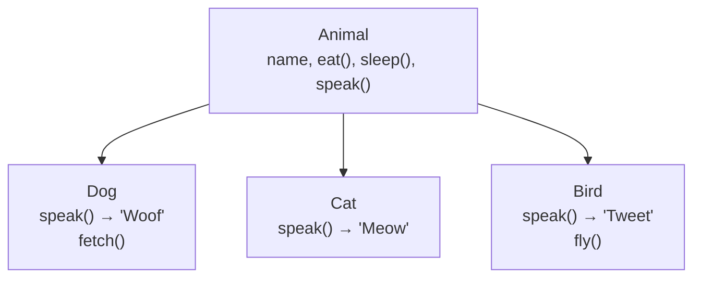
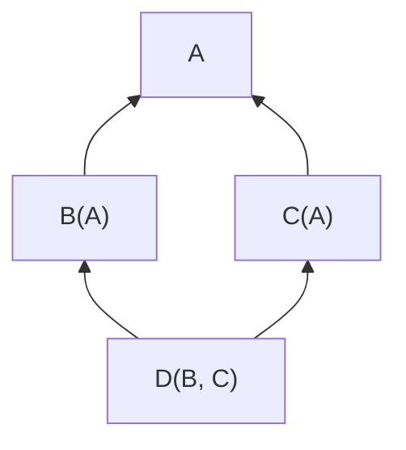
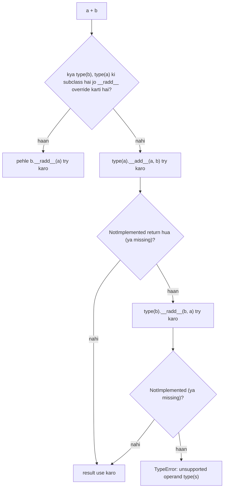

# Chapter 15 · OOP II: Inheritance, Polymorphism & Magic Methods

> `len()` lists pe, strings pe, dicts pe *aur* us pandas DataFrame pe kyun chalta hai jo tumhe ek din milega? Ek hi `sort()` call se numbers aur strings dono sort kaise ho jaate hain? Ye kismat nahi hai: ye kuch gine-chune ideas hain (inheritance, polymorphism aur "magic" dunder methods) jo tumhari apni classes ko Python mein utni hi smoothly fit kar dete hain jitni built-in classes.

**Is chapter mein tum seekhoge:**
- **Inheritance**: ek class ko extend karke reuse karna, methods override karna, aur `super()` se parent ko call karna
- **Multiple inheritance**, **diamond problem**, aur **MRO** (Python kaise decide karta hai ki kaunsa method jeetega)
- **Polymorphism** aur **duck typing**: "agar batakh jaisa quack kare…"
- `abc.ABC` aur `@abstractmethod` se **Abstraction**
- **Composition vs inheritance**, aur kyun "has-a" aksar "is-a" se behtar hai
- Dunder methods: `__eq__`, `__hash__`, `__lt__`, `__len__`, `__getitem__`, `__iter__`, `__contains__`, `__add__`, `__call__`, `__bool__`, aur `__enter__`/`__exit__` ki ek jhalak
- `functools.total_ordering` aur `@dataclass`: boring code Python ko likhne do
- **OOP ke four pillars**, us tarah jaise interviewers poochte hain

**Isse pehle padho:** [OOP I: Classes & Objects](14-oop-classes-objects.md) · [Errors, Exceptions & Files](13-exceptions-files.md)

---

## 🧠 The Big Idea · Asli Baat

Do ideas, do tasveerein.

**Tasveer 1: family tree.** Ek `Dog` *ek* `Animal` *hai*. Jo kuch animals ke baare mein sach hai (wo khaate hain, sote hain, unka ek naam hai), wo dogs ke baare mein apne aap sach hai. Dogs apni extra cheezein jodte hain (fetch) aur kuch kaam alag tarah karte hain (unki awaaz "Woof" hai). Yahi **inheritance** hai: child class ko parent se sab kuch milta hai, aur wo cheezein jod ya badal sakti hai.



**Tasveer 2: deewar ke sockets.** Python ke built-in functions aur operators (`len()`, `+`, `==`, `<`, `[]`, `for`, `in`, `with`) deewar ke **sockets** jaise hain. Sahi **plug** wala koi bhi appliance socket mein chalta hai, chahe kisi ne bhi banaya ho. Plugs hain **dunder methods**: apni class ko `__len__` do aur `len(obj)` chalne lagega; `__add__` do aur `obj + other` chalne lagega.

| Socket (jo tum likhte ho) | Plug (jo Python call karta hai) |
|---|---|
| `len(x)` | `x.__len__()` |
| `a + b` | `a.__add__(b)` |
| `a == b` | `a.__eq__(b)` |
| `a < b` | `a.__lt__(b)` |
| `x[i]` | `x.__getitem__(i)` |
| `item in x` | `x.__contains__(item)` |
| `for v in x` | `x.__iter__()` |
| `x()` | `x.__call__()` |
| `with x:` | `x.__enter__()` / `x.__exit__(...)` |

> 🇮🇳 **Desi Analogy:** Ghar ka switchboard socho. Socket ko farak nahi padta ki plug Bajaj ke mixer ka hai, Philips ke iron ka, ya local dukaan se liye charger ka. Bas plug ki shape sahi ho (3-pin), current mil jaata hai. `len()` wo socket hai; jis bhi class mein `__len__` naam ka "3-pin plug" hai, uspe `len()` chalega. Python ye nahi poochta "tum kaun ho?", wo poochta hai "tumhare paas sahi plug hai?"

Dono tasveerein jodo toh milta hai **polymorphism**: code ka ek hi tukda (`animal.speak()`, `len(thing)`, `a + b`) jo bahut saare alag types ke liye sahi kaam karta hai.

---

## 🔨 Building It Up · Zero Se Shuru

### 1. Inheritance: extend karke reuse

Shared cheezein ek baar **parent class** mein likho (ise **base class** ya **superclass** bhi kehte hain). Phir **child classes** (**subclasses**, **derived classes**) banao, brackets mein parent ka naam likh ke.

```python
class Animal:
    def __init__(self, name):
        self.name = name

    def eat(self):
        return f"{self.name} is eating"

    def speak(self):
        return "..."

class Dog(Animal):             # Dog, Animal se inherit karta hai
    def fetch(self):           # ek extra method jo sirf dogs ke paas hai
        return f"{self.name} fetches the ball"

rex = Dog("Rex")
print(rex.eat())               # Animal se inherit hua
print(rex.fetch())             # Dog ka apna
print(rex.speak())             # inherit hua (abhi humne badla nahi)
print(isinstance(rex, Dog), isinstance(rex, Animal))
print(issubclass(Dog, Animal), issubclass(Animal, Dog))
```

```text
Rex is eating
Rex fetches the ball
...
True True
True False
```

Abhi hua kya: `Dog` ka apna koi `__init__` ya `eat` nahi hai, toh Python unhe `Animal` mein dhoondhta hai. Ek `Dog` **ek** `Animal` **hai**, isliye `isinstance(rex, Animal)` `True` hai. Inheritance ek one-way street hai: har `Animal` zaroori nahi ki `Dog` ho.

> 🇮🇳 **Desi Analogy:** Family business socho. Dada ji ne "Agarwal Sweets" shuru kiya: recipes, dukaan ka naam, hisaab ka tareeka (parent class). Pota naya branch kholta hai (child class). Use sab kuch virasat mein milta hai, kuch dobara banane ki zaroorat nahi. Wo apni nayi cheez jodta hai, jaise online delivery (`fetch`). Par ulta nahi hota: dada ji ki purani dukaan mein pote ki online delivery nahi aa jaati (`issubclass(Animal, Dog)` False).

> 💡 Har class chupke se **`object`** se inherit karti hai, jo saari Python classes ka root hai. Wahi se default behaviours aate hain, jaise bhadda `<__main__.Dog object at 0x...>` repr aur `==` ka matlab "same object".

### 2. Overriding: alag tarah se karna

Child kisi parent method ko **override** (replace) kar sakta hai, same naam ka method define karke:

```python
class Animal:
    def __init__(self, name):
        self.name = name

    def speak(self):
        return "..."

    def introduce(self):
        return f"I am {self.name} and I say {self.speak()}"

class Dog(Animal):
    def speak(self):                 # Animal.speak ko override karta hai
        return "Woof"

class Cat(Animal):
    def speak(self):
        return "Meow"

for pet in [Dog("Rex"), Cat("Tom"), Animal("Generic")]:
    print(pet.introduce())
```

```text
I am Rex and I say Woof
I am Tom and I say Meow
I am Generic and I say ...
```

Dhyaan se dekho: `introduce` `Animal` mein rehta hai aur **Dog ke exist karne se pehle** likha gaya tha. Phir bhi jab `Dog` pe call hua, toh `self.speak()` ne **Dog ka** `speak` chalaya. Aisa isliye kyunki `self` asli object hai (ek `Dog`), aur lookup hamesha object ki apni class se shuru hota hai. Parent ka code un methods ko call kare jinhe children override karte hain: yahi reusable frameworks ka dil hai.

> 🤔 **Mann mein sawaal:** `introduce` toh `Animal` class mein likha hai. Toh uske andar `self.speak()` ko `Animal` wala `speak` kyun nahi milta?
>
> **Jawab:** Kyunki `self.speak()` "jis class mein ye line likhi hai uska speak" nahi maangta. Ye maangta hai "**jo object `self` mein baitha hai, uska speak**". `Dog("Rex").introduce()` mein `self` ek `Dog` hai, toh lookup `Dog` class se shuru hota hai, wahan `speak` mil jaata hai: "Woof". Code kahan likha hai isse farak nahi padta; object kaun hai, bas wahi matter karta hai.

### 3. `super()`: extend karo, replace nahi

Aksar tum parent ke behaviour mein **kuch jodna** chahte ho, use phenkna nahi. `super()` tumhe method ka parent wala version deta hai.

```python
class Employee:
    def __init__(self, name, salary):
        self.name = name
        self.salary = salary

    def describe(self):
        return f"{self.name} earns {self.salary}"

class Manager(Employee):
    def __init__(self, name, salary, reports):
        super().__init__(name, salary)          # parent ko name aur salary set karne do
        self.reports = reports                  # phir apni extra cheez jodo

    def describe(self):
        base = super().describe()               # parent ka text reuse karo
        return f"{base} and manages {len(self.reports)} people"

m = Manager("Priya", 150000, ["Ana", "Ben"])
print(m.describe())
print(m.name, m.reports)
```

```text
Priya earns 150000 and manages 2 people
Priya ['Ana', 'Ben']
```

Abhi hua kya: `super().__init__(...)` line ke bina, `Manager.__init__` `Employee.__init__` ko poori tarah replace kar deta, aur `m.name` kabhi set hi nahi hota (baad mein `AttributeError`). **Agar tumhara child `__init__` define karta hai, toh lagbhag hamesha use `super().__init__(...)` call karna padega.**

> 🇮🇳 **Desi Analogy:** Office mein naya Manager join karta hai. HR ka standard onboarding (parent ka `__init__`) hota hai: employee ID, salary account, laptop. Manager ke liye extra cheez hai: team ki list. Agar Manager bole "mera onboarding alag hai" aur HR wala step skip kar de, toh uska salary account hi nahi khulega (`m.name` missing). `super().__init__()` = "pehle HR ka standard onboarding karwao, phir meri extra cheezein."

### 4. Inheritance chains

Inheritance kai levels gehri ho sakti hai. Python chain mein upar tak dhoondhta hai jab tak method mil na jaaye:

```python
class Vehicle:
    wheels = 0
    def describe(self):
        return f"{type(self).__name__} with {self.wheels} wheels"

class Car(Vehicle):
    wheels = 4

class SportsCar(Car):
    def describe(self):
        return super().describe() + ", goes fast"

print(Vehicle().describe())
print(Car().describe())
print(SportsCar().describe())
print([cls.__name__ for cls in SportsCar.__mro__])
```

```text
Vehicle with 0 wheels
Car with 4 wheels
SportsCar with 4 wheels, goes fast
['SportsCar', 'Car', 'Vehicle', 'object']
```

`SportsCar.__mro__` **Method Resolution Order** hai: classes ki wo exact list jisme Python order se dhoondhta hai. Simple chain ke liye ye bas "main, mera parent, uska parent, ..., object" hai. Jab parents ek se zyada hon tab ye interesting ho jaata hai.

Ek chhoti si baat notice karo: `SportsCar` ne `wheels` define nahi kiya, phir bhi "4 wheels" aaya, kyunki `self.wheels` MRO mein `Car` tak pahuncha. Aur `type(self).__name__` ne "SportsCar" diya, kyunki object asal mein `SportsCar` hai, chahe code `Vehicle` mein likha ho.

> ⚠️ Hierarchies ko **shallow** rakho. Do ya teen levels normal hain. Chhe levels gehri hierarchy ka matlab hai padhne wale ko ek method call samajhne ke liye chhe classes kholni padengi.

### 5. Multiple inheritance aur diamond problem

Python class ke **kai parents** ho sakte hain: `class C(A, B):`. Ye powerful hai, par ek sawaal khada karta hai: agar `A` aur `B` dono `hello()` define karte hain, toh `C` ko kaunsa milega?

Mashhoor tricky case hai **diamond**: do parents jinka ek hi grandparent hai.



```python
class A:
    def hello(self):
        return "A"

class B(A):
    def hello(self):
        return "B"

class C(A):
    def hello(self):
        return "C"

class D(B, C):
    pass

d = D()
print(d.hello())
print([cls.__name__ for cls in D.__mro__])
```

```text
B
['D', 'B', 'C', 'A', 'object']
```

Python MRO ko **C3 linearization** naam ke algorithm se banata hai. Ise haath se chalane ki zaroorat nahi, par ye kin rules ki guarantee deta hai, wo pata hone chahiye:

1. **Child hamesha apne parents se pehle aata hai.** (`D`, `B` aur `C` se pehle; `B` aur `C`, `A` se pehle.)
2. **Parents wahi left-to-right order rakhte hain jo tumne likha.** `class D(B, C)` ka matlab `B`, `C` se pehle.
3. **Har class exactly ek baar aati hai**, toh shared grandparent `A` sirf ek baar visit hota hai, **uske saare bachchon ke baad**. Isi se diamond problem solve hoti hai: na duplicate, na confusion.

> 🇮🇳 **Desi Analogy:** Shaadi mein khaana parosne ka order socho. Rule hai: **bachche pehle, bade baad mein**; **jis order mein naam card pe likhe hain, usi order mein**; aur **har koi sirf ek baar**. `D` (dulha) sabse pehle. Phir uske dono parents ki side, card ke order mein: pehle `B` (papa ki side), phir `C` (mummy ki side). Dada ji `A` dono sides ke common hain, par unhe tab tak nahi parosa jaata jab tak dono sides ke log khaa na lein, aur parosa sirf ek baar jaata hai. Yahi C3 hai.

Agar koi order in rules ko satisfy nahi kar sakta, toh Python class banane se mana kar deta hai:

```py
class X: pass
class Y(X): pass
class Z(X, Y): pass   # TypeError: Cannot create a consistent method resolution order (MRO)
                      # X ko Y se pehle aana chahiye (tumne pehle likha) AUR Y ke baad bhi (Y uska child hai)
```

### 6. `super()` ka matlab hai "MRO mein agla", "mera parent" nahi

Ye sabko surprise karta hai. Multiple inheritance mein, `super()` *tumhare* parent ke paas nahi jaata; ye **object ke asli type ke MRO mein agli class** ke paas jaata hai. Isse diamond ki har class exactly ek baar chalti hai, agar sab `super()` call karein. Ise **cooperative multiple inheritance** kehte hain.

```python
class Base:
    def setup(self):
        print("Base.setup")

class Logging(Base):
    def setup(self):
        print("Logging.setup")
        super().setup()

class Caching(Base):
    def setup(self):
        print("Caching.setup")
        super().setup()          # App object ke liye ye jaata hai... Base pe? Nahi!

class App(Logging, Caching):
    def setup(self):
        print("App.setup")
        super().setup()

App().setup()
print([c.__name__ for c in App.__mro__])
```

```text
App.setup
Logging.setup
Caching.setup
Base.setup
['App', 'Logging', 'Caching', 'Base', 'object']
```

`Logging` ko `Caching` ke baare mein kuch nahi pata, phir bhi `Logging` ke `super().setup()` ne `Caching.setup` call kiya, kyunki `App` object ke liye MRO hai `App → Logging → Caching → Base`. Aur `Base.setup` **ek baar** chala, do baar nahi. 🎉

> 🤔 **Mann mein sawaal:** `Logging` ka parent toh `Base` hai, code mein saaf likha hai `class Logging(Base)`. Toh `super()` `Caching` pe kaise pahuncha?
>
> **Jawab:** `super()` class ke likhe hue parent ko nahi dekhta. Wo do cheezein dekhta hai: "main kis class mein hoon" (`Logging`) aur "object asal mein kya hai" (`App`). Phir `App` ka MRO leta hai, `[App, Logging, Caching, Base, object]`, usme `Logging` dhoondhta hai, aur **uske theek baad wali** class (`Caching`) pe jaata hai. Agar object sirf `Logging()` hota, toh MRO `[Logging, Base, object]` hota aur `super()` seedha `Base` jaata. Same line, alag object, alag manzil.

> 🇮🇳 **Desi Analogy:** Ye relay race ya Mumbai dabbawala ki chain hai. Har dabbawala ko sirf itna pata hai "dabba **line mein agle** banda ko dena hai", ye nahi ki agla kaun hai. Line (MRO) us din ke route se banti hai (object ka type). Isliye `Logging` wala dabbawala dabba `Caching` ko de deta hai bina use jaane, aur aakhri station (`Base`) tak dabba ek hi baar pahunchta hai.

### 7. Mixins: chhote, focused add-ons

Multiple inheritance ka ek common, safe use hai **mixin**: ek chhoti class jo **ek** capability jodti hai aur akele use hone ke liye nahi bani. Inke naam ke end mein `Mixin` lagao.

```python
class ReprMixin:
    def __repr__(self):
        fields = ", ".join(f"{k}={v!r}" for k, v in vars(self).items())
        return f"{type(self).__name__}({fields})"

class ToDictMixin:
    def to_dict(self):
        return dict(vars(self))

class User(ReprMixin, ToDictMixin):
    def __init__(self, name, email):
        self.name = name
        self.email = email

u = User("ana", "ana@example.com")
print(u)
print(u.to_dict())
```

```text
User(name='ana', email='ana@example.com')
{'name': 'ana', 'email': 'ana@example.com'}
```

Ab koi bhi class bas mixins list karke ek accha repr aur `to_dict` paa sakti hai. Asli frameworks (jaise Django ke class-based views) isi tarah bane hain.

> 🇮🇳 **Desi Analogy:** Mixins pizza ke toppings jaise hain. `ReprMixin` = extra cheese, `ToDictMixin` = jalapeño. Akele topping ka koi matlab nahi (koi sirf cheese ka katora order nahi karta), par kisi bhi pizza base (`User`, `Product`, `Order`) pe daal do toh wo feature aa jaata hai. Har topping ek hi kaam karti hai, aur tum jitni chahe utni jod sakte ho.

### 8. Polymorphism: ek interface, kai roop

**Polymorphism** (Greek mein: "kai shapes") ka matlab hai **same call alag-alag types pe chalta hai, har type apna kaam karta hai**. Tumne ise section 2 mein dekha: `pet.introduce()` dogs aur cats dono ke liye chala. Calling code ko `if type == ...` wali chains ki zaroorat nahi:

```python
class Shape:
    def area(self):
        raise NotImplementedError

class Circle(Shape):
    def __init__(self, r):
        self.r = r
    def area(self):
        return 3.14159 * self.r ** 2

class Square(Shape):
    def __init__(self, side):
        self.side = side
    def area(self):
        return self.side ** 2

class Triangle(Shape):
    def __init__(self, base, height):
        self.base, self.height = base, height
    def area(self):
        return 0.5 * self.base * self.height

shapes = [Circle(1), Square(3), Triangle(4, 5)]
for s in shapes:
    print(f"{type(s).__name__:<8} {s.area():.2f}")      # types pe koi if/elif nahi!
print("total:", round(sum(s.area() for s in shapes), 2))
```

```text
Circle   3.14
Square   9.00
Triangle 10.00
total: 22.14
```

Kal ek `Hexagon` jodna hai toh loop mein **zero** badlav chahiye. Alternative se compare karo:

```py
# ❌ har nayi shape ka matlab hai is function (aur iske jaise har function) ko edit karna
def area(shape):
    if shape["kind"] == "circle":
        return 3.14159 * shape["r"] ** 2
    elif shape["kind"] == "square":
        return shape["side"] ** 2
    ...
```

> 🇮🇳 **Desi Analogy:** Cricket captain bolta hai "**bowl karo!**" Ek hi command. Bumrah fast bowling karta hai, Ashwin off-spin, Kuldeep chinaman. Captain ko har bowler ke liye alag instruction nahi deni padti ("agar tum Bumrah ho toh tez daalo, agar Ashwin ho toh ghuma ke..."). Har bowler apna `bowl()` khud jaanta hai. Kal naya bowler team mein aaye, captain ki command wahi rahegi. Yahi polymorphism hai.

### 9. Duck typing: Python family tree check nahi karta

> "If it walks like a duck and quacks like a duck, it's a duck." (Agar batakh jaisa chalta hai aur batakh jaisa quack karta hai, toh wo batakh hai.)

Java mein polymorphism ke liye shared parent class ya interface chahiye. Python zyada relaxed hai: **jis bhi object mein sahi methods hain wo chalega**, rishta ho ya na ho. Ye hai **duck typing**.

```python
class Duck:
    def speak(self):
        return "Quack"

class Robot:                     # Animal NAHI hai, koi shared parent hi nahi
    def speak(self):
        return "Beep boop"

class Person:
    def speak(self):
        return "Hello"

def chorus(things):
    return " / ".join(t.speak() for t in things)

print(chorus([Duck(), Robot(), Person()]))
```

```text
Quack / Beep boop / Hello
```

Tum bina notice kiye lagataar duck typing use karte ho: `for` har iterable pe chalta hai, `len()` har us cheez pe jisme `__len__` hai, `json.dump` har us cheez mein likhta hai jisme `.write()` method hai (asli file, `io.StringIO`, network socket wrapper). Isiliye [Chapter 13](13-exceptions-files.md) mein `io.StringIO` file ki jagah khada ho saka.

Duck typing **EAFP** ke saath naturally jodi banata hai: pehle types check karne ki jagah, seedha method call karo aur agar wo nahi hai toh `AttributeError`/`TypeError` handle karo.

> 🇮🇳 **Desi Analogy:** Shaadi mein DJ ko koi farak nahi padta ki naachne wala dulhe ka bhai hai, padosi hai, ya caterer ka helper. Jo bhi "naach sakta hai" (`dance()` method), wo dance floor pe chalega. Koi family tree ya invitation card check nahi karta. Python ka `chorus()` bhi bas itna dekhta hai: `speak()` hai? Chalo.

### 10. Abstraction: `abc.ABC` aur `@abstractmethod`

Section 8 mein `Shape.area` ne `NotImplementedError` raise kiya. Par kisi ko `Pentagon(Shape)` likhne se kisi ne nahi roka jo `area` bhool jaaye, aur bug tabhi dikhta jab aakhir mein `area()` call hota, shayad production mein. **Abstract base classes** ise object banne ke moment pe hi pakad leti hain.

**Abstraction** ka matlab hai ye dikhana ki koi cheez *kya* karti hai, aur *kaise* karti hai ye chhupana. Ek abstract class **contract** define karti hai ("har shape ke paas `area` aur `perimeter` hona chahiye"), bina use implement kiye.

```python
from abc import ABC, abstractmethod

class PaymentMethod(ABC):
    @abstractmethod
    def pay(self, amount):
        """Charge the amount. Every payment method MUST implement this."""

    def receipt(self, amount):               # concrete methods bhi allowed hain
        return f"Paid {amount} via {type(self).__name__}: {self.pay(amount)}"

class UPI(PaymentMethod):
    def __init__(self, vpa):
        self.vpa = vpa
    def pay(self, amount):
        return f"UPI request sent to {self.vpa}"

class Card(PaymentMethod):
    def pay(self, amount):
        return "card charged"

class BrokenWallet(PaymentMethod):
    pass                                     # pay implement karna bhool gaye!

for method in [UPI("riya@okbank"), Card()]:
    print(method.receipt(499))

for cls in (PaymentMethod, BrokenWallet):
    try:
        cls()
    except TypeError as e:
        print("TypeError:", str(e).split(" with")[0])
```

```text
Paid 499 via UPI: UPI request sent to riya@okbank
Paid 499 via Card: card charged
TypeError: Can't instantiate abstract class PaymentMethod
TypeError: Can't instantiate abstract class BrokenWallet
```

Abhi hua kya:

- Jo class `ABC` se inherit karti hai aur jisme kam se kam ek `@abstractmethod` hai, uska **object nahi ban sakta**.
- Subclass tabhi "concrete" (banane layak) banti hai jab wo **har** abstract method override kare. `BrokenWallet` `pay` bhool gaya, toh Python use banane se mana kar deta hai, aur bug turant pakda jaata hai.
- Abstract classes mein phir bhi normal methods ho sakte hain (`receipt`) jo abstract wale use karte hain. Ye **template method** pattern hai: parent poora algorithm define karta hai, children steps bharte hain.

> 🇮🇳 **Desi Analogy:** NPCI ne UPI ke liye ek rulebook banayi hai (abstract class): "Jo bhi payment app banana chahta hai, use `pay()`, `check_balance()` jaise kaam implement karne hi padenge." Rulebook khud payment nahi karti. PhonePe, GPay, Paytm (concrete subclasses) apne-apne tareeke se implement karte hain. Koi naya app bole "humne `pay()` banaya hi nahi par launch karna hai", toh NPCI approval hi nahi deta (`TypeError` object banate hi). Bug launch se pehle pakda gaya, customer ke paise atakne ke baad nahi.

> 💡 Poora error message aage missing method ka naam bhi batata hai (`pay`), yaani exactly kya fix karna hai (exact wording Python versions mein thodi badalti hai, isiliye upar ka code use kaat deta hai).

Python ki standard library ABCs se bhari padi hai. `collections.abc` `Iterable`, `Sequence`, `Mapping` aur aur bhi define karta hai, aur `isinstance([], collections.abc.Sequence)` `True` hai.

### 11. Composition vs inheritance

Inheritance **"is-a"** model karta hai: `Dog` **ek** `Animal` **hai**. **Composition** **"has-a"** model karta hai: `Car` **ke paas ek** `Engine` **hai**. Composition mein, ek object doosre objects ko attributes ki tarah rakhta hai aur kaam unhe **delegate** karta hai (saunp deta hai).

```python
class Engine:
    def __init__(self, horsepower):
        self.horsepower = horsepower
    def start(self):
        return f"{self.horsepower}hp engine roars"

class ElectricMotor:
    def start(self):
        return "electric motor hums silently"

class Car:
    def __init__(self, model, engine):
        self.model = model
        self.engine = engine            # HAS-A: car ek engine object rakhti hai

    def start(self):
        return f"{self.model}: {self.engine.start()}"   # delegate

print(Car("Swift", Engine(90)).start())
print(Car("Nexon EV", ElectricMotor()).start())         # part badlo, koi nayi subclass nahi
```

```text
Swift: 90hp engine roars
Nexon EV: electric motor hums silently
```

Ek classic interview example: kya `Stack` ko `list` se **inherit** karna chahiye?

```python
class BadStack(list):            # is-a list: list ke SAARE methods inherit karta hai
    def push(self, x):
        self.append(x)

s = BadStack()
s.push(1); s.push(2); s.push(3)
s.insert(0, 99)                  # ❌ allowed! ek "stack" jisme neeche insert ho sakta hai
print(s)

class Stack:                     # has-a list: sirf stack operations expose karta hai
    def __init__(self):
        self._items = []
    def push(self, x):
        self._items.append(x)
    def pop(self):
        return self._items.pop()
    def peek(self):
        return self._items[-1]
    def __len__(self):
        return len(self._items)

good = Stack()
good.push(1); good.push(2)
print(good.pop(), len(good), hasattr(good, "insert"))
```

```text
[99, 1, 2, 3]
2 1 False
```

| | Inheritance ("is-a") | Composition ("has-a") |
|---|---|---|
| Rishta | `Dog` ek `Animal` hai | `Car` ke paas `Engine` hai |
| Coupling | tight: child parent ke internals pe depend karta hai | loose: sirf part ke public methods use karta hai |
| Runtime pe badal sakte ho? | nahi, class likhte waqt fixed | haan, part swap karo (`ElectricMotor`) |
| Kya expose hota hai | parent ka sab kuch | sirf jo tum chuno |
| Risk | fragile hierarchies, unwanted inherited methods | thoda zyada delegation code |

> 🇮🇳 **Desi Analogy:** Thali restaurant socho. **Inheritance** wala approach: "Hamari Gujarati thali, Rajasthani thali ki bachchi hai." Ab Rajasthani thali mein jo bhi badlega, Gujarati mein apne aap aa jaayega, chahe chahiye ya nahi. **Composition** wala approach: "Hamari thali ke paas ek dal katori hai, ek sabzi katori hai, ek roti." Aaj dal makhani nahi, dal tadka chahiye? Bas katori badlo, thali wahi. Swiggy/Zomato pe "customise your thali" composition hi hai.

> 💡 Mashhoor design rule: **"favour composition over inheritance."** Inheritance tab use karo jab child sach mein parent ka ek specialised version *ho* aur parent jo kuch karta hai wo **sab** support kare (ye **Liskov Substitution Principle** hai, SOLID ka "L", jo [System Design Chapter 14](../part-3-system-design/14-low-level-design.md) mein aayega). Warna compose karo.

> 🤔 **Mann mein sawaal:** `BadStack` mein `insert` aa gaya toh kya hua, main use call hi nahi karunga. Problem kya hai?
>
> **Jawab:** Tum nahi karoge, par tumhare teammate, ya 6 mahine baad wala tum, kar sakta hai. Class ka kaam hai apne rules **khud** enforce karna (Chapter 14 ka encapsulation). `Stack` ka promise hai "sirf upar se daalo, upar se nikalo." Agar class khud hi `insert(0, ...)` ka darwaza khula chhod de, toh wo promise sirf ek ummeed reh jaata hai. Composition mein darwaza bana hi nahi, toh todne ka sawaal hi nahi.

### 12. Magic methods I: equality aur hashing (`__eq__`, `__hash__`)

By default tumhare objects pe `==` ka matlab hai "same object". `__eq__` se Python ko sikhao ki barabari ka matlab kya hai:

```python
class Point:
    def __init__(self, x, y):
        self.x, self.y = x, y

    def __eq__(self, other):
        if not isinstance(other, Point):
            return NotImplemented          # "mujhe nahi pata isse kaise compare karun"
        return (self.x, self.y) == (other.x, other.y)

    def __hash__(self):
        return hash((self.x, self.y))      # barabar points ke hash bhi barabar HONE chahiye

    def __repr__(self):
        return f"Point({self.x}, {self.y})"

a, b = Point(1, 2), Point(1, 2)
print(a == b, a is b, a != b)              # != apne aap __eq__ se ban jaata hai
print(a == "not a point")
print({a, b, Point(3, 4)})                 # set duplicate hata deta hai
print({a: "home"}[Point(1, 2)])            # dict key ki tarah use ho sakta hai
```

```text
True False False
False
{Point(1, 2), Point(3, 4)}
home
```

Do zaroori rules (ye seedha [Chapter 9](09-dictionaries.md) se jude hain):

1. **Agar `a == b`, toh `hash(a) == hash(b)` sach hona hi chahiye.** Sets aur dicts pehle hash se ek bucket pe jump karte hain, phir `==` se confirm karte hain. Agar barabar objects ke hash alag hote, toh set khushi-khushi "duplicates" rakh leta aur dictionary lookups fail ho jaate.
2. **Agar tum `__hash__` ke bina `__eq__` define karte ho, toh Python `__hash__` ko `None` set kar deta hai**, jisse tumhare objects unhashable ho jaate hain (sets mein nahi ja sakte, dict keys nahi ban sakte). Ye jaan-boojh ke hai: ye tumhe galti se rule 1 todne se rokta hai.

> 🇮🇳 **Desi Analogy:** Railway reservation chart socho. Coach number (hash) se pehle sahi coach mein jaate ho, phir naam match karte ho (`==`). Ab agar "Riya Sharma" ke do tickets alag-alag coaches mein likhe hon (same insaan, alag hash), toh TTE ek coach mein dhoondhega, wahan nahi milegi, aur bolega "ye passenger hai hi nahi", jabki wo hai. Isliye rule: **jo barabar hain, unka coach bhi same hona chahiye.** Python itna serious hai is rule pe ki agar tumne sirf `__eq__` diya aur coach (hash) ka rule nahi bataya, toh wo tumhe train mein chadhne hi nahi deta (unhashable).

```python
class Money:
    def __init__(self, amount):
        self.amount = amount
    def __eq__(self, other):
        return isinstance(other, Money) and self.amount == other.amount

print(Money(5) == Money(5))
try:
    {Money(5)}
except TypeError as e:
    print("TypeError:", e)
```

```text
True
TypeError: unhashable type: 'Money'
```

> ⚠️ Objects ko hashable sirf tab banao jab `__hash__` mein use hue fields banne ke baad **kabhi na badlein**. Agar tumne ek `Point` ko set mein daala aur phir uska `x` badal diya, toh uska hash badal jaata hai aur set use dobara dhoondh nahi payega. Mutable objects ko aksar unhashable hi rehna chahiye (bilkul `list` ki tarah).

**`NotImplemented` kya hai?** Ye ek special value hai (exception `NotImplementedError` nahi!) jo ek dunder method return karta hai ye bolne ke liye ki "main is type ko handle nahi kar sakta". Tab Python **doosre** operand ka method try karta hai, aur agar koi bhi handle na kare, toh `==` ke liye identity pe fall back karta hai ya `<` aur `+` ke liye `TypeError` raise karta hai.

> 🤔 **Mann mein sawaal:** `__eq__` mein `NotImplemented` return karne ki jagah seedha `False` return kar doon toh kya bigdega? Answer toh same hai!
>
> **Jawab:** `==` ke liye aksar same dikhta hai, par tum doosri class ka mauka chheen lete ho. Maan lo kisi aur ki `Point3D` class jaanti hai ki `Point` se kaise compare karna hai. `NotImplemented` bolta hai "mujhe nahi pata, *doosre se pooch lo*", toh Python `Point3D.__eq__` try karta hai. `False` bolta hai "maine decide kar liya, barabar nahi", aur baat wahin khatam. `+` jaise operators mein ye aur bhi zaroori hai: `NotImplemented` ke bina `2 * v` jaisa reflected trick chalega hi nahi (section 15).

### 13. Magic methods II: ordering (`__lt__` aur saathi) aur `total_ordering`

`<`, `>`, `sorted()`, `min()` aur `max()` chalane ke liye comparison methods define karo:

| Operator | Method |
|---|---|
| `a < b` | `__lt__` |
| `a <= b` | `__le__` |
| `a > b` | `__gt__` |
| `a >= b` | `__ge__` |

`sorted()` aur `list.sort()` ko sirf `__lt__` chahiye. Chaaron haath se likhna thakaau aur galti-prone hai, isliye `functools.total_ordering` baaki sab `__eq__` plus unme se **ek** se bhar deta hai:

```python
from functools import total_ordering

@total_ordering
class Version:
    def __init__(self, text):
        self.parts = tuple(int(p) for p in text.split("."))

    def __eq__(self, other):
        return self.parts == other.parts

    def __lt__(self, other):
        return self.parts < other.parts      # tuples element by element compare hote hain

    def __repr__(self):
        return "v" + ".".join(map(str, self.parts))

releases = [Version("1.10.0"), Version("1.2.3"), Version("1.9"), Version("2.0")]
print(sorted(releases))
print(max(releases))
print(Version("1.10") > Version("1.9"), Version("3.0") >= Version("3.0"))
```

```text
[v1.2.3, v1.9, v1.10.0, v2.0]
v2.0
True True
```

Abhi hua kya: version **strings** compare karte toh `"1.10.0"` `"1.9"` se pehle aata (character by character, `"1"` < `"9"`). Ints ke tuples mein badalne se sahi numeric order milta hai: `(1, 10, 0)` vs `(1, 9)` mein doosra element `10 > 9`. Humne sirf `__lt__` likha, par `>` aur `>=` chal gaye kyunki `@total_ordering` ne unhe generate kiya. (`@` decorator syntax [Chapter 16](16-iterators-generators-decorators.md) mein poori tarah samjhaya gaya hai.)

> 🇮🇳 **Desi Analogy:** Board exam ki merit list socho. Agar marks ko strings ki tarah sort karo toh "100" "99" se pehle aa jaayega kyunki "1" < "9", aur topper list ke beech mein kahin chala jaayega. Numbers ki tarah sort karo, tab sahi order. Version numbers ka bhi yahi haal hai: "1.10" asal mein "1.9" se **naya** hai.

> 💡 Jab bas ek baar kisi field se **sort** karna hai, toh `__lt__` se simple hai `key` function: `sorted(users, key=lambda u: u.age)`. `__lt__` tab define karo jab type ka ek obvious natural order ho (versions, money, dates).

### 14. Magic methods III: container ki tarah behave karna

Ye implement karo aur tumhara object built-in collection ki tarah behave karega:

```python
class Playlist:
    def __init__(self, name, songs):
        self.name = name
        self._songs = list(songs)

    def __len__(self):                     # len(p)
        return len(self._songs)

    def __getitem__(self, index):          # p[i], p[a:b]
        return self._songs[index]

    def __setitem__(self, index, value):   # p[i] = value
        self._songs[index] = value

    def __contains__(self, song):          # song in p
        return song in self._songs

    def __iter__(self):                    # for song in p
        return iter(self._songs)

    def __bool__(self):                    # if p:
        return len(self._songs) > 0

    def __repr__(self):
        return f"Playlist({self.name!r}, {len(self)} songs)"

p = Playlist("Gym", ["Eye of the Tiger", "Stronger", "Lose Yourself"])
print(p, len(p))
print(p[0], "|", p[-1], "|", p[0:2])
p[1] = "Till I Collapse"
print("Stronger" in p, "Till I Collapse" in p)
for i, song in enumerate(p, 1):
    print(i, song)
print(bool(p), bool(Playlist("Empty", [])))
```

```text
Playlist('Gym', 3 songs) 3
Eye of the Tiger | Lose Yourself | ['Eye of the Tiger', 'Stronger']
False True
1 Eye of the Tiger
2 Till I Collapse
3 Lose Yourself
True False
```

Abhi hua kya: `p[0:2]` ne `__getitem__` ko ek **slice object** pass kiya, aur kyunki humne use aage list ko de diya, slicing apne aap chal gayi. Dhyaan do ki humne list ko **compose** kiya (has-a), usse inherit nahi kiya, aur exactly chuna ki list ke kaunse behaviours expose karne hain.

Mazedaar baat: agar tum sirf `__getitem__` define karo (jo 0, 1, 2, ... accept kare), toh Python *phir bhi* tumhare object pe iterate kar sakta hai aur `in` use kar sakta hai, `__getitem__` ko badhte indexes ke saath call karke jab tak `IndexError` na mile. `__iter__` modern, preferred tareeka hai; [Chapter 16](16-iterators-generators-decorators.md) iterator protocol poora samjhata hai.

**Truthiness rules:** `if obj:` `__bool__` call karta hai; wo missing ho toh `__len__` use karta hai (zero matlab falsy); dono missing hon, toh har object truthy hai.

### 15. Magic methods IV: arithmetic (`__add__`, `__mul__`, `__radd__`...)

Ek 2D vector ko `+`, `-`, `*` aur `abs()` support karwao:

```python
import math

class Vector:
    def __init__(self, x, y):
        self.x, self.y = x, y

    def __add__(self, other):                    # v + w
        if not isinstance(other, Vector):
            return NotImplemented
        return Vector(self.x + other.x, self.y + other.y)

    def __sub__(self, other):                    # v - w
        if not isinstance(other, Vector):
            return NotImplemented
        return Vector(self.x - other.x, self.y - other.y)

    def __mul__(self, k):                        # v * 3
        if not isinstance(k, (int, float)):
            return NotImplemented
        return Vector(self.x * k, self.y * k)

    __rmul__ = __mul__                           # 3 * v (reflected): same logic

    def __neg__(self):                           # -v
        return Vector(-self.x, -self.y)

    def __abs__(self):                           # abs(v) = length
        return math.hypot(self.x, self.y)

    def __eq__(self, other):
        return isinstance(other, Vector) and (self.x, self.y) == (other.x, other.y)

    def __repr__(self):
        return f"Vector({self.x}, {self.y})"

v, w = Vector(3, 4), Vector(1, 1)
print(v + w, v - w, v * 2, 2 * v, -w)
print(abs(v))
print(v + w == Vector(4, 5))
try:
    v + 5
except TypeError as e:
    print("TypeError:", e)
```

```text
Vector(4, 5) Vector(2, 3) Vector(6, 8) Vector(6, 8) Vector(-1, -1)
5.0
True
TypeError: unsupported operand type(s) for +: 'Vector' and 'int'
```

(`abs(Vector(3, 4))` = 5.0, kyunki `math.hypot(3, 4)` = √(9 + 16) = 5. Wahi 3-4-5 wala triangle.)

**`2 * v` kaise chalta hai:** Python pehle `int.__mul__(2, v)` try karta hai. `int` ko pata hi nahi `Vector` kya hai, toh wo `NotImplemented` return karta hai. Tab Python right operand pe **reflected** method try karta hai: `v.__rmul__(2)`. Har arithmetic operator ka ek `r` version hai: `__radd__`, `__rsub__`, `__rmul__`, ...

> 🇮🇳 **Desi Analogy:** Do log milke bill split kar rahe hain. Python pehle left wale se poochta hai: "tum ye hisaab kar sakte ho?" (`int.__mul__`). Wo bolta hai "mujhe vector ka hisaab nahi aata" (`NotImplemented`). Tab Python right wale se poochta hai: "chalo tum karo, ulti taraf se" (`v.__rmul__`). Agar dono mana kar dein, toh waiter bolta hai "ye bill nahi banega" (`TypeError`). `r` = **"reverse mein poocho"**.

Yahi `sum()` ka bhi raaz hai: `sum(items)` `0` se shuru hota hai aur `0 + first_item` compute karta hai, toh `sum(list_of_vectors)` chalane ke liye tum ek `__radd__` jodoge jo `0` ko specially treat kare, ya `sum(vectors, Vector(0, 0))` call karoge.

**In-place** versions bhi hain (`+=` ke liye `__iadd__`). Agar tum unhe define nahi karte, toh `v += w` `v = v + w` pe fall back karta hai, jo immutable-style objects ke liye wahi hai jo tum chahte ho.

| Operator | Method | Reflected |
|---|---|---|
| `+` | `__add__` | `__radd__` |
| `-` | `__sub__` | `__rsub__` |
| `*` | `__mul__` | `__rmul__` |
| `/` | `__truediv__` | `__rtruediv__` |
| `//` | `__floordiv__` | `__rfloordiv__` |
| `%` | `__mod__` | `__rmod__` |
| `**` | `__pow__` | `__rpow__` |
| `@` | `__matmul__` | `__rmatmul__` |
| unary `-` / `abs()` | `__neg__` / `__abs__` | |

### 16. Magic methods V: `__call__` (objects jo functions ki tarah behave karte hain)

`__call__` define karo aur tumhara object function ki tarah `()` se call ho sakta hai, aur calls ke beech **state yaad** bhi rakhta hai:

```python
class RateLimiter:
    def __init__(self, max_calls):
        self.max_calls = max_calls
        self.calls = 0

    def __call__(self, user):
        self.calls += 1
        if self.calls > self.max_calls:
            return f"429 Too Many Requests for {user}"
        return f"200 OK for {user} (call {self.calls})"

limit = RateLimiter(max_calls=2)
for user in ["ana", "ana", "ana"]:
    print(limit(user))                 # ek object ko call kar rahe hain!
print(callable(limit), callable(42))
```

```text
200 OK for ana (call 1)
200 OK for ana (call 2)
429 Too Many Requests for ana
True False
```

> 🇮🇳 **Desi Analogy:** IRCTC Tatkal ka "ek user, ek minute mein sirf itne attempts" wala rule socho. `RateLimiter` ek gatekeeper hai jise tum function ki tarah bulaate ho (`limit(user)`), par normal function ke ulat ye **ginti yaad rakhta hai** (`self.calls`). Teesri baar bulaya toh "429, thoda ruko". Normal function har baar zero se shuru hota, use pichli baar yaad hi nahi rehta.

Classes khud callable hain (isiliye `Dog("Rex")` chalta hai), functions callable hain, aur ab tumhare objects bhi ho sakte hain. `__call__` tumhe phir milega jab hum [Chapter 16](16-iterators-generators-decorators.md) mein **class-based decorators** banayenge.

### 17. Magic methods VI: `__enter__` aur `__exit__` (ek preview)

[Chapter 13](13-exceptions-files.md) mein tumne `with open(...)` use kiya. `__enter__` aur `__exit__` wala koi bhi object `with` ke saath chalta hai:

```python
class Section:
    def __init__(self, title):
        self.title = title

    def __enter__(self):
        print(f"[start {self.title}]")
        return self                          # 'as' wala variable yahi banta hai

    def __exit__(self, exc_type, exc_value, traceback):
        print(f"[end {self.title}]")
        return False                         # exceptions ko nigalo mat

with Section("report") as s:
    print("  working inside", s.title)
```

```text
[start report]
  working inside report
[end report]
```

`__exit__` tab bhi chalta hai jab block raise kare, isliye clean-up ke liye perfect hai. Poori kahaani (aasaan `@contextmanager` tareeke samet) [Chapter 16](16-iterators-generators-decorators.md) mein hai.

### 18. `@dataclass`: boilerplate Python ko likhne do

Dekho `Point` ko kitna code chahiye tha: `__init__`, `__repr__`, `__eq__`, `__hash__`. Jo classes zyaadatar **data** hain, unke liye `dataclasses` module ye sab tumhare liye **type annotations** se likh deta hai (`name: type` syntax, jo bas ek field aur uska intended type declare karta hai):

```python
from dataclasses import dataclass, field

@dataclass
class Student:
    name: str
    roll: int
    marks: list = field(default_factory=list)   # har object ke liye fresh list
    active: bool = True                         # simple default

    def average(self):
        return sum(self.marks) / len(self.marks) if self.marks else 0.0

a = Student("Asha", 1, [90, 80])
b = Student("Asha", 1, [90, 80])
c = Student("Ben", 2)
print(a)
print(a == b, a is b)
print(c, c.average())
```

```text
Student(name='Asha', roll=1, marks=[90, 80], active=True)
True False
Student(name='Ben', roll=2, marks=[], active=True) 0.0
```

`@dataclass` ne `__init__`, `__repr__` aur `__eq__` generate kiye (`__eq__` saare fields order mein compare karta hai). Options aur bhi khol dete hain:

```python
from dataclasses import dataclass

@dataclass(frozen=True, order=True)
class Card:
    rank: int
    suit: str

    def __post_init__(self):                      # generated __init__ ke turant baad chalta hai
        if not 2 <= self.rank <= 14:
            raise ValueError(f"bad rank {self.rank}")

hand = [Card(12, "hearts"), Card(3, "spades"), Card(12, "clubs")]
print(sorted(hand))                               # order=True: (rank, suit) compare karta hai
print(len({Card(3, "spades"), Card(3, "spades")}))   # frozen=True ise hashable banata hai

try:
    hand[0].rank = 2
except AttributeError as e:                       # FrozenInstanceError ek AttributeError hai
    print(type(e).__name__, "-", e)
try:
    Card(20, "hearts")
except ValueError as e:
    print("ValueError:", e)
```

```text
[Card(rank=3, suit='spades'), Card(rank=12, suit='clubs'), Card(rank=12, suit='hearts')]
1
FrozenInstanceError - cannot assign to field 'rank'
ValueError: bad rank 20
```

Sorted order dekho: dono 12 wale cards mein rank barabar hai, toh tie suit se tooti: `"clubs"` < `"hearts"` (alphabetically). Bilkul tuple comparison jaisa.

| Option | Kya jodta hai |
|---|---|
| (default) | `__init__`, `__repr__`, `__eq__` |
| `order=True` | `<`, `<=`, `>`, `>=` jo fields ko tuple ki tarah compare karte hain, definition order mein |
| `frozen=True` | fields dobara assign nahi ho sakte; `__hash__` bhi generate karta hai |
| `field(default_factory=list)` | safe mutable defaults (plain `= []` `ValueError` se reject hota hai) |
| `__post_init__` | `__init__` ke baad tumhari extra validation/derived fields |
| `slots=True` (3.10+) | kam memory ke liye `__slots__` use karta hai |

> 🇮🇳 **Desi Analogy:** `@dataclass` ek ready-made **Aadhaar enrolment form** jaisa hai. Tum bas field ke naam likhte ho (naam, DOB, address), aur form apne aap print hone layak format (`__repr__`), bharne ka tareeka (`__init__`), aur "do forms same hain kya" check (`__eq__`) le aata hai. `frozen=True` = form pe lamination: ek baar ban gaya toh badal nahi sakte, isliye uspe bharosa karke usse database ki key bana sakte ho (hashable).

> 💡 Thumb rule: agar class zyaadatar "named fields ka ek thaila" hai, toh use `@dataclass` banao. Agar wo zyaadatar behaviour hai aur state dhyaan se protect karni hai (jaise `BankAccount`), toh haath se likho.

### 19. OOP ke four pillars, interview style

Interviewers ko pasand hai: "What are the four pillars of OOP? Explain with examples." Ye raha ek crisp answer jo tum do minute se kam mein de sakte ho:

| Pillar | One-line definition | Is chapter se Python example |
|---|---|---|
| **Encapsulation** | Bundle data with the methods that operate on it and control access to internal state | `BankAccount` with `_balance` and a read-only `balance` property ([Chapter 14](14-oop-classes-objects.md)) |
| **Abstraction** | Expose *what* an object does, hide *how*; define contracts | `PaymentMethod(ABC)` with abstract `pay()` |
| **Inheritance** | A class acquires the attributes and methods of another and can extend or override them | `Manager(Employee)` using `super().__init__` |
| **Polymorphism** | One interface, many implementations: the same call behaves differently per type | `shape.area()` for `Circle`/`Square`; duck typing; operator overloading with `__add__` |

(Definitions jaan-boojh ke English mein rakhi hain, kyunki interview mein yahi bolni hain.)

Log aksar encapsulation aur abstraction mix kar dete hain. Fark: **encapsulation andar ko protect karne ke baare mein hai** (data chhupana, badlav control karna); **abstraction bahar ko simple banane ke baare mein hai** (ek clean contract jo complexity chhupaye). Car ka locked bonnet encapsulation hai; uska steering wheel aur pedals abstraction hain.

> 🇮🇳 **Desi Analogy:** Auto-rickshaw se chaaron pillars: **Encapsulation** = engine ek band dibbe mein hai, sawari usme haath nahi daal sakti. **Abstraction** = driver ko bas handle, brake aur meter chahiye, engine ke andar ka physics nahi. **Inheritance** = CNG auto ne petrol auto ka poora design le liya, bas fuel system badla. **Polymorphism** = tum har auto ko bolte ho "Andheri chalo", aur CNG, electric, petrol, sab apne-apne tareeke se chal padte hain.

Python polymorphism ke kai flavours support karta hai:

- **Subtype polymorphism**: subclasses mein methods override karna (`Dog.speak`).
- **Duck typing**: same method names wali bina rishte ki classes.
- **Operator overloading**: `+` ka matlab ints ke liye addition, strings ke liye concatenation, aur tumhare `Vector` ke liye vector addition.
- **Signature se method overloading nahi.** Java ke ulat, ek hi class mein `def area(self)` aur `def area(self, scale)` define karoge toh sirf **aakhri** wala bachega. Python iski jagah default aur keyword arguments use karta hai (aur argument type se dispatch ke liye `functools.singledispatch`).

---

## 🔬 Under the Hood · Andar Ki Kahani

### Operators dunder methods kaise dhoondhte hain

`a + b` (mote taur pe) ye algorithm hai:



Ek important detail: Python dunder methods ko **type** pe dhoondhta hai, instance pe nahi. Ek object pe `obj.__len__ = lambda: 5` assign karne se `len(obj)` **nahi** chalega. Special methods class mein define hone chahiye. (Isse CPython unhe type object ke fast fixed slots mein store kar pata hai, toh `len(x)` ko dictionary search nahi karna padta.)

Pehla wala subclass check kyun? Taaki agar tumne `int` ki ek subclass banayi jo `+` ko apne tareeke se handle karti hai, toh `5 + my_special_int` mein tumhari subclass ko pehla mauka mile. Specialised class ko general class se pehle bolne ka haq milta hai.

### C3 linearization MRO kaise banata hai

Class `C(B1, B2, ...)` ke liye, MRO hai: `C`, uske baad parents ke MROs aur parents ki list `[B1, B2, ...]` ka **merge**. Merge baar-baar un lists ka wo **pehla head** uthata hai jo kisi bhi doosri list ki **tail** (pehli position ke alawa koi bhi jagah) mein **nahi** aata.

Diamond `D(B, C)` pe lagao, jahan `MRO(B) = [B, A, object]` aur `MRO(C) = [C, A, object]`:

| Step | Merge karne wali lists | Pick | Kyun |
|---|---|---|---|
| 1 | `[B,A,object]`, `[C,A,object]`, `[B,C]` | `B` | B kisi tail mein nahi hai |
| 2 | `[A,object]`, `[C,A,object]`, `[C]` | `C` | A `[C,A,object]` ki tail mein hai, toh A skip, C lo |
| 3 | `[A,object]`, `[A,object]` | `A` | ab free hai |
| 4 | `[object]`, `[object]` | `object` | |

Result: `D, B, C, A, object`, exactly wahi jo Python ne print kiya. "Jo head kisi tail mein ho use skip karo" wala rule hi shared grandparent `A` ko tab tak rukne pe majboor karta hai jab tak uske saare bachche nipat na jaayein.

"Tail mein hai" ka matlab simple bhasha mein: "koi aur abhi bhi isse **pehle** kisi aur ko aana chahiye bol raha hai." Step 2 mein `[C, A, object]` keh rahi hai "A se pehle C aana chahiye", isliye A ko line mein rukna pada.

### `super()` under the hood

Bina arguments ka `super()` `super(CurrentClass, self)` ka shorthand hai. Ye `type(self).__mro__` dhoondhta hai, usme `CurrentClass` locate karta hai, aur method search **agli** class se shuru karta hai. Kyunki ye `type(self)` ka MRO (asli object ki class) use karta hai, isliye `Logging` mein likhi same line alag-alag classes tak pahunchti hai, is pe depend karta hai ki object asal mein kya hai. Isiliye cooperative inheritance chalti hai.

### `@dataclass` asal mein kya karta hai

Runtime pe koi magic nahi: jab class banti hai, `@dataclass` annotations padhta hai, `__init__`, `__repr__`, `__eq__` aur saathiyon ka **Python source code text ki tarah likhta hai**, use `exec` se compile karta hai, aur bane hue functions class pe chipka deta hai. Generated `__init__` haath se likhe jitna hi fast hai. Fields tum `dataclasses.fields(obj)` se dekh sakte ho aur `dataclasses.asdict(obj)` se dict mein convert kar sakte ho.

### `isinstance` vs `type(...) ==`

`type(x) == Dog` sirf exactly `Dog` ke liye true hai. `isinstance(x, Animal)` MRO walk karta hai, toh subclasses ke liye bhi true hai. ABCs `isinstance` ko customise bhi kar sakti hain (isiliye `isinstance([], collections.abc.Sequence)` `True` hai, halaanki `list` `Sequence` ko parent ki tarah list nahi karta). `isinstance` prefer karo, kyunki ye inheritance aur polymorphism ko respect karta hai.

---

## 🧩 Pattern Decoder · Pattern Pakdo

### Design decision guide

| Tumhe chahiye... | Ye uthao |
|---|---|
| Ek specialised version jo parent ka *sab kuch* support kare | inheritance + `super()` |
| Bina rishte wali classes mein behaviour reuse karna | ek **mixin** ya composition |
| Ek part jo swap ho sake (engine, payment gateway, storage) | composition |
| Ek contract jo subclasses ko poora karna hi hai | `abc.ABC` + `@abstractmethod` |
| Objects jo sets mein / dict keys ki tarah use hon | `__eq__` + `__hash__` (immutable fields), ya `@dataclass(frozen=True)` |
| Natural order se sorting | `__lt__` + `@total_ordering`, ya `@dataclass(order=True)` |
| Kisi field se ek baar sorting | `key=lambda` (dunders ki zaroorat nahi) |
| Zyaadatar data wala record | `@dataclass` |
| Ek stateful function | `__call__` wali class (ya closure, [Chapter 16](16-iterators-generators-decorators.md)) |
| `with`-block setup/teardown | `__enter__`/`__exit__` |

### Pythonic idioms

- Binary dunders se, jab doosra type anjaan ho, **`NotImplemented`** return karo (`False` nahi, exception nahi).
- `__repr__` mein `type(self).__name__` use karo taaki subclasses apna naam print karein.
- `__eq__` mein fields ke **tuples** compare karo: `(self.x, self.y) == (other.x, other.y)`. `__hash__` mein wahi tuple hash karo.
- Gehre trees ki jagah **chhote mixins aur composed parts** se classes banao.
- Subclass ke `__init__` mein hamesha `super().__init__(...)` call karo, aur cooperative hierarchies mein har overriding method mein `super()` call karo.

### DSA mein ye kaise dikhta hai

- **Heaps aur sorting ke liye custom ordering.** Priority queues ([Heaps chapter](../part-2-dsa/15-heaps.md), [Chapter 17](17-modules-stdlib.md) ke `heapq` module se) items ko `<` se compare karti hain. Objects ko heap mein daalna hai, toh ya toh tuples `(priority, counter, obj)` push karo, ya class ko `__lt__` do. Classic example hai **Merge k Sorted Lists**, jahan `ListNode` ke paas `__lt__` nahi hota, toh log ek jod dete hain ya `(node.val, i, node)` tuples push karte hain.

```python
class ListNode:
    def __init__(self, val, next=None):
        self.val, self.next = val, next

    def __lt__(self, other):            # sorted()/min()/heapq ko nodes compare karne deta hai
        return self.val < other.val

nodes = [ListNode(5), ListNode(1), ListNode(3)]
print([n.val for n in sorted(nodes)], min(nodes).val)
```

```text
[1, 3, 5] 1
```

> 🤔 **Mann mein sawaal:** Tuple `(node.val, i, node)` mein beech mein ye `i` (counter) kyun ghusaya? `(node.val, node)` kaafi nahi?
>
> **Jawab:** Agar do nodes ki `val` barabar hui, toh tuple comparison agle element pe jaata hai, yaani `node` vs `node`. `ListNode` ke paas `__lt__` nahi hai, toh `TypeError` crash. Beech mein ek unique counter `i` daal do, toh tie wahin toot jaati hai aur Python kabhi `node` tak pahunchta hi nahi. Ye ek bahut common interview bug hai.

- **Visited sets ke liye hashable states.** States pe BFS mein (puzzle boards, grid problems mein `(row, col, keys)`) tumhe states ko `set` mein daalna padta hai. Tuples seedha chalte hain; custom state classes ke liye `@dataclass(frozen=True)` use karo.
- **Graph edges aur intervals dataclasses ki tarah** code ko readable banate hain: `order=True` wala `Interval(start, end)` pehle start se, phir end se sort hota hai ([Greedy & Intervals](../part-2-dsa/22-greedy-intervals.md)).
- **Tree nodes pe `__repr__`** recursion debug karte waqt ghante bachata hai.
- **LRU Cache** aur doosre design problems aksar `collections.OrderedDict` ([Chapter 17](17-modules-stdlib.md)) ko extend ya compose karte hain: inheritance aur composition ke beech chunne ka ek real-world example.

---

## ⚠️ Traps & Common Mistakes · Yahan Sab Phisalte Hain

1. Child ke `__init__` mein **`super().__init__()` bhool jaana**: parent ke attributes kabhi set hi nahi hote.

```py
class Manager(Employee):
    def __init__(self, name, salary, reports):
        self.reports = reports             # ❌ name aur salary kabhi set nahi hue

class Manager(Employee):
    def __init__(self, name, salary, reports):
        super().__init__(name, salary)     # ✅
        self.reports = reports
```

2. **`__eq__` define karna aur phir sochna ki objects set mein kyun nahi jaa rahe.** `__hash__` `None` ban jaata hai. `__hash__` jodo (sirf immutable ho toh) ya `@dataclass(frozen=True)` use karo.

3. **Mutable fields ko hash karna.** Set/dict mein daalne ke baad object badla toh wo wahan "kho" jaata hai.

4. Anjaan types ke liye `__eq__`/`__add__` se **`NotImplemented` ki jagah `False` return karna**. Ye Python ko doosre operand ka method try karne se rok deta hai.

5. **`NotImplemented` aur `NotImplementedError` mein confusion.** Pehla ek value hai jo binary dunders se *return* hoti hai; doosra ek exception hai jo "subclass ko ye implement karna hai" ke liye *raise* hota hai.

6. Multiple inheritance mein **ye sochna ki `super()` ka matlab "mera parent" hai**. Iska matlab hai "asli object ke MRO mein agla".

7. **Sirf code reuse ke liye inherit karna** (`class Stack(list)`). Tum har unwanted method bhi inherit kar lete ho. Composition prefer karo.

8. **Gehre inheritance trees.** Agar ye jaanne ke liye diagram chahiye ki `save()` kahan se aa raha hai, toh use flat karo.

9. **Method overloading expect karna.** Doosra `def area(self, scale)` chupchaap pehle wale ko replace kar deta hai. Default arguments use karo.

10. **Dataclass mein mutable default**: `tags: list = []` raise karta hai `ValueError: mutable default <class 'list'> for field tags is not allowed: use default_factory`. `field(default_factory=list)` use karo.

11. **`@total_ordering` ke saath incompatible types compare karna** bina type checks ke: `Version("1.0") < 5` ek saaf `TypeError` ki jagah `AttributeError` se crash hota hai. Paraaye types ke liye `NotImplemented` return karo.

12. **Instance pe dunder set karna** (`obj.__len__ = ...`) aur expect karna ki `len(obj)` use use karega. Dunders class pe dhoondhe jaate hain.

---

## 💡 Tips & Tricks · Pro Wale Moves

- `ClassName.__mro__` (ya `ClassName.mro()`) turant bata deta hai "ye method kahan se aa raha hai?"
- `help(SomeClass)` MRO aur har inherited method dikhata hai, us class ke hisaab se grouped jo use define karti hai.
- Custom objects pe `sum()` ke liye start value pass karo: `sum(vectors, Vector(0, 0))`.
- `dataclasses.asdict(obj)` + `json.dumps` = data objects ke liye instant JSON ([Chapter 13](13-exceptions-files.md)).
- `@dataclass(frozen=True)` objects safe dictionary keys hain aur caching ke liye badhiya.
- Dataclasses ka `__repr__` generate hota hai; sirf kuch fields ko `field(repr=False)` se customise karo (passwords ke liye kaam ka).
- "Kya ye list jaisa behave karta hai?" check karna hai toh `isinstance(x, collections.abc.Sequence)` use karo; "kya main ispe loop kar sakta hoon?" check karna hai toh bas try karo (`iter(x)`) aur `TypeError` pakdo.
- Python 3.12+ overriding methods ko mark karne ke liye `typing.override` deta hai; tab tak ek chhota comment kaafi hai.
- Koi anjaan `__dunder__` dikhe, toh Python docs ka "Data model" page sabki list deta hai.

---

## 🎯 Interview Questions · Interview Mein Yahi Poochenge

### 1. What are the four pillars of OOP? Explain each with a Python example. 🔥🔥🔥

<details><summary>Answer dekho 👀</summary>

- **Encapsulation**: data aur methods ko bundle karna, state ka access control karna. Python `_internal` naming, name mangling, aur `@property` use karta hai (jaise ek `BankAccount` jiska `balance` read-only hai aur sirf `deposit`/`withdraw` se badalta hai).
- **Abstraction**: zaroori interface dikhana aur details chhupana; `@abstractmethod` wala `abc.ABC` contracts define karta hai (jaise `PaymentMethod.pay`).
- **Inheritance**: ek class doosri ko reuse aur extend karti hai (`super().__init__` ke saath `class Manager(Employee)`).
- **Polymorphism**: same operation alag types pe kaam karta hai (`Circle`/`Square` pe `shape.area()`; `__len__` wale kisi bhi object pe `len()`; `__add__` se overload hua `+`). Python duck typing pe bhi chalta hai: koi shared base class zaroori nahi.

> 🗣️ **Interview mein aise bolo:** "Encapsulation bundles data with methods and protects internal state, like a BankAccount whose balance only changes through deposit and withdraw. Abstraction exposes a contract and hides details, which I'd do with an ABC and abstract methods. Inheritance lets a class reuse and extend another, like Manager extending Employee with super(). Polymorphism means the same call works across types, like shape.area() or len() on anything with __len__, and in Python duck typing means no shared base class is even required."

</details>

### 2. What is the MRO? How does Python resolve the diamond problem? 🔥🔥🔥

<details><summary>Answer dekho 👀</summary>

**Method Resolution Order** classes ki wo ordered list hai jisme Python attribute dhoondhte waqt search karta hai (`Class.__mro__`). Python ise **C3 linearization** se compute karta hai, jo guarantee deta hai: children parents se pehle aate hain, base classes ka left-to-right order bana rehta hai, aur har class exactly ek baar aati hai. Diamond `D(B, C)` mein jahan `B` aur `C` `A` se inherit karte hain, MRO hai `D, B, C, A, object`: `A` sirf ek baar visit hota hai, `B` aur `C` dono ke baad, toh koi ambiguity ya duplicate call nahi. Agar koi consistent order exist nahi karta, toh class banana `TypeError` se fail hota hai.

> 🗣️ **Interview mein aise bolo:** "The MRO is the ordered list of classes Python searches for an attribute, available as Class.__mro__. It's computed with C3 linearization, which guarantees children come before parents, the declared left-to-right order of bases is kept, and every class appears exactly once. In a diamond D(B, C) with a shared parent A, the MRO is D, B, C, A, object, so A is visited once and only after both B and C."

</details>

### 3. What does `super()` do? Does it always call the parent class? 🔥🔥🔥

<details><summary>Answer dekho 👀</summary>

`super()` ek proxy return karta hai jo methods ko **`type(self)` ke MRO** mein current class ke **baad** wali class se dhoondhna shuru karta hai. Single inheritance mein wo parent hai. Multiple inheritance mein wo ek **sibling** class ho sakti hai: jaise `class App(Logging, Caching)` mein, `App` instance ke liye `Logging` ke andar ka `super()` `Caching` pe resolve hota hai. Isse **cooperative multiple inheritance** possible hoti hai, jahan har class `super()` call karti hai aur hierarchy ka har method exactly ek baar chalta hai.

> 🗣️ **Interview mein aise bolo:** "super() doesn't mean 'my parent'; it means the next class after the current one in the MRO of type(self). In single inheritance that happens to be the parent, but with multiple inheritance it can be a sibling, for example Logging's super() reaching Caching for an App object. That's what makes cooperative multiple inheritance work, where each method in the hierarchy runs exactly once."

</details>

### 4. Method overriding vs method overloading: does Python support both? 🔥🔥

<details><summary>Answer dekho 👀</summary>

**Overriding** (subclass parent ke method ko same naam se dobara define kare) poori tarah supported hai. **Overloading** (same naam ke kai methods, alag parameter lists ke saath) **nahi** hai: same naam ka baad wala `def` pehle wale ko replace kar deta hai. Python yahi effect default arguments, `*args`/`**kwargs`, ya `functools.singledispatch` / `singledispatchmethod` ke saath type-based dispatch se paata hai. **Operator overloading** (`__add__` waghera define karna) supported hai.

</details>

### 5. What is duck typing? 🔥🔥🔥

<details><summary>Answer dekho 👀</summary>

Duck typing ka matlab hai ki object kisi kaam ke layak hai ya nahi, ye **uske methods aur attributes** se tay hota hai, uski class ya inheritance se nahi: "if it walks like a duck and quacks like a duck, it's a duck". Jo function `obj.write(text)` call karta hai wo files, `io.StringIO`, sockets ya `write` wali kisi bhi custom class ke saath chalta hai. Isse Python code flexible banta hai aur ye EAFP ke saath jodi banata hai: types check karne ki jagah method call karo aur `AttributeError`/`TypeError` handle karo. Trade-off ye hai ki errors runtime pe dikhte hain, isiliye documentation aur static checking ke liye type hints aur ABCs/`Protocol`s exist karte hain.

> 🗣️ **Interview mein aise bolo:** "Duck typing means Python cares about what an object can do, not what class it is: if it has the method I call, it works. A function calling obj.write works with real files, StringIO or a socket wrapper without any shared base class. The trade-off is that mismatches surface at runtime, so for larger codebases I'd add type hints or a typing.Protocol."

</details>

### 6. Abstract class vs interface? How do you make one in Python? 🔥🔥

<details><summary>Answer dekho 👀</summary>

Java mein, **interface** bina implementation ke methods declare karta hai, jabki **abstract class** abstract aur concrete methods plus state mix kar sakti hai. Python mein `interface` keyword nahi hai; dono ideas **abstract base classes** se cover hote hain: `abc.ABC` se inherit karo aur zaroori methods ko `@abstractmethod` se mark karo. Jis class ka koi bhi abstract method unimplemented hai uska object nahi ban sakta (`TypeError`). Sirf abstract methods wali ABC interface ki tarah kaam karti hai. Type checkers se check hone wale pure structural ("duck") interfaces ke liye `typing.Protocol` bhi hai.

</details>

### 7. Composition vs inheritance: which do you prefer and why? 🔥🔥🔥

<details><summary>Answer dekho 👀</summary>

Inheritance **is-a** model karta hai aur child ko parent ka poora interface deta hai; composition **has-a** model karta hai, doosre objects rakhta hai aur kaam unhe delegate karta hai. Default mein **composition** prefer karo kyunki ye: coupling kam rakhta hai (tum sirf part ke public methods pe depend karte ho), runtime pe parts swap karne deta hai (dependency injection: alag `Engine`/`PaymentGateway` pass karo), sirf wahi expose karta hai jo tum chuno, aur fragile gehri hierarchies se bachata hai. Inheritance tab use karo jab subclass sach mein har jagah parent ki jagah le sake (Liskov Substitution Principle) aur tum uska behaviour reuse/extend karna chahte ho, jaise custom exception hierarchies. Example: `Stack` ke paas list *honi* chahiye, wo list *nahi* honi chahiye, warna wo `insert` expose kar dega.

> 🗣️ **Interview mein aise bolo:** "I favour composition by default: the object holds parts and delegates to them, so coupling stays low, I can swap parts at runtime, and I expose only what I choose. I use inheritance when the subclass is truly substitutable for the parent, per Liskov, like an exception hierarchy. For example, a Stack should have a list rather than be a list, otherwise it inherits insert and breaks its own rules."

</details>

### 8. What's the relationship between `__eq__` and `__hash__`? 🔥🔥🔥

<details><summary>Answer dekho 👀</summary>

Jo objects barabar compare hote hain, unka hash **same hona hi chahiye**, kyunki dicts aur sets items ko hash se locate karte hain aur phir `==` se confirm karte hain. Agar tum `__hash__` ke bina `__eq__` override karte ho, toh Python `__hash__ = None` set kar deta hai, instances ko unhashable bana deta hai, taaki wo rule na toote. Agar dono implement karte ho, toh wahi fields hash karo jo compare karte ho, jaise `hash((self.x, self.y))`, aur aisa sirf tab karo jab wo fields **immutable** hon, warna set ya dict ke andar baithe object ka hash badal sakta hai. `@dataclass(frozen=True)` (ya agar tum jaante ho kya kar rahe ho toh `eq=True, unsafe_hash=True`) consistent pairs generate karta hai.

> 🗣️ **Interview mein aise bolo:** "Objects that compare equal must have equal hashes, because sets and dicts find the bucket by hash and only then confirm with ==. That's why defining __eq__ alone makes Python set __hash__ to None. If I implement both, I hash exactly the fields I compare, and only if they're immutable, which is what dataclass(frozen=True) gives me for free."

</details>

### 9. What is the difference between `NotImplemented` and `NotImplementedError`? 🔥

<details><summary>Answer dekho 👀</summary>

`NotImplemented` ek singleton **value** hai jo binary special methods (`__eq__`, `__add__`, `__lt__`...) return karte hain ye signal dene ke liye ki "main is operand type ko support nahi karta"; tab Python haar maanne se pehle doosre operand pe reflected method try karta hai (`__radd__`, ya doosri side ka `__eq__`), phir `TypeError` (ya `==` ke liye identity comparison). `NotImplementedError` ek **exception** hai jo tum us method mein raise karte ho jise subclasses ko override karna hai, ya un features ke liye jo abhi bane nahi.

</details>

### 10. What does `__call__` do? Give a use case. 🔥🔥

<details><summary>Answer dekho 👀</summary>

`__call__` define karne se instances functions ki tarah callable ban jaate hain: `obj(args)` chalata hai `type(obj).__call__(obj, args)`. Ise tab use karo jab tumhe aisa function chahiye jo **state ya configuration rakhe**: rate limiter, counter, configured validator, class-based decorator, ya ML "model" objects (PyTorch modules `model(x)` ki tarah call hote hain). `callable(obj)` check karta hai ki koi cheez call ho sakti hai ya nahi.

</details>

### 11. What are dataclasses and what do they generate? 🔥🔥

<details><summary>Answer dekho 👀</summary>

`@dataclass` (module `dataclasses`, Python 3.7+) annotated class fields se special methods auto-generate karta hai: default mein `__init__`, `__repr__`, `__eq__`; `order=True` se ordering methods; `frozen=True` se immutability plus `__hash__`; `slots=True` (3.10+) se `__slots__`. `field(default_factory=list)` safe mutable defaults deta hai aur `__post_init__` validation jodta hai. Ye data rakhne wali classes ka boilerplate hata dete hain, aur phir bhi normal classes rehte hain jinme tum methods jod sakte ho. Alternatives: `typing.NamedTuple` (immutable, tuple-based) ya third-party libraries jaise `attrs`/`pydantic` (validation).

</details>

### 12. `isinstance()` vs `type() ==`? 🔥🔥

<details><summary>Answer dekho 👀</summary>

`type(x) == C` sirf tab true hai jab `x` ki class exactly `C` ho. `isinstance(x, C)` true hai agar `x` ki class `C` **ya koi bhi subclass** ho (ye MRO check karta hai, aur ABCs ise virtual subclasses se extend kar sakti hain). `isinstance` prefer karo kyunki ye inheritance aur polymorphism respect karta hai; jahan `Employee` accept hota hai wahan `Manager` bhi hona chahiye. `isinstance` tuple bhi leta hai: `isinstance(x, (int, float))`. Dhyaan do ki `bool` `int` ki subclass hai, toh `isinstance(True, int)` `True` hai, ek classic gotcha.

</details>

---

## 🏋️ Practice · Ab Tumhari Baari

**🟢 1. ABC ke saath Shapes.** Ek abstract `Shape` banao jisme abstract `area()` aur `perimeter()` hon aur ek concrete `describe()` jo unhe use kare. `Rectangle` aur `Circle` implement karo. Shapes ki list ko area se sort karo.

<details><summary>Solution dekho 👀</summary>

```python
import math
from abc import ABC, abstractmethod

class Shape(ABC):
    @abstractmethod
    def area(self): ...

    @abstractmethod
    def perimeter(self): ...

    def describe(self):
        return f"{type(self).__name__}: area={self.area():.2f}, perimeter={self.perimeter():.2f}"

class Rectangle(Shape):
    def __init__(self, w, h):
        self.w, self.h = w, h
    def area(self):
        return self.w * self.h
    def perimeter(self):
        return 2 * (self.w + self.h)

class Circle(Shape):
    def __init__(self, r):
        self.r = r
    def area(self):
        return math.pi * self.r ** 2
    def perimeter(self):
        return 2 * math.pi * self.r

for s in sorted([Rectangle(3, 4), Circle(1), Rectangle(1, 1)], key=lambda s: s.area()):
    print(s.describe())
```

```text
Rectangle: area=1.00, perimeter=4.00
Circle: area=3.14, perimeter=6.28
Rectangle: area=12.00, perimeter=14.00
```

`...` (Ellipsis) abstract methods ke liye ek common placeholder body hai.

</details>

**🟢 2. MRO predict karo.** Bina chalaye output likho. Phir check karo.

```python
class A:
    def who(self): return "A"
class B(A):
    pass
class C(A):
    def who(self): return "C"
class D(B, C):
    pass

print(D().who(), [k.__name__ for k in D.__mro__])
```

<details><summary>Solution dekho 👀</summary>

```text
C ['D', 'B', 'C', 'A', 'object']
```

`B` `who` define nahi karta, toh search MRO ki agli class pe jaati hai, jo `C` hai (`A` nahi!). Bahut log "A" answer dete hain kyunki wo depth-first search karte hain (B ke baad seedha B ka parent A); C3 `A` ko `B` aur `C` dono ke baad rakhta hai.

</details>

**🟡 3. Ordering wala Money.** Ek `Money(amount, currency)` class banao jo `==`, `<` (`total_ordering` se), `+` (sirf same currency, warna `ValueError`), hashing, aur list pe `sum()` support kare.

<details><summary>Solution dekho 👀</summary>

```python
from functools import total_ordering

@total_ordering
class Money:
    def __init__(self, amount, currency="INR"):
        self._amount = amount
        self._currency = currency

    @property
    def amount(self):
        return self._amount

    @property
    def currency(self):
        return self._currency

    def _check(self, other):
        if not isinstance(other, Money):
            return False
        if other.currency != self.currency:
            raise ValueError(f"cannot mix {self.currency} and {other.currency}")
        return True

    def __eq__(self, other):
        if not isinstance(other, Money):
            return NotImplemented
        return (self.amount, self.currency) == (other.amount, other.currency)

    def __hash__(self):
        return hash((self.amount, self.currency))

    def __lt__(self, other):
        if not self._check(other):
            return NotImplemented
        return self.amount < other.amount

    def __add__(self, other):
        if not self._check(other):
            return NotImplemented
        return Money(self.amount + other.amount, self.currency)

    def __radd__(self, other):          # sum() ko chalata hai: sum 0 se shuru hota hai
        if other == 0:
            return self
        return NotImplemented

    def __repr__(self):
        return f"Money({self.amount}, {self.currency!r})"

prices = [Money(250), Money(99), Money(1200)]
print(sum(prices), max(prices), sorted(prices)[0])
print(Money(5) >= Money(5), len({Money(5), Money(5)}))
try:
    Money(5) + Money(5, "USD")
except ValueError as e:
    print("ValueError:", e)
```

```text
Money(1549, 'INR') Money(1200, 'INR') Money(99, 'INR')
True 1
ValueError: cannot mix INR and USD
```

Read-only properties object ko effectively immutable rakhti hain, jisse hashing safe ho jaati hai.

`sum(prices)` step by step: `0 + Money(250)` → `int` ko Money nahi aata → `Money(250).__radd__(0)` → `Money(250)`. Phir `Money(250) + Money(99)` → `__add__` → `Money(349)`. Phir `+ Money(1200)` → `Money(1549)`.

</details>

**🟡 4. `__getitem__`, `__add__`, `__matmul__` wala Matrix.** `Matrix(rows)` ko `m[i, j]` (tuple index), `m + n`, `m @ n` (matrix multiplication), `==` aur ek readable `__repr__` support karwao.

<details><summary>Solution dekho 👀</summary>

```python
class Matrix:
    def __init__(self, rows):
        self.rows = [list(r) for r in rows]
        self.n, self.m = len(self.rows), len(self.rows[0])

    def __getitem__(self, pos):          # m[i, j] tuple (i, j) pass karta hai
        i, j = pos
        return self.rows[i][j]

    def __add__(self, other):
        return Matrix([[a + b for a, b in zip(r1, r2)]
                       for r1, r2 in zip(self.rows, other.rows)])

    def __matmul__(self, other):
        if self.m != other.n:
            raise ValueError("shapes don't match")
        return Matrix([[sum(self[i, k] * other[k, j] for k in range(self.m))
                        for j in range(other.m)] for i in range(self.n)])

    def __eq__(self, other):
        return isinstance(other, Matrix) and self.rows == other.rows

    def __repr__(self):
        return f"Matrix({self.rows})"

a = Matrix([[1, 2], [3, 4]])
identity = Matrix([[1, 0], [0, 1]])
print(a[1, 0], a + identity)
print(a @ a, a @ identity == a)
```

```text
3 Matrix([[2, 2], [3, 5]])
Matrix([[7, 10], [15, 22]]) True
```

`a @ a` ka pehla element: row 0 `[1, 2]` × column 0 `[1, 3]` = 1·1 + 2·3 = 7. Aur `m[1, 0]` mein comma ki wajah se Python `__getitem__` ko ek tuple `(1, 0)` deta hai, do alag arguments nahi.

</details>

**🟡 5. Composition refactor.** Ek `Logger` console pe likh sakta hai ya messages memory mein rakh sakta hai. `ConsoleLogger(Logger)` / `MemoryLogger(Logger)` subclasses ki jagah, ek `Logger` class banao jiske **paas** ek "sink" object **hai** jisme `write(text)` method hai, aur sinks swap karke dikhao.

<details><summary>Solution dekho 👀</summary>

```python
class ConsoleSink:
    def write(self, text):
        print(text)

class MemorySink:
    def __init__(self):
        self.lines = []
    def write(self, text):
        self.lines.append(text)

class Logger:
    def __init__(self, name, sink):
        self.name = name
        self.sink = sink                     # has-a sink (.write wala koi bhi object)

    def log(self, level, message):
        self.sink.write(f"[{level}] {self.name}: {message}")

app = Logger("app", ConsoleSink())
app.log("INFO", "started")

memory = MemorySink()
app.sink = memory                            # runtime pe swap
app.log("WARN", "disk 91% full")
app.log("INFO", "still running")
print(memory.lines)
```

```text
[INFO] app: started
['[WARN] app: disk 91% full', '[INFO] app: still running']
```

Duck typing + composition: `Logger` ko farak nahi padta sink kya hai, bas uske paas `write` ho. Baad mein `FileSink` jodne ke liye `Logger` mein koi badlav nahi chahiye.

</details>

**🟡 6. Dataclass intervals.** `Interval(start, end)` ke liye `@dataclass(order=True, frozen=True)` use karo. `merge(intervals)` likho jo overlapping intervals merge kare (LeetCode 56, Merge Intervals).

<details><summary>Solution dekho 👀</summary>

```python
from dataclasses import dataclass

@dataclass(order=True, frozen=True)
class Interval:
    start: int
    end: int

def merge(intervals):
    merged = []
    for iv in sorted(intervals):                     # order=True (start, end) se sort karta hai
        if merged and iv.start <= merged[-1].end:    # pichle wale se overlap karta hai
            last = merged[-1]
            merged[-1] = Interval(last.start, max(last.end, iv.end))   # frozen: naya banao
        else:
            merged.append(iv)
    return merged

data = [Interval(8, 10), Interval(1, 3), Interval(2, 6), Interval(15, 18), Interval(17, 20)]
print(merge(data))
```

```text
[Interval(start=1, end=6), Interval(start=8, end=10), Interval(start=15, end=20)]
```

Sort ke liye O(n log n) plus sweep ke liye O(n). Aur interval problems [Greedy & Intervals](../part-2-dsa/22-greedy-intervals.md) mein.

</details>

**🔴 7. Cooperative plugins.** Ek `Pipeline` base likho jiska `process(text)` text ko waisa hi return kare, aur teen mixins `Strip`, `Lower`, `NoDigits` jo har ek text transform karein aur `super().process(...)` call karein. Dikhao ki `class Clean(NoDigits, Lower, Strip, Pipeline)` teeno apply karta hai, aur print karo ki wo kis order mein chale.

<details><summary>Solution dekho 👀</summary>

```python
class Pipeline:
    def process(self, text):
        return text

class Strip(Pipeline):
    def process(self, text):
        print("  Strip")
        return super().process(text.strip())

class Lower(Pipeline):
    def process(self, text):
        print("  Lower")
        return super().process(text.lower())

class NoDigits(Pipeline):
    def process(self, text):
        print("  NoDigits")
        return super().process("".join(c for c in text if not c.isdigit()))

class Clean(NoDigits, Lower, Strip, Pipeline):
    pass

print([k.__name__ for k in Clean.__mro__])
print(repr(Clean().process("  Hello World 2024  ")))
```

```text
['Clean', 'NoDigits', 'Lower', 'Strip', 'Pipeline', 'object']
  NoDigits
  Lower
  Strip
'hello world'
```

Har mixin `super()` call karta hai, jo `Clean` ka MRO follow karta hai, toh har step ek baar chalta hai, MRO order mein, aur `Pipeline.process` chain khatam karta hai. Bases ka order badlo aur steps ka order badal jaayega. Mixin-based frameworks exactly isi tarah behaviour compose karte hain.

Ek subtle baat: `NoDigits` pehle chala, toh `"  Hello World 2024  "` ban gaya `"  Hello World   "` (digits gaye, spaces bache). Phir `Lower`, phir `Strip` ne dono taraf ke spaces hataye, aur bacha `'hello world'`.

</details>

---

## 🧠 Never-Forget Summary · Kabhi Mat Bhoolna

- **Inheritance** = "is-a" reuse. Child ko sab milta hai, wo **override** kar sakta hai aur `super()` se **extend** kar sakta hai.
- Child ke `__init__` ko lagbhag hamesha `super().__init__(...)` chahiye.
- **MRO** (`Class.__mro__`), **C3** se banta hai: child parents se pehle, left-to-right, har class ek baar. Diamond solve.
- `super()` = **asli object ke MRO mein agla**, "mera parent" nahi.
- **Polymorphism**: ek call, kai behaviours. **Duck typing**: shared parent ki zaroorat nahi, bas sahi methods.
- `ABC` + `@abstractmethod` se **Abstraction**: jab tak har abstract method implement na ho, object nahi ban sakta.
- Inheritance pe **composition ("has-a") ko tarjeeh do**, jab tak child sach mein parent ki jagah na le sake.
- Dunders tumhari class ko Python mein plug karte hain: `__eq__`, `__hash__`, `__lt__`, `__len__`, `__getitem__`, `__contains__`, `__iter__`, `__add__`/`__radd__`, `__call__`, `__bool__`, `__enter__`/`__exit__`.
- `__eq__` define kiya → `__hash__` bhi define karo (sirf immutable fields) warna hashability gayi.
- Anjaan operand types ke liye **`NotImplemented`** return karo.
- `@total_ordering` = `__eq__` + ek comparison → saare chhe. `@dataclass` = free `__init__`/`__repr__`/`__eq__` (+ `order`, `frozen`).

**Memory hooks:**
- Pillars ke liye **"PIE-A"**: **P**olymorphism, **I**nheritance, **E**ncapsulation, **A**bstraction. "Easy as PIE, plus A."
- **"Kids first, left to right, everyone once."** → C3 MRO rules.
- **"Equal twins share a hash."** → `__eq__`/`__hash__` contract.
- **"Is-a → inherit, has-a → hold."**

**🪝 Yaad rakhne ka jugaad:** **"Shaadi ka khaana: bachche pehle, card ke order mein, har koi ek baar"** = C3 MRO. **"Jo jode barabar, unka coach bhi barabar"** = `__eq__` ke saath `__hash__`. **"`super()` = line mein agla dabbawala, papa nahi."** Aur pillars ke liye auto-rickshaw yaad karo: **band engine (Encapsulation), handle-brake (Abstraction), CNG ne petrol ka design liya (Inheritance), "Andheri chalo" sab samjhe (Polymorphism).**

**Ek picture:**

| Tumhe chahiye | Likho | Phir Python support karta hai |
|---|---|---|
| Reuse & specialise | `class Child(Parent)` + `super()` | inherited methods, overriding |
| Ek contract | `class X(ABC)` + `@abstractmethod` | method missing ho toh error |
| Swap hone wale parts | `self.part = part` | delegation, runtime swaps |
| Value equality | `__eq__` | `==`, `!=`, lists pe `in` |
| Sets/dicts mein use | `__hash__` (`__eq__` ke saath) | `{obj}`, `d[obj]` |
| Natural order | `__lt__` (+ `@total_ordering`) | `<`, `sorted`, `min`, `max` |
| Container behaviour | `__len__`, `__getitem__`, `__contains__`, `__iter__` | `len`, `[]`, `in`, `for` |
| Arithmetic | `__add__`, `__radd__`, `__mul__`... | `+`, `*`, `sum` |
| Callable objects | `__call__` | `obj()` |
| Clean-up blocks | `__enter__`, `__exit__` | `with obj:` |
| Data records | `@dataclass` | saare boring methods, generated |

> **Agar sirf ek cheez yaad rakhni hai:** Python ka syntax sockets ka ek set hai (`len`, `+`, `==`, `[]`, `for`, `with`), aur dunder methods plugs hain. Sahi plug likho aur tumhari class har us jagah chalegi jahan built-in types chalte hain.

---
**Aage:** [Chapter 16 · Iterators, Generators, Decorators & Context Managers](16-iterators-generators-decorators.md)  ·  **Wapas** [Contents](../README.md)
