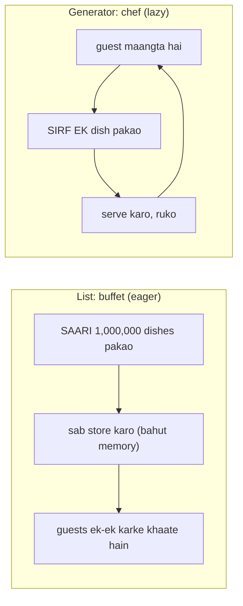
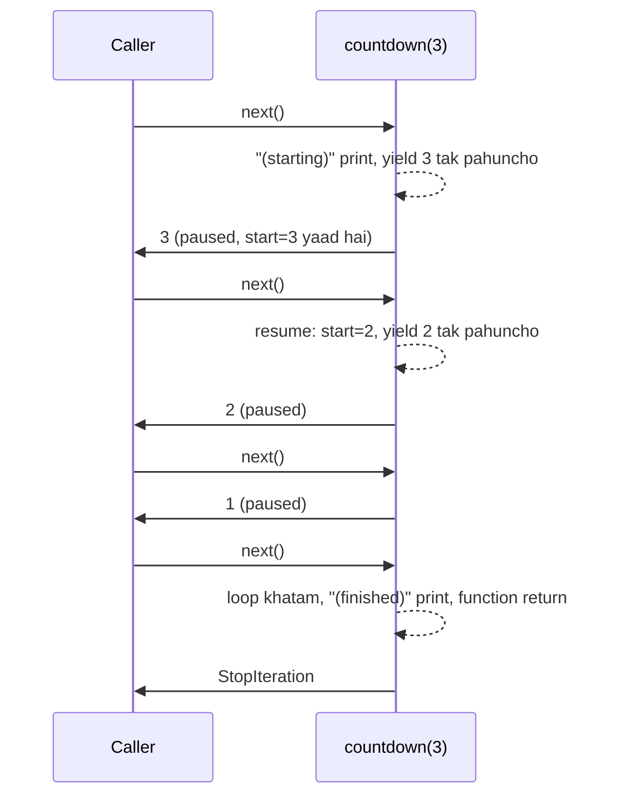

# Chapter 16 · Iterators, Generators, Decorators & Context Managers

> Yeh chaar features woh jagah hain jahan "mujhe Python aata hai" badal ke "main Python pro ki tarah likhta hoon" ban jaata hai. Inki madad se tum 50 GB ki file sirf 10 KB memory mein process kar sakte ho, kisi bhi function pe ek line likh ke timing ya caching laga sakte ho, aur clean-up bhoolna namumkin bana sakte ho. Python interviews mein bhi yeh sabse zyada pooche jaane wale topics mein se hain. Toh chalo, inhe itna simple bana dete hain ki "arre, yeh toh obvious hai" feel ho.

**Is chapter mein tum seekhoge:**
- **Iterable** vs **iterator**, aur ek `for` loop *asal mein* kya karta hai
- `__iter__` aur `__next__` se apni khud ki iterator class kaise banate hain
- **Generators** aur `yield`: pause hone wale functions, lazy evaluation aur memory ki zabardast bachat
- Generator expressions, `yield from`, aur `send()` ki ek jhalak
- **`itertools`** ka ek practical tour
- **Decorators** bilkul zero se: functions as objects → closures → wrappers → `@` syntax
- `functools.wraps`, arguments wale decorators, stacking, class decorators, aur real-life wale (timer, retry, cache, login_required)
- **Context managers**: `with`, `__enter__`/`__exit__`, aur `contextlib.contextmanager`

**Isse pehle padho:** [Functions](10-functions.md) · [Comprehensions & Functional Tools](11-comprehensions-functional.md) · [OOP II: Inheritance & Magic Methods](15-oop-inheritance-magic.md)

---

## 🧠 The Big Idea · Asli Baat

Chaar ideas, chaar roz ki tasveerein:

| Idea | Tasveer | Ek line mein matlab |
|---|---|---|
| **Iterator** | Pez candy dispenser (ya chai tapri pe biscuit ka jar jisme se ek-ek nikalta hai) | Tumhe *ek baar mein ek item* deta hai, yaad rakhta hai ki kahan tak pahuncha, aur khatam hone pe khaali ho jaata hai |
| **Generator** | Ek chef jo har dish *tab banata hai jab tum order karo*, pehle se bana hua buffet nahi | Aisa function jo har value dene ke baad **pause** ho jaata hai, aur agli value maangne pe wahin se resume karta hai |
| **Decorator** | Gift ko wrap karna | Function ke upar ek wrapper chadha ke kuch extra jodta hai (timing, caching, login check) **function ko badle bina** |
| **Context manager** | Hotel ka check-in aur check-out | Code ke ek block ke aas-paas setup aur clean-up dono ki guarantee deta hai, **chahe beech mein kuch bhi gadbad ho jaaye** |

Buffet vs chef wala contrast hi generators ka dil hai:



Buffet ek saath sab cheezon ke liye memory leta hai. Chef ek time pe sirf ek dish ki memory use karta hai. Aur agar guest jaldi chala gaya, toh baaki dishes kabhi pakti hi nahi. Kaam bhi bacha, memory bhi.

> 🇮🇳 **Desi Analogy:** Shaadi ka buffet vs Swiggy order. Buffet mein caterer 500 logon ka khana subah se bana ke rakh deta hai: poori rasoi bhari hui (memory full), chahe aadhe guest aaye hi na. Swiggy pe restaurant tab pakata hai jab order aata hai: ek order, ek dish, phir agle order ka wait. **List = buffet** (sab kuch pehle se ban ke memory mein pada hai). **Generator = order pe khana** (`next()` = naya order, `yield` = dish deliver karke ruk jaana, `StopIteration` = "kitchen band ho gaya"). Customer ne order karna band kiya? Toh baaki khana kabhi bana hi nahi.

---

## 🔨 Building It Up · Zero Se Shuru

### 1. Iterables vs iterators

`for x in something` tum [Chapter 6](06-loops.md) se likh rahe ho. Uske peeche do alag-alag roles chhupe hain:

- **Iterable** woh cheez hai jis par tum *loop chala sakte ho*: list, string, tuple, dict, set, file, range. Isse jab maango (`iter(obj)`), toh yeh tumhe **ek iterator de deta hai**.
- **Iterator** woh object hai jo *asli looping karta hai*: har baar jab tum uspe `next()` call karte ho, woh agla item deta hai, aur jab items khatam ho jaate hain toh **`StopIteration`** raise karta hai.

Ek book iterable hai; ek **bookmark** iterator hai. Ek hi book mein tum kai bookmarks rakh sakte ho, har ek alag page pe.

> 🇮🇳 **Desi Analogy:** Railway reservation chart iterable hai: poori list ek jagah chipki hui hai, koi bhi aake padh sakta hai. TTE ki ungli iterator hai: woh chart pe ek naam pe rukti hai, "next" bolne pe agle naam pe jaati hai, aur last naam ke baad bolti hai "bas, khatam" (`StopIteration`). Do TTE ek hi chart pe apni-apni ungli rakh ke alag-alag jagah se padh sakte hain: ek chart, kai iterators. Aur ungli sirf aage badhti hai, peeche nahi.

```python
fruits = ["apple", "banana", "cherry"]     # ek iterable

it = iter(fruits)                           # ek iterator lo (ek bookmark)
print(type(it).__name__)
print(next(it))
print(next(it))
print(next(it))
try:
    next(it)                                # kuch nahi bacha
except StopIteration:
    print("StopIteration: the iterator is exhausted")
```

```text
list_iterator
apple
banana
cherry
StopIteration: the iterator is exhausted
```

Dekho, `type(it)` ne `list_iterator` bataya. Yaani list ne apna ek alag object banaya jo sirf "main kahan tak pahuncha" yaad rakhta hai. List khud nahi badli.

### 2. Ek `for` loop asal mein kya karta hai

Yeh loop:

```py
for fruit in fruits:
    print(fruit)
```

bilkul yahi hai, bas haath se likha hua:

```python
fruits = ["apple", "banana", "cherry"]

iterator = iter(fruits)            # 1. iterable se ek iterator maango
while True:
    try:
        fruit = next(iterator)     # 2. agla item maango
    except StopIteration:          # 3. jab woh bole "ho gaya", ruk jao
        break
    print(fruit)                   # 4. loop ki body chalao
```

```text
apple
banana
cherry
```

Bas, yahi poora **iterator protocol** hai: do dunder methods.

| Method | Kaun call karta hai | Kya return karna zaroori hai |
|---|---|---|
| `__iter__()` | `iter(obj)`, `for` loop ki shuruaat mein | ek iterator |
| `__next__()` | `next(it)`, `for` ke har step pe | agli value, ya phir `StopIteration` raise karo |

Ek **iterator khud bhi iterable hota hai**: uska `__iter__` bas khud ko (`self`) return kar deta hai. Isiliye tum `for x in some_iterator` bhi likh sakte ho.

> 🤔 **Mann mein sawaal:** `StopIteration` toh ek exception hai. Kya har `for` loop ke end mein error aata hai? Yeh toh slow aur ajeeb lagta hai.
>
> **Jawab:** Haan, technically har loop ka end ek `StopIteration` se hi signal hota hai, lekin yeh "error" nahi, ek **signal** hai: "ab aur kuch nahi hai". `for` loop isse chupchaap pakad leta hai, tumhe kabhi dikhta nahi. Aur list jaise built-in types ke liye yeh poora kaam C mein hota hai, toh speed ki tension mat lo. Exception sirf tab dikhti hai jab tum khud haath se `next()` call karo, jaise upar wale example mein.

### 3. Iterators one-shot hote hain

Bookmark sirf aage badhta hai. Ek baar iterator khatam (exhausted) ho gaya, toh woh khaali hi rehta hai:

```python
numbers = [1, 2, 3]
it = iter(numbers)

print(list(it))      # sab kuch consume kar leta hai
print(list(it))      # pehle hi khatam: khaali!
print(list(numbers), list(numbers))   # LIST hamesha naye iterators de sakti hai

squares = map(lambda x: x * x, numbers)   # map, filter, zip, enumerate iterators return karte hain
print(sum(squares), sum(squares))
```

```text
[1, 2, 3]
[]
[1, 2, 3] [1, 2, 3]
14 0
```

Last line dhyaan se dekho: pehla `sum` ne `14` diya, doosre ne `0`. Kyunki `map` ek iterator hai, pehle `sum` ne usse poora pee liya. Doosre `sum` ko khaali glass mila.

> ⚠️ Python ke sabse common bugs mein se ek yahi hai: `map`/`filter`/`zip`/generator ko ek variable mein store karna aur uspe do baar loop chalana. Doosra loop **chupchaap kuch nahi karta**, koi error nahi aata. Agar values do baar chahiye, toh unhe list mein store kar lo.

### 4. Apni khud ki iterator class banana

Chalo ek countdown banate hain, seedha protocol use karke:

```python
class Countdown:
    def __init__(self, start):
        self.current = start

    def __iter__(self):
        return self                     # iterator apna iterator khud hai

    def __next__(self):
        if self.current <= 0:
            raise StopIteration         # signal: "ab aur items nahi hain"
        value = self.current
        self.current -= 1
        return value

for n in Countdown(3):
    print(n, end=" ")
print("liftoff!")

c = Countdown(2)
print(list(c), list(c))                 # one-shot, kisi bhi iterator ki tarah
```

```text
3 2 1 liftoff!
[2, 1] []
```

Step by step socho: `for` ne `iter(Countdown(3))` call kiya, jo `self` hi lauta. Phir har step pe `__next__` chala: `current` 3 tha, toh 3 return hua aur `current` 2 ban gaya. Aise hi 2, 1. Jab `current` 0 hua, `StopIteration` uthi aur loop ruk gaya.

Agar tumhe aisi cheez chahiye jis par **kai baar** loop chal sake (list ki tarah), toh dono roles alag kar do: **iterable** class ka `__iter__` har baar ek **naya iterator** return kare.

```python
class CountdownIterator:
    def __init__(self, start):
        self.current = start
    def __iter__(self):
        return self
    def __next__(self):
        if self.current <= 0:
            raise StopIteration
        self.current -= 1
        return self.current + 1

class Countdown:                        # reusable iterable
    def __init__(self, start):
        self.start = start
    def __iter__(self):
        return CountdownIterator(self.start)   # har baar ek NAYA bookmark

c = Countdown(3)
print(list(c), list(c))                 # ab do baar chalta hai
print([(a, b) for a in c for b in c if a > b])   # ek hi object pe nested loops
```

```text
[3, 2, 1] [3, 2, 1]
[(3, 2), (3, 1), (2, 1)]
```

Nested loop wali line pe gaur karo: bahar wala `for a in c` aur andar wala `for b in c`, dono ne `iter(c)` call kiya aur dono ko **alag-alag** bookmarks mile. Isiliye dono ek doosre ko disturb nahi karte. Agar `Countdown` khud apna iterator hota (pehle wala version), toh andar wala loop bahar wale ki values kha jaata.

Kaam toh karta hai, lekin "ulti ginti" ke liye itni lambi ceremony? Generators isse kuch hi lines mein kar dete hain.

### 5. Generators: functions jo pause hote hain

**Generator function** koi bhi aisa function hai jisme keyword **`yield`** ho. Use call karne se **uski body chalti hi nahi**. Balki woh ek **generator object** return karta hai (jo ek iterator hai). Har `next()` body ko agle `yield` tak chalata hai, woh value bahar deta hai, aur wahin **freeze** ho jaata hai, saare local variables ke saath. Agla `next()` usi freeze point se **resume** karta hai.

```python
def countdown(start):
    print("  (starting)")
    while start > 0:
        yield start                  # ek value do aur yahin PAUSE ho jao
        start -= 1
    print("  (finished)")

gen = countdown(3)                   # abhi kuch print nahi hua: body shuru hi nahi hui!
print(type(gen).__name__)
print(next(gen))
print(next(gen))
print(next(gen))
print(next(gen, "no more"))          # next(it, default) StopIteration se bachata hai
```

```text
generator
  (starting)
3
2
1
  (finished)
no more
```

Output ka order dhyaan se padho. `gen = countdown(3)` ke baad bhi `(starting)` print nahi hua. Woh tab print hua jab pehla `next()` aaya. Aur `(finished)` tab aaya jab chautha `next()` ne loop ko khatam hone diya.



**`yield` vs `return`:** `return` function ko hamesha ke liye khatam kar deta hai aur ek value wapas deta hai. `yield` value deta hai **aur function ko zinda rakhta hai**, aage chalne ke liye taiyaar. Ek generator jitni baar chahe yield kar sakta hai. Jab uski body khatam hoti hai (ya `return` aata hai), woh apne aap `StopIteration` raise kar deta hai.

> 🇮🇳 **Desi Analogy:** Cricket commentary ka "drinks break". Match (function) chal raha hai, drinks break (`yield`) aaya, score board pe abhi tak ka score dikha diya (value bahar di), aur khiladi wahin ruk gaye: same over, same ball, same fielders ki position (local variables freeze). Break khatam (`next()`), toh match **wahin se** chalu hota hai, naye sire se nahi. `return` matlab match khatam, stumps uth gaye, ab koi resume nahi.

Generators iterators hi hain, toh jo bhi cheez iterables consume karti hai, woh inpe bhi chalti hai:

```python
def evens(limit):
    for n in range(0, limit, 2):
        yield n

print(list(evens(10)))
print(sum(evens(10)), max(evens(10)))
for i, e in enumerate(evens(6)):
    print(i, e)
```

```text
[0, 2, 4, 6, 8]
20 8
0 0
1 2
2 4
```

Note karo: `sum(evens(10))` aur `max(evens(10))` mein humne **do alag** generators banaye (`evens(10)` do baar call kiya). Isliye dono ko poori values mili. Ek hi generator object do baar use karte toh doosre ko kuch na milta.

### 6. Infinite generators

Kyunki values sirf maangne pe banti hain, ek generator **infinite** bhi ho sakta hai. Kab rukna hai, yeh consumer (use karne wala) decide karta hai.

```python
def fibonacci():
    a, b = 0, 1
    while True:                      # apne aap kabhi khatam nahi hota
        yield a
        a, b = b, a + b

fib = fibonacci()
first_ten = [next(fib) for _ in range(10)]
print(first_ten)

for f in fibonacci():                # break karke roko
    if f > 100:
        break
    last = f
print("largest Fibonacci <= 100:", last)
```

```text
[0, 1, 1, 2, 3, 5, 8, 13, 21, 34]
largest Fibonacci <= 100: 89
```

"Saare Fibonacci numbers" ki list banana namumkin hai, kyunki woh kabhi khatam hi nahi hogi. Lekin unka generator? Teen lines.

> ⚠️ Infinite generator pe kabhi seedha `list(fibonacci())` ya `sum(...)` mat chalana. Woh kabhi rukega nahi aur memory bharta rahega. Hamesha `break`, `islice` ya `next()` jaisa koi rukne ka tareeka saath rakho.

### 7. Lazy evaluation aur memory

**Lazy evaluation** ka matlab hai "koi value tab tak compute mat karo jab tak kisi ko sach mein uski zaroorat na ho". **Eager evaluation** (lists) sab kuch pehle hi compute kar leta hai. Chalo naap ke dekhte hain:

```python
import sys

eager = [n * n for n in range(1_000_000)]     # list: saari values abhi exist karti hain
lazy = (n * n for n in range(1_000_000))      # generator: abhi ek bhi nahi

print(f"list:      about {sys.getsizeof(eager) / 1_000_000:.0f} MB")
print(f"generator: under 1 KB? {sys.getsizeof(lazy) < 1000}")
print(sum(lazy) == sum(eager))
```

```text
list:      about 8 MB
generator: under 1 KB? True
True
```

List ka sirf container hi lagbhag 8 MB ka hai (typical 64-bit CPython pe 8,448,728 bytes, aur isme woh integer objects gine hi nahi gaye jinki taraf yeh point karti hai). Generator sirf kuch sau bytes ka hai, **chahe woh kitne bhi items produce kare**, kyunki woh sirf apni paused state store karta hai. (Exact bytes Python versions ke beech thode alag ho sakte hain, lekin gap hamesha bahut bada rehta hai.)

Ek baat samjho: 8 MB kahan se aaya? Har list slot ek pointer hai, aur 64-bit machine pe pointer 8 bytes ka hota hai. 10 lakh slots × 8 bytes = 8 MB. Generator ke paas koi slots hain hi nahi, sirf "main kahan ruka tha" ki ek chhoti si diary hai.

Laziness ka ek aur fayda: **tum beech mein ruk sakte ho aur bacha hua kaam poora skip ho jaata hai**:

```python
def expensive_checks():
    for n in range(1, 1_000_000_000):          # ek ARAB candidates
        yield n * n

# any() pehle True pe ruk jaata hai: sirf 4 values hi compute hoti hain
print(any(sq > 10 for sq in expensive_checks()))
first_big = next(sq for sq in expensive_checks() if sq > 50)
print(first_big)
```

```text
True
64
```

1, 4, 9, 16: chauthi value pe `16 > 10` True ho gaya aur `any()` ne baaki 99 crore se zyada values ko haath bhi nahi lagaya. List hoti toh pehle ek arab squares banta, phir check hota. Yahi lazy ka jaadu hai.

> 🤔 **Mann mein sawaal:** Agar generator itna sasta hai, toh hamesha list ki jagah generator hi kyun na use karein?
>
> **Jawab:** Kyunki generator ki apni limits hain: woh **one-shot** hai, usme indexing (`g[3]`) nahi hoti, slicing nahi hoti, `len()` nahi hota. Aur chhote data pe list thodi tez bhi hai. Rule simple hai: data bada hai ya ek hi baar padhna hai, toh generator. Baar-baar padhna hai, index chahiye, ya size chahiye, toh list.

### 8. Generator pipelines

Generators assembly line ki tarah aapas mein jud jaate hain. Har stage pichhle stage se ek time pe ek hi item kheenchta hai, isliye poori pipeline constant memory mein chalti hai, chahe log file 50 GB ki ho. Yahan `io.StringIO` ek asli file ka kaam kar raha hai ([Chapter 13](13-exceptions-files.md)):

```python
import io

log_file = io.StringIO(
    "INFO user=ana action=login\n"
    "ERROR user=ben action=pay code=502\n"
    "INFO user=ana action=view\n"
    "ERROR user=chen action=pay code=504\n"
    "ERROR user=ben action=refund code=500\n"
)

def read_lines(f):
    for line in f:
        yield line.rstrip("\n")

def only_errors(lines):
    for line in lines:
        if line.startswith("ERROR"):
            yield line

def parse(lines):
    for line in lines:
        fields = dict(part.split("=") for part in line.split()[1:])
        yield fields

pipeline = parse(only_errors(read_lines(log_file)))    # abhi tak kuch nahi chala
for record in pipeline:                                 # kheenchna hi sab kuch chalata hai
    print(record["user"], record["code"])
```

```text
ben 502
chen 504
ben 500
```

Har line teeno stages se guzar jaati hai, agli line padhi bhi nahi jaati tab tak. Asli data-processing tools (aur Unix pipes jaise `cat log | grep ERROR | cut ...`) aise hi kaam karte hain.

Flow ko ek baar slow motion mein dekho. `for` loop ne `parse` se maanga "ek record do". `parse` ne `only_errors` se maanga "ek line do". `only_errors` ne `read_lines` se maanga. `read_lines` ne file se pehli line padhi: `INFO ...`. `only_errors` ne dekha, ERROR nahi hai, toh phir se maanga. Doosri line `ERROR user=ben ...` aayi, yeh pass ho gayi, `parse` ne usse dict banaya, aur loop ne print kiya. Poore safar mein memory mein ek time pe ek hi line thi.

> 🇮🇳 **Desi Analogy:** Mumbai ke dabbawalas. Ek dabbawala ghar se dabba uthata hai (`read_lines`), station pe doosra sort karta hai ki kaunsa dabba Churchgate wala hai (`only_errors`), aur teesra office pe deliver karta hai (`parse` + `print`). Koi bhi poore shehar ke dabbe ek godown mein jama nahi karta. Ek dabba line mein aage badhta jaata hai, aur agla dabba peeche aata rehta hai. Isiliye system lakhon dabbe roz handle kar leta hai bina kisi bade godown ke. Yahi generator pipeline hai: **koi bhi stage poora data jama nahi karta**.

### 9. Generator expressions

**Generator expression** ek list comprehension hi hai, bas **round brackets** ke saath ([Chapter 11](11-comprehensions-functional.md)). Yeh list ki jagah ek generator banata hai:

```python
nums = [3, 1, 4, 1, 5, 9, 2, 6]

squares_list = [n * n for n in nums]      # list: abhi bani
squares_gen = (n * n for n in nums)       # generator: maangne pe banega

print(squares_list)
print(squares_gen.__class__.__name__)
print(sum(n * n for n in nums))           # jab yahi akela argument ho, extra ( ) hata do
print(max(len(w) for w in ["hi", "hello", "hey"]))
print(", ".join(str(n) for n in nums if n > 3))
```

```text
[9, 1, 16, 1, 25, 81, 4, 36]
generator
173
5
4, 5, 9, 6
```

**Rule:** agar tum values ko **ek hi baar consume** karne wale ho (sum, max, any, all, join, ek for loop), toh generator expression use karo. Agar unhe **index, slice, reuse ya `len()`** karna hai, toh list use karo.

### 10. `yield from`: kaam doosre iterable ko saunpna

`yield from iterable` us iterable ka har item, ek-ek karke, yield karta hai. Yeh `for x in iterable: yield x` ki jagah le leta hai, aur **recursive generators** mein toh kamaal karta hai:

```python
def flatten(items):
    for item in items:
        if isinstance(item, list):
            yield from flatten(item)     # recursive generator ko kaam saunp do
        else:
            yield item

nested = [1, [2, [3, 4], 5], [[6]], 7]
print(list(flatten(nested)))

def chain_all(*iterables):
    for it in iterables:
        yield from it

print(list(chain_all("ab", [1, 2], range(3))))
```

```text
[1, 2, 3, 4, 5, 6, 7]
['a', 'b', 1, 2, 0, 1, 2]
```

`flatten` ko aise socho: "agar item khud ek list hai, toh main usse ek chhote `flatten` ko de deta hoon, aur woh jo bhi deta jaaye, main seedha aage pass karta jaata hoon." Har nesting level ke liye ek naya chhota generator banta hai, aur `yield from` unke beech ka pipe hai.

Tree traversal toh ekdum khoobsurat ban jaata hai. Yeh raha binary search tree ka **in-order traversal**, generator ke roop mein (trees [DSA Chapter 13](../part-2-dsa/13-binary-trees.md) mein aayenge; abhi ke liye bas itna samjho ki har node ke paas ek value aur ek left aur right child hai):

```python
class Node:
    def __init__(self, val, left=None, right=None):
        self.val, self.left, self.right = val, left, right

def inorder(node):
    if node:
        yield from inorder(node.left)
        yield node.val
        yield from inorder(node.right)

#        4
#      /   \
#     2     6
#    / \   /
#   1   3 5
root = Node(4, Node(2, Node(1), Node(3)), Node(6, Node(5)))
print(list(inorder(root)))
print(next(inorder(root)))          # sabse chhoti value, baaki tree ko visit kiye bina
```

```text
[1, 2, 3, 4, 5, 6]
1
```

Last line ka magic samjho: `next(inorder(root))` sirf left-left-left jaata hai (4 → 2 → 1), 1 yield karta hai, aur ruk jaata hai. Node 3, 4, 5, 6 ko chhuta tak nahi. Yahi baat aage "Kth Smallest" problem mein kaam aayegi.

### 11. `send()`: generator se wapas baat karna (short mein)

`next(gen)` generator ko resume karta hai; **`gen.send(value)`** usse resume karta hai **aur jis `yield` expression pe woh ruka tha, uski value `value` bana deta hai**. Isse generator ek chhoti si two-way machine ban jaata hai (jise purane zamane mein **coroutine** kehte the). Tum aise generators haath se kam hi likhoge, lekin `async`/`await` ke yahi purvaj (ancestor) hain ([Chapter 18](18-internals-concurrency.md)).

```python
def running_average():
    total, count, average = 0, 0, None
    while True:
        value = yield average          # send() value yahan pahunchata hai
        total += value
        count += 1
        average = total / count

avg = running_average()
next(avg)                             # "prime" karo: pehle yield tak chalao
print(avg.send(10))
print(avg.send(20))
print(avg.send(60))
```

```text
10.0
15.0
30.0
```

`value = yield average` ko do hisson mein padho. Pehle, `yield average` value **bahar** bhejta hai aur ruk jaata hai. Phir jab koi `send(10)` karta hai, toh wahi `yield` expression `10` ban jaata hai aur `value = 10` assign hota hai. Ek hi line mein dena bhi, lena bhi.

> 🤔 **Mann mein sawaal:** Shuru mein `next(avg)` kyun likhna pada? Seedha `avg.send(10)` kyun nahi?
>
> **Jawab:** Kyunki naya generator abhi body ki pehli line pe khada hai, kisi `yield` pe nahi. `send()` ki value toh sirf ek paused `yield` hi receive kar sakta hai. Toh pehle `next()` se usse pehle `yield` tak le jaana padta hai. Isse **priming** kehte hain. Agar bina prime kiye kisi naye generator ko non-`None` value send karoge, toh `TypeError` aayega.

Generators ke paas `.close()` bhi hai (usse band karo; andar koi `finally` ho toh woh chalta hai) aur `.throw(exc)` bhi (paused `yield` pe ek exception raise karo). Generator ka `return value` usse khatam karta hai, aur woh value `StopIteration` ke saath chipak jaati hai (aur `yield from` expression ka result bhi wahi hota hai).

### 12. `itertools` ka ek tour

Standard module **`itertools`** tez aur lazy iterator building blocks ka ek toolbox hai. Yeh rahe woh jo tum sach mein use karoge, khaaskar DSA mein:

```python
from itertools import (count, cycle, repeat, islice, chain, accumulate,
                       product, permutations, combinations,
                       combinations_with_replacement, groupby, zip_longest,
                       pairwise, takewhile, dropwhile, starmap)

# Infinite iterators (hamesha islice ya break ke saath jodi banao)
print(list(islice(count(10, 5), 4)))            # 10, 15, 20, ...
print(list(islice(cycle("AB"), 5)))             # A B A B A ...
print(list(repeat("x", 3)))

# Iterators ko slice karna aur jodna
print(list(islice(range(100), 2, 10, 3)))       # [2:10:3] jaisa, lekin kisi bhi iterator ke liye
print(list(chain([1, 2], (3,), "ab")))
print(list(chain.from_iterable([[1, 2], [3], [4, 5]])))   # ek level flatten

# Running totals (prefix sums!)
print(list(accumulate([3, 1, 4, 1, 5])))
print(list(accumulate([3, 1, 4, 1, 5], max)))   # running maximum

# Combinatorics
print(list(product("ab", [0, 1])))              # nested loops / cartesian product
print(list(permutations([1, 2, 3], 2)))         # ordered arrangements
print(list(combinations([1, 2, 3, 4], 2)))      # unordered choices
print(list(combinations_with_replacement("ab", 2)))

# LAGATAAR (consecutive) barabar items ko group karna (run-length encoding)
print([(k, len(list(g))) for k, g in groupby("aaabccdd")])

# Pairs aur uneven zips
print(list(pairwise([1, 4, 9, 16])))            # (1,4) (4,9) (9,16)  (Python 3.10+)
print(list(zip_longest("abc", [1], fillvalue="-")))

# Condition pe cut-off
print(list(takewhile(lambda x: x < 5, [1, 3, 6, 2])))
print(list(dropwhile(lambda x: x < 5, [1, 3, 6, 2])))
print(list(starmap(pow, [(2, 3), (3, 2)])))     # har tuple ke liye f(*args)
```

```text
[10, 15, 20, 25]
['A', 'B', 'A', 'B', 'A']
['x', 'x', 'x']
[2, 5, 8]
[1, 2, 3, 'a', 'b']
[1, 2, 3, 4, 5]
[3, 4, 8, 9, 14]
[3, 3, 4, 4, 5]
[('a', 0), ('a', 1), ('b', 0), ('b', 1)]
[(1, 2), (1, 3), (2, 1), (2, 3), (3, 1), (3, 2)]
[(1, 2), (1, 3), (1, 4), (2, 3), (2, 4), (3, 4)]
[('a', 'a'), ('a', 'b'), ('b', 'b')]
[('a', 3), ('b', 1), ('c', 2), ('d', 2)]
[(1, 4), (4, 9), (9, 16)]
[('a', 1), ('b', '-'), ('c', '-')]
[1, 3]
[6, 2]
[8, 9]
```

Kuch outputs dhyaan se dekho, kyunki yahin log confuse hote hain:
- `takewhile` ne `[1, 3]` diya: 6 pe condition fail hui aur woh **wahin ruk gaya**. Baad wala 2 (jo `< 5` hai) bhi nahi liya. Yeh filter nahi hai, yeh "jab tak sahi hai tab tak lo" hai.
- `dropwhile` ulta kaam karta hai: jab tak condition sahi hai tab tak phenko, phir pehli failure se **sab kuch** lo: `[6, 2]`.
- `permutations([1, 2, 3], 2)` mein `(1, 2)` aur `(2, 1)` dono hain (order matter karta hai). `combinations` mein sirf `(1, 2)` hai (order matter nahi karta).

| Function | Aise socho | DSA mein use |
|---|---|---|
| `accumulate` | running total / running max | prefix sums ([DSA Ch 06](../part-2-dsa/06-prefix-sums.md)) |
| `product` | nested for loops | grid ki saari directions, brute-force combos |
| `permutations(xs, r)` | saari orderings, n!/(n−r)! of them | brute-force checks, chhote search spaces |
| `combinations(xs, r)` | size r ke saare subsets, C(n, r) of them | k items choose karna |
| `groupby` | lagataar runs (*saare* barabar items ek group mein chahiye toh pehle sort karo!) | run-length encoding, String Compression |
| `pairwise` | sliding pairs | padosiyon ke beech ka difference |
| `chain.from_iterable` | ek level flatten | adjacency lists merge karna |
| `islice` | iterators ke liye slicing | generator se pehle k items lo |

> ⚠️ `groupby` sirf **adjacent** (bagal-bagal wale) barabar items ko group karta hai: `groupby("abab")` chaar groups deta hai. Agar har key ka ek hi group chahiye, toh pehle sort karo. Aur har group ek iterator hai jo agle group pe jaate hi invalid ho jaata hai, isliye usse turant convert kar lo (`list(g)`).

> 🇮🇳 **Desi Analogy:** `groupby` ko exam hall ke us invigilator ki tarah socho jo seating order mein copies ke bundle bana raha hai. Agar ek hi school ke bacche lagataar baithe hain, toh unka ek bundle banta hai. Lekin agar school A, phir B, phir wapas A aaya, toh A ke **do alag bundles** banenge, kyunki invigilator peeche mud ke nahi dekhta, sirf "kya yeh bacha pichhle wale ke school ka hai?" check karta hai. Pehle seating school-wise sort karo, tab har school ka ek hi bundle banega.

### 13. Decorators, step 1: functions objects hain

Ab aate hain decorators pe. Inhe samajhne ke liye humein functions ke baare mein teen facts chahiye, jo tum aadhe-adhoore pehle dekh chuke ho ([Chapter 10](10-functions.md), [Chapter 11](11-comprehensions-functional.md)).

**Fact 1: functions objects hain.** Tum unhe variables mein assign kar sakte ho, lists mein store kar sakte ho, aur doosre functions ko pass kar sakte ho.

```python
def shout(text):
    return text.upper() + "!"

def whisper(text):
    return text.lower() + "..."

yell = shout                         # koi bracket nahi: function khud, call nahi
print(yell("hello"))
print(shout.__name__, type(shout).__name__)

def greet(style, name):              # ek function jo ek function RECEIVE karta hai
    return style(f"Hi {name}")

for style in [shout, whisper]:
    print(greet(style, "Asha"))
```

```text
HELLO!
shout function
HI ASHA!
hi asha...
```

`yell = shout` aur `yell = shout()` ka farak bahut bada hai. Bina bracket ke tum function ko ek naya naam de rahe ho (jaise ek hi bande ke do naam: "Rahul" aur "Golu"). Bracket ke saath tum function ko **chala** rahe ho aur uska result store kar rahe ho.

**Fact 2: functions ke andar functions define ho sakte hain, aur return bhi ho sakte hain.**

```python
def make_multiplier(factor):
    def multiply(x):
        return x * factor            # bahar wale function ka 'factor' use karta hai
    return multiply                  # andar wala function khud return karo

double = make_multiplier(2)
triple = make_multiplier(3)
print(double(5), triple(5))
print(double.__name__)
```

```text
10 15
multiply
```

### 14. Decorators, step 2: closures

`double(5)` ko phir se dekho. Jab yeh chalta hai, tab tak `make_multiplier` **return ho chuka hota hai**, toh uska local variable `factor` gayab ho jaana chahiye tha. Phir bhi `double` ko yaad hai ki `factor = 2`. Kaise?

Andar wala function **bahar wale scope ke jo variables use karta hai, unhe yaad rakhta hai**. Ek function aur uske yaad rakhe hue variables ke is bundle ko **closure** kehte hain. (Yahi teesra fact hai.)

> 🇮🇳 **Desi Analogy:** Maa ne hostel jaate bete ke bag mein ghar ka achaar pack kar diya. Beta ab ghar se door hai (outer function return ho gaya), rasoi band ho gayi, lekin achaar uske bag mein hai, aur jab chahe khol ke kha sakta hai. **Bete = inner function, achaar = captured variable, bag = closure.** Aur har bete ka bag alag: chhote bhai ko aam ka achaar mila (`factor = 3`), bade ko nimbu ka (`factor = 2`). Isiliye `double` aur `triple` ek doosre se mix nahi hote.

```python
def make_multiplier(factor):
    def multiply(x):
        return x * factor
    return multiply

double = make_multiplier(2)
print(double.__closure__[0].cell_contents)     # yaad rakha hua 'factor'
print(double.__code__.co_freevars)             # jo naam capture kiye
```

```text
2
('factor',)
```

Closures aisi **state bhi rakh sakte hain jo badalti hai**. Captured variable ko sirf padhna nahi, balki *reassign* karna ho, toh usse **`nonlocal`** declare karo:

```python
def make_counter():
    count = 0
    def increment():
        nonlocal count             # "count bahar wale function ka hai"
        count += 1
        return count
    return increment

clicks = make_counter()
other = make_counter()             # ek alag counter, apne khud ke 'count' ke saath
print(clicks(), clicks(), clicks(), other())
```

```text
1 2 3 1
```

`nonlocal` ke bina, `count += 1` ek naya local `count` banane ki koshish karta aur `UnboundLocalError` ke saath fail ho jaata. State wala closure, `__call__` wali class ka ek halka-phulka alternative hai ([Chapter 15](15-oop-inheritance-magic.md)).

> 🤔 **Mann mein sawaal:** `factor` ko padhne ke liye `nonlocal` nahi chahiye tha, toh `count` ke liye kyun chahiye?
>
> **Jawab:** Python ka rule hai: function ke andar kisi naam pe **assignment** hua (`=`, `+=`), toh woh naam us function ka **local** maana jaata hai. `count += 1` matlab `count = count + 1`, yaani assignment. Toh Python `count` ko local samajhta hai, aur jab right side pe `count` padhne jaata hai, toh local `count` abhi bana hi nahi: `UnboundLocalError`. Sirf padhne pe (`x * factor`) koi assignment nahi, toh Python bahar dhoondhta hai aur mil jaata hai. `nonlocal` bolta hai: "is naam pe assignment bhi bahar wale variable mein hi karna."

### 15. Decorators, step 3: wrappers

Dono facts mila do: ek aisa function likho jo **ek function leta hai** aur **ek naya function return karta hai jo usse wrap karta hai**, pehle aur/ya baad mein kuch extra karta hai.

```python
def announce(func):
    def wrapper(*args, **kwargs):            # KOI BHI arguments accept karo...
        print(f"-> calling {func.__name__}{args}")
        result = func(*args, **kwargs)       # ...aur sab aage pass kar do
        print(f"<- {func.__name__} returned {result}")
        return result                        # result return karna mat bhoolna!
    return wrapper

def add(a, b):
    return a + b

add = announce(add)          # add ko wrapped version se replace karo
total = add(2, 3)
print("total:", total)
```

```text
-> calling add(2, 3)
<- add returned 5
total: 5
```

Abhi kya hua: `announce(add)` ne `wrapper` return kiya, ek closure jo original `add` ko `func` ke naam se yaad rakhta hai. Humne naam `add` ko `wrapper` se rebind kar diya. Ab `add(...)` ki har call `wrapper` se hoke jaati hai, jo print karta hai, original ko call karta hai, phir se print karta hai, aur result return karta hai. `*args, **kwargs` ([Chapter 10](10-functions.md)) ki wajah se wrapper **kisi bhi** function signature ke saath kaam karta hai.

Woh function, `announce`, **ek decorator hai**. Decorator bas ek function hai jo ek function leta hai aur ek (usually wrapped) function return karta hai.

> 🇮🇳 **Desi Analogy:** Bank locker ka guard. Tum seedha locker (original function) tak nahi jaate. Pehle guard (wrapper) register mein entry karta hai ("-> calling"), phir tumhe andar jaane deta hai (`func(*args, **kwargs)`), aur bahar aate waqt exit time likhta hai ("<- returned"). Locker ke andar ka saaman (function ka logic) badla nahi, sirf uske aas-paas ek process jud gaya. Aur guard ko yeh nahi pata hona chahiye ki tum kya leke aaye: isiliye `*args, **kwargs`, "jo bhi laaye ho, andar le jao".

### 16. Decorators, step 4: `@` syntax

`add = announce(add)` itna common hai ki Python ne iska ek shortcut bana diya. Yeh dono **bilkul** same hain:

```py
def add(a, b):
    return a + b
add = announce(add)

@announce                   # same cheez, bas def ke upar likhi hui
def add(a, b):
    return a + b
```

```python
def announce(func):
    def wrapper(*args, **kwargs):
        print(f"-> {func.__name__}")
        return func(*args, **kwargs)
    return wrapper

@announce
def greet(name, punctuation="!"):
    return f"Hello {name}{punctuation}"

print(greet("Kabir"))
print(greet("Meera", punctuation="?"))
```

```text
-> greet
Hello Kabir!
-> greet
Hello Meera?
```

> 💡 Decorator **sirf ek baar chalta hai, jab `def` statement execute hota hai** (usually import time pe), har call pe nahi. Har call pe jo chalta hai woh hai uska return kiya hua **wrapper**. Isse Chapters 14 aur 15 ke `@property`, `@classmethod`, `@staticmethod`, `@total_ordering` aur `@dataclass` bhi samajh aa jaate hain: har ek bas ek function (ya class) hai jo apne theek neeche define hui cheez pe apply hota hai.

### 17. `functools.wraps`: function ki pehchaan bachao

Hamare wrapper ka ek side effect hai: decorated function ab `wrapper` hone ka *naatak karta hai*.

```python
import functools

def plain(func):
    def wrapper(*args, **kwargs):
        return func(*args, **kwargs)
    return wrapper

def polite(func):
    @functools.wraps(func)                 # func se naam, docstring wagairah copy karo
    def wrapper(*args, **kwargs):
        return func(*args, **kwargs)
    return wrapper

@plain
def area(r):
    """Area of a circle."""
    return 3.14159 * r * r

@polite
def volume(r):
    """Volume of a sphere."""
    return 4 / 3 * 3.14159 * r ** 3

print(area.__name__, area.__doc__)
print(volume.__name__, volume.__doc__)
print(volume.__wrapped__.__name__)         # wraps original ka ek link bhi rakhta hai
```

```text
wrapper None
volume Volume of a sphere.
volume
```

`wraps` ke bina har decorated function ka naam `wrapper` ho jaata hai aur docstring gayab, jisse `help()`, logging, debugging aur woh tools toot jaate hain jo functions ko naam se dhoondhte hain. **Apne decorators mein hamesha `@functools.wraps(func)` use karo.**

Socho, tumhari app mein 20 functions pe `@timer` laga hai aur log mein likha aata hai "wrapper took 300 ms". Kaunsa function slow hai? Pata hi nahi chalega. `wraps` lagao, aur log bolega "fetch_orders took 300 ms". Bas itna sa farak, aur debugging ke ghante bach jaate hain.

### 18. Arguments wale decorators

Agar tumhe `@repeat(3)` chahiye toh? Ab `repeat(3)` ko **ek decorator return karna padega**. Matlab functions ki teen layers:

```python
import functools

def repeat(times):                         # layer 1: decorator ke arguments leta hai
    def decorator(func):                   # layer 2: function leta hai
        @functools.wraps(func)
        def wrapper(*args, **kwargs):      # layer 3: har call pe chalta hai
            result = None
            for _ in range(times):
                result = func(*args, **kwargs)
            return result
        return wrapper
    return decorator

@repeat(3)                                 # repeat(3) pehle chalta hai, 'decorator' return karta hai
def cheer(name):
    print(f"Go {name}!")

cheer("India")
```

```text
Go India!
Go India!
Go India!
```

`def cheer` ke upar `@repeat(3)` ka matlab hai `cheer = repeat(3)(cheer)`. Aise padho: "`repeat(3)` call karke ek decorator lo, phir woh decorator `cheer` pe lagao."

Teen layers ko yaad rakhne ka tareeka: **settings → function → call**. Bahar wali layer settings leti hai (`times=3`), beech wali function leti hai (`cheer`), andar wali asli call ke arguments leti hai (`"India"`). Har layer apne se andar wali ko return karti hai.

### 19. Decorators ki stacking

Tum ek se zyada decorators laga sakte ho. Yeh **neeche se upar** (bottom-up) apply hote hain (jo `def` ke sabse paas hai woh pehle), isliye **sabse upar** wala **sabse bahar** pahunchta hai:

```python
import functools

def bold(func):
    @functools.wraps(func)
    def wrapper(*args, **kwargs):
        return f"<b>{func(*args, **kwargs)}</b>"
    return wrapper

def italic(func):
    @functools.wraps(func)
    def wrapper(*args, **kwargs):
        return f"<i>{func(*args, **kwargs)}</i>"
    return wrapper

@bold
@italic
def hello(name):
    return f"hello {name}"
# same as: hello = bold(italic(hello))

print(hello("world"))
```

```text
<b><i>hello world</i></b>
```

Kapde pehenne ki tarah socho: function ke sabse paas wala decorator pehli layer hai (shirt), sabse upar wala aakhri layer (jacket). Jab function call hota hai, toh tum **pehle jacket se guzarte ho**.

### 20. Class decorators aur decorator classes (short mein)

Do related ideas, jinke naam confusingly ek jaise hain:

**Class pe lagaya gaya decorator** class ko receive karta hai aur use return karta hai (aksar register ya modify karne ke baad). `@dataclass` aisa hi ek decorator hai. Iska ek common use hai **registry**:

```python
PLUGINS = {}

def register(cls):
    PLUGINS[cls.__name__.lower()] = cls     # class ko naam se yaad rakho
    return cls                              # bina badle return karo

@register
class CsvExporter:
    def export(self, rows):
        return "\n".join(",".join(map(str, r)) for r in rows)

@register
class TsvExporter:
    def export(self, rows):
        return "\n".join("\t".join(map(str, r)) for r in rows)

print(sorted(PLUGINS))
print(PLUGINS["csvexporter"]().export([(1, 2), (3, 4)]))
```

```text
['csvexporter', 'tsvexporter']
1,2
3,4
```

Fayda dekho: naya exporter (jaise `JsonExporter`) banao, upar `@register` lagao, bas. Kisi central list ko haath se update nahi karna padta. Bade frameworks plugins aur URL routes aise hi register karte hain.

**Decorator ke roop mein use hui class** isliye kaam karti hai kyunki classes callable hoti hain: `@CountCalls` asal mein `CountCalls(func)` call karta hai, aur bana hua object har use pe `__call__` ke through call hota hai. Jab decorator ko bahut saari state rakhni ho, tab yeh kaam aata hai:

```python
import functools

class CountCalls:
    def __init__(self, func):
        functools.update_wrapper(self, func)   # @wraps ka class wala version
        self.func = func
        self.calls = 0

    def __call__(self, *args, **kwargs):
        self.calls += 1
        return self.func(*args, **kwargs)

@CountCalls
def ping():
    return "pong"

ping(); ping(); ping()
print(ping.calls, ping.__name__)
```

```text
3 ping
```

Yaad rakhne ke liye: "**class decorator**" = decorator jo class ko sajaata hai. "**decorator class**" = class jo khud decorator ka kaam karti hai. Shabdon ka order hi batata hai kaun kisko decorate kar raha hai.

### 21. Real decorators jo tum sach mein likhoge

**Timer** (naapta hai ki function kitna time leta hai). `time.perf_counter()` durations naapne ke liye ek high-precision clock hai. Timing numbers har run pe alag aate hain, isliye yeh fragment ke roop mein dikhaya gaya hai:

```py
import functools
import time

def timer(func):
    @functools.wraps(func)
    def wrapper(*args, **kwargs):
        start = time.perf_counter()
        try:
            return func(*args, **kwargs)
        finally:                                   # func raise kare tab bhi report karo
            elapsed = time.perf_counter() - start
            print(f"{func.__name__} took {elapsed * 1000:.2f} ms")
    return wrapper

@timer
def slow_sum(n):
    return sum(i * i for i in range(n))

slow_sum(1_000_000)        # kuch aisa print karta hai: slow_sum took 61.37 ms
```

**Retry** (fail hone pe phir se try karo; flaky network calls ke liye must-have). Yahan "network" ek nakli function hai jo do baar fail hota hai aur teesri baar chal jaata hai, taaki output predictable rahe:

```python
import functools

def retry(times=3, exceptions=(Exception,)):
    def decorator(func):
        @functools.wraps(func)
        def wrapper(*args, **kwargs):
            for attempt in range(1, times + 1):
                try:
                    return func(*args, **kwargs)
                except exceptions as e:
                    print(f"  attempt {attempt} failed: {e}")
                    if attempt == times:
                        raise                      # attempts khatam: zor se haar maano
        return wrapper
    return decorator

calls = {"n": 0}

@retry(times=3, exceptions=(ConnectionError,))
def fetch_price():
    calls["n"] += 1
    if calls["n"] < 3:
        raise ConnectionError("server busy")
    return 4999

print("price:", fetch_price())
```

```text
  attempt 1 failed: server busy
  attempt 2 failed: server busy
price: 4999
```

Production mein tum attempts ke beech thoda sleep bhi karoge, usually **exponential backoff** ke saath (1 s, 2 s, 4 s ... wait karo), ek pattern jo tumhe [System Design Chapter 9](../part-3-system-design/09-microservices-reliability.md) mein phir milega.

> 🇮🇳 **Desi Analogy:** IRCTC Tatkal booking. Server busy aaya? Tum refresh karte ho (retry). Phir busy? Phir refresh. Lekin samajhdaar log har second refresh nahi karte, thoda ruk ke karte hain, aur har baar thoda zyada rukte hain, taaki server pe aur bhi load na pade: yahi **exponential backoff** hai. Aur teen-chaar baar ke baad haar maan ke "booking failed" bolna (`raise`) bhi zaroori hai, warna tum poori raat refresh hi karte rahoge.

**Cache / memoize** (mehenge calls ke results yaad rakho). Dekho kaise yeh exponential recursion ko linear bana deta hai:

```python
import functools

def memoize(func):
    cache = {}                                     # closure mein rehta hai
    @functools.wraps(func)
    def wrapper(*args):
        if args not in cache:
            cache[args] = func(*args)
        return cache[args]
    wrapper.cache = cache                          # inspection ke liye expose karo
    return wrapper

calls = 0

@memoize
def fib(n):
    global calls
    calls += 1
    return n if n < 2 else fib(n - 1) + fib(n - 2)

print(fib(80), "computed with", calls, "real calls")
print(len(fib.cache), "results cached")
```

```text
23416728348467685 computed with 81 real calls
81 results cached
```

Cache ke bina `fib(80)` 10^16 se zyada calls karta (saalon tak chalta rehta). Cache ke saath har `n` sirf ek baar compute hota hai (0 se 80 tak, yaani 81 values, isiliye 81 real calls). Yahi **memoization** hai, top-down dynamic programming ka dil ([DSA Chapter 20](../part-2-dsa/20-dp-1d.md)). Asli code mein tum built-in `@functools.cache` ya `@functools.lru_cache(maxsize=...)` use karoge ([Chapter 17](17-modules-stdlib.md)), jo bilkul yahi karte hain, aur tez aur zyada features ke saath.

Ek chhota sa detail: `fib` ke andar jo `fib(n - 1)` call hai, woh bhi **wrapped** version ko call karta hai, kyunki naam `fib` ab wrapper se bound hai. Isiliye recursion ke andar ki calls bhi cache se hoke jaati hain. Yahi trick hai.

**login_required** (access control, waisa hi jaisa Flask aur Django jaise web frameworks use karte hain):

```python
import functools

class PermissionDenied(Exception):
    pass

def login_required(func):
    @functools.wraps(func)
    def wrapper(user, *args, **kwargs):
        if not user.get("logged_in"):
            raise PermissionDenied(f"{func.__name__} needs a logged-in user")
        return func(user, *args, **kwargs)
    return wrapper

def role_required(role):
    def decorator(func):
        @functools.wraps(func)
        def wrapper(user, *args, **kwargs):
            if role not in user.get("roles", ()):
                raise PermissionDenied(f"{func.__name__} needs role {role!r}")
            return func(user, *args, **kwargs)
        return wrapper
    return decorator

@login_required
def view_profile(user):
    return f"Profile of {user['name']}"

@login_required
@role_required("admin")
def delete_user(user, target):
    return f"{user['name']} deleted {target}"

guest = {"name": "guest", "logged_in": False}
ana = {"name": "ana", "logged_in": True, "roles": ["admin"]}
ben = {"name": "ben", "logged_in": True, "roles": []}

print(view_profile(ana))
print(delete_user(ana, "spam_bot"))
for user, action in [(guest, view_profile), (ben, lambda u: delete_user(u, "ana"))]:
    try:
        action(user)
    except PermissionDenied as e:
        print("Denied:", e)
```

```text
Profile of ana
ana deleted spam_bot
Denied: view_profile needs a logged-in user
Denied: delete_user needs role 'admin'
```

Stacking order dekho: `login_required` (upar, sabse bahar) pehle check karta hai, phir `role_required`. `delete_user` ke andar ka business logic saaf rehta hai: koi permission code usme mila hua nahi. Decorators ka poora point yahi hai: **cross-cutting concerns** (logging, timing, caching, auth, retries) ko core logic se alag rakhna.

"Cross-cutting" ka matlab: yeh concerns ek jagah nahi, poore codebase mein har jagah kaatte hain. Sau functions ko login check chahiye. Har ek mein `if not user.get("logged_in")` copy-paste karoge toh ek din kisi ek mein bhool jaoge, aur wahi security hole banega. Decorator mein ek baar likho, aur har jagah ek line `@login_required` lagao.

### 22. Context managers: `with` statement

Tumne [Chapter 13](13-exceptions-files.md) mein `with open(...)` use kiya tha aur [Chapter 15](15-oop-inheritance-magic.md) mein `__enter__`/`__exit__` ki jhalak dekhi thi. Yeh raha poora protocol:

```py
with EXPRESSION as name:
    BODY
```

1. `EXPRESSION` evaluate karo aur context manager `cm` lo.
2. `cm.__enter__()` call karo; uski return value `name` mein jaati hai.
3. `BODY` chalao.
4. **Hamesha** `cm.__exit__(exc_type, exc_value, traceback)` call karo:
   - Agar `BODY` normally khatam hui, toh teeno arguments `None` hote hain.
   - Agar `BODY` ne raise kiya, toh yeh teeno exception ka description dete hain. Agar `__exit__` **`True`** return kare, toh exception **nigal liya jaata hai** (swallow); warna woh upar ki taraf safar jaari rakhta hai.

> 🇮🇳 **Desi Analogy:** Hotel check-in aur check-out. Reception pe check-in (`__enter__`) hota hai aur tumhe room ki chaabi milti hai (`as name`). Tum room mein rehte ho (`BODY`). Check-out (`__exit__`) **hamesha** hota hai: chahe tum araam se gaye, ya beech mein emergency mein bhaag ke nikle (exception). Emergency mein bhi hotel room saaf karta hai, chaabi wapas leta hai. Aur `__exit__` ka teen arguments wala sawaal aisa hai jaise reception poochti hai: "Stay kaisi rahi? Koi problem hui?" Sab theek tha toh teen `None`. Problem hui toh uski details.

```python
class Transaction:
    """Apply changes to a dict, but roll back if anything fails."""
    def __init__(self, data):
        self.data = data

    def __enter__(self):
        self._backup = dict(self.data)       # badlaav se pehle ki photo
        return self.data

    def __exit__(self, exc_type, exc_value, traceback):
        if exc_type is not None:
            self.data.clear()
            self.data.update(self._backup)   # roll back
            print(f"rolled back because of {exc_type.__name__}: {exc_value}")
        return False                         # exception ko nigalo mat

accounts = {"ana": 100, "ben": 50}

with Transaction(accounts) as acc:
    acc["ana"] -= 30
    acc["ben"] += 30
print(accounts)

try:
    with Transaction(accounts) as acc:
        acc["ana"] -= 500
        if acc["ana"] < 0:
            raise ValueError("overdraft")
        acc["ben"] += 500
except ValueError:
    pass
print(accounts)
```

```text
{'ana': 70, 'ben': 80}
rolled back because of ValueError: overdraft
{'ana': 70, 'ben': 80}
```

Databases transactions ke liye bhi yahi idea use karte hain: ya toh saare changes hote hain, ya ek bhi nahi.

Socho UPI payment: tumhare account se ₹500 kat gaye, lekin beech mein network gaya aur dost ke account mein credit nahi hua. Agar rollback na ho toh paisa hawa mein gayab! Transaction ka kaam yahi hai ki aadha-adhoora kaam kabhi na bache. Doosre `with` mein `ana` ka balance -430 tak gaya tha, lekin exception aate hi `__exit__` ne backup se sab wapas kar diya.

### 23. `contextlib.contextmanager`: generators se context managers

`__enter__` aur `__exit__` wali class likhna lamba kaam hai. **`@contextmanager`** decorator tumhe context manager ko ek **generator ke roop mein likhne deta hai, jisme exactly ek `yield` ho**:

- `yield` se **pehle** ka code = `__enter__`.
- **Yield ki gayi value** = jo `as` ko milta hai.
- `yield` ke **baad** ka code = `__exit__`. Ise `finally` mein rakho taaki body raise kare tab bhi chale.

Dekho, yahan generator ka "pause" wala superpower kaam aa raha hai: function `yield` pe ruk jaata hai, beech mein `with` ki body chalti hai, phir function wahin se resume hoke clean-up karta hai.

```python
from contextlib import contextmanager

@contextmanager
def tag(name):
    print(f"<{name}>")
    try:
        yield name.upper()          # with-block ki body yahan chalti hai
    finally:
        print(f"</{name}>")         # clean-up, guaranteed

with tag("div") as t:
    print("  inside, got", t)
    with tag("p"):
        print("    nested")
```

```text
<div>
  inside, got DIV
<p>
    nested
</p>
</div>
```

Ek realistic example: ek setting ko temporarily badlo aur use **hamesha** wapas restore karo.

```python
from contextlib import contextmanager

settings = {"debug": False, "currency": "INR"}

@contextmanager
def override(config, **changes):
    old = {k: config[k] for k in changes}
    config.update(changes)
    try:
        yield config
    finally:
        config.update(old)           # block crash ho tab bhi restore karo

with override(settings, debug=True):
    print("inside:", settings)
print("after: ", settings)

try:
    with override(settings, currency="USD"):
        raise RuntimeError("boom")
except RuntimeError:
    pass
print("after crash:", settings)
```

```text
inside: {'debug': True, 'currency': 'INR'}
after:  {'debug': False, 'currency': 'INR'}
after crash: {'debug': False, 'currency': 'INR'}
```

`contextlib` mein kuch aur ready-made helpers bhi hain:

```python
from contextlib import suppress, redirect_stdout
import io

with suppress(KeyError, ZeroDivisionError):   # sirf in specific exceptions ko ignore karo
    {}["missing"]
print("carried on after suppress")

buffer = io.StringIO()
with redirect_stdout(buffer):                 # print ka output pakad lo
    print("this goes into the buffer")
print("captured:", repr(buffer.getvalue()))
```

```text
carried on after suppress
captured: 'this goes into the buffer\n'
```

| Helper | Kya karta hai |
|---|---|
| `@contextmanager` | ek-`yield` wale generator ko context manager bana deta hai |
| `suppress(*excs)` | block ke andar listed exceptions ko ignore karta hai |
| `redirect_stdout(f)` | `print` ka output kisi aur file-like object mein bhejta hai |
| `closing(obj)` | end mein `obj.close()` call karta hai |
| `ExitStack()` | *dynamic number* of context managers manage karta hai (jaise N files kholna) |
| `nullcontext()` | kuch-na-karne wala context manager, "shayad lock use karo" wale code ke liye |

Context managers asli code mein har jagah hain: files, threading mein locks (`with lock:`, [Chapter 18](18-internals-concurrency.md)), database transactions, temporary directories, timers, aur test mocks.

---

## 🔬 Under the Hood · Andar Ki Kahani

### Generator pause kaise hota hai

Ek normal function call ek **frame** banata hai (uske local variables plus "main kaunsi instruction pe hoon"), poora chalta hai, aur phir frame destroy ho jaata hai. Generator ka frame **`yield` pe destroy nahi hota**: woh generator object ke andar zinda rakha jaata hai, aur uska instruction pointer `yield` ke theek baad park hota hai. `next()` bas us saved frame ko phir se chalana shuru kar deta hai. Isiliye locals calls ke beech bache rehte hain, aur isiliye generator ki memory lagbhag ek frame jitni hi hoti hai, chahe woh kitni bhi values produce kare.

```python
import inspect

def gen():
    x = 1
    yield x
    x += 1
    yield x

g = gen()
print(inspect.getgeneratorstate(g))
next(g)
print(inspect.getgeneratorstate(g), g.gi_frame.f_locals)
next(g)
print(g.gi_frame.f_locals)
next(g, None)
print(inspect.getgeneratorstate(g))
```

```text
GEN_CREATED
GEN_SUSPENDED {'x': 1}
{'x': 2}
GEN_CLOSED
```

Generator in states se guzarta hai: **created → (running ↔ suspended) → closed**.

### `for` loop compile kaise hota hai

CPython `for x in items:` ko do bytecode instructions mein compile karta hai: `GET_ITER` (`items` pe `iter()` call karo) aur `FOR_ITER` (`__next__` call karo; `StopIteration` aaye toh loop ke aage jump karo). Lists jaise built-in types ke liye yeh C mein implement hain aur bahut tez hain. Bytecode tum khud `dis` module se [Chapter 18](18-internals-concurrency.md) mein dekhoge.

### Generator ke andar `StopIteration` `RuntimeError` kyun ban jaata hai

Agar generator ke *andar* ka code galti se `StopIteration` trigger kar de (jaise kisi exhausted iterator pe `next()` call karna), toh pehle yeh chupchaap generator ko khatam kar deta tha, aur bug chhup jaata tha. Python 3.7 (PEP 479) se aisa `StopIteration` ek `RuntimeError` mein badal diya jaata hai. Generator ko jaan-boojh ke khatam karna ho, toh bas `return` karo.

### Closures variables kaise store karte hain: cells

Jab andar wala function bahar wale function ka koi variable use karta hai, toh compiler us variable ko normal local slot ki jagah ek **cell** object mein rakhta hai. Bahar wala function aur andar wala function, dono usi cell ki taraf point karte hain. Jab bahar wala function return hota hai, toh cell bach jaata hai kyunki andar wala function (`__closure__` ke through) abhi bhi usse reference karta hai. `nonlocal` compiler ko bolta hai "is naam pe assignments cell mein jaayenge, kisi naye local mein nahi".

Isi se famous **late binding** gotcha bhi samajh aata hai: closures **variables (cells) capture karte hain, values nahi**. Loop mein bane saare lambdas ek hi `i` cell share karte hain, jisme call hone tak uski *aakhri* value pahunch chuki hoti hai:

```python
funcs = [lambda: i for i in range(3)]
print([f() for f in funcs])              # sabko aakhri i dikhta hai

fixed = [lambda i=i: i for i in range(3)] # default argument value abhi capture karta hai
print([f() for f in fixed])
```

```text
[2, 2, 2]
[0, 1, 2]
```

> 🤔 **Mann mein sawaal:** `lambda i=i: i` mein `i=i` kya jaadu hai? Dono taraf same naam?
>
> **Jawab:** Left wala `i` lambda ka apna parameter hai. Right wala `i` loop ka current `i` hai. Aur default values **function banne ke time** evaluate hoti hain, call ke time nahi. Toh har lambda banate waqt us pal ka `i` (0, 1, 2) uske apne default mein freeze ho jaata hai. Closure "variable ka address" yaad rakhta hai; default argument "us waqt ki value ki photo" kheench leta hai.

### `@decorator` compile hoke kya banta hai

```py
@d1
@d2(arg)
def f(): ...
```

Yeh aise execute hota hai: function object `f` banao, phir `f = d1(d2(arg)(f))`. Wrapper call ke alawa koi runtime cost nahi: har invocation pe ek extra function call (lagbhag kuch das nanoseconds), jo sirf bahut hi hot loops mein matter karta hai.

---

## 🧩 Pattern Decoder · Pattern Pakdo

### Pythonic idioms

| Situation | Idiom |
|---|---|
| Lambi ya infinite sequence produce karni hai | `yield` wala generator function |
| Values ko ek baar aggregate karna hai (`sum`, `max`, `any`, `join`) | generator expression, list nahi |
| Values do baar chahiye, ya `len`/indexing | list banao |
| Recursively values produce karni hain (tree walk, flatten) | `yield from` |
| Iterator ke pehle k items lene hain | `itertools.islice(it, k)` |
| "Pehla match dhoondo, ya default" | `next((x for x in xs if cond(x)), default)` |
| Bahut saare functions mein timing/logging/caching/auth jodna | `@functools.wraps` ke saath ek decorator |
| Decorator ko configuration chahiye | teen-layer decorator factory `@deco(args)` |
| Setup + guaranteed clean-up | context manager (`@contextmanager` + `try/finally`) |
| Ek specific exception ignore karna | `with suppress(Exc):` |

### DSA mein yeh kaise dikhta hai

- **DP aur DFS ke liye memoization.** Recursive function pe `@functools.cache` lagana brute-force recursion se top-down DP solution tak pahunchne ka sabse tez raasta hai. Tum ise [DSA Chapter 20](../part-2-dsa/20-dp-1d.md) mein lagataar use karoge.
- **Iterator design problems.** LeetCode pe "design an iterator" problems ki ek poori family hai: **Binary Search Tree Iterator** (173), **Flatten Nested List Iterator** (341), **Peeking Iterator** (284), **Zigzag Iterator** (281). Har ek `next()`/`hasNext()` wali class hai, aur generators inhe chhota bana dete hain (Interview Questions dekho).
- **Brute force aur checks ke liye itertools.** `permutations` / `combinations` / `product` chhote inputs ke liye search spaces generate karte hain, ya apne clever solution ko brute force se verify karne ke kaam aate hain. `accumulate` ek line mein prefix sums banata hai. `groupby` run-length problems solve karta hai. `pairwise` "adjacent element" wali conditions handle karta hai.
- **Lazy traversal.** BST ka generator in-order traversal tumhe k items ke baad rukne deta hai: yahi hai **Kth Smallest Element in a BST** (230), kuch hi lines mein.

```python
from itertools import islice

class Node:
    def __init__(self, val, left=None, right=None):
        self.val, self.left, self.right = val, left, right

def inorder(node):
    if node:
        yield from inorder(node.left)
        yield node.val
        yield from inorder(node.right)

def kth_smallest(root, k):
    return next(islice(inorder(root), k - 1, None))   # k values ke baad ruk jaata hai

root = Node(5, Node(3, Node(2, Node(1)), Node(4)), Node(6))
print([kth_smallest(root, k) for k in range(1, 7)])
```

```text
[1, 2, 3, 4, 5, 6]
```

`islice(inorder(root), k - 1, None)` ka matlab: pehle `k - 1` values skip karo, aur jo aage bacha hai uska iterator do. Phir `next()` sirf ek, yaani k-th value, nikaalta hai. Baaki tree kabhi visit hi nahi hota.

> ⚠️ `yield from` wale recursive generators elegant hain, lekin har level pe overhead jodte hain, aur bahut gehre trees recursion limit se takra sakte hain. Performance-critical traversals ke liye explicit stack ([DSA Chapter 11](../part-2-dsa/11-stacks.md)) zyada safe hai.

---

## ⚠️ Traps & Common Mistakes · Yahan Sab Phisalte Hain

1. **Exhausted iterator pe do baar iterate karna.** Generators, `map`, `filter`, `zip` one-shot hain. Doosra loop chupchaap kuch nahi karta. Dobara chahiye toh list mein convert karo.

2. **Yeh sochna ki generator function call karte hi chal jaayega.** `gen = countdown(3)` **kuch nahi** chalata; body pehle `next()` pe shuru hoti hai. Jis generator pe kabhi iterate nahi hua, woh kabhi chalta hi nahi (uske andar ke `print` ya file writes bhi nahi).

3. **Generator mein `return [values]` likhna.** Generator ke andar `return x` usse khatam karta hai aur `x` ko `StopIteration` pe chipka deta hai; yeh `x` ko yield **nahi** karta. `yield` use karo.

4. **Generator ka `len()` lena.** `len(gen)` `TypeError` raise karta hai. `sum(1 for _ in gen)` use karo (jo usse consume kar leta hai).

5. **Wrapper mein result return karna bhool jaana.**

```py
def log(func):
    def wrapper(*args, **kwargs):
        print("calling")
        func(*args, **kwargs)          # ❌ result phenk diya: har call None return karegi
    return wrapper

def log(func):
    @functools.wraps(func)
    def wrapper(*args, **kwargs):
        print("calling")
        return func(*args, **kwargs)   # ✅
    return wrapper
```

6. **`@functools.wraps` bhool jaana.** Har decorated function `wrapper` ban jaata hai, bina docstring ke.

7. **Decoration ke time pe hi function call kar dena.** Decorator ke andar `return wrapper()` (brackets ke saath) function ko definition ke time ek baar chala deta hai aur function ki jagah uska result return karta hai.

8. **`@deco` aur `@deco()` mein confusion.** Agar `deco` ek decorator factory hai (arguments leta hai), toh bina brackets ke `@deco` function ko hi *argument* bana ke pass kar deta hai, aur cheezein bade confusing tareeke se tootti hain. Decorator jaise design hua hai, waise hi use karo.

9. **Closures mein late binding.** `[lambda: i for i in range(3)]` sab 2 return karte hain. Default argument se value capture karo (`lambda i=i: i`).

10. **`try/finally` ke bina `@contextmanager`.** Agar `with` body raise karti hai, toh exception *`yield` pe* dobara raise hota hai. `finally` ke bina `yield` ke baad ka clean-up code skip ho jaata hai.

11. **Galti se `__exit__` se `True` return karna.** Yeh block ki **har** exception nigal leta hai. Jab tak jaan-boojh ke suppress na karna ho, `False`/`None` return karo.

12. **Unsorted data pe `groupby`.** Yeh sirf lagataar barabar items ko group karta hai.

---

## 💡 Tips & Tricks · Pro Wale Moves

- `next(iterator, default)` kabhi `StopIteration` raise nahi karta; "pehla match ya None" ke liye badhiya.
- `iter(callable, sentinel)` `callable()` ko tab tak call karta hai jab tak woh `sentinel` return na kare. Example: `iter(lambda: f.read(4096), "")` se fixed-size chunks padhna.
- `zip(*matrix)` matrix ko transpose karta hai; `zip(a, a[1:])` (ya `pairwise`) padosi deta hai.
- `list(islice(gen, 10))` kisi shayad-infinite generator ke pehle 10 items jhaankne ka safe tareeka hai.
- Generator expression ke saath `any(...)` / `all(...)` short-circuit karte hain: pehli decisive value pe ruk jaate hain.
- Simple caching ke liye apna likhne ki jagah `@functools.cache` (unbounded) ya `@functools.lru_cache(maxsize=1024)` use karo.
- Decorator ke inner function ka naam `wrapper` rakho, aur hamesha `*args, **kwargs` + `@functools.wraps` use karo.
- Aisa decorator jo `@deco` aur `@deco(option=1)` dono tarah chale, ban toh sakta hai par jhanjhat wala hai; apne code ke liye ek style chuno.
- Jab "user ne jitni bhi files list ki hain" sab ek `with` mein kholni hon, tab `contextlib.ExitStack` hi tool hai.
- Generator pipeline debug karni ho, toh kisi stage ko temporarily `list(...)` mein wrap karke print kar lo.

---

## 🎯 Interview Questions · Interview Mein Yahi Poochenge

### 1. What's the difference between an iterable and an iterator? 🔥🔥🔥

<details><summary>Answer dekho 👀</summary>

**Iterable** koi bhi aisa object hai jo ek iterator bana sakta hai: woh `__iter__` implement karta hai (ya purana `__getitem__` sequence protocol). Lists, strings, dicts, sets, files aur ranges iterables hain. **Iterator** woh object hai jo ek-ek karke values deta hai: woh `__next__` implement karta hai (agli value return karta hai ya `StopIteration` raise karta hai) aur `__iter__` jo khud ko return karta hai. Iterables pe usually kai baar loop chal sakta hai (har `iter()` ek naya iterator deta hai); iterators one-shot hote hain. `for` loop ek baar `iter()` call karta hai aur phir `StopIteration` aane tak `next()`.

> 🗣️ **Interview mein aise bolo:** "An iterable is anything that can hand out an iterator via `__iter__`, like a list or a file. An iterator is the object that actually produces values one at a time via `__next__`, and raises `StopIteration` when it's done. Iterables can be looped over many times; iterators are one-shot. A `for` loop just calls `iter()` once and then `next()` until `StopIteration`."

</details>

### 2. What is a generator, and how is it different from a normal function? 🔥🔥🔥

<details><summary>Answer dekho 👀</summary>

Generator function mein `yield` hota hai. Use call karne se body execute nahi hoti; woh ek generator object (ek iterator) return karta hai. Har `next()` body ko agle `yield` tak chalata hai, woh value return karta hai, aur function ko uski local state ke saath **suspend** kar deta hai; agla `next()` wahin se resume karta hai. Jab body khatam hoti hai, `StopIteration` raise hota hai. Normal function poora chalta hai aur ek value return karta hai; uska frame phenk diya jaata hai. Generators **lazy** hain: woh values demand pe compute karte hain, sequence kitni bhi lambi ho O(1) memory use karte hain, infinite sequences represent kar sakte hain, aur pipelines support karte hain.

> 🗣️ **Interview mein aise bolo:** "A generator is a function that contains `yield`. Calling it returns a generator object without running the body; each `next()` runs until the next `yield`, hands back a value, and suspends with its local state intact. Unlike a normal function, whose frame is discarded after one return, a generator is lazy: it uses O(1) memory, can be infinite, and composes into pipelines."

</details>

### 3. `yield` vs `return`? 🔥🔥

<details><summary>Answer dekho 👀</summary>

`return` function ko khatam karta hai aur ek single value wapas bhejta hai. `yield` value bhejta hai lekin function ko **pause** kar deta hai taaki woh baad mein chal sake, aur shayad bahut saari values yield kare. Generator mein `return value` iteration khatam karta hai; woh value `StopIteration` exception pe store hoti hai (aur `yield from` expression ka result banti hai), yield nahi hoti.

</details>

### 4. List comprehension vs generator expression? When would you use each? 🔥🔥🔥

<details><summary>Answer dekho 👀</summary>

`[x*x for x in data]` poori list turant memory mein bana deta hai; `(x*x for x in data)` ek lazy generator banata hai jo demand pe values deta hai. Generator expression tab use karo jab values **ek baar** consume karni hon (`sum`, `max`, `any`, `join`, ek loop ko pass karna), khaaskar bade ya unbounded data ke liye: yeh constant memory use karta hai aur short-circuit kar sakta hai. List tab use karo jab values reuse karni hon, index ya slice karna ho, `len()` call karna ho, ya jab data chhota ho aur baar-baar access ki speed matter kare (list iteration generator iteration se thoda tez hai).

> 🗣️ **Interview mein aise bolo:** "A list comprehension builds the whole list in memory right away; a generator expression produces values lazily, one at a time. I use a generator expression when I consume the values once, like inside `sum` or `any`, because it's constant memory and can short-circuit. I use a list when I need to reuse, index, slice or take the `len()` of the results."

</details>

### 5. What is a closure? 🔥🔥🔥

<details><summary>Answer dekho 👀</summary>

Closure ek inner function hai jo **apne bahar wale function ke scope ke variables yaad rakhta hai**, bahar wala function return ho jaane ke baad bhi. Example: `make_multiplier(2)` `multiply` return karta hai, jise abhi bhi pata hai ki `factor = 2`. Captured variables cell objects (`func.__closure__`) mein rehte hain. Inner function ke andar captured variable ko reassign karna ho toh usse `nonlocal` declare karo. Closures decorators, callbacks aur function factories ko power dete hain. Gotcha: closures values nahi, variables capture karte hain (late binding), isliye loop mein bane lambdas sab loop variable ki aakhri value dekhte hain, jab tak tum use default argument se bind na karo.

> 🗣️ **Interview mein aise bolo:** "A closure is an inner function that remembers variables from its enclosing scope even after the outer function has returned. Python stores those captured variables in cell objects, visible through `__closure__`, and you need `nonlocal` to reassign them. Closures are what make decorators and function factories work. One gotcha is late binding: they capture variables, not values."

</details>

### 6. What is a decorator? Write one that times a function. 🔥🔥🔥

<details><summary>Answer dekho 👀</summary>

Decorator ek callable hai jo ek function leta hai aur uski jagah ek replacement return karta hai (usually ek wrapper jo original ko call karne se pehle/baad mein behaviour jodta hai). `def f` ke upar `@timer` ka matlab hai `f = timer(f)`.

```py
import functools, time

def timer(func):
    @functools.wraps(func)
    def wrapper(*args, **kwargs):
        start = time.perf_counter()
        try:
            return func(*args, **kwargs)
        finally:
            print(f"{func.__name__}: {time.perf_counter() - start:.4f}s")
    return wrapper
```

Mention karne wale key points: kisi bhi signature ko support karne ke liye `*args, **kwargs`, wrapped function ka result **return** karna, metadata bachane ke liye `functools.wraps`, aur `finally` taaki exception pe bhi timing report ho. Decorator khud definition ke time ek baar chalta hai; wrapper har call pe chalta hai.

> 🗣️ **Interview mein aise bolo:** "A decorator is a callable that takes a function and returns a replacement, usually a wrapper that adds behaviour around the original; `@timer` is just `f = timer(f)`. My timer wrapper takes `*args, **kwargs`, records `perf_counter` before the call, returns the original result, and prints the elapsed time in a `finally` block so it reports even on exceptions. I use `functools.wraps` to preserve the function's name and docstring."

</details>

### 7. Why use `functools.wraps`? 🔥🔥

<details><summary>Answer dekho 👀</summary>

Iske bina decorated function ka metadata wrapper ke metadata se replace ho jaata hai: `__name__` `"wrapper"` ban jaata hai, `__doc__` kho jaata hai, aur saath mein `__module__`, `__qualname__` aur annotations bhi. Isse `help()`, debugging output, logging, documentation tools, aur woh frameworks toot jaate hain jo functions ko naam se register karte hain (do alag decorated routes jinka naam dono `wrapper` hai, takra sakte hain). `@functools.wraps(func)` metadata copy karta hai aur `__wrapped__` jodta hai, jo original function ka reference hai.

</details>

### 8. How do you write a decorator that takes arguments? 🔥🔥

<details><summary>Answer dekho 👀</summary>

Ek aur layer jodo: ek bahar wala function arguments leta hai aur asli decorator return karta hai.

```python
import functools

def repeat(times):
    def decorator(func):
        @functools.wraps(func)
        def wrapper(*args, **kwargs):
            return [func(*args, **kwargs) for _ in range(times)]
        return wrapper
    return decorator

@repeat(2)
def roll():
    return "six"

print(roll())
```

```text
['six', 'six']
```

`@repeat(2)` pehle `repeat(2)` evaluate karta hai, jisse `decorator` banta hai, jo phir apply hota hai: `roll = repeat(2)(roll)`.

</details>

### 9. In what order are stacked decorators applied? 🔥🔥

<details><summary>Answer dekho 👀</summary>

**Definition** ke time neeche se upar: `@a @b def f` ka matlab `f = a(b(f))`, yaani `b` pehle `f` ko wrap karta hai aur `a` uske result ko. **Call** ke time execution pehle sabse bahar wale wrapper (`a` wale) mein ghusta hai, phir `b` wale mein, phir `f` mein. Order matter karta hai, jaise `@login_required` ko `@cache` ke upar hona chahiye taaki bina login wale users cached results na padh sakein.

</details>

### 10. What is a context manager? How do you write one? 🔥🔥🔥

<details><summary>Answer dekho 👀</summary>

Ek object jo `with` ke saath use hota hai aur setup aur teardown ki guarantee deta hai. Protocol: `__enter__()` shuru mein chalta hai (uski return value `as` se bind hoti hai); `__exit__(exc_type, exc, tb)` end mein chalta hai, exceptions pe bhi, aur `True` return karne se exception suppress ho jaata hai. Likhne ke do tareeke: `__enter__`/`__exit__` wali class, ya `@contextlib.contextmanager` se decorate kiya hua generator function, jisme setup ek single `yield` se pehle aur teardown uske baad `finally` ke andar ho. Uses: files, locks, DB transactions, state ko temporarily badalna, timing.

> 🗣️ **Interview mein aise bolo:** "A context manager guarantees setup and teardown around a block used with `with`. `__enter__` runs at the start and its return value is bound by `as`; `__exit__` always runs at the end, even if the block raised, and returning `True` from it would suppress the exception. The quick way to write one is a generator decorated with `@contextmanager`: setup before a single `yield`, cleanup after it inside `finally`."

</details>

### 11. Binary Search Tree Iterator (LeetCode 173) 🔥🔥

`BSTIterator(root)` implement karo, `next()` (agla sabse chhota number return kare) aur `hasNext()` ke saath. Dono average O(1) time mein chalne chahiye aur O(h) memory use karein, jahan h tree ki height hai.

<details><summary>Answer dekho 👀</summary>

Ek stack rakho jisme "leftmost path" ke woh nodes hon jo abhi visit nahi hue. `next()` sabse chhote node ko pop karta hai, phir uske right subtree ka leftmost path push karta hai. Har node ek baar push aur ek baar pop hota hai, toh n calls ka total cost O(n) hai: amortised O(1). Stack mein kabhi bhi ek root-to-leaf path se zyada nahi hota: O(h).

```python
class TreeNode:
    def __init__(self, val, left=None, right=None):
        self.val, self.left, self.right = val, left, right

class BSTIterator:
    def __init__(self, root):
        self._stack = []
        self._push_left(root)

    def _push_left(self, node):
        while node:
            self._stack.append(node)
            node = node.left

    def next(self):
        node = self._stack.pop()
        self._push_left(node.right)
        return node.val

    def hasNext(self):
        return bool(self._stack)

root = TreeNode(7, TreeNode(3), TreeNode(15, TreeNode(9), TreeNode(20)))
it = BSTIterator(root)
out = []
while it.hasNext():
    out.append(it.next())
print(out)
```

```text
[3, 7, 9, 15, 20]
```

Ek baar haath se trace karo: shuru mein stack = [7, 3]. `next()` → 3 pop, uska right nahi hai → return 3. `next()` → 7 pop, uske right (15) ka leftmost path push: stack = [15, 9] → return 7. `next()` → 9. `next()` → 15 pop, right 20 push → return 15. `next()` → 20. Stack khaali, `hasNext()` False.

Generator version (`yield from` wala `inorder`) bhi utna hi lazy hai aur suspended frames ke through O(h) memory use karta hai; mushkil hissa `hasNext` hai, jiske liye ek value ka look-ahead chahiye.

> 🗣️ **Interview mein aise bolo:** "I simulate an in-order traversal with an explicit stack. The constructor pushes the leftmost path from the root; `next()` pops the top, which is the smallest unvisited node, then pushes the leftmost path of its right child. Each node is pushed and popped exactly once, so `next()` is amortised O(1), and the stack holds at most one root-to-leaf path, so memory is O(h)."

</details>

### 12. Flatten Nested List Iterator (LeetCode 341) 🔥🔥

`[[1, 1], 2, [1, 1]]` jaisi integers ki nested list di gayi hai. Ek iterator implement karo jo integers ko order mein return kare.

<details><summary>Answer dekho 👀</summary>

Ek recursive generator lazily flatten karta hai; class usse wrap karti hai aur ek value ka look-ahead rakhti hai taaki `hasNext` aasaan ho jaaye. (LeetCode pe items `NestedInteger` objects hote hain jinke paas `isInteger()`/`getInteger()`/`getList()` hote hain; yahan idea saaf rakhne ke liye plain lists aur ints use kiye hain.)

```python
class NestedIterator:
    def __init__(self, nested):
        self._gen = self._flatten(nested)
        self._next = next(self._gen, None)        # look-ahead

    def _flatten(self, items):
        for item in items:
            if isinstance(item, list):
                yield from self._flatten(item)
            else:
                yield item

    def next(self):
        value = self._next
        self._next = next(self._gen, None)
        return value

    def hasNext(self):
        return self._next is not None

it = NestedIterator([[1, 1], 2, [1, [3, []]]])
result = []
while it.hasNext():
    result.append(it.next())
print(result)
```

```text
[1, 1, 2, 1, 3]
```

Time: har element ke liye O(1) amortised (plus nesting ka overhead), memory O(depth). Ek alternative mein iterators ka explicit stack use hota hai.

Dhyaan do: khaali list `[]` ne koi value yield nahi ki, aur look-ahead ne usse apne aap skip kar diya. Yahi wajah hai ki look-ahead wala design `hasNext` ko itna simple bana deta hai. (Yahan `None` ko "khatam" ka marker banaya hai, jo isliye chalta hai kyunki list mein sirf integers hain. Agar `None` bhi ek valid value ho sakti, toh Practice 7 wala sentinel trick use karna.)

</details>

### 13. What does this print, and why? 🔥🔥

```py
gen = (x * 2 for x in range(3))
print(list(gen))
print(list(gen))
```

<details><summary>Answer dekho 👀</summary>

Pehle `[0, 2, 4]` aur phir `[]`. Generator expression ek iterator hai: pehle `list()` ne use consume kar liya, woh exhausted ho gaya, aur doosre `list()` ko kuch nahi mila. Fix: agar values do baar chahiye toh list comprehension use karo, ya generator ko dobara banao.

</details>

---

## 🏋️ Practice · Ab Tumhari Baari

**🟢 1. `my_range` iterator class.** `MyRange(start, stop, step=1)` ko ek iterator class (with `__iter__` aur `__next__`) ke roop mein implement karo jo positive steps ke liye `range` jaisa behave kare.

<details><summary>Solution dekho 👀</summary>

```python
class MyRange:
    def __init__(self, start, stop, step=1):
        self.current, self.stop, self.step = start, stop, step

    def __iter__(self):
        return self

    def __next__(self):
        if self.current >= self.stop:
            raise StopIteration
        value = self.current
        self.current += self.step
        return value

print(list(MyRange(0, 10, 3)), list(MyRange(5, 5)))
```

```text
[0, 3, 6, 9] []
```

`>=` pe dhyaan do: `range` ki tarah `stop` khud kabhi include nahi hota. `MyRange(5, 5)` mein shuru se hi `current >= stop` hai, toh seedha khaali.

</details>

**🟢 2. Chunks.** Ek generator `chunks(items, size)` likho jo `size` length ki lagataar lists yield kare (aakhri wali chhoti ho sakti hai).

<details><summary>Solution dekho 👀</summary>

```python
def chunks(items, size):
    batch = []
    for item in items:                  # KISI BHI iterable pe chalta hai, generator pe bhi
        batch.append(item)
        if len(batch) == size:
            yield batch
            batch = []
    if batch:
        yield batch

print(list(chunks(range(7), 3)))
print(list(chunks("abcd", 2)))
```

```text
[[0, 1, 2], [3, 4, 5], [6]]
[['a', 'b'], ['c', 'd']]
```

Running batch use karne se (`items[i:i+size]` slicing ki jagah) yeh sirf lists pe nahi, iterators aur files pe bhi kaam karta hai. (Python 3.12 isi kaam ke liye `itertools.batched` laata hai.)

</details>

**🟡 3. `count_calls` decorator.** Ek decorator likho jo decorated function ki calls gine aur count ko `func.calls` ke roop mein expose kare, function ka naam bachate hue.

<details><summary>Solution dekho 👀</summary>

```python
import functools

def count_calls(func):
    @functools.wraps(func)
    def wrapper(*args, **kwargs):
        wrapper.calls += 1               # functions objects hain: attributes rakh sakte hain
        return func(*args, **kwargs)
    wrapper.calls = 0
    return wrapper

@count_calls
def square(x):
    return x * x

print([square(n) for n in range(4)], square.calls, square.__name__)
```

```text
[0, 1, 4, 9] 4 square
```

</details>

**🟡 4. Argument types validate karo.** Ek decorator factory `@accepts(int, int)` likho jo `TypeError` raise kare agar positional arguments diye gaye types se match na karein.

<details><summary>Solution dekho 👀</summary>

```python
import functools

def accepts(*types):
    def decorator(func):
        @functools.wraps(func)
        def wrapper(*args):
            for i, (arg, expected) in enumerate(zip(args, types)):
                if not isinstance(arg, expected):
                    raise TypeError(
                        f"{func.__name__} arg {i} must be {expected.__name__}, "
                        f"got {type(arg).__name__}")
            return func(*args)
        return wrapper
    return decorator

@accepts(int, int)
def gcd(a, b):
    while b:
        a, b = b, a % b
    return a

print(gcd(48, 18))
try:
    gcd(4.5, 3)
except TypeError as e:
    print("TypeError:", e)
```

```text
6
TypeError: gcd arg 0 must be int, got float
```

</details>

**🟡 5. Indent karne wala context manager.** `@contextmanager` use karke `indent()` naam ka context manager likho, taaki nested `with indent():` blocks ek `log()` function ki indentation har level pe 2 spaces badha dein, aur baad mein restore karein, exception ke baad bhi.

<details><summary>Solution dekho 👀</summary>

```python
from contextlib import contextmanager

_level = [0]                       # list taaki functions ise mutate kar sakein

def log(text):
    print(" " * (2 * _level[0]) + text)

@contextmanager
def indent():
    _level[0] += 1
    try:
        yield
    finally:
        _level[0] -= 1

log("start")
with indent():
    log("step 1")
    with indent():
        log("detail")
    log("step 2")
try:
    with indent():
        raise ValueError
except ValueError:
    pass
log("end")
```

```text
start
  step 1
    detail
  step 2
end
```

`"end"` bina indentation ke print hua, yahi proof hai ki `ValueError` ke baad bhi `finally` ne level wapas 0 kar diya.

</details>

**🟡 6. `groupby` se run-length encoding.** `"aaabccdddd"` ko `"a3bc2d4"` mein compress karo (1 wale counts chhod do), aur decoder bhi likho.

<details><summary>Solution dekho 👀</summary>

```python
from itertools import groupby

def encode(s):
    parts = []
    for ch, group in groupby(s):
        n = sum(1 for _ in group)
        parts.append(ch + (str(n) if n > 1 else ""))
    return "".join(parts)

def decode(s):
    out, i = [], 0
    while i < len(s):
        ch = s[i]
        i += 1
        digits = ""
        while i < len(s) and s[i].isdigit():
            digits += s[i]
            i += 1
        out.append(ch * int(digits or "1"))
    return "".join(out)

encoded = encode("aaabccdddd")
print(encoded, decode(encoded), decode(encode("x" * 12)))
```

```text
a3bc2d4 aaabccdddd xxxxxxxxxxxx
```

Decoder ka andar wala `while` multi-digit counts (jaise `x12`) handle karta hai: woh tab tak digits jodta rehta hai jab tak digit milte rahein. `digits or "1"` ka matlab: koi digit nahi mila toh count 1 maano.

</details>

**🔴 7. Peeking Iterator (LeetCode 284).** Kisi bhi iterator ko ek class `PeekingIterator` mein wrap karo jisme `peek()` (agla element dekho bina consume kiye), `next()` aur `has_next()` hon.

<details><summary>Solution dekho 👀</summary>

Ek element ka look-ahead cache karo, aur "kuch nahi bacha" mark karne ke liye ek sentinel object rakho (taaki `None` ek valid value ban sake).

```python
_END = object()                          # ek unique sentinel

class PeekingIterator:
    def __init__(self, iterable):
        self._it = iter(iterable)
        self._ahead = next(self._it, _END)

    def peek(self):
        return self._ahead

    def next(self):
        value = self._ahead
        if value is _END:
            raise StopIteration
        self._ahead = next(self._it, _END)
        return value

    def has_next(self):
        return self._ahead is not _END

p = PeekingIterator(x * x for x in range(1, 4))
print(p.peek(), p.next(), p.peek(), p.next(), p.next(), p.has_next())
q = PeekingIterator([None, 0])
print(q.has_next(), q.next(), q.next(), q.has_next())
```

```text
1 1 4 4 9 False
True None 0 False
```

Har operation O(1) hai. Sentinel trick (`object()` sirf khud ke barabar hota hai) "koi value nahi" ko ek asli `None` se confuse hone se bachane ka classic tareeka hai.

</details>

**🔴 8. LRU-limited memoize.** `@lru_memo(maxsize)` likho jo results cache kare, lekin bhar jaane pe **least recently used** entry nikaal de. Plain dict use karo (dicts insertion order yaad rakhte hain: kisi key ko "recently used" mark karna ho toh use delete karke dobara insert karo).

<details><summary>Solution dekho 👀</summary>

```python
import functools

def lru_memo(maxsize):
    def decorator(func):
        cache = {}
        @functools.wraps(func)
        def wrapper(*args):
            if args in cache:
                value = cache.pop(args)        # "most recent" end pe le jao
                cache[args] = value
                return value
            value = func(*args)
            cache[args] = value
            if len(cache) > maxsize:
                oldest = next(iter(cache))     # pehli key = least recently used
                del cache[oldest]
            return value
        wrapper.cache = cache
        return wrapper
    return decorator

@lru_memo(maxsize=2)
def square(n):
    print(f"  computing {n}")
    return n * n

for n in [2, 3, 2, 4, 3]:
    print(n, "->", square(n))
print([args[0] for args in square.cache])   # keys argument tuples hain
```

```text
  computing 2
2 -> 4
  computing 3
3 -> 9
2 -> 4
  computing 4
4 -> 16
  computing 3
3 -> 9
[4, 3]
```

2 ko dobara use karne ke baad 3 least recently used ban gaya, isliye 4 jodne pe 3 nikal gaya. Yahi idea classic **LRU Cache** (LeetCode 146) ka hai, jo tum [Chapter 17](17-modules-stdlib.md) mein `OrderedDict` se banaoge aur system design caching mein dekhoge ([System Design Chapter 4](../part-3-system-design/04-caching-cdn.md)).

Cache ki state step by step: `[2]` → `[2, 3]` → 2 use hua: `[3, 2]` → 4 aaya: `[3, 2, 4]`, size 3 > 2, toh pehla (3) bahar: `[2, 4]` → 3 aaya (miss, isliye "computing 3"): `[2, 4, 3]`, 2 bahar: `[4, 3]`.

</details>

---

## 🧠 Never-Forget Summary · Kabhi Mat Bhoolna

- **Iterable** iterators deta hai (`__iter__`); **iterator** values deta hai (`__next__`) aur khatam hone pe `StopIteration` raise karta hai. `for` loop = `iter()` + baar-baar `next()`.
- Iterators (generators, `map`, `zip` samet) **one-shot** hain.
- **Generators** (`yield`) pause hone wale functions hain: lazy, O(1) memory, infinite ho sakte hain, pipelines mein jud jaate hain.
- Generator expression = `()` wali list comprehension: jab ek baar consume karna ho tab use karo.
- `yield from` kaam doosre iterable ko saunpta hai; recursive traversal ke liye perfect.
- `itertools`: `accumulate`, `product`, `permutations`, `combinations`, `groupby`, `islice`, `chain`, `pairwise`.
- Functions objects hain → inner functions → **closures** bahar ke variables yaad rakhte hain (rebind karne ke liye `nonlocal`).
- **Decorator** = function jo function leta hai aur wrapper return karta hai; `@d` matlab `f = d(f)`, definition ke time ek baar apply hota hai.
- Hamesha `*args, **kwargs`, result `return` karo, aur `@functools.wraps`. Arguments chahiye → ek aur layer. Stacking neeche se upar apply hoti hai.
- **Context managers** clean-up ki guarantee dete hain: `__enter__`/`__exit__`, ya `try: yield finally:` ke saath `@contextmanager`.

**Memory hooks:**
- **"Book and bookmark."** Iterable book hai; iterator bookmark.
- **"Yield = pause, Return = stop."**
- **"Buffet vs chef."** List = sab abhi pakao; generator = order pe pakao.
- **"Gift-wrap the function."** Decorator = wrapping, andar ka gift nahi badalta.
- **"Before yield = check-in, after yield = check-out (in `finally`)."** → `@contextmanager`.

**🪝 Yaad rakhne ka jugaad:**
- **"Yield bole ruk ja, Return bole chal nikal."** `yield` = drinks break (match wahin se chalega), `return` = stumps (match khatam).
- **"Teen layer, teen sawaal: kitni baar? kis pe? kis ke saath?"** Arguments wala decorator: `repeat(times)` → `decorator(func)` → `wrapper(*args)`. Settings → function → call.
- **"Kapde neeche se pehno, bahar se utaro."** Stacked decorators: neeche wala pehle wrap karta hai, upar wala call pe pehle chalta hai.
- **"Yield se pehle chaabi lo, yield ke baad chaabi do, aur finally mein do warna hotel wale pakad lenge."**

**Ek tasveer:**

| Tool | Protocol / syntax | Kab use karo |
|---|---|---|
| Iterator class | `__iter__` returns self, `__next__` raises `StopIteration` | complex state wala custom traversal |
| Generator function | `yield` (aur `yield from`) | sequences lazily produce karna, pipelines, recursion |
| Generator expression | `(expr for x in it if cond)` | one-pass aggregates |
| itertools | `islice`, `accumulate`, `product`, `groupby`... | tez, lazy building blocks |
| Closure | inner function + captured variables | function factories, private state |
| Decorator | `def deco(func): ... return wrapper` + `@deco` | timing, logging, caching, retries, auth |
| Decorator with args | `def deco(arg): def decorator(func): ...` | configurable behaviour |
| Context manager | `__enter__`/`__exit__` ya `@contextmanager` | setup + guaranteed clean-up |

> **Agar sirf ek cheez yaad rakhni hai:** generators *data* ko lazy banate hain, decorators *behaviour* ko reusable banate hain, aur context managers *clean-up* ko automatic banate hain. Teeno isiliye hain ki jo code tumhe sach mein matter karta hai, woh chhota aur focused rahe.

---
**Aage:** [Chapter 17 · Modules, Packages & the Standard Library](17-modules-stdlib.md)  ·  **Wapas** [Contents](../README.md)
