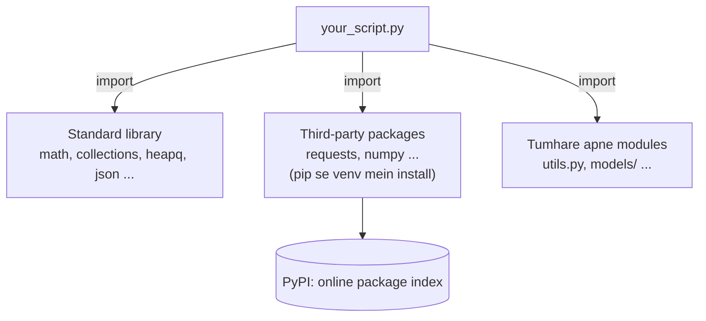
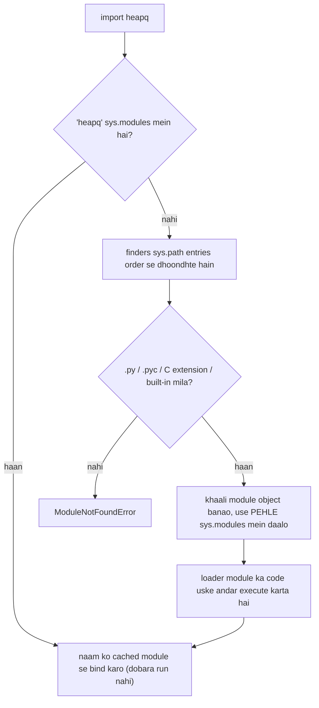

# Chapter 17 · Modules, Packages & the Standard Library

> Python ka slogan hai "batteries included". Standard library mein kahin na kahin pehle se ek tez, battle-tested tool pada hai: cheezein ginne ke liye, priority queue rakhne ke liye, binary search ke liye, caching ke liye, dates parse karne ke liye. Jo interview candidates in tools ko jaante hain, woh 40 line ka solution 8 lines mein likh dete hain, aur kam bugs ke saath. Yeh chapter is toolbox ka naksha hai.

**Is chapter mein tum seekhoge:**
- **Modules** aur **packages** kya hain, import karne ke saare styles, aur `import` asal mein code ko dhoondhta kaise hai
- `if __name__ == "__main__":` idiom, aakhirkaar poori tarah samjha hua
- `pip`, **virtual environments** (`venv`) aur `requirements.txt`, taaki projects aapas mein na ladein
- DSA ke power tools: `collections` (`deque`, `Counter`, `defaultdict`, `OrderedDict`, `namedtuple`), `heapq`, `bisect`, `functools` (`cache`, `lru_cache`, `reduce`, `partial`, `cmp_to_key`)
- Roz ke helpers: `math`, `random` (seeded), `datetime`, `os`/`pathlib`, `sys`, `copy`, `typing`
- Competitive-programming tricks: `sys.setrecursionlimit` aur `sys.stdin` se fast input

**Isse pehle padho:** [Functions](10-functions.md) · [OOP II](15-oop-inheritance-magic.md) · [Iterators, Generators, Decorators & Context Managers](16-iterators-generators-decorators.md)

---

## 🧠 The Big Idea · Asli Baat

Socho tum ek ghar bana rahe ho. Tum chaaho toh khud kile (nails) dhaal sakte ho, khud lakdi ke phatte kaat sakte ho, khud switches ki wiring kar sakte ho. Ya phir hardware ki dukaan pe ja sakte ho jahan sab kuch pehle se bana, tested aur label laga hua rakha hai.

- **Module** ek **toolbox** hai: ek single `.py` file jisme related functions aur classes bhare hain (`math`, `random`, `json`).
- **Package** **toolboxes ki ek shelf** hai: modules ka ek folder (`collections`, `json`, `urllib`).
- **Standard library** woh **hardware store hai jo Python ke saath free aata hai**: 200+ modules, Python ke saath hi install hote hain.
- **PyPI** (Python Package Index) ek **vishaal online marketplace** hai jahan lakhon third-party packages hain (`requests`, `numpy`, `django`), jo **`pip`** se install hote hain.
- **Virtual environment** **har project ka alag workshop** hai, taaki project A ke tools project B ke tools se na takrayein.

> 🇮🇳 **Desi Analogy:** Ghar ki rasoi socho. **Module** = ek masala dabba (ek dabbe mein related cheezein: haldi, mirch, jeera). **Package** = masalon ki poori almari (kai dabbe, ek jagah). **Standard library** = woh saara saamaan jo shaadi mein dahej ke saath aaya, matlab Python install karte hi free mein mil gaya. **PyPI** = Big Basket / Blinkit: jo ghar mein nahi hai, online mangwa lo (`pip install`). **Virtual environment** = har bacche ka alag tiffin: chhote ko bina mirch wala khana chahiye (django 4), bade ko teekha (django 5). Ek hi tiffin mein dono ka khana daaloge toh jhagda pakka.



> 💡 Interviews ke liye tumhe zyaadatar **standard library** hi chahiye. LeetCode aur zyaadatar coding platforms pe third-party packages available nahi hote, lekin `collections`, `heapq`, `bisect`, `itertools`, `functools` aur `math` hamesha hote hain.

---

## 🔨 Building It Up · Zero Se Shuru

### 1. Module bas ek `.py` file hai

Har Python file ek module hai. Uska naam file ka naam hai, bina `.py` ke. Jab tum use `import` karte ho, Python us file ko ek baar chalata hai aur tumhe ek **module object** deta hai, jiske attributes woh sab cheezein hain jo file ne define ki.

```python
import math

print(type(math).__name__)
print(math.pi, math.sqrt(16))
print(len([name for name in dir(math) if not name.startswith("_")]) > 40)
print(math.__name__)
```

```text
module
3.141592653589793 4.0
True
math
```

Abhi kya hua: `import math` ne ek variable `math` banaya jo module object ki taraf point karta hai. Uske andar ki cheezon tak tum dot se pahunchte ho: `math.pi`, `math.sqrt`. `dir(math)` andar ki saari cheezon ki list deta hai.

### 2. Import ke styles

```python
import math                              # 1. module import karo; math.sqrt use karo
import statistics as stats               # 2. chhote alias ke saath import
from math import gcd, inf                # 3. specific names seedha import karo
from collections import Counter as C     # 4. specific naam, alias ke saath

print(math.floor(3.7))
print(stats.mean([1, 2, 3, 4]))
print(gcd(12, 18), inf > 10**100)
print(C("banana").most_common(1))
```

```text
3
2.5
6 True
[('a', 3)]
```

| Style | Example | Fayde | Nuksaan |
|---|---|---|---|
| `import m` | `import math` | saaf dikhta hai ki naam kahan se aaya (`math.sqrt`) | type karne mein lamba |
| `import m as alias` | `import numpy as np` | chhota; standard aliases sab jagah chalte hain | ajeeb-ajeeb aliases khud mat banao |
| `from m import name` | `from collections import deque` | use karne mein chhota | chhupa sakta hai ki `deque` kahan se aaya |
| `from m import *` | `from math import *` | koi fayda nahi jo iske laayak ho | ⚠️ anjaane names tumhari file mein phenk deta hai, tumhare apne names chupchaap overwrite kar sakta hai |

> ⚠️ `from module import *` se bacho. Agar do modules dono `log` define karte hain (jaise `math.log` aur koi logging helper), toh doosra import pehle wale ko chupchaap replace kar deta hai, aur padhne wala bata hi nahi sakta ki kaunsa naam kahan se aaya.

**Imports ke order ka convention** (file ke top pe; PEP 8, Python ki style guide ke hisaab se): pehle standard library, phir third-party packages, phir tumhare apne modules, aur har group ke beech ek blank line.

### 3. `import` module ko dhoondhta aur chalata kaise hai

Jab tum `import something` likhte ho, Python:

1. **`sys.modules`** check karta hai, jo pehle se import ho chuke modules ki ek dictionary cache hai. Agar wahan mil gaya, toh bas usi ko reuse kar leta hai. **Ek module ka code ek program mein sirf ek baar chalta hai**, chahe kitni bhi baar import ho.
2. Warna **`sys.path`** ke folders mein order se dhoondhta hai: pehle us script ka folder jo tumne chalayi, phir `PYTHONPATH` environment variable ke paths, phir standard library ke folders, phir `site-packages` (jahan `pip` cheezein install karta hai).
3. Mil gaya, toh ek fresh module object mein file ko **upar se neeche tak chalata hai**, use `sys.modules` mein store karta hai, aur naam bind kar deta hai.

```python
import sys
import json
import json as again

print(json is again)                     # same module object, do baar load nahi hua
print("json" in sys.modules)
print(type(sys.path).__name__, len(sys.path) > 0)
```

```text
True
True
list True
```

Python import kiye gaye modules ka **compiled bytecode** bhi `__pycache__/*.pyc` files mein cache karta hai, taaki agli baar compile karna skip ho sake. Tumhe yeh folders apni files ke bagal mein dikhenge: yeh normal hai, aur inhe delete karna safe hai.

> 🇮🇳 **Desi Analogy:** `sys.modules` = ghar ka fridge, `sys.path` = market jaane ka route. Maa ne bola "dahi chahiye" (`import dahi`). Pehle fridge kholo (`sys.modules`): dahi hai? Bas, wahi use karo, dobara market mat jao. Nahi hai? Toh route ke hisaab se dukaanein check karo, pehle gali ki kirana (script ka folder), phir supermarket (standard library), phir mall (`site-packages`). Jahan pehle mila, wahi se le aao aur fridge mein rakh do. Isiliye agar gali ki dukaan pe koi nakli "dahi" bik raha hai (tumhari `random.py` file), toh asli wala kabhi ghar aayega hi nahi. Yahi agla trap hai.

### 4. Apna khud ka module likhna

Ek hi folder mein do files banao:

```py
# geometry.py
PI = 3.14159

def circle_area(r):
    return PI * r * r

def _helper():               # shuru mein underscore: "internal", import * isse skip karta hai
    pass
```

```py
# main.py
import geometry
from geometry import circle_area

print(geometry.PI)
print(circle_area(2))
```

`python main.py` chalao, aur yeh `3.14159` aur `12.56636` print karega. Tumhari apni files bilkul standard modules ki tarah import hoti hain, kyunki script ka folder `sys.path` mein sabse pehle hai.

> ⚠️ **Apni file ka naam kabhi us module pe mat rakho jo tum use karte ho.** Tumhare project folder mein `random.py` ya `math.py` ya `json.py` naam ki file asli module se *pehle* mil jaati hai (tumhara folder `sys.path` mein pehle aata hai), toh `import random` tumhari file import karta hai aur sab kuch confusing errors ke saath toot jaata hai, jaise `AttributeError: module 'random' has no attribute 'randint'`. Har beginner ko yeh ek baar zaroor kaatta hai.

### 5. `if __name__ == "__main__":`

Har module ke paas ek built-in variable hota hai **`__name__`**:

- Jab file **seedha chalayi jaati hai** (`python geometry.py`), toh uska `__name__` string `"__main__"` hota hai.
- Jab file **import hoti hai** (`import geometry`), toh uska `__name__` module ka naam hota hai, `"geometry"`.

```python
print("my __name__ is", repr(__name__))

def main():
    print("running as a script")

if __name__ == "__main__":
    main()
```

```text
my __name__ is '__main__'
running as a script
```

**Yeh kyun matter karta hai:** yaad rakho ki module import karna use *chalata* hai. Guard ke bina, `geometry.py` ke neeche likha koi bhi test code ya demo har us baar chalega jab koi use import karega. Guard ke saath, demo sirf tab chalta hai jab tum file ko seedha execute karte ho:

```py
# geometry.py
def circle_area(r):
    return 3.14159 * r * r

if __name__ == "__main__":         # "python geometry.py" pe chalta hai, "import geometry" pe NAHI
    print("self-test:", circle_area(1))
```

Windows aur macOS pe `multiprocessing` ke liye yeh guard **zaroori** bhi hai ([Chapter 18](18-internals-concurrency.md)), kyunki worker processes tumhari main file ko import karte hain.

> 🤔 **Mann mein sawaal:** `__main__` koi magic keyword hai kya? Python ko kaise pata ki file "seedha" chali?
>
> **Jawab:** Koi magic nahi. Jab tum `python geometry.py` likhte ho, Python us file ko ek module ki tarah load karta hai lekin uska naam `"__main__"` rakh deta hai, kyunki woh program ka entry point hai. Baaki har imported file ko uska asli naam milta hai. Toh `if __name__ == "__main__":` bas ek simple string comparison hai: "kya main hi woh file hoon jisse program shuru hua?"

### 6. Packages: modules ke folders

Jab project bada hota hai, toh tum modules ko ek **package** mein group karte ho: ek folder, jisme usually ek `__init__.py` file hoti hai.

```text
shop/                      <- project root (run python from here)
├── main.py
└── store/                 <- a package
    ├── __init__.py        <- runs when 'store' is first imported; marks the folder as a package
    ├── products.py
    ├── cart.py
    └── payments/          <- a sub-package
        ├── __init__.py
        └── upi.py
```

(Upar ke tree mein: `shop/` project ka root hai, yahin se python chalao. `store/` ek package hai. Uska `__init__.py` tab chalta hai jab `store` pehli baar import hota hai, aur folder ko package mark karta hai. `payments/` ek sub-package hai.)

```py
# main.py
from store.products import Product          # absolute import: package.module
from store.payments import upi              # ek submodule import karo
import store.cart as cart

# store/cart.py ke andar, sibling modules RELATIVE imports use kar sakte hain:
from .products import Product               # "." = yahi package (store)
from .payments.upi import pay               # ".payments" = store/payments
from .. import something                    # ".." = parent package (sirf nested packages ke andar)
```

`__init__.py` kis kaam aata hai:

- Yeh **tab chalta hai jab package import hota hai**, toh yeh cheezein set up kar sakta hai ya ek saaf API expose kar sakta hai: `store/__init__.py` ke andar `from .products import Product` likhne se users `from store import Product` likh sakte hain.
- Kisi module ya `__init__.py` mein `__all__ = ["Product", "Cart"]` control karta hai ki `from store import *` kya export kare.
- Python 3.3 se, **bina** `__init__.py` wala folder bhi "namespace package" ki tarah kaam karta hai, lekin apne projects mein `__init__.py` zaroor rakho: yeh explicit hai aur surprises se bachata hai.

> 💡 Relative imports (`from .products import ...`) sirf packages ke andar kaam karte hain. Package ke andar ki kisi file ko seedha chalane se (`python store/cart.py`) woh toot jaate hain; uski jagah project root se module ki tarah chalao: `python -m store.cart`.

### 7. `pip`, virtual environments aur `requirements.txt`

**`pip`** PyPI se packages install karta hai:

```bash
python -m pip install requests            # latest version install karo
python -m pip install "requests==2.31.0"  # ek exact version
python -m pip install --upgrade requests  # upgrade
python -m pip uninstall requests
python -m pip list                        # kya-kya installed hai
```

(`python -m pip` guarantee karta hai ki tum *usi* Python ka pip use kar rahe ho, jisse "maine install toh kiya tha par Python ko mil nahi raha" wali problems se bachte ho.)

**Problem:** by default pip ek hi global jagah install karta hai. Project A ko `django 4` chahiye, project B ko `django 5`. Dono ek saath jeet nahi sakte.

**Solution: virtual environment** (**venv**), ek private folder jiske paas apna Python aur apne packages hote hain, har project ka ek:

```bash
# banao (har project mein ek baar) .venv naam ke folder mein
python -m venv .venv

# activate karo (har naye terminal mein)
.venv\Scripts\activate          # Windows
source .venv/bin/activate       # macOS / Linux

# ab pip sirf isi project mein install karta hai
python -m pip install requests

deactivate                      # venv se bahar niklo
```

Jab venv active hota hai, tumhare terminal prompt pe `(.venv)` dikhta hai, aur `python`/`pip` `.venv` folder ke andar point karte hain.

**`requirements.txt`** tumhare project ki dependencies record karta hai taaki koi bhi environment dobara bana sake:

```bash
python -m pip freeze > requirements.txt    # exact installed versions save karo
python -m pip install -r requirements.txt  # doosri machine pe install karo
```

```text
requests==2.31.0
python-dateutil>=2.8,<3
```

> 💡 `.venv` folder ko kabhi git mein commit mat karo (use `.gitignore` mein daalo); uski jagah `requirements.txt` commit karo. `uv`, `poetry` aur `pyproject.toml` files jaise modern tools yahi kaam zyada features ke saath karte hain, lekin `venv` + `requirements.txt` woh neev hai jispe yeh sab bane hain.

> 🤔 **Mann mein sawaal:** `.venv` commit kyun nahi karna? Usme toh saare packages hain, doosre ko seedha mil jaayenge na?
>
> **Jawab:** Teen wajah. Ek, `.venv` bahut bhaari hota hai (sau MB tak). Do, usme tumhari machine ke specific paths aur OS-specific compiled files hoti hain: Windows ka `.venv` Linux pe chalega hi nahi. Teen, `requirements.txt` ek chhoti si "shopping list" hai, jisse koi bhi apni machine pe ek command mein wahi environment bana sakta hai. List bhejo, poora fridge nahi.

### 8. `collections`: supercharged containers

DSA ke liye yeh akela sabse kaam ka module hai. Paanch tools:

**`deque`** ("deck" bolte hain, double-ended queue): **dono** ends pe O(1) append aur pop. `list` front pe O(n) hoti hai, kyunki har element ko khisakna padta hai.

> 🇮🇳 **Desi Analogy:** List ek cinema hall ki seat row hai: agar shuru mein kisi ko bithana hai, toh poori row ko ek-ek seat khisakna padega (O(n)). `deque` ek Mumbai local ka dabba hai jiske **dono taraf darwaze** hain: aage se bhi chadho-utro, peeche se bhi, kisi ko khisakna nahi padta (O(1)). Lekin dabbe ke beech mein khade bande tak pahunchna ho? Bheed mein se raasta banana padega (middle indexing O(n)).

```python
from collections import deque

q = deque([1, 2, 3])
q.append(4)            # right mein jodo
q.appendleft(0)        # left mein jodo: O(1) (list.insert(0, x) O(n) hai)
print(q)
print(q.popleft(), q.pop(), q)   # dono ends se hatao, O(1)

q.rotate(1)            # 1 se right rotate karo
print(q)

recent = deque(maxlen=3)          # bounded deque sabse purana item apne aap gira deta hai
for page in ["home", "cart", "pay", "done"]:
    recent.append(page)
print(recent)
```

```text
deque([0, 1, 2, 3, 4])
0 4 deque([1, 2, 3])
deque([3, 1, 2])
deque(['cart', 'pay', 'done'], maxlen=3)
```

`deque` ko **queues** (BFS, [Graphs](../part-2-dsa/16-graphs-bfs-dfs.md) mein), sliding windows, aur "aakhri N items" ke liye use karo. Note: deque ke **beech** mein indexing O(n) hai; yeh sirf ends pe tez hai.

`rotate(1)` ka output samjho: `[1, 2, 3]` ko right rotate kiya, matlab aakhri element (3) utha ke aage rakh diya: `[3, 1, 2]`. Aur `maxlen=3` wale deque mein jab chautha page "done" aaya, sabse purana "home" apne aap bahar gir gaya.

**`Counter`**: ek dict jo cheezein ginta hai.

```python
from collections import Counter

votes = Counter(["ana", "ben", "ana", "chen", "ana", "ben"])
print(votes)
print(votes["ana"], votes["nobody"])         # missing keys 0 ginti hain, koi KeyError nahi
print(votes.most_common(2))

letters = Counter("mississippi")
print(letters.most_common(1))
print(Counter("listen") == Counter("silent"))   # ek line mein anagram check

a, b = Counter("aab"), Counter("abc")
print(a + b, a - b)                           # counts jodo / ghatao (<= 0 wale gir jaate hain)
print(a & b, a | b)                           # counts ka min / max
print(sorted(votes.elements()))               # wapas items mein phailao
print(votes.total())                          # saare counts ka sum (Python 3.10+)
```

```text
Counter({'ana': 3, 'ben': 2, 'chen': 1})
3 0
[('ana', 3), ('ben', 2)]
[('i', 4)]
True
Counter({'a': 3, 'b': 2, 'c': 1}) Counter({'a': 1})
Counter({'a': 1, 'b': 1}) Counter({'a': 2, 'b': 1, 'c': 1})
['ana', 'ana', 'ana', 'ben', 'ben', 'chen']
6
```

`a - b` ko dhyaan se dekho: `a` = {a:2, b:1}, `b` = {a:1, b:1, c:1}. Ghataya toh a:1, b:0, c:-1. Zero aur negative gir gaye, bacha sirf `{'a': 1}`. Yeh behaviour "kya kam pad raha hai?" wale sawaalon (jaise Ransom Note) ke liye ekdum perfect hai.

**`defaultdict`**: ek dict jo kisi missing key ko pehli baar chhoone pe **ek default value bana deta hai**. Tum ise ek *factory* dete ho (koi bhi zero-argument callable: `list`, `int`, `set`, ek lambda).

```python
from collections import defaultdict

# words ko unke pehle letter se group karo
words = ["apple", "avocado", "banana", "blueberry", "cherry"]
groups = defaultdict(list)
for w in words:
    groups[w[0]].append(w)          # "agar key dict mein nahi hai toh" wala naach nahi
print(dict(groups))

# ek graph ki adjacency list banao
edges = [(1, 2), (1, 3), (2, 3), (3, 4)]
graph = defaultdict(list)
for u, v in edges:
    graph[u].append(v)
    graph[v].append(u)              # undirected
print(dict(graph))

counts = defaultdict(int)           # int() == 0
for ch in "hello":
    counts[ch] += 1
print(dict(counts))
```

```text
{'a': ['apple', 'avocado'], 'b': ['banana', 'blueberry'], 'c': ['cherry']}
{1: [2, 3], 2: [1, 3], 3: [1, 2, 4], 4: [3]}
{'h': 1, 'e': 1, 'l': 2, 'o': 1}
```

> ⚠️ Missing key ko sirf *padhne* se bhi woh ban jaati hai: `if graph[99]:` chupchaap `99: []` jod deta hai. Bina banaye check karna ho toh `99 in graph` ya `graph.get(99)` use karo.

> 🤔 **Mann mein sawaal:** `defaultdict(list)` mein `list` likhte hain, `list()` kyun nahi?
>
> **Jawab:** Kyunki defaultdict ko ek **factory** chahiye, yaani ek aisi cheez jise woh baad mein baar-baar call kar sake, har nayi key ke liye ek **nayi** khaali list banane ke liye. `list` function khud hai (recipe), `list()` ek bani hui list hai (ek plate khana). Agar ek hi list deta, toh saari keys ek hi list share karti. Wahi Chapter 16 wala "bina bracket = function khud" funda.

**`OrderedDict`**: extra ordering powers wala dict. Python 3.7 se normal dicts bhi insertion order yaad rakhte hain, lekin `OrderedDict` `move_to_end()` aur `popitem(last=False)` jodta hai, dono O(1). Ek **LRU cache** ko bilkul yahi chahiye:

```python
from collections import OrderedDict

class LRUCache:                                   # LeetCode 146
    def __init__(self, capacity):
        self.capacity = capacity
        self.data = OrderedDict()

    def get(self, key):
        if key not in self.data:
            return -1
        self.data.move_to_end(key)                # most recently used mark karo
        return self.data[key]

    def put(self, key, value):
        if key in self.data:
            self.data.move_to_end(key)
        self.data[key] = value
        if len(self.data) > self.capacity:
            self.data.popitem(last=False)         # least recently used ko nikaalo

cache = LRUCache(2)
cache.put(1, "one"); cache.put(2, "two")
print(cache.get(1))           # 1 ab sabse recent hai
cache.put(3, "three")         # 2 ko nikaalta hai
print(cache.get(2), list(cache.data))
```

```text
one
-1 [1, 3]
```

> 🇮🇳 **Desi Analogy:** LRU cache = tumhare phone ka "Recent apps" screen, jisme sirf 2 apps ki jagah hai. Jo app tumne abhi kholi (WhatsApp), woh sabse aage aa jaati hai (`move_to_end`). Teesri app kholi (Swiggy)? Toh woh app band hoti hai jise sabse lambe time se nahi chhua (`popitem(last=False)`). OrderedDict ek line hai jisme ek end "sabse purana" hai aur doosra "sabse naya".

**`namedtuple`**: ek tuple jiske fields ke naam hote hain. Immutable, halka, readable.

```python
from collections import namedtuple

Point = namedtuple("Point", ["x", "y"])
p = Point(3, 4)
print(p, p.x, p[1])                 # naam SE YA index se access
x, y = p                            # tuple ki tarah unpack hota hai
print((p.x ** 2 + p.y ** 2) ** 0.5)
print(p._replace(x=10), p._asdict())

Edge = namedtuple("Edge", "src dst weight")    # fields space-separated string bhi ho sakte hain
edges = [Edge("A", "B", 5), Edge("A", "C", 2)]
print(min(edges, key=lambda e: e.weight))
```

```text
Point(x=3, y=4) 3 4
5.0
Point(x=10, y=4) {'x': 3, 'y': 4}
Edge(src='A', dst='C', weight=2)
```

(`typing.NamedTuple` type hints ke saath class-syntax wala version hai; [Chapter 15](15-oop-inheritance-magic.md) ka `@dataclass` iska mutable, zyada flexible cousin hai.)

`_replace` ne naya tuple banaya (`x=10`), lekin `_asdict()` mein `p` ab bhi `x=3` hai. Kyunki namedtuple immutable hai: `_replace` original ko badalta nahi, ek nayi copy deta hai.

### 9. `heapq`: priority queues

**Heap** ek aisa structure hai jisme **sabse chhota** item hamesha aage hota hai, O(1) mein ready, aur item jodna ya nikaalna sirf O(log n) ka padta hai. Python ka `heapq` ek normal list ke andar heap rakhta hai. Heaps andar se kaise kaam karte hain, yeh [DSA Chapter 15](../part-2-dsa/15-heaps.md) mein seekhoge; yahan dekho ki ise *use* kaise karte hain.

```python
import heapq

nums = [5, 1, 8, 3, 2]
heapq.heapify(nums)                    # in place heap mein rearrange karo: O(n)
print(nums[0])                         # sabse chhota hamesha index 0 pe

heapq.heappush(nums, 0)                # O(log n)
print(heapq.heappop(nums), heapq.heappop(nums))   # sabse chhota pehle nikalta hai, O(log n)

print(heapq.nsmallest(2, [7, 3, 9, 1]), heapq.nlargest(2, [7, 3, 9, 1]))

# MAX-heap trick: Python mein sirf min-heap hai, toh negatives push karo
max_heap = []
for x in [5, 1, 8]:
    heapq.heappush(max_heap, -x)
print(-heapq.heappop(max_heap))

# Tuples ke saath priorities: (priority, tie_breaker, item)
tasks = []
heapq.heappush(tasks, (2, "write report"))
heapq.heappush(tasks, (1, "fix prod bug"))
heapq.heappush(tasks, (3, "lunch"))
while tasks:
    priority, task = heapq.heappop(tasks)
    print(priority, task)
```

```text
1
0 1
[1, 3] [9, 7]
8
1 fix prod bug
2 write report
3 lunch
```

> 🇮🇳 **Desi Analogy:** Hospital ki emergency ward. Log jis order mein aaye, us order mein nahi dekhe jaate; jiski haalat sabse serious hai (sabse chhota priority number), doctor usse pehle dekhta hai. Naya patient aaya (`heappush`), triage nurse usse sahi jagah fit kar deti hai, poori line dobara sort nahi karti (O(log n)). Doctor free hua (`heappop`), sabse serious wala andar. Yahi priority queue hai.

Problem mein yeh signals dikhein toh heap socho: "**k-th largest / smallest**", "**top k**", "**hamesha agla sabse sasta / sabse paas / sabse pehla process karo**", "**merge k sorted**", "**running median**", aur Dijkstra ka shortest path ([DSA Chapter 17](../part-2-dsa/17-graphs-advanced.md)).

> ⚠️ Jab do tuples ki priorities barabar hoti hain, Python **agla** element compare karta hai. Agar woh aisa object hai jiske paas `<` nahi (jaise ek `ListNode`), toh `TypeError` aata hai. Tie-breaker ke roop mein ek unique counter jodo: `(priority, counter, item)`.

> 🤔 **Mann mein sawaal:** `heapify` ke baad `nums` print karoge toh kya woh sorted dikhegi?
>
> **Jawab:** Nahi! Heap sirf ek guarantee deta hai: `nums[0]` sabse chhota hai, aur har parent apne children se chhota ya barabar hai. Baaki list "aadhi-adhoori sorted" dikh sakti hai, jaise `[1, 2, 8, 3, 5]`. Isiliye heap se sorted order chahiye toh baar-baar `heappop` karo; `nums[1]` ko "doosra sabse chhota" mat maan lena.

### 10. `bisect`: sorted lists pe binary search

`bisect` dhoondhta hai ki ek value sorted list mein **kahan jaayegi**, O(log n) mein. (Binary search andar se kaise kaam karta hai: [DSA Chapter 8](../part-2-dsa/08-binary-search.md).)

```python
import bisect

scores = [10, 20, 20, 20, 30, 40]
print(bisect.bisect_left(scores, 20))     # pehli position jahan 20 ja sakta hai (barabar walon se pehle)
print(bisect.bisect_right(scores, 20))    # aakhri position (barabar walon ke baad)
print(bisect.bisect_right(scores, 20) - bisect.bisect_left(scores, 20))   # 20 kitni baar hai

def contains(sorted_list, x):
    i = bisect.bisect_left(sorted_list, x)
    return i < len(sorted_list) and sorted_list[i] == x

print(contains(scores, 30), contains(scores, 25))

bisect.insort(scores, 25)                 # sorted rakhte hue insert (search O(log n), insert O(n))
print(scores)

def grade(mark, cutoffs=(40, 60, 75, 90), letters="FDCBA"):
    return letters[bisect.bisect_right(cutoffs, mark)]

print([grade(m) for m in [35, 40, 72, 90, 100]])
```

```text
1
4
3
True False
[10, 20, 20, 20, 25, 30, 40]
['F', 'D', 'C', 'A', 'A']
```

`bisect_left` **pehle element ≥ x** ka index deta hai; `bisect_right` **pehle element > x** ka index deta hai. Python 3.10 se dono `key=` function bhi accept karte hain.

`grade` function ek pyaari trick hai, ise trace karo: cutoffs `(40, 60, 75, 90)`. Mark 72 ke liye `bisect_right` dekhta hai ki 72 se bade pehle element (75) ka index kya hai: 2. `letters[2]` = `"C"`. Mark 40 ke liye: 40 se *bada* pehla element 60 hai, index 1, toh `"D"`. Yahi wajah hai ki yahan `bisect_right` chahiye: exactly cutoff pe aane wala student agle grade mein jaana chahiye. Board exam ki "40 pe pass" wali logic bina ek bhi `if-elif` ke.

### 11. `itertools`: ek quick recap

`itertools` ka tour tumne [Chapter 16](16-iterators-generators-decorators.md) mein kiya tha. DSA ke highlights, ek jagah:

```python
from itertools import accumulate, combinations, permutations, product, groupby, pairwise

print(list(accumulate([2, 4, 1])))                   # prefix sums
print(list(combinations("abc", 2)))                  # 2 choose karo
print(len(list(permutations(range(4)))))             # 4! orderings
print(list(product([0, 1], repeat=2)))               # length 2 ke saare bit patterns
print([(k, len(list(g))) for k, g in groupby("aabccc")])
print([b - a for a, b in pairwise([1, 4, 9, 16])])   # padosiyon ke beech differences
```

```text
[2, 6, 7]
[('a', 'b'), ('a', 'c'), ('b', 'c')]
24
[(0, 0), (0, 1), (1, 0), (1, 1)]
[('a', 2), ('b', 1), ('c', 3)]
[3, 5, 7]
```

### 12. `functools`: functions ke liye tools

**`cache` aur `lru_cache`**: ek line mein memoization. Tumne [Chapter 16](16-iterators-generators-decorators.md) mein ise haath se banaya tha; yeh uska tez, built-in version hai.

```python
from functools import cache, lru_cache

@cache                                   # unlimited cache (Python 3.9+)
def grid_paths(r, c):
    """Number of ways from (0,0) to (r,c) moving only right/down."""
    if r == 0 or c == 0:
        return 1
    return grid_paths(r - 1, c) + grid_paths(r, c - 1)

print(grid_paths(16, 16))
print(grid_paths.cache_info().currsize)

@lru_cache(maxsize=2)                    # sirf 2 most recently used results rakhta hai
def square(n):
    return n * n

for n in [1, 2, 1, 3, 2]:
    square(n)
print(square.cache_info())
```

```text
601080390
288
CacheInfo(hits=1, misses=4, maxsize=2, currsize=2)
```

Cache ke bina `grid_paths(16, 16)` ek arab se zyada recursive calls karta; cache ke saath 288 alag-alag `(r, c)` states mein se har ek sirf ek baar compute hoti hai. Isse kai recursive DFS / DP solutions "time limit exceeded" se "accepted" ban jaate hain. Arguments **hashable** hone chahiye (lists nahi), aur `.cache_clear()` cache ko reset karta hai (LeetCode pe jab solver ko alag data ke saath dobara call karo tab zaroori hai).

`hits=1, misses=4` ko trace karo (maxsize=2): 1 → miss, cache [1]. 2 → miss, [1, 2]. 1 → **hit**, [2, 1]. 3 → miss, 2 nikla, [1, 3]. 2 → miss (2 toh nikal chuka tha!), [3, 2]. Total 1 hit, 4 misses. Agar `@cache` (unlimited) hota, toh aakhri 2 bhi hit hota.

**`reduce`**: ek two-argument function baar-baar laga ke poori sequence ko ek value mein "fold" kar do.

```python
from functools import reduce
import operator

print(reduce(lambda acc, x: acc * x, [1, 2, 3, 4, 5]))     # 5! = 120
print(reduce(operator.xor, [4, 1, 2, 1, 2]))                # akela non-duplicate number
print(reduce(lambda acc, d: acc * 10 + d, [4, 0, 7], 0))    # digits -> number
```

```text
120
4
407
```

Woh XOR wali line famous **Single Number** (LeetCode 136) trick hai: `x ^ x = 0` aur `x ^ 0 = x`, isliye jodiyan cancel ho jaati hain ([DSA Chapter 23](../part-2-dsa/23-bits-math.md)). Sums aur products ke liye zyada saaf `sum()` aur `math.prod()` pasand karo.

`reduce` ko step by step dekho (digits wala): acc=0 → 0×10+4 = 4 → 4×10+0 = 40 → 40×10+7 = 407. Har step pe "ab tak ka jawab" aur "agla item" milke naya "ab tak ka jawab" banate hain.

**`partial`**: kisi function ke kuch arguments pehle se bhar do, aur ek naya function bana lo.

```python
from functools import partial

def power(base, exponent):
    return base ** exponent

square = partial(power, exponent=2)
cube = partial(power, exponent=3)
print(square(7), cube(2))

parse_binary = partial(int, base=2)
print(parse_binary("1011"))
```

```text
49 8
11
```

**`cmp_to_key`**: purane style ke comparison function `cmp(a, b)` se sort karo, jo negative/zero/positive return karta hai. Usually `key=` zyada simple hota hai, lekin kuch orders sirf **jodiyon** ko compare karke hi express ho sakte hain. Classic example: **Largest Number** (LeetCode 179): numbers ko aise arrange karo ki sabse bada possible number bane.

```python
from functools import cmp_to_key

def largest_number(nums):
    strs = list(map(str, nums))
    def compare(a, b):
        if a + b > b + a:           # "9" + "34" > "34" + "9", toh "9" pehle jaata hai
            return -1
        if a + b < b + a:
            return 1
        return 0
    strs.sort(key=cmp_to_key(compare))
    result = "".join(strs)
    return "0" if result[0] == "0" else result

print(largest_number([3, 30, 34, 5, 9]))
print(largest_number([0, 0]))
```

```text
9534330
0
```

Yahan `key=` kyun kaam nahi karta? "3" aur "30" ko socho. Akele-akele dekhne pe koi rank nahi de sakte; lekin jodi mein dekho toh "330" > "303", toh "3" pehle. Order ek **jodi ka sawaal** hai, isliye comparison function chahiye. Aur `[0, 0]` ke liye "00" ki jagah "0" return karna zaroori hai: isiliye last line.

### 13. `math`: numbers ke tools

```python
import math

print(math.gcd(48, 18), math.lcm(4, 6))         # lcm ko Python 3.9+ chahiye
print(math.isqrt(99), math.sqrt(99))            # integer sqrt (exact) vs float sqrt
print(math.ceil(7 / 2), math.floor(-3.5), -7 // 2)
print(math.comb(5, 2), math.perm(5, 2), math.factorial(5))
print(math.prod([2, 3, 4]), math.dist((0, 0), (3, 4)))
print(math.inf > 10**18, -math.inf < -10**18)
print(math.log2(1024), math.log10(1000), round(math.log(math.e), 2))
print(math.isclose(0.1 + 0.2, 0.3), 0.1 + 0.2 == 0.3)
```

```text
6 12
9 9.9498743710662
4 -4 -4
10 20 120
24 5.0
True True
10.0 3.0 1.0
True False
```

Kaam ki aadatein:

- "Ab tak ka minimum" / "ab tak ka maximum" ki starting value ke liye `math.inf` / `-math.inf` (ya `float("inf")`).
- Exact integer square roots ke liye `math.isqrt(n)` (perfect-square check: `math.isqrt(n) ** 2 == n`). `math.sqrt` floats use karta hai aur bahut bade integers pe galat ho sakta hai.
- "n choose k" wale counting sawaalon ke liye `math.comb(n, k)`.
- Floats compare karne ke liye `math.isclose`, kabhi `==` nahi ([Chapter 3](03-operators-expressions.md)).

Teesri line pe ek baat note karo: `math.floor(-3.5)` = -4 aur `-7 // 2` = -4. Floor hamesha **neeche** (minus infinity ki taraf) jaata hai, zero ki taraf nahi. Negative numbers pe yahi log galti karte hain.

### 14. `random`: seeds ke saath reproducible randomness

Computers **pseudo-random** numbers banate hain: ek deterministic sequence jo random *dikhti* hai, ek **seed** se shuru hoti hai. Same seed → same sequence, jo reproducible tests aur simulations ke liye zaroori hai.

```python
import random

random.seed(42)                             # starting point fix karo
print(random.randint(1, 6), random.randint(1, 6), random.randint(1, 6))
print(round(random.random(), 4))            # [0, 1) mein float
print(random.choice(["rock", "paper", "scissors"]))

deck = list(range(1, 11))
random.shuffle(deck)                        # in place shuffle
print(deck)
print(random.sample(range(100), 3))         # 3 alag-alag picks

random.seed(42)                             # wahi seed dobara...
print(random.randint(1, 6), random.randint(1, 6), random.randint(1, 6))   # ...wahi numbers
```

```text
6 1 1
0.7416
rock
[10, 8, 9, 1, 5, 7, 6, 2, 3, 4]
[4, 3, 11]
6 1 1
```

`random.Random(seed)` ek independent generator object banata hai, jo tab kaam aata hai jab tum global wale ko disturb nahi karna chahte.

> 🇮🇳 **Desi Analogy:** Seed = cricket match ka toss ka "replay". Agar har baar exactly same haath, same force, same hawa ho, toh sikka har baar same hi girega. Computer ke paas koi asli sikka nahi; uske paas ek formula hai jo seed se shuru hoke numbers ki ek fixed line banata hai. Same seed = same line. Isiliye tumhare aur mere computer pe `seed(42)` ke baad `6 1 1` hi aayega.

> ⚠️ `random` passwords, tokens ya kisi bhi security wali cheez ke liye **nahi** hai: iski sequence predict ki ja sakti hai. Uske liye **`secrets`** module use karo (`secrets.token_hex(16)`).

### 15. `datetime`: dates aur times

```python
from datetime import date, datetime, timedelta

launch = date(2024, 8, 15)
deadline = date(2024, 9, 1)
print(deadline - launch)                    # dates ghatane se timedelta milta hai
print((deadline - launch).days, launch.weekday())   # Monday == 0

meeting = datetime(2024, 8, 15, 14, 30)
print(meeting + timedelta(hours=2, minutes=15))
print(meeting.strftime("%d %b %Y, %I:%M %p"))       # format: datetime -> string

parsed = datetime.strptime("2024-12-25 09:00", "%Y-%m-%d %H:%M")   # parse: string -> datetime
print(parsed, parsed.year, parsed.isoformat())
print(date.fromisoformat("2024-02-29") + timedelta(days=1))
```

```text
17 days, 0:00:00
17 3
2024-08-15 16:45:00
15 Aug 2024, 02:30 PM
2024-12-25 09:00:00 2024 2024-12-25T09:00:00
2024-03-01
```

15 August 2024 ko `weekday()` 3 aaya, yaani Thursday (Monday = 0 se ginti). Aur 2024 leap year tha, isliye 29 Feb exist karta hai aur uske ek din baad 1 March. Yeh sab hisaab datetime khud karta hai; tum haath se karoge toh galti pakki.

`strftime` vs `strptime` yaad rakhne ke liye: **f = format** (datetime se string banao, "f" for "formatting ke liye bahar bhejo"), **p = parse** (string padh ke datetime banao).

| Code | Matlab | Example |
|---|---|---|
| `%Y` | 4-digit year | 2024 |
| `%m` / `%d` | month / day, zero-padded | 08 / 15 |
| `%H` / `%I` | hour 24h / 12h | 14 / 02 |
| `%M` / `%S` | minute / second | 30 / 00 |
| `%b` / `%B` | chhota / poora month naam | Aug / August |
| `%a` / `%A` | chhota / poora weekday | Thu / Thursday |
| `%p` | AM/PM | PM |

Abhi ka moment `datetime.now()` aur `date.today()` se milta hai (results har run pe badalte hain, obviously). Bina timezone information wale datetimes ko **naive** kehte hain; jahan bhi alag-alag deshon ke users hon, wahan **aware** datetimes use karo: `datetime.now(timezone.utc)` aur `zoneinfo` module.

### 16. `os` aur `pathlib`: operating system se baat karna

`pathlib` se tum [Chapter 13](13-exceptions-files.md) mein mil chuke ho. `os` purana, lower-level module hai, jo ab bhi environment variables aur processes ke liye use hota hai:

```py
import os
from pathlib import Path

print(os.getcwd())                       # current working directory
print(os.environ.get("HOME"))            # environment variable (na mile toh None)
api_key = os.environ.get("API_KEY", "")  # apps secrets/config aise padhte hain
os.makedirs("out/logs", exist_ok=True)
print(os.listdir("."))                   # ek folder ke andar ke naam
print(os.path.join("out", "logs", "a.txt"))   # purana style
print(Path("out") / "logs" / "a.txt")         # modern style: yahi pasand karo
print(os.cpu_count())                    # CPU cores ki ginti
```

Thumb rule: **paths aur files → `pathlib`**; **environment variables, process info, low-level OS calls → `os`**.

### 17. `sys`: khud interpreter, aur competitive-programming tricks

```python
import sys

print(sys.version_info >= (3, 8))           # versions safely compare karo
print(sys.maxsize == 2**63 - 1)             # 64-bit pe sabse bada list index (ints khud unbounded hain)
print(sys.getrecursionlimit())              # default recursion depth limit
print(sys.getsizeof(0) < sys.getsizeof(10**100))   # bade ints zyada bytes lete hain
print(sys.argv[0].endswith(".py"))          # command-line arguments; argv[0] script hai
```

```text
True
True
1000
True
True
```

**Recursion limit badhana.** 10^5 nodes wale tree ya graph pe recursive DFS 10^5 levels gehra ja sakta hai, lekin Python lagbhag 1,000 frames pe `RecursionError` ke saath ruk jaata hai ([Chapter 12](12-recursion.md)). Competitive programmers limit badha dete hain:

```python
import sys
sys.setrecursionlimit(10**6)

def depth(n):
    return 0 if n == 0 else 1 + depth(n - 1)

print(depth(5000))      # default 1000 ki limit pe crash ho jaata
```

```text
5000
```

> ⚠️ Limit ek safety net hai, asli constraint nahi. Har Python frame C stack memory bhi use karta hai, aur bahut gehri recursion (lakhon levels) poore interpreter ko ek saaf error ki jagah segmentation fault ke saath crash kar sakti hai. Sach mein gehre structures ke liye recursion ko explicit stack mein badlo ([DSA Chapter 11](../part-2-dsa/11-stacks.md)).

**Fast input.** 10^5+ lines padhte waqt `input()` slow hai (har call ka apna overhead hai). `sys.stdin` program ka standard input hai, ek **file object** ([Chapter 13](13-exceptions-files.md)), toh tum use ek hi baar mein poora padh sakte ho:

```py
import sys

def main():
    data = sys.stdin.buffer.read().split()     # SAB KUCH padho, whitespace pe split karo (bytes)
    n = int(data[0])
    nums = list(map(int, data[1:1 + n]))
    print(sum(nums))

main()

# Alternatives:
input = sys.stdin.readline                     # drop-in tez input(); note: "\n" rakhta hai
n = int(input())
row = list(map(int, input().split()))

# Fast OUTPUT: hazaron print() calls ki jagah ek string banao
results = [1, 2, 3]
sys.stdout.write("\n".join(map(str, results)) + "\n")
```

Yeh pattern Codeforces aur CodeChef jaise platforms pe I/O-heavy solutions ko kai guna tez bana sakta hai. (LeetCode pe tum functions likhte ho, I/O nahi, toh wahan iski zaroorat nahi padegi.)

> 🇮🇳 **Desi Analogy:** `input()` baar-baar call karna aisa hai jaise kirana dukaan pe har item ke liye alag chakkar lagana: "bhaiya ek anda", ghar, wapas, "bhaiya ek aur anda". `sys.stdin.buffer.read()` = ek hi baar mein poori list de do aur ek thaila bhar ke le aao. Saman utna hi hai, chakkar bas ek.

### 18. `copy`: shallow vs deep copies

Assignment kabhi copy nahi karta ([Chapter 7](07-lists.md)). Jab tumhe *sach mein* copy chahiye, toh decide karna padta hai ki kitni gehri:

```python
import copy

grid = [[1, 2], [3, 4]]
alias = grid
shallow = copy.copy(grid)          # grid[:] ya list(grid) jaisa hi
deep = copy.deepcopy(grid)

grid[0][0] = 99                    # ek ANDAR wali list badlo
grid.append([5, 6])                # BAHAR wali list badlo

print(alias)
print(shallow)                     # andar ka badlaav dikhta hai, append nahi
print(deep)                        # poori tarah independent
```

```text
[[99, 2], [3, 4], [5, 6]]
[[99, 2], [3, 4]]
[[1, 2], [3, 4]]
```

**Shallow** copy ek naya bahar wala container banati hai lekin andar ke objects **share** karti hai. **Deep** copy sab kuch recursively copy karti hai. Backtracking mein ([DSA Chapter 9](../part-2-dsa/09-backtracking.md)) `path[:]` save karna (flat list ki shallow copy) kaafi hai; lists ke grid ke liye deep copies chahiye. Memory mein kya hota hai, woh [Chapter 18](18-internals-concurrency.md) dikhata hai.

> 🇮🇳 **Desi Analogy:** Joint family ka WhatsApp group. **Alias** = same group, bas tumne naam "Family ❤️" se "Gharwale" kar diya: koi bhi message dono naam mein dikhega. **Shallow copy** = tumne naya group banaya aur purane group ke saare **members** add kar diye: group alag hai (naya member sirf ek mein jodo toh doosre mein nahi aata, jaise `append`), lekin log wahi hain, toh Chacha ne apni DP badli (inner list change) toh dono groups mein badli dikhegi. **Deep copy** = har member ka clone bana ke naye group mein daal diya: ab kuch bhi badlo, doosre pe koi asar nahi.

### 19. `typing`: type hints

**Type hints** document karte hain ki function kaunse types expect karta hai aur kya return karta hai. Python **runtime pe inhe enforce nahi karta**; yeh insaanon, editors (autocomplete, warnings) aur `mypy` jaise checkers ke liye hain.

```python
from typing import Optional, Callable

def average(nums: list[float]) -> float:
    return sum(nums) / len(nums)

def find_user(users: dict[int, str], user_id: int) -> Optional[str]:   # str ya None
    return users.get(user_id)

def apply(f: Callable[[int], int], value: int) -> int:
    return f(value)

def first_or_default(items: list[str], default: str | None = None) -> str | None:   # 3.10+ syntax
    return items[0] if items else default

print(average([1.0, 2.0, 4.5]))
print(find_user({1: "ana"}, 2))
print(apply(lambda x: x * 10, 4))
print(first_or_default([], "none"))
print(average.__annotations__)
print(average([1, 2]))          # ints pass karna phir bhi chalta hai: hints enforce NAHI hote
```

```text
2.5
None
40
none
{'nums': list[float], 'return': <class 'float'>}
1.5
```

| Hint | Matlab |
|---|---|
| `int`, `str`, `float`, `bool` | woh type |
| `list[int]`, `set[str]`, `dict[str, int]`, `tuple[int, str]` | element types ke saath containers (3.9+) |
| `tuple[int, ...]` | ints ka kisi bhi length ka tuple |
| `Optional[X]` or `X \| None` | X ya None |
| `Union[A, B]` or `A \| B` | dono mein se koi ek type |
| `Callable[[int, str], bool]` | ek function jo (int, str) leta hai, bool return karta hai |
| `Any` | kuch bhi (checking se bahar) |

LeetCode ke function signatures hints use karte hain (`def twoSum(self, nums: List[int], target: int) -> List[int]:`), jisme `List` `typing` se aata hai, jo `list[...]` ki purani spelling hai.

---

## 🔬 Under the Hood · Andar Ki Kahani

### `import` ke dauraan asal mein kya hota hai



Do nateeje:

1. **Modules singletons hain.** Tumhare poore program mein har `import config` ko *wahi ek* module object milta hai. Isiliye module configuration ya ek shared instance share karne ka simple, valid tareeka hai.
2. **Circular imports** isliye tootte hain kyunki module ka code poora chalne se *pehle* hi use `sys.modules` mein daal diya jaata hai. Agar `a.py` top pe `b.py` import kare aur `b.py` `a.py` import kare, toh `b` ko ek aadha-initialised `a` milta hai, aur `from a import thing` is error ke saath fail hota hai: `ImportError: cannot import name 'thing' from partially initialized module 'a'`. Fixes: shared code ko ek teesre module mein le jao, ya jis function ko zaroorat hai uske andar import karo.

Circular import ko slow motion mein dekho. `a.py` chalna shuru hua, `sys.modules["a"]` mein ek khaali-sa `a` baith gaya. Pehli line: `import b`. Ab `b.py` chalna shuru hua, uski pehli line: `from a import thing`. Python ne `sys.modules` mein `a` dekha, mil gaya! Lekin `a` toh abhi apni pehli line pe hi atka hai, `thing` abhi define hi nahi hua. Isiliye "partially initialized".

> 🤔 **Mann mein sawaal:** Module ko poora chalne se pehle hi `sys.modules` mein kyun daal dete hain? Baad mein daalte toh yeh problem hi na hoti.
>
> **Jawab:** Baad mein daalte toh problem aur badi hoti: `a` → `b` → `a` → `b` → ... infinite loop, kyunki `b` ko `a` cache mein milta hi nahi aur woh `a` ko phir se chalana shuru kar deta. Pehle daalne se kam se kam loop toh toot jaata hai; bas adhoora module milta hai. Asli ilaaj design ka hai: do modules ek doosre pe depend na karein.

### `.pyc` files

Module chalane se pehle Python source ko **bytecode** mein compile karta hai ([Chapter 18](18-internals-concurrency.md)). Import kiye modules ke liye yeh bytecode `__pycache__/name.cpython-311.pyc` mein save hota hai (tag Python version batata hai), aur agli baar Python source ka timestamp check karta hai: agar badla nahi, toh compile skip. Jo script tum seedha chalate ho, woh har baar fresh compile hoti hai aur cache nahi hoti.

### Standard library itni tez kyun hai

Kai key modules Python mein nahi, **C** mein likhe gaye hain: `heapq`, `bisect`, `collections.deque`, `itertools`, `functools.lru_cache`, `math`, `json` ke speedups, aur `Counter` ka counting loop. `heapq.heappush` jaisi call apna saara kaam C ki speed pe karti hai, isliye woh typically pure Python mein likhe usi algorithm se kai guna tez hoti hai. Yahi badi wajah hai ki "Pythonic" solution aksar sabse tez bhi hota hai: **loops ka kaam C ko karne do**.

### `deque` ko dono ends pe O(1) kaise milta hai

`list` ek lagataar (contiguous) array hai: index 0 pe insert karne se har element khisakta hai (O(n)). `deque` **fixed-size blocks ki doubly linked list** hai (CPython mein har block mein 64 slots). Kisi bhi end pe jodna usually bas end block ki khaali jagah mein likhna hai, aur block bhar jaaye toh naya block allocate hota hai. Dono ends O(1) hain, lekin beech tak pahunchne ke liye blocks pe chalna padta hai, isliye beech mein `dq[i]` O(n) hai.

---

## 🧩 Pattern Decoder · Pattern Pakdo

### "Kaunsa module ise solve karega?" cheat sheet

| Problem kehta hai... | Uthao | Example problems |
|---|---|---|
| occurrences gino, frequency, anagram, majority | `Counter` | Valid Anagram, Top K Frequent Elements, Majority Element |
| kisi key se group karo | `defaultdict(list)` | Group Anagrams |
| edges se graph banao | `defaultdict(list)` / `defaultdict(set)` | Course Schedule, Number of Provinces |
| queue, BFS, level order, sliding window max | `deque` | Binary Tree Level Order Traversal, Sliding Window Maximum |
| k-th largest/smallest, top k, merge k sorted, hamesha agla min/max lo | `heapq` | Kth Largest Element in an Array, Merge k Sorted Lists, Task Scheduler |
| sorted data mein search, insertion position, range mein count | `bisect` | Search Insert Position, Longest Increasing Subsequence (O(n log n)) |
| overlapping subproblems wali recursion | `@cache` / `@lru_cache` | Climbing Stairs, Coin Change, Word Break |
| prefix sums, running max | `itertools.accumulate` | Range Sum Query, Best Time to Buy and Sell Stock |
| saare subsets/orders/pairs (chhota n) | `combinations`, `permutations`, `product` | brute-force checks |
| custom pairwise sort order | `functools.cmp_to_key` | Largest Number |
| LRU cache | `OrderedDict` | LRU Cache |
| gcd / lcm / exact sqrt / n choose k | `math` | Fraction problems, Unique Paths (`comb`) |
| 10^5 nodes pe gehri recursion | `sys.setrecursionlimit` (ya explicit stack) | bade trees pe DFS |
| bahut saari input lines | `sys.stdin` | competitive programming |

### Competitive-programming ka starter template

```py
import sys
from collections import defaultdict, deque, Counter
from heapq import heappush, heappop
from bisect import bisect_left, bisect_right
from functools import cache
from math import inf, gcd

input = sys.stdin.readline
sys.setrecursionlimit(10**6)

def solve():
    n = int(input())
    nums = list(map(int, input().split()))
    # ... tumhara logic ...
    return sum(nums)

def main():
    t = int(input())                       # test cases ki ginti
    out = [str(solve()) for _ in range(t)]
    sys.stdout.write("\n".join(out) + "\n")

if __name__ == "__main__":
    main()
```

### Worked example: Top K Frequent Elements (LeetCode 347)

**Problem:** `k` sabse zyada baar aane wale elements return karo.

**Idea:** `Counter` O(n) mein ginta hai. `most_common(k)` andar se heap use karta hai (O(n log k)). Interviewer O(n) maang sakta hai: frequency ke hisaab se **bucket sort**.

```python
from collections import Counter

def top_k_frequent(nums, k):
    return [x for x, _ in Counter(nums).most_common(k)]

def top_k_frequent_buckets(nums, k):          # O(n): index = frequency
    counts = Counter(nums)
    buckets = [[] for _ in range(len(nums) + 1)]
    for x, c in counts.items():
        buckets[c].append(x)
    result = []
    for freq in range(len(buckets) - 1, 0, -1):
        for x in buckets[freq]:
            result.append(x)
            if len(result) == k:
                return result
    return result

print(top_k_frequent([1, 1, 1, 2, 2, 3], 2))
print(top_k_frequent_buckets([4, 4, 5, 5, 5, 6], 1))
```

```text
[1, 2]
[5]
```

Bucket wala idea kyun kaam karta hai: koi element `len(nums)` se zyada baar aa hi nahi sakta. Toh `len(nums) + 1` buckets banao, jahan bucket number = frequency. `[4, 4, 5, 5, 5, 6]` ke liye: bucket 1 = [6], bucket 2 = [4], bucket 3 = [5]. Ab peeche se (sabse badi frequency se) chalo aur k items uthao. Koi sorting nahi, isliye O(n).

> 🇮🇳 **Desi Analogy:** Bucket sort = school ki attendance register ke hisaab se "kitne din aaye" ke dabbe. Teacher ne 30 dabbe rakhe (1 din, 2 din, ... 30 din). Har bacche ko uske attendance wale dabbe mein daal do. "Top 3 regular bacche" chahiye? Bas 30 wale dabbe se ulta dekhna shuru karo. Kisi ko kisi se compare hi nahi kiya.

### Kab module ki taraf haath NAHI badhana

- Jab interviewer saaf bole ki structure khud implement karo (jaise "implement a heap", "implement LRU without OrderedDict"). Library wala version mention karo, phir haath se banao.
- Hot loop mein fixed chhote alphabet ke liye `Counter`: `ord(c) - ord("a")` se index hone wali `[0] * 26` list tez ho sakti hai.
- Jab beech mein index se random access chahiye, tab `deque`: list use karo.

---

## ⚠️ Traps & Common Mistakes · Yahan Sab Phisalte Hain

1. **Apni file ka naam kisi module pe rakhna** (`random.py`, `heapq.py`, `collections.py`). Tumhari file asli wale ko chhupa (shadow kar) deti hai. Rename karo aur `__pycache__` folder delete karo.

2. **`from module import *`.** Naamon ki takkar aur na padhne laayak code.

3. **Yeh sochna ki do baar import karne se module do baar chalta hai.** Nahi chalta; `sys.modules` use cache kar leta hai. (Interactive session ke dauraan file mein kiye changes ke liye `importlib.reload(module)` chahiye.)

4. **`if __name__ == "__main__":` guard bhool jaana**, jisse test code import pe chal jaata hai (aur `multiprocessing` toot jaata hai).

5. **Venv activate kiye bina packages install karna**, phir sochna ki `import requests` fail kyun ho raha hai, ya iska ulta. `python -m pip --version` se check karo, yeh batata hai ki pip kis Python ka hai.

6. **`heapq` sirf min-heap hai.** Max-heap ke liye `-x` push karo (aur pop karte waqt phir se negate karo).

7. **Heap mein aise items push karna jo compare nahi ho sakte.** Agar nodes ke paas `<` nahi hai toh `(priority, node)` ties pe crash hota hai. `(priority, counter, node)` use karo.

8. **`defaultdict` padhne pe keys bana deta hai.** `if d[key]:` key jod deta hai. `key in d` use karo.

9. **`Counter` subtraction zero aur negative counts gira deta hai.** `Counter(a=1) - Counter(a=2)` khaali hai, `{'a': -1}` nahi. Negatives rakhne hain toh `.subtract()` use karo.

10. **Mutable arguments ke saath `@cache`.** Lists hashable nahi hain: `TypeError: unhashable type: 'list'`. Tuples pass karo, ya ek inner function ko cache karo jo list ko closure mein rakhe aur sirf indexes le.

11. **Test cases ke beech purane (stale) caches.** LeetCode pe module-level `@cache` function alag inputs wale test cases ke beech bhi results rakhe rehta hai. Cached helper ko method ke **andar** define karo, ya `.cache_clear()` call karo.

12. **Tests mein bina seed ke `random`.** Har run pe results alag; reproducibility ke liye seed karo. Aur secrets ke liye kabhi `random` mat use karo.

13. **`bisect_left` aur `bisect_right` mein gadbad.** Left = pehla index jiski value ≥ x; right = pehla index jiski value > x. Off-by-one bugs yahin rehte hain.

14. **2D grid ki shallow copy** (`grid[:]` ya `[row for row in grid]`): rows ab bhi shared hain. `[row[:] for row in grid]` ya `copy.deepcopy` use karo.

---

## 💡 Tips & Tricks · Pro Wale Moves

- `python -m module` ek module ko script ki tarah chalata hai: `python -m venv`, `python -m pip`, `python -m timeit`, `python -m http.server 8000` (turant local web server), `python -m json.tool file.json` (JSON ko sundar print karna).
- REPL mein `help(heapq)` ya `help(Counter.most_common)` offline documentation dikhata hai.
- Module ka source dekhna hai? `import inspect; print(inspect.getsourcefile(collections))`.
- `Counter(word).most_common()[-1]` sabse kam common deta hai; bina argument ke `most_common()` sab kuch sort kar deta hai.
- `heapq.merge(*sorted_lists)` pehle se sorted iterables ko lazily merge karta hai.
- `deque.rotate(k)` O(k) mein rotate karta hai; queues pe "rotate array" type problems solve karne ka jhatpat tareeka.
- Shuruati minimum ke liye `999999999` jaise magic numbers se `math.inf` behtar hai.
- `functools.cache` = `lru_cache(maxsize=None)`: unlimited aur thoda tez.
- Ek single joined string ke saath `sys.stdout.write` hazaron `print` calls se kahin zyada tez hai.
- Project mein apps ke liye `requirements.txt` sorted aur pinned (`==`) rakho; libraries dheele ranges (`>=`) use karti hain.

---

## 🎯 Interview Questions · Interview Mein Yahi Poochenge

### 1. What's the difference between a module and a package? 🔥🔥🔥

<details><summary>Answer dekho 👀</summary>

**Module** ek single Python file hai (`utils.py`) jiske top-level names import hone pe ek module object ke attributes ban jaate hain. **Package** ek directory hai jo modules (aur sub-packages) ko group karti hai, traditionally ek `__init__.py` file se mark hoti hai jo package import hone pe chalti hai aur uski public API define kar sakti hai. Packages hierarchical namespaces dete hain: `store.payments.upi`. Python 3.3 se namespace packages bhi hain (bina `__init__.py` wali directories), jo zyaadatar ek package ko kai locations mein baantne ke kaam aate hain.

> 🗣️ **Interview mein aise bolo:** "A module is a single `.py` file; importing it gives you a module object whose attributes are the file's top-level names. A package is a directory of modules and sub-packages, usually with an `__init__.py` that runs on import and can define the public API. Packages give us hierarchical namespaces like `store.payments.upi`."

</details>

### 2. What does `if __name__ == "__main__":` do? 🔥🔥🔥

<details><summary>Answer dekho 👀</summary>

Har module ke paas ek `__name__` attribute hota hai. Jab file seedha execute hoti hai, Python uska `__name__` `"__main__"` set karta hai; jab woh import hoti hai, `__name__` module ka naam hota hai. Toh is guard ke neeche ka code sirf tab chalta hai jab file script ki tarah chalayi jaaye, import hone pe nahi. Yeh entry points (`main()`), self-tests aur demos ke liye use hota hai, aur un platforms pe `multiprocessing` ke saath zaroori hai jo naye processes spawn karte hain (Windows/macOS), kyunki woh har worker mein main module ko dobara import karte hain.

> 🗣️ **Interview mein aise bolo:** "Every module has a `__name__`; it's set to `"__main__"` only for the file that was executed directly, and to the module name when it's imported. So code under that guard runs when the file is used as a script but not on import. I use it for entry points and demos, and it's required for `multiprocessing` with the spawn start method, because workers re-import the main module."

</details>

### 3. What happens when you import a module? Is it executed every time you import it? 🔥🔥

<details><summary>Answer dekho 👀</summary>

Python pehle `sys.modules` check karta hai. Agar module wahan cached hai, toh turant reuse hota hai. Warna import system `sys.path` mein dhoondhta hai (script directory, `PYTHONPATH`, standard library, `site-packages`), ek module object banata hai, use `sys.modules` mein register karta hai, module ka code us object ke namespace mein upar se neeche tak execute karta hai, aur importer mein naam bind karta hai. Toh module ka top-level code **har process mein ek baar** chalta hai; baad ke imports bas dictionary lookups hain. Compiled bytecode future runs ko tez karne ke liye `__pycache__` mein cache hota hai. `importlib.reload()` dobara execution force karta hai.

</details>

### 4. Why use virtual environments? 🔥🔥🔥

<details><summary>Answer dekho 👀</summary>

Har project ki dependencies ko alag (isolate) karne ke liye. Inke bina saare projects ek hi global `site-packages` share karte hain, toh alag projects ko ek hi library ke alag versions chahiye hon toh takraav hota hai, aur ek project ke liye upgrade karna doosre ko tod sakta hai. Ek venv (`python -m venv .venv`) mein apna interpreter link aur apni package directory hoti hai; use activate karne se `python`/`pip` usi ko use karte hain. Pinned `requirements.txt` (`pip freeze > requirements.txt`, `pip install -r requirements.txt`) ke saath milke yeh machines, CI aur production ke beech reproducible environments deta hai. Isse packages install karne ke liye admin rights ki zaroorat bhi nahi padti.

> 🗣️ **Interview mein aise bolo:** "Virtual environments isolate each project's dependencies, so project A can use Django 4 while project B uses Django 5 without conflicts. A venv has its own interpreter link and site-packages, and activating it points `python` and `pip` there. Combined with a pinned `requirements.txt`, it makes the environment reproducible on any machine, in CI and in production."

</details>

### 5. What are `Counter`, `defaultdict` and `deque` used for? 🔥🔥🔥

<details><summary>Answer dekho 👀</summary>

- `Counter`: hashable items ginne ke liye ek dict subclass; missing keys 0 return karti hain; isme `most_common(k)` hai, counters ke beech arithmetic hai, aur multiset comparison (anagrams) ke liye `==` hai.
- `defaultdict(factory)`: ek dict jo missing key access hone pe value banane ke liye `factory()` call karta hai; grouping (`defaultdict(list)`) aur adjacency lists ke liye ideal.
- `deque`: O(1) `append`/`appendleft`/`pop`/`popleft` wali double-ended queue; queues (BFS), sliding windows, aur bounded history (`maxlen`) ke liye use hoti hai. Lists front pe operations ke liye O(n) hain.

> 🗣️ **Interview mein aise bolo:** "`Counter` is a dict for counting hashable items: missing keys return zero, and it gives me `most_common(k)` and multiset comparison for anagram checks. `defaultdict` creates a default value on first access, which makes grouping and building adjacency lists clean. `deque` gives O(1) appends and pops at both ends, so it's my default queue for BFS and sliding windows, where a list would be O(n) at the front."

</details>

### 6. LRU Cache (LeetCode 146) 🔥🔥🔥

Capacity `c` wala ek cache design karo jo `get(key)` aur `put(key, value)` O(1) mein support kare, aur bhar jaane pe least recently used key nikaal de.

<details><summary>Answer dekho 👀</summary>

Jhatpat version `OrderedDict` use karta hai (section 8 dekho): har access pe `move_to_end`, evict karne ke liye `popitem(last=False)`. Dono O(1).

Interviewers aksar follow-up karte hain: "ab `OrderedDict` ke bina". Classic implementation hai **hash map + doubly linked list**: map key se node tak O(1) lookup deta hai; list usage order rakhti hai, O(1) unlink/relink ke saath. Sentinel head/tail nodes edge cases se bachate hain.

```python
class Node:
    __slots__ = ("key", "val", "prev", "next")
    def __init__(self, key=0, val=0):
        self.key, self.val = key, val
        self.prev = self.next = None

class LRUCache:
    def __init__(self, capacity):
        self.cap = capacity
        self.map = {}
        self.head, self.tail = Node(), Node()      # sentinels
        self.head.next, self.tail.prev = self.tail, self.head

    def _remove(self, node):
        node.prev.next, node.next.prev = node.next, node.prev

    def _add_front(self, node):                     # front = most recently used
        node.prev, node.next = self.head, self.head.next
        self.head.next.prev = node
        self.head.next = node

    def get(self, key):
        if key not in self.map:
            return -1
        node = self.map[key]
        self._remove(node)
        self._add_front(node)
        return node.val

    def put(self, key, value):
        if key in self.map:
            self._remove(self.map[key])
        node = Node(key, value)
        self.map[key] = node
        self._add_front(node)
        if len(self.map) > self.cap:
            lru = self.tail.prev                    # least recently used
            self._remove(lru)
            del self.map[lru.key]

c = LRUCache(2)
c.put(1, 1); c.put(2, 2)
print(c.get(1))
c.put(3, 3)
print(c.get(2), c.get(3))
c.put(4, 4)
print(c.get(1), c.get(3), c.get(4))
```

```text
1
-1 3
-1 3 4
```

Saare operations O(1); space O(capacity). Linked lists ki gehri baat [DSA Chapter 10](../part-2-dsa/10-linked-lists.md) mein hai.

Dono data structures kyun chahiye? Sirf hash map: key se value O(1) mein mil jaati hai, lekin "sabse purana kaun" nahi pata. Sirf linked list: order pata hai, lekin kisi key ka node dhoondhne mein O(n). Dono milke: map node tak O(1) mein le jaata hai, aur doubly linked list us node ko O(1) mein uthake front pe rakh deti hai (kyunki `prev` pointer se padosi turant milte hain).

> 🗣️ **Interview mein aise bolo:** "I combine a hash map with a doubly linked list. The map gives O(1) access from key to node, and the list keeps nodes in recency order, most recent at the head. On every get or put I unlink the node and move it to the front in O(1); when capacity is exceeded I evict the node just before the tail sentinel. Every operation is O(1), and space is O(capacity)."

</details>

### 7. Kth Largest Element in an Array (LeetCode 215) 🔥🔥🔥

<details><summary>Answer dekho 👀</summary>

**Size k ka min-heap** rakho: usme ab tak ke k sabse bade elements hote hain, aur uska root k-th sabse bada hai. Har push/pop O(log k), total O(n log k), O(k) space. (`heapq.nlargest(k, nums)[-1]` yahi kaam ek line mein karta hai; Quickselect average O(n) deta hai.)

```python
import heapq

def find_kth_largest(nums, k):
    heap = []
    for x in nums:
        heapq.heappush(heap, x)
        if len(heap) > k:
            heapq.heappop(heap)          # sabse chhota gira do: woh top k mein ho hi nahi sakta
    return heap[0]

print(find_kth_largest([3, 2, 1, 5, 6, 4], 2), find_kth_largest([3, 2, 3, 1, 2, 4, 5, 5, 6], 4))
```

```text
5 4
```

Ulta lagta hai na, "largest" ke liye **min**-heap? Socho: heap ek VIP lounge hai jisme sirf k seats hain. Naya banda aaya aur seats bhar gayi, toh sabse "kamzor" (sabse chhota) bahar. Min-heap ka root hamesha sabse kamzor hota hai, isliye usse nikaalna O(log k) hai. Aakhir mein lounge mein top k bache, aur unme sabse kamzor (root) hi k-th largest hai.

> 🗣️ **Interview mein aise bolo:** "I keep a min-heap of size k that holds the k largest elements seen so far. For each number I push it, and if the heap grows beyond k I pop the smallest, since it can't be in the top k. At the end the heap's root is the k-th largest. That's O(n log k) time and O(k) space; Quickselect would give O(n) on average."

</details>

### 8. Group Anagrams (LeetCode 49) 🔥🔥🔥

<details><summary>Answer dekho 👀</summary>

Anagrams ke sorted letters same hote hain, isliye sorted string (ya 26 counts ka tuple) ko `defaultdict(list)` mein key bana do.

```python
from collections import defaultdict

def group_anagrams(words):
    groups = defaultdict(list)
    for w in words:
        groups["".join(sorted(w))].append(w)
    return list(groups.values())

print(group_anagrams(["eat", "tea", "tan", "ate", "nat", "bat"]))
```

```text
[['eat', 'tea', 'ate'], ['tan', 'nat'], ['bat']]
```

Time O(n · L log L), n words jinki length L hai (count-tuple key ke saath O(n · L)). Space O(n · L).

> 🗣️ **Interview mein aise bolo:** "Anagrams have the same multiset of letters, so I compute a canonical key for each word, its sorted letters, and group words under that key in a `defaultdict(list)`. That's O(n · L log L); using a tuple of 26 letter counts as the key brings it down to O(n · L)."

</details>

### 9. How does `lru_cache` work, and what are its limitations? 🔥🔥

<details><summary>Answer dekho 👀</summary>

`functools.lru_cache(maxsize=N)` function ko ek dictionary se wrap karta hai jiski key uske arguments hain (positional aur keyword, isliye woh **hashable** hone chahiye). Hit pe woh stored result return karta hai aur entry ko recently used mark karta hai; miss pe function call karta hai aur result store karta hai, aur jab `maxsize` se zyada entries ho jaayein toh least recently used wali nikaal deta hai (`maxsize=None`, ya `@cache`, matlab unbounded). Yeh C mein implement hai aur apni internal bookkeeping ke liye thread-safe hai. Limitations: unhashable arguments (lists, dicts) `TypeError` raise karte hain; unbounded caches ke saath memory badhti jaati hai; agar function bahar ki state pe depend karta hai toh cached results purane (stale) ho jaate hain; methods pe `self` key ka hissa ban jaata hai (objects ko zinda rakhta hai). `cache_info()` hits/misses batata hai aur `cache_clear()` use reset karta hai.

</details>

### 10. Shallow copy vs deep copy? 🔥🔥🔥

<details><summary>Answer dekho 👀</summary>

**Shallow copy** (`copy.copy(x)`, `lst[:]`, `list(lst)`, `dict.copy()`) ek naya container banati hai jisme **unhi** andar wale objects ke **references** hote hain. **Deep copy** (`copy.deepcopy(x)`) andar wale objects ko bhi recursively copy karti hai (cycles ko ek memo dict se handle karte hue). Nested mutable data mein, original ke through andar ka element badlo toh woh shallow copy mein dikhta hai, deep copy mein nahi. Immutables (ints, strings) ki flat lists ke liye shallow copy kaafi hai aur kahin zyada tez hai.

> 🗣️ **Interview mein aise bolo:** "A shallow copy creates a new outer container but shares references to the same inner objects, so mutating a nested list through the original shows up in the copy. A deep copy recursively copies everything, using a memo dict to handle cycles, so the two are fully independent. For a flat list of immutables a shallow copy is enough; for a 2D grid I'd copy each row or use `deepcopy`."

</details>

### 11. Are Python type hints enforced? Why use them? 🔥🔥

<details><summary>Answer dekho 👀</summary>

Nahi: interpreter unhe `__annotations__` mein store karta hai lekin runtime pe check nahi karta (`def f(x: int)` khushi-khushi ek string accept kar leta hai). Inhe static type checkers (`mypy`, `pyright`), IDEs (autocomplete, inline errors), documentation, aur kuch libraries use karti hain jo jaan-boojh ke inhe padhti hain (`dataclasses`, `pydantic`, `FastAPI`). Fayde: chalane se pehle bugs pakdo, interfaces apne aap documented ho jaate hain, bade codebases mein safer refactoring.

</details>

### 12. How do you speed up input in Python for competitive programming? 🔥

<details><summary>Answer dekho 👀</summary>

`input()` ko lakhon baar call karne se bacho. Saara input ek baar mein `sys.stdin.buffer.read().split()` se padho aur tokens ko `int` se convert karo, ya `input = sys.stdin.readline` alias banao (yaad rakho ki yeh trailing newline rakhta hai, toh `.split()`/`.strip()` use karo). Output ke liye results ek list mein jama karo aur `sys.stdout.write("\n".join(...))` se ek baar mein likho. Gehri recursion ke liye `sys.setrecursionlimit` bhi badhao (ya iteration use karo), aur hot loops mein built-ins aur C-backed modules (`heapq`, `bisect`, `collections`) ko pasand karo.

</details>

---

## 🏋️ Practice · Ab Tumhari Baari

**🟢 1. Ransom Note (LeetCode 383).** Kya `ransom` ko `magazine` ke letters se banaya ja sakta hai (har letter zyada se zyada ek baar use ho)?

<details><summary>Solution dekho 👀</summary>

```python
from collections import Counter

def can_construct(ransom, magazine):
    return not (Counter(ransom) - Counter(magazine))   # khaali Counter = kuch kam nahi pad raha

print(can_construct("aa", "aab"), can_construct("aa", "ab"))
```

```text
True False
```

Counter subtraction sirf positive counts rakhta hai, yaani woh letters jo hamare paas kam pad rahe hain. O(n + m).

</details>

**🟢 2. Aakhri N commands.** `maxlen` wale `deque` se typed aakhri 3 commands rakho, aur is sequence ke baad unhe sabse-recent-pehle print karo: `ls, cd, pwd, git status, make`.

<details><summary>Solution dekho 👀</summary>

```python
from collections import deque

history = deque(maxlen=3)
for cmd in ["ls", "cd", "pwd", "git status", "make"]:
    history.append(cmd)
print(list(reversed(history)))
```

```text
['make', 'git status', 'pwd']
```

</details>

**🟡 3. `heapq` se k sorted lists merge karo.** `[[1, 4, 7], [2, 5], [0, 9]]` ko O(N log k) mein ek sorted list mein merge karo, bas jodke sort kiye bina.

<details><summary>Solution dekho 👀</summary>

```python
import heapq

def merge_k(lists):
    heap = [(lst[0], i, 0) for i, lst in enumerate(lists) if lst]   # (value, kaunsi list, index)
    heapq.heapify(heap)
    out = []
    while heap:
        value, i, j = heapq.heappop(heap)
        out.append(value)
        if j + 1 < len(lists[i]):
            heapq.heappush(heap, (lists[i][j + 1], i, j + 1))
    return out

print(merge_k([[1, 4, 7], [2, 5], [0, 9]]))
```

```text
[0, 1, 2, 4, 5, 7, 9]
```

Heap mein har list ka zyada se zyada ek item hota hai (size k), toh N pops/pushes mein se har ek O(log k) ka hai. List index `i` tie-breaker ka kaam bhi karta hai. Yahi **Merge k Sorted Lists** (LeetCode 23) ka core hai.

Isse aise socho: k queues hain (jaise k railway counters), har queue pehle se sorted. Har queue ka sabse aage wala banda heap mein khada hai. Heap se sabse chhota nikaalo, aur uski hi queue ka agla banda heap mein bhejo. Heap kabhi k se bada nahi hota.

</details>

**🟡 4. Time-based key-value store (LeetCode 981).** `set(key, value, timestamp)` aur `get(key, timestamp)` jo diye gaye timestamp se chhote ya barabar sabse bade timestamp wali value return kare (ya `""`). Har key ke timestamps badhte order mein aate hain.

<details><summary>Solution dekho 👀</summary>

```python
import bisect
from collections import defaultdict

class TimeMap:
    def __init__(self):
        self.times = defaultdict(list)     # key -> sorted timestamps
        self.values = defaultdict(list)    # key -> values, same order

    def set(self, key, value, timestamp):
        self.times[key].append(timestamp)  # pehle se badhte hue: sorted hi rehta hai
        self.values[key].append(value)

    def get(self, key, timestamp):
        i = bisect.bisect_right(self.times.get(key, []), timestamp)
        return self.values[key][i - 1] if i else ""

tm = TimeMap()
tm.set("price", "100", 1)
tm.set("price", "120", 4)
print(tm.get("price", 3), tm.get("price", 4), tm.get("price", 10), repr(tm.get("price", 0)))
```

```text
100 120 120 ''
```

`bisect_right` aakhri timestamp ≤ t ke theek baad wala index return karta hai, toh `i - 1` jawab hai. Har `get` O(log n). Note karo ki padhne pe keys na ban jaayein, isliye `.get(key, [])` use kiya.

</details>

**🟡 5. `@cache` se obstacles wale grid mein paths gino.** Ek robot grid pe sirf right ya down chal sakta hai, jahan `1` ek obstacle hai. Top-left se bottom-right tak paths gino (LeetCode 63, Unique Paths II).

<details><summary>Solution dekho 👀</summary>

```python
from functools import cache

def unique_paths_with_obstacles(grid):
    rows, cols = len(grid), len(grid[0])

    @cache                                  # andar define kiya: har grid ka fresh cache
    def paths(r, c):
        if r >= rows or c >= cols or grid[r][c] == 1:
            return 0
        if (r, c) == (rows - 1, cols - 1):
            return 1
        return paths(r + 1, c) + paths(r, c + 1)

    return paths(0, 0)

print(unique_paths_with_obstacles([[0, 0, 0], [0, 1, 0], [0, 0, 0]]))
print(unique_paths_with_obstacles([[0, 1], [0, 0]]))
```

```text
2
1
```

Har cell ek baar compute hota hai: O(rows × cols) time aur space. Cached function ko andar define karne se alag-alag grids ke beech purane results nahi bachte.

Yeh bhi dekho: `paths(r, c)` sirf do ints leta hai (hashable), grid ko closure se padhta hai. Agar grid ko argument banate toh `TypeError: unhashable type: 'list'` aata. Trap #10 ka seedha ilaaj yahi hai.

</details>

**🟡 6. Meeting length report.** `("2024-08-15 09:30", "2024-08-15 11:05")` jaise string pairs ke roop mein meetings di gayi hain. `datetime` se har ek ki duration minutes mein aur total nikaalo, aur sabse lambi meeting dhoondho.

<details><summary>Solution dekho 👀</summary>

```python
from datetime import datetime

FMT = "%Y-%m-%d %H:%M"

def minutes(start, end):
    delta = datetime.strptime(end, FMT) - datetime.strptime(start, FMT)
    return int(delta.total_seconds() // 60)

meetings = {
    "standup": ("2024-08-15 09:30", "2024-08-15 09:45"),
    "design review": ("2024-08-15 11:00", "2024-08-15 12:35"),
    "late night deploy": ("2024-08-15 23:30", "2024-08-16 00:50"),
}
lengths = {name: minutes(*times) for name, times in meetings.items()}
print(lengths)
print("total:", sum(lengths.values()), "| longest:", max(lengths, key=lengths.get))
```

```text
{'standup': 15, 'design review': 95, 'late night deploy': 80}
total: 190 | longest: design review
```

Asli datetimes use karne se (strings pe hour/minute ka hisaab lagane ki jagah) aadhi raat paar karna sahi handle hota hai. "late night deploy" ko haath se karte: 00:50 − 23:30 = negative! datetime ko pata hai ki agla din aa gaya, toh sahi 80 minute deta hai.

</details>

**🔴 7. Task Scheduler (LeetCode 621).** Tasks letters hain; ek jaise tasks ke beech kam se kam `n` idle intervals chahiye. Saare tasks khatam karne ke liye minimum intervals nikaalo. `Counter` aur `heapq` use karo, max-heap aur ek cooldown queue se simulate karte hue.

<details><summary>Solution dekho 👀</summary>

```python
import heapq
from collections import Counter, deque

def least_interval(tasks, n):
    heap = [-c for c in Counter(tasks).values()]      # bache counts ka max-heap
    heapq.heapify(heap)
    cooldown = deque()                                 # (count_left, kab available hoga)
    time = 0
    while heap or cooldown:
        time += 1
        if heap:
            left = heapq.heappop(heap) + 1             # sabse frequent task ek baar chalao
            if left:
                cooldown.append((left, time + n))
        if cooldown and cooldown[0][1] == time:
            heapq.heappush(heap, cooldown.popleft()[0])
    return time

print(least_interval(list("AAABBB"), 2))   # A B idle A B idle A B
print(least_interval(list("AAABBB"), 0))
print(least_interval(list("AAAAAABCDEFG"), 2))
```

```text
8
6
16
```

Greedy ki wajah: hamesha woh task chalao jiski sabse zyada copies bachi hain, kyunki wahi baad mein idle time force karne ka sabse zyada chance rakhta hai. Har time step O(log 26) kaam karta hai. (Ek O(n) formula bhi hai: `max(len(tasks), (max_count - 1) * (n + 1) + number_of_tasks_with_max_count)`, jo interview mein mention karne laayak hai.)

Ek chhoti si baat: heap mein counts negative hain (max-heap trick), toh `heappop(heap) + 1` ka matlab hai "ek copy chal gayi". Jaise -3 + 1 = -2, yaani 2 copies bachi. Jab `left` 0 ho jaaye, task khatam, cooldown mein daalne ki zaroorat nahi.

Formula ko "AAABBB", n=2 pe check karo: max_count = 3, us count wale tasks 2 (A aur B). (3 − 1) × (2 + 1) + 2 = 8. `len(tasks)` = 6. max(6, 8) = 8. ✓

</details>

---

## 🧠 Never-Forget Summary · Kabhi Mat Bhoolna

- **Module** ek `.py` file hai; **package** modules ka folder hai (`__init__.py` ke saath).
- `import` pehle `sys.modules` check karta hai, phir `sys.path` mein dhoondhta hai; module ka code **ek baar** chalta hai.
- `if __name__ == "__main__":` → sirf seedha execute hone pe chalao, import pe nahi.
- Apni file ka naam kabhi `random.py`/`math.py` mat rakho: yeh asli module ko chhupa deta hai.
- Har project ka ek **venv**; `pip freeze > requirements.txt`, `pip install -r requirements.txt`.
- `Counter` ginta hai, `defaultdict` group karta hai, `deque` queue banata hai (dono ends O(1)), `OrderedDict` → LRU, `namedtuple` → readable tuples.
- `heapq` = min-heap (max ke liye negate karo); `bisect_left`/`bisect_right` = sorted lists pe binary search.
- `@cache` / `@lru_cache` = ek line ka memoization; khaas kaamon ke liye `reduce`, `partial`, `cmp_to_key`.
- `math` (gcd, isqrt, comb, inf), seeded `random`, `datetime` + `timedelta`, `pathlib`/`os`, `copy.deepcopy`, type hints (enforce nahi hote).
- Competitive programming: `sys.stdin` fast input, `sys.setrecursionlimit`, output ek baar mein likho.

**Memory hooks:**
- **"Count, Group, Queue, Heap, Search, Remember"** → `Counter`, `defaultdict`, `deque`, `heapq`, `bisect`, `cache`. Chhe DSA superpowers.
- **"Heaps are humble: smallest first."** Max ke liye negate karo.
- **"Left lands on, Right runs past."** `bisect_left` pehli barabar value pe utarta hai; `bisect_right` aakhri barabar value ke aage nikal jaata hai.
- **"Main means me."** `__name__ == "__main__"` matlab "mujhe khud chalaya gaya hai".

**🪝 Yaad rakhne ka jugaad:**
- **"Gino, Baanto, Line Lagao, Chhota Uthao, Dhoondho, Yaad Rakho"** = `Counter`, `defaultdict`, `deque`, `heapq`, `bisect`, `cache`. Ek dukaandaar ka din: maal gina, ghar-ghar baanta, counter pe line lagwayi, sabse chhota order pehle nipataya, register mein naam dhoondha, aur regular customers ka order yaad rakha.
- **"Heap ki aadat ulti, max chahiye toh minus ki chutki."**
- **"Fridge pehle, market baad mein."** Import pehle `sys.modules` (fridge), phir `sys.path` (market). Aur gali ki nakli dukaan (`random.py`) asli maal ko rok deti hai.
- **"Shallow copy = naya group, wahi log. Deep copy = naya group, naye log."**

**Ek tasveer:**

| Tool | Import | Key operations | Cost |
|---|---|---|---|
| `deque` | `from collections import deque` | `append`, `appendleft`, `pop`, `popleft` | O(1) each end |
| `Counter` | `from collections import Counter` | `most_common(k)`, `+ - & \|`, `==` | O(n) build |
| `defaultdict` | `from collections import defaultdict` | `d[k].append(x)` bina key check ke | O(1) avg |
| `OrderedDict` | `from collections import OrderedDict` | `move_to_end`, `popitem(last=False)` | O(1) |
| `heapq` | `import heapq` | `heappush`, `heappop`, `heapify`, `nlargest` | O(log n), heapify O(n) |
| `bisect` | `import bisect` | `bisect_left`, `bisect_right`, `insort` | O(log n) search |
| `cache` | `from functools import cache` | recursive function ke upar `@cache` | O(1) per repeated call |
| `itertools` | `from itertools import ...` | `accumulate`, `combinations`, `product` | lazy |
| `math` | `import math` | `gcd`, `isqrt`, `comb`, `inf` | |
| `sys` | `import sys` | `stdin`, `setrecursionlimit` | |

> **Agar sirf ek cheez yaad rakhni hai:** koi data structure haath se likhne se pehle poocho, "kya yeh pehle se `collections`, `heapq`, `bisect`, `itertools` ya `functools` mein hai?" Das mein se nau baar hai, C mein likha hua hai, aur usme koi bug nahi.

---
**Aage:** [Chapter 18 · Python Internals & Concurrency](18-internals-concurrency.md)  ·  **Wapas** [Contents](../README.md)
