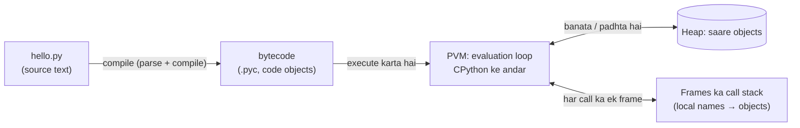
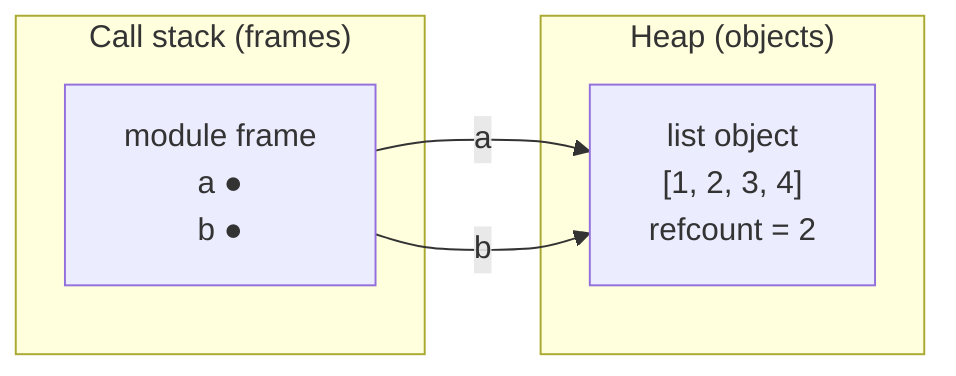
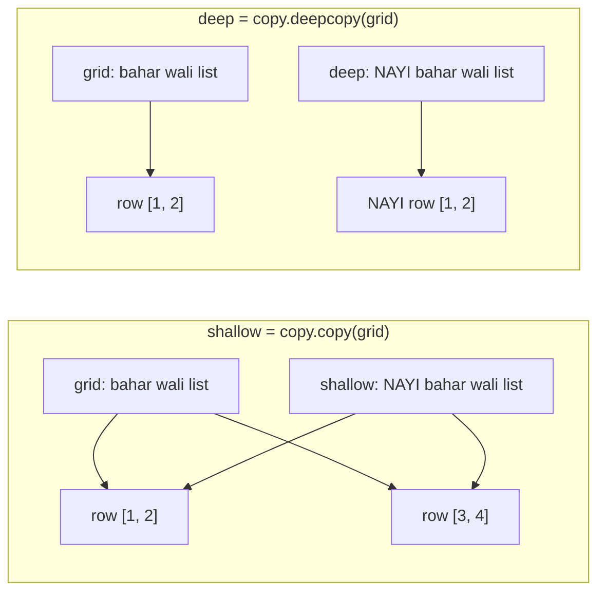
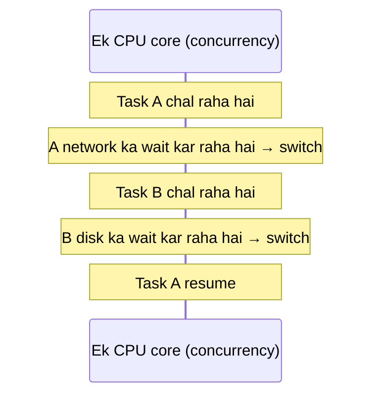
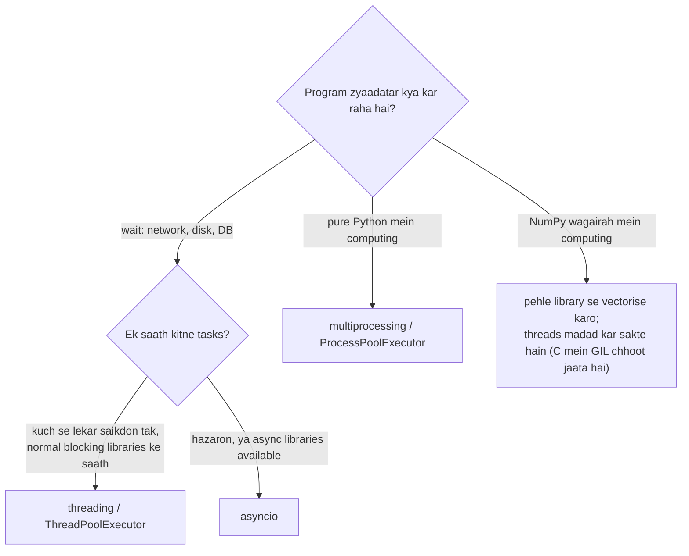

# Chapter 18 · Python Internals & Concurrency

> Car chalane ke liye engine ka kaam samajhna zaroori nahi, jab tak woh koi ajeeb awaaz na karne lage. Yeh chapter bonnet kholta hai: Python tumhara code asal mein kaise chalata hai, tumhare objects memory mein kahan rehte hain, `a is b` kabhi-kabhi tumse jhooth kyun bolta hai, famous GIL kya hai, aur programs ek saath kai kaam kaise karte hain. Yeh woh chapter hai jo "chal toh raha hai, pata nahi kyun" ko "mujhe exactly pata hai kyun" mein badal deta hai.

**Is chapter mein tum seekhoge:**
- CPython code kaise chalata hai: **source → bytecode → Python Virtual Machine**, aur `dis` se andar kaise jhaankein
- "Everything is an object": names vs objects, **stack frames vs heap**
- **Reference counting**, **garbage collector** aur reference cycles
- Small-integer caching, string interning, aur `is` vs `==` hamesha ke liye clear
- **Mutability** ki gehri samajh, arguments kaise pass hote hain, aur shallow vs deep copies
- **GIL**, **concurrency vs parallelism**, aur kab **threading**, **multiprocessing** ya **asyncio** use karna hai
- Practical performance tips, aur `timeit` aur `cProfile` se naapna kaise hai

**Isse pehle padho:** [Variables, Data Types & Memory](02-variables-types-memory.md) · [Iterators, Generators, Decorators & Context Managers](16-iterators-generators-decorators.md) · [Modules & the Standard Library](17-modules-stdlib.md)

---

## 🧠 The Big Idea · Asli Baat

Ek restaurant ki kitchen socho.

- Tumhara **source code** English mein likhi ek recipe hai. Kitchen staff seedha English follow nahi kar sakta.
- **Compiler** use chhote-chhote, ekdum precise steps ki list mein translate karta hai ("pan uthao", "2 ande daalo", "chalao"). Yahi **bytecode** hai.
- **Python Virtual Machine (PVM)** woh chef hai jo un steps ko ek-ek karke, bahut tezi se follow karta hai.
- **Heap** woh bada store-room (pantry) hai jahan saari ingredients (**objects**) rakhi hain. Tumhare **variables** bas **sticky labels** hain jo pantry ki cheezon ki taraf point karte hain.
- Ek **safai wala** (reference counting + garbage collector) un ingredients ko phenk deta hai jin par ab kisi ka label nahi laga.
- **GIL** is kitchen ka ek rule hai: **ek time pe sirf ek chef chulha use kar sakta hai**, chahe tum kitne bhi chef rakh lo.



Chapter ka doosra hissa **ek saath kai kaam karne** ke baare mein hai:

- **Concurrency** = ek cook jo kai dishes ek saath sambhal raha hai, aur jab ek dish wait kar rahi hai (paani ubal raha hai, oven garam ho raha hai) tab doosri pe switch karta hai. Kaam bahut aage badhta hai, lekin haath ek hi jodi.
- **Parallelism** = kai cooks **ek hi pal mein** alag-alag dishes pe kaam kar rahe hain. Iske liye kai jodi haath chahiye (CPU cores).

Python tumhe teen tools deta hai (threads, processes, asyncio), aur GIL decide karta hai ki kaunsa tool kis kaam ke liye fit hai.

> 🇮🇳 **Desi Analogy:** Chai tapri vs chai factory. **Concurrency** = tapri wala bhaiya akela hai. Ek kettle mein chai ubal rahi hai (wait), toh tab tak woh doosre customer ke liye glass dhota hai, teesre ko change deta hai. Ek hi aadmi, lekin koi second khaali nahi jaata. **Parallelism** = factory jisme 4 log 4 alag chulhon pe ek saath chai bana rahe hain. Agar kaam "wait" wala hai (ubalna), toh tapri wala bhaiya bhi kamaal kar leta hai. Agar kaam "haath wala" hai (adrak kootna), toh sirf zyada haath (cores) hi madad karenge.

---

## 🔨 Building It Up · Zero Se Shuru

### 1. Source → bytecode → PVM

"Python interpreted hai" aadha sach hai. Jab tum `python app.py` chalate ho, **CPython** (standard Python implementation, C mein likha hua) do steps karta hai:

1. **Compile**: text ko parse karke ek tree banata hai, phir use **bytecode** mein compile karta hai: ek imaginary machine ke liye compact instructions. Yeh tez hai aur tumhari pehli line chalne se pehle hota hai (isiliye file mein kahin bhi syntax error ho toh sab kuch ruk jaata hai, [Chapter 13](13-exceptions-files.md)).
2. **Execute**: **Python Virtual Machine**, C mein likha ek bada loop, bytecode instructions ko ek-ek karke padhta hai aur unhe perform karta hai.

Compiled code object tum khud dekh sakte ho:

```python
def add_tax(price):
    rate = 0.18
    return price + price * rate

code = add_tax.__code__                 # compiled code object
print(type(code).__name__)
print(code.co_varnames)                 # local variable names
print(code.co_consts[1:])               # use hue constants (pehla slot docstring/None ka hai)
print(isinstance(code.co_code, bytes))  # raw bytecode bas bytes hai
print(add_tax(100))
```

```text
code
('price', 'rate')
(0.18,)
True
118.0
```

Bytecode ko insaani bhasha jaise form mein padhne ke liye **`dis`** (disassembler) module use karo. Exact instructions Python versions ke beech alag hoti hain, toh yahan ek typical Python 3.11 output illustration ke liye hai:

```py
import dis

def add_tax(price):
    rate = 0.18
    return price + price * rate

dis.dis(add_tax)
```

```text
  1           0 RESUME                   0
  2           2 LOAD_CONST               1 (0.18)
              4 STORE_FAST               1 (rate)
  3           6 LOAD_FAST                0 (price)
              8 LOAD_FAST                0 (price)
             10 LOAD_FAST                1 (rate)
             12 BINARY_OP                5 (*)
             16 BINARY_OP                0 (+)
             20 RETURN_VALUE
```

Abhi kya hua: PVM ek **stack machine** hai. `LOAD_FAST` ek local variable ko ek chhote value stack pe push karta hai; `BINARY_OP` do values pop karta hai, unhe combine karta hai, result push karta hai; `RETURN_VALUE` aakhri jawab pop karta hai. `price + price * rate` ban gaya "price push karo, price push karo, rate push karo, multiply, add". Python ki har line aise kuch steps mein badalti hai, aur har step C mein thoda kaam leta hai, isiliye **kam bytecode instructions ka matlab usually tez code**.

Stack ko haath se trace karo, `price = 100` ke saath:
- `LOAD_FAST price` → stack: `[100]`
- `LOAD_FAST price` → `[100, 100]`
- `LOAD_FAST rate` → `[100, 100, 0.18]`
- `BINARY_OP *` → upar ke do (100, 0.18) nikle, 18.0 gaya → `[100, 18.0]`
- `BINARY_OP +` → `[118.0]`
- `RETURN_VALUE` → 118.0 bahar.

Yeh bilkul thaali mein rotiyan rakhne jaisa hai: jo sabse upar rakhi, wahi pehle uthegi.

> 💡 "CPython" *wahi* Python hai jo tumne download kiya. Doosre implementations bhi hain: **PyPy** (JIT compiler ke saath jo garam/baar-baar chalne wale code ko machine code mein badal deta hai, pure-Python loops ke liye aksar kahin tez), **Jython** (Java VM pe) aur **MicroPython** (microcontrollers ke liye). Is chapter mein sab kuch CPython ke baare mein hai.

### 2. Everything is an object

Python mein **har value ek object hai**: numbers, strings, functions, classes, modules, yahan tak ki `None` aur types khud bhi. Har object ke paas teen cheezein hoti hain:

| Property | Kis sawaal ka jawab | Kaise dekhein | Badal sakti hai? |
|---|---|---|---|
| **identity** | *kaunsa* object hai yeh? | `id(x)` | kabhi nahi, object ki poori zindagi |
| **type** | *kis tarah ka* object? | `type(x)` | nahi (practically) |
| **value** | *isme kya rakha hai?* | `print(x)`, `x == y` | sirf agar object **mutable** ho |

> 🇮🇳 **Desi Analogy:** Identity = Aadhaar number (ek baar mila, zindagi bhar wahi, do logon ka kabhi same nahi). Type = tum insaan ho (yeh nahi badalta). Value = tumhara mood, wallet ka paisa, haircut (yeh badal sakta hai, agar tum "mutable" ho). Do judwa bhai dikhne mein same ho sakte hain (`==` True), lekin Aadhaar alag hai (`is` False).

```python
def greet():
    return "hi"

for thing in [42, 3.5, "text", [1, 2], greet, int, None, len]:
    print(f"{type(thing).__name__:<22} is an object: {isinstance(thing, object)}")

greet.author = "riya"             # functions objects hain: attributes bhi rakh sakte hain
print(greet.author, greet.__name__)
```

```text
int                    is an object: True
float                  is an object: True
str                    is an object: True
list                   is an object: True
function               is an object: True
type                   is an object: True
NoneType               is an object: True
builtin_function_or_method is an object: True
riya greet
```

Kyunki ek `int` bhi poora object hai (type pointer aur reference count ke saath, neeche dekho), ek chhota integer 64-bit machine pe lagbhag 28 bytes leta hai, C ki tarah 4 ya 8 nahi. Yahi Python ki flexibility ki keemat hai, aur isiliye NumPy jaisi libraries numbers ko raw C arrays mein store karti hain.

### 3. Names labels hain: stack frames vs heap

Python ka **variable koi dabba nahi hai jisme value rakhi ho**. Yeh ek **naam (label) hai jo ek object ki taraf point karta hai**. Assignment kabhi copy nahi karta; bas ek label chipka deta hai.

Memory do hisson mein organise hoti hai:

- **Heap**: jahan **saare objects** rehte hain. Bada, poore program ka shared.
- **Call stack**: har active function call ka ek **frame**. Frame us call ke **local names** rakhta hai (aur yeh ki woh kis line pe hai). Frame ke names bas heap ke objects ki taraf **references** (teer) hain.

```python
def make_list():
    items = [1, 2, 3]        # list object HEAP pe banta hai
    return items             # reference return karo; frame gayab, object bacha rehta hai

a = make_list()
b = a                        # doosra label, wahi object
b.append(4)
print(a, a is b)
```

```text
[1, 2, 3, 4] True
```



Jab `make_list` chal raha tha, uske apne frame mein ek naam `items` tha jo list ki taraf point karta tha. Function return hua, toh **frame** destroy ho gaya (uska label `items` gayab), lekin **object** zinda raha, kyunki `a` abhi bhi usse refer kar raha tha. Objects tab tak jeete hain jab tak koi unhe refer karta hai, us function ke jitna nahi jisne unhe banaya.

> 🤔 **Mann mein sawaal:** Agar `b = a` copy nahi karta, toh `x = 5; y = x; y = 6` ke baad `x` bhi 6 kyun nahi ho jaata?
>
> **Jawab:** Kyunki `y = 6` object ko **badal** nahi raha, label ko **hata ke** ek naye object (6) pe chipka raha hai. `x` ka label abhi bhi 5 pe hai. `b.append(4)` alag hai: woh label nahi hilata, label ke neeche wale object ko hi badal deta hai, aur `a` bhi usi object pe chipka hai. **Rebinding (`=`) label hilata hai; mutation (`.append`) object badalta hai.** Yeh ek line poore chapter ki chaabi hai.

### 4. Reference counting: Python memory kaise free karta hai

Har CPython object ek **reference count** rakhta hai: kitne references (labels, list slots, attributes...) uski taraf point karte hain. Naam assign karna ya container mein daalna isse badhata hai; naam ka jaana (`del`, reassignment, function ka return hona) isse ghatata hai. **Jab count zero hota hai, object turant free ho jaata hai.**

```python
import sys

data = [1, 2, 3]
base = sys.getrefcount(data)       # note: getrefcount khud ek temporary reference jodta hai

alias = data
holder = [data, data]              # list do aur references rakhti hai
print(sys.getrefcount(data) - base)

del alias                          # del ek NAAM hatata hai, object nahi
holder.clear()
print(sys.getrefcount(data) - base)
```

```text
3
0
```

Hum *difference* print kar rahe hain kyunki absolute number Python internals pe depend karta hai (aur `getrefcount` apne argument ke liye ek extra jodta hai). Idea hi asli cheez hai: `del x` **kabhi seedha object delete nahi karta**; woh ek reference hatata hai. Object tabhi marta hai jab **aakhri** reference chala jaaye.

`3` kahan se aaya? `alias` (+1), aur `holder` list ke andar do slots (+2). Total 3 extra. Phir `del alias` (−1) aur `holder.clear()` (−2), wapas 0.

Hum `__del__` se ek object ko marte hue dekh sakte hain (yeh method object destroy hone se theek pehle call hota hai; demos ke liye kaam ka, asli code mein kam hi):

```python
class Tracked:
    def __init__(self, name):
        self.name = name
    def __del__(self):
        print(f"  {self.name} freed")

print("step 1")
t = Tracked("A")
print("step 2")
t = Tracked("B")          # A ka aakhri reference gaya -> abhi isi waqt free
print("step 3")
del t                     # B ka aakhri reference gaya
print("step 4")
```

```text
step 1
step 2
  A freed
step 3
  B freed
step 4
```

Reference counting **simple aur turant** hai: memory usi pal wapas aa jaati hai jab uski zaroorat nahi rehti, isiliye CPython mein `with open(...)` style clean-up itna predictable hai.

> 🇮🇳 **Desi Analogy:** Reference count = library ki kitaab ka issue register. Kitaab tab tak shelf pe rakhi rehti hai jab tak koi na koi member uska naam register mein likhwa ke rakhe hai. Har naya member jo "mujhe bhi chahiye" bolta hai, count +1. Koi lautata hai, −1. Jis pal count zero hua, librarian kitaab turant godown bhej deta hai (memory free). `del x` = ek member ka naam register se kaatna. Kitaab tabhi jaati hai jab register mein **koi** naam na bache.

### 5. Garbage collector: cycles ki safai

Reference counting ka ek blind spot hai: **cycles**. Agar object A, B ko refer karta hai aur B, A ko, toh dono ke counts 1 pe hi atke rehte hain, chahe program mein aur koi bhi unhe reach na kar sake. Yeh unreachable kachra hai jise akela refcounting kabhi free nahi karta.

Isiliye **cyclic garbage collector** (module `gc`) hai. Yeh time-time pe container objects ko scan karta hai, aise groups dhoondhta hai jo sirf ek doosre se refer hote hain, aur unhe free kar deta hai. Hum ise ek **weak reference** se prove kar sakte hain: aisa reference jo count *nahi* badhata, toh woh hume check karne deta hai ki object abhi zinda hai ya nahi, bina use zinda rakhe.

```python
import gc
import weakref

class Node:
    def __init__(self, name):
        self.name = name
        self.partner = None

gc.disable()                     # is demo ke liye automatic collector band karo

a, b = Node("a"), Node("b")
a.partner, b.partner = b, a      # a <-> b: ek reference cycle
probe = weakref.ref(a)           # a pe nazar rakhta hai, use zinda rakhe bina

del a, b                         # koi naam nahi bacha, lekin dono ek doosre ko refer karte hain
print("after del:", probe() is not None)      # abhi zinda: refcounts 1 hain, 0 nahi

gc.collect()                     # cycle detector haath se chalao
print("after gc.collect():", probe() is None) # aakhirkaar free

gc.enable()
```

```text
after del: True
after gc.collect(): True
```

Collector sasta kaise rehta hai: yeh **generational** hai. Naye objects generation 0 mein shuru hote hain, jo aksar scan hoti hai. Jo objects scan se bach jaate hain woh generation 1, phir 2 mein jaate hain, jo kam scan hoti hain. Zyaadatar objects jawani mein hi mar jaate hain (temporary lists, strings), toh baar-baar wale scans chhote rehte hain. (Naye versions details tune karte hain, lekin idea wahi hai.)

> 🇮🇳 **Desi Analogy:** Do dost hostel chhod ke chale gaye, lekin ek doosre ka phone number abhi bhi save hai (cycle). Hostel warden (refcount) dekhta hai: "inke paas toh ek contact hai, matlab koi inhe yaad karta hai", aur unka kamra khaali nahi karta. Phir mahine mein ek baar ek bada inspector (GC) aata hai jo poochta hai: "inhe **bahar ki duniya** mein koi yaad karta hai, ya sirf yeh dono ek doosre ko?" Sirf ek doosre ko? Dono ka kamra khaali.

> 💡 Doubly linked lists, parent pointers wale trees aur graphs naturally cycles banate hain. Koi baat nahi: GC unhe handle karta hai. `weakref` module un caches aur parent pointers ke liye hai jahan tum *nahi* chahte ki ek reference kisi cheez ko zinda rakhe.

### 6. Small-integer caching aur string interning

Objects banana time leta hai, isliye CPython kuch immutable objects ko **reuse** karta hai:

- **-5 se 256** tak ke **small integers** startup pe ek baar bante hain aur share hote hain. Tumhare program ka har `7` wahi ek object hai.
- **Interned strings**: identifiers jaisi dikhne wali chhoti strings (variable names, `"hello"`, `"user_id"`) aksar ek baar store hoke share hoti hain. Tum `sys.intern(s)` se ise force kar sakte ho.

```python
import sys

x = int("256")              # runtime pe compute hua, toh compiler inhe merge nahi kar sakta
y = int("256")
print(x == y, x is y)       # 256 small-int cache mein hai: same object

x = int("257")
y = int("257")
print(x == y, x is y)       # 257 cached nahi: do alag objects

a = "".join(["py", "thon"])          # runtime pe bana: ek naya string object
b = "python"
print(a == b, a is b)
print(sys.intern(a) is sys.intern(b))   # interning dono ko ek object share karwata hai
```

```text
True True
True False
True False
True
```

Sirf `257` ki jagah `int("257")` kyun? Jab **ek hi file** mein same constant do baar aata hai, toh compiler use ek hi baar store kar sakta hai, isliye `a = 257; b = 257; a is b` script mein `True` print kar sakta hai aur interactive shell mein line-by-line type karne pe `False`. Yeh **implementation details** hain, aur agle section ka poora point yahi hai.

### 7. `is` vs `==`, hamesha ke liye

| | `==` | `is` |
|---|---|---|
| Poochta hai | "kya inki **values barabar** hain?" | "kya yeh **same object** hain?" |
| Kaun implement karta hai | `__eq__` (customise ho sakta hai, [Chapter 15](15-oop-inheritance-magic.md)) | identities compare karna (customise nahi hota) |
| Kis ke liye use karo | numbers, strings, lists, lagbhag sab kuch | `None`, `True`/`False`, sentinel objects |

```python
a = [1, 2, 3]
b = [1, 2, 3]
c = a
print(a == b, a is b)       # barabar values, alag objects
print(a == c, a is c)       # same object

result = None
print(result is None)       # None check karne ka sahi tareeka

nan = float("nan")
print(nan == nan, nan is nan)   # NaN khud ke barabar nahi hota (IEEE 754 rule)
```

```text
True False
True True
True
False True
```

> ⚠️ **Numbers ya strings compare karne ke liye kabhi `is` mat use karo.** `x is 257` ek jagah chal sakta hai aur doosri jagah fail, caching aur compilation ke hisaab se. Python 3.8+ toh warning bhi deta hai: `SyntaxWarning: "is" with a literal`. `==` use karo. `is` sirf `None` jaise singletons ke liye.

> 🤔 **Mann mein sawaal:** `None` ke liye `== None` bhi toh chalta hai. Phir `is None` pe itna zor kyun?
>
> **Jawab:** Do wajah. Ek, `None` ek **singleton** hai: poore program mein sirf ek `None` object hai, toh identity check bilkul sahi aur sabse tez hai. Do, `==` ko koi bhi class apne `__eq__` se badal sakti hai, aur koi ajeeb class `obj == None` pe `True` laut sakti hai. `is` ko koi override nahi kar sakta, toh woh kabhi dhokha nahi deta.

### 8. Mutability ki gehri baat

Object **mutable** hai agar uski value in place badal sakti hai (`list`, `dict`, `set`, zyaadatar custom objects) aur **immutable** hai agar nahi (`int`, `float`, `str`, `tuple`, `frozenset`, `bytes`). Immutable object ko "badalne" ka asal matlab hai **ek naya object banana** aur label ko wahan le jaana:

```python
s = "hi"
print_id_before = id(s)
s += "!"                        # ek NAYI string banata hai, s ko rebind karta hai
print(s, id(s) == print_id_before)

nums = [1, 2]
list_id_before = id(nums)
nums += [3]                     # list += IN PLACE mutate karta hai (__iadd__ call karta hai)
print(nums, id(nums) == list_id_before)

t = (1, 2)
t_alias = t
t += (3,)                       # tuple +=: naya tuple; alias ko abhi bhi purana dikhta hai
print(t, t_alias)
```

```text
hi! False
[1, 2, 3] True
(1, 2, 3) (1, 2)
```

Toh `x += y` ka matlab mutable types ke liye "in place mutate karo" hai, lekin immutable ke liye "naya object banao aur rebind karo". Yeh farak tab matter karta hai jab **doosre references** bhi hon:

```python
def add_item(lst):
    lst += ["new"]              # caller ki list mutate karta hai

def add_text(s):
    s += " new"                 # sirf LOCAL naam ko rebind karta hai

items, text = ["old"], "old"
add_item(items)
add_text(text)
print(items, text)
```

```text
['old', 'new'] old
```

**Python "pass by value" hai ya "pass by reference"?** Exactly dono mein se koi nahi. Yeh **pass by object reference** hai (ise "call by sharing" bhi kehte hain): function ko **usi object ka reference** milta hai. Agar object mutable hai aur function use mutate karta hai, toh caller ko badlaav dikhta hai. Agar function apne parameter ko **reassign** karta hai, toh sirf uska local label hilta hai; caller pe koi asar nahi.

> 🇮🇳 **Desi Analogy:** Tumne dost ko apne ghar ki **chaabi ki duplicate** di (function ko reference mila). Agar dost ghar jaake sofa hila de (mutation, `lst += [...]`), toh tum ghar aake badla hua sofa dekhoge, kyunki ghar wahi hai. Lekin agar dost apni chaabi phenk ke kisi aur ghar ki chaabi le le (rebinding, `s = s + " new"`), toh tumhare ghar pe koi asar nahi. Chaabi ki copy di thi, ghar ki nahi. Aur string ek aisa ghar hai jiska furniture cement se jama hua hai (immutable): dost kuch hila hi nahi sakta, bas naya ghar bana sakta hai.

**Immutable containers mein mutable cheezein ho sakti hain.** Tuple yeh nahi badal sakta ki woh *kaunse* objects rakhta hai, lekin woh objects khud badal sakte hain:

```python
t = ([1, 2], "x")
t[0].append(3)                  # andar wali list mutable hai
print(t)

try:
    t[0] += [4]                 # famous puzzle
except TypeError as e:
    print("TypeError:", e)
print(t)                        # ...aur phir bhi list badal gayi!
```

```text
([1, 2, 3], 'x')
TypeError: 'tuple' object does not support item assignment
([1, 2, 3, 4], 'x')
```

Abhi kya hua: `t[0] += [4]` do steps hain: (1) `t[0].__iadd__([4])` list ko in place mutate karta hai (successful), phir (2) `t[0] = result` use tuple mein wapas store karne ki koshish karta hai (fail). Exception mutation ho jaane ke *baad* aati hai. Ek classic interview dimaag-ghumau sawaal.

> 💡 Sirf **immutable** objects (ya jinka hash kabhi nahi badalta) hi dict keys aur set members ban sakte hain ([Chapter 9](09-dictionaries.md)). Isiliye `(1, 2)` key ban sakta hai lekin `[1, 2]` nahi, aur isiliye list *rakhne wala* tuple bhi hashable nahi hai.

### 9. Shallow vs deep copy, memory mein

`copy.copy` aur `copy.deepcopy` se tum [Chapter 17](17-modules-stdlib.md) mein mil chuke ho. Yeh rahi tasveer ki woh karte kya hain:



Iska sabse famous nateeja hai **`[[0] * n] * m` grid trap**:

```python
bad = [[0] * 3] * 2             # EK hi andar wali list, do baar refer hui
bad[0][0] = 1
print(bad)

good = [[0] * 3 for _ in range(2)]   # har row ke liye ek nayi andar wali list
good[0][0] = 1
print(good)

print(bad[0] is bad[1], good[0] is good[1])
```

```text
[[1, 0, 0], [1, 0, 0]]
[[1, 0, 0], [0, 0, 0]]
True False
```

`[x] * n` **references** copy karta hai, objects kabhi nahi. `[0] * 3` ke liye yeh nuksaandeh nahi (ints immutable hain), lekin lists ki list ke liye yeh aliases bana deta hai. [DSA Chapter 21](../part-2-dsa/21-dp-2d-advanced.md) mein tum DP tables aise hi lagataar initialise karoge, toh comprehension wala version dimaag mein chhaap lo.

`[[0] * 3] * 2` ko aise padho: "ek row banao `[0, 0, 0]`, phir **usi row ke do photo-frame** lagao." Ek frame mein row badli, doosre frame mein bhi wahi row dikhegi, kyunki row ek hi hai. Comprehension wala version har baar `[0] * 3` ko **dobara chalata** hai, toh har row nayi banti hai.

### 10. Concurrency vs parallelism

Ab doosra bada topic. Do shabd jinhe log mix kar dete hain:

- **Concurrency**: **kai tasks ek saath sambhalna**, unhe **interleave** karke (beech-beech mein badal-badal ke). Kai tasks ki progress time mein overlap karti hai, lekin kisi bhi ek pal mein shayad sirf ek chal raha ho. Ek waiter jo das tables sambhal raha hai, concurrent hai.
- **Parallelism**: kai tasks **ek hi pal mein karna**, kai CPU cores pe. Das waiters das tables ek saath serve kar rahe hain, yeh parallel hai.



Itna jhanjhat kyun? Kyunki programs bahut wait karte hain. Kaam do flavours mein aata hai:

- **I/O-bound**: program zyaadatar kisi bahar ki cheez ka **wait** karta hai: network responses, disk reads, database queries, user input. Wait ke dauraan CPU khaali baitha hai. **Concurrency** bahut madad karti hai: jab ek task wait kare, doosra chalao.
- **CPU-bound**: program zyaadatar **compute** karta hai: image processing, number crunching, bhaari loops. CPU kabhi khaali nahi. Sirf **parallelism** (zyada cores) ise tez banata hai.

> 🤔 **Mann mein sawaal:** Mera kaam I/O-bound hai ya CPU-bound, yeh kaise pata karun?
>
> **Jawab:** Program chalate waqt Task Manager (ya `top`) mein CPU usage dekho. Ek core 100% pe atka hai? CPU-bound. CPU lagbhag khaali hai lekin program phir bhi slow hai? Woh kisi cheez ka wait kar raha hai: I/O-bound. Aur thumb rule: "network, file, database, sleep" shabd aaye toh I/O; "calculate, loop, resize, encrypt" aaye toh CPU.

### 11. GIL (Global Interpreter Lock)

CPython mein ek **Global Interpreter Lock** hai: ek lock jo ek process mein **ek time pe sirf ek thread ko Python bytecode chalane deta hai**.

Yeh kyun hai? Reference counts yaad karo (section 4). Har ek assignment kisi na kisi object ka count badalta hai. Agar do threads ek hi pal mein ek hi count badlein, toh count bigad sakta hai: ya toh abhi use mein chal rahe objects free ho jaayein (crash) ya memory leak ho. Har object ko apne alag lock se bachana single-threaded code ko slow kar deta. GIL simple solution hai: interpreter ke chaaron taraf **ek bada lock**. Isse CPython ke internals simple rehte hain, single-threaded code tez, aur C extensions likhna aasaan.

> 🇮🇳 **Desi Analogy:** GIL = ek ghar mein ek hi bathroom aur uski ek hi chaabi. Ghar mein 4 log (threads) hain, lekin bathroom (Python bytecode chalana) ek time pe ek hi use kar sakta hai, jiske haath mein chaabi hai. Agar sab log nahane ki line mein hain (CPU-bound), toh 4 log hone se kuch tez nahi hota, sab baari-baari hi jaayenge. Lekin agar koi bathroom ke bahar khada hoke geezer garam hone ka wait kar raha hai (I/O wait), toh woh chaabi doosre ko de deta hai, aur ghar ka kaam chalta rehta hai. Isiliye threads I/O ke liye kaam ke hain, computing ke liye nahi.

Nateeje:

| Kaam ka type | CPython mein threads | Kyun |
|---|---|---|
| **I/O-bound** | ✅ bahut tez karte hain | thread I/O ka **wait karte waqt GIL chhod deta hai** (network, disk, `time.sleep`), toh doosre chalte hain |
| **CPU-bound (pure Python)** | ❌ koi speed-up nahi (aksar thoda slow) | sirf ek thread bytecode chala sakta hai; woh bas baari-baari karte hain |
| **C libraries mein CPU-bound** (NumPy, hashlib, compression) | ✅ tez ho sakte hain | kai C extensions bhaari computation ke dauraan GIL chhod dete hain |

Interpreter chal rahe thread ko time-time pe GIL chhodne pe majboor bhi karta hai (default har 5 ms, `sys.getswitchinterval()` dekho), taaki threads fairly baari le sakein.

> 💡 **GIL badal raha hai.** Python 3.13 ne ek optional, experimental **free-threaded build** (PEP 703) introduce kiya jisme GIL nahi hai, aur threads Python code sach mein parallel chala sakte hain. Yeh abhi default nahi hai, aur kai libraries abhi adjust ho rahi hain, isliye neeche sab kuch normal GIL build ke baare mein hai jo tumhe interviews aur zyaadatar jobs mein milega.

### 12. `threading`: I/O-bound kaam ke liye concurrency

**Thread** ek hi process ke andar execution ka ek independent flow hai. Threads **memory share karte hain** (wahi heap, wahi global variables), jisse aapas mein baat karna aasaan hota hai, aur bugs banana bhi.

Basic API:

```py
import threading
import time

def download(name, seconds):
    print(f"start {name}")
    time.sleep(seconds)              # network ke wait ki jagah; GIL chhod deta hai
    print(f"done  {name}")

threads = [threading.Thread(target=download, args=(f"file{i}", 1)) for i in range(3)]
for t in threads:
    t.start()                        # concurrently chalna shuru
for t in threads:
    t.join()                         # har ek ke khatam hone ka wait karo
# total time: lagbhag 1 second, 3 nahi. start/done lines kisi bhi order mein mix ho sakti hain.
```

Modern, aasaan tareeka hai **`concurrent.futures.ThreadPoolExecutor`**: worker threads ka ek pool, aur `map` results ko **input ke order mein** jama karta hai. Yahan paanch "downloads" jo har ek 0.2 second wait karte hain, total lagbhag 0.2 second mein khatam hote hain, 1 second mein nahi:

```python
import time
from concurrent.futures import ThreadPoolExecutor

def fetch(url):
    time.sleep(0.2)                   # simulated network wait (GIL chhod deta hai)
    return f"{url}: 200 OK"

urls = [f"site{i}.com" for i in range(5)]

start = time.perf_counter()
with ThreadPoolExecutor(max_workers=5) as pool:     # ek context manager: saare tasks ka wait karta hai
    results = list(pool.map(fetch, urls))
elapsed = time.perf_counter() - start

print(results)
print("concurrent (well under 1 second)?", elapsed < 0.8)
```

```text
['site0.com: 200 OK', 'site1.com: 200 OK', 'site2.com: 200 OK', 'site3.com: 200 OK', 'site4.com: 200 OK']
concurrent (well under 1 second)? True
```

**Race conditions.** Kyunki threads memory share karte hain, ek hi variable update karte do threads ek doosre mein dakhal de sakte hain. `counter += 1` asal mein teen steps hai (padho, jodo, likho); agar thread switch inke beech mein ho jaaye, toh ek update kho jaata hai:

```py
import threading

counter = 0

def work():
    global counter
    for _ in range(100_000):
        counter += 1                 # read-modify-write: atomic NAHI hai

threads = [threading.Thread(target=work) for _ in range(4)]
for t in threads: t.start()
for t in threads: t.join()
print(counter)                       # 400000 se kam ho sakta hai (version aur timing pe depend)
```

Update kaise khota hai, slow motion mein: counter = 10. Thread A ne padha: 10. Switch! Thread B ne padha: 10, jodka 11, likha 11. Switch! Thread A apni purani padhi value 10 mein 1 jodta hai, 11 likhta hai. Do increments hue, lekin counter sirf 11 hua, 12 nahi. B ka kaam hawa ho gaya.

> 🇮🇳 **Desi Analogy:** Do log ek hi joint bank account mein ek saath ATM se ₹500 jama kar rahe hain. Dono ATM ne balance padha ₹1000. Dono ne apne-apne dimaag mein ₹1500 calculate kiya aur dono ne ₹1500 likh diya. ₹1000 jama hue, lekin balance sirf ₹500 badha. Isiliye asli bank har account pe ek **lock** lagata hai: jab tak ek transaction poora na ho, doosra wait karega.

Iska ilaaj hai ek **lock** (ise **mutex** bhi kehte hain): ek time pe sirf ek thread use pakad sakta hai, toh protected block bina rukawat chalta hai. Locks context managers hain ([Chapter 16](16-iterators-generators-decorators.md)), toh `with lock:` acquire karta hai aur **hamesha** release karta hai:

```python
import threading

counter = 0
lock = threading.Lock()

def work():
    global counter
    for _ in range(50_000):
        with lock:                   # ek time pe sirf ek thread andar
            counter += 1

threads = [threading.Thread(target=work) for _ in range(4)]
for t in threads:
    t.start()
for t in threads:
    t.join()
print(counter)                       # hamesha exactly 200000
```

```text
200000
```

Threading ke aur tools jinke naam pata hone chahiye: `queue.Queue` (thread-safe queue, threads ke beech kaam pass karne ka sabse saaf tareeka: **producer-consumer** pattern), `threading.Event` (ek thread doosron ko signal deta hai), `RLock` (aisa lock jo same thread baar-baar acquire kar sake) aur `Semaphore` (ek saath zyada se zyada N threads allow karo, jaise "max 3 downloads ek saath").

> ⚠️ **Deadlock**: thread 1 ke paas lock A hai aur woh lock B ka wait kar raha hai, jabki thread 2 ke paas B hai aur woh A ka wait kar raha hai. Dono hamesha ke liye wait karte rehte hain. Isse bachne ke liye kai locks hamesha **ek hi global order** mein acquire karo, locks ko jitna kam time ho sake pakdo, ya timeouts use karo.

Deadlock ki tasveer: ek patli gali mein do gaadiyan aamne-saamne aa gayi. Har ek bol raha hai "pehle tum peeche hato". Koi nahi hatega, toh dono wahin khade rahenge hamesha. "Ek global order" ka matlab hai ek traffic rule: "gali mein hamesha uttar wala pehle jaayega". Rule follow karo, deadlock kabhi nahi.

### 13. `multiprocessing`: CPU-bound kaam ke liye parallelism

Pure-Python computation ke liye kai CPU cores use karne hain toh kai **processes** use karo. Har process ek alag Python interpreter hai, jiski **apni memory aur apna GIL** hai, toh woh sach mein parallel chalte hain.

```py
import time
from concurrent.futures import ProcessPoolExecutor

def count_primes(limit):                       # CPU-heavy, pure Python
    count = 0
    for n in range(2, limit):
        if all(n % d for d in range(2, int(n ** 0.5) + 1)):
            count += 1
    return count

if __name__ == "__main__":                     # ZAROORI: workers is file ko dobara import karte hain
    jobs = [200_000] * 4

    start = time.perf_counter()
    serial = [count_primes(j) for j in jobs]
    print("serial:  ", round(time.perf_counter() - start, 2), "s")

    start = time.perf_counter()
    with ProcessPoolExecutor() as pool:        # by default har CPU core ka ek worker
        parallel = list(pool.map(count_primes, jobs))
    print("parallel:", round(time.perf_counter() - start, 2), "s")
    # 4-core machine pe parallel typically 2.5x se 3.5x tez hota hai.
```

Jo baatein pata honi chahiye:

- **`if __name__ == "__main__":` guard compulsory hai** ([Chapter 17](17-modules-stdlib.md)). Windows aur macOS pe har worker process fresh shuru hota hai aur **tumhari main file import karta hai**; guard ke bina har worker apna khud ka pool shuru karne ki koshish karega, bina ruke.
- Processes **memory share nahi karte**. Arguments aur results **pickle** hote hain (bytes mein serialise, ek zyada general JSON jaisa) aur processes ke beech bheje jaate hain. Bahut bada data idhar-udhar bhejna utna kharch kar sakta hai jitna computation bachata bhi nahi. Jo functions tum bhejte ho woh module ke top level pe define hone chahiye.
- Process shuru karna thread shuru karne se kahin slow hai (milliseconds, plus ek fresh interpreter). Processes **bade-bade** kaam ke liye use karo: har task ke liye seconds ka computation, microseconds ka nahi.
- Lower-level API `multiprocessing.Process` aur `multiprocessing.Pool` hai; `ProcessPoolExecutor` ka interface `ThreadPoolExecutor` jaisa hi hai, toh dono ke beech switch karna ek shabd ka badlaav hai.

> 🇮🇳 **Desi Analogy:** Threads = ek hi kitchen mein 4 cooks (ek hi fridge, ek hi chulha: GIL). Processes = 4 alag-alag ghar, har ghar ki apni kitchen, apna chulha. Ab sach mein 4 dishes ek saath banti hain. Lekin har ghar ko recipe aur saamaan **courier** karna padta hai (pickling), aur bana hua khana wapas courier se aata hai. Agar dish 2 minute ki hai aur courier 10 minute ka, toh fayda ulta nuksaan ban jaata hai. Isiliye processes sirf "bade" kaam ke liye.

### 14. `asyncio`: ek hi thread pe hazaron waits

Threads ka apna overhead hai (har thread ki memory, switching ka kharcha, locks). Jo programs **hazaron** slow network connections sambhalte hain (web servers, chat servers, scrapers, bots), unke liye Python **`asyncio`** deta hai: **ek hi thread** pe concurrency, **cooperative multitasking** se.

Shabdkosh:

- **`async def`** ek **coroutine function** define karta hai. Use call karne se woh chalta nahi; woh ek **coroutine object** return karta hai (bilkul generator function call karne jaisa, [Chapter 16](16-iterators-generators-decorators.md)).
- **`await something`** ka matlab hai "**mujhe** yahan tab tak pause karo jab tak `something` ho na jaaye, aur **is beech doosre coroutines ko chalne do**". `await` sirf `async def` ke andar likh sakte ho.
- **Event loop** scheduler hai: woh ek coroutine ko tab tak chalata hai jab tak woh kisi aisi cheez pe `await` na kare jo abhi ready nahi, phir kisi doosre pe switch karta hai jo ready *hai*.
- **`asyncio.run(main())`** event loop shuru karta hai aur `main` ko khatam hone tak chalata hai.
- **`asyncio.gather(a, b, c)`** kai coroutines ko concurrently chalata hai aur unke results jama karta hai (diye gaye order mein).

```python
import asyncio
import time

async def fetch(name, delay):
    print(f"start {name}")
    await asyncio.sleep(delay)        # non-blocking wait: loop is beech doosron ko chalata hai
    print(f"done  {name}")
    return f"{name} data"

async def main():
    start = time.perf_counter()
    results = await asyncio.gather(
        fetch("users", 0.3),
        fetch("orders", 0.1),
        fetch("prices", 0.2),
    )
    elapsed = time.perf_counter() - start
    print(results)
    print("took about as long as the slowest (0.3 s)?", elapsed < 0.55)

asyncio.run(main())
```

```text
start users
start orders
start prices
done  orders
done  prices
done  users
['users data', 'orders data', 'prices data']
took about as long as the slowest (0.3 s)? True
```

Abhi kya hua: `gather` ne teeno shuru kiye. Har ek apne `await asyncio.sleep(...)` tak chala, phir **apni marzi se** control wapas loop ko de diya. Loop ne har ek ko tab jagaya jab uska timer khatam hua, sabse chhota pehle. Total time ≈ sabse lamba wait, sum nahi. Aur `results` us order mein aaye jisme humne unhe **pass** kiya tha, us order mein nahi jisme woh khatam hue.

```mermaid
sequenceDiagram
    participant Loop as Event loop (1 thread)
    participant U as fetch users
    participant O as fetch orders
    participant P as fetch prices
    Loop->>U: await tak chalao (0.3 s timer)
    Loop->>O: await tak chalao (0.1 s timer)
    Loop->>P: await tak chalao (0.2 s timer)
    Note over Loop: kuch ready nahi, loop so jaata hai
    Loop->>O: 0.1 s ho gaye, resume → done
    Loop->>P: 0.2 s ho gaye, resume → done
    Loop->>U: 0.3 s ho gaye, resume → done
```

> 🇮🇳 **Desi Analogy:** Swiggy ka ek delivery partner (ek thread) jisne teen restaurants se order uthane hain. Woh pehle restaurant pe order bolta hai ("15 min lagenge" = `await`), wahan khada nahi rehta, turant doosre restaurant pe order bolta hai, phir teesre pe. Phir jo order pehle ready hua (10 min wala), wahi pehle uthata hai. Teeno orders lagbhag sabse lambe wale ke time mein ho gaye, sum mein nahi. Lekin agar woh kisi restaurant pe baith ke khud khana khane lage (`time.sleep` ya heavy loop = event loop block), toh baaki saare orders thande ho jaayenge, kyunki aur koi partner hai hi nahi.

> ⚠️ **asyncio ka sabse bada rule: event loop ko kabhi block mat karo.** Coroutine ke andar `time.sleep(1)` ya bhaari CPU loop **har** coroutine ko freeze kar deta hai, kyunki jab tak woh return na kare kuch nahi chal sakta (cooperative = tumhe koi beech mein rok nahi sakta). `await asyncio.sleep` use karo, async libraries (jaise HTTP ke liye `aiohttp` ya `httpx`), ya blocking kaam ko `await asyncio.to_thread(func, args)` se ek thread pe dhakel do.

Kyunki ek time pe sirf ek coroutine chalta hai aur switch **sirf `await` pe** hota hai, do `await`s ke beech ka code interrupt nahi ho sakta, isliye threads ke muqable kahin kam locks chahiye.

> 🤔 **Mann mein sawaal:** Agar asyncio ek hi thread pe chalta hai, toh woh threads se tez kaise ho sakta hai?
>
> **Jawab:** Tez "computation" mein nahi, **sasta** "waiting" mein. Har OS thread ko apni memory (aksar MBs ka stack) aur OS-level switching chahiye; 10,000 threads banana bhaari pad jaata hai. Ek coroutine bas ek chhota sa Python object hai (paused frame, bilkul generator jaisa), toh 10,000 coroutines aaram se ek thread pe reh jaate hain. Jab kaam 99% waiting hai, toh sasta wait karna hi jeet hai.

### 15. Inme se chunna



| | `threading` | `multiprocessing` | `asyncio` |
|---|---|---|---|
| Kiske liye best | I/O-bound, moderate number of tasks | CPU-bound | I/O-bound, bahut saare tasks |
| Parallel chalta hai? | Nahi (GIL), lekin waits overlap hote hain | **Haan**, har process ka ek GIL | Nahi, single thread |
| Memory | shared | alag (data pickle hota hai) | shared |
| Switching | preemptive (OS decide karta hai, kabhi bhi) | OS scheduler | cooperative (sirf `await` pe) |
| Har task ka kharcha | ~moderate (OS thread) | zyada (poora process) | bahut kam (ek coroutine object) |
| Sabse bada khatra | race conditions, deadlocks | serialisation overhead, `__main__` guard | loop ko block karna |
| Normal libraries ke saath chalta hai? | haan | haan | async-aware libraries chahiye |

Ek thumb rule jo tum quote kar sakte ho: **"Threads for waiting, processes for computing, asyncio for waiting at massive scale."**

### 16. Performance tips jo sach mein matter karti hain

Pehle golden rule: **optimise karne se pehle naapo**. Speed ke baare mein intuition aksar galat hota hai. Do tools:

- Chhote snippets ke micro-benchmarks ke liye **`timeit`**. Yeh code ko kai baar chalata hai aur total batata hai.
- Poore programs ke liye **`cProfile`**: yeh batata hai ki **kaunse functions** time kha rahe hain.

```py
import timeit

# squares ki list banane ke do tareeke compare karo (numbers machine ke hisaab se badlenge)
loop = """
result = []
for i in range(1000):
    result.append(i * i)
"""
comp = "result = [i * i for i in range(1000)]"

print(timeit.timeit(loop, number=10_000))   # e.g. 0.42
print(timeit.timeit(comp, number=10_000))   # e.g. 0.25  (comprehension tez hai)
```

```py
import cProfile

def slow_part():
    return sum(i * i for i in range(2_000_000))

def fast_part():
    return sum(range(1000))

def main():
    slow_part()
    fast_part()

cProfile.run("main()", sort="cumulative")
# ek table print karta hai: har function ka ncalls, tottime, cumtime -> slow_part chhaaya rehta hai
```

Command line se: `python -m timeit "sum(range(1000))"` aur `python -m cProfile -s cumtime app.py`.

Ab tips, mote taur pe asar ke order mein:

1. **Sahi algorithm aur data structure chuno.** O(n²) → O(n log n) kisi bhi micro-trick ko hara deta hai. `set` lookup O(1) hai; `list` lookup O(n). Book ka Part 2 isi ke baare mein hai.
2. **Built-ins aur standard library use karo.** `sum`, `min`, `max`, `sorted`, `any`, `all`, `map`, `str.join`, `collections`, `heapq`: yeh C loops ki tarah chalte hain, Python loop ka bytecode overhead skip karte hue.
3. **`for` + `append` ki jagah comprehensions pasand karo**: har item pe kam bytecode instructions.
4. **Strings `"".join(parts)` se banao**, loop mein `+=` se nahi. Strings immutable hain, toh `s += piece` har baar poori string copy kar sakta hai: worst case mein O(n²). (CPython kabhi-kabhi `+=` ko in place optimise kar leta hai, lekin yeh implementation detail hai jispe bharosa nahi karna chahiye.)
5. **Local variables globals aur attribute lookups se tez hain.** Locals index se padhe jaate hain (`LOAD_FAST`); globals ko dictionary lookup chahiye; `obj.method` ko har baar attribute lookup chahiye. Hot loop mein ek baar bind kar lo:

```python
import math

def slow(values):
    out = []
    for v in values:
        out.append(math.sqrt(v))      # har baar 'math', phir 'sqrt', phir 'out.append' dhoondhta hai
    return out

def faster(values):
    sqrt = math.sqrt                  # ek baar local naam se bind karo
    out = []
    append = out.append
    for v in values:
        append(sqrt(v))
    return out

def fastest(values):
    return list(map(math.sqrt, values))   # loop khud C mein chalta hai

data = [1.0, 4.0, 9.0]
print(slow(data) == faster(data) == fastest(data), fastest(data))
```

```text
True [1.0, 2.0, 3.0]
```

6. **Loops mein baar-baar ka kaam bacho**: `len(x)` ya koi constant expression loop ke bahar ek baar compute karo.
7. **Bade pipelines ke liye generators use karo** memory bachane ke liye ([Chapter 16](16-iterators-generators-decorators.md)), aur repeated computations ke liye `@cache` ([Chapter 17](17-modules-stdlib.md)).
8. **Queues ke liye `deque` use karo** (`list.pop(0)` O(n) hai), aur lakhon chhote objects ke liye `__slots__` ([Chapter 14](14-oop-classes-objects.md)).
9. **Bhaari numeric kaam ke liye NumPy use karo**, jo numbers ko compact C arrays mein rakhta hai aur vectorised C loops chalata hai, aksar pure Python loops se 10-100x tez.
10. **Ab bhi slow?** PyPy try karo, ya hot loop ko ek compiled extension mein le jao (Cython, PyO3 ke through Rust). Interviews ke liye steps 1 se 5 hi matter karte hain.

---

## 🔬 Under the Hood · Andar Ki Kahani

### Har object C mein kaisa dikhta hai

Har CPython object ek hi header se shuru hota hai, ek C struct jise `PyObject` kehte hain:

```text
+------------------+
| ob_refcnt        |  reference count (section 4)
| ob_type  ------->|  pointer to the type object (int, list, YourClass ...)
+------------------+
| type-specific    |  e.g. for a list: size, capacity, pointer to an array of PyObject*
| data ...         |  for an int: the digits of the number
+------------------+
```

(Upar ke diagram mein: `ob_refcnt` = reference count, section 4 wala. `ob_type` = type object ka pointer, jaise int, list, ya tumhari class. Uske neeche type-specific data: list ke liye size, capacity aur `PyObject*` pointers ki array ka pointer; int ke liye number ke digits.)

Isiliye `type(x)` turant milta hai (bas ek pointer follow karo), isiliye 64-bit pe har object kam se kam 16 bytes ka header leta hai, aur isiliye ek list asal mein heap pe idhar-udhar bikhre objects ke **pointers ki array** hai, values ki array nahi. Python 3.12 se kuch objects (jaise `None`, `True`, small ints) **immortal** hain: unka reference count pinned hai aur kabhi nahi badalta, jo performance mein aur future GIL-free kaam mein madad karta hai.

### Memory allocation: pymalloc

Operating system se memory maangna slow hai. CPython ke paas chhote objects (≤ 512 bytes) ke liye apna allocator hai, **pymalloc**: yeh OS se bade **arenas** le leta hai, unhe har size class ke liye **pools** mein baant deta hai, aur fixed-size **blocks** deta hai. Free hue blocks usi size ke naye objects ke liye jaldi reuse ho jaate hain. Side effect: objects free hone ke baad bhi Python process memory turant OS ko wapas nahi deta, kyunki arena reuse ke liye reserved rehta hai.

> 🇮🇳 **Desi Analogy:** pymalloc = shaadi ka caterer jo har plate ke liye baar-baar bazaar nahi jaata. Woh ek baar mein 1000 plates ka bada stock (arena) le aata hai, unhe size ke hisaab se thappiyon mein rakhta hai (pools: chhoti plate, badi plate), aur ek-ek plate (block) deta jaata hai. Plate dhul ke wapas aayi toh agle guest ko wahi de deta hai. Aur shaadi ke beech mein woh bachi plates bazaar ko wapas nahi karta, kyunki pata nahi kab zaroorat pad jaaye. Isiliye Python process ki memory objects free hone ke baad bhi turant kam nahi dikhti.

### Evaluation loop aur "specialising adaptive interpreter"

PVM asal mein C mein ek vishaal `switch` statement hai (`ceval.c`): agli instruction lo, uske code pe jump karo, repeat. Python 3.11 ne is loop ko kahin tez bana diya (CPython docs 3.10 ke muqable average lagbhag 25% speed-up batate hain) ek **specialising adaptive interpreter** se: jab ek instruction kuch baar chal chuki hoti hai, toh use un types ke liye specialised version se replace kar diya jaata hai jo woh sach mein dekh rahi hai. Jaise, ek `BINARY_OP` jo baar-baar do ints jod raha hai, "do ints jodo" instruction ban jaata hai jo generic type dispatch skip karta hai. Isiliye `dis` output versions ke beech alag hota hai, aur isiliye type-stable code tez chalta hai.

### GIL kaise haath badalta hai

GIL pakde hue thread tab tak bytecode chalata hai jab tak ya toh woh **I/O pe block** na ho (system call ke aas-paas woh apni marzi se GIL chhod deta hai) ya **switch interval** khatam na ho jaaye (default 0.005 s): tab koi wait kar raha doosra thread GIL maangta hai, aur chal raha thread instructions ke beech agle safe point pe use chhod deta hai. Dhyaan do, iska matlab hai ki GIL *interpreter* ke internals ko bachata hai, *tumhare* data ko nahi: `counter += 1` ke read aur write ke beech thread switch ho sakta hai, isiliye tumhe phir bhi locks chahiye.

> 🤔 **Mann mein sawaal:** Jab GIL hai hi, aur ek time pe ek hi thread chalta hai, toh race condition ho kaise sakti hai?
>
> **Jawab:** Kyunki GIL **ek bytecode instruction** ke level pe protect karta hai, tumhari **poori line** ke level pe nahi. `counter += 1` kai instructions hai: load, add, store. GIL load ke baad aur store se pehle haath badal sakta hai. Har single instruction safe hai, lekin unka combination atomic nahi. Jaise bathroom ki chaabi har 5 minute mein badalti hai: tumne brush shuru kiya, chaabi gayi, doosre ne tumhara toothpaste use kar liya, tum wapas aaye toh adhoora kaam. Lock = "jab tak main poori tarah ready na ho jaun, chaabi nahi doonga."

### `async`/`await` generators se kaise juda hai

Coroutines generators ki hi machinery pe bane hain: ek suspended frame jo resume ho sakta hai. `await` lagbhag `yield from` jaisa hai ([Chapter 16](16-iterators-generators-decorators.md)): yeh coroutine ko suspend karta hai aur control upar event loop tak bhej deta hai. Jab awaited operation ready hota hai, loop coroutine ko result ke saath resume karta hai, `send()` ki tarah. Event loop khud operating system ki readiness APIs (`select`, `epoll`, `kqueue`, Windows pe IOCP) use karta hai taaki ek hi call mein kai sockets ka wait kar sake.

---

## 🧩 Pattern Decoder · Pattern Pakdo

### Decision guide

| Agar tumhe yeh karna hai... | Chuno | Kyunki |
|---|---|---|
| 50 web APIs call karke results jodna | `ThreadPoolExecutor` | I/O-bound, blocking libraries chal jaayengi |
| 10,000 khule websocket connections sambhalna | `asyncio` | coroutines saste hain; ek thread sab sambhalta hai |
| pure Python mein 10,000 images resize karna | `ProcessPoolExecutor` | CPU-bound: kai cores chahiye, GIL bypass karta hai |
| bade numeric arrays crunch karna | NumPy (vectorise) | C loops kisi bhi Python-level parallelism ko harate hain |
| kaam karte waqt UI responsive rakhna | ek background thread | UI thread events handle karta rehta hai |
| threads ke beech counter share karna | `threading.Lock` ya `queue.Queue` | race conditions rokne ke liye |
| check karna ki `x` `None` hai | `x is None` | singleton pe identity check |
| values compare karna | `==` | equality, kabhi `is` nahi |
| nested structure copy karna | `copy.deepcopy` ya copies ki comprehension | shared andar wale objects se bachne ke liye |

### Memory aur mutability idioms

- **Kabhi mutable default argument mat use karo** (`def f(x=[])`): default object **ek baar** banta hai, jab `def` chalta hai, aur har call share karti hai ([Chapter 10](10-functions.md)). Ab tumhe pata hai kyun: woh ek heap object hai jise function hamesha ke liye refer karta hai.
- **2D grids comprehension se banao**: `[[0] * cols for _ in range(rows)]`.
- **"Pure" functions se naye objects return karo**; in place mutate tabhi karo jab woh saaf-saaf function ka kaam ho (aur document karo, jaise `list.sort()` `None` return karta hai).
- **Jo data bahut jagah share hota hai use freeze karo**: tuples, `frozenset`, `@dataclass(frozen=True)`.

### DSA mein yeh kaise dikhta hai

- **Backtracking** ([DSA Chapter 9](../part-2-dsa/09-backtracking.md)): `path` (ek reference) ko results mein append karke phir `path` ko mutate karne se tumhe ek jaisi lists ki list milti hai. `path[:]` (ek copy) append karo. Yeh section 3 ka aliasing hai, action mein.
- **DP tables** comprehensions se bano, `[[0] * n] * m` se nahi.
- **Recursion depth**: har recursive call call stack pe ek frame banati hai. Python ki limit (lagbhag 1000) hi wajah hai ki gehre DFS ko `sys.setrecursionlimit` ya explicit stack chahiye.
- **Platforms pe performance**: tight loops ke liye Python C++ se mote taur pe ek order of magnitude slow hai. Interviewers ko fark nahi padta, lekin tight limits wale judges pe: built-ins use karo, inner loops mein bekaar function calls se bacho, input ke liye `sys.stdin` use karo, aur precompute karo.
- Interviews mein **concurrency sawaal** usually conceptual hote hain ("GIL?", "threads vs processes?"), plus classic LeetCode concurrency problems jaise **Print in Order** (1114) aur **Print FooBar Alternately** (1115), jo `threading.Event`, `Lock` ya `Semaphore` se solve hote hain.

---

## ⚠️ Traps & Common Mistakes · Yahan Sab Phisalte Hain

1. **Value compare karne ke liye `is` use karna.** `x == 1000` hote hue bhi `x is 1000` `False` ho sakta hai. `==` use karo; `is` ko `None` ke liye bacha ke rakho.

2. **Yeh sochna ki `del x` object delete karta hai.** Yeh **naam** delete karta hai. Jab tak doosre references hain, object zinda hai.

3. **`[[0] * n] * m` grid.** Saari rows ek hi list hain.

4. **Mutable default arguments.** Calls ke beech ek hi shared object.

5. **Yeh umeed rakhna ki threads CPU-bound Python code tez karenge.** GIL ek time pe sirf ek thread ko bytecode chalane deta hai; processes use karo.

6. **Multiprocessing ke saath `if __name__ == "__main__":` bhool jaana.** Windows/macOS pe isse errors ya bekaabu process creation hoti hai.

7. **Threads mein bina protection ki shared state.** `counter += 1` atomic nahi hai. `Lock` use karo, ya behtar, sharing se bacho (`queue.Queue` use karo ya workers se results return karo).

8. **`async def` ke andar blocking functions call karna.** `time.sleep`, `requests.get` ya bhaari loop poore event loop ko freeze kar dete hain. Async equivalents ya `asyncio.to_thread` use karo.

9. **Coroutine ko bina await kiye call karna.**

```py
async def save():
    ...

async def main():
    save()            # ❌ ek coroutine object banata hai aur phenk deta hai: kuch nahi chalta
                      #    (Python warning deta hai: "coroutine 'save' was never awaited")
    await save()      # ✅
```

10. **Worker processes ko bahut bade objects bhejna.** Har worker ko 1 GB list pickle karke bhejna ek hi process mein kaam karne se slow ho sakta hai. Chhote inputs bhejo (file names, ranges), chhote outputs return karo.

11. **Bina naape optimise karna.** Pehle `timeit`/`cProfile` use karo; slow hissa shayad hi wahan hota hai jahan tum andaaza lagate ho.

12. **Program ki correctness ke liye CPython details pe bharosa karna** (small-int cache, `+=` string optimisation, exact `getrefcount` values). Inki koi guarantee nahi aur yeh versions aur implementations ke beech badalte hain.

---

## 💡 Tips & Tricks · Pro Wale Moves

- `import dis; dis.dis(func)` yeh samajhne ka badhiya tareeka hai ki code ka ek version doosre se *kyun* tez hai.
- `sys.getsizeof(obj)` object ka apna size dikhata hai (jiski taraf woh point karta hai woh nahi). Deep size ke liye references pe chalna padega.
- `id(a) == id(b)` `a is b` ke barabar hai (ek hi time pe zinda objects ke liye).
- `weakref.WeakValueDictionary` aise caches banata hai jo objects ko zinda nahi rakhte.
- `gc.collect()` mile hue unreachable objects ki ginti return karta hai; `gc.get_count()` generation counters dikhata hai.
- Raw `Thread`/`Process` se pehle `concurrent.futures` (`ThreadPoolExecutor` / `ProcessPoolExecutor`) use karo: same interface, kam bugs.
- `executor.submit(f, x)` ek **Future** return karta hai (result ke liye ek placeholder); `as_completed(futures)` unhe khatam hote hi deta hai, sabse tez wala pehle.
- asyncio mein `asyncio.wait_for(coro, timeout=5)` timeout jodta hai; `asyncio.Semaphore(10)` concurrency limit karta hai (jaise "ek saath zyada se zyada 10 requests").
- `python -X importtime app.py` dikhata hai ki har import kitna time leta hai: slow start-ups ke liye badhiya.
- Interview mein speed pe doubt ho, toh bolo: "the asymptotic complexity is what matters; in Python I'd lean on built-ins for the constant factor."

---

## 🎯 Interview Questions · Interview Mein Yahi Poochenge

### 1. Is Python compiled or interpreted? 🔥🔥🔥

<details><summary>Answer dekho 👀</summary>

CPython implementation mein dono. Source code pehle **bytecode mein compile** hota hai (code objects mein store hota hai, aur imported modules ke liye `.pyc` files mein cache hota hai), aur phir woh bytecode Python Virtual Machine dwara **interpret** hota hai, jo C mein likha ek loop hai. Standard CPython mein machine code tak ahead-of-time compilation nahi hota. Doosre implementations alag hain: PyPy ek JIT compiler use karta hai jo runtime pe garam (hot) paths ko machine code mein compile karta hai. (CPython 3.13 ne bhi ek experimental JIT joda hai, jo by default band hai.)

> 🗣️ **Interview mein aise bolo:** "Both. CPython first compiles source code to bytecode, which is cached in `.pyc` files for imported modules, and then the Python Virtual Machine, a loop written in C, interprets that bytecode instruction by instruction. There's no ahead-of-time compilation to machine code in standard CPython, though PyPy uses a JIT, and CPython 3.13 added an experimental one."

</details>

### 2. How is memory managed in Python? 🔥🔥🔥

<details><summary>Answer dekho 👀</summary>

Saare objects interpreter dwara manage kiye gaye ek private **heap** pe rehte hain. CPython primary mechanism ke roop mein **reference counting** use karta hai: har object track karta hai ki kitne references uski taraf point karte hain, aur count zero hote hi turant free ho jaata hai. Kyunki reference counting **reference cycles** free nahi kar sakta, ek **generational cyclic garbage collector** (`gc` module) time-time pe aise object groups dhoondh ke free karta hai jo sirf ek doosre ko refer karte hain. Chhote objects speed ke liye **pymalloc** (arenas → pools → blocks) se allocate hote hain. Programmers memory manually free nahi karte; woh `del` (references hatana), `weakref`, `__slots__` aur `gc` module se isse influence kar sakte hain.

> 🗣️ **Interview mein aise bolo:** "All objects live on a private heap. CPython's main mechanism is reference counting: every object tracks how many references point to it and is freed immediately when that count hits zero. Since refcounting can't free reference cycles, a generational cyclic garbage collector periodically finds and frees groups that only reference each other. Small objects come from pymalloc's arenas and pools for speed."

</details>

### 3. What is the GIL? Why does Python have it, and what are its consequences? 🔥🔥🔥

<details><summary>Answer dekho 👀</summary>

**Global Interpreter Lock** CPython mein ek mutex hai jo ek process ke andar ek time pe sirf ek thread ko Python bytecode chalane deta hai. Yeh mainly isliye hai kyunki CPython ka memory management (reference counting) thread-safe nahi hai; ek global lock interpreter ko simple rakhta hai, single-threaded code tez banata hai, aur C extensions likhna aasaan karta hai.

Nateeje: multithreading **CPU-bound pure-Python code ko tez nahi karta**, lekin I/O-bound code mein **madad karta hai**, kyunki threads I/O ka wait karte waqt GIL chhod dete hain (aur NumPy jaisi kai C libraries bhaari computation ke dauraan ise chhod deti hain). CPU-bound parallelism ke liye `multiprocessing` use karo (har process ka apna interpreter aur GIL). Python 3.13 bina GIL ka ek experimental free-threaded build deta hai (PEP 703). Dhyaan do, GIL tumhare apne code ko thread-safe nahi banata: `x += 1` jaise compound operations ko ab bhi locks chahiye.

> 🗣️ **Interview mein aise bolo:** "The GIL is a mutex in CPython that lets only one thread execute Python bytecode at a time, mainly because reference counting isn't thread-safe. The consequence is that threads don't speed up CPU-bound pure-Python code, but they do help I/O-bound code because a thread releases the GIL while it waits. For CPU-bound parallelism I'd use multiprocessing, and I'd still use locks, because the GIL doesn't make compound operations like `x += 1` atomic."

</details>

### 4. Threading vs multiprocessing vs asyncio: when do you use each? 🔥🔥🔥

<details><summary>Answer dekho 👀</summary>

- **threading**: normal blocking libraries ke saath I/O-bound kaam (API calls, file/DB access), moderate concurrency. Shared memory, preemptive switching, shared state ke liye locks chahiye. GIL ki wajah se CPU parallelism nahi.
- **multiprocessing**: Python mein CPU-bound kaam. Cores ke beech sachcha parallelism; alag memory, toh processes ke beech data pickle hota hai; startup aur communication ka kharcha zyada; `__main__` guard chahiye.
- **asyncio**: high concurrency (hazaron connections) wala I/O-bound kaam, async-aware libraries ke saath. Single thread, `await` pe cooperative switching, har task ka overhead bahut kam; event loop ko kabhi block nahi karna.

Summary line: threads for waiting, processes for computing, asyncio for waiting at massive scale.

> 🗣️ **Interview mein aise bolo:** "I pick based on the bottleneck. For I/O-bound work with ordinary blocking libraries I use a `ThreadPoolExecutor`; for I/O at massive scale, like thousands of connections, I use asyncio, which runs cooperative coroutines on one thread. For CPU-bound pure-Python work I use a `ProcessPoolExecutor`, since separate processes each have their own GIL. In short: threads for waiting, processes for computing, asyncio for waiting at scale."

</details>

### 5. What's the difference between concurrency and parallelism? 🔥🔥

<details><summary>Answer dekho 👀</summary>

**Concurrency** structure ke baare mein hai: aise kai tasks sambhalna jinka execution time mein overlap karta hai, shayad ek CPU pe interleave karke (jab tasks wait karein tab switch karna). **Parallelism** execution ke baare mein hai: kai tasks ko sach mein ek hi pal mein kai cores pe chalana. Concurrency bina parallelism ke ho sakti hai (ek thread pe asyncio; GIL ke neeche threads), aur parallelism ko kai cores ya machines chahiye (multiprocessing). Rob Pike ke shabdon mein: "concurrency is about dealing with lots of things at once; parallelism is about doing lots of things at once."

</details>

### 6. Explain `is` vs `==`. Why is `256 is 256` true but `257 is 257` sometimes false? 🔥🔥🔥

<details><summary>Answer dekho 👀</summary>

`==` values compare karta hai (`__eq__` call karta hai); `is` identity compare karta hai (memory mein same object). CPython **-5 se 256 tak ke small integers cache karta hai**, toh un values ka har occurrence ek hi shared object ko refer karta hai, aur `is` `True` hota hai. Runtime pe alag-alag bane bade integers barabar values wale alag objects hain, toh `is` `False` hota hai. Results badal sakte hain: ek hi compiled code block ke constants merge ho sakte hain, toh `a = 257; b = 257; a is b` script mein `True` ho sakta hai lekin interactive shell mein `False`. Isiliye numbers ya strings ke liye kabhi `is` use mat karo, sirf `None` jaise singletons ke liye.

> 🗣️ **Interview mein aise bolo:** "`==` compares values via `__eq__`, while `is` checks whether two names refer to the very same object. CPython pre-creates and shares integers from -5 to 256, so `256 is 256` is true, but 257 created separately at runtime gives two distinct objects. Because the result also depends on compiler constant merging, it's an implementation detail, so I only use `is` for singletons like `None`."

</details>

### 7. Is Python pass-by-value or pass-by-reference? 🔥🔥🔥

<details><summary>Answer dekho 👀</summary>

Exactly dono mein se koi nahi: yeh **pass by object reference** hai (call by sharing). Function parameter ek naya naam ban jaata hai jo caller ke pass kiye **usi object** se bound hota hai. Agar function mutable object ko **mutate** karta hai (`lst.append(x)`), toh caller ko badlaav dikhta hai. Agar woh parameter ko **rebind** karta hai (`lst = [ ]`, ya immutable string pe `s += "x"`), toh sirf local naam badalta hai aur caller pe koi asar nahi. Toh immutable arguments pass-by-value "jaise" aur mutable wale pass-by-reference "jaise" behave karte hain, lekin mechanism dono ke liye ek hi hai.

> 🗣️ **Interview mein aise bolo:** "Neither exactly; it's pass by object reference, also called call by sharing. The parameter becomes a new name bound to the same object the caller passed. If the function mutates a mutable object, the caller sees it; if the function rebinds the parameter, only its local name changes. Immutable arguments therefore look like pass-by-value, but the mechanism is the same."

</details>

### 8. What happens with `t = ([1, 2], 3); t[0] += [3]`? 🔥🔥

<details><summary>Answer dekho 👀</summary>

Yeh `TypeError: 'tuple' object does not support item assignment` raise karta hai, **lekin andar wali list phir bhi badal ke** `[1, 2, 3]` ho jaati hai. `t[0] += [3]` aise execute hota hai: `t[0]` lo (list), uska in-place `__iadd__([3])` call karo (jo list ko mutate karke return karta hai), phir result ko wapas `t[0]` mein assign karo. Aakhri assignment fail hota hai kyunki tuples immutable hain, lekin tab tak mutation ho chuka hota hai. Yeh object ko mutate karne aur reference ko rebind karne ka farak dikhata hai.

</details>

### 9. What are reference cycles and how does Python handle them? 🔥🔥

<details><summary>Answer dekho 👀</summary>

Reference cycle aise objects ka group hai jo ek doosre ko refer karte hain (jaise ek node jiska `parent` aise object ko point karta hai jo use child ke roop mein list karta hai, ya `a.self_ref = a`). Jab koi bahar ka reference nahi bachta, tab bhi har object ka reference count kam se kam 1 rehta hai, toh reference counting unhe free nahi kar sakta. CPython ka **cyclic garbage collector** time-time pe container objects ko jaanchta hai, pata karta hai ki kaun sirf group ke andar se reachable hain, aur unhe free karta hai. Yeh generational hai (jawan objects zyada baar check hote hain). Tum ise `gc.collect()` se trigger kar sakte ho, aur `weakref` se strong cycles banane se bach sakte ho (jaise parent pointers ya caches ke liye).

</details>

### 10. What is a race condition? How do you prevent one? What's a deadlock? 🔥🔥

<details><summary>Answer dekho 👀</summary>

**Race condition** ek aisa bug hai jisme result shared data access karte threads ki anjaani timing pe depend karta hai, jaise do threads `counter += 1` (padho, jodo, likho) karte hue interleave ho sakte hain aur ek update kho sakta hai. Isse **mutual exclusion** se roko: critical section ke chaaron taraf ek `threading.Lock` (`with lock: ...`), ya mutable state share hi mat karo (`queue.Queue` se messages pass karo, immutable data use karo, ya har worker ko apna data do aur end mein results jodo).

**Deadlock** tab hota hai jab do ya zyada threads mein se har ek ke paas woh lock hai jo doosre ko chahiye, toh sab hamesha wait karte rehte hain. Isse locks ko ek consistent global order mein acquire karke, critical sections chhote rakh ke, timeouts (`lock.acquire(timeout=1)`) use karke, ya higher-level primitives use karke roko.

</details>

### 11. How would you find out why a Python program is slow? 🔥🔥

<details><summary>Answer dekho 👀</summary>

Pehle naapo: use **`cProfile`** ke neeche chalao (`python -m cProfile -s cumtime app.py`) taaki pata chale kaunse functions time kha rahe hain; kisi hot snippet ke alternative implementations compare karne ke liye **`timeit`** use karo; production ke liye optionally line profilers ya sampling profilers (`py-spy`). Phir asar ke order mein theek karo: behtar algorithm/data structure (complexity), built-ins/C-backed modules aur comprehensions use karo, hot loops mein baar-baar ka kaam aur attribute/global lookups bacho, repeated computations cache karo (`functools.cache`), memory kam karne ke liye generators use karo, aur I/O-bound waits ke liye concurrency jodo (threads/asyncio), CPU-bound kaam ke liye multiprocessing ya NumPy/compiled extensions.

> 🗣️ **Interview mein aise bolo:** "I measure before changing anything: `cProfile` to find which functions dominate, then `timeit` to compare alternatives for the hot spot. Then I fix in order of impact: a better algorithm or data structure first, then built-ins and C-backed modules, caching, and avoiding repeated lookups in hot loops. If it's I/O-bound I add threads or asyncio; if it's CPU-bound I reach for multiprocessing or NumPy."

</details>

### 12. Print in Order (LeetCode 1114) 🔥

Teen threads `first()`, `second()` aur `third()` ko kisi bhi order mein call karte hain. Ensure karo ki woh hamesha first, second, third ke order mein print karein.

<details><summary>Answer dekho 👀</summary>

Do `threading.Event` objects ko "gates" ki tarah use karo: `second` tab tak wait karta hai jab tak `first` khatam na ho; `third` tab tak wait karta hai jab tak `second` khatam na ho. `Event.wait()` tab tak block karta hai jab tak koi doosra thread `set()` call na kare.

```python
import threading

class Foo:
    def __init__(self):
        self.first_done = threading.Event()
        self.second_done = threading.Event()

    def first(self, print_first):
        print_first()
        self.first_done.set()

    def second(self, print_second):
        self.first_done.wait()
        print_second()
        self.second_done.set()

    def third(self, print_third):
        self.second_done.wait()
        print_third()

foo = Foo()
calls = [
    (foo.third, lambda: print("third")),
    (foo.second, lambda: print("second")),
    (foo.first, lambda: print("first")),
]
threads = [threading.Thread(target=method, args=(printer,)) for method, printer in calls]
for t in threads:
    t.start()                       # jaan-boojh ke GALAT order mein start kiye
for t in threads:
    t.join()
```

```text
first
second
third
```

Events (ya "taken" state mein initialise kiye locks/semaphores) threads ko order mein lagane ka standard tool hain.

Event ko railway crossing ka phatak samjho: `wait()` = gaadi phatak pe ruki hai, `set()` = phatak khul gaya. `second` ki gaadi tab tak khadi rahegi jab tak `first` apna kaam karke phatak nahi kholta. Threads kis order mein aaye, isse fark nahi padta.

</details>

---

## 🏋️ Practice · Ab Tumhari Baari

**🟢 1. Output predict karo.** Phir chala ke dekho.

```python
a = [1, 2]
b = a
a = a + [3]
c = b
c += [4]
print(a, b, c, b is c)
```

<details><summary>Solution dekho 👀</summary>

```text
[1, 2, 3] [1, 2, 4] [1, 2, 4] True
```

`a = a + [3]` ek **nayi** list banata hai aur `a` ko rebind karta hai; `b` abhi bhi original `[1, 2]` ki taraf point karta hai. `c = b` usi original pe ek aur label hai, aur `c += [4]` use in place mutate karta hai, toh `b` aur `c` dono `[1, 2, 4]` dikhate hain aur same object hain.

Farak pakdo: `a = a + [3]` (naya object, `+`) vs `c += [4]` (wahi object, `+=` on list). Lists ke liye `x = x + y` aur `x += y` **same nahi** hain. Interview mein yahi pakadte hain.

</details>

**🟢 2. Aliasing bug pakdo.** Is backtracking-style code ko `[[1], [1, 2], [1, 2, 3]]` collect karna chahiye, lekin nahi karta. Samjhao aur fix karo.

```py
path, results = [], []
for x in [1, 2, 3]:
    path.append(x)
    results.append(path)
print(results)     # [[1, 2, 3], [1, 2, 3], [1, 2, 3]]
```

<details><summary>Solution dekho 👀</summary>

`results` mein **usi ek** `path` list ke teen references hain, jo end mein `[1, 2, 3]` ho jaati hai. Uski jagah ek copy append karo:

```python
path, results = [], []
for x in [1, 2, 3]:
    path.append(x)
    results.append(path[:])        # current state ki ek photo
print(results)
```

```text
[[1], [1, 2], [1, 2, 3]]
```

</details>

**🟡 3. Thread-safe bank account.** Ek `SafeAccount` class likho jiska `deposit(amount)` ek lock se protected ho. 8 threads chalao jo har ek 1 rupaya 10,000 baar deposit karein, aur confirm karo ki balance exactly 80,000 hai.

<details><summary>Solution dekho 👀</summary>

```python
import threading

class SafeAccount:
    def __init__(self):
        self._balance = 0
        self._lock = threading.Lock()

    def deposit(self, amount):
        with self._lock:                 # read-modify-write atomically hota hai
            self._balance += amount

    @property
    def balance(self):
        with self._lock:
            return self._balance

acct = SafeAccount()

def worker():
    for _ in range(10_000):
        acct.deposit(1)

threads = [threading.Thread(target=worker) for _ in range(8)]
for t in threads:
    t.start()
for t in threads:
    t.join()
print(acct.balance)
```

```text
80000
```

Lock ko class ke andar encapsulate karne se (callers se lock karwane ki jagah) koi use bhool nahi sakta: [Chapter 14](14-oop-classes-objects.md) ka encapsulation asli kaam karte hue.

</details>

**🟡 4. Prove karo ki cycle collector kaam karta hai.** Ek self-referencing list banao (`lst.append(lst)`), yeh detect karne ka koi tareeka rakho ki woh free hui ya nahi, `gc` disabled rakh ke use delete karo, aur dikhao ki woh `gc.collect()` tak bachi rehti hai. (Hint: lists ka weak reference nahi ban sakta, toh use ek chhote class instance mein wrap karo jo list rakhe aur cycle ka hissa ho.)

<details><summary>Solution dekho 👀</summary>

```python
import gc
import weakref

class Box:
    pass

gc.disable()
box = Box()
box.items = [box]                 # cycle: box -> list -> box
alive = weakref.ref(box)

del box
print("survives del:", alive() is not None)
found = gc.collect()
print("freed by gc:", alive() is None, "| found some garbage:", found > 0)
gc.enable()
```

```text
survives del: True
freed by gc: True | found some garbage: True
```

</details>

**🟡 5. asyncio se concurrent "downloads".** `async def download(name, size)` likho jo chunks mein "download" kare: `size` chunks mein se har ek ke liye `asyncio.sleep(0.01)` await kare. Size 3, 1 aur 2 ke teen downloads `gather` se concurrently chalao, jis order mein woh **khatam** hon use ek list mein record karo, aur unke naam diye gaye order mein return karo.

<details><summary>Solution dekho 👀</summary>

```python
import asyncio

async def download(name, size, finished):
    for _ in range(size):
        await asyncio.sleep(0.01)        # har chunk ek pause point hai
    finished.append(name)
    return f"{name} ({size} chunks)"

async def main():
    finished = []
    results = await asyncio.gather(
        download("video", 3, finished),
        download("icon", 1, finished),
        download("song", 2, finished),
    )
    print("finish order:", finished)
    print("results:", results)

asyncio.run(main())
```

```text
finish order: ['icon', 'song', 'video']
results: ['video (3 chunks)', 'icon (1 chunks)', 'song (2 chunks)']
```

`gather` results ko us order mein rakhta hai jisme tumne unhe pass kiya, chahe woh alag order mein khatam hue hon.

</details>

**🟡 6. Is function ko optimise karo.** Yeh even numbers ke squares ki comma-separated report banata hai. Ise idiomatic aur tez bana ke dobara likho, aur check karo ki dono ka output bilkul same hai.

```python
def report_slow(n):
    s = ""
    for i in range(n):
        if i % 2 == 0:
            if s != "":
                s = s + ","
            s = s + str(i * i)
    return s

print(report_slow(10))
```

<details><summary>Solution dekho 👀</summary>

```python
def report_slow(n):
    s = ""
    for i in range(n):
        if i % 2 == 0:
            if s != "":
                s = s + ","
            s = s + str(i * i)
    return s

def report_fast(n):
    return ",".join(str(i * i) for i in range(0, n, 2))   # step 2 odd wala check skip kar deta hai

print(report_fast(10))
print(all(report_slow(n) == report_fast(n) for n in range(50)))
```

```text
0,4,16,36,64
True
```

Teen jeet: `range(0, n, 2)` modulo test hata deta hai, generator expression har item pe kam bytecodes chalata hai, aur `join` string ek hi baar banata hai (linear), baar-baar concatenation ki jagah (jo potentially quadratic hai).

Bonus jeet: comma ka jhanjhat (`if s != ""`) poora gayab, kyunki `join` commas sirf beech mein lagata hai. Kam code, kam bugs.

</details>

**🔴 7. Print FooBar Alternately (LeetCode 1115).** Do threads: ek `foo()` n baar call karta hai, doosra `bar()` n baar. Do `threading.Semaphore`s use karke output `foobarfoobar...` (n jodiyan) banao.

<details><summary>Solution dekho 👀</summary>

**Semaphore** ek counter rakhta hai: `acquire()` tab tak wait karta hai jab tak counter positive na ho aur phir use ghatata hai; `release()` use badhata hai. `foo` ka semaphore 1 se shuru karo (foo pehle ja sakta hai) aur `bar` ka 0 se (bar ko wait karna padega). Har thread print karne ke baad *doosre* wale ko release karta hai.

```python
import threading

class FooBar:
    def __init__(self, n):
        self.n = n
        self.foo_turn = threading.Semaphore(1)
        self.bar_turn = threading.Semaphore(0)

    def foo(self, print_foo):
        for _ in range(self.n):
            self.foo_turn.acquire()
            print_foo()
            self.bar_turn.release()     # bar ko jaane do

    def bar(self, print_bar):
        for _ in range(self.n):
            self.bar_turn.acquire()
            print_bar()
            self.foo_turn.release()     # foo ko jaane do

output = []
fb = FooBar(3)
t1 = threading.Thread(target=fb.bar, args=(lambda: output.append("bar"),))
t2 = threading.Thread(target=fb.foo, args=(lambda: output.append("foo"),))
t1.start(); t2.start()                  # bar ka thread pehle shuru hota hai, phir bhi apni baari ka wait karta hai
t1.join(); t2.join()
print("".join(output))
```

```text
foobarfoobarfoobar
```

Semaphores ek baton ki tarah kaam karte hain jo aage-peeche pass hota hai: kisi bhi pal mein exactly ek thread ke paas print karne ki permission hoti hai.

Relay race socho: baton (permission) sirf ek runner ke haath mein hai. `foo` daudta hai, baton `bar` ko deta hai (`bar_turn.release()`), `bar` daudta hai, baton wapas `foo` ko. Jiske haath mein baton nahi, woh line pe khada wait karta hai (`acquire()`).

</details>

---

## 🧠 Never-Forget Summary · Kabhi Mat Bhoolna

- CPython source ko **bytecode** mein **compile** karta hai, phir **PVM** use interpret karta hai; `dis` instructions dikhata hai.
- **Everything is an object**, identity, type aur value ke saath; variables **labels** hain jo **heap** ke objects ki taraf point karte hain; har call ko stack pe ek **frame** milta hai.
- **Reference counting** objects ko usi pal free karta hai jab count zero ho; **cyclic GC** reference cycles saaf karta hai; `del` naam hatata hai, object nahi.
- Small ints (-5..256) aur kai chhoti strings **shared** hain: is pe kabhi bharosa mat karo. `None` ke liye `is`, values ke liye `==`.
- Mutable objects in place badalte hain; immutable "badlaav" naye objects banate hain. Dono ke liye `+=` alag behave karta hai.
- Arguments **object reference** se pass hote hain: mutation caller ko dikhta hai, rebinding nahi.
- `[x] * n` references copy karta hai: grids comprehensions se banao; nested data ko deepcopy karo.
- **Concurrency** = interleaving; **parallelism** = kai cores pe ek saath.
- **GIL** ek time pe ek thread ko bytecode chalane deta hai: threads I/O-bound kaam mein madad karte hain, CPU-bound Python mein nahi.
- **Threads** waiting ke liye (locks use karo!), **processes** computing ke liye (`__main__` guard), **asyncio** bade paimane ki waiting ke liye (loop kabhi block mat karo).
- `timeit`/`cProfile` se naapo, phir: behtar algorithm → built-ins → comprehensions → `join` → locals.

**Memory hooks:**
- **"Recipe → Steps → Chef."** Source → bytecode → PVM.
- **"Labels, not boxes."** Variables objects ki taraf point karte hain; assignment bas ek label jodta hai.
- **"Zero friends, gone; only friends with each other, wait for the GC."** Refcounting vs cycle collection.
- **"Threads wait, Processes compute, Async waits at scale."**
- **"One stove, many chefs."** GIL: ek time pe sirf ek thread Python pakata hai.

**🪝 Yaad rakhne ka jugaad:**
- **"Naam chipkao, dabba nahi."** Variable = sticky label, dabba nahi. `=` label hilata hai, `.append` maal badalta hai.
- **"Koi yaad nahi karta toh gaya; sirf aapas mein yaad karte hain toh GC aayega."**
- **"Wait ho toh Thread, Mehnat ho toh Process, Lakhon wait hon toh Async."**
- **"Ek ghar, ek bathroom, ek chaabi" = GIL.** Line mein lage logon ko zyada log tez nahi bana sakte; geezer ke wait mein chaabi dusre ko do.
- **"`is` sirf None ke liye, baaki sab `==` ke liye."**

**Ek tasveer:**

| Concept | Key fact | Tool / syntax |
|---|---|---|
| Execution | source → bytecode → PVM | `dis.dis(f)`, `f.__code__` |
| Objects | identity, type, value | `id()`, `type()`, `==` |
| Memory | refcount + generational GC | `sys.getrefcount`, `gc.collect()`, `weakref` |
| Identity | `is` = same object | sirf `None`/singletons ke liye |
| Caching | small ints -5..256, interned strings | `sys.intern` |
| Mutability | in-place vs naya object | `list +=` mutate karta hai, `str +=` rebind karta hai |
| Copies | shallow andar share karti hai, deep sab copy karti hai | `copy.copy`, `copy.deepcopy` |
| I/O-bound | waits overlap hote hain | `ThreadPoolExecutor`, `asyncio.gather` |
| CPU-bound | cores chahiye | `ProcessPoolExecutor` |
| Shared state | use protect karo | `Lock`, `Event`, `Semaphore`, `queue.Queue` |
| Speed | naapo, phir algorithm theek karo | `timeit`, `cProfile`, built-ins |

> **Agar sirf ek cheez yaad rakhni hai:** Python mein names bas heap pe rehne wale objects pe chipke labels hain, aur ek time pe sirf ek thread Python chalata hai. Lagbhag har "ajeeb" behaviour (aliasing, `is` ke surprises, mutable defaults, threads ka speed na badhana) inhi do facts se nikalta hai.

---
**Aage:** [Part 2 · Chapter 01 · Thinking in Algorithms & Big-O](../part-2-dsa/01-big-o-complexity.md)  ·  **Wapas** [Contents](../README.md)
