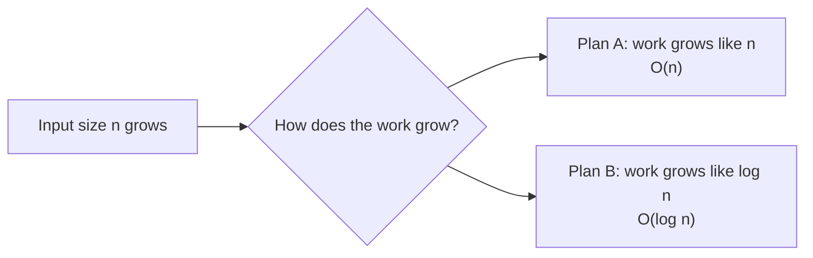
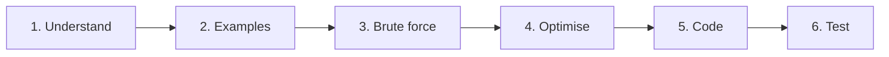
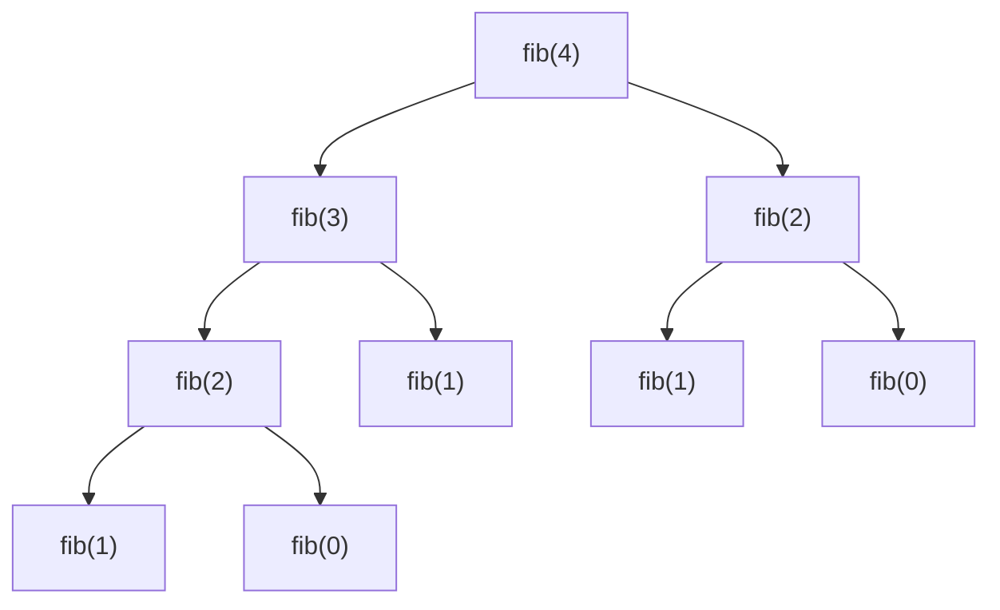

# Chapter 01 · Thinking in Algorithms & Big-O

> Do students hain. Dono ka code sahi answer deta hai. 1,000 inputs pe dono turant khatam. Lekin 1,000,000 inputs pe ek ka code aadhe second mein khatam ho jaata hai, aur doosre ka code tumhare agle birthday tak bhi chal raha hoga. Big-O woh tool hai jo tumhe *kuch bhi run karne se pehle* bata deta hai ki tum kaunse student ho.

**Is chapter mein tum seekhoge:**
- Algorithm asal mein hota kya hai, aur **kisi bhi** problem pe attack karne ka 6-step method
- Big-O, Big-Ω aur Big-Θ ka matlab, simple words mein bhi aur formally bhi
- Complexity nikalne ke rules, aur loops, nested loops, halving loops aur recursion ko analyse kaise karte hain
- Recursion trees aur **Master Theorem** ka ek gentle introduction
- Space complexity, including recursion stack ka chhupa hua kharcha
- Best / average / worst case aur **amortized** analysis (`append` O(1) kyun hai)
- Problem ke constraints padh ke turant target complexity kaise pata karte hain
- Python ke har common operation ka asli cost: `list`, `dict`, `set`, `str`, `deque` aur `heapq`

**Isse pehle padho:** [Lists](../part-1-python/07-lists.md) · [Dictionaries & Hashing](../part-1-python/09-dictionaries.md) · [Functions](../part-1-python/10-functions.md) · [Recursion](../part-1-python/12-recursion.md)

---

## 🧠 The Big Idea · Asli Baat

Socho tum 1,000 pages ki printed phone book mein "Sharma, Priya" dhoondh rahe ho.

- **Plan A:** page 1 se shuru karo aur har page padhte jao jab tak woh mil na jaaye. Worst case: 1,000 pages.
- **Plan B:** book beech se kholo. "Sharma" toh "M" ke baad aata hai, isliye pehla aadha hissa phaad ke phenk do. Jo bacha, uska beech kholo. Yahi repeat karo. Worst case: lagbhag **10** pages, kyunki 1,000 ko 10 baar aadha karo toh 1 se bhi kam bachta hai.

Ab phone book ko 1,000,000 pages ka bana do:

- Plan A: 1,000,000 pages tak.
- Plan B: lagbhag **20** pages.

Book 1,000 guna badi ho gayi. Plan A 1,000 guna slow ho gaya. Plan B ko bas 10 steps aur lage. *Kaam kaise badhta hai*, isi farak ko Big-O describe karta hai.

> 🇮🇳 **Desi Analogy:** IRCTC ka purana printed railway reservation chart socho, jisme 1,000 naam alphabetical order mein chhape hain. TC (ticket checker) agar har naam upar se neeche padhe, toh woh Plan A hai: chart double hua, uski mehnat double. Lekin smart TC chart beech se kholta hai, "S" aage hai ya peeche dekhta hai, aur aadha chart ignore kar deta hai. Woh Plan B hai: chart double hua toh bas **ek** extra step. Chart ka size = input size n. TC ke steps = algorithm ka kaam. Big-O sirf yeh poochta hai: chart bada hone pe TC ke steps kis speed se badhte hain?



> 💡 **The core insight:** Big-O seconds nahi naapta. Woh **growth ka shape** naapta hai: agar main input double kar doon, toh kaam ka kya hoga? Seconds tumhare laptop pe depend karte hain. Growth ka shape sirf tumhare algorithm pe depend karta hai.

> 🤔 **Mann mein sawaal:** Mera laptop toh fast hai. Toh slow algorithm bhi chal jaayega na?
>
> **Jawab:** Chhote input pe haan. Lekin fast laptop speed ko ek fixed factor se badhata hai, maan lo 10×. Agar tumhara algorithm O(n²) hai aur input 1,000× bada ho gaya, toh kaam 1,000,000× badh gaya. 10× fast machine us 1,000,000× ko kabhi cover nahi kar sakti. Isliye growth ka shape hardware se zyada important hai.

---

## 🔨 Building It Up · Zero Se Shuru

### 1. What is an algorithm?

**Algorithm** clear steps ki ek finite list hai jo input ko output mein badal deti hai. Recipe bhi ek algorithm hai: ingredients andar, dish bahar.

Ek accha algorithm paanch properties rakhta hai:

| Property | Matlab | Recipe wala version |
|---|---|---|
| **Input** | zero ya zyada inputs leta hai | ingredients |
| **Output** | kam se kam ek result deta hai | dish |
| **Definite** | har step ekdum clear, koi confusion nahi | "5 g namak daalo", "thoda namak daalo" nahi |
| **Finite** | hamesha ruk jaata hai | recipe khatam hoti hai; "hamesha chalate raho" nahi likha hota |
| **Effective** | har step sach mein kiya ja sakta hai | "ek chutki unicorn daalo" nahi |

> 🇮🇳 **Desi Analogy:** Maggi ke packet ke peeche jo "2 minute" recipe likhi hoti hai, woh ekdum algorithm hai. Input: Maggi cake, tastemaker, 1.5 cup paani (**Input**). Output: Maggi ki plate (**Output**). "1.5 cup paani ubaalo", "thoda paani" nahi (**Definite**). Steps khatam hote hain, koi infinite loop nahi (**Finite**). Aur har step ghar ki kitchen mein possible hai (**Effective**). Mummy ki "andaaze se masala daalo" wali recipe **Definite** property fail kar deti hai, isliye computer usse follow nahi kar sakta.

Ye raha ek chhota sa algorithm: list ka sabse bada number dhoondho.

```python
def find_max(nums):
    best = nums[0]            # maan lo abhi tak pehla wala hi sabse bada hai
    for x in nums[1:]:
        if x > best:
            best = x          # isse bada mil gaya, yaad rakh lo
    return best

print(find_max([3, 9, 2, 7]))
```

```text
9
```

Abhi kya hua: humne har number ko exactly ek baar dekha aur "ab tak ka best" yaad rakha. Yeh "ek baar chalo, saath mein ek summary leke chalo" wala idea is book ke aadhe problems mein aayega.

### 2. How to approach ANY problem: the 6-step method

Zyada tar beginners problem padhte hi typing shuru kar dete hain. Strong engineers ek routine follow karte hain. Ise **"U E B O C T"** ki tarah yaad karo ("**U**ncle **E**ats **B**iryani, **O**rders **C**hai **T**oo"):



1. **Understand.** Problem ko apne words mein dobara bolo. Input ka type aur size kya hai? Output exactly kya chahiye? Duplicates ho sakte hain? Negative numbers? Empty input?
2. **Examples.** 2–3 chhote examples haath se solve karo, ek edge case ke saath (empty list, ek element, sab same).
3. **Brute force.** *Koi bhi* sahi solution dhoondho, chahe slow ho. Uski complexity zor se bolo.
4. **Optimise.** Khud se poocho: "Main kaunsa kaam baar-baar repeat kar raha hoon?" aur "Kaunsa data structure us repeated kaam ko fast bana dega?"
5. **Code.** Saaf code likho, acche naamon ke saath.
6. **Test.** Apne examples ko code mein line by line dry-run karo. Phir edge cases check karo.

Chalo ek real problem pe ek baar karke dekhte hain: **"Kya is list mein koi duplicate hai?"**

**Understand:** input integers ki list hai, output True/False. **Examples:** `[1,2,3,1]` → True, `[1,2,3]` → False, `[]` → False.

**Brute force:** har pair ko compare karo.

```python
def has_duplicate_brute(nums):
    n = len(nums)
    for i in range(n):
        for j in range(i + 1, n):     # har pair (i, j) jahan i < j
            if nums[i] == nums[j]:
                return True
    return False

print(has_duplicate_brute([1, 2, 3, 1]), has_duplicate_brute([1, 2, 3]), has_duplicate_brute([]))
```

```text
True False False
```

Yeh lagbhag n²/2 pairs check karta hai. **O(n²)**.

**Optimise, idea 1:** sort karne ke baad duplicates ek doosre ke bagal mein aa jaate hain. Sorting ka cost O(n log n) hai (kyun, yeh [Chapter 07](07-sorting.md) mein dekhenge), phir ek pass.

**Optimise, idea 2:** repeat hone wala kaam hai "kya maine yeh number pehle dekha hai?". Ek **set** iska jawab average O(1) mein deta hai.

```python
def has_duplicate_sorted(nums):
    s = sorted(nums)                      # O(n log n)
    for i in range(1, len(s)):
        if s[i] == s[i - 1]:              # ab duplicates padosi hain
            return True
    return False

def has_duplicate_set(nums):
    seen = set()
    for x in nums:
        if x in seen:                     # average O(1) lookup
            return True
        seen.add(x)
    return False

for f in (has_duplicate_sorted, has_duplicate_set):
    print(f.__name__, f([1, 2, 3, 1]), f([1, 2, 3]), f([]))
```

```text
has_duplicate_sorted True False False
has_duplicate_set True False False
```

Teen sahi answers, teen alag growth shapes:

| Approach | Time | Extra space |
|---|---|---|
| Saare pairs compare karo | O(n²) | O(1) |
| Sort karo, phir padosi check karo | O(n log n) | O(n) (`sorted` ek copy banata hai) |
| Dekhe hue values ka set | O(n) | O(n) |

Yeh table **hi** interview hai. Interviewer ko sirf answer nahi chahiye. Woh dekhna chahta hai ki tum upar wali row se neeche best row tak kaise pahunchte ho, aur trade-off kaise samjhaate ho.

> 🇮🇳 **Desi Analogy:** Shaadi ke gate pe guest list check ho rahi hai, aur dekhna hai koi do baar toh nahi ghus aaya. Brute force: har naye guest ko andar baithe har guest se milaao (O(n²)). Sort wala tareeka: sabko naam ke hisaab se line mein khada karo, phir bas bagal wale se milaao (O(n log n)). Set wala tareeka: gate pe ek register rakho, har aane wale ka naam turant register mein dekho, naam mila toh pakda gaya, nahi mila toh likh lo (O(n)). Register hi **set** hai: extra kaagaz (space) lagta hai, par time bachta hai.

### 3. Why we count steps instead of timing

Stopwatch ka result tumhare CPU pe, background mein kya chal raha hai us pe, aur Python version pe depend karta hai. Isliye hum **basic operations** ginte hain: comparisons, additions, assignments, index lookups. Har ek lagbhag constant time leta hai.

Chalo do alag algorithms mein sabse andar wali line kitni baar chalti hai, woh ginte hain:

```python
def count_linear(n):
    steps = 0
    for i in range(n):
        steps += 1
    return steps

def count_pairs(n):
    steps = 0
    for i in range(n):
        for j in range(n):
            steps += 1
    return steps

for n in (10, 100, 1000):
    print(n, count_linear(n), count_pairs(n))
```

```text
10 10 100
100 100 10000
1000 1000 1000000
```

Abhi kya hua: jab n 10× bada hua, single loop ne 10× zyada kaam kiya aur double loop ne **100×** zyada. Raw number nahi, yeh ratio hi Big-O pakadta hai.

### 4. Big-O, Big-Ω, Big-Θ: the three bounds

Maan lo ek algorithm exactly `f(n) = 3n² + 5n + 20` steps leta hai.

Jab n bada hota hai, `3n²` wala hissa poori tarah dominate karta hai. n = 1,000 pe: 3n² = 3,000,000 jabki 5n + 20 = 5,020. Chhote terms bas noise hain. Aur constant 3 speed ko sirf ek fixed factor se badalta hai; *shape* nahi badalta. Isliye hum kehte hain growth "n² jaisi" hai.

| Notation | Kaise padhein | Simple matlab | Analogy |
|---|---|---|---|
| **O(g(n))** | "Big-O of g" | **zyada se zyada** g jaisa badhta hai (upper bound) | "safar zyada se zyada 2 ghante ka hai" |
| **Ω(g(n))** | "Big-Omega of g" | **kam se kam** g jaisa badhta hai (lower bound) | "safar kam se kam 1 ghante ka hai" |
| **Θ(g(n))** | "Big-Theta of g" | **exactly** g jaisa badhta hai (dono bounds) | "safar lagbhag 1.5 ghante ka hai" |

> 🇮🇳 **Desi Analogy:** Swiggy app pe delivery time dekho. "Max 40 min mein pahunchega" = **O** (upper bound, isse zyada nahi lagega). "Kam se kam 20 min lagenge, restaurant khaana bana raha hai" = **Ω** (lower bound, isse kam nahi lagega). "Lagbhag 30 min" jahan upper aur lower dono same shape mein tight hain = **Θ**. Interview mein jab koi "Big-O" bolta hai, toh woh actually yeh "lagbhag 30 min" wala tight answer maang raha hota hai.

**Formal definition** (bas ek baar, taaki tumne dekh liya ho): f(n) O(g(n)) hai agar aise constants c > 0 aur n₀ exist karte hain ki har n ≥ n₀ ke liye `f(n) ≤ c · g(n)`. Simple words mein: *ek point ke baad, f kabhi bhi g ke ek constant multiple se upar nahi jaata.*

`3n² + 5n + 20` ke liye: c = 4 lo. n ≥ 8 ke liye, `3n² + 5n + 20 ≤ 4n²` (kyunki n ≥ 8 hote hi n² ≥ 5n + 20 ho jaata hai). Check karo: n = 8 pe n² = 64 aur 5n + 20 = 60, toh 64 ≥ 60 sahi. Isliye yeh O(n²) hai. Yeh Ω(n²) bhi hai (kyunki yeh hamesha ≥ 3n² hai), toh yeh Θ(n²) hai.

> 💡 **What interviewers mean:** interviews mein (aur is book mein bhi) log "Big-O" bolte hain, lekin aksar unka matlab **tight** bound hota hai, yaani Θ. Agar tum bolo bubble sort O(n³) hai, toh technically tum sahi ho (n² ≤ n³), lekin interviewer tumhe ajeeb nazar se dekhega. Hamesha sabse tight bound do jo de sakte ho.

> 🤔 **Mann mein sawaal:** Agar O sirf upper bound hai, toh "binary search O(n) hai" bolna bhi sahi hai kya?
>
> **Jawab:** Technically haan, log n ≤ n hai, toh O(n) ek valid upper bound hai. Lekin woh bekaar answer hai, jaise koi pooche "Delhi se Agra kitni der?" aur tum bolo "ek saal se kam". Sach hai, par kisi kaam ka nahi. Interview mein hamesha tightest bound bolo: **O(log n)**.

### 5. The rules for computing complexity

Chhe rules lagbhag sab kuch cover kar lete hain.

**Rule 1: Constants hata do.** O(2n) = O(n). O(500) = O(1).

**Rule 2: Chhote terms hata do.** O(n² + n) = O(n²). O(n + log n) = O(n).

**Rule 3: Ek ke baad ek steps add hote hain.**

```py
for x in a: ...      # O(n)
for x in a: ...      # O(n)
# total: O(n + n) = O(n)
```

**Rule 4: Nested steps multiply hote hain.**

```py
for x in a:          # n baar
    for y in a:      #   har baar n baar
        ...          # total: O(n * n) = O(n²)
```

**Rule 5: Alag inputs ko alag letters milte hain.** Yeh sabse common galti hai.

```py
def print_pairs(a, b):
    for x in a:          # len(a) = A
        for y in b:      # len(b) = B
            print(x, y)
# O(A * B), O(n²) NAHI. Agar b chhota sa hai, toh yeh basically linear hai.
```

**Rule 6: if/else mein, jo branch zyada kharab hai woh lo** (jab worst case nikal rahe ho).

```py
if flag:
    total = sum(nums)          # O(n)
else:
    total = nums[0]            # O(1)
# worst case: O(n)
```

Chalo chhe ke chhe rules ek function pe lagaate hain:

```python
def mystery(a, b):
    total = 0
    for x in a:                 # A iterations
        total += x
    for x in a:                 # A iterations
        for y in b:             #   har ek mein B iterations
            if x == y:
                total += 1
    for _ in range(100):        # constant: 100 iterations
        total += 1
    return total

print(mystery([1, 2, 3], [2, 3, 4, 5]))
```

```text
108
```

Steps: A + A·B + 100 → constant hatao → **O(A·B)** (jab tak B ≥ 1 hai, A wala term A·B ke neeche dab jaata hai).

Output 108 kahan se aaya, woh bhi dekh lo: pehla loop 1+2+3 = 6. Doosre loop mein common values 2 aur 3 hain, toh +2. Teesra loop +100. Total 6 + 2 + 100 = 108.

### 6. Analysing loops: the five shapes

Tumhe jo bhi loop milega, woh lagbhag hamesha in paanch shapes mein se ek hoga. Inhe dekhte hi pehchaanna seekho.

**Shape 1: simple loop → O(n)**

```py
for i in range(n): ...          # n iterations
for i in range(0, n, 2): ...    # n/2 iterations, phir bhi O(n)
```

**Shape 2: nested independent loops → O(n²)**

```py
for i in range(n):
    for j in range(n): ...      # n * n
```

**Shape 3: nested dependent loops (triangle) → phir bhi O(n²)**

```py
for i in range(n):
    for j in range(i + 1, n): ...   # (n-1) + (n-2) + ... + 1 + 0
```

Inner loop pehle n−1 baar chalta hai, phir n−2, ..., phir 0 baar. Yeh sum n(n−1)/2 ≈ n²/2 hai. ½ hata do → O(n²). Log aksar guess karte hain "yeh toh chhota hai, shayad O(n log n) hoga". Nahi hai. n² ka aadha bhi n² hi hai.

> 🤔 **Mann mein sawaal:** Triangle loop toh square loop ka aadha kaam karta hai. Phir dono ka Big-O same kaise?
>
> **Jawab:** Kyunki Big-O "kitna" nahi, "kaise badhta hai" poochta hai. n double karo: square loop ka kaam 4× hota hai, aur triangle loop ka kaam bhi 4× hota hai (n²/2 → (2n)²/2 = 4 · n²/2). Dono ka *badhne ka tareeka* same hai. Aadha sirf ek constant ½ hai, aur constants hata diye jaate hain.

**Shape 4: halving ya doubling loops → O(log n)**

```py
i = n
while i > 1:
    i //= 2          # n, n/2, n/4, ... , 1

i = 1
while i < n:
    i *= 2           # 1, 2, 4, 8, ... , n
```

n ko kitni baar aadha kar sakte ho jab tak woh 1 na ho jaaye? Wahi number **log₂ n** hai. n = 1,000,000 ke liye yeh lagbhag 20 hai. Isiliye logarithm har jagah dikhta hai: **log n = "isko kitni baar aadha kar sakta hoon?"**

> 🇮🇳 **Desi Analogy:** Cricket ka knockout tournament socho. 64 teams hain. Har round mein aadhi teams bahar: 64 → 32 → 16 → 8 → 4 → 2 → 1. Kitne rounds? **6**, kyunki 2⁶ = 64. Teams ko 1,024 kar do, toh rounds sirf **10**. Teams 16 guna badh gayi, rounds sirf 4 badhe. Teams ki ginti = n, rounds ki ginti = log₂ n. Yahi halving loop hai.

**Shape 5: square-root loop → O(√n)**

```py
i = 1
while i * i <= n:    # jab i, √n se aage nikal jaaye, tab rukta hai
    i += 1
```

Ye raha paanchon ko asli mein gin ke dikhaya hua:

```python
import math

def count(n):
    linear = sum(1 for _ in range(n))
    triangle = sum(1 for i in range(n) for _ in range(i + 1, n))
    halving, i = 0, n
    while i > 1:
        i //= 2
        halving += 1
    root, i = 0, 1
    while i * i <= n:
        i += 1
        root += 1
    return linear, triangle, halving, root

for n in (16, 1024):
    lin, tri, half, root = count(n)
    print(f"n={n}: linear={lin} triangle={tri} (n(n-1)/2={n*(n-1)//2}) "
          f"halving={half} (log2 n={int(math.log2(n))}) root={root}")
```

```text
n=16: linear=16 triangle=120 (n(n-1)/2=120) halving=4 (log2 n=4) root=4
n=1024: linear=1024 triangle=523776 (n(n-1)/2=523776) halving=10 (log2 n=10) root=32
```

Abhi kya hua: formulas real counts se ekdum match karte hain. n = 16 se n = 1024 pe jaane pe (64× bada), halving loop 4 se sirf 10 iterations pe gaya, jabki triangle loop 120 se seedha aadhe million ke paar fat gaya.

**Ek chalaak wala: halving loop ke andar ek loop.**

```py
i = n
while i > 0:
    for j in range(i): ...   # n + n/2 + n/4 + ... 
    i //= 2
```

Dikhta O(n log n) jaisa hai, lekin andar ka kaam n + n/2 + n/4 + ... hai, jo jod ke 2n se kam aata hai. Toh yeh **O(n)** hai. Hamesha asli kaam ko jodo, aankh band karke multiply mat karo.

Yeh 2n se kam kyun? Socho ek pizza hai. Pehle aadha khaaya, phir bache hue ka aadha, phir uska aadha... tum kitna bhi khao, poore pizza se zyada kabhi nahi khaa sakte. Waise hi n/2 + n/4 + n/8 + ... hamesha n se kam rehta hai, toh total n + (n se kam) = 2n se kam.

**Aur ulta trap: poore loop ke andar ek halving loop.**

```py
for i in range(n):        # n baar
    j = n
    while j > 1:          #   har baar log n baar
        j //= 2
# O(n log n)
```

Farak samjho: upar wale mein inner loop har baar *chhota* hota ja raha tha (i aadha hota tha). Yahan inner loop har baar poore n se shuru hota hai (`j = n` reset hota hai), toh har outer iteration mein poora log n kaam. n × log n.

### 7. Analysing recursion: calls × work per call

Kisi recursive function ke liye do sawaal poocho:

1. Total **kitni calls** hoti hain?
2. Har call **kitna kaam** karti hai (uski apni recursive calls ko chhod ke)?

Dono ko multiply karo (ya, jab alag calls alag amount ka kaam karti hain, toh saari calls ka kaam jod do).

**Linear recursion: factorial.** `fact(n)` call karta hai `fact(n-1)` ko, jo call karta hai `fact(n-2)` ko, ... neeche `fact(0)` tak. Yeh n + 1 calls hain, har ek O(1) kaam → **O(n)** time. Call stack bhi n + 1 deep jaata hai → **O(n)** space.

**Branching recursion: naive Fibonacci.** Har call *do* calls karti hai:

```python
calls = 0

def fib(n):
    global calls
    calls += 1
    if n < 2:
        return n
    return fib(n - 1) + fib(n - 2)

for n in (10, 20, 25):
    calls = 0
    value = fib(n)
    print(f"fib({n}) = {value}, calls = {calls}")
```

```text
fib(10) = 55, calls = 177
fib(20) = 6765, calls = 21891
fib(25) = 75025, calls = 242785
```

n mein har +5 pe calls lagbhag 11 guna ho jaati hain. Yeh exponential growth hai. Ye raha **recursion tree**, jisme har node ek call hai:



Tree ki depth n hai, aur har level pe upar wale level se zyada se zyada double nodes hote hain: 1, 2, 4, 8, ... Toh total zyada se zyada 2⁰ + 2¹ + ... + 2ⁿ ≈ 2ⁿ⁺¹. Time **O(2ⁿ)**. (Tight bound lagbhag O(1.618ⁿ) hai, lekin O(2ⁿ) standard answer hai.) Space sirf **O(n)** hai, kyunki kisi bhi moment pe stack mein root se ek leaf tak ka sirf ek path hota hai.

> 🇮🇳 **Desi Analogy:** Joint family ka WhatsApp forward socho. Pehla banda message do logon ko forward karta hai, woh dono aage do-do ko. Har "level" pe log double: 1, 2, 4, 8... 20 levels mein 10 lakh se zyada forwards. Yahi naive Fibonacci ka recursion tree hai: har call do calls karti hai, isliye **O(2ⁿ)**. Ab socho ek hi aadmi ek-ek karke forward kar raha hai: pehle ek branch ko poora neeche tak bhejta hai, phir agli branch. Kisi bhi moment uske dimaag mein sirf ek chain hoti hai (kisne kisko bheja, upar se neeche ek line). Isliye stack space sirf depth jitna, **O(n)**.

> 🤔 **Mann mein sawaal:** Time O(2ⁿ) hai toh space bhi O(2ⁿ) kyun nahi? Itni saari calls kahan store hoti hain?
>
> **Jawab:** Calls ek saath zinda nahi rehti. `fib(4)` pehle `fib(3)` mein ghusta hai, woh poora khatam hota hai aur uska stack frame hat jaata hai, *tab* `fib(2)` shuru hota hai. Stack pe ek time pe sirf current path hota hai: `fib(4) → fib(3) → fib(2) → fib(1)`. Woh path zyada se zyada n lamba hai. Time = total calls ka count, space = ek saath zinda calls ka max count.

> 💡 **Recursion ka rule of thumb:** jab har call O(1) kaam karti hai, time ≈ O(branches^depth). Space ≈ O(depth).

Dhyaan do, us chhote se tree mein `fib(2)` do baar compute hua. `fib(25)` mein `fib(2)` hazaaron baar compute hota hai. In repeat hone wale answers ko cache karna **memoisation** kehlata hai, aur yeh isse O(n) bana deta hai. Dynamic Programming ka poora idea yahi hai ([Chapter 20](20-dp-1d.md)).

**Halving recursion: binary search.** Aadhe data pe ek call, plus O(1) kaam: n → n/2 → n/4 → ... → 1. Yeh log n calls hain → **O(log n)**.

**Divide and conquer: merge sort.** Do halves mein todo, har ek ko recursively sort karo, phir O(n) mein merge karo. Tree ko level by level draw karo:

```text
level 0:            [ n ]                    work n
level 1:       [n/2]     [n/2]               work n/2 + n/2 = n
level 2:   [n/4] [n/4] [n/4] [n/4]           work 4 × n/4 = n
...                                          ...
level log n: n pieces of size 1              work n
```

Har level total n kaam karta hai, aur log n levels hain → **O(n log n)**. Yeh "har level ka kaam × levels ki ginti" wala trick hi kisi bhi recursion tree ko analyse karne ka tareeka hai.

### 8. Recurrences and the Master Theorem (gentle intro)

Recursive function ke cost ko hum ek equation ki tarah likh sakte hain, jise **recurrence** kehte hain. `T(n)` ka matlab hai "size n ki problem solve karne ka time".

| Algorithm | Recurrence | Kaise padhein | Result |
|---|---|---|---|
| Factorial | T(n) = T(n−1) + O(1) | ek chhoti call + constant kaam | O(n) |
| Binary search | T(n) = T(n/2) + O(1) | ek aadhe-size ki call + constant kaam | O(log n) |
| Merge sort | T(n) = 2T(n/2) + O(n) | do aadhe-size ki calls + linear merge | O(n log n) |
| Naive Fibonacci | T(n) = T(n−1) + T(n−2) + O(1) | do calls, bas thodi chhoti | O(2ⁿ) |
| Tree traversal | T(n) = 2T(n/2) + O(1) | dono halves visit karo, node pe O(1) | O(n) |
| Selection-style | T(n) = T(n−1) + O(n) | ek chhoti call + linear kaam | O(n²) |

Bahut common shape **T(n) = a·T(n/b) + O(n^d)** ke liye (a sub-problems, har ek size n/b ka, plus split/combine karne ka n^d kaam), **Master Theorem** `a` ko `b^d` se compare karke answer deta hai:

| Case | Condition | Kaun jeetta hai | Answer | Example |
|---|---|---|---|---|
| 1 | a < b^d | top-level ka kaam dominate karta hai | O(n^d) | T(n) = T(n/2) + O(n) → O(n) |
| 2 | a = b^d | har level barabar kaam karta hai | O(n^d log n) | merge sort: a=2, b=2, d=1 → O(n log n) |
| 3 | a > b^d | leaves dominate karti hain | O(n^(log_b a)) | T(n) = 2T(n/2) + O(1) → O(n) |

Intuition: `a` batata hai sub-problems ki ginti kitni tezi se multiply hoti hai; `b^d` batata hai har sub-problem ka kaam kitni tezi se shrink hota hai. Jo tez hai, wahi decide karta hai ki zyada tar kaam kahan hai: top pe, barabar bata hua, ya bottom pe. Proofs ratne ki zaroorat nahi; merge sort (case 2) aur binary search (a=1, b=2, d=0 → b^d = 2⁰ = 1 = a → case 2 → O(n⁰ log n) = O(log n)) pehchaan lo, toh zyada tar interviews cover ho jaate hain.

> 🇮🇳 **Desi Analogy:** Ek company ka CEO kaam ko `a` managers mein baant-ta hai, aur har manager ko kaam ka 1/b hissa milta hai. Har level pe "baantne aur jodne" ka meeting time n^d hai. Agar managers ki ginti (a) dheere badhti hai aur har level ka meeting kaam (b^d) tezi se ghatta hai, toh CEO ka apna meeting hi sabse bhaari hai (case 1, top dominate). Agar dono barabar speed se chalte hain, toh har level barabar busy hai (case 2, isliye extra log n). Agar managers ki fauj tezi se badhti hai, toh neeche ke interns ka total kaam sabse zyada hai (case 3, leaves dominate).

### 9. The common complexity classes

Ye rahe sab, fastest se slowest tak, aur har ek ko kitne steps chahiye:

```python
import math

def fmt(x):
    return f"{x:.1e}" if x >= 1e6 else str(round(x))

sizes = [10, 100, 1000, 10**6]
rows = [
    ("O(1)", lambda n: 1),
    ("O(log n)", lambda n: math.log2(n)),
    ("O(sqrt n)", lambda n: math.sqrt(n)),
    ("O(n)", lambda n: n),
    ("O(n log n)", lambda n: n * math.log2(n)),
    ("O(n^2)", lambda n: n * n),
    ("O(n^3)", lambda n: n ** 3),
]
print(f"{'class':<11}" + "".join(f"{n:>10}" for n in sizes))
for name, f in rows:
    print(f"{name:<11}" + "".join(f"{fmt(f(n)):>10}" for n in sizes))
print(f"{'O(2^n)':<11}" + "".join(f"{fmt(2 ** n) if n <= 100 else 'way too big':>10}" for n in sizes[:2]))
```

```text
class              10       100      1000   1000000
O(1)                1         1         1         1
O(log n)            3         7        10        20
O(sqrt n)           3        10        32      1000
O(n)               10       100      1000   1.0e+06
O(n log n)         33       664      9966   2.0e+07
O(n^2)            100     10000   1.0e+06   1.0e+12
O(n^3)           1000   1.0e+06   1.0e+09   1.0e+18
O(2^n)           1024   1.3e+30
```

Aakhri column padho: ek million items ke saath, O(n log n) lagbhag 2 crore steps hai (theek hai), jabki O(n²) ek **trillion** hai (koi umeed nahi). Aur O(2ⁿ) toh n = 100 pe hi 10³⁰ hai: Dharti pe jitne ret ke daane hain, usse bhi zyada steps.

| Class | Naam | Typical example |
|---|---|---|
| O(1) | constant | list ko index karna, dict lookup, end pe push/pop |
| O(log n) | logarithmic | binary search, heap push/pop |
| O(√n) | square root | trial division se check karna ki n prime hai ya nahi |
| O(n) | linear | data pe ek pass |
| O(n log n) | linearithmic | acchi sorting, divide and conquer |
| O(n²) | quadratic | saare pairs, simple sorts |
| O(n³) | cubic | saare triples, naive matrix multiplication |
| O(2ⁿ) | exponential | saare subsets |
| O(n!) | factorial | saari orderings (permutations) |

> 💡 **The ladder:** 1 < log n < √n < n < n log n < n² < n³ < 2ⁿ < n!. Yeh order ratt lo; tum baar-baar isse compare karoge.

### 10. Space complexity

**Space complexity** batata hai ki n badhne pe algorithm ko kitni *extra* memory chahiye. Hum aam taur pe **auxiliary space** ginte hain: input ke alawa jo memory lagti hai.

```python
def total_o1(nums):          # O(1) extra space: bas ek variable
    s = 0
    for x in nums:
        s += x
    return s

def squares_on(nums):        # O(n) extra space: size n ki nayi list
    return [x * x for x in nums]

def grid_on2(n):             # O(n^2) extra space: ek n x n table
    return [[0] * n for _ in range(n)]

print(total_o1([1, 2, 3]), squares_on([1, 2, 3]), len(grid_on2(4)) * len(grid_on2(4)[0]))
```

```text
6 [1, 4, 9] 16
```

**Chhupa hua kharcha: recursion stack.** Har function call jo abhi return nahi hui, memory mein ek **stack frame** rakhti hai (uske local variables aur kahan wapas jaana hai). Recursion depth d ka matlab O(d) space, chahe tumne ek bhi list na banayi ho.

> 🇮🇳 **Desi Analogy:** Office mein file ek table se doosri table pe jaati hai aur har babu apne register mein entry karta hai "file yahan se aage bheji, wapas aayegi toh yahan se continue karna hai". Jab tak file wapas nahi aati, har table pe ek entry padi rehti hai. 1,000 tables tak file gayi toh 1,000 entries pending. Har pending entry = ek **stack frame**. Tumne koi naya kaagaz (list) nahi banaya, phir bhi registers bhar gaye. Yahi recursion ki O(depth) space hai.

```python
import sys

def sum_recursive(nums, i=0):
    if i == len(nums):
        return 0
    return nums[i] + sum_recursive(nums, i + 1)    # depth len(nums) tak badhti hai

print(sum_recursive(list(range(100))))
print("default recursion limit:", sys.getrecursionlimit())
```

```text
4950
default recursion limit: 1000
```

Yeh function **O(n) space** use karta hai, chahe dikhne mein lagta ho ki kuch store hi nahi kar raha. Ise 5,000 items ki list pe call karo aur Python `RecursionError` raise karega, kyunki CPython depth ko limit karta hai (default 1,000). Wahi kaam karne wala loop O(1) use karta hai. Isiliye interviewers poochte hain, "space complexity kya hai, stack *ko mila ke*?"

| Recursion | Max depth | Stack space |
|---|---|---|
| factorial(n) | n | O(n) |
| naive fib(n) | n | O(n) (ek time pe stack pe sirf ek path hota hai) |
| binary search (recursive) | log n | O(log n) |
| merge sort | log n | O(log n) stack + merging buffers ke liye O(n) |
| height h wale tree pe DFS | h | O(h) |

### 11. Best, average and worst case

Ek hi algorithm, size n ka *kaunsa* input mila hai us hisaab se, bahut alag amount ka kaam kar sakta hai. Linear search lo:

```python
def linear_search(nums, target):
    comparisons = 0
    for i, x in enumerate(nums):
        comparisons += 1
        if x == target:
            return i, comparisons
    return -1, comparisons

data = [7, 3, 9, 1, 5, 8, 2, 6]
print("best   :", linear_search(data, 7))     # pehla element
print("worst  :", linear_search(data, 4))     # hai hi nahi
print("middle :", linear_search(data, 5))
```

```text
best   : (0, 1)
worst  : (-1, 8)
middle : (4, 5)
```

- **Best case:** target pehla hi hai → 1 comparison → O(1). (Isse koi care nahi karta; yeh bahut zyada optimistic hai.)
- **Worst case:** target missing hai → n comparisons → O(n). **Interviews mein default answer yahi hai.**
- **Average case:** agar target kahin bhi hone ke barabar chances hain, toh lagbhag n/2 comparisons → O(n).

> 🇮🇳 **Desi Analogy:** Kirana store ki khata book mein Sharma ji ka udhaar dhoondhna. Best case: Sharma ji ka naam pehle page pe. Worst case: Sharma ji ka khata hai hi nahi, toh poori book palatni padi. Average: beech mein kahin. Dukaandaar plan worst case ke hisaab se karta hai, kyunki "aaj lucky din hoga" se dukaan nahi chalti.

> ⚠️ **Inhe O/Ω/Θ ke saath mix mat karo.** Best/worst/average batate hain *kaunsa input*. O/Ω/Θ batate hain *growth function ke bounds*. Tum keh sakte ho "quicksort ka worst case Θ(n²) hai" aur "average case Θ(n log n) hai": do alag inputs, har ek ka apna tight bound.

> 🤔 **Mann mein sawaal:** Toh kya "worst case = Big-O" aur "best case = Big-Ω" nahi hota?
>
> **Jawab:** Nahi, yeh bahut common confusion hai. Yeh do alag sawaal hain. Pehla sawaal: "kaunsa input?" (best, average, worst). Doosra sawaal: "us input pe growth ka bound kya hai?" (O, Ω, Θ). Tum worst case ka bhi O, Ω aur Θ bol sakte ho, aur best case ka bhi. Example: linear search ka best case Θ(1) hai, worst case Θ(n) hai.

Jahan yeh farak sach mein matter karta hai:

| Algorithm | Best | Average | Worst |
|---|---|---|---|
| Linear search | O(1) | O(n) | O(n) |
| Insertion sort | O(n) (pehle se sorted) | O(n²) | O(n²) |
| Quick sort | O(n log n) | O(n log n) | O(n²) |
| Hash table lookup | O(1) | O(1) | O(n) (saari keys collide karti hain) |

### 12. Amortized analysis: why `append` is O(1)

Python list memory ke ek block mein rehti hai, jiske end pe thodi khaali jagah hoti hai. Jab jagah khatam ho jaati hai, Python ek **bada** block allocate karta hai aur har element ko usme copy karta hai. Woh copy O(n) hai! Toh `append` O(1) kaise ho sakta hai?

Kyunki block ek **multiplying factor** se badhta hai, toh badi copies kabhi-kabhi hi hoti hain. Chalo ek list simulate karte hain jo full hone pe apni capacity double kar deti hai, aur har element copy ko ginte hain:

```python
def simulate_appends(n):
    capacity, size, copies = 1, 0, 0
    for _ in range(n):
        if size == capacity:       # full: double size wale block mein shift karo
            copies += size         # har existing element copy karo
            capacity *= 2
        size += 1                  # khud append
    return copies

for n in (8, 1000, 1_000_000):
    c = simulate_appends(n)
    print(f"{n} appends -> {c} copies, {c / n:.2f} copies per append")
```

```text
8 appends -> 7 copies, 0.88 copies per append
1000 appends -> 1023 copies, 1.02 copies per append
1000000 appends -> 1048575 copies, 1.05 copies per append
```

Abhi kya hua: copies sizes 1, 2, 4, 8, ... pe hoti hain, aur 1 + 2 + 4 + ... + n/2 < n. Toh n appends ka total kaam 2n se kam hai, yaani har append **O(1) amortized**. "Amortized" ka matlab hai **operations ke ek sequence pe average**: koi ek append slow ho sakta hai, lekin appends ka koi bhi lamba sequence average mein slow nahi ho sakta.

Ek baar haath se dekh lo n = 8 ke liye. Capacity 1 thi, 1 element ke baad full. 2nd append pe 1 copy (capacity 2). 3rd append pe 2 copies (capacity 4). 5th append pe 4 copies (capacity 8). Total 1 + 2 + 4 = 7. Output mein bhi 7 hi aaya.

> 💡 **Analogy:** tum ₹100 har mahine dene ki jagah saal mein ek baar ₹1,200 rent dete ho. Saal wala payment chubhta hai, lekin *per month* cost phir bhi ₹100 hi hai. Amortized O(1) yahi deal hai. (CPython asal mein list ko 2× ki jagah lagbhag 1.125× se badhata hai; 1 se bada koi bhi constant factor same O(1) amortized result deta hai.)

> 🇮🇳 **Desi Analogy:** Mumbai local ka monthly pass. Mahine ki pehli tareekh ko counter pe line mein lagna padta hai (ek "slow" din, jaise resize wali copy). Baaki 29 din tum seedha platform pe ghus jaate ho (fast appends). Mahine bhar ka total kharcha baant do toh har din ka cost chhota aur fixed hai. Pass ka renewal = resize, roz ka safar = append, aur "per day average" = amortized cost.

Amortized, average case jaisa **nahi** hai. Average case *random inputs* pe average karta hai. Amortized operations ke kisi bhi sequence ke baare mein ek *guarantee* hai, isme koi randomness nahi.

### 13. Constraints tell you the target complexity

Competitive programming aur interviews ka yeh sabse kaam ka trick hai. Ek typical judge lagbhag 1 second deta hai. Compiled languages bahut roughly 10⁸ simple operations per second kar leti hain; Python slow hai, bahut roughly 10⁷. Toh input size se tum nikal sakte ho ki kaunsi complexities possible bhi hain:

| Max n | Target complexity | Typical techniques |
|---|---|---|
| n ≤ 10 | O(n!) ya O(n · 2ⁿ) | permutations, backtracking |
| n ≤ 20 | O(2ⁿ) | subsets, bitmask brute force |
| n ≤ 100 | O(n³) | triple loops, Floyd–Warshall, interval DP |
| n ≤ 1,000 – 5,000 | O(n²) | saare pairs, 2D DP |
| n ≤ 10⁵ – 10⁶ | O(n log n) ya O(n) | sorting, binary search, heaps, two pointers, sliding window, hashing |
| n ≤ 10⁹ ya zyada | O(log n) ya O(1) | binary search on the answer, math |

Toh jab problem kehti hai `1 <= nums.length <= 10^5`, toh woh chupke se bata rahi hai: **"O(n²) time out hoga; O(n log n) ya usse behtar dhoondho."** Design karne se *pehle* constraints padho.

Yeh table khud kaise banate hain? Bas plug karo. n = 10⁵ pe n² = 10¹⁰, jo 10⁷/second ki speed se 1,000 seconds hai. Fail. n log n = 10⁵ × 17 ≈ 1.7 × 10⁶, jo second ke ek chhote hisse mein ho jaata hai. Pass.

> 🇮🇳 **Desi Analogy:** IRCTC Tatkal booking 10 baje khulti hai aur seats 2 minute mein khatam. Tumhare paas jitna time hai (time limit), usi hisaab se plan banta hai: form pehle se bhar ke rakho, UPI ready rakho. Waise hi constraint (n kitna bada) aur time limit (1 second) dekh ke pehle hi decide ho jaata hai ki kaunsa "plan" (complexity) chalega. Time limit pehle se pata ho toh galat plan pe mehnat hi nahi karte.

### 14. The cost of Python operations

Python masoom dikhne wale one-liners ke andar loops chhupa deta hai. `x in my_list` ek loop hai. `my_list.pop(0)` ek loop hai. Yeh table seekh lo, phir tum galti se kabhi O(n²) nahi likhoge.

**list** (ek dynamic array, [Chapter 02](02-arrays-strings.md))

| Operation | Cost | Kyun |
|---|---|---|
| `a[i]`, `a[i] = x`, `len(a)` | O(1) | seedha address ka hisaab / stored length |
| `a.append(x)`, `a.pop()` | O(1) amortized | kaam sirf end pe |
| `a.pop(0)`, `a.insert(0, x)` | O(n) | baaki har element shift hota hai |
| `a.insert(i, x)`, `a.pop(i)`, `del a[i]` | O(n − i) | i ke baad wale elements shift hote hain |
| `x in a`, `a.index(x)`, `a.count(x)`, `a.remove(x)` | O(n) | linear scan |
| `a[i:j]` (slice) | O(j − i) | utne elements copy hote hain |
| `a + b` | O(len(a) + len(b)) | nayi list banti hai |
| `a.extend(b)` | O(len(b)) amortized | har item append hota hai |
| `a.sort()`, `sorted(a)` | O(n log n) | Timsort |
| `a.reverse()`, `a[::-1]` | O(n) | har element ko chhoota hai |
| `min(a)`, `max(a)`, `sum(a)` | O(n) | linear scan |
| `a * k` | O(n · k) | badi list banti hai |

**dict** aur **set** (hash tables, [Chapter 05](05-hashing.md))

| Operation | Average | Worst |
|---|---|---|
| `d[k]`, `d[k] = v`, `k in d`, `del d[k]` | O(1) | O(n) |
| `s.add(x)`, `x in s`, `s.remove(x)` | O(1) | O(n) |
| saare items pe iterate karna | O(n) | O(n) |
| `s \| t` (union) | O(len(s) + len(t)) | |
| `s & t` (intersection) | O(min(len(s), len(t))) | |
| `d.copy()`, `set(iterable)` | O(n) | |

**str** (immutable)

| Operation | Cost | Note |
|---|---|---|
| `s[i]`, `len(s)` | O(1) | |
| `s[i:j]` | O(j − i) | nayi string banti hai |
| `s + t` | O(len(s) + len(t)) | nayi string banti hai |
| `sub in s`, `s.find(sub)` | O(n · m) worst, aam taur pe kaafi fast | |
| `"".join(parts)` | O(total length) | strings banane ka sahi tareeka |
| `s.split()`, `s.replace(...)`, `s.lower()` | O(n) | |
| loop mein `s += ch` se banana | O(n²) worst | har `+=` poori string copy kar sakta hai |

**collections.deque** (double-ended queue, [Chapter 12](12-queues-deques.md))

| Operation | Cost |
|---|---|
| `append`, `appendleft`, `pop`, `popleft` | O(1) |
| `d[i]` (beech mein indexing) | O(n) |
| `rotate(k)` | O(k) |

**heapq** (list ke upar binary heap, [Chapter 15](15-heaps.md))

| Operation | Cost |
|---|---|
| `heappush`, `heappop`, `heapreplace` | O(log n) |
| `h[0]` (min ko peek karna) | O(1) |
| `heapify(list)` | O(n) |
| `nlargest(k, a)`, `nsmallest(k, a)` | O(n log k) |

Ab dekho ek chhupa hua loop kitna dard de sakta hai. Neeche ke dono functions same kaam karte hain (`queries` ke kitne items `data` mein hain, yeh ginte hain), lekin ek list check karta hai aur ek set. List wala version kitne comparisons karta hai, woh hum ginte hain:

```python
def count_hits_list(data, queries):
    comparisons = 0
    hits = 0
    for q in queries:
        for x in data:              # "q in data" andar yahi karta hai
            comparisons += 1
            if x == q:
                hits += 1
                break
    return hits, comparisons

def count_hits_set(data, queries):
    lookup = set(data)              # ek baar O(n)
    return sum(1 for q in queries if q in lookup)   # har ek O(1)

data = list(range(2000))
queries = list(range(1000, 3000))
print(count_hits_list(data, queries))
print(count_hits_set(data, queries))
```

```text
(1000, 3500500)
1000
```

Answer same hai. List wale version ne 35 lakh comparisons kiye; set wale ne lagbhag 4,000 operations (2,000 set banane mein, 2,000 lookups).

3,500,500 kahan se aaya? Queries 1000 se 1999 tak `data` mein milti hain: query q ko dhoondhne mein q + 1 comparisons lagte hain, toh 1001 + 1002 + ... + 2000 = 1,500,500. Queries 2000 se 2999 tak milti hi nahi, toh har ek poore 2,000 comparisons karti hai: 1,000 × 2,000 = 2,000,000. Total 3,500,500.

---

## 🔬 Under the Hood · Andar Ki Kahani

### Why the base of the logarithm doesn't matter

log₂ n, log₁₀ n aur ln n mein sirf ek constant factor ka farak hai: log₂ n = log₁₀ n / log₁₀ 2 ≈ 3.32 × log₁₀ n. Big-O constants hata deta hai, isliye hum bas **O(log n)** likhte hain. Computer science mein "log" ka matlab aam taur pe log₂ hota hai, kyunki hum aksar aadha hi kar rahe hote hain.

### Why list indexing is O(1) but `x in list` is O(n)

CPython list asli objects ke **pointers** (memory addresses) ka ek contiguous array store karti hai. 64-bit machine pe har pointer 8 bytes ka hai. `a[i]` lene ke liye CPU ek hi step mein `start_address + i × 8` calculate karta hai aur wahan jump kar jaata hai: koi dhoondhna nahi. Lekin `x in a` ka jawab dene ke liye Python ko pata hi nahi ki `x` kahan ho sakta hai, toh use `a[0]`, `a[1]`, ... ek-ek karke compare karna padta hai.

> 🇮🇳 **Desi Analogy:** Train ka coach S4 aur seat number 37. Tumhe pata hai seat 37 kahan hogi, seedha wahan jaate ho (index = O(1)). Lekin agar sawaal ho "Is coach mein Gupta ji baithe hain kya?", toh har seat pe jaake dekhna padega (`x in list` = O(n)). Seat number se jaana address ka hisaab hai; naam se dhoondhna search hai.

**set** ya **dict** iski jagah `hash(x)` compute karta hai, use ek slot number mein badalta hai, aur seedha us slot pe jump karta hai. Isiliye membership average O(1) hai. "Average" isliye, kyunki do keys same slot pe gir sakti hain (ek **collision**), jisme extra probes lagte hain. Bahut ghatiya hash function ho toh sab kuch collide karta hai aur lookups O(n) tak gir jaate hain. [Chapter 05](05-hashing.md) isme gehraai se jaata hai.

### Why `s += ch` in a loop can be O(n²)

Strings **immutable** hain: tum ek string ko jagah pe badal nahi sakte. Toh `s = s + ch` ek bilkul nayi string banata hai aur poori `s` usme copy karta hai. Is tarah length n ki string banane mein 1 + 2 + ... + n ≈ n²/2 characters copy hote hain. (CPython ka ek special trick hai jo kabhi-kabhi string ko jagah pe hi resize kar deta hai jab koi aur use reference nahi kar raha, isliye ho sakta hai tumhe apne laptop pe slowdown na dikhe. Uspe bharosa mat karo: doosre Python implementations yeh nahi karte, aur yeh kai situations mein chupchaap kaam karna band kar deta hai.) Safe pattern hai: pieces ko ek list mein jama karo aur ek baar `"".join(pieces)` call karo, jo O(n) hai.

> 🇮🇳 **Desi Analogy:** Board exam ki answer sheet mein ek galti ho gayi aur rule hai "kaat-peet nahi chalegi". Toh har naye word ke liye poori sheet nayi copy pe dobara likhni pade. 100 words likhne mein 1 + 2 + ... + 100 words dobara likhe gaye. Yahi `s += ch` hai. Smart tareeka: rough copy (list) mein saare words likh lo, aakhir mein ek baar saaf copy pe utaar do (`"".join`).

### Why constants still matter in real life

Big-O constants ignore karta hai, lekin tumhare users nahi karte. Ek O(n) algorithm jo har element pe 50 operations karta hai, ek O(n log n) wale se haar sakta hai jo har element pe 2 karta hai, jab tak n billions mein na pahunch jaaye. Aur, ek Python loop C mein likhe built-in (jaise `sum`, `sorted`, `set`) ke andar wale same loop se lagbhag 10–100× slow hota hai. Isliye Python mein "built-in use karo" aksar sabse bada speed-up hota hai. Big-O batata hai kaunsa algorithm **scale** karta hai; constants batate hain ki **tumhare size pe** kaun jeetega.

### Why O(n log n) is the "speed limit" for comparison sorting

Koi bhi sort jo sirf elements ke pairs compare karta hai, use n! possible orderings mein se har ek produce kar paana chahiye. Har comparison ke do outcomes hote hain, toh k comparisons zyada se zyada 2ᵏ cases mein farak kar sakte hain. Tumhe 2ᵏ ≥ n! chahiye, toh k ≥ log₂(n!) ≈ n log₂ n. Iska proper proof hum [Chapter 07](07-sorting.md) mein karenge.

Ise "20 sawaal" wale game ki tarah socho. Dost ne n! orderings mein se ek socha hai, aur tum sirf haan/na wale sawaal (comparisons) pooch sakte ho. Har sawaal possibilities ko zyada se zyada aadha karta hai. n! ko 1 tak laane mein kam se kam log₂(n!) sawaal lagenge.

---

## 🧩 Pattern Decoder · Pattern Pakdo

DSA chapters mein yeh section ek problem-solving pattern decode karta hai. Is chapter mein "pattern" hai **complexity ko hi decode karna**: code (ya constraints) padho aur turant Big-O jaan lo.

### Signals: what tells you the complexity

| Tumhe dikhe... | Toh shayad yeh hai... |
|---|---|
| input pe ek single loop | O(n) |
| same input pe do nested loops | O(n²) |
| `i *= 2`, `i //= 2`, `lo, hi = mid...`, "aadha karo" | O(log n) |
| n ka loop jiske andar O(log n) step hai (heap push, binary search) | O(n log n) |
| kahin bhi `sort()` / `sorted()` | kam se kam O(n log n) |
| 2 calls wala recursion, har ek size n−1 | O(2ⁿ) |
| halves pe 2 calls wala recursion + linear merge | O(n log n) |
| "saare subsets generate karo" | O(2ⁿ · n) |
| "saari permutations generate karo" | O(n! · n) |
| loop ke andar `x in some_list` | chhupa O(n) → total O(n²) |
| loop ke andar `list.pop(0)` / `insert(0, ...)` | chhupa O(n) → total O(n²) |
| constraint n ≤ 10⁵ | target O(n log n) ya behtar |
| constraint n ≤ 20 | exponential allowed hai |

### Template: the 4-question complexity checklist

```py
# Kisi bhi code ke liye, yeh chaar sawaal isi order mein poocho:
# 1. n kya hai? (aur m, k... har independent input size ka ek letter)
# 2. Har loop: n ke function ke roop mein kitni iterations?
#    - +1/-1 step -> n   |   *2 ya //2 step -> log n   |   i*i <= n -> sqrt n
# 3. Jodo: ek ke baad ek -> ADD, nested -> MULTIPLY,
#    recursion -> (calls ki ginti) x (har call ka kaam), ya (har level ka kaam) x (levels)
# 4. Simplify: constants aur chhote terms hatao. Phir poocho "SPACE ka kya?"
#    (nayi lists/dicts/sets + recursion depth)
```

### Variation 1: "Is it really O(n²)?" (the reader/writer trap)

**Code:**

```py
i = 0
for j in range(n):
    while i < j and some_condition(i, j):
        i += 1
```

**Idea:** nested loop hai, lekin `i` sirf aage badhta hai aur kabhi reset nahi hota. *Poore* run mein `i` zyada se zyada n baar badhta hai. Toh inner `while` **total mein** zyada se zyada n baar chalta hai, har `j` ke liye n baar nahi. Total: O(n + n) = **O(n)**. Bilkul isiliye sliding window ([Chapter 04](04-sliding-window.md)) linear hai. Kitne loops dikh rahe hain yeh mat gino, **har pointer total kitna chala, woh gino**.

> 🇮🇳 **Desi Analogy:** Ek lambi gali hai, 100 ghar, aur do dabbawale. Pehla dabbawala (`j`) har ghar pe rukta hai. Doosra (`i`) uske peeche-peeche aata hai, kabhi ek ghar, kabhi teen ghar aage badhta hai, lekin **kabhi wapas nahi jaata**. Din ke end mein dono ne gali zyada se zyada ek-ek baar poori ki. Total distance 100 + 100 = 200 ghar, 100 × 100 nahi. Loop ke andar loop dikhne se dhokha mat khao; distance gino.

> 🤔 **Mann mein sawaal:** Mujhe kaise pata chalega ki inner pointer reset hota hai ya nahi?
>
> **Jawab:** Dekho inner variable ki initialisation kahan likhi hai. Agar `i = 0` **outer loop ke andar** hai, toh har baar reset hota hai, aur cost multiply hogi. Agar `i = 0` **outer loop ke bahar** hai aur andar sirf `i += 1` hai, toh woh poore run mein ek hi baar end tak jaata hai. Upar wale code mein `i = 0` bahar hai. Isliye O(n).

### Variation 2: two inputs

**Problem:** `words` (W words) ke har word ke liye check karo ki woh `banned` (B words) mein hai ya nahi.

```python
def filter_banned(words, banned):
    banned_set = set(banned)                         # O(B)
    return [w for w in words if w not in banned_set]  # O(1) pe O(W) lookups

print(filter_banned(["hit", "ball", "the", "hit"], ["hit"]))
```

```text
['ball', 'the']
```

Complexity: **O(W + B)** time, O(B) extra space. Set ki jagah list hoti toh yeh O(W · B) hota. Do sizes ko kabhi ek "n" mein mat milao.

### Variation 3: recursion with memo

**Problem:** n stairs chadhne ke kitne tareeke hain, agar ek baar mein 1 ya 2 steps le sakte ho (yeh bhes badle hue Fibonacci hai).

```python
from functools import lru_cache

@lru_cache(maxsize=None)
def climb(n):
    if n <= 1:
        return 1
    return climb(n - 1) + climb(n - 2)

print(climb(10), climb(50))
print(climb.cache_info().misses)
```

```text
89 20365011074
51
```

Cache ke bina: O(2ⁿ). Cache ke saath: 0..n ki har value ek hi baar compute hoti hai (n = 50 ke liye `misses` = 51 distinct sub-problems) aur har computation O(1) hai, toh **O(n)** time aur O(n) space. Rule: **memoised recursion ka cost = (distinct states ki ginti) × (har state ka kaam).**

(51 kyun? `climb(10)` ne 0 se 10 tak, 11 values compute ki. Phir `climb(50)` ne bachi hui 11 se 50 tak, 40 nayi values compute ki. 11 + 40 = 51, yaani 0..50 ki har value exactly ek baar.)

> 🇮🇳 **Desi Analogy:** Memoisation = kirana store ki khata book. Pehli baar Sharma ji ka hisaab jodne mein mehnat lagi, phir khata mein likh liya. Agli baar koi poochhe toh seedha khata dekho, dobara mat jodo. Khata ke pages (distinct states) jitne hain, utni hi baar mehnat lagti hai.

### Dry run: counting a halving loop

```python
def halvings(n):
    steps = 0
    while n > 1:
        n //= 2
        steps += 1
    return steps

print(halvings(100))
```

```text
6
```

| step | n pehle | `n //= 2` ke baad n |
|---|---|---|
| 1 | 100 | 50 |
| 2 | 50 | 25 |
| 3 | 25 | 12 |
| 4 | 12 | 6 |
| 5 | 6 | 3 |
| 6 | 3 | 1 |

6 steps, aur log₂ 100 ≈ 6.6. Count ⌊log₂ n⌋ hai (yaani log₂ n ko neeche round karo). n ko 200 kar do aur tumhe bas ek step zyada milega.

### When NOT to trust Big-O alone

- **Chhote inputs.** n = 10 ke liye, O(n²) insertion sort ek fancy O(n log n) sort ko hara deta hai (isiliye Python ka Timsort chhote chunks pe insertion sort use karta hai).
- **Bahut bade constants.** 10-second network call wala O(1), memory mein 100 items pe O(n) se slow hai.
- **Memory locality.** Arrays cache-friendly hain; linked structures memory mein idhar-udhar koodte hain. Same Big-O, bahut alag speeds.
- **Worst case rare hai aur guarded hai.** Hash tables worst case mein O(n) hain, lekin accha hash ho toh tum O(1) ke hisaab se plan karte ho.

---

## ⚠️ Traps & Common Mistakes · Yahan Sab Phisalte Hain

1. **Do alag sizes ko "n" bolna.** `b` ke loop ke andar `a` ka loop O(A·B) hai, O(n²) nahi.

2. **Built-ins ke andar chhupe loops bhool jaana.**

```py
# ❌ O(n²): "x in result" har baar poori list scan karta hai
result = []
for x in nums:
    if x not in result:
        result.append(x)

# ✅ O(n): membership ke liye set, order ke liye list
seen, result = set(), []
for x in nums:
    if x not in seen:
        seen.add(x)
        result.append(x)
```

3. **`pop(0)` ko queue ki tarah use karna.**

```py
# ❌ har pop O(n)
queue = [1, 2, 3]
first = queue.pop(0)

# ✅ har pop O(1)
from collections import deque
queue = deque([1, 2, 3])
first = queue.popleft()
```

Kyun? List ke aage se ek nikaalo toh baaki saare ek-ek seat aage khisakte hain, jaise cinema hall ki row mein pehla banda uthe aur sabko ek seat shift karna pade. `deque` dono taraf se khula darwaza hai: koi khisakta nahi.

4. **Space complexity mein recursion stack ko ignore karna.** n nodes ke path-shaped tree pe recursive DFS O(n) stack space use karta hai.

5. **"Nested loops = O(n²)" automatically maan lena.** Check karo ki inner pointer reset hota hai ya nahi. Agar woh kabhi peeche nahi jaata, toh total O(n) ho sakta hai.

6. **Sochna ki "aadha kaam" Big-O badal deta hai.** n²/2 phir bhi O(n²) hai. Sirf *shape* ka badlaav (jaise n² → n log n) count hota hai.

7. **Loop mein `+=` se strings banana.** List use karo aur `"".join(...)`.

8. **Loop ya recursion ke andar slicing.** `nums[1:]` har call mein n−1 elements copy karta hai, aur ek O(n) recursion ko O(n²) time aur space bana deta hai. Uski jagah index pass karo.

```py
# ❌ O(n²): har call baaki list copy karta hai
def total(nums):
    return 0 if not nums else nums[0] + total(nums[1:])

# ✅ O(n): position pass karo
def total(nums, i=0):
    return 0 if i == len(nums) else nums[i] + total(nums, i + 1)
```

9. **Bolna "hash map lookups hamesha O(1) hote hain".** Bolo "average mein O(1), collisions ki wajah se worst case O(n)". Interviewers ko yeh precision bahut pasand hai.

---

## 💡 Tips & Tricks · Pro Wale Moves

- **Constraints pehle padho.** n ≤ 10⁵ matlab "O(n²) nahi". n ≤ 20 matlab "exponential chalega, subsets socho".
- **Optimise karne se pehle brute force uski complexity ke saath bolo.** Isse structured thinking dikhti hai aur tumhare paas ek fallback rehta hai.
- **Optimisation wala sawaal:** "Main kaunsa kaam repeat kar raha hoon?" Baar-baar searching → hash set/map. Baar-baar sums → prefix sums ([Chapter 06](06-prefix-sums.md)). Baar-baar sub-problems → memoisation/DP.
- **Space dekar time kharido.** Zyada tar O(n²) → O(n) improvements set ya dict pe O(n) memory kharch karte hain.
- **Recursion ke liye tree draw karo** chhote input pe. Har level ke nodes aur levels ki ginti karo.
- **log n bahut chhota hai.** Ek billion ka log₂ lagbhag 30 hai. O(log n) ko "lagbhag free" samjho.
- Jab complexity poochi jaaye, **time aur space dono** do, aur agar best/worst alag hain toh woh bhi batao (jaise quicksort).
- Built-ins prefer karo (`sum`, `max`, `sorted`, `set`, `Counter`): tumhare loop jaisa hi Big-O, lekin constant bahut chhota.

---

## 🎯 Interview Questions · Interview Mein Yahi Poochenge

### 1. What is the time complexity of this code? 🔥🔥🔥

```py
for i in range(n):
    j = 1
    while j < n:
        j *= 2
```

<details><summary>Answer dekho 👀</summary>

Outer loop n baar chalta hai. Inner loop `j` ko double karta hai jab tak woh n tak na pahunch jaaye: log n baar. Nested → multiply → **O(n log n)** time, O(1) space.

Follow-up jo aksar poochte hain: "Agar inner loop `while j < i` hota toh?" Tab inner kaam log 1 + log 2 + ... + log n = log(n!) ≈ n log n hai. Phir bhi **O(n log n)**.

(log(n!) ≈ n log n kyun? n! mein n numbers multiply hote hain, aur unme se aadhe kam se kam n/2 hain. Toh n! ≥ (n/2)^(n/2), jiska log (n/2) · log(n/2) hai, jo n log n jaisa hi badhta hai. Aur n! ≤ nⁿ, jiska log n log n hai. Dono taraf se n log n.)

> 🗣️ **Interview mein aise bolo:** "The outer loop runs n times, and the inner loop doubles j until it reaches n, so it runs log n times. Since they're nested, I multiply: O(n log n) time and O(1) space. Even if the inner bound were i instead of n, the total is log(n!), which is still Θ(n log n)."

</details>

### 2. Contains Duplicate 🔥🔥🔥

True return karo agar koi value kam se kam do baar aati hai.

<details><summary>Answer dekho 👀</summary>

Brute force O(n²) → sort O(n log n) → set O(n), bilkul section 2 ki tarah walk through karo. Final answer:

```python
def contains_duplicate(nums):
    return len(set(nums)) != len(nums)

print(contains_duplicate([1, 2, 3, 1]), contains_duplicate([1, 2, 3, 4]))
```

```text
True False
```

Time O(n), space O(n). Agar interviewer bole "O(1) extra space", toh in place sort karo aur padosiyon ko compare karo: O(n log n) time.

Trick samjho: set duplicates ko hata deta hai. Agar set ka size list ke size se chhota hai, toh kuch na kuch hata hoga, yaani duplicate tha.

> 🗣️ **Interview mein aise bolo:** "The brute force compares every pair in O(n²). Sorting brings duplicates next to each other, giving O(n log n). The best approach is a hash set: if the set of values is smaller than the list, there's a duplicate. That's O(n) time and O(n) space, and if extra space isn't allowed, I'd sort in place and compare neighbours."

</details>

### 3. Why is `list.append` O(1) if resizing copies the whole list? 🔥🔥🔥

<details><summary>Answer dekho 👀</summary>

Resizing O(n) hai, lekin capacity ek constant **factor** se badhti hai, toh resizes aisi sizes pe hote hain jo ek geometric series banati hain (doubling ke liye 1, 2, 4, 8, ...). n appends pe total copying 2n se kam hai, toh har append ka cost **O(1) amortized** hai. Amortized matlab operations ke kisi bhi sequence pe average, guaranteed, koi randomness nahi. Ek akela append phir bhi O(n) le sakta hai. Section 12 ka simulation dekho. CPython lagbhag 1.125× se badhata hai, jo kam wasted memory ke saath same result deta hai.

> 🗣️ **Interview mein aise bolo:** "A single append can trigger an O(n) resize, but the capacity grows by a constant factor, so resizes happen at geometrically spaced sizes. Over n appends the total copying is less than 2n, so each append is O(1) amortized. Amortized is a worst-case guarantee over any sequence of operations, not a probabilistic average."

</details>

### 4. Fibonacci Number 🔥🔥🔥

`F(0)=0, F(1)=1` ke saath `F(n)` compute karo. Naive recursion ki complexities kya hain, aur use improve kaise karoge?

<details><summary>Answer dekho 👀</summary>

Naive recursion: O(2ⁿ) time (recursion tree har level pe double hota hai), O(n) stack space. Memoisation: O(n) time aur space. Do variables ke saath iterate karna: O(n) time, **O(1)** space.

```python
def fib(n):
    prev, curr = 0, 1
    for _ in range(n):
        prev, curr = curr, prev + curr
    return prev

print([fib(i) for i in range(10)], fib(90))
```

```text
[0, 1, 1, 2, 3, 5, 8, 13, 21, 34] 2880067194370816120
```

Iterative version ka idea: har Fibonacci number ko sirf pichhle do chahiye. Toh poori list rakhne ki zaroorat nahi, bas do variables (`prev`, `curr`) ko aage khiskaate raho.

> 🗣️ **Interview mein aise bolo:** "Naive recursion recomputes the same subproblems, so it's O(2ⁿ) time and O(n) stack space. Memoisation stores each F(k) once, which gives O(n) time and space. Since each value depends only on the previous two, I can keep just two variables and get O(n) time with O(1) space."

</details>

### 5. Pow(x, n) 🔥🔥

xⁿ ko n baar multiply karne se tez compute karo.

<details><summary>Answer dekho 👀</summary>

**Fast exponentiation** (exponentiation by squaring): jab n even ho toh xⁿ = (x^(n/2))², aur jab odd ho toh x · xⁿ⁻¹. Exponent har step pe aadha hota hai, toh n ki jagah O(log n) multiplications. Negative n ko 1 / x^(−n) se handle karo.

```python
def my_pow(x, n):
    if n < 0:
        x, n = 1 / x, -n
    result = 1.0
    while n:
        if n & 1:            # sabse neeche wala bit set hai: x ki yeh power chahiye
            result *= x
        x *= x               # x, x^2, x^4, x^8, ...
        n >>= 1              # exponent aadha karo
    return result

print(my_pow(2.0, 10), my_pow(2.0, -2), my_pow(3.0, 5))
```

```text
1024.0 0.25 243.0
```

Time O(log n), space O(1). Bit tricks (`n & 1`, `n >>= 1`) [Chapter 23](23-bits-math.md) mein samjhaaye gaye hain; `n % 2` aur `n //= 2` bhi same kaam karte hain.

Ek chhota dry run, 3⁵: 5 binary mein 101 hai, toh 3⁵ = 3⁴ · 3¹. Loop mein x ban-ta hai 3, 9, 81 (yaani 3¹, 3², 3⁴), aur jin bits pe 1 hai (pehla aur teesra), unhi powers ko result mein multiply karte hain: 3 × 81 = 243.

> 🗣️ **Interview mein aise bolo:** "I'll use exponentiation by squaring. I look at n in binary: I keep squaring x, and multiply it into the result whenever the current bit of n is 1. The exponent halves each step, so it's O(log n) time and O(1) space, and for negative n I invert x and use the absolute value."

</details>

### 6. Missing Number 🔥🔥🔥

`nums` mein `0..n` se n distinct numbers hain, exactly ek missing hai. Use O(n) time aur O(1) space mein dhoondho.

<details><summary>Answer dekho 👀</summary>

Brute force: har candidate ke liye list scan karo → O(n²). Set: O(n) time, O(n) space. Best: `0..n` ka sum n(n+1)/2 hai; usme se asli sum ghatao.

```python
def missing_number(nums):
    n = len(nums)
    return n * (n + 1) // 2 - sum(nums)

print(missing_number([3, 0, 1]), missing_number([9, 6, 4, 2, 3, 5, 7, 0, 1]))
```

```text
2 8
```

Time O(n), space O(1). (Python mein integers kabhi overflow nahi hote. Java/C++ mein overflow se bachne ke liye XOR trick mention karo.)

Pehla example check karo: n = 3, toh 0+1+2+3 = 6. Asli sum 3+0+1 = 4. 6 − 4 = 2. Missing 2 hai.

> 🇮🇳 **Desi Analogy:** Class mein 0 se n tak roll numbers hain, ek bachcha absent hai. Har bachche ka naam bula ke dhoondhne ki jagah, teacher bas sabke roll numbers jod leti hai aur "poori class ka total" se ghata deti hai. Jo farak bacha, wahi absent bachche ka roll number hai.

> 🗣️ **Interview mein aise bolo:** "The numbers 0 to n should sum to n(n+1)/2. I compute that expected sum and subtract the actual sum of the array; the difference is the missing number. That's O(n) time and O(1) space. In a language with fixed-size integers, I'd use XOR instead to avoid overflow."

</details>

### 7. Count Primes 🔥🔥

n se strictly chhote primes gino (n 5 × 10⁶ tak).

<details><summary>Answer dekho 👀</summary>

Har number ko √k tak trial division se check karne ka cost O(n√n) hai: bahut slow. **Sieve of Eratosthenes** har prime ke multiples ko p² se shuru karke kaat deta hai. Total kaam n/2 + n/3 + n/5 + ... = O(n log log n), jo practically linear hai.

```python
def count_primes(n):
    if n < 3:
        return 0
    is_prime = [True] * n
    is_prime[0] = is_prime[1] = False
    p = 2
    while p * p < n:
        if is_prime[p]:
            for multiple in range(p * p, n, p):   # chhote multiples pehle hi kat chuke hain
                is_prime[multiple] = False
        p += 1
    return sum(is_prime)

print(count_primes(10), count_primes(100), count_primes(1_000_000))
```

```text
4 25 78498
```

Time O(n log log n), space O(n).

p² se hi kyun shuru? Kyunki p ka koi bhi chhota multiple, jaise 2p ya 3p, kisi chhote prime (2 ya 3) ka bhi multiple hai, toh woh pehle hi kat chuka hai. Aur `while p * p < n` isliye, kyunki agar p² ≥ n, toh p ke kaatne layak koi naya multiple bacha hi nahi.

> 🇮🇳 **Desi Analogy:** School ki assembly mein 1 se n tak bachche line mein khade hain. Teacher bolti hai "2 ke saare multiples baith jao", phir "3 ke saare multiples baith jao", phir 5... Jo bachche aakhir tak khade rehte hain, woh primes hain. Har bachcha ek baar baith gaya toh dobara uthaya nahi jaata, isliye kaam lagbhag linear hai.

</details>

### 8. What's the complexity of this recursion? 🔥🔥

```py
def f(n):
    if n <= 1:
        return 1
    return f(n // 2) + f(n // 2)
```

<details><summary>Answer dekho 👀</summary>

T(n) = 2T(n/2) + O(1). Master theorem: a = 2, b = 2, d = 0 → a > b^d → O(n^(log₂ 2)) = **O(n)**. Intuition: tree mein log n levels hain, aur level k pe 2ᵏ nodes hain, toh aakhri level pe lagbhag n nodes aur total lagbhag 2n. Space O(log n) hai (depth). Classic trick question: log O(log n) bol dete hain kyunki "yeh aadha karta hai", yeh bhool ke ki calls *do* hain.

</details>

### 9. Explain best, average, worst case with quicksort 🔥🔥

<details><summary>Answer dekho 👀</summary>

Quicksort ek pivot choose karta hai aur partition karta hai. Agar pivot data ko roughly aadha-aadha baant de, toh recursion ke log n levels hote hain, har ek O(n) kaam → O(n log n) (best aur average). Agar pivot hamesha sabse chhota ya sabse bada element ho (jaise already-sorted array ka pehla element pivot lena), toh har level sirf ek element hataata hai → n levels → **O(n²)** worst case. Random pivot worst case ko bahut hi unlikely bana deta hai. Details [Chapter 07](07-sorting.md) mein.

> 🗣️ **Interview mein aise bolo:** "Quicksort's cost depends on how balanced the partitions are. With good pivots we get log n levels of O(n) work, so O(n log n) in the best and average case. If the pivot is always the min or max, like the first element of a sorted array, we get n levels and O(n²). Choosing a random pivot makes that worst case extremely unlikely."

</details>

### 10. Given n ≤ 10⁵, would an O(n²) solution pass? 🔥🔥

<details><summary>Answer dekho 👀</summary>

Nahi. 10⁵ ka square 10¹⁰ operations hai. Compiled language mein roughly 10⁸ simple operations per second ke hisaab se (aur Python mein kaafi kam), yeh ek minute se zyada hai. Tumhe O(n log n) ya O(n) chahiye: sorting, hashing, two pointers, sliding window, prefix sums ya heaps socho. Code karne se pehle yeh zor se bolna interviewer ko ek strong signal deta hai.

> 🗣️ **Interview mein aise bolo:** "No. With n up to 10⁵, O(n²) is about 10¹⁰ operations, which at roughly 10⁸ per second is over a minute, and much worse in Python. So I'm aiming for O(n log n) or O(n), which points me towards sorting, hashing, two pointers, sliding window or prefix sums."

</details>

### 11. Space complexity of recursive vs iterative binary search? 🔥

<details><summary>Answer dekho 👀</summary>

Dono O(log n) time hain. Recursive call stack ke liye O(log n) space use karta hai (har halving pe ek frame). Iterative O(1) space use karta hai (bas `lo`, `hi`, `mid`). Python tail calls optimise nahi karta, toh recursive version sach mein woh saare frames rakhta hai. Binary search khud [Chapter 08](08-binary-search.md) mein cover hai.

</details>

### 12. Power of Two 🔥

True return karo agar n two ki power hai. O(1) mein karo.

<details><summary>Answer dekho 👀</summary>

Loop version: jab tak even hai 2 se divide karo, O(log n). O(1) version: two ki power mein exactly ek 1-bit hota hai, aur `n & (n - 1)` sabse neeche wala 1-bit clear kar deta hai, toh result 0 sirf two ki powers ke liye aata hai.

```python
def is_power_of_two(n):
    return n > 0 and n & (n - 1) == 0

print([k for k in range(1, 70) if is_power_of_two(k)])
```

```text
[1, 2, 4, 8, 16, 32, 64]
```

Time O(1), space O(1). Aur bit tricks [Chapter 23](23-bits-math.md) mein.

Example: 8 = `1000`, 7 = `0111`. `1000 & 0111` = `0000`, toh 8 power of two hai. 6 = `110`, 5 = `101`, `110 & 101` = `100` ≠ 0, toh 6 nahi hai.

</details>

---

## 🏋️ Practice · Ab Tumhari Baari

**🟢 1. Time complexity batao** har snippet ki.

```py
# (a)
for i in range(n):
    for j in range(5):
        pass

# (b)
for i in range(n):
    for j in range(i):
        pass

# (c)
i = n
while i > 0:
    i -= 3
```

<details><summary>Solution dekho 👀</summary>

(a) O(n): inner loop ek constant 5 hai. (b) O(n²): 0 + 1 + ... + (n−1) = n(n−1)/2. (c) O(n): lagbhag n/3 iterations.

</details>

**🟢 2. Space complexity:** `def rev(s): return s[::-1]` ka auxiliary space kya hai, aur list ke two-pointer in-place reversal ka?

<details><summary>Solution dekho 👀</summary>

`s[::-1]` length n ki nayi string banata hai → O(n). List ka two-pointer in-place swap do integers use karta hai → O(1).

</details>

**🟡 3. Is O(n²) function ko O(n) mein dobara likho:** un numbers ki list return karo jo ek se zyada baar aate hain, unke doosri baar aane ke order mein.

```py
def dups(nums):
    out = []
    for i, x in enumerate(nums):
        if x in nums[:i] and x not in out:
            out.append(x)
    return out
```

<details><summary>Solution dekho 👀</summary>

`x in nums[:i]` copy bhi karta hai aur scan bhi; `x not in out` dobara scan karta hai. Do sets use karo.

```python
def dups(nums):
    seen, reported, out = set(), set(), []
    for x in nums:
        if x in seen and x not in reported:
            reported.add(x)
            out.append(x)
        seen.add(x)
    return out

print(dups([4, 3, 2, 7, 8, 2, 3, 1, 3]))
```

```text
[2, 3]
```

O(n) time, O(n) space.

`seen` batata hai "yeh pehle aa chuka hai", `reported` batata hai "isko output mein daal chuke hain". 3 teesri baar aaya toh `reported` mein tha, isliye dobara nahi gaya.

</details>

**🟡 4. Recurrence solve karo** T(n) = 4T(n/2) + O(n), aur T(n) = T(n/2) + O(n).

<details><summary>Solution dekho 👀</summary>

Pehla: a = 4, b = 2, d = 1, b^d = 2 < 4 → leaves dominate → O(n^(log₂ 4)) = **O(n²)**.
Doosra: a = 1, b^d = 2 > 1 → top dominate → **O(n)** (n + n/2 + n/4 + ... < 2n).

</details>

**🟡 5. Iterations exactly gino.** n = 64 ke liye body kitni baar chalti hai? Confirm karne ke liye ek program likho.

```py
i = 1
while i < n:
    j = 0
    while j < i:
        j += 1
    i *= 2
```

<details><summary>Solution dekho 👀</summary>

Inner loop i = 1, 2, 4, 8, 16, 32 ke liye i baar chalta hai → 63 = n − 1. Toh yeh O(n) hai, O(n log n) nahi.

```python
def count(n):
    total, i = 0, 1
    while i < n:
        j = 0
        while j < i:
            j += 1
            total += 1
        i *= 2
    return total

print(count(64), count(1000))
```

```text
63 1023
```

(n = 1000 ke liye i = 1, 2, ..., 512 tak jaata hai, toh total 1 + 2 + ... + 512 = 1023.)

</details>

**🔴 6. Subsets count.** Ek recursive function likho jo list ke saare subsets generate kare aur bataye kitne banaye. Uski time complexity kya hai, aur Python mein realistic maximum n kitna hai?

<details><summary>Solution dekho 👀</summary>

Har element ya toh andar hai ya bahar → 2ⁿ subsets, aur har subset copy karne ka cost O(n) tak → **O(n · 2ⁿ)**. Python mein ~10⁷ simple operations per second pe, n ≈ 20 (lagbhag 2 crore) practical ceiling hai.

```python
def all_subsets(nums):
    result = []

    def build(i, current):
        if i == len(nums):
            result.append(current[:])    # copy: O(n)
            return
        build(i + 1, current)            # nums[i] ko chhodo
        current.append(nums[i])
        build(i + 1, current)            # nums[i] ko lo
        current.pop()

    build(0, [])
    return result

subsets = all_subsets([1, 2, 3])
print(len(subsets), subsets)
print(len(all_subsets(list(range(10)))))
```

```text
8 [[], [3], [2], [2, 3], [1], [1, 3], [1, 2], [1, 2, 3]]
1024
```

Yeh backtracking hai, jo [Chapter 09](09-backtracking.md) mein aa raha hai.

</details>

**🔴 7. Amortized puzzle.** Ek stack `push` (O(1)) aur `multipop(k)` support karta hai, jo k items tak pop karta hai (O(k)). Dikhao ki n operations ka koi bhi sequence total O(n) cost karta hai.

<details><summary>Solution dekho 👀</summary>

Har element push hone ke baad zyada se zyada ek baar pop ho sakta hai. Zyada se zyada n pushes hain, toh *saari* `multipop` calls milake total zyada se zyada n elements pop hote hain. Total kaam ≤ n (pushes) + n (pops) = O(n), toh har operation **O(1) amortized** hai, chahe ek `multipop` O(n) ho sakta hai. Yahi "har element ek baar andar aata hai aur ek baar bahar jaata hai" wala argument hai jisse monotonic stacks ([Chapter 11](11-stacks.md)) linear hain.

> 🇮🇳 **Desi Analogy:** Metro station ka entry gate. Har passenger ek baar card tap karke andar aata hai aur ek baar tap karke bahar jaata hai. Kabhi-kabhi ek train se 200 log ek saath bahar nikalte hain (bada `multipop`), lekin din bhar mein exits ki ginti entries se zyada ho hi nahi sakti. Toh din ka total kaam = entries + exits ≤ 2 × passengers.

</details>

---

## 🧠 Never-Forget Summary · Kabhi Mat Bhoolna

- Algorithm input se output tak ki ek finite, definite recipe hai.
- Problems **U-E-B-O-C-T** se solve karo: Understand, Examples, Brute force, Optimise, Code, Test.
- Big-O **growth ka shape** batata hai, seconds nahi. O = upper bound, Ω = lower, Θ = tight.
- Constants aur chhote terms hatao. Ek ke baad ek → add. Nested → multiply. Alag inputs → alag letters.
- Halving ya doubling → log n. Triangle loops → phir bhi n². Peeche na jaane wale pointers → total linear.
- Recursion: calls × har call ka kaam, ya har level ka kaam × levels. Space = max depth.
- Master theorem: a ko b^d se compare karo (merge sort: barabar → n log n).
- Amortized O(1) = kisi bhi sequence pe average mein sasta (list append, multipop).
- Constraints → target: 10⁵ matlab O(n log n) ya behtar; 20 matlab exponential OK.
- Python ke chhupe loops: `in list`, `pop(0)`, `insert(0)`, slicing, strings pe `+=`.

**Memory hooks:**
- **"Halve it → log it."** Jo bhi problem ko aadha karta hai, woh logarithmic hai.
- **"Branches to the depth."** b branches aur depth d wala recursion lagbhag bᵈ cost karta hai.
- **"Lists search, sets know."** `x in list` dhoondhta hai; `x in set` bas jaanta hai.

**🪝 Yaad rakhne ka jugaad:** *"Aadha kaata, log aaya. Loop mein loop, square chhaya. Pointer peeche na jaaye, toh linear hi kehlaaye."* Aur constraints ke liye: **"Bees tak 2ⁿ, sau tak n³, hazaar tak n², laakh pe n log n."** (n ≤ 20 → 2ⁿ, n ≤ 100 → n³, n ≤ 1,000 → n², n ≤ 10⁵ → n log n.)

**One picture:**

| Code shape | Time | Example |
|---|---|---|
| koi loop nahi | O(1) | `a[i]`, `d[k]` |
| har step pe aadha | O(log n) | binary search |
| ek loop | O(n) | sum, max, two pointers |
| loop × halving / sort | O(n log n) | merge sort, `sorted()` |
| loop × loop | O(n²) | saare pairs |
| 2 branches, depth n | O(2ⁿ) | subsets, naive fib |
| n choices, phir n−1, ... | O(n!) | permutations |

> **Agar sirf ek cheez yaad rakhni hai:** code likhne se pehle poocho "agar n double ho jaaye, toh mera kaam kitna badhega?" Yeh ek sawaal hi poora Big-O hai.

---
**Aage:** [Chapter 02 · Arrays & Strings Fundamentals](02-arrays-strings.md)  ·  **Wapas** [Contents](../README.md)
