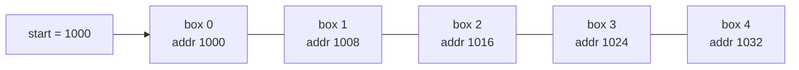
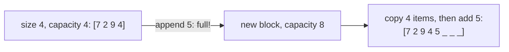
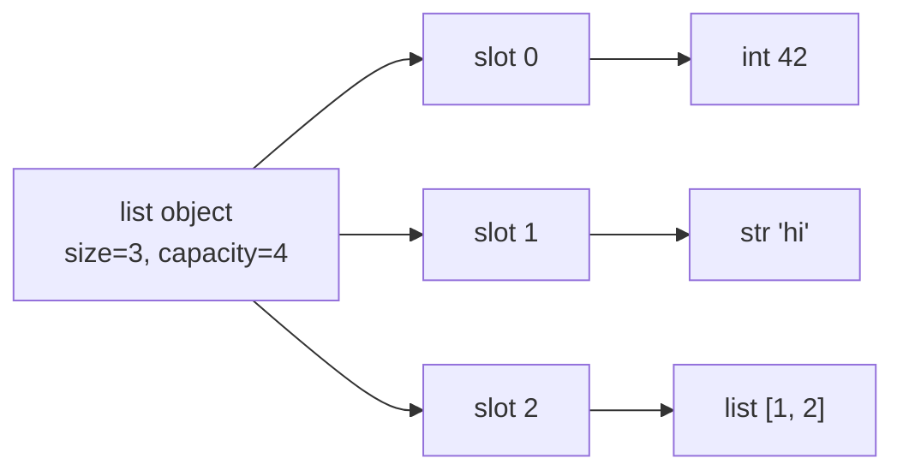

# Chapter 02 · Arrays & Strings Fundamentals

> Ek hostel corridor socho jisme 100 bilkul ek jaise rooms hain, number 0 se 99 tak. Room number pata hai toh seedha wahan chale jaate ho: kisi aur ka darwaza khatkhatane ki zaroorat nahi. Bas yahi ek property, "seedha item i pe jump karo", wajah hai ki arrays lagbhag har data structure ke neeche baithe hote hain jo tum kabhi use karoge.

**Is chapter mein tum seekhoge:**
- Array memory mein kaise rakha hota hai, aur `a[i]` O(1) kyun hai
- Static vs dynamic arrays, aur Python `list` andar se asal mein kaise kaam karti hai
- Har core operation ka asli cost (access, append, insert, delete, search, slice)
- In-place techniques aur standard traversal patterns
- **Reverse trick** se rotation, aur maximum subarray ke liye **Kadane's algorithm**
- Matrix traversal: row/column order, transpose, rotate 90°, spiral, diagonals
- DSA ke liye strings: immutability, strings efficiently banana, `ord`/`chr` tricks aur 26-slot count arrays
- Arrays aur strings ke 12 classic interview problems

**Isse pehle padho:** [Lists](../part-1-python/07-lists.md) · [Strings Deep Dive](../part-1-python/04-strings.md) · [Big-O](01-big-o-complexity.md)

---

## 🧠 The Big Idea · Asli Baat

**Array** memory mein **ek ke bagal ek** rakhe gaye barabar size ke boxes ki ek line hai. Kyunki har box same size ka hai aur sab chipak ke rakhe hain, computer kisi bhi box ko ek multiplication aur ek addition se dhoondh leta hai:

```text
address of box i = start address + i × box size
```



Box 3 chahiye? 1000 + 3 × 8 = 1024. Ho gaya. Array mein 5 boxes hon ya 5 billion: **ek hi calculation**. Yahi O(1) random access hai, array ki superpower.

Is superpower ki keemat: boxes itne tight pack hain ki beech mein naya box ghusane ki jagah hi nahi. Position 2 pe insert karna hai toh 2 se aage ke har box ko ek jagah right khisakna padega. Yeh O(n) hai.

> 🇮🇳 **Desi Analogy:** Railway reservation chart pe coach S4 ki berths socho: berth 1, 2, 3... sab ek line mein, sab same size. TC ko berth 37 chahiye toh woh gin-gin ke nahi jaata, seedha 37 pe pahunchta hai (start + 37 = **O(1) access**). Ab socho beech mein ek naya passenger ko berth 5 pe bithana hai aur saari berths bhari hain. Toh berth 5 se aage wale har passenger ko ek berth aage khisakna padega. Woh hai **O(n) insert**. Aakhri wali khaali berth pe naya passenger bithana? Koi nahi khiskega: **O(1) append**.

> 💡 **The core insight:** arrays **"position i padho ya likho"** aur **"end pe add ya remove karo"** mein kamaal hain, aur **"beech mein ya aage insert ya delete karo"** mein kharab. Is chapter ka har array trick bas yahi hai: saste operations use karo, mehnge waale avoid karo.

**String** basically characters ka ek array hai, Python mein ek extra rule ke saath: ek baar ban gayi toh badal nahi sakti. Yeh baat bahut matter karti hai, aage dekhenge.

---

## 🔨 Building It Up · Zero Se Shuru

### 1. Memory layout: contiguous boxes

Tumhare computer ki memory (RAM) bytes ki ek giant numbered line hai. Array usme se ek lagataar hissa apna bana leta hai. 64-bit integers ka array har element ke liye 8 bytes use karta hai, toh element i, element 0 ke 8 × i bytes baad shuru hota hai.

Python ki standard library mein `array` module mein ek asli typed array hai. Chalo uska element size dekhte hain:

```python
from array import array

nums = array("q", [10, 20, 30, 40])   # "q" = signed 64-bit integers
print(nums.itemsize, "bytes per element")
print("element 2 is", nums[2])
print("byte offset of element 2:", 2 * nums.itemsize)
```

```text
8 bytes per element
element 2 is 30
byte offset of element 2: 16
```

Abhi kya hua: har element exactly 8 bytes ka hai, toh element 2 start se 16 bytes baad baitha hai. Barabar sizes + koi gap nahi = turant addressing.

Ek doosra, chhupa hua fayda bhi hai: **cache locality**. Jab CPU RAM se ek box padhta hai, woh uske padosiyon ka ek poora chunk (ek **cache line**, aam taur pe 64 bytes) apne fast cache mein le aata hai. Array ko left se right chalne ka matlab agla element aksar pehle se cache mein hota hai. Isiliye array pe ek simple loop practice mein bahut fast hota hai.

> 🇮🇳 **Desi Analogy:** Kirana store pe tum ek Parle-G maangne gaye. Dukaandaar godown se sirf ek packet nahi laata, poora carton utha laata hai aur counter pe rakh deta hai. Ab agle 23 packets maangoge toh seedha counter se milenge, godown nahi jaana. Godown = RAM, counter = cache, carton = cache line. Array ke elements carton mein line se rakhe hain, isliye agla element hamesha counter pe ready hota hai.

### 2. Static vs dynamic arrays

**Static array** ka size bante waqt fix ho jaata hai (jaise C mein `int a[10]`). Bhar gaya toh bhar gaya.

**Dynamic array** apne aap badhta hai. Woh apni **size** (jitne boxes use ho rahe hain) se badi ek **capacity** (jitne boxes reserve hain) rakhta hai. Jab size capacity tak pahunchti hai, toh woh:

1. ek naya, bada block reserve karta hai (ek constant factor bada),
2. sab kuch usme copy karta hai,
3. purana block free kar deta hai.



Jaisa tumne [Chapter 01](01-big-o-complexity.md) mein dekha, constant factor se badhne se `append` **O(1) amortized** ban jaata hai: kabhi-kabhi wali O(n) copy bahut saare saste appends mein bat jaati hai.

| | Static array | Dynamic array |
|---|---|---|
| Size | banate waqt fix | badhta/ghatta hai |
| End pe append | bhar gaya toh impossible | O(1) amortized |
| Memory | exact | thodi spare capacity |
| Examples | C arrays, Java `int[]` | Python `list`, Java `ArrayList`, C++ `vector` |

> 🇮🇳 **Desi Analogy:** Shaadi mein caterer ko 100 guests bataye, par woh 125 plates ka intezaam karta hai (capacity > size). Extra guests aate gaye, plates milti gayi, koi tension nahi (O(1) append). Lekin 126th guest aaya toh caterer ko bada hall book karna padta hai aur saara setup wahan shift karna padta hai (resize + copy, O(n)). Smart caterer har baar double se bada hall leta hai, isliye shifting kabhi-kabhi hi hoti hai.

### 3. How a Python list really works

Python list ek dynamic array hai, lekin **pointers** ka, values ka nahi. Har slot mein ek object ka memory address hota hai, aur woh object kahin aur rehta hai.



Isse teen cheezein samajh aati hain jo beginners ko confuse karti hain:

1. **List mixed types rakh sakti hai.** Har slot same size ka hai (ek pointer, 8 bytes), chahe woh kisi ko bhi point kare.
2. **`a[i]` O(1) hai**, mixed types ke saath bhi: tum pointer array ko index karte ho, phir ek pointer follow karte ho.
3. **`[[0] * 3] * 3` ek trap hai.** Yeh same inner list ka *pointer* teen baar copy karta hai.

```python
bad = [[0] * 3] * 3          # EK hi inner list ke teen pointers
bad[0][0] = 9
print(bad)

good = [[0] * 3 for _ in range(3)]   # teen alag inner lists
good[0][0] = 9
print(good)
```

```text
[[9, 0, 0], [9, 0, 0], [9, 0, 0]]
[[9, 0, 0], [0, 0, 0], [0, 0, 0]]
```

Abhi kya hua: `bad` mein teeno rows ek hi object hain, toh ek ko badlo toh teeno "badal" jaati hain. Grids hamesha comprehension se banao.

> 🤔 **Mann mein sawaal:** `[0] * 3` toh theek kaam karta hai, phir `[[0] * 3] * 3` mein problem kyun?
>
> **Jawab:** `* 3` kabhi naye objects nahi banata, sirf pointers copy karta hai. `[0] * 3` mein teeno slots same `0` object ko point karte hain, lekin `0` ek int hai jo badal hi nahi sakta. Jab tum `a[0] = 9` likhte ho, slot 0 ka pointer ek naye `9` pe chala jaata hai, baaki slots ko farak nahi padta. `[[0] * 3] * 3` mein teeno slots ek hi **list** ko point karte hain, aur list mutable hai. `bad[0][0] = 9` us shared list ko andar se badalta hai, toh teeno "rows" mein dikhta hai. Comprehension har iteration mein `[0] * 3` dobara chalata hai, isliye har row alag object hai.

Spare capacity ko kaam karte hue dekh bhi sakte ho: append karte waqt list ka memory size sirf kabhi-kabhi jump karta hai.

```python
import sys

a = []
last = sys.getsizeof(a)
jumps = 0
for i in range(100):
    a.append(i)
    size = sys.getsizeof(a)
    if size != last:          # memory badhi: yahan resize hua
        jumps += 1
        last = size
print("appends:", len(a), "| fewer than 20 resizes:", jumps < 20)
```

```text
appends: 100 | fewer than 20 resizes: True
```

(Resizes ki exact ginti Python versions ke beech alag hoti hai, lagbhag ek darjan, isiliye hum number ki jagah haan/na print karte hain. Point yeh hai: 100 appends mein se sirf gine-chune appends ne copy trigger ki.)

### 4. Core operations and their costs

| Operation | Python | Cost | Kyun |
|---|---|---|---|
| Index i padho / likho | `a[i]`, `a[i] = x` | O(1) | address ka hisaab |
| End pe append | `a.append(x)` | O(1) amortized | spare capacity |
| End se remove | `a.pop()` | O(1) | kuch shift nahi hota |
| i pe insert | `a.insert(i, x)` | O(n − i) | tail ko right shift karo |
| i pe delete | `a.pop(i)`, `del a[i]` | O(n − i) | tail ko left shift karo |
| Value se search | `x in a`, `a.index(x)` | O(n) | scan karna padega |
| Slice | `a[i:j]` | O(j − i) | elements copy hote hain |
| Length | `len(a)` | O(1) | stored hai |

Chalo apne khud ke insert function se shifting dekhte hain, jo moves ginta hai:

```python
def insert_at(arr, index, value):
    arr.append(None)                   # end pe jagah banao
    moves = 0
    for i in range(len(arr) - 1, index, -1):
        arr[i] = arr[i - 1]            # peeche se, ek step right shift
        moves += 1
    arr[index] = value
    return moves

a = [10, 20, 30, 40, 50]
print(insert_at(a, 1, 15), a)
b = [10, 20, 30, 40, 50]
print(insert_at(b, 5, 60), b)
```

```text
4 [10, 15, 20, 30, 40, 50]
0 [10, 20, 30, 40, 50, 60]
```

Abhi kya hua: aage ke paas insert karne mein 4 elements move hue; end pe insert karne mein ek bhi nahi. Hum **peeche se** shift karte hain taaki kisi value ko move karne se pehle overwrite na kar dein.

> 🤔 **Mann mein sawaal:** Aage se shift kyun nahi kar sakte? `arr[i+1] = arr[i]` left se right chalao?
>
> **Jawab:** Karke dekho `[10, 20, 30]` pe, index 0 se. Pehle step mein `arr[1] = arr[0]` → `[10, 10, 30]`. 20 gaya! Ab `arr[2] = arr[1]` → `[10, 10, 10]`. Sab barbaad. Peeche se chalo toh har value apni nayi jagah pe pahunchne ke *baad* hi uski purani jagah overwrite hoti hai. Jaise bus mein sab ek seat peeche khisak rahe hon: sabse peeche wala pehle uthta hai, warna do log ek seat pe.

### 5. In-place techniques

**In place** ka matlab hai input array ko hi modify karna, sirf O(1) extra memory ke saath, naya array banane ki jagah. Interviewers ko yeh poochna bahut pasand hai. Basic tools:

- **Swap:** `a[i], a[j] = a[j], a[i]`
- **Dono ends se two pointers** (reverse, palindrome): [Chapter 03](03-two-pointers.md)
- **Reader/writer pointers** (order rakhte hue filter karna): [Chapter 03](03-two-pointers.md)
- **Peeche se overwrite karo** jab end ki spare jagah mein merge kar rahe ho
- **Array ko hi storage ki tarah use karo** (values ko negative karke visited mark karo, matrix ki row 0 mein info store karo)

Sabse basic wala, ek range ko in place reverse karna:

```python
def reverse_range(arr, lo, hi):
    """Reverse arr[lo..hi] (inclusive) in place."""
    while lo < hi:
        arr[lo], arr[hi] = arr[hi], arr[lo]
        lo += 1
        hi -= 1

nums = [1, 2, 3, 4, 5, 6, 7]
reverse_range(nums, 2, 5)
print(nums)
```

```text
[1, 2, 6, 5, 4, 3, 7]
```

`reverse_range` ko jeb mein rakh lo: section 7 ka rotation aur kai matrix tricks isi pe chalte hain.

**Array ko hi uska hash set bana lo.** Agar values 1..n range mein hain, toh array index `value − 1` pe sign palat ke "dekh liya" mark kar sakta hai:

```python
def find_duplicates(nums):
    """Values are in 1..n; each appears once or twice. O(n) time, O(1) extra space."""
    result = []
    for x in nums:
        idx = abs(x) - 1                 # abs: ho sakta hai slot pehle hi negative ho
        if nums[idx] < 0:
            result.append(abs(x))        # pehle ek baar mark ho chuka: duplicate
        else:
            nums[idx] = -nums[idx]       # value idx+1 ko seen mark karo
    return result

print(find_duplicates([4, 3, 2, 7, 8, 2, 3, 1]))
```

```text
[2, 3]
```

Kaise hua, thoda haath se chalao. x = 4 → index 3 ka value 7 negative karo. x = 3 → index 2 ka 2 negative. x = 2 → index 1 ka 3 negative. x = 7 → index 6 ka 3 negative. x = 8 → index 7 ka 1 negative. Ab x = 2 (doosri baar) → index 1 pehle se negative hai → **2 duplicate**. Isi tarah 3 bhi pakda jaata hai. Har index ek "attendance register ka khaana" hai: value v aayi toh khaana v − 1 pe tick (minus sign). Tick pehle se laga hai? Matlab v dobara aaya.

### 6. Traversal patterns

Zyada tar array solutions in mein se ek walk hote hain. Inhe pehchaan lo, aadha code khud likh jaata hai.

```python
nums = [3, 1, 4, 1, 5]

# 1. Aage ki taraf, index aur value ke saath
print([f"{i}:{x}" for i, x in enumerate(nums)])

# 2. Peeche ki taraf
print([nums[i] for i in range(len(nums) - 1, -1, -1)])

# 3. Bagal wale pairs (padosiyon ko compare karo)
print([(nums[i - 1], nums[i]) for i in range(1, len(nums))])

# 4. Running state (chalte-chalte ek summary saath rakho)
running, best = 0, []
for x in nums:
    running += x
    best.append(running)
print(best)

# 5. Do passes: pehle left se info, phir right se
n = len(nums)
left_max = [0] * n
right_max = [0] * n
for i in range(n):
    left_max[i] = max(nums[i], left_max[i - 1] if i else nums[i])
for i in range(n - 1, -1, -1):
    right_max[i] = max(nums[i], right_max[i + 1] if i < n - 1 else nums[i])
print(left_max, right_max)
```

```text
['0:3', '1:1', '2:4', '3:1', '4:5']
[5, 1, 4, 1, 3]
[(3, 1), (1, 4), (4, 1), (1, 5)]
[3, 4, 8, 9, 14]
[3, 3, 4, 4, 5] [5, 5, 5, 5, 5]
```

Pattern 4 (running state) **prefix sums** ([Chapter 06](06-prefix-sums.md)) aur **Kadane** (section 8) ka beej hai. Pattern 5 (left pass + right pass) Trapping Rain Water aur Product of Array Except Self solve karta hai.

Pattern 5 ka output samjho: `left_max[i]` = index 0 se i tak ka sabse bada. `right_max[i]` = index i se end tak ka sabse bada. Kyunki 5 aakhri element hai, right se har position ko 5 hi dikhta hai.

**Best Time to Buy and Sell Stock** running-state pattern ka sabse shuddh roop hai: ek baar chalo, ab tak ka sabse sasta price yaad rakho, aur check karo aaj bechte toh kitna profit hota.

```python
def max_profit(prices):
    min_price = float("inf")
    best = 0
    for p in prices:
        min_price = min(min_price, p)        # ab tak kharidne ka sabse accha din
        best = max(best, p - min_price)      # aaj bechein toh profit
    return best

print(max_profit([7, 1, 5, 3, 6, 4]), max_profit([7, 6, 4, 3, 1]))
```

```text
5 0
```

> 🇮🇳 **Desi Analogy:** Sabzi mandi mein tamatar ka bhaav roz badalta hai, aur tumhe ek din kharidna hai, kisi baad wale din bechna hai. Tum roz diary mein sirf ek line likhte ho: "ab tak ka sabse sasta bhaav". Har din bas poocho: "aaj ke bhaav mein se diary wala bhaav ghataun toh kitna bachega?" Poori purani history yaad rakhne ki zaroorat nahi, ek number kaafi hai. Diary ka number = `min_price`, roz ka hisaab = `p - min_price`. Bhaav sirf girte rahe (`[7, 6, 4, 3, 1]`)? Toh trade hi mat karo, profit 0.

### 7. Rotation and the reverse trick

**Right mein k se rotate:** `[1,2,3,4,5,6,7]`, k = 3 → `[5,6,7,1,2,3,4]`. Aakhri k elements aage aa jaate hain.

**Tareeka 1, slicing:** aasaan, O(n) time, lekin O(n) extra space.

**Tareeka 2, reverse trick:** O(n) time, **O(1)** space.

1. Poora array reverse karo.
2. Pehle k reverse karo.
3. Baaki reverse karo.

```text
start:              1 2 3 4 5 6 7
reverse all:        7 6 5 4 3 2 1
reverse first 3:    5 6 7 | 4 3 2 1
reverse last 4:     5 6 7 | 1 2 3 4   ✅
```

Yeh kyun kaam karta hai: poora array reverse karne se aakhri k elements aage aa jaate hain (accha) lekin ulte (bura). Har hisse ko dobara reverse karne se har hisse ke andar ka order theek ho jaata hai, hisson ko hilaaye bina.

> 🇮🇳 **Desi Analogy:** Cricket ka batting order hai 1 se 7, aur captain ko aakhri 3 batsmen (5, 6, 7) ko upar bhejna hai. Ek trick: poori list ko ulta padho (7 6 5 4 3 2 1). Ab upar wale 3 sahi log hain, bas ulte order mein. Toh un 3 ko seedha karo (5 6 7), aur neeche wale 4 ko seedha karo (1 2 3 4). Kisi ko extra bench pe bithane ki zaroorat nahi padi, sirf jagah pe swap. Yahi O(1) space hai.

```python
def reverse_range(arr, lo, hi):
    while lo < hi:
        arr[lo], arr[hi] = arr[hi], arr[lo]
        lo += 1
        hi -= 1

def rotate_right(nums, k):
    n = len(nums)
    k %= n                       # n se rotate karna = kuch nahi; k > n bhi handle hota hai
    reverse_range(nums, 0, n - 1)
    reverse_range(nums, 0, k - 1)
    reverse_range(nums, k, n - 1)
    return nums

print(rotate_right([1, 2, 3, 4, 5, 6, 7], 3))
print(rotate_right([1, 2, 3], 4))                      # 4 % 3 = 1
print([1, 2, 3, 4, 5, 6, 7][-3:] + [1, 2, 3, 4, 5, 6, 7][:-3])   # slicing wala version
```

```text
[5, 6, 7, 1, 2, 3, 4]
[3, 1, 2]
[5, 6, 7, 1, 2, 3, 4]
```

**Left** mein k se rotate karna, right mein n − k se rotate karne jaisa hi hai. Ya pehle k reverse karo, baaki reverse karo, phir poora reverse karo.

### 8. Kadane's algorithm: maximum subarray sum

**Problem:** woh contiguous subarray dhoondho jiska sum sabse bada ho. `[-2,1,-3,4,-1,2,1,-5,4]` → 6 (`[4,-1,2,1]` se).

Brute force har start aur end try karta hai: O(n²) (ya O(n³) agar har ek ko dobara jodo).

**Kadane ki insight:** left se right chalo, aur har index pe ek hi sawaal poocho: **"Yahan khatam hone wala best subarray, pichhle wale ko aage badhaye ya is element se fresh shuru kare?"**

Agar pichhle index pe khatam hone wala best sum negative hai, toh woh sirf humein neeche kheenchega, isliye use phenk do aur fresh shuru karo.

```text
best_ending_here(i) = max(nums[i], best_ending_here(i-1) + nums[i])
answer = max over all i of best_ending_here(i)
```

> 🇮🇳 **Desi Analogy:** Tum ek naye shehar mein chai ki tapri chala rahe ho aur har din ka profit/loss likhte ho. Har subah ek sawaal: "Pichhli partnership ka total abhi tak plus mein hai ya minus mein?" Agar pichhla total minus mein hai, toh woh karza aage le jaane ka koi fayda nahi; purana khata band karo aur aaj se naya khata kholo. Agar plus mein hai, toh aaj ka din usme jod do. Saath mein ek alag diary mein "ab tak ka sabse accha khata" likhte raho. Purana khata = `current`, naya khata kholna = `current = x`, diary = `best`.

```python
def max_subarray(nums):
    current = best = nums[0]
    for x in nums[1:]:
        current = max(x, current + x)   # aage badhao, ya x se fresh shuru karo
        best = max(best, current)
    return best

print(max_subarray([-2, 1, -3, 4, -1, 2, 1, -5, 4]))
print(max_subarray([-3, -1, -2]))     # sab negative: best sabse bada akela element hai
```

```text
6
-1
```

`[-2, 1, -3, 4, -1, 2, 1, -5, 4]` pe **dry run**:

| i | x | current = max(x, current + x) | best |
|---|---|---|---|
| 0 | -2 | -2 (start) | -2 |
| 1 | 1 | max(1, -1) = 1 → fresh | 1 |
| 2 | -3 | max(-3, -2) = -2 | 1 |
| 3 | 4 | max(4, 2) = 4 → fresh | 4 |
| 4 | -1 | max(-1, 3) = 3 | 4 |
| 5 | 2 | max(2, 5) = 5 | 5 |
| 6 | 1 | max(1, 6) = 6 | 6 |
| 7 | -5 | max(-5, 1) = 1 | 6 |
| 8 | 4 | max(4, 5) = 5 | 6 |

> 🤔 **Mann mein sawaal:** Row 4 pe x = −1 hai, phir bhi current ne usse le liya (3). Negative number lena galat nahi?
>
> **Jawab:** Nahi. Fresh start ka rule *pichhle total* ke negative hone pe lagta hai, current element ke negative hone pe nahi. Row 4 pe pichhla total 4 tha (positive), toh 4 + (−1) = 3 abhi bhi −1 akele se behtar hai. Yeh −1 ek "pul" hai: agle 2 aur 1 ko 4 se jodne ke liye isse paar karna padega. Aur dekho, best answer `[4, -1, 2, 1]` mein woh −1 hai bhi.

Sirf sum nahi, asli subarray chahiye? Yaad rakho current run kahan se shuru hua tha:

```python
def max_subarray_with_range(nums):
    current, best = nums[0], nums[0]
    start = best_l = best_r = 0
    for i in range(1, len(nums)):
        if current + nums[i] < nums[i]:
            current, start = nums[i], i          # yahan se fresh shuru karo
        else:
            current += nums[i]
        if current > best:
            best, best_l, best_r = current, start, i
    return best, nums[best_l:best_r + 1]

print(max_subarray_with_range([-2, 1, -3, 4, -1, 2, 1, -5, 4]))
```

```text
(6, [4, -1, 2, 1])
```

O(n) time, O(1) space. Kadane asal mein ek chhota sa Dynamic Programming solution hai (state hai "yahan khatam hone wala best sum"); tum ise [Chapter 20](20-dp-1d.md) mein dobara pehchaanoge.

### 9. Matrix traversal

Python mein **matrix** (2D array) rows ki ek list hai: `grid[r][c]` matlab row r, column c. R rows aur C columns ke saath:

```python
grid = [
    [1, 2, 3],
    [4, 5, 6],
    [7, 8, 9],
]
R, C = len(grid), len(grid[0])

print("row-major:   ", [grid[r][c] for r in range(R) for c in range(C)])
print("column-major:", [grid[r][c] for c in range(C) for r in range(R)])
print("main diag:   ", [grid[i][i] for i in range(min(R, C))])
print("anti diag:   ", [grid[i][C - 1 - i] for i in range(min(R, C))])
```

```text
row-major:    [1, 2, 3, 4, 5, 6, 7, 8, 9]
column-major: [1, 4, 7, 2, 5, 8, 3, 6, 9]
main diag:    [1, 5, 9]
anti diag:    [3, 5, 7]
```

**Diagonal ka rule:** same "\\" diagonal pe cells ka `r − c` same hota hai; same "/" anti-diagonal pe cells ka `r + c` same hota hai. Yeh ek fact N-Queens, Valid Sudoku jaise checks aur diagonal traversals solve kar deta hai.

Khud check karo: "\\" diagonal pe (0,0), (1,1), (2,2) hain, sabka r − c = 0. "/" anti-diagonal pe (0,2), (1,1), (2,0) hain, sabka r + c = 2. Ek diagonal pe neeche jaate ho toh r ek badhta hai; "\\" mein c bhi ek badhta hai (farak same), "/" mein c ek ghatta hai (jod same).

```python
from collections import defaultdict

grid = [[1, 2, 3], [4, 5, 6], [7, 8, 9]]
by_anti = defaultdict(list)
for r in range(3):
    for c in range(3):
        by_anti[r + c].append(grid[r][c])     # same r + c = same "/" diagonal
print(dict(by_anti))
```

```text
{0: [1], 1: [2, 4], 2: [3, 5, 7], 3: [6, 8], 4: [9]}
```

**Transpose** (rows aur columns ki adla-badli: `t[c][r] = g[r][c]`). Square matrix ke liye, in place, main diagonal ke aar-paar swap karo, sirf uske upar wale cells chhoo ke:

```python
def transpose_in_place(m):
    n = len(m)
    for r in range(n):
        for c in range(r + 1, n):        # sirf diagonal ke upar, warna wapas swap ho jaayega
            m[r][c], m[c][r] = m[c][r], m[r][c]
    return m

print(transpose_in_place([[1, 2, 3], [4, 5, 6], [7, 8, 9]]))
print([list(row) for row in zip(*[[1, 2, 3], [4, 5, 6]])])   # non-square: naya banao
```

```text
[[1, 4, 7], [2, 5, 8], [3, 6, 9]]
[[1, 4], [2, 5], [3, 6]]
```

**Rotate 90° clockwise = transpose, phir har row reverse.**

```text
1 2 3    transpose    1 4 7    reverse rows    7 4 1
4 5 6   ---------->   2 5 8   ------------>    8 5 2
7 8 9                 3 6 9                    9 6 3
```

(Counter-clockwise = transpose, phir rows ka order reverse karo; ya pehle har row reverse karo, phir transpose.)

> 🇮🇳 **Desi Analogy:** Phone pe photo rotate karna yahi hai. Transpose = photo ko "\\" diagonal pe mod dena (jaise ek rumaal ko kone se kone tak fold karna). Phir har row reverse = photo ko left-right aaine mein dekhna. Fold + aaina = 90° clockwise ghuma hua photo. Dono steps jagah pe hote hain, koi doosra kaagaz nahi chahiye.

**Spiral order** pehle bahar wali ring chalta hai, phir andar wali agli ring. Chaar boundaries rakho aur unhe sikodte jao:

```python
def spiral_order(matrix):
    result = []
    top, bottom = 0, len(matrix) - 1
    left, right = 0, len(matrix[0]) - 1
    while top <= bottom and left <= right:
        for c in range(left, right + 1):          # → top row pe
            result.append(matrix[top][c])
        top += 1
        for r in range(top, bottom + 1):          # ↓ right column pe neeche
            result.append(matrix[r][right])
        right -= 1
        if top <= bottom:                         # ← bottom row pe (agar ek bachi hai)
            for c in range(right, left - 1, -1):
                result.append(matrix[bottom][c])
            bottom -= 1
        if left <= right:                         # ↑ left column pe upar (agar ek bacha hai)
            for r in range(bottom, top - 1, -1):
                result.append(matrix[r][left])
            left += 1
    return result

print(spiral_order([[1, 2, 3], [4, 5, 6], [7, 8, 9]]))
print(spiral_order([[1, 2, 3, 4], [5, 6, 7, 8], [9, 10, 11, 12]]))
```

```text
[1, 2, 3, 6, 9, 8, 7, 4, 5]
[1, 2, 3, 4, 8, 12, 11, 10, 9, 5, 6, 7]
```

Non-square matrices ke liye dono `if` checks matter karte hain: right aur down jaane ke baad, bacha hua area sirf ek row ya ek column ho sakta hai, aur checks ke bina tum use do baar chal doge.

Example: 3 × 4 matrix mein doosri ring ke time top = bottom = 1 hai (sirf row `[6, 7]` bachi). Top row pe 6, 7 likhe, `top` 2 ho gaya. Right column ka loop khaali gaya aur `right` 1 ho gaya. Ab `top <= bottom` false hai, toh bottom row nahi chalte. Check na hota toh row 1 ko ulta chal ke `matrix[1][1]` = 6 dobara likh dete.

> 🇮🇳 **Desi Analogy:** Jalebi banate dekha hai? Halwai bahar se shuru karta hai aur gol-gol andar ki taraf aata hai. Spiral bhi wahi hai, bas chaukor. Chaar deewaarein (`top`, `bottom`, `left`, `right`) hain; har side poori karke woh deewaar ek kadam andar khisak jaati hai. Jab deewaarein ek doosre ko cross kar dein, jalebi poori.

**Grid mein padosi** direction arrays se nikalte hain, jo tum graph problems mein lagataar use karoge ([Chapter 16](16-graphs-bfs-dfs.md)):

```python
grid = [[1, 2, 3], [4, 5, 6], [7, 8, 9]]
R, C = 3, 3
DIRS = [(-1, 0), (1, 0), (0, -1), (0, 1)]     # upar, neeche, left, right

def neighbours(r, c):
    for dr, dc in DIRS:
        nr, nc = r + dr, c + dc
        if 0 <= nr < R and 0 <= nc < C:       # grid ke andar hi raho
            yield grid[nr][nc]

print(sorted(neighbours(1, 1)), sorted(neighbours(0, 0)))
```

```text
[2, 4, 6, 8] [2, 4]
```

### 10. Strings for DSA

**Immutability.** Python `str` ek baar ban gayi toh badal nahi sakti. `s[0] = "x"` `TypeError` raise karta hai. Har "modification" (`s + t`, `s.replace(...)`, `s.upper()`) ek **nayi** string banata hai. Iske nateeje:

- Loop mein `+=` se string banane ka cost O(n²) ho sakta hai (har step ab tak ka sab kuch copy kar sakta hai).
- Strings dict keys aur set members ki tarah safe hain (woh hashable hain kyunki badal nahi sakti).
- Characters ko in place edit karna hai toh list mein badlo: `chars = list(s)`, edit karo, phir `"".join(chars)`.

> 🇮🇳 **Desi Analogy:** String ek printed Aadhaar card jaisi hai. Address mein ek letter galat hai? Card pe pen se nahi kaat sakte; naya card print hota hai (nayi string). Aur isi wajah se Aadhaar number pe bharosa kiya ja sakta hai, woh kabhi chupke se nahi badalta, isliye use dict key ki tarah use kar sakte ho (hashable). Agar bahut saare badlaav karne hain, toh pehle ek rough form (list) pe sab likh lo, phir ek hi baar card print karao (`"".join`).

```python
def build_slow(n):
    s = ""
    for i in range(n):
        s += str(i % 10)        # har baar s copy ho sakta hai: worst case O(n^2)
    return s

def build_fast(n):
    parts = []
    for i in range(n):
        parts.append(str(i % 10))   # O(1) amortized
    return "".join(parts)           # end mein ek O(n) pass

print(build_slow(12) == build_fast(12), build_fast(12))
```

```text
True 012345678901
```

**`ord` aur `chr`.** Har character ka ek number hota hai (uska Unicode **code point**). `ord("a")` 97 hai, `ord("b")` 98, ... `ord("z")` 122. Toh `ord(ch) - ord("a")` `a..z` ko `0..25` pe map karta hai, ekdum perfect array index.

```python
print(ord("a"), ord("z"), ord("A"), ord("0"))
print(ord("d") - ord("a"))                    # letter ki position: 3
print(chr(ord("a") + 3))                      # wapas letter: 'd'
print(chr((ord("y") - ord("a") + 3) % 26 + ord("a")))   # Caesar shift ghoom ke: 'b'
print(int("7"), ord("7") - ord("0"))          # digit char se number, do tareeke
```

```text
97 122 65 48
3
d
b
7 7
```

Caesar wali line todo: "y" ki position 24. 24 + 3 = 27. 27 % 26 = 1. Position 1 = "b". `% 26` alphabet ko ek gol ghadi bana deta hai: z ke baad wapas a.

**26-slot count array.** Jab problem kahe "sirf lowercase English letters", toh tum characters ko dict ki jagah 26 ints ki list mein gin sakte ho. Yeh O(1) space hai (26 ek constant hai), fast hai, aur list ko tuple bana ke dict key ki tarah use kar sakte ho.

```python
def letter_counts(s):
    counts = [0] * 26
    for ch in s:
        counts[ord(ch) - ord("a")] += 1
    return counts

def is_anagram(s, t):
    return len(s) == len(t) and letter_counts(s) == letter_counts(t)

print(letter_counts("banana")[:3])          # a, b, c
print(is_anagram("listen", "silent"), is_anagram("rat", "car"))
```

```text
[3, 1, 0]
True False
```

> 🤔 **Mann mein sawaal:** 26 slots ka array bhi toh memory leta hai. Use O(1) space kaise bol sakte hain?
>
> **Jawab:** Kyunki uska size input ke saath nahi badhta. String 10 letters ki ho ya 10 crore ki, array hamesha 26 slots ka rahega. Space complexity "n ke saath kaise badhta hai" poochti hai, aur yeh badhta hi nahi. Interview mein yahi bolo: "O(1) space, because the alphabet size is fixed."

DSA ke liye **kaam ke string methods**: `s.isalnum()`, `s.isalpha()`, `s.isdigit()`, `s.lower()`, `s.split()` (kisi bhi whitespace pe todta hai aur khaali pieces hata deta hai), `" ".join(words)`, `s[::-1]` (reverse), `s.startswith(p)`, `s.count(sub)`, aur jaldi frequency map ke liye `collections.Counter(s)`.

**Reverse Words in a String** inme se kai ko saath milata hai:

```python
def reverse_words(s):
    return " ".join(reversed(s.split()))     # split() extra spaces bhi hata deta hai

print(repr(reverse_words("  the sky   is blue ")))
```

```text
'blue is sky the'
```

### 11. A few classic problems, start to finish

**Saare negatives ko positives se pehle karna? Merge? Dedupe?** Woh two-pointer problems hain (agla chapter). Yahan teen pure array/string classics hain.

**Plus One:** ek number digits ki list ke roop mein store hai; usme ek jodo.

```python
def plus_one(digits):
    digits = digits[:]                       # caller ki list mat badlo
    for i in range(len(digits) - 1, -1, -1):
        if digits[i] < 9:
            digits[i] += 1
            return digits                    # koi carry nahi bacha: ho gaya
        digits[i] = 0                        # 9 + 1 = 10: 0 likho, carry aage
    return [1] + digits                      # sab 9 the: jaise 999 -> 1000

print(plus_one([1, 2, 3]), plus_one([1, 9, 9]), plus_one([9, 9]))
```

```text
[1, 2, 4] [2, 0, 0] [1, 0, 0]
```

Yeh bilkul waise hi hai jaise school mein haath se jodte the: right se shuru karo, 9 pe "0 likho, haath mein 1". Jahan pehla non-9 digit mila, wahan carry khatam.

**Longest Common Prefix** kai strings ka: column by column compare karo.

```python
def longest_common_prefix(strs):
    if not strs:
        return ""
    for i, ch in enumerate(strs[0]):
        for other in strs[1:]:
            if i == len(other) or other[i] != ch:
                return strs[0][:i]
    return strs[0]

print(longest_common_prefix(["flower", "flow", "flight"]))
print(repr(longest_common_prefix(["dog", "racecar", "car"])))
```

```text
fl
''
```

Time O(S) jahan S characters ki total ginti hai; answer ke alawa space O(1).

**Pascal's Triangle:** har row pichhli row se banti hai, ek pyaara "pichhli row → agli row" array walk.

```python
def pascal(num_rows):
    rows = [[1]]
    for _ in range(num_rows - 1):
        prev = rows[-1]
        row = [1] + [prev[i - 1] + prev[i] for i in range(1, len(prev))] + [1]
        rows.append(row)
    return rows

for row in pascal(5):
    print(row)
```

```text
[1]
[1, 1]
[1, 2, 1]
[1, 3, 3, 1]
[1, 4, 6, 4, 1]
```

---

## 🔬 Under the Hood · Andar Ki Kahani

### The CPython list struct

CPython ke andar list ek C struct hai jisme teen key fields hain: `ob_size` (kitne items use ho rahe hain), `allocated` (capacity), aur `ob_item`, jo `PyObject*` pointers ke ek C array ka pointer hai. `len(a)` bas `ob_size` return karta hai: O(1). `a[i]` check karta hai `0 <= i < ob_size` aur `ob_item[i]` return karta hai: O(1).

Jab `append` dekhta hai ki `ob_size == allocated`, CPython `list_resize` call karta hai, jo lagbhag `size + size/8 + ek chhota constant` ki nayi capacity choose karta hai. Yeh lagbhag 12.5% growth hai, jo doubling se narm hai (kam memory waste), lekin phir bhi ek constant factor hai, toh append amortized O(1) hi rehta hai.

End se `pop()` kabhi shift nahi karta. Jab list apni capacity ke aadhe se neeche sikud jaati hai, CPython allocation ko bhi chhota kar sakta hai, taaki memory hamesha ke liye waste na pade.

### Why a list of ints uses more memory than you'd think

Har slot ek 8-byte pointer hai, aur har `int` ek poora Python object hai (chhoti values ke liye lagbhag 28 bytes). Toh ek million ints ki list lagbhag 8 MB pointers ka plus int objects ka kharcha karti hai. (CPython −5 se 256 tak ke chhote ints cache karta hai, toh chhote repeat hone wale numbers se bhari list un objects ko share karti hai.) Typed `array("q", ...)` raw 8-byte numbers store karta hai, har element ka alag object nahi, aur NumPy jaisi libraries bhi yahi karti hain. Isiliye numeric kaam ke liye NumPy chhota bhi hai aur tez bhi.

### Why `insert(0, x)` is O(n) but still feels fast

CPython pointers ko `memmove` se shift karta hai, jo ek bahut optimised C routine hai aur memory ko bade blocks mein move karta hai. Toh kuch hazaar elements pe tumhe farak nahi dikhega. Lekin phir bhi yeh linear hai: n baar karo aur tumne ek O(n²) algorithm likh diya. Aage baar-baar operations ke liye `collections.deque` use karo ([Chapter 12](12-queues-deques.md)).

### How strings are stored

CPython ek string ko fixed-width code units ke compact array ki tarah store karta hai: agar har character Latin-1 mein fit hota hai toh 1 byte per character, agar har character Basic Multilingual Plane ke andar hai toh 2 bytes, warna 4 bytes. Ek string ke saare characters same width use karte hain, aur bilkul isiliye `s[i]` phir bhi O(1) hai: yeh phir se array indexing hai. String apna hash pehli baar compute hone ke baad cache bhi kar leti hai, toh same string ko baar-baar dict key ki tarah use karna sasta hai.

Ek mazedaar nateeja: `"hello"` 1 byte per character mein store hoti hai, lekin usme ek emoji jod do toh *poori* string 4 bytes per character pe chali jaati hai. Kyun? Kyunki saare characters ki width same honi chahiye, tabhi `start + i × width` wala formula chalega.

### Row-major order and why loop order matters

C aur NumPy mein 2D array ek lamba block hota hai jisme rows ek ke baad ek store hoti hain (**row-major**). Row by row iterate karna memory ko order mein chalta hai (cache-friendly); column by column iterate karna har step pe ek poori row jitna koodta hai. Plain Python mein har row ek alag list hai, toh effect kam hai, lekin "outer loop rows pe, inner columns pe" phir bhi natural aur sabse fast default hai.

---

## 🧩 Pattern Decoder · Pattern Pakdo

### Signals: which array technique?

| Problem mein dikhe... | Socho |
|---|---|
| "maximum / minimum **subarray** sum", negatives ke saath "contiguous" | **Kadane** |
| "best time to buy and sell", "i < j ke saath max difference" | **running min/max** (ek pass) |
| "array ko k se rotate karo", "O(1) extra space" | **reverse trick** |
| "image / matrix ko 90° rotate karo" | **transpose + reverse rows** |
| "spiral", "layer by layer" | **chaar sikudti boundaries** |
| "diagonal", "anti-diagonal", "queens" | **r − c** aur **r + c** keys |
| "sirf lowercase letters", "anagram" | **26-slot count array** |
| "values range 1..n mein", "O(1) extra space" | **array ko hi hash bana lo** (negate / index pe swap) |
| "har element ke liye, uske left aur right ke sab ke baare mein kuch" | **do passes** (left array + right array) |
| "in place", "elements remove / move karo" | reader/writer two pointers ([Chapter 03](03-two-pointers.md)) |
| "condition wala contiguous subarray (sum ≥ k, at most k distinct)" | sliding window ([Chapter 04](04-sliding-window.md)) |
| negatives ke saath "subarray sum equals k" | prefix sums + hashmap ([Chapter 06](06-prefix-sums.md)) |

### Template A: one-pass with running state

```py
def one_pass(nums):
    state = initial_state()          # jaise ab tak ka min, yahan khatam hone wala best, count
    answer = initial_answer()
    for x in nums:
        state = update(state, x)     # x ko summary mein mila lo
        answer = better(answer, state)
    return answer
```

### Template B: Kadane (best subarray ending here)

```py
def kadane(nums):
    current = best = nums[0]
    for x in nums[1:]:
        current = max(x, current + x)   # badhao ya restart
        best = max(best, current)
    return best
```

### Template C: matrix boundaries (spiral / layers)

```py
top, bottom, left, right = 0, R - 1, 0, C - 1
while top <= bottom and left <= right:
    # top row chalo (left..right), phir top += 1
    # right column chalo (top..bottom), phir right -= 1
    # agar top <= bottom: bottom row chalo (right..left), phir bottom -= 1
    # agar left <= right: left column chalo (bottom..top), phir left += 1
```

### Template D: frequency array for letters

```py
counts = [0] * 26
for ch in s:
    counts[ord(ch) - ord("a")] += 1
key = tuple(counts)       # hashable signature: saare anagrams ke liye same
```

### Variation 1: Maximum Product Subarray (Kadane with a twist)

**Problem:** contiguous subarray ka sabse bada product. `[2,3,-2,4]` → 6.

**Idea:** ek negative number sabse bade product ko sabse chhota bana deta hai aur ulta bhi. Toh yahan khatam hone wala max aur min product, **dono** track karo. Jab `x` negative ho, aage badhane se pehle dono ko swap kar do.

```python
def max_product(nums):
    cur_max = cur_min = best = nums[0]
    for x in nums[1:]:
        if x < 0:
            cur_max, cur_min = cur_min, cur_max     # negative bade aur chhote ko palat deta hai
        cur_max = max(x, cur_max * x)
        cur_min = min(x, cur_min * x)
        best = max(best, cur_max)
    return best

print(max_product([2, 3, -2, 4]), max_product([-2, 0, -1]), max_product([-2, 3, -4]))
```

```text
6 0 24
```

O(n) time, O(1) space.

`[-2, 3, -4]` pe socho: −2 × 3 = −6 abhi sabse *chhota* hai. Lekin agla −4 aaya toh −6 × −4 = 24, sabse *bada* ban gaya. Agar sirf max track karte toh −6 ko phenk chuke hote. Isliye min bhi sambhaal ke rakho: aaj ka villain, kal ka hero ban sakta hai.

### Variation 2: Product of Array Except Self (two passes)

**Problem:** `out[i]` = `nums[i]` ko chhod ke har element ka product, division ke bina. `[1,2,3,4]` → `[24,12,8,6]`.

**Idea:** `out[i]` = (i ke left mein sab ka product) × (i ke right mein sab ka product). Left-to-right ek pass left products bharta hai; right-to-left ek pass right products multiply karta hai.

```python
def product_except_self(nums):
    n = len(nums)
    out = [1] * n
    left = 1
    for i in range(n):
        out[i] = left            # nums[0..i-1] ka product
        left *= nums[i]
    right = 1
    for i in range(n - 1, -1, -1):
        out[i] *= right          # gunaa nums[i+1..n-1] ka product
        right *= nums[i]
    return out

print(product_except_self([1, 2, 3, 4]))
```

```text
[24, 12, 8, 6]
```

O(n) time, O(1) extra space (output count nahi hota). Is pattern ko [Chapter 06](06-prefix-sums.md) mein apna alag treatment milta hai.

| i | left pass ke baad `out[i]` (left product) | right product | final `out[i]` |
|---|---|---|---|
| 0 | 1 | 2·3·4 = 24 | 24 |
| 1 | 1 | 3·4 = 12 | 12 |
| 2 | 1·2 = 2 | 4 | 8 |
| 3 | 1·2·3 = 6 | 1 | 6 |

### Variation 3: Majority Element (Boyer–Moore voting)

**Problem:** ek value n/2 se zyada baar aati hai. Use O(n) time aur O(1) space mein dhoondho.

**Idea:** majority ke har vote ko ek alag vote ke saath jodi banao aur dono ko cancel kar do. Kyunki majority ke paas aadhe se zyada votes hain, woh poori tarah cancel nahi ho sakti. Ek `candidate` aur ek `count` rakho: same value → count badhao, alag → count ghatao, count 0 hua → naya candidate.

> 🇮🇳 **Desi Analogy:** Stadium ke bahar IPL fans ki bheed hai, aur rule hai: alag-alag team ke do fans mile toh dono bahas karte-karte ghar chale jaate hain (ek jodi cancel). Agar ek team ke fans poori bheed ke aadhe se zyada hain, toh saari jodiyan banne ke baad bhi uske kuch fans bachenge, kyunki baaki sab milake bhi itne nahi ki sabko cancel kar sakein. Jo aakhir mein khada hai, uski team majority hai. `candidate` = abhi jis team ke fans maidan mein hain, `count` = unme se kitne khade hain.

```python
def majority_element(nums):
    candidate, count = None, 0
    for x in nums:
        if count == 0:
            candidate = x
        count += 1 if x == candidate else -1
    return candidate

print(majority_element([2, 2, 1, 1, 1, 2, 2]))
```

```text
2
```

`[2, 2, 1, 1, 1, 2, 2]` pe **dry run**:

| x | candidate pehle | count pehle | action | count baad mein |
|---|---|---|---|---|
| 2 | None | 0 | naya candidate 2, +1 | 1 |
| 2 | 2 | 1 | same, +1 | 2 |
| 1 | 2 | 2 | alag, −1 | 1 |
| 1 | 2 | 1 | alag, −1 | 0 |
| 1 | 2 | 0 | naya candidate 1, +1 | 1 |
| 2 | 1 | 1 | alag, −1 | 0 |
| 2 | 1 | 0 | naya candidate 2, +1 | 1 |

Final candidate: 2. (Agar majority ki guarantee nahi hai, toh candidate ko ginne ke liye ek doosra pass karo.)

### Variation 4: Set Matrix Zeroes (use the matrix as storage)

**Problem:** agar koi cell 0 hai, toh uski poori row aur column ko 0 kar do, in place.

**Idea:** tumhe yaad rakhna hai ki kaunsi rows aur columns zero karni hain. Do extra arrays ki jagah, **row 0 aur column 0 ko markers ki tarah use karo**, plus ek flag ki row 0 mein khud koi zero tha ya nahi.

```python
def set_zeroes(m):
    R, C = len(m), len(m[0])
    first_row_zero = any(m[0][c] == 0 for c in range(C))
    for r in range(1, R):
        for c in range(C):
            if m[r][c] == 0:
                m[r][0] = 0          # row r mark karo
                m[0][c] = 0          # column c mark karo
    for r in range(1, R):
        for c in range(C - 1, -1, -1):   # right se left, taaki column 0 ka marker sabse aakhir mein padha jaaye
            if m[r][0] == 0 or m[0][c] == 0:
                m[r][c] = 0
    if first_row_zero:
        for c in range(C):
            m[0][c] = 0
    return m

print(set_zeroes([[1, 1, 1], [1, 0, 1], [1, 1, 1]]))
print(set_zeroes([[0, 1, 2, 0], [3, 4, 5, 2], [1, 3, 1, 5]]))
```

```text
[[1, 0, 1], [0, 0, 0], [1, 0, 1]]
[[0, 0, 0, 0], [0, 4, 5, 0], [0, 3, 1, 0]]
```

O(R·C) time, O(1) extra space.

Row 0 ke liye alag flag kyun? Kyunki row 0 khud ek "notice board" ban gayi hai jisme column markers likhe hain. Agar hum pehle hi row 0 ko zero kar dein, toh saare column markers mit jaayenge aur har column zero ho jaayega. Isliye row 0 ka apna hisaab ek alag variable mein rakhte hain aur use sabse aakhir mein lagaate hain.

### When NOT to use plain array tricks

- **Beech mein ya aage bahut saare inserts/deletes** → linked list ([Chapter 10](10-linked-lists.md)) ya deque ([Chapter 12](12-queues-deques.md)).
- **Bahut saare "x hai kya?" queries** → set, baar-baar `x in list` nahi ([Chapter 05](05-hashing.md)).
- **Bahut saare range-sum queries** → prefix sums ([Chapter 06](06-prefix-sums.md)), har baar dobara jodna nahi.
- **Length limit ya extra condition wala Kadane** ("exactly k length ka subarray") → woh sliding window hai.
- **a–z ke bahar ke letters** (Unicode, mixed case, digits) → dict / `Counter` use karo, 26-array nahi.

---

## ⚠️ Traps & Common Mistakes · Yahan Sab Phisalte Hain

1. **`[[0] * C] * R` se grid banana.** Saari rows ek hi list share karti hain. `[[0] * C for _ in range(R)]` use karo.

2. **Rotation mein `k %= n` bhool jaana.** 7 elements pe k = 10 se rotate karna reverse trick ko tod deta hai (aur `n = 0` ko alag se handle karna padega, warna `k %= 0` pe `ZeroDivisionError`).

3. **Kadane ko 0 se initialise karna.**

```py
# ❌ [-3, -1, -2] ke liye 0 return karta hai (empty subarray allowed nahi hai)
best = current = 0

# ✅ pehle element se shuru karo
best = current = nums[0]
```

4. **List pe loop chalate hue usi se remove karna.** Elements skip ho jaate hain. Reader/writer use karo ya nayi list banao.

5. **Lambe loop mein `s += ch`.** List mein jama karo aur end mein `"".join`.

6. **String mein assign karne ki koshish.** `s[i] = "x"` fail hota hai. `list(s)` se convert karo.

7. **Non-square matrices pe spiral order mein off-by-one:** `if top <= bottom` / `if left <= right` checks bhoolne se aakhri row ya column duplicate ho jaata hai.

8. **Square matrix ko har (r, c) swap karke transpose karna.** Har pair do baar swap hota hai, aur original wapas aa jaata hai. Sirf `c > r` pe loop karo.

9. **Uppercase ya digits pe `ord(ch) - 97` use karna.** Negative ya range ke bahar ka index deta hai. Constraints check karo, ya `.lower()` se normalise karo.

10. **Caller ki list ko bina bataaye badal dena.** Agar function ko apna input nahi badalna chahiye, toh pehle copy karo (`a[:]`), aur interview mein yeh bolo bhi.

> 🤔 **Mann mein sawaal:** Loop chalate hue remove karne se element skip kyun hota hai?
>
> **Jawab:** `nums = [2, 2, 3]` pe `for x in nums: if x == 2: nums.remove(x)` chalao. Loop index 0 pe hai, pehla 2 hata. Ab list `[2, 3]` hai, aur loop agle index 1 pe jaata hai, jahan 3 baitha hai. Doosra 2 index 0 pe khisak gaya tha, toh loop ne use dekha hi nahi. Result `[2, 3]`, galat. Jaise queue mein tum gin rahe ho aur aage wala nikal gaya: sab ek kadam aage aaye, aur tumhari ungli ek bande ko skip kar gayi.

---

## 💡 Tips & Tricks · Pro Wale Moves

- `a[-1]` aakhri element hai, `a[-k:]` aakhri k. `a[::-1]` reverse karta hai (ek copy). `a.reverse()` in place reverse karta hai.
- `enumerate(a)` index aur value deta hai; `zip(a, b)` do lists ko saath chalata hai; `zip(*grid)` transpose karta hai.
- `for row in grid: print(*row)` matrix ko saaf print karta hai.
- `float("inf")` aur `float("-inf")` min/max trackers ke liye badhiya starting values hain.
- `max(nums, key=...)`, `min(...)`, `sum(...)` C-speed loops hain; simple kaam ke liye haath se likhe loops ki jagah inhe prefer karo.
- Index tricks: beech wala `n // 2` hai; i ka mirror `n - 1 - i` hai; 2D cell (r, c) flatten hoke `r * C + c` banta hai aur `divmod(idx, C)` se wapas.
- Letter problems mein 26-array ko "O(1) space because the alphabet is fixed" bol ke mention karo. Interviewers ko yeh sunna accha lagta hai.
- Jab O(1) space maanga jaaye, khud se poocho: "Kya input khud mera hisaab-kitaab store kar sakta hai?" (negation, row 0 markers, values ko unke index pe swap karna).

---

## 🎯 Interview Questions · Interview Mein Yahi Poochenge

### 1. Best Time to Buy and Sell Stock 🔥🔥🔥

Ek din khareedo, baad ke kisi din becho; profit maximise karo.

<details><summary>Answer dekho 👀</summary>

Running-minimum pattern: har din ke liye, aaj bechte toh profit = price − pehle dekha gaya sabse sasta price. Ek pass.

```python
def max_profit(prices):
    min_price, best = float("inf"), 0
    for p in prices:
        min_price = min(min_price, p)
        best = max(best, p - min_price)
    return best

print(max_profit([7, 1, 5, 3, 6, 4]))
```

```text
5
```

Time O(n), space O(1).

> 🗣️ **Interview mein aise bolo:** "I walk through the prices once, keeping the minimum price seen so far. For each day, the best profit if I sell today is today's price minus that minimum, and I keep the maximum of those. That's O(n) time and O(1) space, and if prices only fall the answer is 0."

</details>

### 2. Maximum Subarray 🔥🔥🔥

<details><summary>Answer dekho 👀</summary>

Kadane: `current = max(x, current + x)`, best track karo. Code aur dry run section 8 mein dekho. Time O(n), space O(1). "Divide and conquer use karo" wala follow-up bhi hota hai (O(n log n)), lekin expected answer Kadane hi hai. Key sentence: "a negative running sum can only hurt the future, so restart."

> 🗣️ **Interview mein aise bolo:** "I'll use Kadane's algorithm. At each index, the best subarray ending there either extends the previous one or starts fresh at the current element, whichever is larger, because a negative running sum can only hurt the future. I track the maximum of these values, which gives O(n) time and O(1) space, and I initialise with the first element so all-negative arrays work."

</details>

### 3. Rotate Array 🔥🔥🔥

Right mein k se in place rotate karo.

<details><summary>Answer dekho 👀</summary>

`k %= n` ke baad: poora reverse karo, pehle k reverse karo, baaki reverse karo.

```python
def rotate(nums, k):
    def rev(lo, hi):
        while lo < hi:
            nums[lo], nums[hi] = nums[hi], nums[lo]
            lo += 1; hi -= 1
    n = len(nums)
    k %= n
    rev(0, n - 1); rev(0, k - 1); rev(k, n - 1)
    return nums

print(rotate([1, 2, 3, 4, 5, 6, 7], 3), rotate([-1, -100, 3, 99], 2))
```

```text
[5, 6, 7, 1, 2, 3, 4] [3, 99, -1, -100]
```

Time O(n), space O(1). Slicing wala version `nums[:] = nums[-k:] + nums[:-k]` bhi mention karo (O(n) space).

> 🗣️ **Interview mein aise bolo:** "First I take k modulo n. Then I reverse the whole array, which brings the last k elements to the front but backwards, and then I reverse the first k and the remaining n minus k separately to fix their order. Every element is swapped a constant number of times, so it's O(n) time and O(1) extra space."

</details>

### 4. Rotate Image 🔥🔥🔥

n × n matrix ko 90° clockwise in place rotate karo.

<details><summary>Answer dekho 👀</summary>

Transpose karo (main diagonal ke aar-paar swap), phir har row reverse karo.

```python
def rotate_image(m):
    n = len(m)
    for r in range(n):
        for c in range(r + 1, n):
            m[r][c], m[c][r] = m[c][r], m[r][c]
    for row in m:
        row.reverse()
    return m

for row in rotate_image([[1, 2, 3], [4, 5, 6], [7, 8, 9]]):
    print(row)
```

```text
[7, 4, 1]
[8, 5, 2]
[9, 6, 3]
```

Time O(n²), space O(1).

> 🗣️ **Interview mein aise bolo:** "A 90-degree clockwise rotation equals a transpose followed by reversing each row. I transpose in place by swapping only the cells above the main diagonal, so nothing gets swapped twice, then reverse every row. That's O(n²) time, which is optimal since every cell moves, and O(1) extra space."

</details>

### 5. Spiral Matrix 🔥🔥🔥

<details><summary>Answer dekho 👀</summary>

Chaar boundaries (`top`, `bottom`, `left`, `right`), ring chalo, sikodo, repeat karo. Bottom row aur left column ke liye do guard checks yaad rakho. Code aur output section 9 mein. Time O(R·C), output ke alawa space O(1).

> 🗣️ **Interview mein aise bolo:** "I keep four boundaries: top, bottom, left and right. I walk the top row, the right column, then the bottom row and the left column, shrinking each boundary after I use it. Before the bottom and left walks I check that the boundaries haven't crossed, so a single remaining row or column isn't visited twice. It's O(R times C) time and O(1) extra space."

</details>

### 6. Set Matrix Zeroes 🔥🔥

<details><summary>Answer dekho 👀</summary>

Easy version: zero wali rows aur columns do sets mein record karo, phir unhe zero karo: O(R + C) space. Optimal: row 0 aur column 0 ko markers ki tarah use karo plus row 0 ke liye ek flag, isse O(1) extra space milta hai. Code Pattern Decoder mein (Variation 4). Time O(R·C).

</details>

### 7. Valid Anagram 🔥🔥🔥

<details><summary>Answer dekho 👀</summary>

Letters ko 26-array se gino (ya Unicode ke liye `Counter`). Lengths match honi chahiye.

```python
def is_anagram(s, t):
    if len(s) != len(t):
        return False
    counts = [0] * 26
    for a, b in zip(s, t):
        counts[ord(a) - ord("a")] += 1
        counts[ord(b) - ord("a")] -= 1
    return all(c == 0 for c in counts)

print(is_anagram("anagram", "nagaram"), is_anagram("rat", "car"))
```

```text
True False
```

Time O(n), space O(1). Alternative: `sorted(s) == sorted(t)` O(n log n) hai.

Trick dekho: ek hi array mein `s` ke letters `+1` aur `t` ke letters `−1`. Anagram hain toh har letter jitna aaya utna gaya, sab zero.

> 🗣️ **Interview mein aise bolo:** "If the lengths differ, it's not an anagram. Otherwise I use a 26-slot count array: increment for each letter of s and decrement for each letter of t. If every count ends at zero, they're anagrams. That's O(n) time and O(1) space since the alphabet is fixed; for Unicode I'd use a hash map instead."

</details>

### 8. Majority Element 🔥🔥

<details><summary>Answer dekho 👀</summary>

Boyer–Moore voting: ek candidate aur ek count rakho; count 0 → current element ko candidate bana lo; same → +1, alag → −1. Code aur dry run Variation 3 mein. Time O(n), space O(1). `Counter` wala solution O(n) space hai; sort karke `nums[n // 2]` lena O(n log n) hai.

</details>

### 9. Maximum Product Subarray 🔥🔥

<details><summary>Answer dekho 👀</summary>

Yahan khatam hone wala max aur min product dono track karo; negative unhe swap kar deta hai. Code Variation 1 mein. Time O(n), space O(1). Zeros dono ko apne aap reset kar dete hain kyunki x = 0 ke saath `max(x, ...)` restart karta hai.

</details>

### 10. Longest Common Prefix 🔥🔥

<details><summary>Answer dekho 👀</summary>

Vertical scan: pehli string ke har index ke liye, check karo ki baaki har string mein wahan same character hai. Pehle mismatch pe ya kisi bhi string ke end pe ruk jao. Code section 11 mein. Time O(S) total characters, space O(1).

Ek smart alternative: strings ko sort karo; poori list ka common prefix pehli aur aakhri string ke common prefix ke barabar hota hai (sorting ki wajah se O(S log n)).

(Kyun? Sorted order mein pehli aur aakhri string sabse "door" hain. Jo prefix in dono mein common hai, beech wali har string unke beech sort hui hai, toh usme bhi woh prefix hona hi chahiye. Jaise dictionary mein "flight" aur "flower" ke beech jo bhi word hai, woh "fl" se hi shuru hoga.)

</details>

### 11. Reverse Words in a String 🔥🔥

<details><summary>Answer dekho 👀</summary>

`" ".join(reversed(s.split()))`. Bina argument ka `split()` shuru ke, end ke aur repeat hone wale spaces sab handle kar leta hai. Time O(n), space O(n). Agar "in place" karne ko kahein (char array pe, jaise C/Java mein): poora array reverse karo, phir har word reverse karo, phir reader/writer pass se extra spaces saaf karo. Yeh phir se reverse trick hai.

</details>

### 12. Find All Duplicates in an Array 🔥🔥

Values `1..n` mein hain; har ek ek baar ya do baar aati hai. Do baar aane wali values O(n) time aur O(1) extra space mein dhoondho.

<details><summary>Answer dekho 👀</summary>

Array ko hash ki tarah use karo: har value v ke liye, index `|v| − 1` dekho. Agar woh pehle se negative hai, v duplicate hai; warna use negative kar do. Code section 5 mein.

```python
def find_duplicates(nums):
    out = []
    for x in nums:
        i = abs(x) - 1
        if nums[i] < 0:
            out.append(abs(x))
        else:
            nums[i] = -nums[i]
    return out

print(find_duplicates([4, 3, 2, 7, 8, 2, 3, 1]), find_duplicates([1, 1, 2]))
```

```text
[2, 3] [1]
```

Time O(n), output ke alawa space O(1). (Yeh input ko badal deta hai. Mention karo ki baad mein signs wapas restore kar sakte ho.)

</details>

### 13. String Compression 🔥

`["a","a","b","b","c","c","c"]` ko in place `["a","2","b","2","c","3"]` mein compress karo aur nayi length return karo.

<details><summary>Answer dekho 👀</summary>

Reader/writer: reader barabar chars ka har run dhoondhta hai; writer char likhta hai, phir count ke digits (sirf agar count > 1).

```python
def compress(chars):
    write = read = 0
    while read < len(chars):
        ch, start = chars[read], read
        while read < len(chars) and chars[read] == ch:
            read += 1
        chars[write] = ch
        write += 1
        run = read - start
        if run > 1:
            for d in str(run):
                chars[write] = d
                write += 1
    return write

arr = list("aabbccc")
k = compress(arr)
print(k, arr[:k])
arr2 = list("abbbbbbbbbbbb")
k2 = compress(arr2)
print(k2, arr2[:k2])
```

```text
6 ['a', '2', 'b', '2', 'c', '3']
4 ['a', 'b', '1', '2']
```

Time O(n), space O(1). Writer kabhi reader se aage nahi nikalta, kyunki ek run ka compressed form kabhi run se lamba nahi hota.

(Check karo: run length 1 → 1 char likha. Run length 2 → 2 chars ("b2"). Run length 12 → 3 chars ("b12"). Hamesha ≤ run length. Isliye writer jo overwrite karta hai, woh reader pehle hi padh chuka hota hai.)

</details>

---

## 🏋️ Practice · Ab Tumhari Baari

**🟢 1. Second largest distinct value** ek pass mein, ya None agar exist nahi karti.

<details><summary>Solution dekho 👀</summary>

```python
def second_largest(nums):
    first = second = None
    for x in nums:
        if first is None or x > first:
            first, second = x, first
        elif x != first and (second is None or x > second):
            second = x
    return second

print(second_largest([3, 5, 1, 5, 4]), second_largest([7, 7]))
```

```text
4 None
```

Naya champion aaya toh purana champion runner-up ban jaata hai (`first, second = x, first`). `x != first` wala check isliye, taaki 5 dobara aaye toh runner-up na ban jaaye; humein *distinct* second chahiye.

</details>

**🟢 2. Check karo array sorted aur rotated hai ya nahi** (jaise `[3,4,5,1,2]` → True). Hint: "drops" gino.

<details><summary>Solution dekho 👀</summary>

Sorted-then-rotated array mein zyada se zyada ek jagah `nums[i] > nums[i+1]` hota hai, aakhri se pehle element tak ka wrap-around mila ke.

```python
def check_rotated_sorted(nums):
    n = len(nums)
    drops = sum(1 for i in range(n) if nums[i] > nums[(i + 1) % n])
    return drops <= 1

print(check_rotated_sorted([3, 4, 5, 1, 2]), check_rotated_sorted([2, 1, 3, 4]))
```

```text
True False
```

`[3,4,5,1,2]`: drops sirf 5 → 1 pe (2 → 3 wrap pe drop nahi). Ek drop, True. `[2,1,3,4]`: 2 → 1 pe drop, aur wrap 4 → 2 pe bhi drop. Do drops, False.

</details>

**🟢 3. First unique character** lowercase string mein; uska index return karo ya −1.

<details><summary>Solution dekho 👀</summary>

```python
def first_uniq_char(s):
    counts = [0] * 26
    for ch in s:
        counts[ord(ch) - ord("a")] += 1
    for i, ch in enumerate(s):
        if counts[ord(ch) - ord("a")] == 1:
            return i
    return -1

print(first_uniq_char("leetcode"), first_uniq_char("loveleetcode"), first_uniq_char("aabb"))
```

```text
0 2 -1
```

</details>

**🟡 4. Diagonal Traverse:** R × C matrix ke elements zigzag diagonal order mein return karo. `[[1,2,3],[4,5,6],[7,8,9]]` → `[1,2,4,7,5,3,6,8,9]`.

<details><summary>Solution dekho 👀</summary>

`r + c` se group karo. Even diagonals upar ki taraf jaate hain (natural top-to-bottom order ko reverse karo).

```python
def find_diagonal_order(mat):
    R, C = len(mat), len(mat[0])
    diags = [[] for _ in range(R + C - 1)]
    for r in range(R):
        for c in range(C):
            diags[r + c].append(mat[r][c])
    out = []
    for d, items in enumerate(diags):
        out.extend(reversed(items) if d % 2 == 0 else items)
    return out

print(find_diagonal_order([[1, 2, 3], [4, 5, 6], [7, 8, 9]]))
```

```text
[1, 2, 4, 7, 5, 3, 6, 8, 9]
```

</details>

**🟡 5. Maximum Circular Subarray Sum.** Array ghoom ke wapas aata hai. `[5,-3,5]` → 10.

<details><summary>Solution dekho 👀</summary>

Ya toh best subarray wrap nahi karta (normal Kadane), ya wrap karta hai, aur tab woh total − (minimum subarray) hai. Agar saare numbers negative hain, toh "wrap" wala answer ek empty array hoga, isliye normal Kadane wala answer return karo.

```python
def max_circular(nums):
    cur_max = cur_min = 0
    best_max, best_min = nums[0], nums[0]
    total = 0
    for x in nums:
        cur_max = max(x, cur_max + x)
        best_max = max(best_max, cur_max)
        cur_min = min(x, cur_min + x)
        best_min = min(best_min, cur_min)
        total += x
    return best_max if best_max < 0 else max(best_max, total - best_min)

print(max_circular([5, -3, 5]), max_circular([1, -2, 3, -2]), max_circular([-3, -2, -3]))
```

```text
10 3 -2
```

Wrap wala case aise socho: gol table pe khaana rakha hai. Jo plates tum *nahi* uthaate, woh ek lagataar tukda hai. Toh "sabse accha wrap-around tukda uthao" = "total mein se sabse bekaar lagataar tukda chhod do". `[5, -3, 5]` mein bekaar tukda `[-3]` hai, toh 7 − (−3) = 10.

</details>

**🟡 6. Spiral Matrix II:** 1..n² se spiral order mein bhara n × n matrix generate karo.

<details><summary>Solution dekho 👀</summary>

Wahi chaar boundaries; padhne ki jagah likho.

```python
def generate_spiral(n):
    m = [[0] * n for _ in range(n)]
    top, bottom, left, right = 0, n - 1, 0, n - 1
    k = 1
    while top <= bottom and left <= right:
        for c in range(left, right + 1):
            m[top][c] = k; k += 1
        top += 1
        for r in range(top, bottom + 1):
            m[r][right] = k; k += 1
        right -= 1
        if top <= bottom:
            for c in range(right, left - 1, -1):
                m[bottom][c] = k; k += 1
            bottom -= 1
        if left <= right:
            for r in range(bottom, top - 1, -1):
                m[r][left] = k; k += 1
            left += 1
    return m

for row in generate_spiral(4):
    print(row)
```

```text
[1, 2, 3, 4]
[12, 13, 14, 5]
[11, 16, 15, 6]
[10, 9, 8, 7]
```

</details>

**🔴 7. First Missing Positive** O(n) time aur O(1) extra space mein. `[3,4,-1,1]` → 2.

<details><summary>Solution dekho 👀</summary>

Answer `1..n+1` mein hai. `1..n` ki har value v ko swap karke index `v − 1` pe rakho ("cyclic sort"). Phir pehla index i jahan `nums[i] != i + 1`, wahi answer deta hai. Har swap ek value ko uski final jagah pe pahuncha deta hai, toh total mein zyada se zyada n swaps: O(n).

```python
def first_missing_positive(nums):
    n = len(nums)
    for i in range(n):
        while 1 <= nums[i] <= n and nums[nums[i] - 1] != nums[i]:
            j = nums[i] - 1
            nums[i], nums[j] = nums[j], nums[i]     # nums[i] ko uske ghar bhejo
    for i in range(n):
        if nums[i] != i + 1:
            return i + 1
    return n + 1

print(first_missing_positive([3, 4, -1, 1]), first_missing_positive([1, 2, 0]),
      first_missing_positive([7, 8, 9]))
```

```text
2 3 1
```

Answer `1..n+1` mein hi kyun? n slots hain. Best case mein woh 1, 2, ..., n se bhare hain, tab answer n + 1. Warna 1..n mein se kuch na kuch missing hai. Isliye n se badi values aur negatives ko ignore kar sakte hain.

> 🇮🇳 **Desi Analogy:** Hostel ke rooms 1 se n tak hain, aur students galat rooms mein baithe hain. Har student ko uske apne room (number v → room v − 1) mein bhej do; jo pehle se sahi jagah hai ya jiska room number hostel mein hai hi nahi (negative ya n se bada), woh jahan hai wahi rahe. Sab set hone ke baad, pehla room jisme sahi student nahi hai, wahi missing number hai.

</details>

**🔴 8. Game of Life (in place).** 0/1 cells ke board ko copy ke bina agli generation pe update karo.

<details><summary>Solution dekho 👀</summary>

Ek cell mein do states encode karo: bit 0 current state hai, bit 1 agli. Live neighbours `cell & 1` se gino, bit 1 set karo, phir sab kuch 1 se right shift kar do.

```python
def game_of_life(board):
    R, C = len(board), len(board[0])
    for r in range(R):
        for c in range(C):
            live = 0
            for dr in (-1, 0, 1):
                for dc in (-1, 0, 1):
                    if (dr or dc) and 0 <= r + dr < R and 0 <= c + dc < C:
                        live += board[r + dr][c + dc] & 1
            if (board[r][c] & 1 and live in (2, 3)) or (not board[r][c] & 1 and live == 3):
                board[r][c] |= 2                 # "agli generation mein zinda" mark karo
    for r in range(R):
        for c in range(C):
            board[r][c] >>= 1                    # agli state current ban jaati hai
    return board

for row in game_of_life([[0, 1, 0], [0, 0, 1], [1, 1, 1], [0, 0, 0]]):
    print(row)
```

```text
[0, 0, 0]
[1, 0, 1]
[0, 1, 1]
[0, 1, 0]
```

Do bits ka matlab: value 0 = abhi mara, aage bhi mara. 1 = abhi zinda, aage mara. 2 = abhi mara, aage zinda. 3 = abhi zinda, aage bhi zinda. `& 1` hamesha "abhi" wala bit padhta hai, isliye update ho chuke padosi bhi galat count nahi dete.

</details>

---

## 🧠 Never-Forget Summary · Kabhi Mat Bhoolna

- Array = barabar size ke boxes ek ke bagal ek → `a[i]` ek address calculation hai → O(1).
- Beech/aage insert aur delete elements ko shift karte hain → O(n). End wale operations O(1) hain (append ke liye amortized).
- Python list **pointers** ka ek dynamic array hai jo lagbhag 12.5% zyada allocate karti hai.
- Grids comprehension se banao, kabhi `[[0]*C]*R` nahi.
- **k se rotate** = poora reverse, pehle k reverse, baaki reverse (`k %= n` ke baad).
- **Kadane**: `current = max(x, current + x)`; jab past sirf nuksaan de, restart karo.
- **90° clockwise rotate** = transpose + har row reverse. **Spiral** = chaar sikudti deewaarein.
- Diagonals ka `r − c` same hota hai; anti-diagonals ka `r + c` same hota hai.
- Strings immutable hain: list + `"".join` se banao. `ord(ch) - ord("a")` → 0..25 index.
- O(1) space tricks: reverse, swap, negate-as-marker, row-0 markers, cyclic sort.

**Memory hooks:**
- **"Arrays: jump fast, shift slow."**
- **"Flip all, flip parts"** → rotation.
- **"Transpose, then mirror"** → rotate image.
- **"Bad past? Fresh start."** → Kadane.

**🪝 Yaad rakhne ka jugaad:** *"Index pe jhatpat, beech mein khatpat."* (Known index pe O(1), beech mein insert/delete pe shifting ka jhanjhat.) Aur Kadane ke liye: **"Purana khata minus mein? Band karo, naya kholo."** Rotation ke liye: **"Poora ulta, phir tukde seedhe."**

**One picture:**

| Kaam | Technique | Time | Space |
|---|---|---|---|
| i ko access / update | index | O(1) | O(1) |
| k se rotate | reverse trick | O(n) | O(1) |
| Max subarray sum | Kadane | O(n) | O(1) |
| Buy/sell stock | running min | O(n) | O(1) |
| Matrix rotate | transpose + reverse rows | O(n²) | O(1) |
| Spiral order | 4 boundaries | O(R·C) | O(1) |
| Anagram check | 26-count array | O(n) | O(1) |
| Majority element | Boyer–Moore | O(n) | O(1) |

> **Agar sirf ek cheez yaad rakhni hai:** arrays **ends** pe aur **pata index** pe saste hain, **beech** mein mehnge. Har solution aisa design karo ki tum wahin raho jahan arrays saste hain.

---
**Aage:** [Chapter 03 · Two Pointers](03-two-pointers.md)  ·  **Wapas** [Contents](../README.md)
