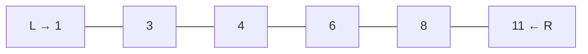
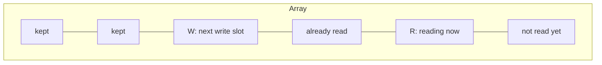

# Chapter 03 · Two Pointers

> Socho ek lamba corridor hai, dono taraf khazane ke sandook rakhe hain. Do scouts hain: ek corridor ke shuru se chalta hai, doosra end se. Har step pe sirf ek aage badhta hai. Jo kaam akela scout sau chakkar laga ke karta, ye dono milke ek hi walk mein kar dete hain. Bas yahi poora trick hai, aur isi se kai **O(n²)** problems **O(n)** ban jaati hain.

**Is chapter mein tum seekhoge:**
- Array problems mein "pointer" ka matlab kya hai (yeh bas ek index hai)
- Is pattern ke teen shapes: **opposite ends**, **same direction (reader/writer)**, aur **two arrays**
- Ek pointer move karne se answer kabhi skip *kyun* nahi hota (woh proof idea jisse sab click karta hai)
- Har shape ke liye ek reusable template
- Problem ki wording se 10 second ke andar two-pointer problem kaise pehchaanein
- 10 classic interview problems, step by step solve kiye hue

**Isse pehle padho:** [Big-O](01-big-o-complexity.md) · [Arrays & Strings Fundamentals](02-arrays-strings.md)

---

## 🧠 The Big Idea · Asli Baat

Maan lo tumhare paas ek **sorted** list hai aur tumhe do numbers chahiye jinka sum 10 ho:

```text
index:   0   1   2   3   4   5
value:   1   3   4   6   8   11
```

Brute-force tareeka har pair check karta hai: (1,3), (1,4), (1,6), ... Yeh lagbhag n²/2 pairs hain. 100,000 numbers ke liye, yeh 5 billion checks hain. Bahut slow.

Two-pointer tareeka ek ungli sabse chhote number pe rakhta hai aur ek sabse bade pe:



- 1 + 11 = 12. **Bahut bada.** Sum chhota karne ka ek hi tareeka hai: right wala number chhota lo. **R** ko left move karo.
- 1 + 8 = 9. **Bahut chhota.** Badhane ka ek hi tareeka hai: left wala number bada lo. **L** ko right move karo.
- 3 + 8 = 11. Bahut bada. R ko left move karo.
- 3 + 6 = 9. Bahut chhota. L ko right move karo.
- 4 + 6 = 10. **Mil gaya!**

Pandrah ki jagah paanch checks. Aur worst case mein bhi kabhi n se zyada checks nahi, kyunki har step ek ungli ko andar ki taraf move karta hai aur woh sirf ek baar mil sakti hain.

> 🇮🇳 **Desi Analogy:** Shaadi mein do log gift envelopes gin rahe hain. Envelopes amount ke hisaab se sorted line mein rakhe hain. Ek banda sabse chhote wale pe khada hai, doosra sabse bade wale pe. Target hai "do envelopes jinka total ₹10,000 ho". Total zyada aaya? Bade wala ek step peeche aata hai, kyunki chhote wale ko aage badhane se total aur badhega. Total kam aaya? Chhote wala aage badhta hai. Har step pe ek poori line ke combinations ek saath reject ho jaate hain. Yahi **two pointers** hai.

> 💡 **The core insight:** har comparison tumhe sirf ek pair nahi, possibilities ki ek poori row ek saath phenkne deta hai. Speed wahin se aati hai.

---

## 🔨 Building It Up · Zero Se Shuru

### 1. A "pointer" is just an index

C jaisi languages mein pointer ek memory address hota hai. Array problems mein jab log "pointer" bolte hain, toh unka matlab bas **ek variable jisme index hai**, jaise `left = 0` aur `right = len(nums) - 1`. Kuch fancy nahi.

```python
nums = [10, 20, 30, 40, 50]
left, right = 0, len(nums) - 1
print(nums[left], nums[right])

left += 1
right -= 1
print(nums[left], nums[right])
```

```text
10 50
20 40
```

Abhi kya hua: humne do integers badal ke pointers ko "move" kiya. Har two-pointer algorithm bas ek loop hai jo har step pe decide karta hai ki **kaunsa integer badalna hai**.

### 2. Shape #1: Opposite ends (converging pointers)

Dono ends se shuru karo, ek doosre ki taraf chalo, jab milo tab ruk jao.

```python
def reverse_in_place(chars):
    left, right = 0, len(chars) - 1
    while left < right:
        chars[left], chars[right] = chars[right], chars[left]   # swap
        left += 1
        right -= 1
    return chars

print(reverse_in_place(list("python")))
```

```text
['n', 'o', 'h', 't', 'y', 'p']
```

Abhi kya hua: har step do positions ek saath theek karta hai (sabse bahar wala abhi tak na theek hua pair), toh n/2 swaps lagte hain aur O(1) extra memory. Condition `left < right` hai (`<=` nahi): jab dono barabar hote hain, woh beech wale element ko point karte hain, jise swap karne ki zaroorat nahi.

> 🤔 **Mann mein sawaal:** `left < right` ya `left <= right`? Mujhe hamesha confusion hota hai.
>
> **Jawab:** Khud se poocho: "jab `left == right` ho, tab kya us akele element pe kuch kaam bacha hai?" Reverse ya palindrome mein beech wala element khud se hi swap/compare hoga, jo bekaar hai, toh `<`. Pair sum mein ek element ko khud ke saath jodna allowed nahi, toh `<`. Lekin Boats to Save People (Q10) mein aakhri akele bande ko bhi boat chahiye, toh wahan `<=`. Rule ratna nahi, yeh ek sawaal poochna hai.

**Palindrome check** wahi shape hai, swap ki jagah compare:

```python
def is_palindrome(s):
    left, right = 0, len(s) - 1
    while left < right:
        if s[left] != s[right]:
            return False
        left += 1
        right -= 1
    return True

print(is_palindrome("racecar"), is_palindrome("rocket"))
```

```text
True False
```

### 3. Opposite ends + a decision: Pair sum in a sorted array

Yeh Big Idea wala example code mein hai. Decision rule iska dil hai.

```python
def pair_with_sum(nums, target):
    """nums is sorted ascending. Return indexes of two numbers summing to target."""
    left, right = 0, len(nums) - 1
    while left < right:
        total = nums[left] + nums[right]
        if total == target:
            return [left, right]
        elif total < target:
            left += 1        # bada sum chahiye -> bada left number
        else:
            right -= 1       # chhota sum chahiye -> chhota right number
    return []

print(pair_with_sum([1, 3, 4, 6, 8, 11], 10))
print(pair_with_sum([1, 2, 3], 100))
```

```text
[2, 3]
[]
```

Target 10 ke liye **dry run**:

| step | left | right | nums[left] + nums[right] | decision |
|---|---|---|---|---|
| 1 | 0 | 5 | 1 + 11 = 12 | bahut bada → right-- |
| 2 | 0 | 4 | 1 + 8 = 9 | bahut chhota → left++ |
| 3 | 1 | 4 | 3 + 8 = 11 | bahut bada → right-- |
| 4 | 1 | 3 | 3 + 6 = 9 | bahut chhota → left++ |
| 5 | 2 | 3 | 4 + 6 = 10 | ✅ mil gaya |

### 4. Shape #2: Same direction (reader / writer)

Dono pointers left se shuru hote hain. Ek **fast** pointer (reader) har element dekhta hai. Ek **slow** pointer (writer) mark karta hai ki agla "rakha hua" element kahan jaana chahiye. Isi tarah tum ek array ko O(1) extra memory ke saath **in place** filter karte ho.



`write` ke left mein sab kuch tayyar answer hai. `write` aur `read` ke beech sab kachra hai jise overwrite karne ki humein ijazat hai.

> 🇮🇳 **Desi Analogy:** Board exam ki answer sheets check ho rahi hain. Ek examiner (reader) har sheet uthata hai aur dekhta hai: pass ya fail. Ek clerk (writer) ek file banata ja raha hai jisme sirf pass wali sheets line se lagti hain. Examiner har sheet dekhta hai, clerk sirf tab aage badhta hai jab sheet rakhni ho. Clerk kabhi examiner se aage nahi nikal sakta, isliye woh jo jagah bharta hai, woh pehle hi check ho chuki hoti hai. Aakhir mein file ki pehli `write` sheets hi result hain.

**Saare zeroes end mein bhejo** (baaki ka order rakhte hue):

```python
def move_zeroes(nums):
    write = 0
    for read in range(len(nums)):
        if nums[read] != 0:
            nums[write], nums[read] = nums[read], nums[write]
            write += 1
    return nums

print(move_zeroes([0, 1, 0, 3, 12]))
```

```text
[1, 3, 12, 0, 0]
```

**Sorted array se duplicates hatao**, nayi length return karte hue:

```python
def remove_duplicates(nums):
    if not nums:
        return 0
    write = 1                          # nums[0] hamesha rakha jaata hai
    for read in range(1, len(nums)):
        if nums[read] != nums[write - 1]:   # aakhri rakhi value se alag hai
            nums[write] = nums[read]
            write += 1
    return write

arr = [0, 0, 1, 1, 1, 2, 2, 3, 3, 4]
k = remove_duplicates(arr)
print(k, arr[:k])
```

```text
5 [0, 1, 2, 3, 4]
```

Abhi kya hua: array sorted hai, isliye duplicates padosi hain. Hum ek value tabhi rakhte hain jab woh humari aakhri *rakhi hui* value se alag ho.

> 🤔 **Mann mein sawaal:** `nums[read] != nums[read - 1]` se compare karein ya `nums[write - 1]` se? Dono same nahi?
>
> **Jawab:** Is problem mein dono chal jaate hain, kyunki sorted array mein `read - 1` aur aakhri kept value same hi hoti hai. Lekin `nums[write - 1]` ("jo maine *rakha* hai usse compare karo") wali aadat sahi hai, kyunki Remove Duplicates II (Q8) mein tumhe `nums[write - 2]` chahiye, aur wahan `read - 2` galat answer deta hai: writer ne kuch values overwrite kar di hoti hain, aur reader ke peeche ka data bharosemand nahi rehta.

### 5. Shape #3: Two arrays, one pointer each

Jab tumhare paas **do sorted sequences** hon, toh unhe saath-saath chalo, har array ka ek pointer, aur hamesha chhoti value wale pointer ko aage badhao. Yahi merge sort ka "merge" step hai.

```python
def merge_sorted(a, b):
    i = j = 0
    out = []
    while i < len(a) and j < len(b):
        if a[i] <= b[j]:
            out.append(a[i]); i += 1
        else:
            out.append(b[j]); j += 1
    out.extend(a[i:])     # inme se zyada se zyada ek mein
    out.extend(b[j:])     # kuch bacha hota hai
    return out

print(merge_sorted([1, 4, 7, 10], [2, 3, 8]))
```

```text
[1, 2, 3, 4, 7, 8, 10]
```

> 🇮🇳 **Desi Analogy:** Do Mumbai local trains ki platform queues, dono mein log height ke hisaab se line mein khade hain. Ab dono queues ko ek gate se nikaalna hai, height order mein hi. Gatekeeper sirf dono queues ke *aage wale* do logon ko dekhta hai, jo chhota hai use nikaal deta hai. Peeche walon ko dekhne ki zaroorat hi nahi, kyunki har queue khud sorted hai. Ek queue khatam? Doosri ke baaki log seedha nikal jaate hain.

Yahi walk **do sorted arrays ka intersection** aur **kya `s`, `t` ka subsequence hai** bhi solve karta hai:

```python
def is_subsequence(s, t):
    i = 0                       # s ke andar pointer
    for ch in t:                # t ka pointer khud loop hai
        if i < len(s) and s[i] == ch:
            i += 1
    return i == len(s)

print(is_subsequence("ace", "abcde"), is_subsequence("aec", "abcde"))
```

```text
True False
```

### 6. Combining with an outer loop: 3Sum

Bahut saare "k numbers dhoondho" problems ek outer loop hain jo ek number fix karta hai, plus baaki ke liye two pointers. 3Sum famous wala hai: `nums[i]` fix karo, phir uske right wale hisse mein ek pair dhoondho jiska sum `-nums[i]` ho.

```python
def three_sum(nums):
    nums.sort()
    result = []
    for i in range(len(nums) - 2):
        if i > 0 and nums[i] == nums[i - 1]:
            continue                       # duplicate pehle numbers skip karo
        if nums[i] > 0:
            break                          # sorted: ab 0 tak pahunchne ka koi tareeka nahi
        left, right = i + 1, len(nums) - 1
        while left < right:
            total = nums[i] + nums[left] + nums[right]
            if total < 0:
                left += 1
            elif total > 0:
                right -= 1
            else:
                result.append([nums[i], nums[left], nums[right]])
                left += 1
                right -= 1
                while left < right and nums[left] == nums[left - 1]:
                    left += 1              # duplicate doosre numbers skip karo
    return result

print(three_sum([-1, 0, 1, 2, -1, -4]))
```

```text
[[-1, -1, 2], [-1, 0, 1]]
```

Time: sorting O(n log n) plus pointer walks ke liye n × O(n), toh **O(n²)**. Yeh brute force O(n³) ko hara deta hai.

Chhota sa walk-through: sort ke baad `[-4, -1, -1, 0, 1, 2]`. i = 0 (−4): baaki mein 4 ka pair chahiye, sabse bada 1 + 2 = 3, nahi milega. i = 1 (−1): 1 ka pair chahiye, mile `[-1, 2]` aur `[0, 1]`. i = 2 (−1 phir se): duplicate, skip, warna wahi triplets dobara aate. i = 3 (0): `[1, 2]` ka sum 3, nahi. Bas.

`if nums[i] > 0: break` kyun? Agar sabse chhota (fixed) number hi positive hai, toh uske right wale sab usse bade ya barabar hain, sab positive. Teen positives ka sum 0 ho hi nahi sakta.

---

## 🔬 Under the Hood · Andar Ki Kahani

### Why moving a pointer never skips the answer

Yeh woh hissa hai jo zyada tar tutorials skip kar dete hain, aur isiliye log two pointers "ratt" lete hain aur phir ek variation pe fail ho jaate hain. Chalo pair-sum rule ko prove karte hain.

Maan lo `nums[left] + nums[right] > target`. Ab **har** woh pair socho jo `right` ko `left` aur `right` ke beech ke kisi index `k` ke saath use karta hai:

- Array sorted hai, toh `nums[k] >= nums[left]`.
- Toh `nums[k] + nums[right] >= nums[left] + nums[right] > target`.

`right` wala **har** pair bahut bada hai. Toh `right` kabhi answer ka hissa ho hi nahi sakta, aur hum `right -= 1` karke use safely phenk sakte hain. Ek comparison ne abhi n tak pairs eliminate kar diye.

"Bahut chhota" ke liye mirror argument kaam karta hai: `left` wala har pair bahut chhota hai, toh `left` bekaar hai.

> 🤔 **Mann mein sawaal:** Ek pointer ko move karne se kahin sahi answer skip toh nahi ho jaata?
>
> **Jawab:** Nahi. Jab `nums[L] + nums[R]` bahut bada hai, toh `nums[R]` kisi bhi bache hue left number ke saath bhi bada hi rahega, kyunki baaki sab left numbers `nums[L]` se bade ya barabar hain. Matlab `R` kisi answer ka hissa ho hi nahi sakta. Usse phenkna safe hai. Aur `L` ke left wale numbers? Woh toh pehle hi phenke ja chuke hain, aur unhe bhi isi tarah ke proof se phenka gaya tha.

Ek table mein socho. Rows = left index, columns = right index, har cell ek pair hai. Shuru mein poora upar ka triangle "candidate" hai. Har comparison ek poori row (left phenko) ya ek poora column (right phenko) kaat deta hai. n − 1 kaatne ke baad sab khatam. Isiliye n² cells sirf n steps mein check ho jaate hain.

> 💡 **General rule:** two-pointer move tab valid hai jab tum yeh argue kar sako ki "jo element main phenk raha hoon, woh kisi bhi behtar answer ka hissa nahi ho sakta." Agar yeh argument nahi bana sakte, toh two pointers galat tool hai.

### Why it's O(n)

Har loop iteration `left` ko right ya `right` ko left move karta hai (ya dono). Gap `right - left` n−1 se shuru hota hai aur har iteration mein kam se kam 1 ghatta hai. Woh 0 se neeche nahi ja sakta. Toh zyada se zyada n−1 iterations. Reader/writer shape mein `read` pointer har index ko exactly ek baar visit karta hai, woh bhi O(n).

### Memory

Upar ke saare shapes constant number ke integer variables use karte hain: **O(1) extra space**, merge ko chhod ke (jo ek nayi output list banata hai). Isiliye interviewers ko two pointers bahut pasand hain: jab woh kehte hain "in place karo" ya "O(1) extra space", toh aksar unhe two pointers hi chahiye.

---

## 🧩 Pattern Decoder · Pattern Pakdo

### Signals: when to reach for two pointers

| Problem mein dikhe... | Socho |
|---|---|
| "sorted array", "sum X wala pair / triplet dhoondho" | Opposite ends |
| "palindrome", "reverse", "dono ends se compare karo" | Opposite ends |
| "do lines ke beech area / width maximise karo" | Opposite ends + chhoti side move karo |
| "in place", "O(1) extra space", "elements remove / move karo" | Reader / writer |
| "sorted array se duplicates hatao" | Reader / writer |
| "do sorted arrays / lists", "merge", "intersection" | Har array ka ek pointer |
| "is subsequence" | Har sequence ka ek pointer |
| "linked list ka middle / cycle / end se k-th" | Fast & slow pointers ([Chapter 10](10-linked-lists.md)) |
| "condition wala contiguous subarray" | Shayad **sliding window** ([Chapter 04](04-sliding-window.md)), jo two pointers ka hi ek special shape hai |

### Template A: Opposite ends

```py
def opposite_ends(arr):
    left, right = 0, len(arr) - 1
    while left < right:
        # 1. arr[left], arr[right] dekho
        # 2. agar yahi answer hai -> record / return
        # 3. decide karo kaunsi side phenki ja sakti hai (proof!), woh pointer move karo
        if condition_to_move_left(arr[left], arr[right]):
            left += 1
        else:
            right -= 1
    return answer
```

### Template B: Reader / writer

```py
def reader_writer(arr):
    write = 0
    for read in range(len(arr)):
        if keep(arr[read]):          # har problem mein sirf yahi badalta hai
            arr[write] = arr[read]
            write += 1
    return write                     # arr[:write] result hai
```

### Template C: Two sequences

```py
def two_sequences(a, b):
    i = j = 0
    while i < len(a) and j < len(b):
        if a[i] < b[j]:   i += 1     # ya: a[i] le lo
        elif a[i] > b[j]: j += 1     # ya: b[j] le lo
        else:                        # barabar: match handle karo
            i += 1; j += 1
    # agar problem ko chahiye toh bache hue handle karo
```

### Variation: Container With Most Water (move the shorter side)

**Problem:** `height[i]` position i pe ek khadi line hai. Do lines chuno jo x-axis ke saath milke sabse zyada paani rakh sakein. Area = `min(h[l], h[r]) * (r - l)`.

**Idea:** sabse chaude container se shuru karo. **Chhoti** line height ko limit karti hai. Ab us chhoti line ko kisi bhi andar wali line ke saath jodo: width pakka kam hogi, aur height chhoti line se upar ja hi nahi sakti. Matlab chhoti line ka har bacha hua pair abhi wale area se behtar ho hi nahi sakta. Toh chhoti line bekaar hai: use phenk do. (Isi wajah se badi line ko move karna bhi bekaar hai: chhoti line wahin rehti hai aur height limit karti rehti hai, sirf width ghatti hai.)

> 🇮🇳 **Desi Analogy:** Do deewaaron ke beech tarpaulin baandh ke paani jama karna hai. Paani utna hi upar jayega jitni *chhoti* deewaar hai, baaki behh jaayega. Agar tum badi deewaar ko paas laate ho, toh chaudai kam hui aur height phir bhi chhoti deewaar pe atki hai: nuksaan hi nuksaan. Ek hi umeed hai: chhoti deewaar badal ke shayad koi oonchi deewaar mil jaaye. Isliye hamesha chhoti deewaar wala pointer move karo.

```python
def max_area(height):
    left, right = 0, len(height) - 1
    best = 0
    while left < right:
        area = min(height[left], height[right]) * (right - left)
        best = max(best, area)
        if height[left] < height[right]:
            left += 1
        else:
            right -= 1
    return best

print(max_area([1, 8, 6, 2, 5, 4, 8, 3, 7]))
```

```text
49
```

O(n) time, O(1) space.

49 kahan se? Index 1 (height 8) aur index 8 (height 7): min(8, 7) × (8 − 1) = 7 × 7 = 49.

### Variation: Sort Colors / Dutch National Flag (three pointers)

**Problem:** ek array mein sirf 0s, 1s aur 2s hain. Use ek pass mein, in place sort karo.

**Idea:** teen regions rakho: `[0, low)` sab 0s, `[low, mid)` sab 1s, `(high, end]` sab 2s. `mid` beech ke unknown hisse ko scan karta hai.

```python
def sort_colors(nums):
    low, mid, high = 0, 0, len(nums) - 1
    while mid <= high:
        if nums[mid] == 0:
            nums[low], nums[mid] = nums[mid], nums[low]
            low += 1
            mid += 1
        elif nums[mid] == 1:
            mid += 1
        else:
            nums[mid], nums[high] = nums[high], nums[mid]
            high -= 1          # mid ko mat hilao: swap hoke aayi value abhi check nahi hui
    return nums

print(sort_colors([2, 0, 2, 1, 1, 0]))
```

```text
[0, 0, 1, 1, 2, 2]
```

> 🇮🇳 **Desi Analogy:** Kirana store mein ek tokri mein aloo (0), pyaaz (1) aur tamatar (2) mile hue hain. Dukaandaar beech mein khada hokar ek-ek uthata hai (`mid`). Aloo mila? Left wale dher mein (`low`) phenko. Pyaaz? Wahin rehne do, aage badho. Tamatar? Right wale dher mein (`high`) phenko, aur wahan se jo cheez badle mein aayi, use abhi dekha nahi hai, toh dobara check karo. Ek hi round mein teeno dher alag.

> 🤔 **Mann mein sawaal:** 0 ke swap ke baad `mid += 1` karte hain, lekin 2 ke swap ke baad nahi. Yeh asymmetry kyun?
>
> **Jawab:** `low` se jo value aati hai, woh `[low, mid)` region se aati hai, jo pehle hi scan ho chuka hai aur jisme sirf 1s hain (ya `low == mid` hai toh wahi element). Toh woh pakka 1 hai (ya wahi 0), dobara check karne ki zaroorat nahi. Lekin `high` se jo value aati hai, woh unknown region se hai: 0, 1, 2 kuch bhi ho sakti hai. Isliye `mid` wahin rukta hai aur agli iteration mein us nayi value ko check karta hai.

### Variation: Squares of a Sorted Array (fill from the back)

**Problem:** negatives wala sorted array, squares sorted return karo. `[-4,-1,0,3,10]` → `[0,1,9,16,100]`.

**Idea:** sabse bada square do ends mein se kisi ek pe hai. Ends compare karo, aur bada square result ke **peeche** likho.

```python
def sorted_squares(nums):
    n = len(nums)
    out = [0] * n
    left, right = 0, n - 1
    for pos in range(n - 1, -1, -1):
        if abs(nums[left]) > abs(nums[right]):
            out[pos] = nums[left] ** 2
            left += 1
        else:
            out[pos] = nums[right] ** 2
            right -= 1
    return out

print(sorted_squares([-4, -1, 0, 3, 10]))
```

```text
[0, 1, 9, 16, 100]
```

Peeche se kyun? Kyunki hum pakke se sirf *sabse bada* square jaante hain (woh kisi end pe hai). Sabse chhota beech mein kahin chhupa hai, use dhoondhne mein extra mehnat lagti. Toh jo pakka pata hai, wahi pehle likho: sabse bada, sabse peeche.

### When NOT to use two pointers

- **Unsorted array + pair sum + original indexes chahiye** → hash map use karo (Two Sum, [Chapter 05](05-hashing.md)). Sorting indexes ko gadbad kar degi.
- **Arbitrary subsets** (pairs nahi, contiguous nahi) → backtracking ya DP.
- **Tum discard rule prove nahi kar sakte.** Agar koi bhi pointer move karne se answer skip ho sakta hai, toh tumhe alag approach chahiye.

---

## ⚠️ Traps & Common Mistakes · Yahan Sab Phisalte Hain

1. **Unsorted array pe opposite ends use karna.** Discard proof ko sorted order chahiye. Pehle sort karo (agar indexes matter nahi karte), ya hashing use karo.
2. **`while left <= right` vs `while left < right`.** Pairs ke liye tumhe do *alag* elements chahiye, toh `<` use karo. `<=` se `left == right` hone pe ek element khud ke saath pair ban jaata hai.
3. **3Sum-type problems mein duplicates skip karna bhool jaana**, jisse output mein repeat triplets aate hain.
4. **Dutch flag mein `high` ke saath swap ke baad `mid` move karna.** Right se swap hoke aayi value abhi check nahi hui.
5. **Reader/writer mein off-by-one:** `write` ki jagah `write - 1` return karna. `write` pehle se hi rakhe gaye elements ki ginti ke barabar hai.
6. **`for x in arr: arr.remove(...)` se iterate karte hue modify karna.** Isse elements skip hote hain. Iski jagah reader/writer use karo:

```py
# ❌ galat: loop ke neeche list sikudti hai toh elements skip hote hain
for x in nums:
    if x == 0:
        nums.remove(x)

# ✅ sahi
write = 0
for read in range(len(nums)):
    if nums[read] != 0:
        nums[write] = nums[read]; write += 1
del nums[write:]
```

---

## 💡 Tips & Tricks · Pro Wale Moves

- Code karne se pehle **discard rule** zor se bolo: "agar sum bahut bada hai, toh `right` wala har pair bahut bada hai, isliye `right` hatao." Agar tum yeh bol sakte ho, toh code khud likh jaata hai.
- Array aur pointers kaagaz pe draw karo aur 4-step ka dry run karo. Isse 90% bugs pakde jaate hain.
- "Unsorted array se indexes return karo" → hash map. "Values / count / boolean return karo" → sorting + two pointers chalega.
- k-Sum ke liye: ek baar sort karo, phir k−2 nested loops + ek two-pointer pass, jo O(n^(k−1)) deta hai.
- Python mein swap ek line ka hai: `a[i], a[j] = a[j], a[i]`.
- Agar interviewer kahe "kya tum O(n log n) se behtar kar sakte ho?" aur input pehle se sorted hai, toh woh two-pointer O(n) solution ki taraf ishaara kar raha hai.

---

## 🎯 Interview Questions · Interview Mein Yahi Poochenge

### 1. Two Sum II – Input Array Is Sorted 🔥🔥🔥

Ek 1-indexed sorted array diya hai, un do numbers ke indexes return karo jinka sum `target` hai.

<details><summary>Answer dekho 👀</summary>

Opposite-ends pointers, bilkul Big Idea wala. 1-based indexes return karo.

```python
def two_sum_sorted(numbers, target):
    left, right = 0, len(numbers) - 1
    while left < right:
        s = numbers[left] + numbers[right]
        if s == target:
            return [left + 1, right + 1]
        if s < target:
            left += 1
        else:
            right -= 1

print(two_sum_sorted([2, 7, 11, 15], 9))
```

```text
[1, 2]
```

Time O(n), space O(1).

> 🗣️ **Interview mein aise bolo:** "Since the array is sorted, I'll use two pointers at both ends. If the sum is too large, I move the right pointer left; if it's too small, I move the left pointer right. Each step safely discards one element, so it's O(n) time and O(1) space."

</details>

### 2. Valid Palindrome 🔥🔥🔥

Ek string di hai, True return karo agar woh lowercase karne aur non-alphanumeric characters hataane ke baad palindrome hai. `"A man, a plan, a canal: Panama"` → True.

<details><summary>Answer dekho 👀</summary>

Opposite ends, jo characters letters ya digits nahi hain unhe skip karte hue.

```python
def is_valid_palindrome(s):
    left, right = 0, len(s) - 1
    while left < right:
        while left < right and not s[left].isalnum():
            left += 1
        while left < right and not s[right].isalnum():
            right -= 1
        if s[left].lower() != s[right].lower():
            return False
        left += 1
        right -= 1
    return True

print(is_valid_palindrome("A man, a plan, a canal: Panama"))
print(is_valid_palindrome("race a car"))
```

```text
True
False
```

Time O(n), space O(1). (Saaf ki hui string pe one-liner `t == t[::-1]` O(n) space hai. Dono mention karo.)

Andar wale `while` loops mein bhi `left < right` check kyun? Socho string `",,,"` hai: bina check ke `left` string ke end se bahar nikal jaata aur `IndexError` aata.

> 🗣️ **Interview mein aise bolo:** "I'll use two pointers from both ends, skipping any character that isn't alphanumeric, and compare the remaining characters case-insensitively. If any pair differs, it's not a palindrome. This is O(n) time and O(1) space, versus O(n) space if I first built a cleaned copy and compared it with its reverse."

</details>

### 3. Valid Palindrome II 🔥🔥

Kya string **zyada se zyada ek** character delete karke palindrome ban sakti hai? `"abca"` → True.

<details><summary>Answer dekho 👀</summary>

Andar ki taraf chalo. Pehle mismatch pe tumhe ek deletion milta hai: left char skip karke **ya** right char skip karke try karo, aur check karo ki baaki palindrome hai ya nahi.

```python
def valid_palindrome_ii(s):
    def is_pal(i, j):
        while i < j:
            if s[i] != s[j]:
                return False
            i += 1; j -= 1
        return True

    left, right = 0, len(s) - 1
    while left < right:
        if s[left] != s[right]:
            return is_pal(left + 1, right) or is_pal(left, right - 1)
        left += 1; right -= 1
    return True

print(valid_palindrome_ii("abca"), valid_palindrome_ii("abc"))
```

```text
True False
```

Time O(n), space O(1).

`"abca"`: a = a, aage. b ≠ c, mismatch. Option 1: b skip karo, bacha `"c"`, palindrome. True. Pehle mismatch se pehle wale characters pe dobara sochne ki zaroorat nahi, kyunki woh pehle hi match ho chuke hain.

</details>

### 4. 3Sum 🔥🔥🔥

Saare unique triplets return karo jinka sum zero hai.

<details><summary>Answer dekho 👀</summary>

Sort karo, `i` fix karo, baaki pe two pointers, duplicates skip karo. Poora code upar section 6 mein dekho. Time O(n²), output ke alawa space O(1) (sorting O(n) use kar sakti hai).

Interviewers jo follow-ups poochte hain: *3Sum Closest* (exact matches ki jagah best `abs(total - target)` track karo) aur *4Sum* (ek aur outer loop jodo).

> 🗣️ **Interview mein aise bolo:** "I sort the array, then fix each element as the first number and run a two-pointer search on the part to its right for a pair summing to its negative. I skip equal values for both the fixed element and the left pointer to avoid duplicate triplets. Sorting is O(n log n) and the n two-pointer passes are O(n²) total, with O(1) extra space apart from the output."

</details>

### 5. 3Sum Closest 🔥🔥

Woh triplet dhoondho jiska sum `target` ke sabse paas ho aur woh sum return karo.

<details><summary>Answer dekho 👀</summary>

```python
def three_sum_closest(nums, target):
    nums.sort()
    best = nums[0] + nums[1] + nums[2]
    for i in range(len(nums) - 2):
        left, right = i + 1, len(nums) - 1
        while left < right:
            s = nums[i] + nums[left] + nums[right]
            if abs(s - target) < abs(best - target):
                best = s
            if s < target:
                left += 1
            elif s > target:
                right -= 1
            else:
                return s            # exact se zyada paas nahi ja sakte
    return best

print(three_sum_closest([-1, 2, 1, -4], 1))
```

```text
2
```

Time O(n²), space O(1).

</details>

### 6. Container With Most Water 🔥🔥🔥

<details><summary>Answer dekho 👀</summary>

Opposite ends, hamesha **chhoti** line move karo (code aur proof ke liye Pattern Decoder dekho). Interviewer ke liye key sentence: "Moving the taller line can only reduce width without raising the limiting height, so the shorter line can be discarded." O(n) time, O(1) space.

> 🗣️ **Interview mein aise bolo:** "I start with the widest container, pointers at both ends. The area is limited by the shorter line, and any other container using that shorter line would be narrower and no taller, so it can't beat the current one. That means I can discard the shorter line and move its pointer inward. Each step discards one line, so it's O(n) time and O(1) space."

</details>

### 7. Trapping Rain Water 🔥🔥🔥

Bars ki heights di hain, calculate karo kitna baarish ka paani ruka hai. `[0,1,0,2,1,0,1,3,2,1,2,1]` → 6.

<details><summary>Answer dekho 👀</summary>

Bar i ke upar paani = `min(uske left mein max height, uske right mein max height) − height[i]`.

Two pointers: `left_max` aur `right_max` rakho. Agar `height[left] < height[right]`, toh right side pe pakka ek deewaar hai jo kam se kam `height[right] > height[left]` jitni oonchi hai, toh `left` pe paani sirf `left_max` se decide hota hai. `left` ko process karo aur move karo. Warna `right` ko process karo.

```python
def trap(height):
    left, right = 0, len(height) - 1
    left_max = right_max = water = 0
    while left < right:
        if height[left] < height[right]:
            left_max = max(left_max, height[left])
            water += left_max - height[left]
            left += 1
        else:
            right_max = max(right_max, height[right])
            water += right_max - height[right]
            right -= 1
    return water

print(trap([0, 1, 0, 2, 1, 0, 1, 3, 2, 1, 2, 1]))
```

```text
6
```

Time O(n), space O(1). (Alternatives: prefix-max arrays O(n) space, ya monotonic stack, [Chapter 11](11-stacks.md).)

> 🇮🇳 **Desi Analogy:** Mumbai ki baarish mein do building ke beech gali mein paani bharta hai. Kisi jagah paani kitna upar aayega, yeh *dono taraf ki sabse oonchi deewaaron mein se chhoti wali* decide karti hai. Agar tum left side pe khade ho aur jaante ho ki right side pe tumse oonchi deewaar pakka hai (`height[right]` bada hai), toh right ki exact height jaanne ki zaroorat hi nahi; tumhari limit left wali sabse oonchi deewaar (`left_max`) hai. Isliye jo side chhoti hai, uska hisaab pakka ho jaata hai, aur use process karke aage badho.

> 🗣️ **Interview mein aise bolo:** "The water above each bar is the minimum of the tallest bar on its left and on its right, minus its own height. With two pointers, whenever the left bar is shorter than the right bar, I know the right side has a wall at least that tall, so the water at the left pointer depends only on left_max. I process the smaller side and move inward, which gives O(n) time and O(1) space."

</details>

### 8. Remove Duplicates from Sorted Array II 🔥🔥

Har element **zyada se zyada do baar** aa sakta hai. In place karo aur nayi length return karo.

<details><summary>Answer dekho 👀</summary>

Reader/writer, lekin likhe hue hisse mein **do** position peeche wale element se compare karo.

```python
def remove_duplicates_ii(nums):
    write = 0
    for x in nums:
        if write < 2 or x != nums[write - 2]:
            nums[write] = x
            write += 1
    return write

arr = [1, 1, 1, 2, 2, 3]
k = remove_duplicates_ii(arr)
print(k, arr[:k])
```

```text
5 [1, 1, 2, 2, 3]
```

"Zyada se zyada k baar" tak generalise hota hai: 2 ko k se replace karo. Time O(n), space O(1).

Logic: agar `x` likhe hue hisse ke do-peeche wale element ke barabar hai, toh sorted hone ki wajah se beech wala bhi `x` hi hai, matlab `x` pehle hi do baar likha ja chuka hai. Teesri baar nahi.

</details>

### 9. Merge Sorted Array (in place) 🔥🔥🔥

`nums1` ki length m + n hai, pehle m elements valid hain aur end mein n khaali slots. `nums2` (length n) ko usme in place merge karo.

<details><summary>Answer dekho 👀</summary>

**Peeche** se bharo, taaki `nums1` ki unread values kabhi overwrite na hon.

```python
def merge_into(nums1, m, nums2, n):
    i, j, k = m - 1, n - 1, m + n - 1
    while j >= 0:
        if i >= 0 and nums1[i] > nums2[j]:
            nums1[k] = nums1[i]; i -= 1
        else:
            nums1[k] = nums2[j]; j -= 1
        k -= 1
    return nums1

print(merge_into([1, 2, 3, 0, 0, 0], 3, [2, 5, 6], 3))
```

```text
[1, 2, 2, 3, 5, 6]
```

Time O(m + n), space O(1). Hum `j >= 0` tak loop karte hain: ek baar `nums2` khatam ho gaya, toh `nums1` ka baaki hissa pehle se apni jagah pe hai.

> 🤔 **Mann mein sawaal:** Aage se merge kyun nahi kar sakte, normal merge ki tarah?
>
> **Jawab:** Aage se likhoge toh `nums1` ke abhi tak na padhe gaye elements overwrite ho jaayenge. `[1, 2, 3, ...]` mein agar `nums2` ka 2 index 1 pe likh diya, toh `nums1` ka 2 gaya. Peeche khaali slots hain, wahan likhne se kisi ka data nahi mitta. Aur `k` hamesha `i` se aage ya barabar rehta hai, toh writer reader ko kabhi nahi pakadta.

> 🗣️ **Interview mein aise bolo:** "I merge from the back, because nums1 has empty space at the end. I keep pointers at the last valid element of each array and at the last slot, and write the larger of the two values there. This never overwrites unread data, and once nums2 is exhausted the rest of nums1 is already in place. It's O(m + n) time and O(1) extra space."

</details>

### 10. Boats to Save People 🔥🔥

Har boat zyada se zyada 2 log aur ek weight `limit` le ja sakti hai. Minimum boats ki ginti dhoondho.

<details><summary>Answer dekho 👀</summary>

Sort karo. Sabse bhaari bache hue insaan ko sabse halke ke saath jodo agar dono saath fit hote hain; warna sabse bhaari akela jaata hai. (Greedy + two pointers: sabse bhaari insaan ko kisi na kisi boat mein jaana hi hai, aur sabse halka insaan uske liye sabse accha possible partner hai.)

```python
def num_rescue_boats(people, limit):
    people.sort()
    left, right = 0, len(people) - 1
    boats = 0
    while left <= right:            # <= : aakhri akele insaan ko bhi boat chahiye
        if people[left] + people[right] <= limit:
            left += 1
        right -= 1
        boats += 1
    return boats

print(num_rescue_boats([3, 2, 2, 1], 3), num_rescue_boats([3, 5, 3, 4], 5))
```

```text
3 4
```

Time O(n log n), space O(1). Yahan `left <= right` note karo: ek akele bache insaan ko bhi boat chahiye.

</details>

---

## 🏋️ Practice · Ab Tumhari Baari

**🟢 1. Sirf vowels reverse karo** ek string ke. `"hello"` → `"holle"`.

<details><summary>Solution dekho 👀</summary>

```python
def reverse_vowels(s):
    chars = list(s)
    vowels = set("aeiouAEIOU")
    left, right = 0, len(chars) - 1
    while left < right:
        if chars[left] not in vowels:
            left += 1
        elif chars[right] not in vowels:
            right -= 1
        else:
            chars[left], chars[right] = chars[right], chars[left]
            left += 1; right -= 1
    return "".join(chars)

print(reverse_vowels("hello"), reverse_vowels("leetcode"))
```

```text
holle leotcede
```

</details>

**🟢 2. Remove Element:** `val` ki saari occurrences in place hatao aur nayi length return karo.

<details><summary>Solution dekho 👀</summary>

```python
def remove_element(nums, val):
    write = 0
    for x in nums:
        if x != val:
            nums[write] = x
            write += 1
    return write

arr = [3, 2, 2, 3]
k = remove_element(arr, 3)
print(k, arr[:k])
```

```text
2 [2, 2]
```

</details>

**🟡 3. Do sorted arrays ka intersection** (duplicates utni baar rakho jitni baar dono mein aate hain). `[1,2,2,3]`, `[2,2,4]` → `[2,2]`.

<details><summary>Solution dekho 👀</summary>

```python
def intersect_sorted(a, b):
    i = j = 0
    out = []
    while i < len(a) and j < len(b):
        if a[i] < b[j]:
            i += 1
        elif a[i] > b[j]:
            j += 1
        else:
            out.append(a[i]); i += 1; j += 1
    return out

print(intersect_sorted([1, 2, 2, 3], [2, 2, 4]))
```

```text
[2, 2]
```

</details>

**🟡 4. Target se kam sum wale pairs gino** ek array mein (kisi bhi order mein). `[-1,1,2,3,1]`, target 2 → 3.

<details><summary>Solution dekho 👀</summary>

Sort karo. Agar `nums[left] + nums[right] < target`, toh `left` `left+1` se `right` tak ke **har** index ke saath pair banata hai: yeh ek saath `right - left` pairs hain.

```python
def count_pairs(nums, target):
    nums.sort()
    left, right = 0, len(nums) - 1
    count = 0
    while left < right:
        if nums[left] + nums[right] < target:
            count += right - left
            left += 1
        else:
            right -= 1
    return count

print(count_pairs([-1, 1, 2, 3, 1], 2))
```

```text
3
```

Kyun saare ek saath? `nums[right]` `left` ke right wale sab numbers mein sabse bada hai. Agar sabse bade ke saath bhi sum target se kam hai, toh chhoto ke saath toh aur bhi kam hoga. Sorted `[-1, 1, 1, 2, 3]` pe: −1 + 3 = 2, kam nahi. Right ghatao. −1 + 2 = 1 < 2, toh −1 ke saath (1, 1, 2) teeno chalenge: +3. Phir 1 + 2 = 3, nahi; 1 + 1 = 2, nahi. Total 3.

</details>

**🟡 5. Backspace String Compare:** `#` matlab backspace. Type karne ke baad kya `"ab#c"` aur `"ad#c"` barabar hain? O(1) space mein karo.

<details><summary>Solution dekho 👀</summary>

Dono strings ko **end se** chalo, `#` se mite hue characters skip karte hue.

```python
def backspace_compare(s, t):
    def next_valid(string, i):
        skip = 0
        while i >= 0:
            if string[i] == "#":
                skip += 1
            elif skip:
                skip -= 1
            else:
                break
            i -= 1
        return i

    i, j = len(s) - 1, len(t) - 1
    while True:
        i, j = next_valid(s, i), next_valid(t, j)
        if i < 0 or j < 0:
            return i < 0 and j < 0
        if s[i] != t[j]:
            return False
        i -= 1; j -= 1

print(backspace_compare("ab#c", "ad#c"), backspace_compare("a#c", "b"))
```

```text
True False
```

End se kyun? Aage se padhte waqt tumhe nahi pata ki koi character baad mein mit jaayega ya nahi. Peeche se padhte ho toh `#` *pehle* milta hai, aur tum jaante ho ki agle kitne characters skip karne hain. Jaise WhatsApp message mein backspace: jo aakhir mein bacha, wahi bheja gaya.

</details>

**🔴 6. 4Sum:** saare unique quadruplets jinka sum `target` hai.

<details><summary>Solution dekho 👀</summary>

Do outer loops plus two pointers. O(n³).

```python
def four_sum(nums, target):
    nums.sort()
    n, res = len(nums), []
    for i in range(n - 3):
        if i > 0 and nums[i] == nums[i - 1]:
            continue
        for j in range(i + 1, n - 2):
            if j > i + 1 and nums[j] == nums[j - 1]:
                continue
            left, right = j + 1, n - 1
            while left < right:
                s = nums[i] + nums[j] + nums[left] + nums[right]
                if s < target:
                    left += 1
                elif s > target:
                    right -= 1
                else:
                    res.append([nums[i], nums[j], nums[left], nums[right]])
                    left += 1; right -= 1
                    while left < right and nums[left] == nums[left - 1]:
                        left += 1
    return res

print(four_sum([1, 0, -1, 0, -2, 2], 0))
```

```text
[[-2, -1, 1, 2], [-2, 0, 0, 2], [-1, 0, 0, 1]]
```

</details>

**🔴 7. Binary string ke saare 1s ko saath laane ke liye minimum swaps?** Ise skip karo: isme sliding window chahiye. Yeh jaan-boojh ke yahan hai, tumhari nazar train karne ke liye. Yeh kis chapter ka pattern hai?

<details><summary>Answer dekho 👀</summary>

**Sliding window** ([Chapter 04](04-sliding-window.md)): 1s gino (k), phir size k ki woh window dhoondho jisme pehle se sabse zyada 1s hain. Answer hai k minus woh maximum. Yeh pehchaanna ki problem two pointers *nahi* hai, utna hi important hai.

</details>

---

## 🧠 Never-Forget Summary · Kabhi Mat Bhoolna

- Pointer bas ek index hai. Two pointers = ek rule ke under chalte do indexes.
- **Opposite ends**: sorted pairs, palindromes, container with most water, trapping rain water.
- **Reader/writer**: in-place filtering (remove, dedupe, move zeroes). `arr[:write]` answer hai.
- **Har array ka ek**: merging, intersection, subsequence.
- **k-Sum** = sort + (k−2) loops + ek two-pointer walk.
- Yeh isliye kaam karta hai kyunki har move **ek aisa element phenkta hai jo kisi answer mein ho hi nahi sakta**. Discard prove karo aur code sahi hai.
- Complexity: har walk O(n), O(1) extra space. Isiliye yeh "in place karo" ka jawab hai.
- Unsorted + original indexes chahiye → iski jagah hash map.

**Memory hook: "SQUEEZE, FILTER, ZIP"**
- **Squeeze** dono ends se (opposite ends)
- **Filter** in place (reader/writer)
- **Zip** do lists ko saath (har ek ka ek pointer)

**🪝 Yaad rakhne ka jugaad:** *"Sorted mila? Dono kone pakdo. Bada aaya? Daayan hilao. Chhota aaya? Baayan badhao."* Aur reader/writer ke liye: **"Padhne wala sab padhe, likhne wala sirf kaam ka likhe."** Har move se pehle bas ek sawaal: **"Kaun bekaar hai? Usi ko nikaalo."**

**One picture:**

| Shape | Start | Move rule | Classic problems |
|---|---|---|---|
| Squeeze | `0` aur `n-1` | jo side madad nahi kar sakti use phenko | Two Sum II, 3Sum, Container, Rain Water, Palindrome |
| Filter | dono `0` pe | `write` sirf rakhne pe aage badhta hai | Move Zeroes, Remove Duplicates, Remove Element |
| Zip | har array mein `0` | chhote wale ko aage badhao | Merge Sorted, Intersection, Is Subsequence |

> **Agar sirf ek cheez yaad rakhni hai:** two pointers candidates ko thok mein *phenkne* ke baare mein hai. Hamesha poocho, "kaunsi side main safely phenk sakta hoon?"

---
**Aage:** [Chapter 04 · Sliding Window](04-sliding-window.md)  ·  **Wapas** [Contents](../README.md)
