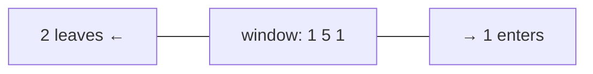

# Chapter 04 · Sliding Window

> Tum train mein baithe ho, aur khidki se ek baar mein exactly teen ghar dikhte hain. Train chalti hai toh ek ghar right se andar aata hai aur ek left se bahar nikal jaata hai. Teeno gharon ko dobara dekhne ki zaroorat kabhi nahi padti: bas jo badla, use update karo. Yahi aalsi lekin chalaak update sliding window hai, aur yeh "har subarray check karo" ko O(n²) se O(n) bana deta hai.

**Is chapter mein tum seekhoge:**
- "Window" kya hai, aur yeh bas **same** direction mein chalte two pointers kyun hai
- **Fixed-size** windows aur **variable-size** windows (grow / shrink)
- Ek template jo lagbhag har window problem solve karta hai
- Loop ke andar loop hone ke bawajood yeh O(n) *kyun* hai
- Character aur frequency problems ke liye hashmap / `Counter` wali windows
- **"At most K"** trick aur **exactly K = atMost(K) − atMost(K − 1)**
- Sliding window kab **fail** hota hai (negative numbers) aur uski jagah kya use karein
- 10+ classic problems, "size k ka max sum" se "minimum window substring" tak

**Isse pehle padho:** [Big-O](01-big-o-complexity.md) · [Arrays & Strings Fundamentals](02-arrays-strings.md) · [Two Pointers](03-two-pointers.md) · [Dictionaries & Hashing](../part-1-python/09-dictionaries.md)

---

## 🧠 The Big Idea · Asli Baat

**Problem:** `[2, 1, 5, 1, 3, 2]` mein kinhi bhi 3 lagataar numbers ka sabse bada sum dhoondho.

Brute force har 3 ke block ko zero se jodta hai:

```text
[2 1 5] 1 3 2      → 2+1+5 = 8
 2 [1 5 1] 3 2     → 1+5+1 = 7
 2 1 [5 1 3] 2     → 5+1+3 = 9
 2 1 5 [1 3 2]     → 1+3+2 = 6
```

Barbaadi dekho: `[2 1 5]` se `[1 5 1]` pe jaate waqt, beech wala `1 + 5` **dobara** joda gaya. Size k ki windows ke saath, har sum k − 1 additions dobara karta hai jo hum pehle hi kar chuke the.

Sliding window kehta hai: nayi window = purani window, **minus jo element gaya, plus jo element aaya**.

```text
sum([1 5 1]) = sum([2 1 5]) − 2 + 1 = 8 − 2 + 1 = 7
```



Har step pe ek subtraction aur ek addition, k chahe kitna bhi bada ho. O(n·k) ki jagah O(n).

> 🇮🇳 **Desi Analogy:** Cricket scoreboard pe "last 5 overs mein runs" dikhta hai. Scorer har over ke baad pichhle 5 overs ko dobara nahi jodta. Naya over khatam hua? Uske runs jodo, aur 6 over pehle wale over ke runs ghatao. Bas do operations, chahe match 20 overs ka ho ya 50 ka. Naya over = right se aane wala element, sabse purana over = left se jaane wala element, "last 5 overs" = window.

Ab is idea ka bada version. Kuch windows fixed size ki nahi hoti; woh ek **sundi (caterpillar)** ki tarah **khichti aur sikudti** hain:

- **Right** edge naye elements **pakadne** ke liye aage badhta hai (sundi ka sir khichta hai).
- Jab window koi rule todti hai (bahut zyada distinct letters, sum bahut bada, ek duplicate), toh **left** edge aage badh ke elements **chhodta** hai jab tak rule phir se sahi na ho jaaye (poonchh peeche se aa jaati hai).

Dono edges sirf **aage** hi chalte hain. Yahi poori wajah hai ki yeh fast hai.

> 💡 **The core insight:** sliding window current window ki ek **summary** rakhta hai (ek sum, ek count, ek set) aur jaise-jaise elements right se aate hain aur left se jaate hain, use **thoda-thoda** update karta hai. Tum window ko kabhi dobara scan nahi karte.

---

## 🔨 Building It Up · Zero Se Shuru

### 1. What is a window?

**Window** ek array ya string ka ek contiguous tukda hai, jo do indexes se describe hota hai: `left` aur `right`. Hum **inclusive** convention use karenge: window `nums[left..right]` hai, aur uski length `right - left + 1` hai.

```python
nums = [2, 1, 5, 1, 3, 2]
left, right = 1, 3
window = nums[left:right + 1]
print(window, "length:", right - left + 1)
```

```text
[1, 5, 1] length: 3
```

Key word: **contiguous**. Sliding window sirf **subarrays** aur **substrings** (lagataar elements) ke liye kaam karta hai, kabhi subsequences ya subsets ke liye nahi, jahan tum elements skip kar sakte ho.

> 🤔 **Mann mein sawaal:** Length `right - left + 1` kyun, `right - left` kyun nahi?
>
> **Jawab:** Ungliyon pe gino. Window `[1..3]` mein index 1, 2, 3 hain: teen elements. 3 − 1 = 2 sirf beech ke *gaps* ginta hai, elements nahi. Jaise 1 se 3 tareekh tak ki chhutti 3 din ki hoti hai, 2 din ki nahi. Inclusive range mein hamesha +1.

### 2. Fixed-size window: the warm-up

Window size diya hua hai (k). Pehli window banao, phir slide karo: naya right element jodo, purana left element hatao.

```python
def max_sum_size_k(nums, k):
    window_sum = sum(nums[:k])        # pehli window
    best = window_sum
    for right in range(k, len(nums)):
        window_sum += nums[right]       # andar aane wala element
        window_sum -= nums[right - k]   # bahar jaane wala element
        best = max(best, window_sum)
    return best

print(max_sum_size_k([2, 1, 5, 1, 3, 2], 3))
print(max_sum_size_k([1, 9, -1, -2, 7, 3, -1, 2], 4))
```

```text
9
13
```

`[2, 1, 5, 1, 3, 2]`, k = 3 ke liye **dry run**:

| right | aaya | gaya (`right - k`) | window | window_sum | best |
|---|---|---|---|---|---|
| (start) | | | [2 1 5] | 8 | 8 |
| 3 | 1 | 2 | [1 5 1] | 7 | 8 |
| 4 | 3 | 1 | [5 1 3] | 9 | 9 |
| 5 | 2 | 5 | [1 3 2] | 6 | 9 |

Abhi kya hua: har step ne exactly do arithmetic operations kiye. Fixed windows mein jaane wala element hamesha `right - k` wala hota hai.

`right - k` hi kyun? Nayi window `[right - k + 1 .. right]` hai, jisme k elements hain. Usse theek ek pehle wala index `right - k` hai, wahi jo abhi-abhi bahar gira.

Yahi shape **averages**, **counts** (jaise "size k ki har window mein vowels kitne") aur kisi bhi aisi cheez ke liye kaam karta hai jise tum jod aur hata sako.

```python
def max_vowels(s, k):
    vowels = set("aeiou")
    count = sum(1 for ch in s[:k] if ch in vowels)
    best = count
    for right in range(k, len(s)):
        count += s[right] in vowels         # True ko 1 gina jaata hai
        count -= s[right - k] in vowels
        best = max(best, count)
    return best

print(max_vowels("abciiidef", 3), max_vowels("leetcode", 3))
```

```text
3 2
```

### 3. Variable-size window: grow and shrink

Ab window ka size diya hua nahi hai; hum koi condition satisfy karne wali **sabse lambi** ya **sabse chhoti** window dhoondh rahe hain.

**Problem: Minimum Size Subarray Sum.** Positive numbers aur ek target diya hai, sum ≥ target wale sabse chhote subarray ki length dhoondho. `[2, 3, 1, 2, 4, 3]`, target 7 → 2 (`[4, 3]`).

Plan:

1. `right` ko aage badhao, `nums[right]` ko sum mein jodte hue (**grow**).
2. **Jab tak** sum ≥ target hai, window valid hai: uski length record karo, phir `nums[left]` hatao aur `left` ko aage badhao (**shrink**), yeh dekhne ke liye ki chhoti wali bhi chalti hai ya nahi.

```python
def min_subarray_len(target, nums):
    left = 0
    window_sum = 0
    best = float("inf")
    for right, x in enumerate(nums):
        window_sum += x                          # grow
        while window_sum >= target:              # valid: shrink karke dekho
            best = min(best, right - left + 1)
            window_sum -= nums[left]
            left += 1
    return 0 if best == float("inf") else best

print(min_subarray_len(7, [2, 3, 1, 2, 4, 3]))
print(min_subarray_len(100, [1, 2, 3]))
```

```text
2
0
```

Target 7 ke liye **dry run**:

| right | x | grow ke baad sum | sum ≥ 7 hai? | shrink steps | best |
|---|---|---|---|---|---|
| 0 | 2 | 2 | nahi | | ∞ |
| 1 | 3 | 5 | nahi | | ∞ |
| 2 | 1 | 6 | nahi | | ∞ |
| 3 | 2 | 8 | haan | len 4 → best 4; 2 hatao → sum 6, left=1 | 4 |
| 4 | 4 | 10 | haan | len 4; 3 hatao → 7, left=2; len 3 → best 3; 1 hatao → 6, left=3 | 3 |
| 5 | 3 | 9 | haan | len 3; 2 hatao → 7, left=4; len 2 → best 2; 4 hatao → 3, left=5 | 2 |

Abhi kya hua: `left` kabhi peeche nahi gaya. Ek baar pata chal gaya ki `left` se shuru hone wali window kaam karti hai, toh wahan se shuru hone wali kisi bhi lambi window ki zaroorat nahi (humein sabse chhoti chahiye), toh `left` hamesha ke liye aage badh sakta hai.

> 🇮🇳 **Desi Analogy:** Wedding buffet ki line mein tum plate bhar rahe ho, aur target hai "kam se kam 700 calories, lekin sabse kam dishes mein". Tum aage badhte jaate ho aur dishes uthate jaate ho (right badhta hai). Jaise hi 700 paar hua, tum sochte ho "kya shuruaat wali dish chhod ke bhi kaam chal jaayega?" aur plate ke sabse purane item ko wapas rakh dete ho (left badhta hai). Jab tak target bana rahe, chhodte raho. Target toot gaya? Phir aage ki dishes uthao. Tum kabhi line mein peeche nahi jaate, isliye poori line ek hi baar chalni padti hai.

### 4. The longest valid window

Iska ulta: woh **sabse lambi** window dhoondho jo valid rahe. Yahan hum **jab tak window invalid hai** tab tak shrink karte hain, phir record karte hain.

**Problem: Longest Substring Without Repeating Characters.** `"abcabcbb"` → 3 (`"abc"`).

```python
def length_of_longest_substring(s):
    in_window = set()
    left = 0
    best = 0
    for right, ch in enumerate(s):
        while ch in in_window:            # ch jodne se repeat banega: shrink karo
            in_window.remove(s[left])
            left += 1
        in_window.add(ch)                 # ab window phir se valid hai
        best = max(best, right - left + 1)
    return best

for s in ("abcabcbb", "bbbbb", "pwwkew", ""):
    print(repr(s), length_of_longest_substring(s))
```

```text
'abcabcbb' 3
'bbbbb' 1
'pwwkew' 3
'' 0
```

`"pwwkew"` ke liye **dry run**:

| right | ch | window pehle | action | window baad mein | best |
|---|---|---|---|---|---|
| 0 | p | "" | add | "p" | 1 |
| 1 | w | "p" | add | "pw" | 2 |
| 2 | w | "pw" | w repeat → p hatao, w hatao; w add | "w" | 2 |
| 3 | k | "w" | add | "wk" | 2 |
| 4 | e | "wk" | add | "wke" | 3 |
| 5 | w | "wke" | w repeat → w hatao; w add | "kew" | 3 |

Toh humare paas do flavours hain, aur farak sirf ek hai: **answer kahan record karte ho**:

| Kya dhoondh rahe ho | Shrink jab tak... | Answer record karo... |
|---|---|---|
| **sabse chhoti** valid window | window **valid** hai | shrink loop ke **andar** (shrink karne se pehle) |
| **sabse lambi** valid window | window **invalid** hai | shrink loop ke **baad** |

> 🤔 **Mann mein sawaal:** Ye "andar record" aur "baad mein record" wali baat mujhe hamesha ulti-pulti lagti hai. Kaise yaad rakhun?
>
> **Jawab:** Socho record kab karna *sahi* hai: sirf jab window valid ho. Longest wale mein shrink loop *invalid* window ko theek karta hai, toh valid window loop ke *baad* milti hai, wahin record karo. Shortest wale mein shrink loop *valid* window pe hi chalta hai, toh loop ke *andar* window valid hai; shrink karne se pehle record kar lo, warna woh valid window haath se nikal jaayegi. Rule ek hi hai: **valid window dikhe tabhi record karo.**

### 5. The universal template

Har variable-size window problem is skeleton mein fit hoti hai. Ise apne phone number ki tarah yaad karo.

```py
def sliding_window(arr):
    left = 0
    state = ...                  # sum, Counter, set, kisi cheez ka count
    best = ...                   # longest ke liye 0, shortest ke liye inf, counting ke liye 0
    for right in range(len(arr)):
        add arr[right] to state                   # 1. EXPAND: naya element lo

        while window is invalid:                  # 2. SHRINK jab tak phir se valid na ho
            remove arr[left] from state           #    ("shortest" ke liye: jab tak VALID)
            left += 1

        best = update(best, right - left + 1)     # 3. RECORD
    return best
```

Teen sawaal har problem decide karte hain:

1. **State kya hai?** (Window ko judge karne ke liye mujhe uske baare mein kya jaanna hai?)
2. **Window invalid kab hai?** (Kaunsa rule tootta hai?)
3. **Main kya record karun?** (Max length, min length, windows ki ginti, ya khud window?)

### 6. Windows with a hashmap (Counter)

Jab rule **characters ya frequencies** ke baare mein ho, toh state counts ki ek dictionary hoti hai.

**Problem: Longest Substring with At Most K Distinct Characters.** `"eceba"`, k = 2 → 3 (`"ece"`).

- State: `counts`, window mein char → count ki ek dict. Distinct chars ki ginti `len(counts)` hai.
- Invalid kab: `len(counts) > k`.
- Record: sabse lambi length.

```python
from collections import defaultdict

def longest_k_distinct(s, k):
    counts = defaultdict(int)
    left = best = 0
    for right, ch in enumerate(s):
        counts[ch] += 1
        while len(counts) > k:
            counts[s[left]] -= 1
            if counts[s[left]] == 0:
                del counts[s[left]]          # len(counts) == distinct ki ginti bana rahe
            left += 1
        best = max(best, right - left + 1)
    return best

print(longest_k_distinct("eceba", 2), longest_k_distinct("aa", 1), longest_k_distinct("abaccc", 2))
```

```text
3 2 4
```

Abhi kya hua: count zero hone pe `del` bahut zaroori hai. Uske bina `len(counts)` un characters ko bhi ginega jo window se ja chuke hain.

> 🇮🇳 **Desi Analogy:** Joint family ka WhatsApp group socho jisme rule hai "ek time pe zyada se zyada k families ke log online". `counts` group ki member list hai: har family ke kitne log online hain. Jab kisi family ka aakhri banda bhi offline ho gaya (count 0), toh us family ka naam list se **hatana** padega. Warna admin "kitni families online hain" gine toh purani, khaali family bhi gin lega aur galti se kisi aur ko bahar nikaal dega. Yahi `del counts[...]` hai.

**Fruit Into Baskets** bilkul yahi problem hai k = 2 ke saath, bas kahani mein lapeti hui: tumhare paas do tokriyan hain, har ek mein ek hi type ka fruit, aur tum lagataar pedon se todte ho. "Zyada se zyada 2 types wale pedon ki sabse lambi line." Same code.

### 7. Matching a pattern: Permutation in String & Find All Anagrams

**Problem: Permutation in String.** Kya `s2` mein `s1` ka koi permutation substring ki tarah hai? `s1 = "ab"`, `s2 = "eidbaooo"` → True (`"ba"`).

`s1` ka permutation = `s2` ka koi bhi substring jiski **same length** aur **same character counts** hon. Toh yeh size `len(s1)` ki ek **fixed** window hai, aur hum counts compare karte hain.

Har step pe do 26-slot arrays compare karna O(26) = O(1) hai. Isse bhi behtar, ek single number `matches` rakho: 26 mein se kitne letters ke counts abhi dono mein barabar hain.

```python
def check_inclusion(s1, s2):
    k = len(s1)
    if k > len(s2):
        return False
    need = [0] * 26
    have = [0] * 26
    for ch in s1:
        need[ord(ch) - 97] += 1
    for right, ch in enumerate(s2):
        have[ord(ch) - 97] += 1               # aaya
        if right >= k:
            have[ord(s2[right - k]) - 97] -= 1   # gaya (fixed size k)
        if have == need:                       # O(26) compare = O(1)
            return True
    return False

print(check_inclusion("ab", "eidbaooo"), check_inclusion("ab", "eidboaoo"))
```

```text
True False
```

(Upar ka code seedha `have == need` compare karta hai, jo already O(1) hai. `matches` wala counter ek extra optimisation hai jo interview mein bonus point ke liye mention kar sakte ho: har step pe sirf do letters ke counts badalte hain, toh sirf unhi do ka `matches` update karo.)

> 🇮🇳 **Desi Analogy:** Tumhe Swiggy order verify karna hai: "1 paneer, 1 naan" (`need`). Delivery boy ke paas ek lambi line mein packets hain aur tumhare haath mein ek khidki hai jisme ek saath exactly 2 packets dikhte hain. Har baar khidki ek packet aage khisakti hai: naya packet `have` mein jodo, purana packet `have` se hatao. Jis pal `have` ki list `need` se ekdum match kare, order mil gaya. Order mein packets kis kram mein hain (`"ab"` ya `"ba"`), isse farak nahi padta, sirf ginti matter karti hai. Yahi permutation hai.

**Find All Anagrams in a String** same code hai, lekin pehle match pe True return karne ki jagah har starting index `right - k + 1` collect karo:

```python
def find_anagrams(s, p):
    k = len(p)
    need, have = [0] * 26, [0] * 26
    for ch in p:
        need[ord(ch) - 97] += 1
    result = []
    for right, ch in enumerate(s):
        have[ord(ch) - 97] += 1
        if right >= k:
            have[ord(s[right - k]) - 97] -= 1
        if have == need:
            result.append(right - k + 1)       # window ka start
    return result

print(find_anagrams("cbaebabacd", "abc"), find_anagrams("abab", "ab"))
```

```text
[0, 6] [0, 1, 2]
```

### 8. The hardest classic: Minimum Window Substring

**Problem:** `s` ka sabse chhota substring jisme `t` ka har character ho (ginti ke saath). `s = "ADOBECODEBANC"`, `t = "ABC"` → `"BANC"`.

Yeh **shortest valid window** wala shape hai (valid rehte hue shrink karo), ek chalaak validity check ke saath:

- `need`: `t` ka Counter.
- `missing`: `t` ke kitne characters (duplicates gin ke) window mein abhi bhi kam hain. Window exactly tab valid hai jab `missing == 0`.
- Jab koi char aata hai aur decrement se pehle `need[ch] > 0` hai, toh woh sach mein chahiye tha → `missing -= 1`. Phir `need[ch]` decrement karo (yeh negative ja sakta hai, matlab "surplus").
- Jab koi char jaata hai, `need[ch]` increment karo; agar yeh > 0 ho jaaye, toh window mein ab woh kam hai → `missing += 1`.

> 🇮🇳 **Desi Analogy:** Mummy ne kirana list di hai: 1 aata, 1 bread, 1 chai patti (`need`). Tum dukaan ki shelf pe left se right chal rahe ho aur jo dikhe tokri mein daal rahe ho. `missing` = list mein abhi kitni cheezein baaki hain. Koi cheez mili jo list mein abhi baaki thi? `missing` ghatao. Koi cheez mili jo list mein thi hi nahi, ya pehle hi le chuke ho? Woh "extra" hai (`need` negative). Jab `missing` 0 ho gaya, list poori. Ab tokri ke sabse purane items wapas rakho, jab tak list poori rahe: extra cheezein wapas rakhne se kuch nahi bigadta. Jis pal koi *zaroori* cheez wapas rakh di (`need` phir positive), `missing` badh gaya, aur phir aage chalna padega.

```python
from collections import Counter

def min_window(s, t):
    if not t or not s:
        return ""
    need = Counter(t)
    missing = len(t)
    left = 0
    best_start, best_len = 0, float("inf")
    for right, ch in enumerate(s):
        if need[ch] > 0:
            missing -= 1                       # yeh char abhi bhi chahiye tha
        need[ch] -= 1                          # negative = window mein surplus copies
        while missing == 0:                    # valid: record karo, phir shrink karke dekho
            if right - left + 1 < best_len:
                best_start, best_len = left, right - left + 1
            need[s[left]] += 1
            if need[s[left]] > 0:
                missing += 1                   # abhi ek zaroori char gira diya
            left += 1
    return "" if best_len == float("inf") else s[best_start:best_start + best_len]

print(min_window("ADOBECODEBANC", "ABC"))
print(repr(min_window("a", "aa")))
print(min_window("aa", "aa"))
```

```text
BANC
''
aa
```

`s = "ADOBECODEBANC"`, `t = "ABC"` ke liye **dry run** (sirf key moments):

| right | ch | baad mein missing | window valid? | action | best |
|---|---|---|---|---|---|
| 0 | A | 2 | nahi | | |
| 3 | B | 1 | nahi | | |
| 5 | C | 0 | haan | "ADOBEC" (6) record; A girao → missing 1, left = 1 | "ADOBEC" |
| 10 | A | 0 | haan | length 10, 9, 8, 7, 6 wali windows 6 se chhoti nahi hain; D, O, B girao (ek extra B bacha hai, toh abhi bhi valid), E, phir C → missing 1, left = 6 | "ADOBEC" |
| 12 | C | 0 | haan | O, D girao; "EBANC" (5) record; E girao; "BANC" (4) record; B girao → missing 1, left = 10 | "BANC" |

(Jin rows mein kuch khaas nahi hota, woh skip ki gayi hain. Dekho right = 10 pe pehla `B` girane se window valid kaise rahi: `need["B"]` −1 se 0 gaya, 0 se upar nahi, kyunki ek doosra `B` abhi bhi andar tha.)

Time O(|s| + |t|): har character ek baar aata hai aur ek baar jaata hai. Space O(alphabet ka size).

> 🤔 **Mann mein sawaal:** `need[ch]` negative kaise ho sakta hai? Kisi cheez ki "minus zaroorat" ka kya matlab?
>
> **Jawab:** Negative = "jitni chahiye thi usse zyada window mein hain". Jaise `t = "ABC"` aur window mein do B hain: `need["B"]` = 1 − 2 = −1, yaani ek B extra hai. Isi wajah se pehla B girane pe `need["B"]` sirf 0 hota hai (abhi bhi poora hai), `missing` nahi badhta. Aur `t` mein na hone wale letters (jaise D, O) ka `need` shuru se 0 hai, aate hi negative ho jaata hai, aur jaate waqt wapas 0 tak hi aata hai, kabhi positive nahi. Isliye woh kabhi `missing` ko nahi chhoote. Interviewer yahi samajh check karta hai.

### 9. Counting windows: "how many subarrays..."

Kabhi-kabhi sawaal hota hai ki **kitne** valid subarrays hain, sabse lamba nahi. Trick: longest-style window mein, jab window `[left..right]` valid hai, toh `right` pe khatam hone wali aur `left..right` mein kahin bhi shuru hone wali **har** window bhi valid hai (ek valid "at most" window ko sikodne se woh valid hi rehti hai). Yeh `right - left + 1` subarrays hain, sab `right` pe khatam hone wale.

**Problem: Subarray Product Less Than K.** Contiguous subarrays (positive numbers) gino jinka product < k. `[10, 5, 2, 6]`, k = 100 → 8.

```python
def num_subarray_product_less_than_k(nums, k):
    if k <= 1:
        return 0
    product = 1
    left = count = 0
    for right, x in enumerate(nums):
        product *= x
        while product >= k:
            product //= nums[left]
            left += 1
        count += right - left + 1        # right pe khatam hone wali saari windows
    return count

print(num_subarray_product_less_than_k([10, 5, 2, 6], 100))
```

```text
8
```

Woh 8 hain: [10], [5], [10,5], [2], [5,2], [6], [2,6], [5,2,6]. (`product //= nums[left]` exact hai kyunki `product` hamesha current window ke integers ka product hota hai.)

Step by step dekho ki `right - left + 1` kaise yahi list deta hai:

| right | x | window | product | `right - left + 1` | nayi windows (right pe khatam) |
|---|---|---|---|---|---|
| 0 | 10 | [10] | 10 | 1 | [10] |
| 1 | 5 | [10,5] | 50 | 2 | [5], [10,5] |
| 2 | 2 | [10,5,2] → 100 ≥ 100, 10 girao → [5,2] | 10 | 2 | [2], [5,2] |
| 3 | 6 | [5,2,6] | 60 | 3 | [6], [2,6], [5,2,6] |

1 + 2 + 2 + 3 = 8. Har subarray ko uske *end* se ek hi baar gina gaya, toh koi double count nahi.

### 10. "At most K" and "exactly K = atMost(K) − atMost(K − 1)"

Yeh ek aisi problem hai jo window **lagti** hai lekin seedha window nahi hai: **Subarrays with K Different Integers.** **Exactly** k distinct values wale subarrays gino. `[1,2,1,2,3]`, k = 2 → 7.

Plain window kyun fail hoti hai: "exactly k" ke saath, ek valid window badh ke (k+1 distinct) **ya** sikud ke (k−1 distinct) invalid ho sakti hai. Window ke paas koi ek "valid hone tak shrink karo" wali direction nahi hai, toh hum decide nahi kar sakte ki `left` ko kaise move karein.

**Trick:** "at most k" ke paas ek saaf direction *hai* (zyada elements = zyada distinct, toh sirf bahut badi windows invalid hain). Aur:

```text
exactly(k) = atMost(k) − atMost(k − 1)
```

Exactly k distinct wala har subarray atMost(k) mein gina jaata hai lekin atMost(k−1) mein nahi. k se kam distinct wala har subarray dono mein gina jaata hai aur cancel ho jaata hai.

> 🇮🇳 **Desi Analogy:** Metro mein "exactly 2 stops" door wale ghar ginne hain. Seedha ginna mushkil hai, toh do aasaan sawaal poocho: "zyada se zyada 2 stops door kitne ghar?" aur "zyada se zyada 1 stop door kitne?" Pehle mein se doosra ghatao: jo bache, woh exactly 2 stops wale hain. "At most" ek seedhi line hai jahan aage badhna hamesha ya toh theek hai ya galat; "exactly" do taraf se tootta hai. Isliye do seedhe sawaalon ka farak lete hain.

```python
from collections import defaultdict

def at_most_k_distinct(nums, k):
    counts = defaultdict(int)
    left = total = 0
    for right, x in enumerate(nums):
        counts[x] += 1
        while len(counts) > k:
            counts[nums[left]] -= 1
            if counts[nums[left]] == 0:
                del counts[nums[left]]
            left += 1
        total += right - left + 1           # right pe khatam hone wali har window
    return total

def subarrays_with_k_distinct(nums, k):
    return at_most_k_distinct(nums, k) - at_most_k_distinct(nums, k - 1)

nums = [1, 2, 1, 2, 3]
print(at_most_k_distinct(nums, 2), at_most_k_distinct(nums, 1))
print(subarrays_with_k_distinct(nums, 2), subarrays_with_k_distinct([1, 2, 1, 3, 4], 3))
```

```text
12 5
7 3
```

Yahi trick **Binary Subarrays With Sum** (exactly `goal` ones) aur **Count Number of Nice Subarrays** (exactly k odd numbers) bhi solve karta hai: "at most goal" minus "at most goal − 1" gino.

### 11. Windows that allow k "mistakes"

**Problem: Max Consecutive Ones III.** Binary array; tum zyada se zyada k zeros ko ones mein flip kar sakte ho. Ones ka sabse lamba run? `[1,1,1,0,0,0,1,1,1,1,0]`, k = 2 → 6.

Reframe karo: "**zyada se zyada k zeros** wali sabse lambi window". State = window mein zeros ki ginti.

```python
def longest_ones(nums, k):
    left = zeros = best = 0
    for right, x in enumerate(nums):
        zeros += x == 0
        while zeros > k:
            zeros -= nums[left] == 0
            left += 1
        best = max(best, right - left + 1)
    return best

print(longest_ones([1, 1, 1, 0, 0, 0, 1, 1, 1, 1, 0], 2))
print(longest_ones([0, 0, 1, 1, 0, 0, 1, 1, 1, 0, 1, 1, 0, 0, 0, 1, 1, 1, 1], 3))
```

```text
6
10
```

Reframe kyun kaam karta hai? Tumhe *actually* flip karne ki zaroorat nahi. Agar ek window mein k ya kam zeros hain, toh unhe flip karke poori window ones ban sakti hai. Toh sawaal "flip kahan karun" se badal ke "k zeros tak wali sabse lambi window kaunsi" ban jaata hai, jo humara template hai.

**Problem: Longest Repeating Character Replacement.** Uppercase string; tum zyada se zyada k characters replace kar sakte ho. Ek hi repeat hone wale letter ka sabse lamba substring? `"AABABBA"`, k = 1 → 4.

Ek window poori ek letter ki ban sakti hai agar `window length − (uske sabse frequent letter ka count) ≤ k`: hum sabse common letter rakhte hain aur baaki replace karte hain.

```python
def character_replacement(s, k):
    counts = [0] * 26
    left = max_freq = best = 0
    for right, ch in enumerate(s):
        counts[ord(ch) - 65] += 1
        max_freq = max(max_freq, counts[ord(ch) - 65])
        while (right - left + 1) - max_freq > k:     # bahut zyada replacements chahiye
            counts[ord(s[left]) - 65] -= 1
            left += 1
        best = max(best, right - left + 1)
    return best

print(character_replacement("ABAB", 2), character_replacement("AABABBA", 1))
```

```text
4 4
```

> 💡 **Ek famous subtlety:** shrink karte waqt hum `max_freq` ko kabhi *kam* nahi karte, toh woh stale (zyada) ho sakta hai. Yeh theek hai! Answer sirf tab improve hota hai jab koi window sach mein zyada `max_freq` ke saath aaye, aur stale `max_freq` sirf window ko zaroorat se zyada shrink hone se rokta hai; woh `best` ko kabhi aisi length record nahi karne deta jo kisi pehle ke point pe sach mein achievable na thi. Bahut log ise poore sliding window ki sabse tricky line maante hain, toh agar yeh dhundhla lag raha hai, toh har baar `max(counts)` recompute karna (O(26)) ek bilkul theek answer hai.

Thoda aur khol ke: `best` tabhi badhta hai jab window ki length badhe. Window ki length tabhi badh sakti hai jab `length − max_freq ≤ k` rahe, yaani jab `max_freq` bhi badhe. Agar `max_freq` purana aur zyada hai, toh window bas *sikudne ki jagah ek jagah khisakti* hai (ek aaya, ek gaya), length same rehti hai, `best` nahi badhta. Toh galat bada answer kabhi record nahi hota. Jab koi letter sach mein purane record ko todta hai, tab `max_freq` sahi value pe update hota hai aur window badhti hai.

---

## 🔬 Under the Hood · Andar Ki Kahani

### Why it's O(n) despite the nested loop

Template dekho: `right` pe ek `for` loop, uske andar `left` pe ek `while` loop. O(n²) jaisa dikhta hai. Hai nahi.

Loops nahi, **pointer moves** gino:

- `right` 0 se n − 1 tak chalta hai: exactly n moves.
- `left` sirf badhta hai, kabhi reset nahi hota, aur kabhi `right` se aage nahi nikalta. Toh **poore** run mein woh zyada se zyada n baar move karta hai.

Har pointer move O(1) kaam karta hai (ek sum, ek count, ek dict entry update karna). Toh total kaam ≤ n + n = **O(n)**. Yeh **amortized** reasoning hai: koi ek `while` loop bahut baar chal sakta hai, lekin woh `left` ke aise moves "kharch" kar deta hai jo dobara kabhi kharch nahi ho sakte.

Doosre shabdon mein: **har element window mein ek baar aata hai aur zyada se zyada ek baar jaata hai.**

> 🇮🇳 **Desi Analogy:** Metro station ka turnstile. Din bhar mein har passenger ek baar andar ghusta hai aur ek baar bahar nikalta hai. Kabhi ek train aayi aur 50 log ek saath nikle (ek bada `while` loop), kabhi koi nahi nikla. Lekin din ke end mein total entries + exits = 2 × passengers. Yahi amortized O(n) hai: alag-alag moment pe kaam ka bojh upar-neeche hota hai, total fixed hai.

### Why moving `left` forward never skips the answer

Yeh [Chapter 03](03-two-pointers.md) wala "discard proof" hai, windows pe lagaya hua. Yeh **monotonicity** pe tika hai:

- **Longest valid window** problems: agar `[left..right]` invalid hai, toh `left' < left` wali **koi bhi badi window** `[left'..right]` bhi invalid hai (elements jodne se "bahut zyada distinct" ya "positives ke saath sum bahut bada" theek nahi ho sakta). Aur aage ke `right' > right` ke liye, purane `left` se shuru hone wali windows aur bhi badi hain, toh woh bhi invalid. Toh ek baar `left` kisi index se aage nikal gaya, wahan se shuru hone wali koi window kabhi answer nahi ho sakti.
- **Shortest valid window** problems: ek baar `[left..right]` valid hai, toh `right' > right` wali koi bhi window `[left..right']` lambi hai, toh woh abhi record kiye gaye ko hara nahi sakti. Toh is `left` ke saath humara kaam hamesha ke liye khatam.

> 💡 **General rule:** sliding window tab kaam karta hai jab window ki validity **monotonic** ho: window badhane se woh sirf ek direction mein jaa sakti hai (valid → invalid, ya invalid → valid), aur sikodne se doosri direction mein.

### Why negative numbers break it

`[2, -1, 2]`, k = 3 ke saath "sum ≥ k wala sabse chhota subarray". Sirf-positive wali window sochegi: "sum bahut chhota hai, badhao; sum kaafi hai, sikodo." Lekin negatives ke saath, sikodna sum ko **badha** sakta hai (−1 hatane se) aur badhana use **ghata** sakta hai. Monotonicity gayi, toh discard argument fail ho jaata hai. Tumhe **prefix sums** chahiye honge ([Chapter 06](06-prefix-sums.md)), kabhi-kabhi monotonic deque ke saath ([Chapter 12](12-queues-deques.md)).

> 🤔 **Mann mein sawaal:** Negatives ho toh sliding window bilkul hi nahi chalega? Fixed window wale examples mein toh negatives the!
>
> **Jawab:** Achha pakda. Fixed-size window mein koi "shrink karun ya nahi" wala decision hi nahi hota; har step pe ek aata hai, ek jaata hai, bas. Isliye wahan negatives se koi dikkat nahi (`max_sum_size_k` mein −1, −2 the, aur answer sahi tha). Dikkat sirf **variable** window mein hai, jahan tum sum dekh ke decide karte ho ki `left` ko badhana hai ya nahi. Wahan negatives us decision ko jhootha bana dete hain.

### Space

Sums aur counts ke liye state O(1) hai, window ke Counter ke liye O(k) ya O(alphabet), aur characters ke set ke liye O(min(n, alphabet)). 26-slot array wala version O(1) hai.

---

## 🧩 Pattern Decoder · Pattern Pakdo

### Signals: when to reach for a sliding window

| Problem mein dikhe... | Socho |
|---|---|
| "**contiguous** subarray / substring" | sliding window ek strong candidate hai |
| "size k ka", "har k lagataar", "length k ki window" | **fixed** window |
| "sabse lamba / maximum length ... aisa ki" | **variable**, invalid rehte shrink karo, baad mein record |
| "sabse chhota / minimum length ... aisa ki" | **variable**, valid rehte shrink karo, andar record |
| "at most k distinct / k zeros / k replacements" | variable window, state = Counter ya count |
| "**exactly** k ..." (subarrays ki ginti) | atMost(k) − atMost(k − 1) |
| "kitne subarrays jahan ..." (monotonic condition) | har step `right - left + 1` jodo |
| "s ke andar p ka permutation / anagram" | `len(p)` ki fixed window + count arrays |
| "t ke saare characters hon" | variable window + `need` Counter + `missing` |
| saare numbers **positive** + sum condition | window chalegi |
| numbers **negative** ho sakte hain + sum condition | ❌ window fail → prefix sums ([Chapter 06](06-prefix-sums.md)) |
| "subsequence" (elements skip ho sakte hain) | ❌ window nahi → DP ya two pointers |
| "size k ki har window ka max" | window + monotonic deque ([Chapter 12](12-queues-deques.md)) |

### Template A: Fixed window of size k

```py
def fixed_window(arr, k):
    state = init()
    for i in range(k):
        add(state, arr[i])                  # pehli window banao
    best = evaluate(state)
    for right in range(k, len(arr)):
        add(state, arr[right])              # aaya
        remove(state, arr[right - k])       # gaya
        best = better(best, evaluate(state))
    return best
```

### Template B: Longest valid window

```py
def longest_valid(arr):
    left = 0
    best = 0
    state = init()
    for right in range(len(arr)):
        add(state, arr[right])
        while not valid(state):             # valid hone tak shrink karo
            remove(state, arr[left])
            left += 1
        best = max(best, right - left + 1)  # shrink ke BAAD record karo
    return best
```

### Template C: Shortest valid window

```py
def shortest_valid(arr):
    left = 0
    best = float("inf")
    state = init()
    for right in range(len(arr)):
        add(state, arr[right])
        while valid(state):                 # jab tak valid hai, shrink karo
            best = min(best, right - left + 1)   # hatane se PEHLE record karo
            remove(state, arr[left])
            left += 1
    return 0 if best == float("inf") else best
```

### Template D: Count subarrays (at most / exactly)

```py
def count_at_most(arr, k):
    left = total = 0
    state = init()
    for right in range(len(arr)):
        add(state, arr[right])
        while exceeds(state, k):
            remove(state, arr[left])
            left += 1
        total += right - left + 1           # right pe khatam hone wali windows
    return total

def count_exactly(arr, k):
    return count_at_most(arr, k) - count_at_most(arr, k - 1)
```

### Variation 1: Maximum Average Subarray I (fixed)

**Problem:** length k ke kisi bhi subarray ka max average. Max sum jaisa hi, end mein k se divide karo.

```python
def find_max_average(nums, k):
    s = best = sum(nums[:k])
    for right in range(k, len(nums)):
        s += nums[right] - nums[right - k]
        best = max(best, s)
    return best / k

print(find_max_average([1, 12, -5, -6, 50, 3], 4))
```

```text
12.75
```

O(n) time, O(1) space. Dhyaan do yahan negatives theek hain: **fixed** size ke saath koi shrink decision hi nahi jo galat ho sake.

### Variation 2: Count Number of Nice Subarrays (exactly k)

**Problem:** exactly k odd numbers wale subarrays gino. `[1,1,2,1,1]`, k = 3 → 2.

**Idea:** "zyada se zyada k odd numbers" monotonic hai. Exactly-trick use karo.

```python
def number_of_nice_subarrays(nums, k):
    def at_most(k):
        if k < 0:
            return 0
        left = odd = total = 0
        for right, x in enumerate(nums):
            odd += x % 2
            while odd > k:
                odd -= nums[left] % 2
                left += 1
            total += right - left + 1
        return total
    return at_most(k) - at_most(k - 1)

print(number_of_nice_subarrays([1, 1, 2, 1, 1], 3))
print(number_of_nice_subarrays([2, 2, 2, 1, 2, 2, 1, 2, 2, 2], 2))
```

```text
2
16
```

O(n) time, O(1) space.

(`x % 2` odd ke liye 1 aur even ke liye 0 deta hai, toh `odd += x % 2` seedha odd numbers ginta hai. Pehle example ke 2 subarrays: `[1,1,2,1]` aur `[1,2,1,1]`.)

### Variation 3: Grumpy Bookstore Owner (fixed window on "extra gain")

**Problem:** `customers[i]` minute i pe aate hain; jin minutes pe `grumpy[i] = 1`, owner gusse mein hota hai aur un customers ko satisfaction nahi milta. Ek secret technique use `minutes` lagataar minutes ke liye ek baar shaant rakh sakti hai. Max satisfied customers?

**Idea:** base = jo customers pehle se satisfied hain. Phir size `minutes` ki ek fixed window slide karo, aur maximum **extra** customers (jo grumpy minutes pe hain) dhoondho jinhe tum bacha sakte ho.

```python
def max_satisfied(customers, grumpy, minutes):
    base = sum(c for c, g in zip(customers, grumpy) if g == 0)
    extra = best_extra = 0
    for right in range(len(customers)):
        extra += customers[right] * grumpy[right]
        if right >= minutes:
            extra -= customers[right - minutes] * grumpy[right - minutes]
        best_extra = max(best_extra, extra)
    return base + best_extra

print(max_satisfied([1, 0, 1, 2, 1, 1, 7, 5], [0, 1, 0, 1, 0, 1, 0, 1], 3))
```

```text
16
```

Lesson: window ki state ka "elements ka sum" hona zaroori nahi; yeh jo bhi quantity tum optimise kar rahe ho, wahi hai.

Hisaab: base = 1 + 1 + 1 + 7 = 10 (grumpy 0 wale minutes). Aakhri 3 minutes (index 5, 6, 7) ki window mein grumpy customers 1 + 5 = 6 hain, jo sabse zyada extra hai. 10 + 6 = 16.

> 🇮🇳 **Desi Analogy:** Chai tapri wale bhaiya subah thode chidchide rehte hain. Unke paas ek "adrak wali special chai" hai jo unhe lagataar 3 ghante ke liye khush rakh sakti hai, lekin din mein sirf ek baar. Jo customers unke accha mood mein aate hain, woh toh khush hi jaayenge (base). Sawaal sirf yeh hai ki adrak wali chai kaunse 3 ghante ke liye pee jaaye, taaki gusse wale time ke zyada se zyada customers bach jaayein. Woh 3 ghante = fixed window, "gusse wale time ke customers" = window ki state.

### Dry run: Longest Repeating Character Replacement, `"AABABBA"`, k = 1

| right | ch | counts (A,B) | max_freq | window | len − max_freq | action | best |
|---|---|---|---|---|---|---|---|
| 0 | A | 1,0 | 1 | A | 0 | | 1 |
| 1 | A | 2,0 | 2 | AA | 0 | | 2 |
| 2 | B | 2,1 | 2 | AAB | 1 | | 3 |
| 3 | A | 3,1 | 3 | AABA | 1 | | 4 |
| 4 | B | 3,2 | 3 | AABAB | 2 > 1 | A girao → ABAB | 4 |
| 5 | B | 2,3 | 3 | ABABB | 2 > 1 | A girao → BABB | 4 |
| 6 | A | 2,3 | 3 | BABBA | 2 > 1 | B girao → ABBA | 4 |

Answer 4 (jaise `"AABA"` → `"AAAA"`).

(Row 4 pe dekho: A girane ke baad counts (2,2) hain, lekin `max_freq` 3 hi raha. Yahi "stale" `max_freq` hai. Window ki length 4 hi rahi, `best` nahi badha, toh koi galat answer nahi aaya.)

### When NOT to use a sliding window

- **Sum condition ke saath negative numbers** ("subarray sum equals k", negatives ke saath "sum ≥ k wala sabse chhota subarray") → prefix sums + hashmap ya monotonic deque.
- **Subsequences ya subsets** (elements skip kar sakte ho) → DP ya backtracking.
- **"Exactly k" seedha** → "exactly" pe shrink karne ki koshish mat karo; atMost(k) − atMost(k−1) ya prefix sums use karo.
- **Validity monotonic nahi hai** (jaise "sum ek prime number hai"): badhane se cheezein consistently behtar ya badtar nahi hoti, toh tum decide nahi kar sakte kaunsa pointer move karna hai.
- **Pairs, ranges nahi** (jaise "do numbers jinka sum x ho") → two pointers ya hashing.

---

## ⚠️ Traps & Common Mistakes · Yahan Sab Phisalte Hain

1. **Shrink ke liye `while` ki jagah `if` use karna.** Ek removal validity wapas laane ke liye kaafi nahi bhi ho sakta.

```py
# ❌ sirf ek step shrink karta hai; window invalid reh sakti hai
if len(counts) > k:
    ...remove s[left]...; left += 1

# ✅ rule sahi hone tak shrink karte raho
while len(counts) > k:
    ...remove s[left]...; left += 1
```

2. **Dict-based window mein zero-count keys delete na karna.** Phir `len(counts)` distinct elements zyada ginta hai.

3. **Galat jagah record karna.** Longest → shrink loop ke baad. Shortest → uske andar, hatane se pehle.

4. **Window length mein off-by-one.** Inclusive window `[left..right]` ki length `right - left + 1` hai, `right - left` nahi.

5. **Sum target ke liye negative numbers ke saath sliding window use karna.** Yeh chupchaap galat answers deta hai. Bharosa karne se pehle ek negative number ke saath test karo.

6. **Har step pe window state ko zero se dobara banana**, jaise loop ke andar `sum(nums[left:right+1])` ya `Counter(s[left:right+1])`. Yeh O(n·k) hai, poora point hi khatam.

7. **Fixed window: galat element hatana.** Jaane wala element `arr[right - k]` hai, aur sirf tab jab `right >= k`.

8. **Ek hi window se "exactly k" try karna.** Subtraction trick use karo.

9. **"Shortest" problem mein koi valid window na ho toh `inf` return karna.** Problem jaisa maange, 0 ya −1 mein badlo.

---

## 💡 Tips & Tricks · Pro Wale Moves

- Teen sawaal zor se bolo: **"State? Invalid kab? Record kya?"** Phir template bharo.
- `"longest"` → **bura** rehte shrink karo. `"shortest"` → **accha** rehte shrink karo. (Mnemonic: *long matlab acchi windows ke saath sabr, short matlab kaatne ka laalach*.)
- Sirf-lowercase strings ke liye 26-int list `Counter` se tez aur halki hai, aur do lists compare karna O(26) hai.
- `right - left + 1` do kaam karta hai: window ki length **aur** `right` pe khatam hone wale valid subarrays ki ginti ("at most" counting ke liye).
- `Counter` subtraction non-positive counts apne aap hata deta hai, lekin window mein manual `del` ke saath `defaultdict(int)` zyada saaf hai.
- Agar tum decide nahi kar pa rahe ki `left` ko kis taraf move karna hai, toh problem shayad pure window nahi hai. Prefix sums ya deque socho.
- "Longest substring without repeating characters" ke liye tum `last_seen` index map se `left` ko seedha jump kara sakte ho: `left = max(left, last_seen[ch] + 1)`. Same O(n), kam steps.

---

## 🎯 Interview Questions · Interview Mein Yahi Poochenge

### 1. Longest Substring Without Repeating Characters 🔥🔥🔥

<details><summary>Answer dekho 👀</summary>

Variable window; state = har character ka aakhri index. Jab `ch` window ke andar dekha gaya ho, `left` ko uski pichhli position ke paar jump karao.

```python
def length_of_longest_substring(s):
    last_seen = {}
    left = best = 0
    for right, ch in enumerate(s):
        if ch in last_seen and last_seen[ch] >= left:
            left = last_seen[ch] + 1          # pichhli copy ke paar jump karo
        last_seen[ch] = right
        best = max(best, right - left + 1)
    return best

print(length_of_longest_substring("abcabcbb"), length_of_longest_substring("abba"))
```

```text
3 2
```

Time O(n), space O(min(n, alphabet)). `>= left` wala check matter karta hai: `"abba"` mein, jab hum aakhri `a` pe pahunchte hain, index 0 wala purana `a` window ke bahar hai.

`"abba"` dry run: a (left 0), b (left 0), b dobara → left = 2, a dobara → `last_seen["a"]` = 0, jo `left` = 2 se chhota hai, matlab woh `a` window mein hai hi nahi. Check na hota toh `left` 1 pe *peeche* chala jaata aur window "bba" ban jaati, jisme repeat hai. Galat.

> 🗣️ **Interview mein aise bolo:** "I use a sliding window with a map from each character to the last index where I saw it. When the current character was last seen inside the window, I jump the left pointer just past that index; otherwise I just extend. Each character is processed once, so it's O(n) time and O(min(n, alphabet size)) space."

</details>

### 2. Minimum Window Substring 🔥🔥🔥

<details><summary>Answer dekho 👀</summary>

`need` Counter aur `missing` counter ke saath shortest-valid template (section 8). `missing == 0` hone tak expand karo, phir valid rehte shrink karo, sabse chhoti window record karte hue. Time O(|s| + |t|), space O(alphabet). Negative `need` values ka matlab (surplus copies) samjhao — interviewers check karte hain ki tum use samajhte ho, sirf yaad nahi kiya.

> 🗣️ **Interview mein aise bolo:** "I keep a count of what I still need from t and a single 'missing' counter. I expand the right pointer, decreasing missing whenever a character fills a real need; once missing hits zero the window is valid, so I record it and shrink from the left until I drop a required character. Negative counts just mean surplus copies in the window. Every character enters and leaves once, so it's O(|s| + |t|) time."

</details>

### 3. Longest Repeating Character Replacement 🔥🔥🔥

<details><summary>Answer dekho 👀</summary>

Window tab tak valid hai jab tak `length − max_freq ≤ k`. Counts aur `max_freq` track karo; invalid hone pe ek se shrink karo. Code aur dry run section 11 aur Pattern Decoder mein. Time O(n), space O(26). Yeh samjhaane ke liye ready raho ki stale `max_freq` galat answers kyun nahi deta (ya O(26n) ke liye har step `max(counts)` use karo).

> 🗣️ **Interview mein aise bolo:** "A window can be made uniform if its length minus the count of its most frequent letter is at most k, since I'd replace everything else. I grow the window, track letter counts and the max frequency, and shrink when that condition fails. The max frequency may be stale after shrinking, but that only keeps the window from growing, so it never produces a wrong answer. It's O(n) time and O(1) space."

</details>

### 4. Permutation in String 🔥🔥🔥

<details><summary>Answer dekho 👀</summary>

`s2` pe `len(s1)` ki fixed window, 26-count arrays compare karte hue (section 7). Time O(26 · n) = O(n), space O(1).

> 🗣️ **Interview mein aise bolo:** "A permutation of s1 is any substring with the same length and the same letter counts, so I slide a fixed window of length len(s1) over s2. I maintain a 26-slot count array, adding the entering character and removing the leaving one, and compare it with s1's counts at each step. That's O(26·n), which is O(n), with O(1) extra space."

</details>

### 5. Find All Anagrams in a String 🔥🔥🔥

<details><summary>Answer dekho 👀</summary>

Permutation in String jaisa hi, jahan bhi counts match karein wahan har start index `right - k + 1` collect karte hue (section 7). Time O(n), output ke alawa space O(1).

> 🗣️ **Interview mein aise bolo:** "It's the same fixed-window idea as Permutation in String. I slide a window of length len(p) over s with a 26-slot count array, and whenever the counts equal p's counts I record the window's start index, right minus k plus one. It's O(n) time and O(1) space besides the output."

</details>

### 6. Minimum Size Subarray Sum 🔥🔥🔥

<details><summary>Answer dekho 👀</summary>

Saare numbers positive hain, toh shortest-valid window kaam karti hai: grow karo, aur jab tak sum ≥ target, record karo aur shrink karo (section 3). Time O(n), space O(1). Follow-up "O(n log n)": prefix sums + binary search ([Chapter 08](08-binary-search.md)).

> 🗣️ **Interview mein aise bolo:** "Because all numbers are positive, extending the window only increases the sum and shrinking only decreases it, so a sliding window is valid. I extend the right pointer, and while the sum is at least the target, I record the length and shrink from the left. Each element enters and leaves once, so it's O(n) time and O(1) space."

</details>

### 7. Max Consecutive Ones III 🔥🔥

<details><summary>Answer dekho 👀</summary>

Zyada se zyada k zeros wali sabse lambi window (section 11). Time O(n), space O(1). Reframe ko saaf-saaf bolo: "flipping at most k zeros = a window containing at most k zeros."

</details>

### 8. Fruit Into Baskets 🔥🔥

Tum pedon ki ek line ke saath chalte ho (`fruits[i]` fruit ka type hai). Do tokriyon ke saath, har ek mein ek hi type, **lagataar** pedon se zyada se zyada fruits jama karo.

<details><summary>Answer dekho 👀</summary>

Zyada se zyada 2 distinct values wala sabse lamba subarray.

```python
from collections import defaultdict

def total_fruit(fruits):
    basket = defaultdict(int)
    left = best = 0
    for right, f in enumerate(fruits):
        basket[f] += 1
        while len(basket) > 2:
            basket[fruits[left]] -= 1
            if basket[fruits[left]] == 0:
                del basket[fruits[left]]
            left += 1
        best = max(best, right - left + 1)
    return best

print(total_fruit([1, 2, 1]), total_fruit([0, 1, 2, 2]), total_fruit([1, 2, 3, 2, 2]))
```

```text
3 3 4
```

Time O(n), space O(1) (zyada se zyada 3 keys).

</details>

### 9. Subarrays with K Different Integers 🔥🔥

<details><summary>Answer dekho 👀</summary>

exactly(k) = atMost(k) − atMost(k − 1), jahan atMost har step `right - left + 1` se windows ginta hai (section 10). Time O(n), space O(k). Key explanation: "exactly" monotonic nahi hai, "at most" hai.

</details>

### 10. Maximum Points You Can Obtain from Cards 🔥🔥

Exactly k cards lo, har ek row ke shuru ya end se; sum maximise karo.

<details><summary>Answer dekho 👀</summary>

Ends se k cards lene pe beech mein n − k cards ka ek **contiguous** block bachta hai. Jo lo use maximise karna = beech wali window ko minimise karna. Size n − k ki fixed window.

```python
def max_score(card_points, k):
    n = len(card_points)
    size = n - k
    window = sum(card_points[:size])
    smallest = window
    for right in range(size, n):
        window += card_points[right] - card_points[right - size]
        smallest = min(smallest, window)
    return sum(card_points) - smallest

print(max_score([1, 2, 3, 4, 5, 6, 1], 3), max_score([9, 7, 7, 9, 7, 7, 9], 7))
```

```text
12 55
```

Time O(n), space O(1). Insight ("problem ko complement window mein palat do") hi test ho raha hai.

> 🇮🇳 **Desi Analogy:** Mithai ka dabba hai jisme barfiyan ek line mein hain, aur tum sirf dono kinaaron se hi utha sakte ho, total k barfiyan. Kaunsi uthaun, yeh sochne ki jagah ulta socho: jo bachengi, woh beech mein ek lagataar tukda hongi. Toh sabse "halka" beech wala tukda dhoondho aur baaki sab uthao. Pehle example mein total 22 hai, aur beech mein bachne wale 4 cards ke tukde `[1,2,3,4]` = 10, `[2,3,4,5]` = 14, `[3,4,5,6]` = 18, `[4,5,6,1]` = 16 hain. Sabse halka 10 hai, toh 22 − 10 = 12 (yaani end ke 5, 6, 1 uthao).

</details>

### 11. Sliding Window Maximum 🔥🔥🔥

Size k ki har window ka max return karo.

<details><summary>Answer dekho 👀</summary>

Plain window ek sum mein jod aur hata sakti hai, lekin **max** ko O(1) mein "un-add" nahi kiya ja sakta. Indexes ka ek **monotonic deque** use karo jinki values ghatti hui hon; front max hai. Har index ek baar push aur ek baar pop hota hai → O(n).

```python
from collections import deque

def max_sliding_window(nums, k):
    dq = deque()                    # indexes, values ghatte order mein
    out = []
    for right, x in enumerate(nums):
        while dq and nums[dq[-1]] <= x:
            dq.pop()                # chhoti values ab kabhi max nahi ban sakti
        dq.append(right)
        if dq[0] <= right - k:
            dq.popleft()            # front window se bahar gir gaya
        if right >= k - 1:
            out.append(nums[dq[0]])
    return out

print(max_sliding_window([1, 3, -1, -3, 5, 3, 6, 7], 3))
```

```text
[3, 3, 5, 5, 6, 7]
```

Time O(n), space O(k). Poori explanation [Chapter 12](12-queues-deques.md) mein.

> 🤔 **Mann mein sawaal:** Chhoti values ko deque se phenk diya, kya woh baad mein kabhi max nahi ban sakti?
>
> **Jawab:** Nahi ban sakti. Agar x abhi aaya aur purani value y ≤ x hai, toh y x se *pehle* window se bahar jaayegi (woh purani hai) aur jab tak dono andar hain, x usse bada ya barabar hai. Matlab y ki baari kabhi aayegi hi nahi. Jaise cricket team mein naya player aaya jo purane se behtar bhi hai aur jawaan bhi: purana player ab kabhi captain nahi banega, use bench se bhi hata do.

> 🗣️ **Interview mein aise bolo:** "A plain running sum doesn't work for max, because you can't remove an element from a max in O(1). I keep a deque of indexes whose values are decreasing: before pushing a new index I pop smaller values from the back, since they can never be a maximum again, and I pop the front when it leaves the window. The front is always the current max, and each index is pushed and popped once, so it's O(n) time and O(k) space."

</details>

### 12. Binary Subarrays With Sum 🔥

Binary array ke woh subarrays gino jinka sum exactly `goal` ho.

<details><summary>Answer dekho 👀</summary>

atMost(goal) − atMost(goal − 1). (Prefix sums + hashmap bhi kaam karta hai; [Chapter 06](06-prefix-sums.md) dekho.)

```python
def num_subarrays_with_sum(nums, goal):
    def at_most(g):
        if g < 0:
            return 0
        left = s = total = 0
        for right, x in enumerate(nums):
            s += x
            while s > g:
                s -= nums[left]
                left += 1
            total += right - left + 1
        return total
    return at_most(goal) - at_most(goal - 1)

print(num_subarrays_with_sum([1, 0, 1, 0, 1], 2), num_subarrays_with_sum([0, 0, 0, 0, 0], 0))
```

```text
4 15
```

Time O(n), space O(1).

(Doosra example: 5 zeros ka har subarray sum 0 deta hai. Length 5 ke array mein subarrays 5 + 4 + 3 + 2 + 1 = 15.)

</details>

---

## 🏋️ Practice · Ab Tumhari Baari

**🟢 1. Contains Duplicate II:** kya barabar values ka koi pair hai jinke indexes zyada se zyada k door hon?

<details><summary>Solution dekho 👀</summary>

Aakhri k elements ki fixed window, ek set mein rakhi hui.

```python
def contains_nearby_duplicate(nums, k):
    window = set()
    for i, x in enumerate(nums):
        if x in window:
            return True
        window.add(x)
        if len(window) > k:
            window.remove(nums[i - k])     # sirf aakhri k values rakho
    return False

print(contains_nearby_duplicate([1, 2, 3, 1], 3), contains_nearby_duplicate([1, 2, 3, 1, 2, 3], 2))
```

```text
True False
```

</details>

**🟢 2. Size k ke sub-arrays ki ginti jinka average ≥ threshold.**

<details><summary>Solution dekho 👀</summary>

Floats se bachne ke liye sums ko `k * threshold` se compare karo.

```python
def num_of_subarrays(arr, k, threshold):
    target = k * threshold
    s = sum(arr[:k])
    count = int(s >= target)
    for right in range(k, len(arr)):
        s += arr[right] - arr[right - k]
        count += s >= target
    return count

print(num_of_subarrays([2, 2, 2, 2, 5, 5, 5, 8], 3, 4))
```

```text
3
```

(average ≥ threshold ⇔ sum / k ≥ threshold ⇔ sum ≥ k × threshold. Division hata diya, toh floating-point ki koi gadbad nahi.)

</details>

**🟡 3. Ek element delete karne ke baad 1's ka sabse lamba subarray** (exactly ek delete karna zaroori hai).

<details><summary>Solution dekho 👀</summary>

Zyada se zyada ek zero wali sabse lambi window, minus 1 (delete kiya hua element).

```python
def longest_subarray(nums):
    left = zeros = best = 0
    for right, x in enumerate(nums):
        zeros += x == 0
        while zeros > 1:
            zeros -= nums[left] == 0
            left += 1
        best = max(best, right - left)       # length - 1
    return best

print(longest_subarray([1, 1, 0, 1]), longest_subarray([0, 1, 1, 1, 0, 1, 1, 0, 1]), longest_subarray([1, 1, 1]))
```

```text
3 5 2
```

Teesra case dekho: `[1, 1, 1]` mein koi zero nahi, phir bhi ek delete karna *zaroori* hai, toh answer 3 − 1 = 2. Isiliye hamesha length − 1 record karte hain.

</details>

**🟡 4. Saare 1's ko saath laane ke liye minimum swaps** (Chapter 03 ke end wala puzzle).

<details><summary>Solution dekho 👀</summary>

k = 1s ki ginti. Size k ki window slide karo; sabse kam swaps wali window woh hai jisme pehle se sabse zyada 1s hain.

```python
def min_swaps(data):
    k = sum(data)
    if k <= 1:
        return 0
    ones = best = sum(data[:k])
    for right in range(k, len(data)):
        ones += data[right] - data[right - k]
        best = max(best, ones)
    return k - best

print(min_swaps([1, 0, 1, 0, 1]), min_swaps([1, 0, 1, 0, 1, 0, 0, 1, 1, 0, 1]))
```

```text
1 3
```

Kyun `k - best`? Final mein saare k ones kisi size-k block mein honge. Us block mein jitne zeros hain, har zero ko ek bahar wale 1 se swap karna padega. Zeros = k − (block mein pehle se ones). Isliye sabse zyada ones wala block chuno.

</details>

**🟡 5. Get Equal Substrings Within Budget:** `s[i]` ko `t[i]` mein badalne ka cost `|ord(s[i]) − ord(t[i])|` hai. Total cost ≤ maxCost mein tum sabse lamba kaunsa substring barabar bana sakte ho.

<details><summary>Solution dekho 👀</summary>

```python
def equal_substring(s, t, max_cost):
    left = cost = best = 0
    for right in range(len(s)):
        cost += abs(ord(s[right]) - ord(t[right]))
        while cost > max_cost:
            cost -= abs(ord(s[left]) - ord(t[left]))
            left += 1
        best = max(best, right - left + 1)
    return best

print(equal_substring("abcd", "bcdf", 3), equal_substring("abcd", "cdef", 3))
```

```text
3 1
```

</details>

**🔴 6. Substring with Concatenation of All Words.** Saare words ki length same hai, L. `s` mein har woh start index dhoondho jahan saare words ka koi concatenation (har ek ek baar use hua) shuru hota hai.

<details><summary>Solution dekho 👀</summary>

L alag windows chalao, har offset `0..L−1` ke liye ek, L ke steps mein (word by word). Har window words ka ek Counter rakhti hai; jab koi word zyada baar aaye, shrink karo.

```python
from collections import Counter

def find_substring(s, words):
    if not s or not words:
        return []
    L, count = len(words[0]), len(words)
    need = Counter(words)
    result = []
    for offset in range(L):
        left = offset
        seen = Counter()
        used = 0
        for right in range(offset, len(s) - L + 1, L):
            word = s[right:right + L]
            if word not in need:
                seen.clear(); used = 0
                left = right + L                 # bure word ke baad se restart karo
                continue
            seen[word] += 1
            used += 1
            while seen[word] > need[word]:       # bahut copies: shrink karo
                seen[s[left:left + L]] -= 1
                used -= 1
                left += L
            if used == count:
                result.append(left)
    return sorted(result)

print(find_substring("barfoothefoobarman", ["foo", "bar"]))
print(find_substring("barfoofoobarthefoobarman", ["bar", "foo", "the"]))
```

```text
[0, 9]
[6, 9, 12]
```

Time O(L · n/L · L) = O(n · L) words slice karne ke liye, space O(words ki ginti).

L offsets kyun? Words L ki length ke hain, toh ek valid concatenation kisi bhi index se shuru ho sakta hai. Index 0, L, 2L, ... ek "lane" hai; index 1, L+1, ... doosri lane. Har lane ke andar tum poore-poore words ke steps mein chalte ho, jaise har word ek single "letter" ho. L lanes milake har possible start cover ho jaata hai.

</details>

**🔴 7. Yeh fail kyun hota hai?** Koi "sum ≥ k wala sabse chhota subarray" ke liye `[84, -37, 32, 40, 95]`, k = 167 pe Template C use karta hai. Kya galat hota hai, aur sahi tool kya hai?

<details><summary>Answer dekho 👀</summary>

Asli answer 3 hai (`[32, 40, 95]` = 167). Window poore array tak badhti hai (sum 214 ≥ 167), 5 record karti hai, aur shrink karti hai: 84 hatane se 130 < 167 bachta hai, toh woh ruk jaati hai, aur 84 **aur** −37 dono ek saath hatane ki koshish kabhi nahi karti (jisse 167 bachta). Negative ko hatane se sum *badh* jaata, jo window ke monotonic logic ko tod deta hai. Sahi tool hai prefix sums + monotonic deque (LeetCode 862, Shortest Subarray with Sum at Least K): [Chapter 06](06-prefix-sums.md) aur [Chapter 12](12-queues-deques.md) dekho.

</details>

---

## 🧠 Never-Forget Summary · Kabhi Mat Bhoolna

- Window = ek **contiguous** range `[left..right]`, length `right − left + 1`.
- **Fixed** size k: `arr[right]` jodo, `arr[right − k]` hatao.
- **Variable**: har step right expand karo; `while` loop se left shrink karo.
- **Longest**: invalid rehte shrink, baad mein record. **Shortest**: valid rehte shrink, andar record.
- **Subarrays gino**: "at most" conditions ke liye har step `right − left + 1` jodo.
- **Exactly k** = atMost(k) − atMost(k − 1).
- State ek sum, count, set, Counter ya 26-array ho sakti hai. Zero-count keys delete karo.
- O(n) kyunki har element ek baar aata hai aur zyada se zyada ek baar jaata hai.
- **Monotonic validity** chahiye. Negative numbers + sum target → iski jagah prefix sums.

**Memory hooks:**
- **"Grab with the right, drop with the left."**
- **"Long is lazy, short is greedy"**: longest sirf majboori mein shrink karta hai; shortest jab bhi ho sake shrink karta hai.
- **"Exactly is two at-mosts."**

**🪝 Yaad rakhne ka jugaad:** *"Daayan haath uthaata, baayan haath chhodta, koi peeche nahi modta."* Aur do flavours ke liye: **"Lamba chahiye? Galti pe kaato, baad mein naapo. Chhota chahiye? Sahi pe kaato, kaatne se pehle naapo."** Exactly ke liye: **"Exactly k = (k tak) − (k−1 tak)."**

**One picture:**

| Problem type | Shrink jab tak | Record | Classic problems |
|---|---|---|---|
| Fixed size k | (hamesha slide) | har step | Max Sum Size K, Anagrams, Permutation in String |
| Longest valid | invalid | shrink ke baad: `max(len)` | Longest Substring w/o Repeat, Char Replacement, Max Ones III, Fruit Baskets |
| Shortest valid | valid | shrink ke andar: `min(len)` | Min Size Subarray Sum, Min Window Substring |
| Count (at most) | invalid | `+= right − left + 1` | Product < K, Subarrays ≤ K distinct |
| Count (exactly) | — | atMost(k) − atMost(k−1) | K Different Integers, Nice Subarrays, Binary Sum |

> **Agar sirf ek cheez yaad rakhni hai:** agar problem **contiguous** bolti hai aur window badhne pe condition sirf kharab hoti hai, toh window slide karo: right se pakdo, left se chhodo, kabhi peeche mat jao.

---
**Aage:** [Chapter 05 · Hashing Patterns](05-hashing.md)  ·  **Wapas** [Contents](../README.md)
