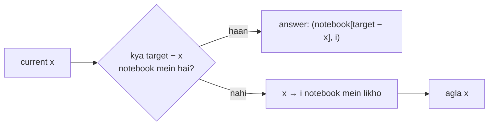
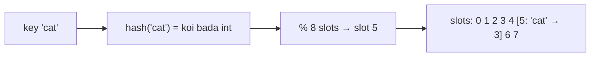

# Chapter 05 · Hashing Patterns

> Socho ek librarian hai jiski memory perfect hai. Tum usse koi book maango, toh woh shelves mein dhoondhne nahi jaati. Title suna, aur dimaag ne turant bola: "shelf 412". **Hash maps** tumhare code ko yahi librarian de dete hain. Interviews mein jitne bhi "O(n²) ko O(n) bana diya" wale moments aate hain, unme se zyadatar bas yahi hain: **dhoondhna band karo, yaad rakhna shuru karo.**

**Is chapter mein tum seekhoge:**
- Hash maps aur sets kaise kaam karte hain, iska quick recap, aur "O(1) average" ka asli matlab kya hai
- **Collisions**, load factor, aur O(n) worst case (aur Python string hashes ko randomise kyun karta hai)
- Saat hashing patterns: **complement lookup**, **frequency counting**, **canonical keys / grouping**, **seen set**, **index map**, **set-as-universe** (longest consecutive), aur **bijection maps**
- **Top K Frequent Elements** ke liye bucket sort, O(n) mein
- Encode/decode design aur validation problems (Valid Sudoku)
- Space-for-time trade-off, aur kab hashing galat tool hai

**Isse pehle padho:** [Dictionaries & Hashing](../part-1-python/09-dictionaries.md) · [Tuples & Sets](../part-1-python/08-tuples-sets.md) · [Big-O](01-big-o-complexity.md) · [Arrays & Strings](02-arrays-strings.md)

---

## 🧠 The Big Idea · Asli Baat

Ek problem hai jisse lakhon interviews shuru hue hain. **Two Sum:** tumhe `[2, 7, 11, 15]` diya hai aur target 9. Un do numbers ke indexes return karo jinka sum 9 ho.

Brute force har pair se poochta hai: "Kya tum dono ka total 9 hai?" Ye **O(n²)** hai, kyunki har element ke liye baaki saare elements check hote hain.

Hashing wala tareeka sawaal hi ulta kar deta hai. List ko ek hi baar walk karo, aur har number `x` pe poocho: **"Kya maine iska partner `9 − x` pehle dekh liya hai?"** Is sawaal ka jawab turant dene ke liye ek notebook rakho (ek dict), jisme har dekha hua number aur uski position likhi ho.

```text
see 2  → need 7. Seen 7? no.  Write down {2: 0}
see 7  → need 2. Seen 2? YES, at index 0.  Answer: [0, 1]
```



Brute force mein jo "dhoondhne" wala part tha (n steps ka inner loop), woh ab ek single **O(1)** dictionary lookup ban gaya. Do loops ki jagah ek loop.

> 🇮🇳 **Desi Analogy:** Kirana store wale uncle ka khata socho. Tum poocho "Sharma ji ka kitna udhaar hai?", toh uncle poora register page-by-page nahi palatte. Unhone har customer ka naam ek fixed page pe likha hai, aur unhe yaad hai kaunsa naam kis page pe hai. Naam bola (key), seedha page khula (slot), amount mila (value). Brute force matlab har page palat ke dhoondhna: **O(n)**. Khata system matlab seedha page pe jaana: **O(1)**. Two Sum mein bhi yahi ho raha hai: har naye number pe hum "khata" kholte hain aur dekhte hain ki partner ka naam likha hai ya nahi.

> 💡 **The core insight:** jab bhi tumhare brute force mein ek inner loop kuch **dhoondh** raha ho ("kya koi element hai jo is wale ke barabar hai / match karta hai / iske saath pair banata hai?"), tab ek hash map aam taur pe us poori search ko ek **O(1)** lookup se replace kar deta hai. Iski keemat tum **O(n) memory** se chukaate ho.

---

## 🔨 Building It Up · Zero Se Shuru

### 1. Hash map aur hash set recap (DSA view)

`dict` aur `set` se tum [Part 1 ke Chapter 09](../part-1-python/09-dictionaries.md) mein mil chuke ho. DSA ke liye bas itna yaad rakhna kaafi hai:

| Structure | Kya store karta hai | Key operations (average) |
|---|---|---|
| `set` | unique keys | `add`, `in`, `remove`: O(1) |
| `dict` | key → value | `d[k]`, `d[k] = v`, `k in d`, `del d[k]`: O(1) |
| `collections.Counter` | key → count | `Counter(iterable)`: O(n); `c[k]` (missing → 0) |
| `collections.defaultdict(f)` | key → value, missing values ko `f()` se khud bana deta hai | dict jaisa hi |

Keys **hashable** honi chahiye: numbers, strings, hashable cheezon ke tuples, frozensets. Lists, dicts aur sets hashable nahi hain, kyunki ye badal sakte hain, aur badalne se table toot jaayega (iski poori kahani neeche Under the Hood mein hai).

```python
from collections import Counter, defaultdict

counts = Counter("mississippi")
print(counts.most_common(2), counts["z"])          # missing key -> 0, KeyError nahi aata

groups = defaultdict(list)
for word in ["apple", "avocado", "banana", "blueberry", "cherry"]:
    groups[word[0]].append(word)                    # "if key in groups" check karne ki zaroorat nahi
print(dict(groups))

print((1, 2) in {(1, 2), (3, 4)})                   # tuples hashable hain: keys ke liye badhiya
```

```text
[('i', 4), ('s', 4)] 0
{'a': ['apple', 'avocado'], 'b': ['banana', 'blueberry'], 'c': ['cherry']}
True
```

Dhyaan do: `"mississippi"` mein `i` aur `s` dono 4-4 baar hain, aur `most_common` ne tie mein jo pehle dikha (`i`) usse pehle rakha. Aur `counts["z"]` ne error nahi diya, seedha `0` diya. Yahi `Counter` ka sabse bada fayda hai.

### 2. Hash table kaise kaam karta hai, ek picture mein

Hash table asal mein ek **array of slots** hai, plus ek **hash function**. Key `k` ko store karne ke liye:

1. `h = hash(k)` nikaalo, ye ek bada integer hota hai.
2. Usse slot number mein badlo: `h % number_of_slots` (CPython low bits use karta hai, idea same hai).
3. Entry ko us slot mein rakh do.

Baad mein `k` ko dhoondhna ho, toh wahi calculation dobara karo aur seedha us slot pe pahunch jao. Isi wajah se ye **O(1)** hai: ye phir se array indexing hi hai ([Chapter 02](02-arrays-strings.md)), bas index key se calculate hota hai.



> 🇮🇳 **Desi Analogy:** Railway reservation chart socho. Tumhara PNR ek fixed formula se coach aur berth number mein badal jaata hai. TC ko tumhe dhoondhne ke liye poori train mein ghoomna nahi padta: PNR (key) → formula (hash function) → "S4, berth 23" (slot). Wahi formula har baar same berth batata hai, isliye lookup turant hota hai. Hash function bas wo formula hai jo key ko "berth number" mein convert karta hai.

> 🤔 **Mann mein sawaal:** Agar `hash()` ek bahut bada number deta hai, toh itna bada array thodi banayenge?
>
> **Jawab:** Bilkul nahi. Isliye `% number_of_slots` lagate hain. Number kitna bhi bada ho, `% 8` ke baad woh `0` se `7` ke beech hi aayega. Table chhoti rehti hai, aur har key ko ek valid slot mil jaata hai. Haan, iski keemat ye hai ki do alag keys ek hi slot pe aa sakti hain. Yahi agla topic hai.

### 3. Collisions aur worst case

Do alag keys ek hi slot mein aa sakti hain. Isko **collision** kehte hain. Ye unavoidable hai: keys infinite ho sakti hain, slots limited hain. Do classic fixes hain:

- **Chaining:** har slot mein entries ki ek chhoti list hoti hai. Lookup sirf us list ko scan karta hai. (Java ka `HashMap` yahi karta hai.)
- **Open addressing:** agar slot bhara hua hai, toh ek fixed sequence mein doosre slots ko **probe** karo jab tak khaali slot (ya woh key) na mil jaaye. CPython ka `dict` aur `set` yahi karte hain.

Chalo ek chhota sa chaining hash map banate hain taaki collisions apni aankhon se dikhein:

```python
class ChainedHashMap:
    def __init__(self, slots=4):
        self.buckets = [[] for _ in range(slots)]

    def _bucket(self, key):
        return self.buckets[hash(key) % len(self.buckets)]

    def put(self, key, value):
        bucket = self._bucket(key)
        for i, (k, _) in enumerate(bucket):
            if k == key:
                bucket[i] = (key, value)       # existing key ko update karo
                return
        bucket.append((key, value))            # nayi key (shayad collision ho)

    def get(self, key):
        for k, v in self._bucket(key):         # sirf isi bucket ko scan karo
            if k == key:
                return v
        raise KeyError(key)

m = ChainedHashMap(slots=4)
for n in [1, 5, 9, 2]:                         # small ints ka hash khud wahi number hota hai
    m.put(n, n * 10)
print(m.buckets)
print(m.get(9))
```

```text
[[], [(1, 10), (5, 50), (9, 90)], [(2, 20)], []]
90
```

Kya hua yahan: 1, 5 aur 9, teeno ke liye `n % 4 == 1` hai, isliye teeno bucket 1 mein **collide** kar gaye. 9 ko dhoondhne ke liye us bucket ki teeno entries scan karni padi. Ab socho agar **har** key collide kare: ek hi bucket mein saari n entries hongi, aur har lookup **O(n)** ho jaayega. Yahi hash table ka **worst case** hai.

> 🇮🇳 **Desi Analogy:** Chaining ko society ke letterboxes jaisa samjho. Har flat number ka ek box hai (slot). Agar teen families ki daak ek hi box mein aati hai (collision), toh postman ko box ke andar naam padh ke sahi chitthi nikaalni padti hai (bucket scan). Jab tak har box mein 1-2 chitthiyan hain, kaam turant. Lekin agar poori society ki daak ek hi box mein aane lage, toh har baar poora dher chhaanna padega: yahi O(n) worst case hai.

Real hash tables do tricks se fast rehti hain:

- **Accha hash function** keys ko barabar spread karta hai, taaki buckets chhote rahein.
- **Resizing:** jab **load factor** (entries ÷ slots) zyada ho jaata hai, toh ek bada table allocate karo (constant factor bada) aur sab kuch dobara insert karo. List growth ki tarah, isse inserts **O(1) amortized** rehte hain ([Chapter 01](01-big-o-complexity.md)). CPython dict ko tab resize karta hai jab woh lagbhag do-tihaai (two-thirds) bhar jaata hai.

> 🤔 **Mann mein sawaal:** Resize mein toh saari entries dobara insert hoti hain, woh O(n) hua. Phir insert ko O(1) kaise bola?
>
> **Jawab:** Resize kabhi-kabhi hota hai, har insert pe nahi. Table har baar double (ya kisi constant factor se badi) hoti hai, toh n inserts mein resize ka total kaam lagbhag `1 + 2 + 4 + ... + n` ≈ `2n` hota hai. Ye 2n kaam n inserts mein baant do, toh har insert ke hisse mein constant kaam aata hai. Isko **amortized O(1)** kehte hain: kabhi-kabhi ek mehenga step, lekin average sasta.

> ⚠️ **Hash flooding:** agar attacker ko tumhara hash function pata hai, toh woh hazaaron aisi keys bhej sakta hai jo sab collide karein. Tumhara O(1) server O(n) ban jaata hai (aur n inserts ke liye O(n²)). Isi wajah se Python har process mein **string hashes ko randomise** karta hai (`PYTHONHASHSEED`): `hash("cat")` har run mein alag aata hai, toh attacker pehle se collisions calculate nahi kar sakta. Small integers ka hash phir bhi khud wahi number hota hai, isliye upar wala demo har baar same output deta hai.

### 4. Pattern 1: Complement lookup (Two Sum)

**Shape:** "do elements dhoondho jo milke target **banate** hain". Har `x` ke liye partner already decided hai (`target − x`, `target / x`, `x XOR target`...). Bas pehle dekhe hue elements mein usse lookup karo.

```python
def two_sum(nums, target):
    index_of = {}                       # value -> index jahan humne usse dekha
    for i, x in enumerate(nums):
        partner = target - x
        if partner in index_of:         # inner loop ki jagah O(1)
            return [index_of[partner], i]
        index_of[x] = i                 # check ke BAAD store karo: x kabhi khud se pair nahi banega
    return []

print(two_sum([2, 7, 11, 15], 9))
print(two_sum([3, 2, 4], 6))
print(two_sum([3, 3], 6))
```

```text
[0, 1]
[1, 2]
[0, 1]
```

**Dry run** `[3, 2, 4]` ke liye, target 6:

| i | x | partner = 6 − x | partner map mein hai? | map after |
|---|---|---|---|---|
| 0 | 3 | 3 | nahi (map khaali hai, 3 abhi store nahi hua) | {3: 0} |
| 1 | 2 | 4 | nahi | {3: 0, 2: 1} |
| 2 | 4 | 2 | **haan, index 1 pe** | return [1, 2] |

Kya hua yahan: i = 0 pe humne 3 ko **apna 3 store karne se pehle** check kiya. Isi wajah se index 0 galti se khud ke saath pair nahi bana. Aur `[3, 3]` isliye chalta hai kyunki doosra 3 pehle wale 3 ko map mein dhoondh leta hai.

> 🤔 **Mann mein sawaal:** Map mein value → index kyun rakha, index → value kyun nahi?
>
> **Jawab:** Kyunki hum **value se dhoondh** rahe hain ("kya 4 dekha hai?"). Jo cheez tum dhoondhte ho, wahi key banti hai. Jo cheez answer mein chahiye (index), wahi value banti hai. Ye rule har hashing problem mein kaam aayega.

[Chapter 03](03-two-pointers.md) se compare karo: agar array **sorted** hota, toh two pointers ye kaam O(1) space mein kar dete. Unsorted hai aur original indexes chahiye → hash map.

### 5. Pattern 2: Frequency counting

**Shape:** "har cheez kitni baar aayi?", "counts same hain?", "sabse common kaun?", "exactly ek baar kaun aaya?"

```python
from collections import Counter

def first_unique(s):
    counts = Counter(s)                 # pass 1: gino
    for i, ch in enumerate(s):          # pass 2: pehla aisa dhoondho jiska count 1 ho
        if counts[ch] == 1:
            return i
    return -1

def can_construct(ransom_note, magazine):
    have = Counter(magazine)
    need = Counter(ransom_note)
    return all(have[ch] >= cnt for ch, cnt in need.items())

print(first_unique("leetcode"), first_unique("aabb"))
print(can_construct("aa", "aab"), can_construct("aa", "ab"))
```

```text
0 -1
True False
```

**Two-pass** shape (pehle sab gino, phir counts use karo) bahut common hai. Utna hi common **one-pass** shape bhi hai, jisme tum chalte-chalte ginte ho aur past ke baare mein sawaalon ka jawab dete ho.

`first_unique` mein do pass kyun chahiye? Jab tum pehli baar `"l"` dekhte ho, tumhe abhi pata hi nahi ki aage aur `"l"` aayega ya nahi. Future ki jaankari chahiye, isliye pehle poora gin lo, phir order mein dekho.

> 🇮🇳 **Desi Analogy:** Ransom Note ko shaadi ke buffet jaisa socho. Magazine = kitchen mein kaun si dish ki kitni plates bani hain (`have`). Ransom note = guests ne kya-kya maanga (`need`). Har dish ke liye check karo: banaya hua ≥ maanga hua? Ek bhi dish kam padi toh `False`. Hum har dish ka count ek baar gin lete hain, har guest ke liye kitchen mein dobara nahi bhaagte.

### 6. Pattern 3: Canonical keys aur grouping

**Shape:** "un cheezon ko group karo jo kisi tarah se **equivalent** hain" (anagrams, same pattern, same shift). Ek **canonical key** design karo: ek aisi value jo saare equivalent items ke liye identical ho, aur baaki sab ke liye alag. Phir bas `groups[key].append(item)`.

**Group Anagrams:** `["eat","tea","tan","ate","nat","bat"]` → `[["eat","tea","ate"],["tan","nat"],["bat"]]`.

Do possible keys:

- **Sorted letters:** `"".join(sorted(word))` → eat/tea/ate teeno ke liye `"aet"`. Cost: length k ke word ke liye O(k log k).
- **Count signature:** 26 counts ka ek tuple. Cost: har word ke liye O(k).

```python
from collections import defaultdict

def group_anagrams(words):
    groups = defaultdict(list)
    for w in words:
        counts = [0] * 26
        for ch in w:
            counts[ord(ch) - ord("a")] += 1
        groups[tuple(counts)].append(w)        # tuple: lists dict keys nahi ban sakti
    return list(groups.values())

print(group_anagrams(["eat", "tea", "tan", "ate", "nat", "bat"]))
```

```text
[['eat', 'tea', 'ate'], ['tan', 'nat'], ['bat']]
```

`ord(ch) - ord("a")` ka matlab: `"a"` → 0, `"b"` → 1, ... `"z"` → 25. Har letter ko apna counter-slot mil jaata hai. "eat" aur "tea" dono ka count array same hai (a:1, e:1, t:1), toh dono ka tuple same, toh dono ek hi group mein.

**Group Shifted Strings** ("abc", "bcd", "xyz" sab ek doosre ke shifts hain): key hai consecutive letters ke beech ke gaps ka tuple, mod 26.

```python
from collections import defaultdict

def group_shifted(strings):
    groups = defaultdict(list)
    for s in strings:
        key = tuple((ord(b) - ord(a)) % 26 for a, b in zip(s, s[1:]))
        groups[key].append(s)
    return list(groups.values())

print(group_shifted(["abc", "bcd", "acef", "xyz", "az", "ba", "a", "z"]))
```

```text
[['abc', 'bcd', 'xyz'], ['acef'], ['az', 'ba'], ['a', 'z']]
```

`% 26` kyun? `"az"` ka gap `z − a = 25` hai. `"ba"` ka gap `a − b = −1` hai. Ghadi ki tarah 26 letters ko gol ghumao (z ke baad phir a), toh −1 aur 25 ek hi jagah hain. `% 26` dono ko 25 bana deta hai, isliye `"az"` aur `"ba"` ek group mein aaye. Single letters (`"a"`, `"z"`) mein koi gap hai hi nahi, unki key khaali tuple `()` hai, isliye woh saath hain.

> 💡 **The canonical-key question:** "Group ke saare members mein aisa kya common hai jo group ke bahar kisi ke paas nahi?" Usse ek hashable value (string ya tuple) mein badal do, aur kaam khatam.

> 🇮🇳 **Desi Analogy:** Aadhaar number socho. Ek hi insaan ka naam alag-alag forms mein "Rahul K.", "Rahul Kumar", "R. Kumar" likha ho sakta hai, lekin Aadhaar sab jagah same hai. Sab records ko Aadhaar se group karo toh ek insaan ke saare forms ek jagah aa jaate hain. **Canonical key** wahi Aadhaar hai: alag-alag dikhne wale items ("eat", "tea", "ate") ka ek common ID ("aet"), jo group ke bahar kisi ke paas nahi.

### 7. Pattern 4: Seen set (dedupe, cycle detection)

**Shape:** "kya main yahan pehle aa chuka hoon?" Duplicates, repeats, cycles.

**Happy Number:** n ko uske digits ke squares ke sum se replace karte raho. Agar 1 pe pahunch gaye toh happy; agar hamesha ghoomte rahe toh unhappy. "Hamesha ghoomte rehna" = koi aisa number dikhna jo pehle dekh chuke ho.

```python
def is_happy(n):
    seen = set()
    while n != 1 and n not in seen:
        seen.add(n)
        n = sum(int(d) ** 2 for d in str(n))
    return n == 1

print(is_happy(19), is_happy(2))
```

```text
True False
```

19 → 82 → 68 → 100 → 1. Happy. (Check karo: 1² + 9² = 82, 8² + 2² = 68, 6² + 8² = 100, 1² + 0² + 0² = 1.) 2 ke saath sequence 2 → 4 → 16 → 37 → 58 → 89 → 145 → 42 → 20 → 4 pe wapas aa jaata hai. `4` already `seen` mein hai, toh loop rukta hai aur answer `False`. (Cycle ko O(1) space mein bhi detect kar sakte ho, fast aur slow pointers se, jo [Chapter 10](10-linked-lists.md) mein aa raha hai.)

### 8. Pattern 5: Index map (value → position)

**Shape:** "ye cheez maine aakhri/pehli baar kahan dekhi thi?", "barabar elements ke beech distance", "is property wala sabse pehla index". Value ke roop mein ek index (ya indexes ki list) store karo.

**Contains Duplicate II:** kya koi do barabar values hain jo zyada se zyada k distance pe hain?

```python
def contains_nearby_duplicate(nums, k):
    last_index = {}
    for i, x in enumerate(nums):
        if x in last_index and i - last_index[x] <= k:
            return True
        last_index[x] = i               # sabse recent wala rakho: future ke liye wahi sabse paas hai
    return False

print(contains_nearby_duplicate([1, 2, 3, 1], 3), contains_nearby_duplicate([1, 2, 3, 1, 2, 3], 2))
```

```text
True False
```

Pehle example mein dono `1` index 0 aur 3 pe hain, distance 3 ≤ 3, toh `True`. Doosre mein har repeat ka distance 3 hai aur k = 2, toh `False`. Sirf **last** index kyun rakha? Kyunki aage aane wale kisi bhi element ke liye sabse recent copy hi sabse paas hogi. Purani copies kabhi better answer nahi de sakti.

Index map hi agle chapter ke sabse important hashing pattern ka engine hai: **prefix sum → earliest index** ([Chapter 06](06-prefix-sums.md)).

### 9. Pattern 6: Set as a universe (Longest Consecutive Sequence)

**Problem:** unsorted `[100, 4, 200, 1, 3, 2]` → consecutive integers ka sabse lamba run `1, 2, 3, 4` hai → 4. O(n) chahiye, toh sorting nahi chalegi.

**Idea:** sab kuch ek set mein daal do. Koi number `x` ek run ko **shuru** tabhi karta hai jab `x − 1` set mein **nahi** hai. Har start se upar ginte jao jab tak `x + 1, x + 2, ...` mil rahe hain.

```python
def longest_consecutive(nums):
    num_set = set(nums)
    best = 0
    for x in num_set:
        if x - 1 not in num_set:          # x ek run ka start hai
            length = 1
            while x + length in num_set:
                length += 1
            best = max(best, length)
    return best

print(longest_consecutive([100, 4, 200, 1, 3, 2]))
print(longest_consecutive([0, 3, 7, 2, 5, 8, 4, 6, 0, 1]))
```

```text
4
9
```

`for` ke andar `while` hone ke baad bhi O(n) kyun? `while` loop sirf **run starts** se chalta hai, aur har run ko exactly ek baar walk karta hai. Har number exactly ek run ka hissa hai, toh saare starts milake `while` ke total steps zyada se zyada n hain. (Agar `x − 1 not in num_set` wala check na ho, toh har number apna khud ka run walk karega: O(n²).)

> 🇮🇳 **Desi Analogy:** Yard mein khade railway coaches socho, kuch aapas mein jude hain, kuch alag. Tumhe sabse lambi judi hui train ginni hai. Smart tareeka: sirf us coach se ginna shuru karo jiske **peeche koi coach nahi juda** (yahi engine wala coach hai, `x − 1` missing). Wahan se aage gino. Beech ke coaches se shuru karoge toh ek hi train ko baar-baar ginoge. Har train sirf apne engine se ek baar gini jaati hai, isliye total kaam n.

**Dry run** `{100, 4, 200, 1, 3, 2}` pe:

| x | x − 1 set mein? | start? | walk | length |
|---|---|---|---|---|
| 100 | 99: nahi | haan | 101? nahi | 1 |
| 4 | 3: haan | nahi | skip | |
| 200 | 199: nahi | haan | 201? nahi | 1 |
| 1 | 0: nahi | haan | 2 ✓, 3 ✓, 4 ✓, 5 ✗ | 4 |
| 3 | 2: haan | nahi | skip | |
| 2 | 1: haan | nahi | skip | |

(Set ka iteration order bilkul is table jaisa hi ho, ye guaranteed nahi hai. Lekin answer pe koi farak nahi padta: har run apne start se hi gina jaayega, chahe start kabhi bhi aaye.)

> 🤔 **Mann mein sawaal:** Duplicates ho toh? Doosre example mein `0` do baar hai.
>
> **Jawab:** `set(nums)` duplicates ko pehle hi hata deta hai, aur loop bhi `num_set` pe chal raha hai, `nums` pe nahi. Agar `nums` pe loop chalate, toh ek hi start (jaise `0`) se run do baar walk hota. Bahut saare duplicates wale input pe ye kaam O(n²) tak badh sakta hai. Isliye set pe iterate karo.

### 10. Pattern 7: Bijection maps (Isomorphic Strings, Word Pattern)

**Shape:** "kya in do sequences ke beech one-to-one mapping hai?" **Do** maps use karo (forward aur backward), kyunki ek-taraf ka map ye nahi pakad sakta ki do letters ek hi letter pe map ho rahe hain.

**Isomorphic Strings:** `"egg"` aur `"add"` → True (e→a, g→d). `"badc"` aur `"baba"` → False (b→b aur d→b, dono b pe map ho rahe hain).

```python
def is_isomorphic(s, t):
    if len(s) != len(t):
        return False
    s_to_t, t_to_s = {}, {}
    for a, b in zip(s, t):
        if s_to_t.get(a, b) != b or t_to_s.get(b, a) != a:
            return False                  # kisi bhi direction mein conflict
        s_to_t[a] = b
        t_to_s[b] = a
    return True

for s, t in [("egg", "add"), ("foo", "bar"), ("paper", "title"), ("badc", "baba")]:
    print(s, t, is_isomorphic(s, t))
```

```text
egg add True
foo bar False
paper title True
badc baba False
```

`d.get(a, b) != b` ko aise padho: "agar `a` pehle se kisi cheez pe map hai, toh woh `b` hi hona chahiye." Default `b` dene ka fayda ye hai ki bilkul nayi key apne aap pass ho jaati hai.

> 🇮🇳 **Desi Analogy:** Shaadi ka seating chart socho: har guest ki ek seat, aur har seat pe ek guest. Agar sirf "guest → seat" register rakhoge, toh do guests ko same seat de doge aur pata bhi nahi chalega. Isliye do registers rakho: "guest → seat" aur "seat → guest". `"badc"` vs `"baba"` mein guest `b` aur guest `d` dono seat `b` maang rahe hain. Pehla register khush hai (dono alag guests hain, dono ki apni entry), lekin doosra register turant pakadta hai: "seat `b` pe toh pehle se `b` baitha hai!"

> 🤔 **Mann mein sawaal:** `"foo"` vs `"bar"` toh ek hi map se pakda gaya. Phir doosra map kyun?
>
> **Jawab:** `"foo"` mein `o` pehle `a` pe map hua, phir `r` pe jaana chahta hai: forward map hi conflict pakad leta hai. Lekin `"badc"` vs `"baba"` ulta case hai: `s` ke do **alag** letters (`b` aur `d`) `t` ke ek hi letter `b` pe ja rahe hain. Forward map mein `b→b` aur `d→b` do alag keys hain, koi conflict nahi dikhta. Ye galti sirf backward map (`t_to_s`) pakadta hai. One-to-one ka matlab hai dono taraf ki guarantee.

Ek slick alternative: do strings tabhi isomorphic hain jab unke **first-occurrence patterns** match karein. Har character ko uske pehle appearance ke index pe map karo: `"egg"` → `[0, 1, 1]`, `"add"` → `[0, 1, 1]`. Ye phir se **canonical key** pattern hi hai.

### 11. Sets se validation: Valid Sudoku

**Problem:** check karo ki 9×9 board ke bhare hue cells koi rule todte hain ya nahi (kisi row, column ya 3×3 box mein koi digit repeat nahi hona chahiye). Khaali cells `"."` hain.

**Idea:** cells pe ek hi pass. Har digit ke liye teen "fingerprints" banao (row r mein d hai, column c mein d hai, box b mein d hai) aur ek hi seen-set mein unhe check karo. Box number `(r // 3) * 3 + c // 3` hai.

```python
def is_valid_sudoku(board):
    seen = set()
    for r in range(9):
        for c in range(9):
            d = board[r][c]
            if d == ".":
                continue
            keys = (("row", r, d), ("col", c, d), ("box", r // 3, c // 3, d))
            if any(k in seen for k in keys):
                return False
            seen.update(keys)
    return True

board = [
    ["5", "3", ".", ".", "7", ".", ".", ".", "."],
    ["6", ".", ".", "1", "9", "5", ".", ".", "."],
    [".", "9", "8", ".", ".", ".", ".", "6", "."],
    ["8", ".", ".", ".", "6", ".", ".", ".", "3"],
    ["4", ".", ".", "8", ".", "3", ".", ".", "1"],
    ["7", ".", ".", ".", "2", ".", ".", ".", "6"],
    [".", "6", ".", ".", ".", ".", "2", "8", "."],
    [".", ".", ".", "4", "1", "9", ".", ".", "5"],
    [".", ".", ".", ".", "8", ".", ".", "7", "9"],
]
print(is_valid_sudoku(board))
board[0][0] = "8"                     # ab column 0 mein do 8 hain
print(is_valid_sudoku(board))
```

```text
True
False
```

Box formula ko samjho: `r // 3` batata hai ki row upar wale, beech wale ya neeche wale band mein hai (0, 1 ya 2). `c // 3` yahi kaam columns ke liye karta hai. Jaise cell (4, 7): `4 // 3 = 1`, `7 // 3 = 2`, toh box (1, 2), yaani beech wali patti ka right wala box. Code mein box ko `(r // 3, c // 3)` pair ki tarah fingerprint mein daala hai; `(r // 3) * 3 + c // 3` usi pair ko 0 se 8 tak ke ek number mein badalne ka tareeka hai (yahan 1 * 3 + 2 = 5). Dono same kaam karte hain.

Fingerprint mein `"row"`, `"col"`, `"box"` labels kyun? Taaki "row 3 mein 5" aur "column 3 mein 5" ek jaisa tuple na ban jaaye. Label lagate hi teeno alag duniya ban jaati hain, aur ek hi set teeno ka hisaab rakh leta hai.

9×9 fixed board ke liye O(81) = O(1); n×n generalisation ke liye O(n²).

### 12. Top K Frequent Elements, bucket sort se

**Problem:** k sabse frequent elements return karo. `[1,1,1,2,2,3]`, k = 2 → `[1, 2]`.

Teen solutions, har agla behtar:

| Approach | Time |
|---|---|
| Gino, phir saare items ko count se sort karo | O(n log n) |
| Gino, phir size k ka heap ([Chapter 15](15-heaps.md)) | O(n log k) |
| Gino, phir **frequency se bucket karo** | **O(n)** |

**Bucket idea:** koi bhi frequency 1 aur n ke beech hi hogi (n elements mein koi cheez n se zyada baar nahi aa sakti). n + 1 buckets banao, jahan `buckets[f]` mein woh elements hain jo exactly f baar aaye. Phir sabse badi frequency se neeche ki taraf buckets padho jab tak k elements na mil jaayein.

```python
from collections import Counter

def top_k_frequent(nums, k):
    counts = Counter(nums)
    buckets = [[] for _ in range(len(nums) + 1)]   # index = frequency
    for value, freq in counts.items():
        buckets[freq].append(value)
    result = []
    for freq in range(len(buckets) - 1, 0, -1):    # sabse zyada frequency pehle
        for value in buckets[freq]:
            result.append(value)
            if len(result) == k:
                return result
    return result

print(top_k_frequent([1, 1, 1, 2, 2, 3], 2))
print(top_k_frequent([4, 4, 5, 5, 5, 6, 6, 6, 6, 7], 3))
print(Counter([1, 1, 1, 2, 2, 3]).most_common(2))   # library wala one-liner
```

```text
[1, 2]
[6, 5, 4]
[(1, 3), (2, 2)]
```

Pehle example ke buckets aise dikhte hain: `buckets[3] = [1]`, `buckets[2] = [2]`, `buckets[1] = [3]`, baaki khaali. Upar se padho: 1 mila, phir 2 mila, k = 2 poora, return.

Kya hua yahan: koi comparison sort hua hi nahi. Frequency ko hi array index ki tarah use kiya, aur yahi trick **counting sort** aur **bucket sort** ke peeche hai ([Chapter 07](07-sorting.md)).

> 🇮🇳 **Desi Analogy:** School ke result board socho jahan students ko marks ke hisaab se alag-alag khaanon mein daala hai: "100 marks wale", "99 wale", ... "1 wale". Top 3 chahiye? Sabse upar wale khaane se padhna shuru karo aur 3 naam milte hi ruk jao. Kisi ko kisi se compare karke sort karne ki zaroorat hi nahi padi, kyunki khaane khud hi order mein lage hain. Marks ki range fixed thi (0 se 100), isliye ye trick chali. Frequency ki range bhi fixed hai (1 se n).

### 13. Encode aur decode

**Problem: Encode and Decode Strings.** `encode(list_of_strings) → ek string` aur `decode(string) → original list` design karo. Strings mein **koi bhi** character ho sakta hai, woh separator bhi jo tum chunoge.

`","` se join karna fail ho jaata hai agar kisi string mein comma ho. Robust fix hai **length-prefixing**: har string ko `len#string` ki tarah likho. Decoder `#` tak digits padhta hai, phir exactly utne characters padhta hai, toh content ko kabhi interpret hi nahi kiya jaata.

```python
def encode(strs):
    return "".join(f"{len(s)}#{s}" for s in strs)

def decode(data):
    result, i = [], 0
    while i < len(data):
        j = data.index("#", i)            # length field ka end
        length = int(data[i:j])
        result.append(data[j + 1:j + 1 + length])
        i = j + 1 + length                # seedha is string ke aage kood jao
    return result

original = ["hello", "", "a#b", "4#x", "world,!"]
packed = encode(original)
print(packed)
print(decode(packed) == original)
```

```text
5#hello0#3#a#b3#4#x7#world,!
True
```

> 🤔 **Mann mein sawaal:** String `"a#b"` mein khud `#` hai, aur `"4#x"` toh bilkul length field jaisa dikhta hai. Decoder confuse kyun nahi hota?
>
> **Jawab:** Kyunki decoder content ko kabhi "padhta" hi nahi. Woh sirf length field mein `#` dhoondhta hai, length (`3`) le leta hai, aur phir aankh band karke agle 3 characters (`a#b`) utha leta hai. Unke andar kya hai, isse koi matlab nahi. Phir `i` seedha unke baad jump kar jaata hai. `#` hamesha ek length field ke baad hi dhoondha jaata hai, content ke andar kabhi nahi. Empty string `""` bhi safe hai: woh `0#` ban jaati hai, aur decoder 0 characters utha ke aage badh jaata hai.

Ye idea (length-prefixed framing) bilkul wahi hai jisse kai network protocols messages ko alag karte hain. Related design problem **Encode and Decode TinyURL** short code se long URL tak ka hash map use karta hai; isse scale pe properly design tum [System Design Chapter 12](../part-3-system-design/12-case-studies-1.md) mein karoge.

---

## 🔬 Under the Hood · Andar Ki Kahani

### CPython ka dict asal mein cheezein kaise store karta hai

Python 3.6 se, ek dict ke andar do arrays hote hain:

1. Ek compact **entries** array, jisme `(hash, key, value)` rows **insertion order** mein rakhi hoti hain. Isi wajah se dicts insertion order yaad rakhte hain.
2. Ek sparse (khaali-khaali sa) **indices** table (yahi asli hash table hai), jiske slots mein entries array ki positions hoti hain.

Lookup: `hash(key)` nikaalo, uske low bits se indices table ka ek slot chuno. Agar slot kisi aisi entry ko point karta hai jiska stored hash aur key match karte hain, toh kaam ho gaya. Agar woh kisi doosri key ko point karta hai (collision), toh CPython ek "perturbed" sequence se doosra slot probe karta hai. Ye sequence hash ke aur bits ko mix karti hai, taaki colliding keys ek jagah jhund na banayein balki fail jaayein. Khaali slot mila matlab "key present nahi hai".

Ek `set` bhi isi tarah ki open-addressing table use karta hai, lekin sirf keys store karta hai.

> 🇮🇳 **Desi Analogy:** Entries array ko hostel ka register samjho, jisme students usi order mein likhe hain jisme woh aaye (insertion order). Indices table ek chhota sa "room → register line number" chart hai. Room number (slot) se line number milta hai, line number se poori entry. Register compact rehta hai, aur chart thoda khaali rakha jaata hai taaki rooms jaldi milein.

### Equal objects ke hashes equal kyun hone chahiye

Table key ko pehle uske hash se dhoondhta hai, aur sirf uske baad `==` check karta hai. Agar `a == b` hai lekin `hash(a) != hash(b)`, toh dono alag slots mein jaayenge aur dict unhe alag keys maan lega. Isliye Python ka rule hai: **agar `a == b` hai toh `hash(a) == hash(b)` hona chahiye**. Isi wajah se `hash(1) == hash(1.0) == hash(True)`, aur `{1: "x", 1.0: "y"}` mein sirf ek key hai. (Ulta zaroori nahi hai: alag keys ka same hash ho sakta hai, woh bas ek collision hai.)

> 🤔 **Mann mein sawaal:** `{1: "x", 1.0: "y"}` mein kaunsi key bachegi aur kaunsi value?
>
> **Jawab:** Key wahi rehti hai jo pehle aayi (`1`), lekin value baad wali (`"y"`) se overwrite ho jaati hai. Result `{1: 'y'}`. Kyunki dict ki nazar mein `1` aur `1.0` ek hi key hain: same hash, aur `1 == 1.0` True.

### Mutable objects hashable kyun nahi hain

Socho tumne ek list ko set mein daala, aur phir usme append kar diya. Uska hash badal jaata, lekin woh abhi bhi apne *purane* hash wale slot mein baithi hoti. Lookups galat slot mein jaate, aur set chupchaap use kho deta. Isliye Python ye allow hi nahi karta. Key ke liye `tuple` (ya `frozenset`) use karo.

### "O(1) average" ka asli matlab

Accha hash ho aur load factor ek constant ke neeche rakha jaaye, toh har operation ke **expected** probes ki ginti constant hoti hai. "Expected" ye maan ke chalta hai ki keys hash ke hisaab se random jaisi behave karti hain. Individual operations dheemi ho sakti hain (lamba probe sequence, ya ek resize jo O(n) hai), aur adversarial keys sab kuch O(n) bana sakti hain. Interview mein bolo: **"O(1) average, O(n) worst case."**

> 🇮🇳 **Desi Analogy:** Metro ka "har 3 minute mein train" bhi ek average promise hai. Aam din mein sach hai. Lekin kabhi-kabhi signal failure (lamba probe) ya maintenance (resize) se ek train late ho jaati hai, aur agar koi jaan-boojh ke chain kheeche (adversarial keys), toh poori line ruk jaati hai. Isliye "har baar 3 minute" mat bolo, "average 3 minute" bolo. Hash map ke saath bhi yahi imaandari dikhao.

### Kitni space ki keemat chuka rahe ho

n entries wala dict O(n) memory leta hai, lekin ek bade constant ke saath: har entry ek hash, ek key pointer aur ek value pointer store karti hai, plus woh sparse index table jo jaan-boojh ke aadhi khaali rakhi jaati hai. Ek million chhote ints ka dict dasiyon megabytes le sakta hai. "Values 0..n ke beech" wale problems mein, value se indexed ek simple list dict se halki bhi hai aur tez bhi.

---

## 🧩 Pattern Decoder · Pattern Pakdo

### Signals: hashing kab uthana hai

| Problem mein tum dekho... | Pattern | Example |
|---|---|---|
| "two elements that sum / combine to target", **unsorted**, indexes return karne hain | **complement lookup** | Two Sum |
| "count", "frequency", "most / least common", "appears once / twice" | **frequency counting** | First Unique Char, Top K Frequent |
| "same characters / counts", "anagram", "can be built from" | **Counter compare** | Valid Anagram, Ransom Note |
| "group", "categorise", "equivalent" | **canonical key → list** | Group Anagrams, Shifted Strings |
| "duplicate", "repeat", "cycle", "visited before" | **seen set** | Contains Duplicate, Happy Number |
| "distance between equal values", "first / last occurrence" | **index map** | Contains Duplicate II |
| **unsorted** array mein "consecutive values", O(n) chahiye | **set as universe**, sirf run starts se shuru | Longest Consecutive Sequence |
| "one-to-one", "pattern matches", "isomorphic" | **two maps (bijection)** | Isomorphic Strings, Word Pattern |
| "validate rows / columns / boxes" | **set of fingerprints** | Valid Sudoku |
| "k most frequent", O(n) target ke saath | **count + bucket by frequency** | Top K Frequent |
| "subarray sum equals k" (negatives ke saath) | **prefix sum + hashmap** ([Chapter 06](06-prefix-sums.md)) | Subarray Sum Equals K |
| brute force mein ek inner loop jo kuch **dhoondh** raha hai | search ko lookup se replace karo | lagbhag sab kuch |

### Template A: Complement lookup (one pass)

```py
def complement_lookup(nums, target):
    seen = {}                                  # value -> index (ya count)
    for i, x in enumerate(nums):
        want = complement(x, target)           # target - x, target ^ x, ...
        if want in seen:
            return answer(seen[want], i)       # ya: count += seen[want]
        seen[x] = i                            # check karne ke BAAD add karo
    return not_found
```

### Template B: Count then query (two passes)

```py
from collections import Counter

def count_then_query(items):
    counts = Counter(items)                    # pass 1
    for x in items:                            # pass 2 (original order bana rehta hai)
        if condition(counts[x]):
            return x
```

### Template C: Group by canonical key

```py
from collections import defaultdict

def group(items):
    groups = defaultdict(list)
    for item in items:
        groups[canonical_key(item)].append(item)   # key hashable honi chahiye
    return list(groups.values())
```

### Template D: Chalte-chalte pairs ginna

```py
from collections import defaultdict

def count_pairs(nums):
    seen = defaultdict(int)                    # value -> ab tak kitni baar dikha
    pairs = 0
    for x in nums:
        pairs += seen[partner(x)]              # har pehle wala partner x ke saath ek pair banata hai
        seen[x] += 1
    return pairs
```

> 🤔 **Mann mein sawaal:** Template A mein `return` hai, Template D mein `+=`. Kab kaunsa?
>
> **Jawab:** Agar sawaal "**koi ek** pair dikhao" hai (Two Sum), toh pehla match milte hi `return` karo, aur map mein index rakho. Agar sawaal "**kitne** pairs hain" hai, toh ruko mat: map mein index ki jagah **count** rakho, aur har element pe `seen[partner]` jod do, kyunki har pehle wala partner ek alag pair banata hai.

### Variation 1: Number of Good Pairs (chalte-chalte ginna)

**Problem:** aise pairs `i < j` gino jinme `nums[i] == nums[j]`. `[1,2,3,1,1,3]` → 4.

**Idea:** jab koi value (c+1)-th baar milti hai, toh woh pehle ki c copies mein se har ek ke saath ek pair banati hai.

```python
from collections import defaultdict

def num_identical_pairs(nums):
    seen = defaultdict(int)
    pairs = 0
    for x in nums:
        pairs += seen[x]           # x ko har pehle wali copy ke saath pair karo
        seen[x] += 1
    return pairs

print(num_identical_pairs([1, 2, 3, 1, 1, 3]), num_identical_pairs([1, 1, 1, 1]))
```

```text
4 6
```

Trace `[1, 2, 3, 1, 1, 3]` pe: pehla `1` → 0 pairs; `2` → 0; `3` → 0; doosra `1` → pehle ek `1` tha, +1; teesra `1` → pehle do the, +2; doosra `3` → pehle ek tha, +1. Total 1 + 2 + 1 = 4.

O(n) time, O(n) space. (Ya formula use karo: jo value c baar aati hai woh c·(c−1)/2 pairs deti hai. `[1, 1, 1, 1]` mein c = 4, toh 4·3/2 = 6.)

### Variation 2: 4Sum II (aadha-aadha baanto + complement)

**Problem:** chaar lists A, B, C, D, sab ki length n. Aise tuples gino jinme `A[i] + B[j] + C[k] + D[l] == 0`.

**Idea:** brute force O(n⁴) hai. Har `a + b` sum ko uske count ke saath store karo (O(n²)), phir har `c + d` ke liye `−(c + d)` lookup karo (O(n²)). Total O(n²). Ye "meet in the middle" split ek powerful hashing trick hai.

```python
from collections import Counter

def four_sum_count(A, B, C, D):
    ab = Counter(a + b for a in A for b in B)
    return sum(ab[-(c + d)] for c in C for d in D)

print(four_sum_count([1, 2], [-2, -1], [-1, 2], [0, 2]))
```

```text
2
```

O(n²) time aur space.

Yahan `a + b + c + d = 0` ko `a + b = −(c + d)` mein rearrange kiya. Left side ka har possible value pehle Counter mein likh liya, right side ka har value bas lookup. Chaar nested loops ki jagah do-do ke do alag loops.

> 🇮🇳 **Desi Analogy:** Do families ki shaadi ki baat chal rahi hai, dono taraf ke chaar log hain. Har combination ek saath milaane ki jagah, ladki wale apni list bana lete hain ("humari taraf se ye-ye options"), ladke wale apni. Phir dono lists ko match karte hain. Yahi "meet in the middle" hai: problem ko beech se kaat do, dono half alag-alag solve karo, aur hash map pe mila do.

### Variation 3: Word Pattern (letters aur words ke beech bijection)

**Problem:** kya `s` `pattern` follow karta hai? `"abba"`, `"dog cat cat dog"` → True.

```python
def word_pattern(pattern, s):
    words = s.split()
    if len(words) != len(pattern):
        return False
    return len(set(pattern)) == len(set(words)) == len(set(zip(pattern, words)))

print(word_pattern("abba", "dog cat cat dog"), word_pattern("abba", "dog cat cat fish"),
      word_pattern("aaaa", "dog cat cat dog"), word_pattern("abba", "dog dog dog dog"))
```

```text
True False False False
```

Ye kaam kyun karta hai: agar mapping bijection hai, toh distinct letters, distinct words aur distinct (letter, word) pairs ki ginti teeno barabar hongi. Koi bhi conflict pair count ko kisi ek se bada kar deta hai. Cute hai, aur interview mein bol ke samjhane layak hai.

Ek example lo: `"abba"` vs `"dog cat cat fish"`. Distinct letters = {a, b} = 2. Distinct words = {dog, cat, fish} = 3. Pehle hi mismatch, `False`. Aur `"abba"` vs `"dog dog dog dog"`: letters 2, words 1, pairs {(a, dog), (b, dog)} = 2. Words ki ginti kam hai, matlab do letters ek hi word pe gaye, `False`.

### Kab hashing NAHI use karni

- **Data sorted hai, ya sort karna allowed hai** aur O(1) space chahiye → two pointers ([Chapter 03](03-two-pointers.md)).
- **Order-based queries chahiye** ("x se bada ya barabar sabse chhota key", "ek range ke andar ki keys") → sorted structure ya binary search ([Chapter 08](08-binary-search.md), [Chapter 14](14-binary-search-trees.md)). Hash maps ko "paas-paas" ka koi concept hi nahi pata.
- **Keys ek known range ke chhote integers hain** (0..n, ya 26 letters) → ek simple list zyada tez aur halki hai.
- **Memory bahut tight hai** → O(n) space ki jagah sorting + scanning (O(1) extra space) better ho sakta hai.
- **Contiguous-window constraints** → sliding window ko sirf O(1) ya O(k) state chahiye ho sakti hai.

---

## ⚠️ Traps & Common Mistakes · Yahan Sab Phisalte Hain

1. **Two Sum mein check karne se pehle add kar dena.** Element khud ke saath pair ban sakta hai.

```py
# ❌ nums=[3], target=6 ke liye ye [0, 0] "dhoondh" leta hai
for i, x in enumerate(nums):
    seen[x] = i
    if target - x in seen: return [seen[target - x], i]

# ✅ pehle check, phir store
for i, x in enumerate(nums):
    if target - x in seen: return [seen[target - x], i]
    seen[x] = i
```

2. **List ko dict key bana dena.** `TypeError: unhashable type: 'list'`. Usse `tuple` mein convert karo.

3. **Ye maan lena ki dict ka order = sorted order.** Dicts **insertion** order rakhte hain, sorted order nahi. Jab sorted chahiye, explicitly sort karo.

4. **Missing key pe `d[k] += 1`** `KeyError` deta hai. `Counter`, `defaultdict(int)`, ya `d[k] = d.get(k, 0) + 1` use karo.

5. **Membership check karne ke liye `defaultdict` ko padhna.** `if counts[x]:` key x ko 0 ke saath *bana deta hai*. Jab side effects nahi chahiye toh `if x in counts:` use karo (ye tab matter karta hai jab baad mein `len(counts)` use karte ho).

6. **Bijection problems mein one-directional maps.** `"badc"` vs `"baba"` ek single map se pass ho jaata hai. Hamesha dono directions check karo.

7. **Worst case bhool jaana.** Interview mein "hamesha O(1)" bolne se points katte hain. "Average" bolo.

8. **Jahan counts chahiye wahan set use karna.** `set` multiplicity kho deta hai: `set("aab") == set("ab")`. Anagram checks ke liye `Counter` chahiye.

9. **Insert karne ke baad key object ko mutate karna** (jaise ek custom class jiska `__hash__` kisi mutable field pe depend karta hai). Woh entry phir kabhi nahi milegi.

---

## 💡 Tips & Tricks · Pro Wale Moves

- Khud se poocho: **"Main baar-baar kya dhoondh raha hoon?"** Wahi cheez dict ki key banegi.
- `Counter(a) == Counter(b)` "same multiset" check karta hai. `Counter(a) - Counter(b)` batata hai kya missing hai (sirf positive counts rakhta hai).
- `dict.setdefault(k, []).append(v)` bina `defaultdict` ke bhi kaam karta hai.
- `sorted(counts, key=counts.get, reverse=True)` keys ko frequency ke hisaab se sort karta hai.
- Pair ko key banana hai? Tuple `(a, b)` use karo. Unordered pair chahiye? `(min(a, b), max(a, b))` ya `frozenset` use karo.
- "Group" problems mein poora solution key choose karna hi hai. Apna sochne ka time wahin lagao.
- `len(set(x)) == len(x)` sabse tez "kya sab unique hain?" check hai.
- Interview mein jab hash map add karo, trade-off saaf bolo: "this uses O(n) extra space to get O(n) time."

---

## 🎯 Interview Questions · Interview Mein Yahi Poochenge

### 1. Two Sum 🔥🔥🔥

<details><summary>Answer dekho 👀</summary>

Complement lookup: ek pass, value→index map mein `target − x` check karo, phir `x` store karo. Code aur dry run section 4 mein hai. Time O(n), space O(n). Ye bhi mention karo: brute force O(n²) hai; sort + two pointers O(n log n) hai lekin original indexes kho jaate hain (jab tak tum `(value, index)` pairs ko sort na karo).

> 🗣️ **Interview mein aise bolo:** "I'll walk the array once and keep a hash map from value to index. For each number, I check whether its complement, target minus the number, is already in the map; if so, I return both indexes. I check before inserting so an element never pairs with itself. That's O(n) time and O(n) space, versus O(n²) for brute force."

</details>

### 2. Valid Anagram 🔥🔥🔥

<details><summary>Answer dekho 👀</summary>

```python
from collections import Counter

def is_anagram(s, t):
    return Counter(s) == Counter(t)

print(is_anagram("anagram", "nagaram"), is_anagram("rat", "car"))
```

```text
True False
```

Time O(n), space O(alphabet). Follow-up "Unicode ka kya?": `Counter` handle kar leta hai; 26-size array nahi kar paata.

> 🗣️ **Interview mein aise bolo:** "Two strings are anagrams exactly when every character appears the same number of times in both. I'll build a frequency count for each and compare them. That's O(n) time and O(k) space for an alphabet of size k, and using a Counter instead of a fixed 26-slot array also handles Unicode."

</details>

### 3. Group Anagrams 🔥🔥🔥

<details><summary>Answer dekho 👀</summary>

Canonical key: ya toh `"".join(sorted(w))` (har word ke liye O(k log k)) ya 26-count tuple (har word ke liye O(k)). Code section 6 mein hai. n words, har ek ki length k: time O(n · k), space O(n · k).

> 🗣️ **Interview mein aise bolo:** "All anagrams share the same letter counts, so I use that as a canonical key. For each word I build a tuple of 26 counts and append the word to a dictionary keyed by that tuple. That's O(n·k) time and space; sorting each word as the key also works but costs O(n·k log k)."

</details>

### 4. Top K Frequent Elements 🔥🔥🔥

<details><summary>Answer dekho 👀</summary>

`Counter` se gino, phir frequency se bucket karo aur upar se padho: O(n) (section 12). Alternatives bhi bolo: count se sort O(n log n), size k ka heap O(n log k). Heap tab better hai jab k bahut chhota ho aur data stream mein aa raha ho; ek single batch ke liye buckets jeet-te hain.

> 🗣️ **Interview mein aise bolo:** "First I count frequencies with a hash map. Since any frequency is between 1 and n, I create n+1 buckets indexed by frequency and drop each value into its bucket. Then I scan buckets from highest to lowest until I have k elements. That's O(n) time and space; a size-k heap would give O(n log k) and suits streaming data."

</details>

### 5. Longest Consecutive Sequence 🔥🔥🔥

<details><summary>Answer dekho 👀</summary>

Saare numbers ka set; ginti sirf us `x` se shuru karo jahan `x − 1` missing hai; `x + 1, x + 2, ...` se aage badhao (section 9). Time O(n): har number ko zyada se zyada ek walk visit karta hai. Space O(n). Sorting O(n log n) hogi, jo problem allow nahi karti.

> 🗣️ **Interview mein aise bolo:** "I put all numbers in a hash set. A number starts a sequence only if number minus one isn't in the set, so I only begin counting from those starts and extend upward while the next number exists. Each number is visited by at most one such walk, so the total is O(n) time and O(n) space, without sorting."

</details>

### 6. Contains Duplicate 🔥🔥🔥

<details><summary>Answer dekho 👀</summary>

Seen set (ya `len(set(nums)) != len(nums)`). Time O(n), space O(n). Agar O(1) space maange: sort karo aur neighbours compare karo, O(n log n).

```python
def contains_duplicate(nums):
    seen = set()
    for x in nums:
        if x in seen:
            return True          # early exit poora set banane se behtar hai
        seen.add(x)
    return False

print(contains_duplicate([1, 2, 3, 1]), contains_duplicate([1, 2, 3]))
```

```text
True False
```

> 🗣️ **Interview mein aise bolo:** "I'll scan the array and keep a hash set of values seen so far. If the current value is already in the set, I return true immediately; otherwise I add it. That's O(n) time and O(n) space. If memory is tight, I can sort and compare neighbours in O(n log n) with O(1) extra space."

</details>

### 7. Isomorphic Strings 🔥🔥

<details><summary>Answer dekho 👀</summary>

Do maps (s→t aur t→s), dono directions mein conflicts check karo (section 10). Ya first-occurrence patterns compare karo: `[s.index(c) for c in s] == [t.index(c) for c in t]` (ye one-liner O(n²) hai kyunki `.index` scan karta hai; O(n) ke liye pattern ko dict se banao). Time O(n), space O(alphabet).

</details>

### 8. Valid Sudoku 🔥🔥

<details><summary>Answer dekho 👀</summary>

Fingerprints ke ek set ke saath ek pass: `("row", r, d)`, `("col", c, d)`, `("box", r//3, c//3, d)` (section 11). Ya 27 alag sets. 9×9 ke liye time aur space O(1). Key detail: box index ka formula.

</details>

### 9. Encode and Decode Strings 🔥🔥

<details><summary>Answer dekho 👀</summary>

Har string ko length-prefix karo: `len#content`. Decoding `#` tak number padhta hai, phir exactly utne characters, toh content mein kuch bhi ho sakta hai, `#` aur digits bhi (section 13). Dono taraf time O(total length). Samjhao ki plain delimiter kyun fail hota hai, aur escaping doosra option hai (zyada jhanjhat wala).

</details>

### 10. Subarray Sum Equals K 🔥🔥🔥

Aise subarrays gino jinka sum exactly k ho (numbers negative bhi ho sakte hain).

<details><summary>Answer dekho 👀</summary>

**Prefix sums** pe complement lookup: agar abhi running sum `s` hai aur pehle kisi point pe `s − k` tha, toh beech wala hissa k ke barabar hai. Ab tak dekhe gaye prefix sums ka ek Counter rakho.

```python
from collections import defaultdict

def subarray_sum(nums, k):
    seen = defaultdict(int)
    seen[0] = 1                       # khaali prefix
    running = count = 0
    for x in nums:
        running += x
        count += seen[running - k]    # pehle ke prefixes jo k ka sum poora karte hain
        seen[running] += 1
    return count

print(subarray_sum([1, 1, 1], 2), subarray_sum([1, 2, 3], 3), subarray_sum([1, -1, 0], 0))
```

```text
2 2 3
```

Time O(n), space O(n). Ye [Chapter 06](06-prefix-sums.md) ka star hai. Negatives ki wajah se sliding window yahan fail hoti hai.

`seen[0] = 1` kyun? Taaki woh subarrays bhi gine jaayein jo index 0 se shuru hote hain. Jaise `[1, 2, 3]` mein k = 3: jab running sum 3 hota hai (pehle do elements ke baad), humein `3 − 3 = 0` dhoondhna hai, aur "kuch bhi nahi liya" wala prefix (sum 0) hi woh partner hai.

> 🗣️ **Interview mein aise bolo:** "A subarray sum is a difference of two prefix sums, so I'm looking for earlier prefixes equal to the current prefix minus k. I keep a hash map from prefix sum to how many times it has occurred, seeded with zero once for the empty prefix. Each step I add the count of running minus k, then record the running sum. It's O(n) time and space, and unlike a sliding window it works with negative numbers."

</details>

### 11. Ransom Note 🔥

<details><summary>Answer dekho 👀</summary>

Magazine ko gino; note ke har letter ke liye count ghatao aur agar 0 se neeche jaaye toh fail (Counter wala version section 5 mein hai). Time O(m + n), space O(alphabet).

</details>

### 12. Find All Duplicates / First Missing Positive, hash set ke saath (aur interviewer kyun push back karega) 🔥🔥

<details><summary>Answer dekho 👀</summary>

Ek set dono ko O(n) time aur O(n) space mein solve kar deta hai. Follow-up ki ummeed rakho: "ab O(1) extra space mein karo". Kyunki values `1..n` mein hain, array ko hi hash table bana lo (negation marks ya cyclic sort), jaisa [Chapter 02](02-arrays-strings.md) mein dikhaya tha. Asli test ye pehchaanna hai ki "values in 1..n" ka matlab hai "array khud apna hash map ban sakta hai".

</details>

### 13. Design HashMap 🔥🔥

Built-in hash tables use kiye bina `put`, `get`, `remove` implement karo.

<details><summary>Answer dekho 👀</summary>

Chaining ke saath buckets ka ek array; jab load factor ek threshold paar kare, resize karo.

```python
class MyHashMap:
    def __init__(self):
        self.capacity = 8
        self.size = 0
        self.buckets = [[] for _ in range(self.capacity)]

    def _index(self, key):
        return hash(key) % self.capacity

    def put(self, key, value):
        bucket = self.buckets[self._index(key)]
        for pair in bucket:
            if pair[0] == key:
                pair[1] = value
                return
        bucket.append([key, value])
        self.size += 1
        if self.size > self.capacity * 0.75:      # chains chhoti rakho
            self._resize()

    def get(self, key):
        for k, v in self.buckets[self._index(key)]:
            if k == key:
                return v
        return -1

    def remove(self, key):
        bucket = self.buckets[self._index(key)]
        for i, (k, _) in enumerate(bucket):
            if k == key:
                bucket.pop(i)
                self.size -= 1
                return

    def _resize(self):
        old = [pair for bucket in self.buckets for pair in bucket]
        self.capacity *= 2
        self.buckets = [[] for _ in range(self.capacity)]
        for k, v in old:
            self.buckets[self._index(k)].append([k, v])

m = MyHashMap()
for i in range(20):
    m.put(i, i * i)
m.remove(3)
print(m.get(4), m.get(3), m.get(19), m.capacity)
```

```text
16 -1 361 32
```

`put`/`get`/`remove` average O(1) hain; resizing O(n) hai lekin har put pe amortized O(1).

Capacity 32 kaise hui? 8 × 0.75 = 6, toh 7th insert pe resize → 16. 16 × 0.75 = 12, toh 13th insert pe resize → 32. 20 inserts ke baad 32 × 0.75 = 24 tak jagah hai, toh 32 pe ruk gaye. Resize ke baad har key ka `_index` dobara nikalna zaroori hai, kyunki `% capacity` badal gaya.

Ek detail: pairs ko tuple ki jagah `[key, value]` list mein rakha hai, taaki `pair[1] = value` se update in-place ho sake (tuple immutable hota).

> 🗣️ **Interview mein aise bolo:** "I'll use an array of buckets with separate chaining: the index is hash of key modulo capacity, and each bucket holds key-value pairs. Put, get and remove scan only one bucket, so they're O(1) on average. When the load factor exceeds 0.75, I double the capacity and rehash everything, which is O(n) occasionally but amortized O(1) per insert."

</details>

---

## 🏋️ Practice · Ab Tumhari Baari

**🟢 1. Intersection of Two Arrays** (woh unique values jo dono mein hain).

<details><summary>Solution dekho 👀</summary>

```python
def intersection(a, b):
    return sorted(set(a) & set(b))

print(intersection([1, 2, 2, 1], [2, 2]), intersection([4, 9, 5], [9, 4, 9, 8, 4]))
```

```text
[2] [4, 9]
```

O(n + m). (`sorted` sirf isliye taaki output ka order predictable rahe.)

</details>

**🟢 2. Jewels and Stones:** `stones` ke kitne characters `jewels` mein bhi hain?

<details><summary>Solution dekho 👀</summary>

```python
def num_jewels_in_stones(jewels, stones):
    jewel_set = set(jewels)
    return sum(ch in jewel_set for ch in stones)

print(num_jewels_in_stones("aA", "aAAbbbb"))
```

```text
3
```

O(J · S) ki jagah O(J + S). (`ch in jewel_set` ek `True`/`False` deta hai, aur Python mein `True` = 1, toh `sum` seedha count bana deta hai.)

</details>

**🟢 3. Sort Characters By Frequency:** `"tree"` → `"eert"` (ya `"eetr"`).

<details><summary>Solution dekho 👀</summary>

```python
from collections import Counter

def frequency_sort(s):
    return "".join(ch * cnt for ch, cnt in Counter(s).most_common())

print(frequency_sort("tree"), frequency_sort("Aabb"))
```

```text
eetr bbAa
```

(`most_common` ties mein first-seen order rakhta hai, isliye ye output deterministic hai.)

</details>

**🟡 4. Find Players With Zero or One Losses**: `[winner, loser]` matches ki list di hai. Do sorted lists return karo.

<details><summary>Solution dekho 👀</summary>

```python
from collections import Counter

def find_winners(matches):
    losses = Counter()
    players = set()
    for w, l in matches:
        players.update((w, l))
        losses[l] += 1
    zero = sorted(p for p in players if losses[p] == 0)
    one = sorted(p for p in players if losses[p] == 1)
    return [zero, one]

print(find_winners([[1, 3], [2, 3], [3, 6], [5, 6], [5, 7], [4, 5], [4, 8], [4, 9], [10, 4], [10, 9]]))
```

```text
[[1, 2, 10], [4, 5, 7, 8]]
```

`players` set kyun alag se rakha? Kyunki jo player kabhi haara hi nahi (jaise 1, 2, 10), woh `losses` mein kabhi aayega hi nahi. Unhe yaad rakhne ke liye saare players ki list chahiye. (`losses[p]` Counter hai, toh missing player ke liye 0 deta hai, error nahi.)

</details>

**🟡 5. Aise pairs gino jinka sum power of two ho** (Count Good Meals): pairs `i < j` gino jahan `a[i] + a[j]` ek power of two ho (2²¹ tak).

<details><summary>Solution dekho 👀</summary>

Chalte-chalte ginna, har element ke liye 22 possible complements ke saath.

```python
from collections import defaultdict

def count_pairs(deliciousness):
    seen = defaultdict(int)
    total = 0
    for x in deliciousness:
        for p in range(22):
            total += seen.get((1 << p) - x, 0)   # .get: keys mat banao
        seen[x] += 1
    return total % (10**9 + 7)

print(count_pairs([1, 3, 5, 7, 9]), count_pairs([1, 1, 1, 3, 3, 3, 7]))
```

```text
4 15
```

O(22 · n) = O(n).

Yahan target ek nahi, 22 hain (1, 2, 4, ..., 2²¹). Har `x` ke liye har target ka complement `(1 << p) - x` lookup karo. `1 << p` matlab 2^p. Pehle example mein pairs hain: 1+3 = 4, 1+7 = 8, 3+5 = 8, 7+9 = 16, total 4. `.get` isliye use kiya kyunki `seen[...]` defaultdict pe 22 × n faltu keys bana deta (Trap 5 yaad hai?).

</details>

**🟡 6. Longest Palindrome jo letters se ban sake**, ek string ke letters se. `"abccccdd"` → 7.

<details><summary>Solution dekho 👀</summary>

Barabar letters ka har pair dono taraf ja sakta hai; ek odd letter beech mein baith sakta hai.

```python
from collections import Counter

def longest_palindrome(s):
    length = 0
    has_odd = False
    for cnt in Counter(s).values():
        length += cnt // 2 * 2
        if cnt % 2:
            has_odd = True
    return length + has_odd

print(longest_palindrome("abccccdd"), longest_palindrome("a"))
```

```text
7 1
```

`"abccccdd"`: c ke 4 (poore use), d ke 2 (poore use), a aur b ke 1-1 (pair nahi bante). Pairs se 6, plus ek odd letter beech mein, total 7. Jaise `"dccaccd"`. Aur `length + has_odd` mein `True` 1 ki tarah judta hai.

</details>

**🔴 7. Max Points on a Line:** points diye hain; ek seedhi line pe zyada se zyada kitne points aa sakte hain.

<details><summary>Solution dekho 👀</summary>

Har anchor point ke liye, baaki points ko anchor se unke **slope** ke hisaab se group karo. Floats se bacho: slope key reduced fraction `(dy/g, dx/g)` hai, sign normalise karke. O(n²) time.

```python
from collections import defaultdict
from math import gcd

def max_points(points):
    n = len(points)
    if n <= 2:
        return n
    best = 0
    for i in range(n):
        slopes = defaultdict(int)
        x1, y1 = points[i]
        for j in range(i + 1, n):
            dx, dy = points[j][0] - x1, points[j][1] - y1
            g = gcd(dx, dy)
            dx, dy = dx // g, dy // g
            if dx < 0 or (dx == 0 and dy < 0):    # same line, same key
                dx, dy = -dx, -dy
            slopes[(dx, dy)] += 1
        if slopes:
            best = max(best, max(slopes.values()) + 1)   # +1 anchor ke liye
    return best

print(max_points([[1, 1], [2, 2], [3, 3]]))
print(max_points([[1, 1], [3, 2], [5, 3], [4, 1], [2, 3], [1, 4]]))
```

```text
3
4
```

Ye phir se canonical-key pattern hai: key hai reduced slope.

Floats se kyun bachna? `1/3` jaisa slope float mein `0.333...` banta hai, aur do alag calculations se thode alag floats aa sakte hain, toh same line wale points alag keys pe chale jaate. Integer fraction `(dx, dy)` ko gcd se chhota karke (jaise (2, 4) aur (1, 2) dono → (1, 2)) aur sign fix karke (taaki (−1, −2) bhi (1, 2) bane) har line ki ek hi pakki key milti hai.

</details>

**🔴 8. Brick Wall:** ek vertical line kheencho jo sabse kam bricks cross kare. Har row brick widths ki list hai.

<details><summary>Solution dekho 👀</summary>

Har x position pe kitni rows ka **edge** hai, ye gino (widths ke prefix sums, sabse right wala edge chhod ke). Best line sabse common edge se guzarti hai.

```python
from collections import Counter

def least_bricks(wall):
    edges = Counter()
    for row in wall:
        x = 0
        for width in row[:-1]:       # wall ki right boundary skip karo
            x += width
            edges[x] += 1
    return len(wall) - max(edges.values(), default=0)

wall = [[1, 2, 2, 1], [3, 1, 2], [1, 3, 2], [2, 4], [3, 1, 2], [1, 3, 1, 1]]
print(least_bricks(wall))
```

```text
2
```

O(total bricks).

Sochne ka tareeka ulta karo: "kam bricks cross karo" = "zyada se zyada joints (edges) se guzro". Jis x pe sabse zyada rows ka edge hai, wahan line kheencho. Yahan x = 4 pe 4 rows ka edge hai, toh 6 − 4 = 2 bricks katengi. Right boundary isliye skip ki kyunki wahan line kheenchna allowed nahi (woh wall ka kinara hai, warna answer hamesha 0 hota).

</details>

---

## 🧠 Never-Forget Summary · Kabhi Mat Bhoolna

- Hash map/set = slots ka ek array, jo `hash(key)` se indexed hai. Lookups **O(1) average, O(n) worst case** hain.
- Collisions ko chaining ya open addressing (CPython) se handle karte hain; resizing load factor ko kam rakhta hai.
- Keys hashable (immutable) honi chahiye. Composite keys ke liye tuples use karo.
- **Complement lookup**: `x` store karne se pehle `target − x` check karo.
- **Frequency counting**: `Counter`, phir query.
- **Canonical key**: group ke saare members jo share karte hain → `groups[key].append(item)`.
- Duplicates aur cycles ke liye **seen set**; distances aur first/last positions ke liye **index map**.
- **Longest consecutive**: sirf wahan se shuru karo jahan `x − 1` missing hai → O(n).
- **Bijection**: do maps, ya distinct counts compare karo.
- **Top K**: frequency se bucket karo → O(n).
- Universal trade: **O(n) extra space se O(n) wali inner search O(1) ban jaati hai**.

**Memory hooks:**
- **"Don't search. Remember."**
- **"Check, then store"** (Two Sum ka order).
- **"Same key, same group."**
- **"Two-way street for one-to-one."**

**🪝 Yaad rakhne ka jugaad:** **"Dhoondho mat, khata kholo."** Jab bhi code mein andar wala loop kuch dhoondhta dikhe, kirana uncle ko yaad karo: woh har customer ke liye poora register nahi palatte, seedha naam wala page kholte hain. Aur Two Sum ke liye: **"Pehle poocho, phir likho"** (check, then store). Bijection ke liye: **"Shaadi ki seat: guest ki bhi list, seat ki bhi list."**

**One picture:**

| Pattern | Key → Value | Classic problems |
|---|---|---|
| Complement | value → index | Two Sum, 4Sum II, Subarray Sum = K |
| Frequency | item → count | Valid Anagram, Top K, First Unique |
| Grouping | canonical key → list | Group Anagrams, Shifted Strings, Max Points |
| Seen set | item | Contains Duplicate, Happy Number |
| Index map | value → last index | Contains Duplicate II |
| Universe set | number | Longest Consecutive Sequence |
| Bijection | a → b and b → a | Isomorphic Strings, Word Pattern |

> **Agar sirf ek cheez yaad rakho:** jab tumhare brute force mein ek inner loop kuch **dhoondh** raha ho, toh ek hash map lagbhag hamesha use seedha **lookup** kar sakta hai.

---
**Aage:** [Chapter 06 · Prefix Sums & Difference Arrays](06-prefix-sums.md)  ·  **Wapas** [Contents](../README.md)
