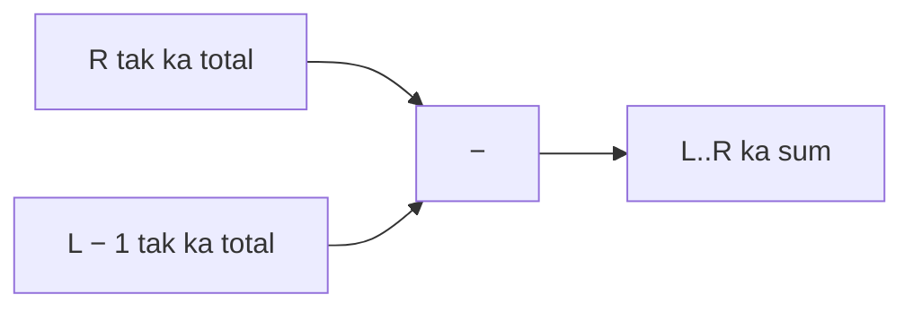
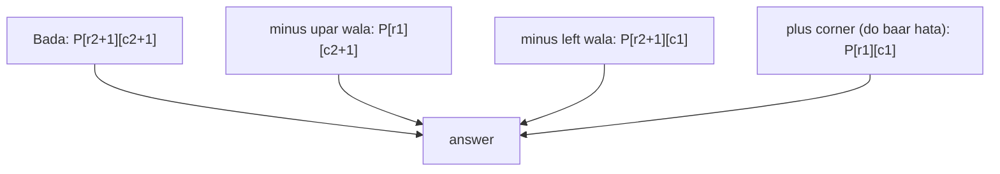

# Chapter 06 · Prefix Sums & Difference Arrays

> Cricket ka scoreboard har over ke runs alag se nahi dikhata; woh dikhata hai **ab tak ka total**. Jaanna hai over 10 aur over 20 ke beech kitne runs bane? Bas do totals ko subtract karo. Dobara jodne ki zaroorat hi nahi. Yahi chhoti si subtraction wali trick **prefix sum** hai, aur ye ek O(n) pass ke baad "kisi bhi range ka sum" O(1) mein bata deti hai.

**Is chapter mein tum seekhoge:**
- **Prefix sum** array kaise banate hain aur koi bhi range-sum query O(1) mein kaise answer karte hain
- Off-by-one se bachane wala convention (`prefix[0] = 0`)
- **Prefix sum + hashmap**: woh pattern jo Subarray Sum Equals K, Contiguous Array aur Subarrays Divisible by K ke peeche hai
- **Prefix XOR** aur doosre "prefix kuch bhi" ideas
- Rectangle sums O(1) mein nikaalne ke liye **2D prefix sums**
- **Difference arrays**: bahut saare range updates, har ek O(1) mein
- **Prefix and suffix products** (Product of Array Except Self)
- Negatives ke saath sliding window kyun fail hoti hai aur prefix sums kyun nahi

**Isse pehle padho:** [Big-O](01-big-o-complexity.md) · [Arrays & Strings](02-arrays-strings.md) · [Sliding Window](04-sliding-window.md) · [Hashing Patterns](05-hashing.md)

---

## 🧠 The Big Idea · Asli Baat

Ek match ke har over mein bane runs:

```text
over:        1   2   3   4   5   6
runs:        4   9   2   7   6   3
total so far:4  13  15  22  28  31
```

Over 3 se 5 tak kitne runs bane? Dheema tareeka: 2 + 7 + 6 = 15. Tez tareeka:

```text
(total after over 5) − (total after over 2) = 28 − 13 = 15
```

Over 5 ke baad ka total = overs 1 se 5 tak sab. Over 2 ke baad ka total = overs 1 aur 2. Dono ko ghatao, toh overs 1-2 cancel ho jaate hain aur sirf overs 3, 4, 5 bachte hain.

"Total so far" wali row hi **prefix sum** hai. Ek baar ye ban gayi, toh *koi bhi* range sum **ek subtraction** hai, range kitni bhi lambi ho.



Ulta wala side bhi utna hi kaam ka hai. Maan lo tumhe over 2 se 4 tak har over mein 5 runs ki penalty **jodni** hai (aise bahut saare updates, aur aakhir mein final scores padhne hain). Har over ko chhoone ki jagah, over 2 pe `+5` likho aur over 4 ke theek baad `−5`. Jab aakhir mein in marks ka running total nikaaloge, toh +5 over 2 pe "switch on" hoga aur over 4 ke baad "switch off". Ye hai **difference array**.

> 🇮🇳 **Desi Analogy:** Bijli ka meter socho. Meter har din ki units alag se nahi dikhata, woh **ab tak ki total reading** dikhata hai. Bill banane wala bhaiya 1 tareekh ki reading aur 30 tareekh ki reading ghata deta hai, aur poore mahine ki units mil jaati hain. Usse har din ka hisaab jodna nahi padta. Meter reading = prefix sum. Do readings ka farak = range sum. Aur difference array? Woh bijli ka switch hai: din 5 pe switch on (`+v`), din 10 ke baad switch off (`−v`). Beech ke har din apne aap bijli chalti rahi, tumne har din ko alag se chhuaa bhi nahi.

> 💡 **The core insight:** prefix sums **range queries** ko do point lookups mein badal dete hain. Difference arrays **range updates** ko do point writes mein badal dete hain. Dono ek doosre ke inverse hain: ek difference array ka prefix sum lo, toh original wapas mil jaata hai.

---

## 🔨 Building It Up · Zero Se Shuru

### 1. Prefix sum array banana

`prefix[i]` ki definition = pehle `i` elements ka sum, yaani `nums[0] + ... + nums[i−1]`. Isliye `prefix` ki length n + 1 hai, aur `prefix[0] = 0` (zero elements ka sum).

```python
def build_prefix(nums):
    prefix = [0] * (len(nums) + 1)
    for i, x in enumerate(nums):
        prefix[i + 1] = prefix[i] + x       # ab tak ka total
    return prefix

nums = [4, 9, 2, 7, 6, 3]
prefix = build_prefix(nums)
print(prefix)

from itertools import accumulate
print([0] + list(accumulate(nums)))       # library wala tareeka
```

```text
[0, 4, 13, 15, 22, 28, 31]
[0, 4, 13, 15, 22, 28, 31]
```

Banana O(n) hai, aur sirf ek baar.

Index ka matlab dhyaan se padho, kyunki yahi poore chapter ki chaabi hai: `prefix[3] = 15` ka matlab hai "pehle **3** elements (`4, 9, 2`) ka sum". Index 3 ka element (`7`) isme **shaamil nahi** hai. `prefix[i]` = index `i` se **pehle** ka sab kuch.

### 2. Range sum queries O(1) mein

`nums[l..r]` (dono inclusive) ka sum hai:

```text
sum(l, r) = prefix[r + 1] − prefix[l]
```

`prefix[r + 1]` mein index r tak (r ko milake) sab kuch hai; `prefix[l]` mein index l se pehle ka sab kuch hai. Ghatao, toh sirf `l..r` bachta hai.

```python
nums = [4, 9, 2, 7, 6, 3]
prefix = [0]
for x in nums:
    prefix.append(prefix[-1] + x)

def range_sum(l, r):
    return prefix[r + 1] - prefix[l]

print(range_sum(2, 4))      # 2 + 7 + 6
print(range_sum(0, 5))      # sab kuch
print(range_sum(3, 3))      # sirf ek element
```

```text
15
31
7
```

Kya hua yahan: teen queries, har ek bas ek subtraction. Agar n size ke array pe q queries hain, toh prefix sums ka cost **O(n + q)** hai, **O(n · q)** ki jagah.

> 💡 **`prefix[0] = 0` kyun?** Isse `sum(0, r)` bhi usi formula (`prefix[r+1] − prefix[0]`) se chal jaata hai, warna `if l == 0` wala special case likhna padta. Ye shuru wala zero hashmap pattern mein bhi bahut kaam aayega: ye represent karta hai "array shuru hone se pehle ka khaali prefix".

> 🤔 **Mann mein sawaal:** `prefix[r + 1]` mein ye `+ 1` hamesha confuse karta hai. Kya `prefix[r] − prefix[l − 1]` nahi likh sakte?
>
> **Jawab:** Likh sakte ho, agar tumhara `prefix[i]` "index i tak, i ko milake" ka sum ho. Lekin tab `l = 0` pe `prefix[-1]` aa jaata hai, jo Python mein chupchaap **last element** de deta hai, aur galat answer bina error ke aata hai. Isliye book ka convention rakho: `prefix` ki length n + 1, `prefix[0] = 0`, aur formula hamesha `prefix[r + 1] − prefix[l]`. Yaad karne ka tareeka: **"right ke aage wala, minus left wala."**

**Range Sum Query – Immutable** bilkul yahi hai, bas ek class ke roop mein:

```python
class NumArray:
    def __init__(self, nums):
        self.prefix = [0]
        for x in nums:
            self.prefix.append(self.prefix[-1] + x)

    def sum_range(self, left, right):
        return self.prefix[right + 1] - self.prefix[left]

arr = NumArray([-2, 0, 3, -5, 2, -1])
print(arr.sum_range(0, 2), arr.sum_range(2, 5), arr.sum_range(0, 5))
```

```text
1 -1 -3
```

(Agar queries ke beech array **update** bhi hota hai, toh har update ke baad prefix array ko dobara banane mein O(n) lagega. Tab Fenwick tree ya segment tree use karte hain: [Chapter 24](24-advanced-structures.md).)

### 3. Simple uses: pivot index aur running balance

**Find Pivot Index:** woh index jahan left ke sab elements ka sum right ke sab elements ke sum ke barabar ho.

Index i pe left sum = `prefix[i]`. Right sum = `total − prefix[i] − nums[i]`. Humein array ki bhi zaroorat nahi: bas ek running left sum rakho.

```python
def pivot_index(nums):
    total = sum(nums)
    left = 0
    for i, x in enumerate(nums):
        if left == total - left - x:     # left sum == right sum
            return i
        left += x
    return -1

print(pivot_index([1, 7, 3, 6, 5, 6]), pivot_index([1, 2, 3]), pivot_index([2, 1, -1]))
```

```text
3 -1 0
```

`[1, 7, 3, 6, 5, 6]` mein index 3 (value 6) pe: left = 1 + 7 + 3 = 11, right = 5 + 6 = 11. Barabar, toh 3. Aur `[2, 1, -1]` mein index 0 pe left = 0 (kuch nahi), right = 1 + (−1) = 0. Barabar, toh 0. Dhyaan do, `left += x` check ke **baad** hota hai, kyunki pivot khud na left mein gina jaata hai na right mein.

### 4. Prefix sum + hashmap: star pattern

Ab asli baat. **Subarray Sum Equals K:** aise contiguous subarrays gino jinka sum exactly k ho. Numbers **negative bhi ho sakte hain**.

Sliding window fail ho jaati hai (negatives monotonicity tod dete hain, [Chapter 04](04-sliding-window.md)). Saare (l, r) pe brute force O(n²) hai.

**Key equation.** Subarray `l..r` ka sum k tab hai jab:

```text
prefix[r + 1] − prefix[l] = k
⟺  prefix[l] = prefix[r + 1] − k
```

Toh, left se right chalte hue ek running sum `s` rakho (yahi `prefix[r + 1]` hai). **Yahan khatam hone wale** acche subarrays ki ginti hai: **pehle ke kitne prefix sums `s − k` ke barabar the?** Ye wahi Two Sum wala complement lookup hai ([Chapter 05](05-hashing.md)), bas prefix sums pe lagaya hai. Ab tak dekhe gaye prefix sums ka ek Counter rakho.

> 🇮🇳 **Desi Analogy:** Tumhara UPI passbook socho, jisme har transaction ke baad **balance** likha hai (ye prefix sum hai). Transactions mein paise aate bhi hain, jaate bhi hain (positive aur negative). Sawaal: "kitne lagaataar transaction-groups mein exactly ₹500 ka net farak aaya?" Har nayi line pe balance dekho, maan lo ₹2,300. Ab poocho: "pehle kitni baar balance ₹1,800 tha?" Har aisi purani line se lekar abhi tak ka hissa exactly ₹500 ka hai. Pichhle balances ka ek register (Counter) rakho, aur har line pe bas usme dekho. Paise ghatte-badhte rahein, koi farak nahi padta.

```python
from collections import defaultdict

def subarray_sum(nums, k):
    count_of = defaultdict(int)
    count_of[0] = 1                  # khaali prefix: subarrays ko index 0 se shuru hone deta hai
    running = result = 0
    for x in nums:
        running += x
        result += count_of[running - k]   # pehle ke prefixes jo k ka sum poora karte hain
        count_of[running] += 1            # aage ki positions ke liye ye prefix record karo
    return result

print(subarray_sum([1, 1, 1], 2))
print(subarray_sum([1, 2, 3], 3))
print(subarray_sum([3, 4, 7, 2, -3, 1, 4, 2], 7))
```

```text
2
2
4
```

**Dry run** `[3, 4, 7, 2, -3, 1, 4, 2]` ke liye, k = 7:

| i | x | running | running − 7 | count_of[running − 7] | result | count_of after |
|---|---|---|---|---|---|---|
| | | 0 | | | 0 | {0:1} |
| 0 | 3 | 3 | −4 | 0 | 0 | {0:1, 3:1} |
| 1 | 4 | 7 | 0 | **1** ([3,4]) | 1 | +{7:1} |
| 2 | 7 | 14 | 7 | **1** ([7]) | 2 | +{14:1} |
| 3 | 2 | 16 | 9 | 0 | 2 | +{16:1} |
| 4 | −3 | 13 | 6 | 0 | 2 | +{13:1} |
| 5 | 1 | 14 | 7 | **1** ([7,2,−3,1]) | 3 | {14:2} |
| 6 | 4 | 18 | 11 | 0 | 3 | +{18:1} |
| 7 | 2 | 20 | 13 | **1** ([1,4,2]) | 4 | +{20:1} |

Kya hua yahan: har row poochti hai "mujhse pehle kitni jagah aisi thi jahan running total mere total se exactly 7 kam tha?" Har aisi jagah ek aise subarray ki shuruaat mark karti hai jiska sum 7 hai. Jaise row i = 7: running 20 hai, aur running 13 pehle i = 4 pe tha. Toh i = 4 ke **baad** se i = 7 tak (`1, 4, 2`) ka sum 20 − 13 = 7. Do critical details:

1. **Loop se pehle `count_of[0] = 1`.** Iske bina index 0 se shuru hone wale subarrays (jaise `[3, 4]`) chhoot jaate hain, kyunki unka "pehle wala prefix" khaali prefix hai.
2. **Store karne se pehle lookup karo** (Two Sum jaisa hi). Warna k = 0 ke saath tum khaali subarray bhi gin loge.

Time O(n), space O(n).

> 🤔 **Mann mein sawaal:** Counter mein count kyun rakha, sirf "dekha ya nahi" (set) kyun nahi?
>
> **Jawab:** Kyunki ek hi prefix value kai baar aa sakti hai, aur har baar ek **alag** subarray deti hai. Dry run mein running 14 do baar aaya (i = 2 aur i = 5). Agar aage kahin running 21 aata, toh `21 − 7 = 14` ke **dono** occurrences se do alag subarrays bante. Set sirf "haan" bolta, Counter bolta "2". Negatives aur zeros ki wajah se same running sum baar-baar aana bilkul normal hai.

### 5. Variation: Contiguous Array (barabar 0s aur 1s)

**Problem:** sabse lamba contiguous subarray jisme 0s aur 1s ki ginti barabar ho. `[0, 1, 1, 0, 1, 1, 1, 0]` → 4.

**Trick:** 0 ko −1 maan lo. Ab "barabar 0s aur 1s" ka matlab hai "sum 0 hai". Aur subarray `l..r` ka sum 0 exactly tab hai jab `prefix[r+1] == prefix[l]`: **same running sum do baar aata hai**.

**Sabse lambe** ke liye, har running sum ka **pehla** index store karo (kabhi overwrite mat karo: jitna pehle, utna lamba).

```python
def find_max_length(nums):
    first_seen = {0: -1}               # running sum 0 index 0 se pehle "ho chuka" tha
    running = best = 0
    for i, x in enumerate(nums):
        running += 1 if x == 1 else -1
        if running in first_seen:
            best = max(best, i - first_seen[running])
        else:
            first_seen[running] = i    # sirf sabse pehla index rakho
    return best

print(find_max_length([0, 1]), find_max_length([0, 1, 0]), find_max_length([0, 1, 1, 0, 1, 1, 1, 0]))
```

```text
2 2 4
```

> 🇮🇳 **Desi Analogy:** Cricket mein do teams ka "run difference" socho. Team A ka run = +1, Team B ka run = −1. Agar over 3 ke baad difference +2 tha, aur over 9 ke baad phir se +2 hai, toh over 4 se 9 ke beech dono teams ne **barabar** runs banaye, kyunki difference wahi ka wahi raha. Same running sum do baar = beech mein sab barabar. Aur sabse lamba "barabari ka daur" chahiye, toh har difference ko **pehli baar** kab dekha, wahi yaad rakho.

**Dry run** `[0, 1, 1, 0, 1, 1, 1, 0]` ke liye:

| i | x | running | pehle dekha? | length | best | first_seen |
|---|---|---|---|---|---|---|
| | | 0 | | | 0 | {0: −1} |
| 0 | 0 | −1 | nahi | | 0 | +{−1: 0} |
| 1 | 1 | 0 | haan, −1 pe | 1 − (−1) = 2 | 2 | |
| 2 | 1 | 1 | nahi | | 2 | +{1: 2} |
| 3 | 0 | 0 | haan, −1 pe | 3 − (−1) = 4 | 4 | |
| 4 | 1 | 1 | haan, 2 pe | 2 | 4 | |
| 5 | 1 | 2 | nahi | | 4 | +{2: 5} |
| 6 | 1 | 3 | nahi | | 4 | +{3: 6} |
| 7 | 0 | 2 | haan, 5 pe | 2 | 4 | |

Convention ka badlav notice karo: **counting** ke liye hum `{sum: kitni baar}` store karte hain aur seed `{0: 1}` dete hain. **Longest length** ke liye `{sum: pehla index}` store karte hain aur seed `{0: -1}` dete hain. Idea same, bas hisaab-kitaab alag.

> 🤔 **Mann mein sawaal:** Seed `{0: -1}` mein ye −1 kahan se aaya?
>
> **Jawab:** Length ka formula hai `i − first_seen[running]`, jo index `first_seen + 1` se `i` tak ke elements ginta hai. Agar subarray index 0 se shuru hona hai, toh "pehle wala" index 0 se ek pehle, yaani −1 hona chahiye. Check karo: i = 3 pe running 0 hai, length = 3 − (−1) = 4, yaani index 0, 1, 2, 3, poore chaar elements. Agar seed `{0: 0}` dete toh length 3 aati, galat.

### 6. Variation: Subarrays Divisible by K (prefix sums mod k)

**Problem:** aise subarrays gino jinka sum k se divisible ho. `[4, 5, 0, -2, -3, 1]`, k = 5 → 7.

**Trick:** `(prefix[r+1] − prefix[l])` k se exactly tab divisible hai jab `prefix[r+1] % k == prefix[l] % k`. Toh **same remainder** wale prefixes ke pairs gino.

Kyun? Agar do numbers ka remainder same hai (jaise 17 aur 32, dono ka `% 5` = 2), toh unka farak (15) remainder ko cancel kar deta hai aur k ka multiple bachta hai.

```python
from collections import defaultdict

def subarrays_div_by_k(nums, k):
    count_of = defaultdict(int)
    count_of[0] = 1
    running = result = 0
    for x in nums:
        running = (running + x) % k    # k > 0 ke liye Python ka % kabhi negative nahi hota
        result += count_of[running]    # pehle ka har prefix jiska remainder same hai
        count_of[running] += 1
    return result

print(subarrays_div_by_k([4, 5, 0, -2, -3, 1], 5), subarrays_div_by_k([5], 9))
```

```text
7 0
```

> ⚠️ Java/C++ mein `-2 % 5` ka answer `-2` hai, toh wahan `((x % k) + k) % k` likhna padega. Positive k ke liye Python ka `%` already `0..k−1` ke beech value deta hai. Interview mein ye zaroor bolo: isse dikhta hai ki tumhe languages ka farak pata hai.

**Continuous Subarray Sum** (kya length ≥ 2 ka koi subarray hai jiska sum k se divisible ho?) bhi isi remainder idea pe chalta hai: har remainder ka **pehla index** store karo aur `i − first[rem] >= 2` check karo.

### 7. Prefix XOR

Prefix sums har us operation pe kaam karte hain jise "undo" kiya ja sake. XOR khud ko undo kar deta hai (`a ^ a = 0`), isliye:

```text
xor(l..r) = px[r + 1] ^ px[l]       where px[i] = nums[0] ^ ... ^ nums[i−1]
```

`px[r + 1]` mein shuru se r tak sab XOR hua hai, `px[l]` mein shuru se l − 1 tak. Dono ko XOR karo, toh common head (`nums[0..l−1]`) do baar XOR hokar gayab ho jaata hai (`a ^ a = 0`), aur sirf `l..r` bachta hai. Bilkul subtraction jaisa.

**XOR Queries of a Subarray:**

```python
def xor_queries(arr, queries):
    px = [0]
    for x in arr:
        px.append(px[-1] ^ x)
    return [px[r + 1] ^ px[l] for l, r in queries]

print(xor_queries([1, 3, 4, 8], [[0, 1], [1, 2], [0, 3], [3, 3]]))
```

```text
[2, 7, 14, 8]
```

Aur hashmap pattern bhi waise hi chal jaata hai: **XOR k ke barabar wale subarrays gino** = har prefix XOR `p` ke liye, pehle ke woh prefixes gino jo `p ^ k` ke barabar hain.

```python
from collections import defaultdict

def count_subarrays_xor(nums, k):
    seen = defaultdict(int)
    seen[0] = 1
    px = result = 0
    for x in nums:
        px ^= x
        result += seen[px ^ k]       # pehle ka prefix q jiske liye q ^ px == k
        seen[px] += 1
    return result

print(count_subarrays_xor([4, 2, 2, 6, 4], 6), count_subarrays_xor([5, 6, 7, 8, 9], 5))
```

```text
4 2
```

**Kaunse operations chalte hain?** Sum (− se undo), XOR (XOR se undo), aur product jab zeros na ho (÷ se undo). **Max aur min aise nahi chalte**: max ko "subtract" nahi kar sakte. Range-max queries ke liye sparse table ya segment tree use karo ([Chapter 24](24-advanced-structures.md)).

### 8. 2D prefix sums

**Problem:** bahut saari queries jo ek matrix mein kisi rectangle ka sum poochti hain.

`P[r][c]` ki definition = `(0, 0)` se `(r−1, c−1)` tak ke rectangle ka sum (phir se, zeros ki ek extra row aur column ke saath). Isse **inclusion–exclusion** se banao:

```text
P[r+1][c+1] = grid[r][c] + P[r][c+1] + P[r+1][c] − P[r][c]
```

Tum upar wala rectangle aur left wala rectangle jodte ho, lekin dono ka overlap (top-left) do baar jud gaya, isliye usse ek baar ghata do.

Corners `(r1, c1)` se `(r2, c2)` wale rectangle ki query:

```text
sum = P[r2+1][c2+1] − P[r1][c2+1] − P[r2+1][c1] + P[r1][c1]
```

Bada rectangle lo, upar wali patti hatao, left wali patti hatao, aur top-left corner wapas jodo (woh do baar hata tha).



> 🇮🇳 **Desi Analogy:** Ek bade khet ka naksha socho. Tumhe beech ke ek chhote plot ka area chahiye. Patwari ke paas har "top-left kone se is point tak" ka total area likha hai. Woh bada wala total leta hai, upar ki patti ka total ghatata hai, left ki patti ka total ghatata hai. Lekin top-left ka kona dono pattiyon mein tha, toh woh do baar ghat gaya. Ek baar wapas jod do. Bas, beech ka plot bach gaya.

```python
class NumMatrix:
    def __init__(self, grid):
        R, C = len(grid), len(grid[0])
        self.P = [[0] * (C + 1) for _ in range(R + 1)]
        for r in range(R):
            for c in range(C):
                self.P[r + 1][c + 1] = (grid[r][c] + self.P[r][c + 1]
                                        + self.P[r + 1][c] - self.P[r][c])

    def sum_region(self, r1, c1, r2, c2):
        P = self.P
        return P[r2 + 1][c2 + 1] - P[r1][c2 + 1] - P[r2 + 1][c1] + P[r1][c1]

matrix = [
    [3, 0, 1, 4, 2],
    [5, 6, 3, 2, 1],
    [1, 2, 0, 1, 5],
    [4, 1, 0, 1, 7],
    [1, 0, 3, 0, 5],
]
nm = NumMatrix(matrix)
print(nm.sum_region(2, 1, 4, 3), nm.sum_region(1, 1, 2, 2), nm.sum_region(1, 2, 2, 4))
```

```text
8 11 12
```

Haath se check karo: `sum_region(1, 1, 2, 2)` matlab rows 1-2, columns 1-2: `6 + 3 + 2 + 0 = 11`. ✓

Build O(R·C), har query O(1). Ye hai **Range Sum Query 2D – Immutable**.

### 9. Difference arrays: bahut saare range updates

**Problem:** zeros se shuru karo; bahut saare updates lagao "l..r ke har index mein v jodo"; phir final array report karo.

Naive: har update apni range pe loop chalata hai → har update O(n) → O(n · q).

**Difference array:** `diff[l] += v` aur `diff[r + 1] −= v`. Saare updates ke baad, **`diff` ka prefix sum** hi final array hai. Har update O(1); final pass O(n).

Kyun? Prefix sum mein, l pe rakha `+v` l se aage har index tak pahunchta hai; r + 1 pe rakha `−v` usse r + 1 se aage cancel kar deta hai. Net effect: sirf `l..r` pe exactly +v.

```python
def apply_range_updates(n, updates):
    diff = [0] * (n + 1)            # ek extra slot taaki r + 1 kabhi bahar na jaaye
    for l, r, v in updates:
        diff[l] += v                # l pe switch on
        diff[r + 1] -= v            # r ke baad switch off
    result, running = [], 0
    for i in range(n):
        running += diff[i]
        result.append(running)
    return result

print(apply_range_updates(6, [(1, 3, 5), (2, 5, 2), (0, 0, 10)]))
```

```text
[10, 5, 7, 7, 2, 2]
```

**Dry run:**

| step | diff (indexes 0..6) |
|---|---|
| start | [0, 0, 0, 0, 0, 0, 0] |
| 1..3 pe +5 | [0, 5, 0, 0, −5, 0, 0] |
| 2..5 pe +2 | [0, 5, 2, 0, −5, 0, −2] |
| 0..0 pe +10 | [10, −10+5, 2, 0, −5, 0, −2] = [10, −5, 2, 0, −5, 0, −2] |
| prefix sums | 10, 5, 7, 7, 2, 2 |

Last row ko step-by-step padho: 10 → 10 + (−5) = 5 → 5 + 2 = 7 → 7 + 0 = 7 → 7 + (−5) = 2 → 2 + 0 = 2. Index 6 wala `−2` kabhi padha hi nahi gaya, kyunki woh array ke bahar ka "switch off" hai. Isiliye extra slot rakha tha.

> 🇮🇳 **Desi Analogy:** Mumbai local mein passengers ka hisaab socho. Har station pe conductor sirf likhta hai "yahan 5 chadhe" (`+5`) aur "yahan 5 utre" (`−5`). Kisi bhi station pe train mein kitne log hain, ye jaanne ke liye shuru se ab tak ke saare chadhne-utarne jod do (prefix sum). Conductor ko har station pe har passenger ko dobara ginna nahi padta. Ek group ka safar = do entries, safar kitna bhi lamba ho.

### 10. Classic: Corporate Flight Bookings

**Problem:** flights 1..n. Har booking `[first, last, seats]` first se last tak har flight pe `seats` reserve karti hai. Har flight ki total seats return karo.

Ye literally ek difference array hai, bas labels 1-based hain.

```python
def corp_flight_bookings(bookings, n):
    diff = [0] * (n + 1)
    for first, last, seats in bookings:
        diff[first - 1] += seats        # 0-based mein convert karo
        diff[last] -= seats             # (last - 1) + 1
    answer, running = [], 0
    for i in range(n):
        running += diff[i]
        answer.append(running)
    return answer

print(corp_flight_bookings([[1, 2, 10], [2, 3, 20], [2, 5, 25]], 5))
```

```text
[10, 55, 45, 25, 25]
```

O(n + bookings ki ginti).

`diff[last]` kyun, `diff[last + 1]` kyun nahi? Flight `last` ka 0-based index `last − 1` hai. Switch off uske theek baad hona chahiye, yaani `(last − 1) + 1 = last`. Do conversions ek doosre ko cancel kar dete hain.

### 11. Classic: Car Pooling

**Problem:** `capacity` seats wali ek car east ki taraf chalti hai. Har trip `[passengers, from, to]` km `from` pe passengers uthati hai aur km `to` pe utaarti hai. Kya ye capacity cross kiye bina saari trips poori kar sakti hai?

**Idea:** passengers car mein half-open range `[from, to)` pe hain. Kilometres pe difference array: `from` pe `+p`, `to` pe `−p`. Phir sweep karo aur check karo ki running load kabhi capacity se zyada na ho.

```python
def car_pooling(trips, capacity):
    last_stop = max(to for _, _, to in trips)
    diff = [0] * (last_stop + 1)
    for passengers, start, end in trips:
        diff[start] += passengers
        diff[end] -= passengers         # woh end PE utar jaate hain, toh wahan nahi gine jaate
    load = 0
    for change in diff:
        load += change
        if load > capacity:
            return False
    return True

print(car_pooling([[2, 1, 5], [3, 3, 7]], 4), car_pooling([[2, 1, 5], [3, 3, 7]], 5))
```

```text
False True
```

Km 3 se 5 ke beech dono groups car mein hain: 2 + 3 = 5 log. Capacity 4 hai toh `False`, 5 hai toh `True`. Km 5 pe pehla group utar jaata hai, isliye wahan load wapas 3 ho jaata hai.

Ye "start pe +, end pe −, phir sweep" wala idea hi **Meeting Rooms II** (ek saath kitni meetings maximum) solve karne ka tareeka hai, jo [Chapter 22](22-greedy-intervals.md) mein aa raha hai.

### 12. Prefix aur suffix products: Product of Array Except Self

**Problem:** `answer[i]` = `nums[i]` ko chhod ke baaki sab elements ka product, O(n) mein, **bina division ke**. `[1, 2, 3, 4]` → `[24, 12, 8, 6]`.

```text
answer[i] = (product of everything LEFT of i) × (product of everything RIGHT of i)
             = prefix_product[i]               × suffix_product[i + 1]
```

```python
def product_except_self(nums):
    n = len(nums)
    left = [1] * n                     # left[i] = nums[0] * ... * nums[i-1]
    for i in range(1, n):
        left[i] = left[i - 1] * nums[i - 1]
    right = [1] * n                    # right[i] = nums[i+1] * ... * nums[n-1]
    for i in range(n - 2, -1, -1):
        right[i] = right[i + 1] * nums[i + 1]
    print("left :", left)
    print("right:", right)
    return [left[i] * right[i] for i in range(n)]

print(product_except_self([1, 2, 3, 4]))
```

```text
left : [1, 1, 2, 6]
right: [24, 12, 4, 1]
[24, 12, 8, 6]
```

Index 2 (value 3) ke liye: left mein `1 × 2 = 2`, right mein `4`, answer `2 × 4 = 8`. `left[0]` aur `right[n−1]` 1 hain kyunki unke ek taraf kuch hai hi nahi, aur "kuch nahi" ka product 1 hota hai (jaise "kuch nahi" ka sum 0).

> 🇮🇳 **Desi Analogy:** Class photo mein har bachche ke liye poocho: "tumhe chhod ke baaki sab ka product kya hai?" Ek monitor left se chalta hai aur har bachche ko batata hai "tumhare left walon ka product ye hai". Doosra monitor right se chalta hai aur batata hai "tumhare right walon ka ye". Har bachcha bas dono numbers multiply kar leta hai. Kisi ko apna number "divide karke hatane" ki zaroorat nahi.

O(1)-extra-space wala version (output array gina nahi jaata) output ko hi `left` ke liye reuse karta hai aur `right` ko ek single running variable mein rakhta hai:

```python
def product_except_self(nums):
    n = len(nums)
    out = [1] * n
    running = 1
    for i in range(n):                 # pass 1: left products
        out[i] = running
        running *= nums[i]
    running = 1
    for i in range(n - 1, -1, -1):     # pass 2: right products multiply karo
        out[i] *= running
        running *= nums[i]
    return out

print(product_except_self([1, 2, 3, 4]), product_except_self([-1, 1, 0, -3, 3]))
```

```text
[24, 12, 8, 6] [0, 0, 9, 0, 0]
```

"No division" kyun? Jab array mein zero ho toh `total / nums[i]` toot jaata hai (aur problem waise bhi ise mana karti hai). Prefix/suffix products zeros ko naturally handle kar lete hain. Doosre example mein dekho: sirf index 2 (jahan khud zero hai) ka answer non-zero hai, `(−1) × 1 × (−3) × 3 = 9`. Baaki sab ke product mein woh zero aata hai, toh 0.

---

## 🔬 Under the Hood · Andar Ki Kahani

### Range sum = do lookups, kyun

`prefix[r+1]` = `nums[0] + ... + nums[l−1]` + `nums[l] + ... + nums[r]`.
`prefix[l]`   = `nums[0] + ... + nums[l−1]`.

Ghatane se common head exactly cancel ho jaata hai, aur bachta hai `nums[l] + ... + nums[r]`. Ye har us operation ke liye chalta hai jiska ek **inverse** ho (cancel karne ka tareeka): + ka −, XOR ka XOR, × ka ÷ (agar zeros na ho). Isi wajah se "prefix max" kisi bhi range-max query ka jawab nahi de sakta: head ka contribution cancel karne ka koi tareeka hi nahi hai.

> 🤔 **Mann mein sawaal:** Max ka inverse kyun nahi hota? Thoda example se samjhao.
>
> **Jawab:** `[9, 2, 5]` lo. Prefix max: `[9, 9, 9]`. Ab range `1..2` (yaani `2, 5`) ka max chahiye, jo 5 hai. Lekin prefix max mein 9 ne sab kuch dhak diya, aur "9 ko hatao" ka koi operation nahi hai. Sum mein `14 − 9 = 5` karke head nikaal sakte the; max mein `max(9, ?) = 9` se `?` wapas nahi nikalta. Information hi kho gayi.

### Prefix sums aur difference arrays ek doosre ke inverse hain

- `prefix(diff(a)) = a`: agar `diff[i] = a[i] − a[i−1]`, toh inhe wapas jodne pe sab telescope hokar `a[i]` ban jaata hai.
- `diff(prefix(a)) = a`: running totals ke consecutive differences har element wapas de dete hain.

Ye calculus ke "integration aur differentiation ek doosre ko undo karte hain" ka discrete version hai. Prefix sum = integrate; difference = differentiate. Range update derivative mein ek "step" hai (l pe upar, r ke baad neeche), isiliye iska kharcha sirf do writes hai.

"Telescope" ka matlab chhote example se: `a = [3, 5, 4]` ka diff `[3, 2, −1]` hai. Ab prefix: `3`, `3 + 2 = 5`, `5 + (−1) = 4`. Wapas `[3, 5, 4]`. Har step mein pichhla number cancel hokar agla number aa jaata hai, jaise ek telescope ke tukde andar-andar fold ho jaate hain.

### Hashmap wala version O(n) kyun hai

Ek pass; har step ek dictionary lookup aur ek update karta hai, dono average O(1) ([Chapter 05](05-hashing.md)). Prefix values ki dictionary ke liye space O(n). Brute force saare n(n+1)/2 subarrays dekhta hai; hashmap wala version har right end ke liye bas ek sawaal poochta hai, jiska jawab O(1) mein milta hai.

### Sliding window kyun fail hoti hai aur prefix sums kyun nahi

Sliding window ko **monotonic** validity chahiye: window badhane se sum sirf ek hi direction mein jaana chahiye. Negatives ke saath aisa nahi hota. Prefix sums aisa koi assumption nahi karte: woh har possible (l, r) ka exact sum **implicitly** calculate kar lete hain, aur hashmap matches gin leta hai. Negative numbers, zeros, sab chalega.

Concrete example: `[1, −1, 1]` mein k = 1. Window `[1]` ka sum 1 hai, match. Ab badhao: `[1, −1]` ka sum 0, chhota ho gaya! Positive numbers mein window badhane se sum hamesha badhta tha, isliye window ko pata hota tha ki left ko kab sikodna hai. Yahan woh rule toot gaya, aur window ko pata hi nahi ki aage badhe ya peeche sikde. Prefix sums ko is sawaal ki parwah hi nahi.

### Overflow aur bade numbers

Python mein integers zaroorat ke hisaab se badhte jaate hain, isliye prefix sums kabhi overflow nahi hote. Java/C++ mein bade arrays ke prefix sums `int` ko overflow kar sakte hain; `long` use karo. Prefix **products** bahut tezi se badhte hain, aur isi wajah se jin problems mein ye chahiye, woh guarantee deti hain ki result 32 bits mein fit hoga.

### 2D ke liye memory

2D prefix table O(R·C) extra space leti hai, grid jitni hi. Agar R·C bahut bada hai aur queries kam hain, toh shayad ye worth nahi. Agar grid bhi badalti rehti hai, toh 2D Fenwick tree use karo ([Chapter 24](24-advanced-structures.md)).

---

## 🧩 Pattern Decoder · Pattern Pakdo

### Signals: prefix sums kab uthane hain

| Problem mein tum dekho... | Socho |
|---|---|
| "sum of range [l, r]", bahut saari queries, array badalta nahi | **1D prefix sum** |
| "sum of a rectangle / submatrix", bahut saari queries | **2D prefix sum** |
| "subarray sum **equals** k" (count), negatives allowed | **prefix sum + Counter**, seed `{0: 1}` |
| "**longest** subarray with sum k / sum 0" | **prefix sum + first index**, seed `{0: -1}` |
| "equal number of 0s and 1s / As and Bs" | ek ko −1 bana do → "sum = 0" |
| "sum divisible by k", "sum % k" | **prefix mod k + Counter** |
| "XOR of range", "subarrays with XOR = k" | **prefix XOR** |
| "add v to every element in [l, r]", kai baar, phir padho | **difference array** |
| "bookings", "trips", "intervals add load", "max overlap" | difference array + sweep |
| "product of all except self", "left info × right info" | **prefix/suffix products** |
| "left sum equals right sum", "pivot" | total aur running left sum |
| sliding window **lagbhag** chal rahi hai lekin numbers negative ho sakte hain | prefix sums |

### Template A: Static range queries

```py
prefix = [0]
for x in nums:
    prefix.append(prefix[-1] + x)

def query(l, r):                       # inclusive l..r
    return prefix[r + 1] - prefix[l]
```

### Template B: Target property wale subarrays gino (prefix + Counter)

```py
from collections import defaultdict

def count_subarrays(nums, k):
    seen = defaultdict(int)
    seen[START] = 1                    # sums/XOR/mod ke liye START = 0: khaali prefix
    running = count = 0
    for x in nums:
        running = combine(running, x)  # +x, ^x, (running + x) % k ...
        count += seen[partner(running, k)]   # running - k, running ^ k, running % k ...
        seen[running] += 1
    return count
```

### Template C: Target property wala sabse lamba subarray (prefix + first index)

```py
def longest_subarray(nums, k):
    first = {0: -1}                    # khaali prefix index -1 pe "khatam" hota hai
    running = best = 0
    for i, x in enumerate(nums):
        running += transform(x)        # jaise +1 / -1
        if running - k in first:
            best = max(best, i - first[running - k])
        if running not in first:       # kabhi overwrite mat karo: sabse pehla = sabse lamba
            first[running] = i
    return best
```

### Template D: Difference array

```py
diff = [0] * (n + 1)
for l, r, v in updates:                # inclusive l..r
    diff[l] += v
    diff[r + 1] -= v
result, running = [], 0
for i in range(n):
    running += diff[i]
    result.append(running)
```

### Variation 1: Maximum Size Subarray Sum Equals k

**Problem:** sabse lamba subarray jiska sum exactly k ho (negatives allowed). `[1, -1, 5, -2, 3]`, k = 3 → 4.

```python
def max_sub_array_len(nums, k):
    first = {0: -1}
    running = best = 0
    for i, x in enumerate(nums):
        running += x
        if running - k in first:
            best = max(best, i - first[running - k])
        first.setdefault(running, i)   # sirf pehla occurrence store karo
    return best

print(max_sub_array_len([1, -1, 5, -2, 3], 3), max_sub_array_len([-2, -1, 2, 1], 1))
```

```text
4 2
```

O(n) time aur space. Ye Template C hai, `transform(x) = x` ke saath.

Pehle example mein running sums: 1, 0, 5, 3, 6. i = 3 pe running 3 hai, `3 − 3 = 0` chahiye, jo seed mein index −1 pe hai, toh length 3 − (−1) = 4: `[1, −1, 5, −2]`. ✓

### Variation 2: Count Number of Nice Subarrays (prefix version)

**Problem:** aise subarrays gino jinme exactly k odd numbers hon. [Chapter 04](04-sliding-window.md) mein humne atMost(k) − atMost(k−1) use kiya tha. Prefix sums ke saath: har number ko 1 bana do agar odd hai warna 0, phir ye bas "subarray sum equals k" hai.

```python
from collections import defaultdict

def number_of_subarrays(nums, k):
    seen = defaultdict(int)
    seen[0] = 1
    odd = count = 0
    for x in nums:
        odd += x % 2
        count += seen[odd - k]
        seen[odd] += 1
    return count

print(number_of_subarrays([1, 1, 2, 1, 1], 3), number_of_subarrays([2, 2, 2, 1, 2, 2, 1, 2, 2, 2], 2))
```

```text
2 16
```

Window wale version jaise hi answers. Do tools, ek problem: dono pata hona ek strength hai.

### Variation 3: 2D grid pe Range Addition (2D difference array)

**Problem:** bahut saare updates "rectangle (r1, c1)–(r2, c2) mein v jodo", phir grid output karo.

**Idea:** 2D version chaar corners mark karta hai: (r1, c1) pe +v, (r1, c2+1) pe −v, (r2+1, c1) pe −v, (r2+1, c2+1) pe +v. Phir 2D prefix sum lo.

Chaar corners kyun? (r1, c1) ka +v neeche aur right, dono taraf phailta hai. (r1, c2+1) ka −v use right side pe rokta hai. (r2+1, c1) ka −v use neeche rokta hai. Lekin bottom-right kone (r2+1, c2+1) ke aage dono −v lag gaye, yaani do baar ghata. Isliye wahan ek +v wapas. Bilkul 2D query wala inclusion–exclusion, ulta.

```python
def range_add_2d(R, C, updates):
    diff = [[0] * (C + 1) for _ in range(R + 1)]
    for r1, c1, r2, c2, v in updates:
        diff[r1][c1] += v
        diff[r1][c2 + 1] -= v
        diff[r2 + 1][c1] -= v
        diff[r2 + 1][c2 + 1] += v
    grid = [[0] * C for _ in range(R)]
    for r in range(R):
        for c in range(C):
            up = grid[r - 1][c] if r else 0
            left = grid[r][c - 1] if c else 0
            corner = grid[r - 1][c - 1] if r and c else 0
            grid[r][c] = diff[r][c] + up + left - corner
    return grid

for row in range_add_2d(3, 4, [(0, 0, 1, 1, 1), (1, 1, 2, 3, 2)]):
    print(row)
```

```text
[1, 1, 0, 0]
[1, 3, 2, 2]
[0, 2, 2, 2]
```

Har update O(1), final grid banane mein O(R·C).

Output ko padho: pehla update top-left 2×2 pe +1. Doosra update (1,1) se (2,3) tak +2. Cell (1, 1) dono mein hai, toh 1 + 2 = 3. Baaki cells mein sirf ek update laga.

### Kab prefix sums NAHI use karne

- **Queries ke beech array badalta hai** (point updates aur range queries mixed) → Fenwick ya segment tree ([Chapter 24](24-advanced-structures.md)).
- **Range max/min queries** → koi inverse operation nahi; sparse table, segment tree, ya sliding windows ke liye monotonic deque use karo ([Chapter 12](12-queues-deques.md)).
- **Saare numbers positive hain aur sum ≤ / ≥ k wali longest/shortest window chahiye** → sliding window simple hai aur O(1) space leti hai.
- **Sirf ek query hai** → seedha range pe loop chala lo; prefix array banane se koi fayda nahi.
- **Subsequences** (non-contiguous) → prefix sums sirf contiguous ranges describe karte hain.

---

## ⚠️ Traps & Common Mistakes · Yahan Sab Phisalte Hain

1. **Seed bhool jaana.** `seen[0] = 1` (counting) ya `first = {0: -1}` (longest) ke bina, index 0 se shuru hone wale subarrays chhoot jaate hain.

```py
# ❌ subarray_sum([3, 4], 7) 0 return karta hai
seen = defaultdict(int)

# ✅ 1 return karta hai
seen = defaultdict(int); seen[0] = 1
```

2. **Query formula mein off-by-one.** `prefix[0] = 0` ke saath, `l..r` ka sum `prefix[r + 1] − prefix[l]` hai, `prefix[r] − prefix[l]` nahi.

3. **Hashmap pattern mein lookup se pehle store kar dena.** k = 0 ke saath ye khaali subarrays bhi gin leta hai.

4. **"Longest" problems mein first index overwrite kar dena.** Har baar `first[running] = i` likhoge toh *latest* index bachega, jo *shortest* match deta hai. `setdefault` ya `if running not in first` use karo.

5. **Doosri languages mein negative remainders.** `-2 % 5` Python mein 3 hai lekin Java/C++ mein −2. Wahan `((x % k) + k) % k` se normalise karo.

6. **Difference array ka size n + 1 ki jagah n rakhna.** r = n − 1 hone pe `diff[r + 1]` range ke bahar chala jaata hai.

7. **Car pooling ka off-by-one.** Passengers `to` pe utar jaate hain, toh `to` pe subtract karo, `to + 1` pe nahi.

8. **Range max ke liye prefix max try karna.** `prefix_max[r] − prefix_max[l]` ka koi matlab nahi. Inverse nahi, toh prefix trick nahi.

9. **2D inclusion–exclusion mein sign ki galtiyan.** Yaad rakho: corner ko ek baar wapas jodo (woh do baar ghataya gaya tha).

---

## 💡 Tips & Tricks · Pro Wale Moves

- Hamesha shuru mein ek zero lagao: `prefix = [0]`. Isse har `if l == 0` special case gayab ho jaata hai.
- `itertools.accumulate(nums)` running sums C mein banata hai; doosre operations ke liye `accumulate(nums, operator.xor)` ya `accumulate(nums, max)` (prefix max "ab tak ka max" ke liye theek hai, bas range queries ke liye nahi).
- Conditions ko sums mein badlo: **odd → 1, even → 0**; **0 → −1, 1 → +1**; **vowel → 1**. Phir "property wala subarray gino / sabse lamba dhoondho" ban jaata hai "sum equals k".
- Counting → `Counter` aur `{0: 1}`. Longest → first index aur `{0: -1}`. Ye zor se bolo; aadha solution yahi hai.
- Jab interviewer pooche "agar bahut saare update operations ho aur end mein sirf ek read?" → difference array. "Bahut saare reads, koi update nahi" → prefix sum. "Dono bahut saare" → Fenwick tree.
- "Start pe +, end pe −" wale sweeps mein agar coordinates bahut bade hain (jaise 10⁹), toh bada array allocate karne ki jagah events ko sort karo ([Chapter 22](22-greedy-intervals.md)).

---

## 🎯 Interview Questions · Interview Mein Yahi Poochenge

### 1. Range Sum Query – Immutable 🔥🔥

<details><summary>Answer dekho 👀</summary>

Shuru mein 0 ke saath `prefix` precompute karo; har query `prefix[r+1] − prefix[l]` hai (section 2). Build O(n), query O(1), space O(n). Follow-up "updates ke saath": Fenwick tree, har operation O(log n).

> 🗣️ **Interview mein aise bolo:** "I'll precompute a prefix array of length n plus one, where prefix of i is the sum of the first i elements and prefix of zero is zero. Then the sum from l to r is prefix of r plus one minus prefix of l, a single subtraction. That's O(n) preprocessing and O(1) per query; if the array were mutable I'd switch to a Fenwick tree for O(log n) updates and queries."

</details>

### 2. Subarray Sum Equals K 🔥🔥🔥

<details><summary>Answer dekho 👀</summary>

Prefix sum + Counter, seed `{0: 1}`; har running sum `s` ke liye `count[s − k]` jodo, phir `s` record karo (section 4, poore dry run ke saath). Time O(n), space O(n). Samjhao ki sliding window kyun fail hoti hai (negatives) — aam taur pe follow-up yahi hota hai.

> 🗣️ **Interview mein aise bolo:** "Any subarray sum is the difference of two prefix sums, so a subarray ending here sums to k exactly when an earlier prefix equals the current running sum minus k. I keep a hash map counting how often each prefix sum has appeared, seeded with zero once for the empty prefix, and add the count of running minus k at each step before recording the current sum. That's O(n) time and space, and it works with negative numbers, where a sliding window would fail."

</details>

### 3. Contiguous Array 🔥🔥🔥

<details><summary>Answer dekho 👀</summary>

0 → −1 map karo; first-index map (seed `{0: -1}`) se sum 0 wala sabse lamba subarray dhoondho (section 5). Time O(n), space O(n).

> 🗣️ **Interview mein aise bolo:** "I'll treat every zero as minus one, so an equal number of zeros and ones means a subarray summing to zero. A zero-sum subarray exists between two positions with the same running sum, so I store the first index at which each running sum appears, seeded with zero at index minus one. Whenever the running sum repeats, the distance to its first occurrence is a candidate length. That's O(n) time and O(n) space."

</details>

### 4. Product of Array Except Self 🔥🔥🔥

<details><summary>Answer dekho 👀</summary>

Pehle left-products ka pass output array mein, phir right se left ek pass jo running suffix product se multiply karta hai (section 12). Time O(n), O(1) extra space. Samjhao ki division kyun avoid kiya (zeros).

> 🗣️ **Interview mein aise bolo:** "Each answer is the product of everything to the left times the product of everything to the right. In a first pass I fill the output with prefix products, and in a second pass from the right I multiply in a running suffix product. That's O(n) time and O(1) extra space beyond the output, and it handles zeros correctly because it never divides."

</details>

### 5. Subarray Sums Divisible by K 🔥🔥

<details><summary>Answer dekho 👀</summary>

Barabar `prefix % k` wale prefixes ke pairs gino; seed `{0: 1}` (section 6). Time O(n), space O(k). Doosri languages mein negative-modulo handling ka zikr karo.

</details>

### 6. Continuous Subarray Sum 🔥🔥

Kya kam se kam length 2 ka koi subarray hai jiska sum k ka multiple ho?

<details><summary>Answer dekho 👀</summary>

Har remainder ka **pehla index** store karo; agar wahi remainder kam se kam 2 positions baad phir aata hai, toh unke beech wala subarray kaam karta hai.

```python
def check_subarray_sum(nums, k):
    first = {0: -1}
    running = 0
    for i, x in enumerate(nums):
        running = (running + x) % k
        if running in first:
            if i - first[running] >= 2:
                return True
        else:
            first[running] = i
    return False

print(check_subarray_sum([23, 2, 4, 6, 7], 6), check_subarray_sum([23, 2, 6, 4, 7], 13),
      check_subarray_sum([5, 0, 0, 0], 3))
```

```text
True False True
```

Time O(n), space O(min(n, k)). Last example: `[0, 0]` ka sum 0 hai, jo har k ka multiple hai.

Yahan "pehla index" hi kyun, aur `else` mein hi store kyun? Kyunki length ≥ 2 chahiye. Agar remainder dobara milne pe index update kar diya, toh agli baar distance chhota dikhega aur ek valid lamba subarray miss ho sakta hai. Sabse purana index sabse lambi possibility deta hai.

</details>

### 7. Range Sum Query 2D – Immutable 🔥🔥

<details><summary>Answer dekho 👀</summary>

Zero border ke saath 2D prefix table; inclusion–exclusion se banao; chaar lookups se query karo (section 8). Build O(R·C), query O(1).

</details>

### 8. Corporate Flight Bookings 🔥🔥

<details><summary>Answer dekho 👀</summary>

Difference array: `first − 1` pe `+seats`, `last` pe `−seats`; aakhir mein prefix-sum (section 10). Time O(n + bookings).

</details>

### 9. Car Pooling 🔥🔥

<details><summary>Answer dekho 👀</summary>

Positions pe difference array: pickup pe `+p`, drop-off pe `−p`; sweep karo aur running load ko capacity se compare karo (section 11). Time O(trips + max position). Agar positions bahut bade hote: 2·trips events ko position se sort karo (same jagah pe drop-offs pickups se pehle) aur O(t log t) mein karo.

</details>

### 10. Find Pivot Index 🔥🔥

<details><summary>Answer dekho 👀</summary>

Total sum lo, phir running left sum ke saath chalo; pivot tab hai jab `left == total − left − nums[i]` (section 3). Time O(n), space O(1).

</details>

### 11. Subarray Sum Equals K with XOR (Count Subarrays with XOR k) 🔥

<details><summary>Answer dekho 👀</summary>

Prefix XOR + Counter, `px ^ k` lookup karte hue (section 7). Time O(n), space O(n). Ye kaam kyun karta hai: `px_r ^ px_l = k` ⟺ `px_l = px_r ^ k` (dono taraf `px_r` se XOR karo, toh woh cancel ho jaata hai).

</details>

### 12. Count Vowel Strings in Ranges 🔥

Words aur queries `[l, r]` diye hain; har range mein woh words gino jo vowel se shuru aur vowel pe khatam hote hain.

<details><summary>Answer dekho 👀</summary>

Har word ko 1/0 mein badlo, uska prefix-sum banao, har query O(1) mein answer karo.

```python
def vowel_strings(words, queries):
    vowels = set("aeiou")
    prefix = [0]
    for w in words:
        prefix.append(prefix[-1] + (w[0] in vowels and w[-1] in vowels))
    return [prefix[r + 1] - prefix[l] for l, r in queries]

print(vowel_strings(["aba", "bcb", "ece", "aa", "e"], [[0, 2], [1, 4], [1, 1]]))
```

```text
[2, 3, 0]
```

O(n + q).

Yahi "condition ko 0/1 mein badlo" wala trick hai jo Tips mein tha. Ek baar condition number ban gayi, toh "range mein kitne" bas range sum hai.

</details>

---

## 🏋️ Practice · Ab Tumhari Baari

**🟢 1. Running Sum of 1d Array.** `[1, 2, 3, 4]` ke running sums return karo.

<details><summary>Solution dekho 👀</summary>

```python
from itertools import accumulate

def running_sum(nums):
    return list(accumulate(nums))

print(running_sum([1, 2, 3, 4]), running_sum([3, 1, 2, 10, 1]))
```

```text
[1, 3, 6, 10] [3, 4, 6, 16, 17]
```

(Dhyaan do, yahan shuru wala 0 nahi lagaya, kyunki problem bas running sums maangti hai, range queries nahi.)

</details>

**🟢 2. Find the Highest Altitude.** Ek biker altitude 0 se shuru karta hai; `gain[i]` points ke beech ka change hai. Sabse zyada altitude jahan pahuncha, woh return karo.

<details><summary>Solution dekho 👀</summary>

```python
def largest_altitude(gain):
    altitude = best = 0
    for g in gain:
        altitude += g
        best = max(best, altitude)
    return best

print(largest_altitude([-5, 1, 5, 0, -7]), largest_altitude([-4, -3, -2, -1, 4, 3, 2]))
```

```text
1 0
```

`best = 0` se shuru kiya kyunki starting altitude 0 bhi ek point hai. Doosre example mein biker hamesha 0 se neeche hi raha, toh answer start wala 0 hai.

</details>

**🟡 3. Minimum Value to Get Positive Step by Step Sum.** Sabse chhoti positive start value dhoondho taaki running sum kabhi 1 se neeche na jaaye.

<details><summary>Solution dekho 👀</summary>

Start value ko prefix sums ke sabse neeche wale point ko cover karna padega.

```python
def min_start_value(nums):
    running = lowest = 0
    for x in nums:
        running += x
        lowest = min(lowest, running)
    return 1 - lowest

print(min_start_value([-3, 2, -3, 4, 2]), min_start_value([1, 2]))
```

```text
5 1
```

Pehle example ke running sums: −3, −1, −4, 0, 2. Sabse neeche −4. Start + (−4) ≥ 1 chahiye, toh start ≥ 5.

</details>

**🟡 4. Longest Well-Performing Interval.** Jis din > 8 ghante kaam hua woh "tiring" hai. Sabse lamba interval dhoondho jisme tiring days non-tiring days se strictly zyada hon.

<details><summary>Solution dekho 👀</summary>

Tiring → +1, baaki → −1. Agar running score positive hai, toh poora prefix chalega. Warna yahan khatam hone wala best interval us jagah ke theek baad shuru hota hai jahan score pehli baar `running − 1` tha (scores ±1 se hi badalte hain, toh `running − 1` kisi bhi chhoti value se pehle aata hai).

```python
def longest_wpi(hours):
    first = {}
    running = best = 0
    for i, h in enumerate(hours):
        running += 1 if h > 8 else -1
        if running > 0:
            best = i + 1
        elif running - 1 in first:
            best = max(best, i - first[running - 1])
        first.setdefault(running, i)
    return best

print(longest_wpi([9, 9, 6, 0, 6, 6, 9]), longest_wpi([6, 6, 6]))
```

```text
3 0
```

Ye thoda tricky hai, toh dhyaan se: humein chahiye `running − prefix[l] > 0`, yaani koi pehle ka score jo `running` se **kam** ho, aur woh jitna pehle ho utna accha. Scores ek-ek step se chalte hain (jaise seedhi), toh agar koi value `running − 2` pe pahunchi thi, toh woh pehle `running − 1` se zaroor guzri hogi. Matlab `running − 1` ka pehla occurrence hi sabse pehli "kam" value hai. Isliye sirf usse dekhna kaafi hai.

</details>

**🟡 5. Shifting Letters II.** Ek string pe shifts `[start, end, direction]` lagao (1 aage, 0 peeche).

<details><summary>Solution dekho 👀</summary>

Shift amounts ka difference array, phir mod 26 lagao.

```python
def shifting_letters(s, shifts):
    diff = [0] * (len(s) + 1)
    for start, end, direction in shifts:
        v = 1 if direction else -1
        diff[start] += v
        diff[end + 1] -= v
    out, running = [], 0
    for i, ch in enumerate(s):
        running += diff[i]
        out.append(chr((ord(ch) - 97 + running) % 26 + 97))
    return "".join(out)

print(shifting_letters("abc", [[0, 1, 0], [1, 2, 1], [0, 2, 1]]), shifting_letters("dztz", [[0, 0, 0], [1, 1, 1]]))
```

```text
ace catz
```

`97` = `ord("a")`. `% 26` letters ko ghadi ki tarah ghumata hai: `z` ke aage `a`, aur `a` ke peeche `z`. `"dztz"` mein `z` ek aage gaya toh `a` ban gaya.

</details>

**🔴 6. Number of Submatrices That Sum to Target.**

<details><summary>Solution dekho 👀</summary>

Rows ka ek pair (top, bottom) fix karo. Unke beech ke columns ko column sums ke ek 1D array mein collapse karo, phir uspe **Subarray Sum Equals K** chalao. O(R² · C).

```python
from collections import defaultdict

def num_submatrix_sum_target(matrix, target):
    R, C = len(matrix), len(matrix[0])
    total = 0
    for top in range(R):
        col_sums = [0] * C
        for bottom in range(top, R):
            for c in range(C):
                col_sums[c] += matrix[bottom][c]     # strip ko ek row neeche badhao
            seen = defaultdict(int)
            seen[0] = 1
            running = 0
            for x in col_sums:
                running += x
                total += seen[running - target]
                seen[running] += 1
    return total

print(num_submatrix_sum_target([[0, 1, 0], [1, 1, 1], [0, 1, 0]], 0))
print(num_submatrix_sum_target([[1, -1], [-1, 1]], 0))
```

```text
4
5
```

Sochne ka tareeka: har submatrix ki ek top row aur bottom row hoti hai. Woh dono fix kar do, toh beech ke har column ko ek single number (column ka sum) se represent kar sakte ho. Ab submatrix = in numbers ka ek contiguous subarray. 2D problem 1D mein badal gaya, aur 1D wala hum already jaante hain. Ye "ek dimension fix karo, doosri pe 1D solve karo" trick bahut saari 2D problems mein kaam aati hai.

</details>

**🔴 7. Make Sum Divisible by P.** Sabse chhota subarray hatao (poora array nahi) taaki bacha hua sum p se divisible ho. Uski length return karo ya −1.

<details><summary>Solution dekho 👀</summary>

Maan lo `need = total % p`. Humein aisa subarray chahiye jiska sum % p == need ho. Prefix remainders ke saath: har i pe, remainder `(running − need) % p` wala **sabse latest** pehle ka prefix dhoondho (latest → shortest), isliye last index store karo.

```python
def min_subarray(nums, p):
    need = sum(nums) % p
    if need == 0:
        return 0
    last = {0: -1}
    running = 0
    best = len(nums)
    for i, x in enumerate(nums):
        running = (running + x) % p
        want = (running - need) % p
        if want in last:
            best = min(best, i - last[want])
        last[running] = i               # overwrite: latest wala sabse chhota deta hai
    return best if best < len(nums) else -1

print(min_subarray([3, 1, 4, 2], 6), min_subarray([6, 3, 5, 2], 9), min_subarray([1, 2, 3], 7))
```

```text
1 2 -1
```

Twist notice karo: **shortest** → **latest** index store karo ("longest" problems ka ulta).

Pehle example mein total 10, `10 % 6 = 4`, toh 4 ka subarray hatana hai: `[4]` hata do, bacha `3 + 1 + 2 = 6`. Length 1. Aur `best < len(nums)` wali check isliye hai kyunki poora array hataana allowed nahi.

</details>

---

## 🧠 Never-Forget Summary · Kabhi Mat Bhoolna

- `prefix[i]` = pehle i elements ka sum, `prefix[0] = 0` ke saath. Range `l..r` = `prefix[r+1] − prefix[l]`.
- Build O(n), query O(1). Har us operation pe chalta hai jiska inverse ho (+, XOR, zeros ke bina ×), max/min pe **nahi**.
- **Prefix + Counter** (seed `{0: 1}`) sum k wale subarrays ginta hai; store karne se **pehle** `running − k` lookup karo.
- **Prefix + first index** (seed `{0: -1}`) sabse lamba dhoondhta hai; **latest index** sabse chhota.
- Conditions ko ±1 ya 0/1 mein badlo taaki "sum equals k" reuse ho sake.
- k se divisible → barabar remainders. Python ka `%` already non-negative hai.
- **2D**: inclusion–exclusion se banao; query = bada − upar − left + corner.
- **Difference array**: l pe `+v`, r+1 pe `−v`, aakhir mein prefix-sum. Har update O(1).
- **Prefix/suffix products** "mujhe chhod ke sab" ko bina division ke solve karte hain.
- Prefix sums negatives handle karte hain; sliding window nahi.

**Memory hooks:**
- **"Total minus total."** (range sum)
- **"Seen it before? It's a subarray."** (prefix + hashmap)
- **"Switch on, switch off."** (difference array)
- **"Count from zero-one, longest from minus-one."** (`{0: 1}` vs `{0: -1}`)

**🪝 Yaad rakhne ka jugaad:** **"Meter reading ghatao, bill nikaalo."** Range sum = do meter readings ka farak. Hashmap version ke liye: **"Purana balance mila? Beech mein subarray khila!"** Aur seeds ke liye ek line: **"Ginti ho toh ek-zero, lambai ho toh minus-ek-zero"** (`{0: 1}` counting ke liye, `{0: -1}` longest ke liye). Difference array: **"Bijli ka switch: shuru mein on, khatam ke baad off."**

**One picture:**

| Need | Tool | Precompute | Per operation |
|---|---|---|---|
| Many range sums | prefix sum | O(n) | O(1) query |
| Count subarrays sum = k | prefix + Counter | — | O(n) total |
| Longest subarray sum = k | prefix + first index | — | O(n) total |
| Rectangle sums | 2D prefix | O(R·C) | O(1) query |
| Many range adds, read once | difference array | — | O(1) update, O(n) final |
| Except-self product | prefix × suffix | O(n) | — |
| Range XOR | prefix XOR | O(n) | O(1) query |

> **Agar sirf ek cheez yaad rakho:** kisi bhi subarray ka sum **do prefix sums ka farak** hai, isliye "sum k wala subarray dhoondho" ban jaata hai "pehle ka aisa prefix dhoondho jo `running − k` ke barabar ho" — ek hashmap lookup.

---
**Aage:** [Chapter 07 · Sorting Algorithms](07-sorting.md)  ·  **Wapas** [Contents](../README.md)
