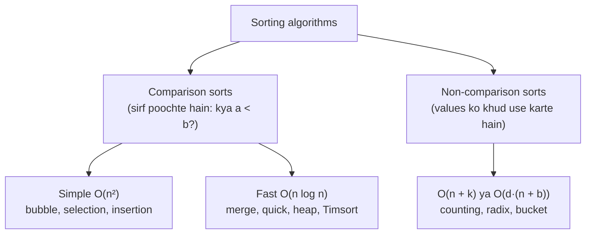
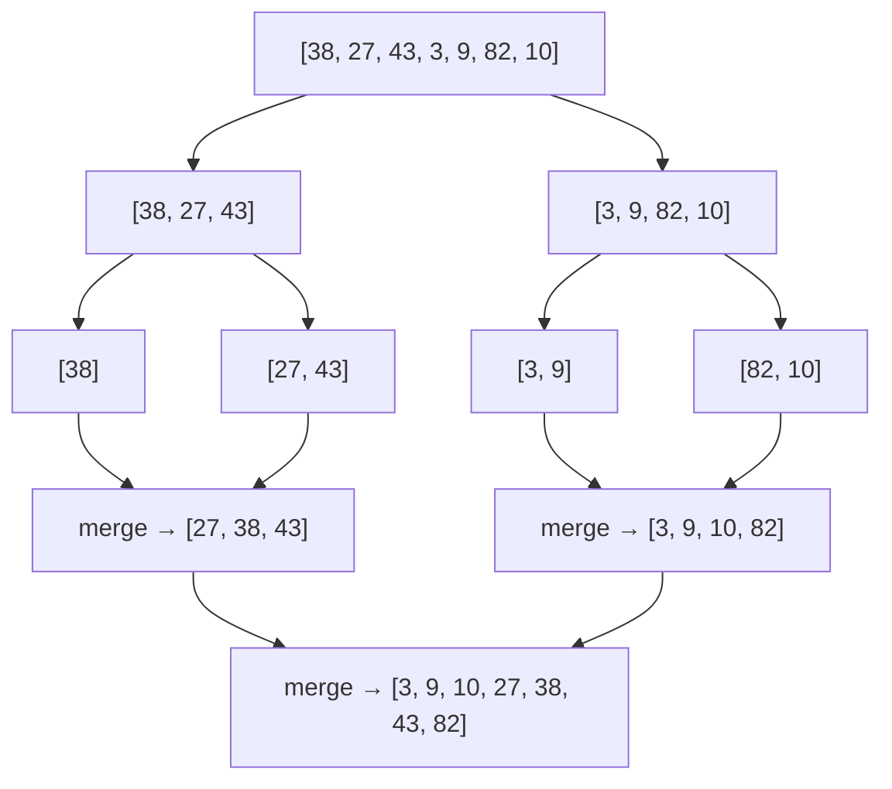

# Chapter 07 · Sorting Algorithms

> Ek librarian ko 10,000 books random order mein de do aur poocho "kya humare paas *Wings of Fire* hai?" Woh ek lambi saans legi aur chalna shuru karegi. Wahi books title ke hisaab se sorted ho, toh woh seconds mein dhoondh legi. **Sorting** woh kaam hai jo tum ek baar karte ho taaki uske baad har sawaal aasaan ho jaaye, aur ye bahut saare interview solutions ka secret pehla step hai.

**Is chapter mein tum seekhoge:**
- Sorting itni saari doosri techniques (binary search, two pointers, greedy, dedupe) ka darwaza kyun kholti hai
- Shabdavali: **stable**, **in-place**, **comparison-based**, **adaptive**
- Koi bhi comparison sort **Ω(n log n)** ko kyun nahi hara sakta
- Bubble, selection aur insertion sort, poore traces ke saath (aur insertion sort kab sach mein badhiya hai)
- **Merge sort** aur **quick sort** gehraai se: divide and conquer, partition schemes, pivots, worst cases
- Heap sort, aur non-comparison sorts: **counting**, **radix**, **bucket**
- Python ka **Timsort** kaise kaam karta hai, aur `key` aur `functools.cmp_to_key` se custom ordering
- k-th element ke liye **Quickselect**, O(n) average mein
- Classic problems: Sort Colors, Kth Largest, Largest Number, Count Inversions, Sort by Frequency, Merge Intervals

**Isse pehle padho:** [Big-O](01-big-o-complexity.md) · [Arrays & Strings](02-arrays-strings.md) · [Two Pointers](03-two-pointers.md) · [Recursion](../part-1-python/12-recursion.md) · [Functions (lambda, key)](../part-1-python/10-functions.md)

---

## 🧠 The Big Idea · Asli Baat

Taash ki ek shuffled gaddi. *Tum* use kaise sort karoge? Zyadatar log bina soche inme se koi ek tareeka use karte hain:

- **Sabse chhota patta uthao, use pehle rakho, repeat karo.** Ye hai **selection sort**.
- **Ek-ek patta uthao aur haath mein usko uski sahi jagah pe sarka do.** Ye hai **insertion sort**.
- **Gaddi do doston mein baant do, dono apna aadha sort karein, phir tum dono sorted dheron ko merge karo, baar-baar dono ke upar wale patton mein se chhota uthake.** Ye hai **merge sort**.
- **Ek patta chuno (maan lo 7), usse chhote patte left mein phenko, bade right mein, phir dono taraf isi tarah sort karo.** Ye hai **quick sort**.



Pehle do tareeke O(n²) kaam karte hain. Aakhri do problem ko **baant ke** O(n log n) mein kar dete hain. Aur ek theoretical speed limit bhi hai: jo algorithm sirf pairs compare karta hai, woh n log n ko nahi hara sakta. Usse tez jaana hai toh compare karna band karo aur values ko seedha use karo (counting sort aur uske dost).

> 🇮🇳 **Desi Analogy:** Board exam ki answer sheets socho jo roll number ke hisaab se lagani hain. Ek teacher ek-ek sheet uthati hai aur haath ke dher mein sahi jagah ghusa deti hai (insertion sort). Doosri teacher dher ko do helpers mein baant deti hai, dono apna aadha lagaate hain, phir woh dono sorted dheron ko upar se milaati jaati hai (merge sort). Teesri teacher ek roll number chunti hai, maan lo 500, "500 se chhote left table pe, bade right table pe", phir har table pe yahi dobara (quick sort). Aur chautha tareeka: 1 se 1000 tak ke khaane bana do aur har sheet seedha apne khaane mein daal do, bina kisi se compare kiye (counting sort). Har tareeke ka kharcha alag hai, aur yahi poora chapter hai.

> 💡 **The core insight:** sorting kabhi-kabhi hi asli goal hoti hai; zyadatar ye **setup** hai. Data sorted ho gaya, toh barabar items padosi ban jaate hain, sabse chhota aur sabse bada kinaron pe aa jaate hain, aur tum binary search ya two pointers se squeeze kar sakte ho. Jab atak jao, khud se poocho: "Agar input sorted hota, toh kya ye aasaan hota?"

---

## 🔨 Building It Up · Zero Se Shuru

### 1. Sorting kyun matter karti hai, aur shabdavali

Pehle sort karne se mushkil problems aasaan ban jaati hain:

| Problem | Unsorted | Sort karne ke baad |
|---|---|---|
| Duplicates dhoondho | O(n²) ya ek hash set | padosi, O(n) scan |
| Sum wala pair | O(n²) ya ek hash map | two pointers ([Chapter 03](03-two-pointers.md)) |
| Baar-baar search | har search O(n) | binary search O(log n) ([Chapter 08](08-binary-search.md)) |
| Overlapping intervals merge karo | gadbad | start se sort karo, ek pass ([Chapter 22](22-greedy-intervals.md)) |
| Median / k-th smallest | — | seedha index karo |

Chaar shabd har sorting algorithm ko describe karte hain:

- **Stable:** barabar elements apna original relative order nahi khote. Students ko marks se sort karo; stable sort barabar marks wale students ko unke original (maan lo alphabetical) order mein hi rakhega. Ye tab matter karta hai jab tum ek key ke baad doosri key se sort karte ho.
- **In-place:** O(1) extra memory use karta hai (ya recursion ke liye O(log n)), array ko khud hi rearrange karta hai.
- **Comparison-based:** elements ke baare mein sirf "kya a < b?" pooch ke hi seekhta hai.
- **Adaptive:** jab input pehle se lagbhag sorted ho, tab tez chalta hai.

```python
students = [("Asha", 90), ("Ravi", 85), ("Meera", 90), ("Kabir", 85)]
by_marks = sorted(students, key=lambda s: s[1])      # Python ka sort stable hai
print(by_marks)
```

```text
[('Ravi', 85), ('Kabir', 85), ('Asha', 90), ('Meera', 90)]
```

Kya hua yahan: input mein Ravi, Kabir se pehle tha, aur 85 walon mein bhi pehle hi raha. Asha, Meera se pehle rahi. Yahi stability hai.

> 🇮🇳 **Desi Analogy:** IRCTC Tatkal ki waiting list socho. Do log same class, same quota mein hain. Stable sort ka matlab: jisne pehle book kiya, woh list mein pehle hi rahega, chahe tum list ko class ke hisaab se dobara sort kar do. Unstable sort mein ho sakta hai baad wala aage aa jaaye, aur pehle wala bhai naraaz. Railway ko stability chahiye, isliye "barabar" logon ka purana order bachna zaroori hai.

### 2. Bubble sort

Array mein chalo, aur jo padosi galat order mein hain unhe swap karo. Ek pass ke baad sabse bada element "bubble" hokar end tak pahunch jaata hai. Bache hue hisse pe repeat karo. Agar kisi pass mein ek bhi swap nahi hua toh jaldi ruk jao (array sorted hai).

```python
def bubble_sort(arr):
    a = arr[:]
    n = len(a)
    for end in range(n - 1, 0, -1):          # a[end+1:] already apni final jagah pe hai
        swapped = False
        for i in range(end):
            if a[i] > a[i + 1]:
                a[i], a[i + 1] = a[i + 1], a[i]
                swapped = True
        print(f"after pass: {a}")
        if not swapped:                       # koi swap nahi: already sorted
            break
    return a

print(bubble_sort([5, 1, 4, 2, 8]))
```

```text
after pass: [1, 4, 2, 5, 8]
after pass: [1, 2, 4, 5, 8]
after pass: [1, 2, 4, 5, 8]
[1, 2, 4, 5, 8]
```

Kya hua yahan: pass 1 mein 5 right ki taraf chalta gaya jab tak 8 se nahi takraaya (8 bada tha, toh ab 8 aage end tak gaya). Pass 2 ne 4/2 wala pair theek kiya. Pass 3 ko swap karne ko kuch nahi mila aur woh jaldi ruk gaya.

- Time: O(n²) worst/average, **O(n) best** (already sorted, `swapped` flag ki wajah se).
- Space: O(1). **Stable** (sirf strictly bade padosiyon ko swap karta hai). In-place.
- Haqeeqat: lagbhag kabhi use nahi hota. Ye yahan isliye hai kyunki interviewers poochte hain "bubble sort ka best case kya hai?"

### 3. Selection sort

Har position i ke liye, unsorted hisse `a[i:]` mein **sabse chhota** element dhoondho aur use position i pe swap kar do.

```python
def selection_sort(arr):
    a = arr[:]
    n = len(a)
    for i in range(n - 1):
        smallest = i
        for j in range(i + 1, n):
            if a[j] < a[smallest]:
                smallest = j
        a[i], a[smallest] = a[smallest], a[i]   # har position pe ek swap
        print(f"i={i}: {a}")
    return a

print(selection_sort([64, 25, 12, 22, 11]))
```

```text
i=0: [11, 25, 12, 22, 64]
i=1: [11, 12, 25, 22, 64]
i=2: [11, 12, 22, 25, 64]
i=3: [11, 12, 22, 25, 64]
[11, 12, 22, 25, 64]
```

- Time: **hamesha** O(n²) comparisons, chahe pehle se sorted ho (adaptive nahi hai).
- Swaps: zyada se zyada n − 1. Yahi iski ek taakat hai: jab writes bahut mehenge ho tab kaam ka hai.
- **Stable nahi:** door wala swap kisi element ko uske barabar wale ke upar se kooda sakta hai. Example: `[(2,'a'), (2,'b'), (1,'c')]` → (1,'c') ko position 0 pe swap karne se (2,'a') peeche chala jaata hai, (2,'b') ke baad.

> 🤔 **Mann mein sawaal:** Selection sort mein swap kam hain, phir bhi O(n²) kyun?
>
> **Jawab:** Kyunki kharcha swaps ka nahi, **comparisons** ka hai. Har position ke liye woh bache hue poore hisse ko scan karta hai sabse chhota dhoondhne ke liye: (n−1) + (n−2) + ... + 1 = n(n−1)/2 comparisons. Ye scan kabhi chhota nahi hota, chahe array pehle se sorted ho. Isliye best case bhi O(n²).

### 4. Insertion sort

Left wale hisse ko ek sorted haath maano. Agla patta uthao aur bade patton ko right mein sarkao jab tak uski jagah na mil jaaye.

```python
def insertion_sort(arr):
    a = arr[:]
    for i in range(1, len(a)):
        key = a[i]                       # jo patta hum ghusa rahe hain
        j = i - 1
        while j >= 0 and a[j] > key:     # bade patton ko ek step right sarkao
            a[j + 1] = a[j]
            j -= 1
        a[j + 1] = key                   # patte ko khaali jagah mein rakh do
        print(f"insert {key}: {a}")
    return a

print(insertion_sort([12, 11, 13, 5, 6]))
```

```text
insert 11: [11, 12, 13, 5, 6]
insert 13: [11, 12, 13, 5, 6]
insert 5: [5, 11, 12, 13, 6]
insert 6: [5, 6, 11, 12, 13]
[5, 6, 11, 12, 13]
```

`[11, 12, 13 | 5, 6]` mein 5 ko insert karne ka **trace**:

| j | a[j] | a[j] > 5? | action | array |
|---|---|---|---|---|
| 2 | 13 | haan | 13 ko right sarkao | [11, 12, 13, 13, 6] |
| 1 | 12 | haan | 12 ko right sarkao | [11, 12, 12, 13, 6] |
| 0 | 11 | haan | 11 ko right sarkao | [11, 11, 12, 13, 6] |
| −1 | | ruko | 5 ko j+1 = 0 pe rakho | [5, 11, 12, 13, 6] |

Beech mein array mein duplicate dikhte hain (jaise `[11, 12, 13, 13, 6]`), ghabrao mat. 5 ko `key` variable mein sambhaal ke rakha hai, isliye overwrite hone se kuch nahi khoya. Aakhir mein woh khaali jagah mein baith jaata hai.

- Time: O(n²) worst (reverse sorted), **O(n) best** (already sorted: har `while` turant ruk jaata hai). Aur precisely, O(n + inversions ki ginti).
- Space O(1). **Stable** (`>` use karta hai, `>=` nahi). In-place. **Adaptive.**
- Haqeeqat: **chhote** ya **lagbhag sorted** arrays ke liye ye sabse tez sort hai, aur isi wajah se Timsort chhote runs ke liye ise use karta hai.

> 🇮🇳 **Desi Analogy:** Kirana store wale uncle ka shelf socho jahan masale ke packets naam ke hisaab se line mein lage hain. Naya packet aaya ("Haldi"). Uncle right end se dekhte hain: "Jeera" bada hai, ek khaana right sarkao; "Garam Masala" chhota hai, ruk jao, Haldi yahan rakh do. Agar naye packets pehle se order mein aa rahe hain, toh har naya seedha end pe lag jaata hai, kuch sarakna nahi padta: O(n) total. Agar sab ulte order mein aa rahe hain, toh har naye packet ke liye poori line sarakni padti hai: O(n²). Yahi insertion sort hai, aur isi wajah se ye "lagbhag sorted" data pe itna tez hai.

### 5. Merge sort: divide and conquer

**Divide and conquer** = problem ko apni hi chhoti copies mein todo, unhe recursively solve karo, answers ko jod do.

Merge sort:
1. **Divide:** array ko aadha-aadha baanto.
2. **Conquer:** dono halves ko recursively sort karo (size ≤ 1 ka array pehle se sorted hai).
3. **Combine:** dono sorted halves ko **merge** karo, [Chapter 03](03-two-pointers.md) wala do-sequence two-pointer walk.



```python
def merge(left, right):
    out = []
    i = j = 0
    while i < len(left) and j < len(right):
        if left[i] <= right[j]:          # <= isse stable rakhta hai: tie pe left se lo
            out.append(left[i]); i += 1
        else:
            out.append(right[j]); j += 1
    out.extend(left[i:])
    out.extend(right[j:])
    return out

def merge_sort(a):
    if len(a) <= 1:
        return a
    mid = len(a) // 2
    return merge(merge_sort(a[:mid]), merge_sort(a[mid:]))

print(merge_sort([38, 27, 43, 3, 9, 82, 10]))
print(merge_sort([]), merge_sort([5, 5, 1]))
```

```text
[3, 9, 10, 27, 38, 43, 82]
[] [1, 5, 5]
```

> 🇮🇳 **Desi Analogy:** Do sections ki merit lists, dono pehle se rank ke hisaab se sorted. Principal ko ek combined merit list chahiye. Woh dono lists ke **top** ko dekhti hain, jo better hai use likh deti hain, aur us list mein ek neeche khisak jaati hain. Bas dono lists ke top compare karte raho. Har student ek hi baar likha jaata hai, toh merge O(n). Yahi `merge` function hai. Aur merge sort bas itna kehta hai: "Badi list ko tod-tod ke itna chhota karo ki har list mein ek hi student ho (woh toh sorted hi hai), phir upar ki taraf merge karte jao."

**Recurrence:** T(n) = 2T(n/2) + O(n). Do aadhe size ke sub-problems plus ek linear merge. [Chapter 01](01-big-o-complexity.md) se: recursion tree ke log n levels hain, har level total O(n) merging karta hai → **O(n log n)**, best, average **aur** worst, teeno case mein.

Thoda numbers mein: n = 8 ho toh levels hain 8 → 4+4 → 2+2+2+2 → 1×8, yaani log₂ 8 = 3 levels of merging. Har level pe saare 8 elements ek baar merge hote hain. 3 × 8 = 24 ≈ n log n.

- Space: merge buffers ke liye O(n) (plus O(log n) recursion depth).
- **Stable** (`<=` ki wajah se). In-place nahi.
- Superpower: guaranteed O(n log n), aur linked lists pe ([Chapter 10](10-linked-lists.md)) aur memory mein na samaane wale data pe ("external sorting": chunks sort karo, phir unhe merge karo) zabardast kaam karta hai.

### 6. Quick sort: partition aur recurse

Quick sort merge sort ko ulta kar deta hai: mehnat recurse karne se **pehle** karo.

1. Ek **pivot** chuno.
2. **Partition:** aise rearrange karo ki pivot se chhote sab uske left mein ho aur bade sab right mein. Ab pivot apni **final** position pe hai.
3. Left hisse aur right hisse pe recurse karo. Koi combine step nahi chahiye.

> 🇮🇳 **Desi Analogy:** School assembly mein PT sir ek bachche ko (pivot) beech mein khada karte hain: "Jo isse chhote hain left mein, jo lambe hain right mein." Ek hi ishaare mein woh bachcha apni **final jagah** pe pahunch gaya, kyunki uske left ke sab chhote hain aur right ke sab lambe. Ab dono groups mein alag-alag yahi game. Koi aakhir mein "merge" nahi karna padta, kyunki groups pehle se sahi order mein khade hain. Aur agar sir har baar sabse chhote bachche ko pivot bana dein? Toh har baar ek group khaali, doosre mein sab: kaam hi nahi batata. Yahi O(n²) worst case hai.

**Lomuto partition** (likhne mein sabse simple): pivot = last element; `i` "pivot se chhote" region ka end mark karta hai; `j` se scan karo.

```python
def lomuto_partition(a, lo, hi):
    pivot = a[hi]
    i = lo                                  # a[lo:i] mein pivot se chhoti values hain
    for j in range(lo, hi):
        if a[j] < pivot:
            a[i], a[j] = a[j], a[i]
            i += 1
    a[i], a[hi] = a[hi], a[i]               # pivot ko small region ke theek baad rakho
    return i

def quick_sort(a, lo=0, hi=None):
    if hi is None:
        hi = len(a) - 1
    if lo < hi:
        p = lomuto_partition(a, lo, hi)
        quick_sort(a, lo, p - 1)
        quick_sort(a, p + 1, hi)
    return a

data = [10, 80, 30, 90, 40, 50, 70]
print(quick_sort(data))
```

```text
[10, 30, 40, 50, 70, 80, 90]
```

`[10, 80, 30, 90, 40, 50, 70]` ka **partition trace**, pivot 70:

| j | a[j] | a[j] < 70? | action | array | i after |
|---|---|---|---|---|---|
| 0 | 10 | haan | swap a[0], a[0] | [10, 80, 30, 90, 40, 50, 70] | 1 |
| 1 | 80 | nahi | | | 1 |
| 2 | 30 | haan | swap a[1], a[2] | [10, 30, 80, 90, 40, 50, 70] | 2 |
| 3 | 90 | nahi | | | 2 |
| 4 | 40 | haan | swap a[2], a[4] | [10, 30, 40, 90, 80, 50, 70] | 3 |
| 5 | 50 | haan | swap a[3], a[5] | [10, 30, 40, 50, 80, 90, 70] | 4 |
| end | | | pivot ko a[4] mein swap | [10, 30, 40, 50, **70**, 90, 80] | |

Ab 70 hamesha ke liye index 4 pe hai; `[10, 30, 40, 50]` aur `[90, 80]` pe recurse karo.

> 🤔 **Mann mein sawaal:** Lomuto mein `i` aur `j` dono kya kar rahe hain? Dimaag ghoom jaata hai.
>
> **Jawab:** Array ko teen hisson mein socho: `a[lo:i]` = "pakke chhote" (pivot se kam), `a[i:j]` = "pakke bade" (pivot se zyada ya barabar), `a[j:hi]` = "abhi dekhe nahi". `j` har step pe ek naya element dekhta hai. Agar woh chhota hai, toh use "bade" region ke pehle element (`a[i]`) se swap kar do, aur `i` aage. Isse chhota region ek se badh jaata hai aur bada region ek aage khisak jaata hai. Aakhir mein pivot ko `a[i]` pe daalo, jo bade region ki shuruaat hai.

**Hoare partition** (original wala, practice mein tez): do pointers dono kinaron se shuru hote hain aur ek doosre ki taraf chalte hain, "left mein jo zyada bada hai" ko "right mein jo zyada chhota hai" se swap karte hue. Ye average pe Lomuto se lagbhag teen guna kam swaps karta hai aur bahut saare duplicates ke saath behtar behave karta hai. Dhyaan do, Hoare mein pivot zaroori nahi ki returned index pe hi khatam ho, isliye recurse `[lo..p]` aur `[p+1..hi]` pe karte hain.

```python
def hoare_partition(a, lo, hi):
    pivot = a[(lo + hi) // 2]               # beech wala element pivot
    i, j = lo - 1, hi + 1
    while True:
        i += 1
        while a[i] < pivot:
            i += 1
        j -= 1
        while a[j] > pivot:
            j -= 1
        if i >= j:
            return j
        a[i], a[j] = a[j], a[i]

def quick_sort_hoare(a, lo=0, hi=None):
    if hi is None:
        hi = len(a) - 1
    if lo < hi:
        p = hoare_partition(a, lo, hi)
        quick_sort_hoare(a, lo, p)          # dhyaan do: p, p - 1 nahi
        quick_sort_hoare(a, p + 1, hi)
    return a

print(quick_sort_hoare([3, 6, 8, 10, 1, 2, 1]))
print(quick_sort_hoare([5, 5, 5, 5]))
```

```text
[1, 1, 2, 3, 6, 8, 10]
[5, 5, 5, 5]
```

**Complexity aur pivot ki problem.**

- **Accha pivot** (lagbhag aadha-aadha baantta hai): T(n) = 2T(n/2) + O(n) → **O(n log n)**.
- **Bura pivot** (hamesha sabse chhota ya sabse bada): T(n) = T(n − 1) + O(n) → **O(n²)**. "Last element as pivot" ke saath, ek **already sorted** array hi worst case hai!
- Random inputs pe **average**: O(n log n).
- Space: average pe O(log n) recursion, worst case mein O(n). In-place. **Stable nahi.**

Sorted array pe last-element pivot kyun bura hai? `[1, 2, 3, 4, 5]` mein pivot 5. Sab usse chhote hain, toh left mein 4 elements, right mein 0. Phir `[1, 2, 3, 4]` mein pivot 4, phir se wahi. Har level sirf ek element hata raha hai: n + (n−1) + ... + 1 = O(n²).

**Pivot ko theek karna:**

| Strategy | Idea | Worst case |
|---|---|---|
| First / last element | simple | sorted input pe O(n²) |
| Middle element | sorted input pe behtar | jaan-boojh ke banaye inputs pe O(n²) |
| Median of three | first, middle, last ka median | kabhi-kabhaar O(n²) |
| **Random pivot** | ek random index chuno | O(n²) sirf bahut hi zyada badkismati se; **har input ke liye expected O(n log n)** |

```python
import random

def randomized_quick_sort(a, lo=0, hi=None):
    if hi is None:
        hi = len(a) - 1
    if lo < hi:
        r = random.randint(lo, hi)
        a[r], a[hi] = a[hi], a[r]           # random pivot ko end pe le jao, phir Lomuto
        pivot, i = a[hi], lo
        for j in range(lo, hi):
            if a[j] < pivot:
                a[i], a[j] = a[j], a[i]
                i += 1
        a[i], a[hi] = a[hi], a[i]
        randomized_quick_sort(a, lo, i - 1)
        randomized_quick_sort(a, i + 1, hi)
    return a

random.seed(7)                              # fixed seed: har baar same run
print(randomized_quick_sort(list(range(10, 0, -1))))
```

```text
[1, 2, 3, 4, 5, 6, 7, 8, 9, 10]
```

Randomness badkismati ko **input** se (jise ek attacker control karta hai) hata ke **sikke ke uchhalne** pe daal deti hai (jise koi control nahi karta).

> 🤔 **Mann mein sawaal:** "Random" ka matlab kabhi-kabhi toh bura pivot aayega hi. Phir isse kya fayda?
>
> **Jawab:** Haan, kabhi-kabhi ek bura pivot aayega, lekin **lagaataar** bure pivots aane ki probability bahut tezi se ghatti hai. O(n²) ke liye lagbhag har level pe sabse bura pivot chahiye, jo ek sikke ko hazaar baar ulta girane jaisa hai. Asli fayda ye hai ki ab koi **specific input** tumhe hamesha dheema nahi kar sakta. Fixed pivot ke saath ek sorted array har baar O(n²) deta; random ke saath wahi array bhi average O(n log n) leta hai.

> 💡 **Bahut saare duplicates?** Jab zyadatar values barabar ho toh two-way partitions dheeme pad jaate hain. **Three-way partitioning** (Dutch National Flag, [Chapter 03](03-two-pointers.md)) array ko `< pivot`, `== pivot`, `> pivot` mein baantta hai aur poore beech wale block ko skip kar deta hai.

### 7. Heap sort

Ek **binary heap** ([Chapter 15](15-heaps.md)) aisa array hai jo is tarah arranged hai ki sabse bada element (max-heap mein) hamesha index 0 pe ho, aur use nikaalna O(log n) leta hai. Heap sort:

1. Array ko in-place ek max-heap mein **heapify** karo: O(n).
2. Baar-baar max (index 0) ko end pe swap karo, heap ko ek se chhota karo, aur naye root ko **sift down** karo: n × O(log n).

```python
def sift_down(a, root, size):
    while True:
        largest = root
        left, right = 2 * root + 1, 2 * root + 2       # array layout mein children
        if left < size and a[left] > a[largest]:
            largest = left
        if right < size and a[right] > a[largest]:
            largest = right
        if largest == root:
            return
        a[root], a[largest] = a[largest], a[root]
        root = largest

def heap_sort(a):
    n = len(a)
    for i in range(n // 2 - 1, -1, -1):     # max-heap neeche se upar banao
        sift_down(a, i, n)
    for end in range(n - 1, 0, -1):
        a[0], a[end] = a[end], a[0]          # current max apni final jagah pe jaata hai
        sift_down(a, 0, end)                 # a[0:end] pe heap wapas theek karo
    return a

print(heap_sort([12, 11, 13, 5, 6, 7]))
```

```text
[5, 6, 7, 11, 12, 13]
```

- Time: **hamesha O(n log n)**. Space: **O(1)**. In-place. **Stable nahi.**
- Ye akela common sort hai jo guaranteed O(n log n) **aur** O(1) space dono deta hai. Practice mein ye quick sort se dheema hai (memory mein idhar-udhar koodta hai, toh caches kam madad karte hain). Ye **introsort** (C++ ka `std::sort`) ke andar fallback hai: quick sort jo recursion bahut gehri ho jaane pe heap sort pe switch kar leta hai.

> 🇮🇳 **Desi Analogy:** Office ki hierarchy socho: har boss apne do juniors se "bada" hai, toh sabse bada boss (CEO) top pe hai. Heap sort baar-baar CEO ko retire karke line ke end mein bhej deta hai. Uski kursi pe sabse neeche wala aadmi baitha diya jaata hai, aur woh neeche gir-gir ke apni sahi jagah tak jaata hai (sift down), jab tak naya sabse bada top pe na aa jaaye. Har retirement O(log n), n retirements, total O(n log n).

Agar sift-down naya lag raha hai toh tension mat lo; [Chapter 15](15-heaps.md) heaps ko zero se banata hai.

### 8. Counting sort: koi comparison hi nahi

Agar values ek range `0..k` ke chhote integers hain, toh bas **gino** ki har value kitni baar aayi, phir unhe order mein likh do.

```python
def counting_sort_simple(nums, k):
    counts = [0] * (k + 1)
    for x in nums:
        counts[x] += 1
    out = []
    for value, c in enumerate(counts):
        out.extend([value] * c)
    return out

print(counting_sort_simple([4, 2, 2, 8, 3, 3, 1], 8))
```

```text
[1, 2, 2, 3, 3, 4, 8]
```

Time **O(n + k)**, space O(n + k). Jab k lagbhag n ke barabar (ya chhota) ho, toh ye **linear** hai, n log n wali "limit" ko hara deta hai, kyunki ye kabhi compare karta hi nahi.

**Records** ko ek chhote integer key se sort karna ho aur **stable** bhi rehna ho (radix sort ke liye zaroori), toh counts ke **prefix sums** ([Chapter 06](06-prefix-sums.md)) se nikaalo ki har key ka block kahan se shuru hota hai:

```python
def counting_sort_stable(items, key, k):
    counts = [0] * (k + 1)
    for item in items:
        counts[key(item)] += 1
    starts = [0] * (k + 1)                 # starts[v] = key v ka pehla output slot
    for v in range(1, k + 1):
        starts[v] = starts[v - 1] + counts[v - 1]
    out = [None] * len(items)
    for item in items:                     # left se right chalna barabar keys ka order bachata hai
        out[starts[key(item)]] = item
        starts[key(item)] += 1
    return out

people = [("Asha", 3), ("Ravi", 1), ("Meera", 3), ("Kabir", 2), ("Zoya", 1)]
print(counting_sort_stable(people, key=lambda p: p[1], k=3))
```

```text
[('Ravi', 1), ('Zoya', 1), ('Kabir', 2), ('Asha', 3), ('Meera', 3)]
```

Samjho `starts` kaise bana: counts hain key 1 → 2 log, key 2 → 1, key 3 → 2. Toh key 1 wale output ke slot 0 se shuru, key 2 wale slot 2 se (pehle 2 slots key 1 ke), key 3 wale slot 3 se. Ye cinema hall ki rows jaisa hai: "pehli 2 seats Gold wale, agli 1 Silver, uske baad Bronze." Har aane wala apne block ki agli khaali seat pe baithta hai, isliye jo pehle aaya woh pehle baitha: stable.

Kab **nahi** use karna: jab k bahut bada ho (0 aur 10⁹ ke beech ke 10 numbers sort karne ke liye ek billion counters banane padenge).

### 9. Radix sort

Numbers ko **digit by digit** sort karo, sabse kam significant digit (LSD) se sabse zyada significant tak, har digit pe ek **stable** counting sort use karke. Kyunki har pass stable hai, isliye pehle (kam significant) digits se bana order baad wale digits ke ties mein bacha rehta hai.

```python
def radix_sort(nums):
    if not nums:
        return nums
    exp = 1
    biggest = max(nums)
    while biggest // exp > 0:
        buckets = [[] for _ in range(10)]          # stable: append order bachata hai
        for x in nums:
            buckets[(x // exp) % 10].append(x)
        nums = [x for bucket in buckets for x in bucket]
        print(f"by digit {exp:>3}: {nums}")
        exp *= 10
    return nums

print(radix_sort([170, 45, 75, 90, 802, 24, 2, 66]))
```

```text
by digit   1: [170, 90, 802, 2, 24, 45, 75, 66]
by digit  10: [802, 2, 24, 45, 66, 170, 75, 90]
by digit 100: [2, 24, 45, 66, 75, 90, 170, 802]
[2, 24, 45, 66, 75, 90, 170, 802]
```

`(x // exp) % 10` ka matlab: `exp = 10` ho toh `802 // 10 = 80`, `80 % 10 = 0`, yaani 802 ka tens digit 0. Dusre pass mein dekho: 802 aur 2 dono ka tens digit 0 hai, aur 802 pehle aaya kyunki pichhle pass mein woh pehle tha (stable). Teesre pass (hundreds) mein 2 ka hundreds digit 0 hai, toh woh 802 se aage nikal jaata hai. Aakhri pass hi final faisla karta hai, aur ties pichhle passes ke order se tootte hain.

Time **O(d · (n + b))**, d digits aur base b ke liye (yahan b = 10). Fixed-width integers (jaise 32-bit) ke liye d constant hai, toh ye O(n) hai. Non-negative integers aur fixed-length strings pe chalta hai; negatives ke liye offset ya alag pass chahiye.

> 🇮🇳 **Desi Analogy:** Post office mein letters ko PIN code se sort karna socho. Pehle sab letters ko PIN ke **aakhri** digit ke hisaab se 10 dabbon mein daalo, phir dabbe order mein utha ke ek dher banao. Phir second-last digit se, phir aur aage. Har baar dabbe mein daalte waqt pichhla order mat todo (stable). Aakhir mein poora PIN sorted. Kisi bhi do letters ko kabhi aapas mein compare nahi kiya, bas digits dekh-dekh ke dabbon mein daala.

### 10. Bucket sort

Agar values ek range mein lagbhag **barabar (uniformly)** faili hain, toh unhe value ke hisaab se n buckets mein bikher do, har (chhote) bucket ko sort karo, aur jod do.

```python
def bucket_sort(values):
    n = len(values)
    buckets = [[] for _ in range(n)]
    for v in values:                      # maan ke chalo values [0, 1) mein hain
        buckets[int(v * n)].append(v)
    for b in buckets:
        b.sort()                          # average pe har bucket bahut chhota hai
    return [v for b in buckets for v in b]

print(bucket_sort([0.78, 0.17, 0.39, 0.26, 0.72, 0.94, 0.21, 0.12, 0.23, 0.68]))
```

```text
[0.12, 0.17, 0.21, 0.23, 0.26, 0.39, 0.68, 0.72, 0.78, 0.94]
```

Uniform data ke liye average **O(n)**; agar sab kuch ek hi bucket mein gir jaaye toh worst O(n²) (ya acche inner sort ke saath O(n log n)). Ye idea tum **Top K Frequent Elements** ([Chapter 05](05-hashing.md)) mein already use kar chuke ho, jahan frequency hi bucket index thi.

`int(v * n)` bucket number deta hai: n = 10 ho toh 0.78 → bucket 7, 0.17 → bucket 1. Buckets khud order mein hain (bucket 1 ki har value bucket 2 ki har value se chhoti), toh bas andar sort karke jod do.

---

### 11. Python ka sort: Timsort

`list.sort()` aur `sorted()` **Timsort** use karte hain, jo Tim Peters ne 2002 mein Python ke liye banaya tha. (Recent CPython versions merge karne wale runs chunne ka rule thoda refine karte hain, Powersort naam ke algorithm se idea leke, lekin dil se ye abhi bhi Timsort hi hai.) Idea:

1. **Runs** dhoondho: aise tukde jo pehle se ascending hain (ya strictly descending, jinhe ye ulta kar deta hai).
2. Chhote runs ko ek minimum length (aam taur pe 32–64) tak **insertion sort** se badhao (chhote arrays pe tez).
3. Runs ko jode mein **merge** karo, merge-sort style, merges ko balanced rakhne ke clever rules ke saath, plus **galloping** (jab ek run lagaataar "jeet" raha ho, toh ek-ek compare karne ki jagah exponential search se aage kood jao).

Properties:

| Property | Timsort |
|---|---|
| Worst case | O(n log n) |
| Best case | **O(n)** (already sorted ya reverse sorted: ek hi run) |
| Space | O(n) worst |
| Stable | **Haan** (language guarantee karti hai) |
| Adaptive | Bahut zyada: real-world data aksar thoda-bahut sorted hota hai |

> 🇮🇳 **Desi Analogy:** Shaadi mein gift envelopes ginne baithe ho. Log aksar groups mein aaye the, toh envelopes ke kuch dher pehle se hi amount ke hisaab se order mein hain (runs). Smart insaan har envelope ko zero se sort nahi karega. Woh pehle se sorted dheron ko pehchaanega, bahut chhote dheron ko haath se theek karega (insertion sort), aur phir dheron ko jode-jode mein merge karega. Timsort yahi "jo pehle se sorted hai uska fayda uthao" wala dimaag hai.

```python
nums = [5, 2, 9, 1]
print(sorted(nums), nums)          # sorted(): nayi list, original ko haath nahi lagata
nums.sort(reverse=True)            # .sort(): in place, None return karta hai
print(nums)

words = ["banana", "Apple", "cherry", "apple"]
print(sorted(words))                           # uppercase letters lowercase se pehle aate hain
print(sorted(words, key=str.lower))            # case-insensitive (ties ke liye stable)
print(sorted(words, key=lambda w: (len(w), w)))  # length se, phir alphabetically
```

```text
[1, 2, 5, 9] [5, 2, 9, 1]
[9, 5, 2, 1]
['Apple', 'apple', 'banana', 'cherry']
['Apple', 'apple', 'banana', 'cherry']
['Apple', 'apple', 'banana', 'cherry']
```

(Is list ke liye teeno lines ittefaq se same aayi hain. `"Banana"` jod ke dekho, teeno alag ho jaayengi.)

Uppercase pehle kyun? Python strings ko character codes se compare karta hai, aur `"A"` ka code 65 hai jabki `"a"` ka 97. Saare capital letters (65–90) saare small letters (97–122) se pehle aate hain. Isliye `sorted(["banana", "Banana"])` mein `"Banana"` pehle aayega, lekin `key=str.lower` ke saath dono tie honge aur stability input order rakhegi.

### 12. Custom ordering: `key` aur `cmp_to_key`

Ek **key function** har element ko ek aisi value mein map karta hai jise Python already compare karna jaanta hai. Ye **har element ke liye ek baar** call hota hai, isliye tez hai. Tuples element-by-element compare hote hain, jisse multi-level sorting aasaan ho jaati hai. Sirf ek level ulta karna ho toh number ko negate kar do.

```python
people = [("Asha", 25, 90), ("Ravi", 22, 85), ("Meera", 25, 95), ("Kabir", 22, 85)]

# age ascending, phir marks DESCENDING, phir naam ascending
print(sorted(people, key=lambda p: (p[1], -p[2], p[0])))
```

```text
[('Kabir', 22, 85), ('Ravi', 22, 85), ('Meera', 25, 95), ('Asha', 25, 90)]
```

Key tuples likh ke check karo: Kabir `(22, -85, "Kabir")`, Ravi `(22, -85, "Ravi")`, Meera `(25, -95, "Meera")`, Asha `(25, -90, "Asha")`. 25 saal walon mein −95 < −90, toh Meera (zyada marks) pehle aati hai. Interview mein sort order predict karte waqt apni galtiyan pakadne ka sabse tez tareeka yahi hai: keys likh ke dekho.

> 🤔 **Mann mein sawaal:** `-p[2]` se descending kaise ho gaya? Aur strings ko negate kaise karein?
>
> **Jawab:** Sort hamesha chhote se bade ki taraf jaata hai. 95 > 90, lekin −95 < −90. Toh negate karte hi bada number "chhota" ban jaata hai aur pehle aata hai: yahi descending hai. Strings ko negate nahi kar sakte (`-"Ravi"` error dega). Uske liye stability wala trick use karo: pehle string wali key se `reverse=True` sort karo, phir primary key se normal sort (ye Tips section mein bhi hai).

Kabhi-kabhi order ko key ke roop mein express **kar hi nahi sakte**, kyunki woh do elements ko *saath mein* compare karne pe depend karta hai. Classic example: **Largest Number**. `[3, 30, 34, 5, 9]` ko aise arrange karo ki sabse bada number bane → `"9534330"`. Kya "3" ko "30" se pehle aana chahiye? Dono concatenations compare karo: "330" vs "303". "330" bada hai, toh "3" pehle.

`functools.cmp_to_key` ek **comparator** (agar a pehle aana chahiye toh negative, agar b toh positive, tie pe 0 return karta hai) ko key mein badal deta hai:

```python
from functools import cmp_to_key

def largest_number(nums):
    strs = [str(x) for x in nums]

    def compare(a, b):
        if a + b > b + a:
            return -1          # a pehle
        if a + b < b + a:
            return 1           # b pehle
        return 0

    strs.sort(key=cmp_to_key(compare))
    result = "".join(strs)
    return "0" if result[0] == "0" else result    # [0, 0] -> "0", "00" nahi

print(largest_number([10, 2]), largest_number([3, 30, 34, 5, 9]), largest_number([0, 0]))
```

```text
210 9534330 0
```

(Ye comparator ek valid ordering kyun hai? `a+b` ko `b+a` se compare karna, infinite repetitions `aaaa...` aur `bbbb...` ko compare karne ke barabar hai, jo transitive hai. Interviewers kabhi-kabhi yahi proof sketch chahte hain.)

Simple `sorted(strs, reverse=True)` kyun nahi chalta? Kyunki woh "9" > "5" > "34" > "30" > "3" dega, yaani "9534303", jo "9534330" se chhota hai. Problem "30" aur "3" ke beech hai: string ke roop mein "30" > "3", lekin jodne pe "3" pehle aana chahiye. Isliye pair ko jod ke dekhna padta hai.

### 13. Quickselect: poora sort kiye bina k-th element

**Problem:** k-th smallest element dhoondho. Sort karne mein O(n log n) lagta hai. Lekin quick sort ke ek **partition** ke baad pivot apne final index p pe hota hai. Agar p == k, kaam khatam. Agar k < p, answer left mein hai; warna right mein. **Sirf ek taraf recurse karo.**

```python
import random

def quickselect(nums, k):
    """Return the k-th smallest (0-based) element. Modifies a copy."""
    a = nums[:]
    lo, hi = 0, len(a) - 1
    while True:
        r = random.randint(lo, hi)
        a[r], a[hi] = a[hi], a[r]
        pivot, i = a[hi], lo
        for j in range(lo, hi):                 # Lomuto partition
            if a[j] < pivot:
                a[i], a[j] = a[j], a[i]
                i += 1
        a[i], a[hi] = a[hi], a[i]
        if i == k:
            return a[i]
        if k < i:
            hi = i - 1                          # answer left mein hai
        else:
            lo = i + 1                          # answer right mein hai

random.seed(1)
nums = [3, 2, 1, 5, 6, 4]
print([quickselect(nums, k) for k in range(len(nums))])
print("2nd largest:", quickselect(nums, len(nums) - 2))
```

```text
[1, 2, 3, 4, 5, 6]
2nd largest: 5
```

**Average pe O(n) kyun?** Random pivot ke saath, har step (average pe) array ka ek constant hissa phenk deta hai: n + n/2 + n/4 + ... < 2n. Worst case O(n²) hai (hamesha sabse bura pivot), jo random pivots ke saath bahut unlikely hai. Compare karo: size k ka heap O(n log k) worst case deta hai ([Chapter 15](15-heaps.md)).

> 🇮🇳 **Desi Analogy:** Class mein 3rd rank wala dhoondhna hai, poori merit list banaye bina. Teacher ek random student ke marks pivot leti hai: "isse kam wale left, zyada wale right." Pivot ki position 5 aayi. 3rd rank wala toh left group mein hi hoga! Right group ko poora bhool jao, unhe kabhi sort karne ki zaroorat hi nahi. Quick sort dono taraf jaata hai; quickselect sirf us taraf jahan answer hai. Isliye kaam aadha, phir chauthai, phir aath-va hissa... total 2n se kam.

### 14. Comparison table

| Algorithm | Best | Average | Worst | Extra space | Stable | In-place | Notes |
|---|---|---|---|---|---|---|---|
| Bubble | O(n) | O(n²) | O(n²) | O(1) | ✅ | ✅ | sirf padhane ke liye |
| Selection | O(n²) | O(n²) | O(n²) | O(1) | ❌ | ✅ | sabse kam swaps |
| Insertion | O(n) | O(n²) | O(n²) | O(1) | ✅ | ✅ | chhote / lagbhag sorted |
| Merge | O(n log n) | O(n log n) | O(n log n) | O(n) | ✅ | ❌ | linked lists, external sort |
| Quick | O(n log n) | O(n log n) | O(n²) | O(log n) | ❌ | ✅ | practice mein sabse tez |
| Heap | O(n log n) | O(n log n) | O(n log n) | O(1) | ❌ | ✅ | guaranteed + O(1) space |
| Counting | O(n + k) | O(n + k) | O(n + k) | O(n + k) | ✅* | ❌ | chhoti integer range |
| Radix | O(d(n + b)) | O(d(n + b)) | O(d(n + b)) | O(n + b) | ✅ | ❌ | fixed-width keys |
| Bucket | O(n) | O(n) | O(n²) | O(n) | ✅* | ❌ | uniform data |
| Timsort | O(n) | O(n log n) | O(n log n) | O(n) | ✅ | ❌ | Python, Java objects |

\* jab upar dikhaye tareeke se implement kiya ho (stable counting pass, stable bucket sort).

---

## 🔬 Under the Hood · Andar Ki Kahani

### Comparison sorting Ω(n log n) ko kyun nahi hara sakti

Kisi bhi comparison sort ko ek **decision tree** ki tarah socho: har internal node ek sawaal hai "kya a[i] < a[j]?", jiski ek yes branch aur ek no branch hai. Har leaf ek final answer hai: input ki ek specific ordering.

- n distinct elements ki **n!** possible orderings hain, aur algorithm ko har ek output karne layak hona chahiye, isliye tree mein kam se kam n! leaves chahiye.
- Height h ke binary tree mein zyada se zyada 2ʰ leaves hoti hain. Toh 2ʰ ≥ n!, yaani **h ≥ log₂(n!)**.
- log₂(n!) = log₂ 1 + log₂ 2 + ... + log₂ n. Inme se upar wale aadhe terms har ek kam se kam log₂(n/2) hain, aur aise n/2 terms hain, toh log₂(n!) ≥ (n/2) · log₂(n/2), jo Θ(n log n) hai.

Height hi worst-case comparisons ki ginti hai. Isliye **har** comparison sort ko worst case mein Ω(n log n) comparisons chahiye. Merge sort aur heap sort is bound ko chhoo lete hain, isliye woh comparison sorts mein **optimal** hain. Counting/radix sort is bound se bach nikalte hain kyunki woh compare nahi karte: values ko array indexes ki tarah use karte hain.

> 🇮🇳 **Desi Analogy:** "Kaun Banega Crorepati" ke lifeline wale "haan/na" sawaal socho. Agar tumhe 8 logon ka sahi order guess karna hai, toh 8! = 40,320 possible orders hain. Har haan/na sawaal possibilities ko zyada se zyada aadha karta hai. Toh kam se kam log₂(40,320) ≈ 15.3, yaani 16 sawaal toh poochne hi padenge, chahe tum kitne bhi smart ho. Comparison sort ke paas sirf haan/na sawaal hain, isliye ye neeche ki limit todi nahi ja sakti. Counting sort "haan/na" nahi poochta, woh seedha number dekh ke khaana bata deta hai, isliye woh is game ke bahar hai.

```python
import math

for n in (10, 100, 1000):
    print(n, round(math.log2(math.factorial(n))), round(n * math.log2(n)))
```

```text
10 22 33
100 525 664
1000 8529 9966
```

log₂(n!) kaafi kareeb se n log₂ n ke peeche chalta hai (lagbhag n log₂ n − 1.44n).

### Merge sort har case mein O(n log n) kyun hai

Split hamesha exactly aadhe se hota hai, data chahe kuch bhi ho, isliye hamesha ⌈log₂ n⌉ levels hote hain. Har level total n elements merge karta hai. Koi bhi input ise bura nahi bana sakta. Keemat: merging ke liye ek O(n) buffer.

### Phir bhi quick sort aam taur pe merge sort se tez kyun hai

Dono average pe O(n log n) hain, lekin quick sort:
- **in place** partition karta hai, memory ko sequentially scan karta hai (cache-friendly),
- ka inner loop bahut tight hai (ek comparison, kabhi-kabhaar ek swap),
- ko merge buffer nahi chahiye.

Merge sort zyada data idhar-udhar karta hai (buffers mein copy karna). C mein isse quick sort ek constant factor se tez ho jaata hai. Isi wajah se C ka `qsort` aur C++ ka `std::sort` quick-sort based hain (safeguards ke saath), jabki jin languages ko **stability** chahiye (Python, Java objects ke liye) woh merge-based Timsort use karti hain.

> 🤔 **Mann mein sawaal:** "Cache-friendly" ka matlab kya hai, aur isse itna farak kyun padta hai?
>
> **Jawab:** CPU memory se data ek-ek byte nahi, balki chhote blocks (cache lines) mein laata hai. Agar tum array ko line se padh rahe ho (jaise partition karta hai), toh agla element already cache mein hota hai: bahut tez. Agar tum idhar-udhar kood rahe ho (jaise heap sort `2i+1` pe koodta hai), toh har baar naya block laana padta hai: dheema. Big-O dono ka same hai, lekin asli seconds mein farak 2-3 guna tak ho sakta hai.

### Python ka sort stable kyun hai, aur ye kaam ka kyun hai

Python language **guarantee** karti hai ki `sort()` stable hai. Isse multi-pass sorting possible hoti hai: pehle secondary key se sort karo, phir primary key se, aur primary key ke ties secondary ke order mein hi rehte hain.

```python
records = [("Ravi", "B"), ("Asha", "A"), ("Kabir", "B"), ("Meera", "A")]
records.sort(key=lambda r: r[0])     # secondary: naam
records.sort(key=lambda r: r[1])     # primary: grade (stability naamon ka order bachati hai)
print(records)
```

```text
[('Asha', 'A'), ('Meera', 'A'), ('Kabir', 'B'), ('Ravi', 'B')]
```

Order ulta lagta hai na? Pehle **secondary** se, phir **primary** se. Kyunki aakhri sort hi "main" faisla karta hai, aur pichhla sort sirf ties todne ke liye bachta hai.

### Key functions vs comparators, performance ke hisaab se

`key=` ke saath, Python tumhara function n baar call karta hai, keys store karta hai, aur phir keys ko tez C code mein compare karta hai. `cmp_to_key` ke saath, lagbhag n log n comparisons mein se har ek tumhare Python comparator ko call karta hai. Isliye jab bhi order ko ek value ki tarah express kar sako, `key` hi use karo; `cmp_to_key` sirf sach mein pairwise orders ke liye, jaise Largest Number.

---

## 🧩 Pattern Decoder · Pattern Pakdo

### Signals: kab sorting (ya sorting wala idea) hi answer hai

| Problem mein tum dekho... | Socho |
|---|---|
| "pairs / triplets with sum", "closest", order matter nahi karta | **sort + two pointers** |
| "intervals", "meetings", "overlapping", "merge ranges" | **start se sort**, sweep |
| "minimum number of...", "greedy choose karke maximise" | **sort, phir greedy** ([Chapter 22](22-greedy-intervals.md)) |
| "group equal items", "remove duplicates" bina extra space ke | sort, phir padosi |
| "k-th largest / smallest", "top k", "median" | **quickselect** (avg O(n)) ya heap |
| "arrange to form the largest / smallest" | **custom comparator** (`cmp_to_key`) |
| "sort by frequency / by multiple keys" | **tuple** ke saath `key=` |
| "values in small range" (0..k, letters, ages) | **counting sort** O(n + k) |
| "only 0s, 1s and 2s" | **Dutch National Flag** (3-way partition) |
| "count pairs i < j with a[i] > a[j]" (inversions) | **merge sort with counting** |
| "sort a linked list" | **merge sort** ([Chapter 10](10-linked-lists.md)) |
| "nearly sorted, each element at most k away" | insertion sort O(nk) ya size k ka heap |
| "O(n) required" + integers | counting / radix / bucket |

### Template A: Merge sort, "merge ke dauraan kuch karo" hook ke saath

```py
def merge_sort_count(a):
    if len(a) <= 1:
        return a, 0
    mid = len(a) // 2
    left, cl = merge_sort_count(a[:mid])
    right, cr = merge_sort_count(a[mid:])
    merged, count = [], cl + cr
    i = j = 0
    while i < len(left) and j < len(right):
        if left[i] <= right[j]:
            merged.append(left[i]); i += 1
        else:
            count += len(left) - i     # HOOK: right[j] bache hue har left item se chhota hai
            merged.append(right[j]); j += 1
    merged += left[i:] + right[j:]
    return merged, count
```

### Template B: Partition (quick sort aur quickselect ka engine)

```py
def partition(a, lo, hi):
    pivot = a[hi]                     # (pehle randomise karo: ek random index ko hi pe swap karo)
    i = lo
    for j in range(lo, hi):
        if a[j] < pivot:              # har problem mein sirf yahi line badalti hai
            a[i], a[j] = a[j], a[i]
            i += 1
    a[i], a[hi] = a[hi], a[i]
    return i                          # pivot ka final index
```

### Template C: Custom order

```py
from functools import cmp_to_key

items.sort(key=lambda x: (primary(x), -secondary_desc(x), tertiary(x)))   # value-based
items.sort(key=cmp_to_key(lambda a, b: -1 if a_first(a, b) else 1))      # pairwise
```

### Variation 1: Count Inversions (merge sort hook)

**Problem:** aise pairs `i < j` gino jinme `a[i] > a[j]`. Ye naapta hai ki array "kitna unsorted" hai. `[8, 4, 2, 1]` → 6.

**Idea:** merge ke dauraan, jab `right[j]` ko `left[i]` se pehle uthaya jaata hai, toh woh **saare** bache hue left elements se chhota hai (left half sorted hai), toh woh ek saath `len(left) − i` inversions banata hai. Yahi counting hook hai.

```python
def count_inversions(a):
    if len(a) <= 1:
        return a, 0
    mid = len(a) // 2
    left, cl = count_inversions(a[:mid])
    right, cr = count_inversions(a[mid:])
    merged, count = [], cl + cr
    i = j = 0
    while i < len(left) and j < len(right):
        if left[i] <= right[j]:
            merged.append(left[i]); i += 1
        else:
            count += len(left) - i
            merged.append(right[j]); j += 1
    merged += left[i:] + right[j:]
    return merged, count

print(count_inversions([8, 4, 2, 1])[1], count_inversions([2, 4, 1, 3, 5])[1], count_inversions([1, 2, 3])[1])
```

```text
6 3 0
```

`[2, 4, 1, 3, 5]` ke final merge ka **dry run**: halves sort hokar `left = [2, 4]` (andar 0 inversions) aur `right = [1, 3, 5]` (andar 0) bante hain.

| i (left[i]) | j (right[j]) | compare | lo | inversions jude | total |
|---|---|---|---|---|---|
| 0 (2) | 0 (1) | 2 > 1 | 1 | len(left) − 0 = 2 → (2,1), (4,1) | 2 |
| 0 (2) | 1 (3) | 2 ≤ 3 | 2 | 0 | 2 |
| 1 (4) | 1 (3) | 4 > 3 | 3 | len(left) − 1 = 1 → (4,3) | 3 |
| 1 (4) | 2 (5) | 4 ≤ 5 | 4 | 0 | 3 |
| — | 2 (5) | left khatam | 5 | 0 | 3 |

O(n²) ki jagah O(n log n). Yahi hook **Count of Smaller Numbers After Self** aur **Reverse Pairs** bhi solve karta hai.

> 🤔 **Mann mein sawaal:** Halves ko sort kar diya toh original positions toh badal gayi. Phir inversions sahi kaise gine ja rahe hain?
>
> **Jawab:** Kyunki sorting sirf **ek half ke andar** hoti hai. Left half ka har element original array mein right half ke har element se pehle tha, chahe half ke andar order kuch bhi ho. Toh cross-pair (ek left se, ek right se) ke liye "i < j" hamesha sach hai, bas "a[i] > a[j]" check karna hai. Half ke andar wale inversions pehle hi recursion mein gin liye gaye (`cl`, `cr`). Har pair exactly ek jagah gina jaata hai.

### Variation 2: Sort Colors (3-way partition)

**Problem:** 0s, 1s aur 2s ke array ko ek pass mein, in place sort karo.

```python
def sort_colors(nums):
    low, mid, high = 0, 0, len(nums) - 1
    while mid <= high:
        if nums[mid] == 0:
            nums[low], nums[mid] = nums[mid], nums[low]
            low += 1; mid += 1
        elif nums[mid] == 1:
            mid += 1
        else:
            nums[mid], nums[high] = nums[high], nums[mid]
            high -= 1              # mid aage mat badhao: swap hokar aayi value abhi check nahi hui
    return nums

print(sort_colors([2, 0, 2, 1, 1, 0]), sort_colors([2, 0, 1]))
```

```text
[0, 0, 1, 1, 2, 2] [0, 1, 2]
```

O(n), O(1). Ye quick sort ka partition hai, pivot 1 aur teen regions ke saath ([Chapter 03](03-two-pointers.md) dekho). Counting sort (0s, 1s, 2s gino, phir overwrite karo) bhi O(n) hai lekin do pass leta hai.

### Variation 3: Merge Intervals (sort, phir sweep) — ek preview

**Problem:** saare overlapping intervals merge karo. `[[1,3],[2,6],[8,10],[15,18]]` → `[[1,6],[8,10],[15,18]]`.

**Idea:** start se sort karne ke baad, overlapping intervals **padosi** ban jaate hain. Ek baar chalo: agar current interval pichhle merged interval ke khatam hone se pehle shuru hota hai, toh use badha do; warna naya shuru karo.

```python
def merge_intervals(intervals):
    intervals.sort(key=lambda iv: iv[0])
    merged = []
    for start, end in intervals:
        if merged and start <= merged[-1][1]:
            merged[-1][1] = max(merged[-1][1], end)    # overlap: badhao
        else:
            merged.append([start, end])                # gap: naya interval
    return merged

print(merge_intervals([[1, 3], [2, 6], [8, 10], [15, 18]]))
print(merge_intervals([[1, 4], [4, 5]]), merge_intervals([[1, 4], [2, 3]]))
```

```text
[[1, 6], [8, 10], [15, 18]]
[[1, 5]] [[1, 4]]
```

Sort ke liye O(n log n), sweep ke liye O(n). Intervals ka poora parivaar [Chapter 22](22-greedy-intervals.md) mein hai.

`max(merged[-1][1], end)` kyun, seedha `end` kyun nahi? `[[1, 4], [2, 3]]` dekho: `[2, 3]` poori tarah `[1, 4]` ke andar hai. Seedha `end` likhte toh `[1, 3]` ban jaata, aur 3 se 4 tak ka hissa kho jaata. `max` ensure karta hai ki interval kabhi sikude nahi.

### Kab sort NAHI karna

- **Original indexes chahiye** aur answer positions ke baare mein hai (jaise Two Sum) → hashing, ya `(value, index)` pairs sort karo.
- **Input ka order matter karta hai** (subarrays, sliding windows, "contiguous") → sorting structure ko tod deti hai.
- **Sirf k-th element ya top k chahiye** → quickselect O(n) ya heap O(n log k), poora O(n log n) sort nahi.
- **O(n) chahiye** aur values chhote integers nahi hain → hashing.
- **Data stream mein aa raha hai** aur baar-baar current order chahiye → heap ya balanced BST, baar-baar sort nahi.

---

## ⚠️ Traps & Common Mistakes · Yahan Sab Phisalte Hain

1. **`x = x.sort()`** x ko `None` bana deta hai. `.sort()` in place sort karta hai aur `None` return karta hai; `sorted(x)` nayi list return karta hai.

```py
# ❌
nums = nums.sort()      # ab nums None hai

# ✅
nums.sort()             # ya: nums = sorted(nums)
```

2. **Sorted input pe first/last pivot wala quick sort** → O(n²) aur, Python mein, bade n ke liye `RecursionError`. Pivot randomise karo.

3. **Galti se stability kho dena.** Merge mein `<=` ki jagah `<` use karna (ties pe right se lena) merge sort ko unstable bana deta hai. Insertion sort mein `>` ki jagah `>=` bhi yahi karta hai.

4. **Hoare partition ke recursion bounds.** `[lo, p]` aur `[p+1, hi]` pe recurse karo, `[lo, p−1]` pe nahi; pivot zaroori nahi ki p pe hi ho.

5. **Largest Number: all-zeros wala case bhool jaana.** `[0, 0]` ko `"0"` return karna chahiye, `"00"` nahi.

6. **Numbers ko strings ki tarah sort karna.** `sorted(["10", "9", "2"])` deta hai `['10', '2', '9']` (lexicographic). `key=int` use karo.

7. **Bahut badi range pe counting sort.** `[0, 10**9]` ke liye ek billion counters chahiye. Pehle range check karo.

8. **Ye maan lena ki O(n log n) hamesha chahiye.** Agar problem kehti hai values 0..100 hain, toh counting sort O(n) hai.

9. **Loop ke andar sort karna.** `for ...: arr.sort()` O(n · n log n) hai. Ek baar sort karo, ya heap use karo.

10. **Comparators jo booleans return karte hain.** `cmp_to_key` ko negative/zero/positive integers chahiye. `lambda a, b: a + b > b + a` True/False (1/0) return karta hai aur chupchaap order tod deta hai.

---

## 💡 Tips & Tricks · Pro Wale Moves

- Interviews mein bas `sorted()` / `.sort()` use karo jab tak sort implement karne ko na kaha jaaye. Bolo "Timsort, O(n log n), stable".
- Multi-key sort: `key=lambda x: (a(x), -b(x))`. Descending **strings** ke liye (negate nahi kar sakte), stability ka use karke do baar sort karo, ya ek single key pe `reverse=True` lagao.
- `heapq.nsmallest(k, a)` / `nlargest(k, a)` O(n log k) hain: jab k chhota ho toh sort karne se behtar.
- `sorted(d.items(), key=lambda kv: kv[1], reverse=True)` ek dict ko value se sort karta hai.
- `bisect.insort(a, x)` insert karte waqt list ko sorted rakhta hai (shifting ki wajah se har insert O(n); chhoti lists ke liye theek).
- Sorted order mein indexes chahiye? `sorted(range(n), key=nums.__getitem__)` (ye ek **argsort** hai).
- Jab pairs pe O(n²) brute force dikhe, pehle sort karke dekho; aksar isse two pointers ya greedy khul jaata hai.
- Agar interview mein quick sort implement karo, toh pivot choice aur O(n²) worst case ka zikr interviewer se pehle khud kar do.

---

## 🎯 Interview Questions · Interview Mein Yahi Poochenge

### 1. Kth Largest Element in an Array 🔥🔥🔥

<details><summary>Answer dekho 👀</summary>

Teen answers, is order mein: sort (O(n log n)); size k ka min-heap (O(n log k), [Chapter 15](15-heaps.md)); **quickselect** (O(n) average, O(n²) worst). k-th largest = (n − k)-th smallest, 0-based.

```python
import heapq
import random

def find_kth_largest(nums, k):
    target = len(nums) - k             # sorted order mein index
    a = nums[:]
    lo, hi = 0, len(a) - 1
    while True:
        r = random.randint(lo, hi)
        a[r], a[hi] = a[hi], a[r]
        pivot, i = a[hi], lo
        for j in range(lo, hi):
            if a[j] < pivot:
                a[i], a[j] = a[j], a[i]
                i += 1
        a[i], a[hi] = a[hi], a[i]
        if i == target:
            return a[i]
        if i < target:
            lo = i + 1
        else:
            hi = i - 1

random.seed(0)
print(find_kth_largest([3, 2, 1, 5, 6, 4], 2), find_kth_largest([3, 2, 3, 1, 2, 4, 5, 5, 6], 4))
print(heapq.nlargest(2, [3, 2, 1, 5, 6, 4])[-1])     # heap wala one-liner
```

```text
5 4
5
```

`target = len(nums) − k` kyun? 6 elements mein 2nd largest = sorted order mein index 4 (0, 1, 2, 3, **4**, 5). Sabse bada index 5 pe, doosra sabse bada index 4 pe. Toh k-th largest = index n − k.

> 🗣️ **Interview mein aise bolo:** "The k-th largest is the element at index n minus k in sorted order. Sorting gives O(n log n), and a min-heap of size k gives O(n log k). The optimal approach is quickselect: partition around a random pivot, and since the pivot lands in its final position, I recurse only into the side containing the target index. That's O(n) on average and O(n²) in the worst case, which a random pivot makes very unlikely."

</details>

### 2. Sort Colors 🔥🔥🔥

<details><summary>Answer dekho 👀</summary>

Dutch National Flag: teen pointers `low`, `mid`, `high` (Variation 2). Ek pass, O(n) time, O(1) space. Counting sort ko do-pass alternative ki tarah bolo, aur samjhao ki `high` ke saath swap ke baad `mid` aage kyun nahi badhate.

> 🗣️ **Interview mein aise bolo:** "I'll use the Dutch National Flag algorithm with three pointers: everything before low is zero, everything after high is two, and mid scans the unknown middle. A zero is swapped to low and both pointers advance; a one just advances mid; a two is swapped with high and only high moves back, because the value swapped in hasn't been checked yet. It's a single pass, O(n) time and O(1) space."

</details>

### 3. Merge Intervals 🔥🔥🔥

<details><summary>Answer dekho 👀</summary>

Start se sort karo; jab tak agla interval overlap kare (`start <= last_end`) pichhle merged interval ko badhao, warna append karo (Variation 3). O(n log n) time, output ke liye O(n).

> 🗣️ **Interview mein aise bolo:** "After sorting by start time, any intervals that overlap become adjacent. I sweep once, keeping a list of merged intervals: if the current interval starts at or before the last merged end, I extend that end with the maximum of the two; otherwise I start a new interval. Sorting dominates, so it's O(n log n) time and O(n) space for the output."

</details>

### 4. Largest Number 🔥🔥

<details><summary>Answer dekho 👀</summary>

Strings mein badlo; `cmp_to_key` ke saath comparator "a, b se pehle agar a + b > b + a" se sort karo; join karo; all-zeros case handle karo (section 12). Time O(n log n · L), jahan L digit length hai (string comparisons). Transitivity justify karne ke liye taiyaar raho.

</details>

### 5. Count Inversions / Reverse Pairs 🔥🔥

<details><summary>Answer dekho 👀</summary>

Counting hook wala merge sort: right half se lete waqt `len(left) − i` jodo (Variation 1). O(n log n). **Reverse Pairs** (`i < j` gino jahan `nums[i] > 2 * nums[j]`) wahi skeleton use karta hai, lekin merge se **pehle** ek alag two-pointer pass mein ginta hai, kyunki condition merge order se alag hai:

```python
def reverse_pairs(nums):
    def sort_count(a):
        if len(a) <= 1:
            return a, 0
        mid = len(a) // 2
        left, cl = sort_count(a[:mid])
        right, cr = sort_count(a[mid:])
        count = cl + cr
        j = 0
        for x in left:                       # dono halves sorted: j sirf aage badhta hai
            while j < len(right) and x > 2 * right[j]:
                j += 1
            count += j
        return sorted(left + right), count   # merge (Timsort do runs ko O(n) mein merge karta hai)
    return sort_count(nums)[1]

print(reverse_pairs([1, 3, 2, 3, 1]), reverse_pairs([2, 4, 3, 5, 1]))
```

```text
2 3
```

Alag pass kyun? Merge "kaun chhota hai" (`x > y`) ke hisaab se chalta hai, lekin yahan sawaal hai `x > 2y`. Dono conditions alag points pe true hoti hain, toh ek hi loop mein dono kaam nahi ho sakte. Pehle gino, phir merge.

</details>

### 6. Sort Characters By Frequency / Sort Array by Increasing Frequency 🔥🔥

Numbers ko badhti frequency se sort karo; ties ko **ghatti** value se. `[1,1,2,2,2,3]` → `[3,1,1,2,2,2]`.

<details><summary>Answer dekho 👀</summary>

Ek tuple key: `(frequency, −value)`.

```python
from collections import Counter

def frequency_sort(nums):
    freq = Counter(nums)
    return sorted(nums, key=lambda x: (freq[x], -x))

print(frequency_sort([1, 1, 2, 2, 2, 3]), frequency_sort([2, 3, 1, 3, 2]))
```

```text
[3, 1, 1, 2, 2, 2] [1, 3, 3, 2, 2]
```

O(n log n). Character wala version (sabse frequent pehle) O(n) ke liye bucket sort use kar sakta hai ([Chapter 05](05-hashing.md)).

Doosre example mein 3 aur 2 dono do-do baar hain (tie), toh `−x` se bada wala (3) pehle aaya.

</details>

### 7. Merge sort / quick sort implement karo aur compare karo 🔥🔥🔥

<details><summary>Answer dekho 👀</summary>

Code sections 5 aur 6 mein. Interviewers ko ye comparison chahiye: merge sort har case mein O(n log n), stable, O(n) extra space, linked lists aur external data ke liye badhiya. Quick sort average O(n log n) lekin worst O(n²) (random pivots se kam), O(log n) stack ke saath in place, stable nahi, aur cache-friendly partitioning ki wajah se practice mein aam taur pe tez.

> 🗣️ **Interview mein aise bolo:** "Merge sort splits in half, sorts both halves recursively and merges them, so it's O(n log n) in every case and stable, but needs O(n) extra space; it's ideal for linked lists and external sorting. Quick sort partitions around a pivot first and recurses with no merge step; it's O(n log n) on average, in place with O(log n) stack, but not stable and O(n²) in the worst case, which I avoid with a random pivot. In practice quick sort is usually faster because its partitioning is cache-friendly."

</details>

### 8. Sort ko stable kya banata hai, aur iski zaroorat kab hoti hai? 🔥🔥

<details><summary>Answer dekho 👀</summary>

Stable = barabar keys apna input order rakhti hain. Zaroorat tab hai jab passes mein multiple keys se sort karna ho (pehle secondary se, phir primary se), jab input order ka koi matlab ho (pehle wale transactions pehle), aur radix sort ke andar (har digit pass ko pichhle passes ka order bachana hai). Stable: insertion, merge, counting (jaise implement kiya), Timsort. Unstable: selection, quick, heap.

</details>

### 9. Hum O(n log n) se tez sort kyun nahi kar sakte? Aur counting sort ye kaise kar leta hai? 🔥🔥

<details><summary>Answer dekho 👀</summary>

Decision-tree argument: n! possible orderings ke liye n! leaves wala tree chahiye; height h ke binary tree mein ≤ 2ʰ leaves hoti hain; toh worst case mein h ≥ log₂(n!) = Θ(n log n) comparisons (Under the Hood). Counting sort compare nahi karta: woh har value ko array index ki tarah use karta hai, isliye ye bound us pe lagu nahi hota. Uska kharcha O(n + k) hai, jo tabhi accha hai jab value range k chhoti ho.

</details>

### 10. Sort an Array (bina built-ins ke, O(n log n)) 🔥🔥

<details><summary>Answer dekho 👀</summary>

Merge sort (safe O(n log n)) ya heap sort (O(1) space) use karo. Fixed pivot wala plain quick sort avoid karo: judge mein aam taur pe sorted ya all-equal inputs hote hain jo O(n²) trigger karte hain. Agar quick sort chuno, toh random pivot **aur** duplicates ke liye three-way partitioning dono use karo.

</details>

### 11. Meeting Rooms (kya ek insaan saari meetings attend kar sakta hai?) 🔥🔥

<details><summary>Answer dekho 👀</summary>

Start time se sort karo; jo bhi meeting pichhli wali ke khatam hone se pehle shuru ho, woh conflict hai.

```python
def can_attend_meetings(intervals):
    intervals.sort()
    return all(intervals[i][0] >= intervals[i - 1][1] for i in range(1, len(intervals)))

print(can_attend_meetings([[0, 30], [5, 10], [15, 20]]), can_attend_meetings([[7, 10], [2, 4]]))
```

```text
False True
```

O(n log n). Follow-up "kitne rooms?" (Meeting Rooms II) → sweep line ya heap ([Chapter 22](22-greedy-intervals.md)).

</details>

### 12. H-Index 🔥

**H-Index:** ek researcher ka index h hai agar h papers mein se har ek ko kam se kam h citations mile hon. `[3, 0, 6, 1, 5]` → 3.

<details><summary>Answer dekho 👀</summary>

Descending sort karo; h sabse bada i + 1 hai jiske liye `citations[i] >= i + 1`. Ya counting sort se O(n), kyunki h ≤ n.

```python
def h_index(citations):
    n = len(citations)
    buckets = [0] * (n + 1)
    for c in citations:
        buckets[min(c, n)] += 1           # n se zyada citations ko n gino
    papers = 0
    for h in range(n, -1, -1):
        papers += buckets[h]              # kam se kam h citations wale papers
        if papers >= h:
            return h
    return 0

print(h_index([3, 0, 6, 1, 5]), h_index([1, 3, 1]), h_index([0, 0]))
```

```text
3 1 0
```

O(n) time aur space: capped range wala counting sort.

Trace `[3, 0, 6, 1, 5]` pe (n = 5): buckets = `[1, 1, 0, 1, 0, 2]` (6 ko 5 gina). h = 5 se neeche aao: h = 5 → papers 2, kam hai; h = 4 → papers 2, kam; h = 3 → papers 3 ≥ 3, answer 3.

</details>

---

## 🏋️ Practice · Ab Tumhari Baari

**🟢 1. Squares of a Sorted Array** — Chapter 03 mein tumne two pointers dekhe the. Ab bas square karo aur sort karo. Complexity mein kya farak hai?

<details><summary>Solution dekho 👀</summary>

```python
def sorted_squares(nums):
    return sorted(x * x for x in nums)

print(sorted_squares([-4, -1, 0, 3, 10]))
```

```text
[0, 1, 9, 16, 100]
```

Yahan O(n log n) vs two pointers ke saath O(n). (Practice mein is input pe Timsort tez hai kyunki squares ek descending run aur phir ek ascending run banate hain, lekin guarantee phir bhi O(n log n) hi hai.)

</details>

**🟢 2. Relative Sort Array:** `arr1` ko aise sort karo ki elements `arr2` mein diye order mein aayein; bache hue end mein ascending order mein.

<details><summary>Solution dekho 👀</summary>

```python
def relative_sort_array(arr1, arr2):
    rank = {v: i for i, v in enumerate(arr2)}
    return sorted(arr1, key=lambda x: (rank.get(x, len(arr2)), x))

print(relative_sort_array([2, 3, 1, 3, 2, 4, 6, 7, 9, 2, 19], [2, 1, 4, 3, 9, 6]))
```

```text
[2, 2, 2, 1, 4, 3, 3, 9, 6, 7, 19]
```

Key ka jaadu: `arr2` mein jo hai uska rank 0, 1, 2...; jo nahi hai (7, 19) unka rank `len(arr2)` = 6, yaani sabse aakhir. Aur tuple ka doosra hissa `x` un bache hue logon ko aapas mein ascending kar deta hai.

</details>

**🟢 3. Insertion sort ko descending order mein implement karo** aur `[3, 1, 2]` ke liye har step print karo.

<details><summary>Solution dekho 👀</summary>

Comparison ulta kar do.

```python
def insertion_sort_desc(a):
    for i in range(1, len(a)):
        key, j = a[i], i - 1
        while j >= 0 and a[j] < key:
            a[j + 1] = a[j]
            j -= 1
        a[j + 1] = key
        print(a)
    return a

insertion_sort_desc([3, 1, 2])
```

```text
[3, 1, 2]
[3, 2, 1]
```

</details>

**🟡 4. Version strings ki list sort karo** jaise `"1.10.0"`, `"1.2"`, `"1.2.0.1"`, sahi tareeke se (numerically, part by part, jahan missing parts 0 gine jaate hain).

<details><summary>Solution dekho 👀</summary>

Integer tuples ki key, trailing zeros hata ke taaki `"1.2"` aur `"1.2.0"` barabar compare hon.

```python
def version_key(v):
    parts = [int(p) for p in v.split(".")]
    while parts and parts[-1] == 0:
        parts.pop()
    return tuple(parts)

versions = ["1.10.0", "1.2", "1.2.0.1", "1.9", "1.2.0"]
print(sorted(versions, key=version_key))
```

```text
['1.2', '1.2.0', '1.2.0.1', '1.9', '1.10.0']
```

(`"1.2"` aur `"1.2.0"` ki keys barabar hain; stability unka input order bachati hai.)

Strings ki tarah sort karte toh `"1.10.0"` < `"1.9"` aata, kyunki character `"1"` < `"9"`. Integers mein badalte hi 10 > 9 sahi se compare hota hai. Aur tuples mein chhota tuple, jo bade ka shuruaati hissa ho, pehle aata hai: `(1, 2) < (1, 2, 0, 1)`.

</details>

**🟡 5. Maximum Gap:** sorted order mein consecutive elements ke beech sabse bada farak, O(n) time mein (non-negative integers).

<details><summary>Solution dekho 👀</summary>

Radix sort (bounded integers ke liye O(n)), phir padosi scan karo. (Famous pigeonhole-bucket wala solution bhi chalta hai.)

```python
def maximum_gap(nums):
    if len(nums) < 2:
        return 0
    exp, biggest = 1, max(nums)
    while biggest // exp > 0:
        buckets = [[] for _ in range(10)]
        for x in nums:
            buckets[(x // exp) % 10].append(x)
        nums = [x for b in buckets for x in b]
        exp *= 10
    return max(b - a for a, b in zip(nums, nums[1:]))

print(maximum_gap([3, 6, 9, 1]), maximum_gap([10]), maximum_gap([1, 10000000]))
```

```text
3 0 9999999
```

</details>

**🟡 6. K Closest Points to Origin** (koi bhi order return karo; print karne ke liye hum answer sort karte hain).

<details><summary>Solution dekho 👀</summary>

Squared distance pe quickselect: average O(n). Yahan simple O(n log n) version hai plus key idea.

```python
def k_closest(points, k):
    return sorted(points, key=lambda p: p[0] ** 2 + p[1] ** 2)[:k]

print(k_closest([[1, 3], [-2, 2]], 1), k_closest([[3, 3], [5, -1], [-2, 4]], 2))
```

```text
[[-2, 2]] [[3, 3], [-2, 4]]
```

Square root ki zaroorat nahi: squared distances compare karne se bhi same order milta hai. Average O(n) ke liye, distance se quickselect partition karo jab tak pivot index k pe na aa jaaye.

(Square root kyun nahi chahiye? Agar a < b hai aur dono positive hain, toh √a < √b bhi hai. Order same rehta hai, aur float ki galtiyan bhi bach jaati hain.)

</details>

**🔴 7. Count of Smaller Numbers After Self.** Har `nums[i]` ke liye, uske right mein uss se chhote elements gino.

<details><summary>Solution dekho 👀</summary>

**Indexes** pe merge sort. Jab left half ka koi element rakha jaata hai, toh right half ka har woh element jo usse pehle rakha ja chuka hai, usse chhota hai aur original array mein uske right mein tha.

```python
def count_smaller(nums):
    counts = [0] * len(nums)

    def sort(idx):
        if len(idx) <= 1:
            return idx
        mid = len(idx) // 2
        left, right = sort(idx[:mid]), sort(idx[mid:])
        merged, j = [], 0
        for i in left:
            while j < len(right) and nums[right[j]] < nums[i]:
                merged.append(right[j])
                j += 1
            counts[i] += j                  # nums[i] se chhote right elements
            merged.append(i)
        merged.extend(right[j:])
        return merged

    sort(list(range(len(nums))))
    return counts

print(count_smaller([5, 2, 6, 1]), count_smaller([-1, -1]))
```

```text
[2, 1, 1, 0] [0, 0]
```

O(n log n). (Fenwick tree bhi chalta hai: [Chapter 24](24-advanced-structures.md).)

Values ki jagah **indexes** kyun sort kiye? Kyunki answer har original position ke liye chahiye (`counts[i]`). Sort ke dauraan values idhar-udhar ho jaati hain; agar values sort karte toh pata hi nahi chalta kaunsa count kis original element ka hai. Index saath le chalne se "ye kaun hai" kabhi nahi khota.

</details>

**🔴 8. Nearly sorted array ko sort karo:** har element apni sorted position se zyada se zyada k positions door hai. O(n log k) mein karo.

<details><summary>Solution dekho 👀</summary>

Sabse chhota bacha hua element hamesha agle k + 1 elements ke andar hi hota hai, isliye size k + 1 ka ek min-heap rakho ([Chapter 15](15-heaps.md)).

```python
import heapq

def sort_k_sorted(nums, k):
    heap = nums[:k + 1]
    heapq.heapify(heap)
    out = []
    for x in nums[k + 1:]:
        out.append(heapq.heappushpop(heap, x))   # x push karo, sabse chhota pop karo
    while heap:
        out.append(heapq.heappop(heap))
    return out

print(sort_k_sorted([6, 5, 3, 2, 8, 10, 9], 3))
```

```text
[2, 3, 5, 6, 8, 9, 10]
```

Isi input pe insertion sort O(n·k) hai, jo k bahut chhota ho toh woh bhi theek hai.

</details>

---

## 🧠 Never-Forget Summary · Kabhi Mat Bhoolna

- Sorting aam taur pe woh **setup** hai jo two pointers, binary search, greedy aur padosi scans ka darwaza kholta hai.
- **Stable** = ties input order rakhte hain. **In-place** = O(1) extra. **Adaptive** = lagbhag sorted data pe tez.
- Bubble/selection/insertion O(n²) hain. Insertion sorted input pe O(n) hai aur chhote arrays ke liye best.
- **Merge sort**: baanto, halves sort karo, merge karo. Hamesha O(n log n), O(n) space, stable.
- **Quick sort**: pivot ke around partition, recurse. O(n log n) average, O(n²) worst; **pivot randomise karo**.
- **Heap sort**: hamesha O(n log n), O(1) space, stable nahi.
- Comparison sorts ko **Ω(n log n)** chahiye (n! leaves wala decision tree). Counting/radix/bucket compare na karke isse bach jaate hain.
- Python **Timsort** use karta hai: stable, sorted runs pe O(n), worst O(n log n).
- Custom order: tuples ke saath `key=` (descending ke liye negate); `cmp_to_key` sirf pairwise rules ke liye jaise Largest Number.
- **Quickselect** ek taraf recurse karke k-th element O(n) average mein dhoondhta hai.

**Memory hooks:**
- **"Merge: split dumb, combine smart. Quick: split smart, combine nothing."**
- **"Random pivot, no regret."**
- **"Count when the range is small."**
- **"Can't key it? Compare it."** (`cmp_to_key`)

**🪝 Yaad rakhne ka jugaad:** **"Merge = aalsi baantna, mehnati jodna. Quick = mehnati baantna, jodna zero."** Merge sort aankh band karke beech se kaat deta hai aur saari mehnat jodne mein karta hai; quick sort saari mehnat PT sir ki tarah "chhote left, lambe right" baantne mein karta hai, phir jodne ko kuch bachta hi nahi. Aur pivot ke liye: **"Pivot chuno random, worst case gayab dhadaam."** Counting sort ke liye: **"Range chhoti? Khaane banao, compare mat karo."**

**One picture:**

| Need | Use | Time |
|---|---|---|
| General sort in Python | `sorted()` / `.sort()` (Timsort) | O(n log n), stable |
| Guaranteed + stable | merge sort | O(n log n), O(n) space |
| Fast in place | quick sort (random pivot) | O(n log n) avg |
| Guaranteed + O(1) space | heap sort | O(n log n) |
| Small int range | counting sort | O(n + k) |
| Fixed-width ints | radix sort | O(d(n + b)) |
| k-th element | quickselect | O(n) avg |
| Count inversions | merge sort + hook | O(n log n) |
| Only 0/1/2 | Dutch National Flag | O(n), O(1) |

> **Agar sirf ek cheez yaad rakho:** jab koi problem mushkil lage, poocho "agar input sorted hota toh kya ye aasaan hota?" Agar haan, toh tumne bas O(n log n) dekar ek kahin zyada simple problem khareed li.

---
**Aage:** [Chapter 08 · Binary Search](08-binary-search.md)  ·  **Wapas** [Contents](../README.md)
