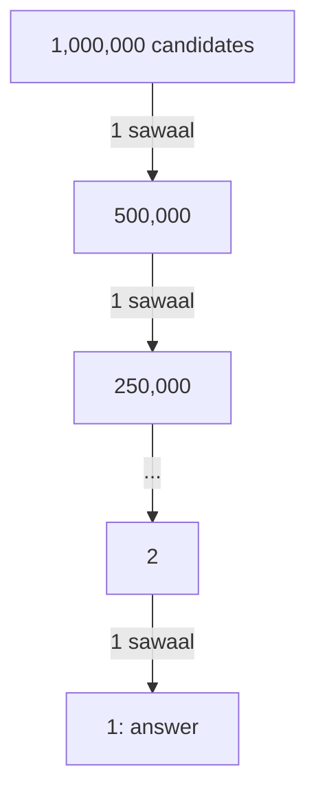
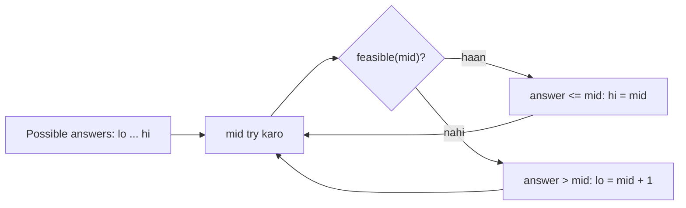

# Chapter 08 · Binary Search

> Tumhara dost 1 se ek billion (100 crore) ke beech koi number soch leta hai. Tum sirf ye pooch sakte ho "kya woh X se bada hai?" Kitne sawaal lagenge? Bas **30**. Har ek sawaal se aadhi duniya phenk dena, yahi jaadu **binary search** hai. Aur ek baar tumne ise "pehla YES dhoondho" ki tarah dekh liya, toh tum ise un problems mein bhi pakad loge jo search jaisi dikhti bhi nahi.

**Is chapter mein tum seekhoge:**
- Aadha karna scan karne se kyun jeet-ta hai, aur ek billion items ke liye 30 steps kaafi kyun hain
- Classic `lo <= hi` binary search, line by line trace ke saath
- **Ek robust template** ("pehla index jahan predicate true hai") jo lagbhag har variant ko bina off-by-one bugs ke solve karta hai
- `lower_bound`, `upper_bound` aur Python ka `bisect` module
- Tricky parivaar: rotated arrays, peak element, 2D matrices
- **Binary search on the answer**: Koko Eating Bananas, Ship Packages, Split Array Largest Sum, square roots
- Floating-point binary search aur famous Median of Two Sorted Arrays
- Ek decoder table jo off-by-one errors ko hamesha ke liye khatam kar deti hai

**Isse pehle padho:** [Big-O](01-big-o-complexity.md) · [Arrays & Strings Fundamentals](02-arrays-strings.md) · [Sorting Algorithms](07-sorting.md)

---

## 🧠 The Big Idea · Asli Baat

Socho tum ek paper dictionary mein "mango" kaise dhoondhte ho. Page 1 se shuru nahi karte. Beech mein kahin kholte ho, "kettle" dikhta hai, aur sochte ho: "M toh K ke baad aata hai, toh left wala aadha hissa bekaar hai." Ek nazar mein tumne aadhi book phenk di. Right half ke beech mein kholo, "orange" dikha: zyada aage aa gaye, right wala hissa phenko. Kuch hi panne palte aur tum pahunch gaye.

Yahi hai **binary search**: beech mein dekho, decide karo ki kaunsa aadha answer *ho hi nahi sakta*, aur use phenk do.



Ek item bachne tak kitni baar aadha karna padega? n items ke liye lagbhag **log₂ n**:

| Items | Kitni baar aadha karna padega |
|---|---|
| 1,000 | 10 |
| 1,000,000 | 20 |
| 1,000,000,000 | 30 |
| universe ka har atom (~10⁸⁰) | ~266 |

Ek billion items ka linear scan ek billion checks karta hai. Binary search 30 karta hai. Ye "thoda tez" nahi hai, ye bilkul alag duniya hai.

> 🇮🇳 **Desi Analogy:** Ek school ka attendance register socho jisme 1,024 bachche roll number ke hisaab se likhe hain. Tumhe roll number 777 dhoondhna hai. Beech wala page (512) kholo: "777 aage hai", pehla aadha gaya. Ab 513–1024 ke beech (768): "aage hai". Phir 769–1024 ke beech (896): "peeche hai"... Har baar register aadha. 1,024 bachchon mein max 11 baar page kholna padega. Agar ek-ek naam padhte toh 777 baar.

Lekin yahan ek gehri tasveer hai, jo is chapter ko "click" karwati hai. Binary search **asal mein sorted array mein number dhoondhne ke baare mein nahi hai**. Ye is shape ke baare mein hai:

```text
index:      0      1      2      3     4     5     6
question:  NO     NO     NO     YES   YES   YES   YES
                              ^
                     find this boundary
```

Jab bhi tum har position ke baare mein ek haan/na sawaal pooch sako, aur answers pehle sab NO ho aur phir sab YES (kabhi wapas palte nahi), toh binary search **pehla YES** O(log n) sawaalon mein dhoondh leta hai. Sorted array bas ek jagah hai jahan ye shape dikhti hai. "Kya ye khaane ki speed kaafi tez hai?", "Kya ye ship capacity kaafi badi hai?", "Kya ye version broken hai?", sab mein wahi NO-NO-NO-YES-YES shape hai. Shape dekhna seekh lo, aur tumne binary search seekh liya.

> 🇮🇳 **Desi Analogy:** Socho tumhare phone ka ek app update ke baad crash karne laga. Pichhle 100 updates mein se kaunse update ne bug daala? Version 1 se 100 tak har version ke liye sawaal: "kya ye crash karta hai?" Answer: NO, NO, NO, ..., YES, YES, YES. Kyunki ek baar bug aaya toh baad ke har version mein rahega. Version 50 check karo: crash? Haan, toh bug 1–50 ke beech aaya. Phir 25... Sirf 7 checks mein culprit mil jaayega. Isme koi "sorted array" hai hi nahi, sirf ek NO-NO-YES-YES shape hai. (Git mein ye exactly `git bisect` command hai.)

> 💡 **The core insight:** binary search ko *monotonic* haan/na answers chahiye, sorted array zaroori nahi. Agar position x pe YES ka matlab hai ki x ke baad har position pe bhi YES hai, toh tum binary search laga sakte ho.

---

## 🔨 Building It Up · Zero Se Shuru

### 1. Guessing game

Chalo 1 se 100 tak "mera number guess karo" smart tareeke se khelte hain: hamesha jo abhi possible hai uske beech wala guess karo.

```python
def guess_game(secret, low=1, high=100):
    guesses = 0
    while low <= high:
        guess = (low + high) // 2
        guesses += 1
        if guess == secret:
            print(f"guess {guesses}: {guess} -> correct!")
            return guesses
        elif guess < secret:
            print(f"guess {guesses}: {guess} -> higher")
            low = guess + 1          # guess tak ka sab kuch impossible hai
        else:
            print(f"guess {guesses}: {guess} -> lower")
            high = guess - 1         # guess aur usse upar sab impossible hai

guess_game(73)

# n items ke liye worst-case guesses n.bit_length() hain (= floor(log2 n) + 1)
for n in [100, 1_000_000, 1_000_000_000]:
    print(n, "->", n.bit_length(), "guesses at most")
```

```text
guess 1: 50 -> higher
guess 2: 75 -> lower
guess 3: 62 -> higher
guess 4: 68 -> higher
guess 5: 71 -> higher
guess 6: 73 -> correct!
100 -> 7 guesses at most
1000000 -> 20 guesses at most
1000000000 -> 30 guesses at most
```

Kya hua yahan: `low` aur `high` un numbers ki range batate hain jo **abhi bhi possible** hain. Har answer us range ko aadha kar deta hai. Jab "higher" aata hai, toh guess aur usse neeche sab mar gaye, isliye `low = guess + 1`. `+ 1` aur `- 1` matter karte hain: guess khud rule out ho chuka hai, toh use range se bahar jaana hi chahiye.

`n.bit_length()` kyun? 100 ko binary mein likho: `1100100`, 7 bits. Har guess ek "bit" ka faisla karta hai (aadha left ya aadha right), toh 7 guesses kaafi hain.

### 2. Classic version: sorted list mein target dhoondho

Wahi game, bas "numbers" ab ek sorted list ki positions hain.

```python
def binary_search(nums, target):
    lo, hi = 0, len(nums) - 1          # search space: har index, dono ends shaamil
    while lo <= hi:                    # jab tak space khaali nahi hai
        mid = (lo + hi) // 2
        if nums[mid] == target:
            return mid
        elif nums[mid] < target:
            lo = mid + 1               # target mid ke right mein hai
        else:
            hi = mid - 1               # target mid ke left mein hai
    return -1                          # space khaali ho gaya: target nahi hai

nums = [2, 5, 8, 12, 16, 23, 38, 56, 72, 91]
print(binary_search(nums, 23))
print(binary_search(nums, 7))
```

```text
5
-1
```

Target 23 ke liye **dry run**:

| step | lo | hi | mid | nums[mid] | decision |
|---|---|---|---|---|---|
| 1 | 0 | 9 | 4 | 16 | 16 < 23 → lo = 5 |
| 2 | 5 | 9 | 7 | 56 | 56 > 23 → hi = 6 |
| 3 | 5 | 6 | 5 | 23 | ✅ 5 pe mila |

Target 7 ke liye **dry run** (present nahi hai):

| step | lo | hi | mid | nums[mid] | decision |
|---|---|---|---|---|---|
| 1 | 0 | 9 | 4 | 16 | 16 > 7 → hi = 3 |
| 2 | 0 | 3 | 1 | 5 | 5 < 7 → lo = 2 |
| 3 | 2 | 3 | 2 | 8 | 8 > 7 → hi = 1 |
| 4 | 2 | 1 | | | lo > hi → return -1 |

Kya hua yahan: `[lo, hi]` ek **closed** range hai (dono ends shaamil) un indexes ki jahan target abhi bhi ho sakta hai. Loop `while lo <= hi` chalta hai kyunki `[5, 5]` jaisi range mein abhi bhi ek candidate hai. Jab `lo`, `hi` ko paar kar jaata hai, kuch nahi bachta.

Notice karo failed search mein `lo` kahan ruka: index 2, exactly wahan jahan 7 ko list sorted rakhne ke liye *insert kiya jaata*. Ye yaad rakhna, ek minute mein wapas aayega.

> 🤔 **Mann mein sawaal:** `lo <= hi` likhun ya `lo < hi`? Har baar confuse ho jaata hoon.
>
> **Jawab:** Khud se poocho: "kya `[lo, hi]` mein `hi` bhi ek candidate hai?" Classic version mein haan (closed range), toh jab `lo == hi` ho tab bhi ek element check karna baaki hai, isliye `<=`. Agle section ke template mein `hi` candidate **nahi** hai (half-open range), toh `lo == hi` matlab range khaali, isliye `<`. Range ki definition pehle decide karo, loop condition apne aap aa jaayegi. Neeche ek poori decoder table bhi hai.

Ye version "kya target hai?" ke liye theek hai. Lekin asli problems zyada nakhre wale sawaal poochti hain: "`[1, 2, 2, 2, 3]` mein 2 ki **pehli** position", "**sabse chhoti** speed jo kaam kare", "**aakhri** din jo safe ho". Classic version wahan bhaddi ho jaati hai. Isliye humein ek behtar tool chahiye.

### 3. Har problem ko "pehla YES" ki tarah dekhna

Sorted list `[2, 5, 8, 12, 16, 23, 38]` lo aur har index pe poocho: "kya `nums[i] >= 12` hai?"

```text
index:            0   1   2   3    4    5    6
nums:             2   5   8   12   16   23   38
nums[i] >= 12?    F   F   F   T    T    T    T
```

Saare F pehle aate hain, phir saare T. Pehla T (index 3) wahan hai jahan 12 rehta hai, ya agar 12 missing hota toh jahan insert hota. `lambda i: nums[i] >= 12` jaisa function jo True/False answer deta hai, use **predicate** kehte hain. Agar iske answers F...F T...T ki tarah chalte hain, toh hum use **monotonic** kehte hain.

Lagbhag har binary search problem bas itni hai: **"pehla index dhoondho jahan ek monotonic predicate True ban jaata hai."** Sirf predicate badalta hai.

### 4. Ek template, sab pe raaj

```python
def first_true(lo, hi, pred):
    """Smallest x in [lo, hi) with pred(x) True. Returns hi if pred is never True.
    Requires pred to be monotonic: False ... False True ... True."""
    while lo < hi:
        mid = (lo + hi) // 2
        if pred(mid):
            hi = mid          # mid answer ho sakta hai; use rakho
        else:
            lo = mid + 1      # mid False hai, toh answer strictly uske right mein hai
    return lo                 # lo == hi: yahi boundary hai

nums = [2, 5, 8, 12, 16, 23, 38]
print(first_true(0, len(nums), lambda i: nums[i] >= 12))
print(first_true(0, len(nums), lambda i: nums[i] >= 100))
print(first_true(0, len(nums), lambda i: nums[i] >= 0))
print(first_true(0, len(nums), lambda i: nums[i] >= 13))
```

```text
3
7
0
4
```

`nums[i] >= 12` ke liye **dry run**:

| step | lo | hi | mid | nums[mid] | pred(mid) | action |
|---|---|---|---|---|---|---|
| 1 | 0 | 7 | 3 | 12 | True | hi = 3 |
| 2 | 0 | 3 | 1 | 5 | False | lo = 2 |
| 3 | 2 | 3 | 2 | 8 | False | lo = 3 |
| 4 | 3 | 3 | | | | lo == hi → return 3 |

Kya hua yahan, rule by rule:

- **Half-open range `[lo, hi)`**: `hi` candidate index *nahi* hai, ye "end se ek aage" hai. `hi = len(nums)` se shuru karne se humein ek natural "not found" answer milta hai: agar koi element pass nahi hota, toh hum `len(nums)` return karte hain.
- **`while lo < hi`**: jab range sikud ke ek point reh jaaye tab ruko. Wahi point answer hai. Loop ke andar koi "mil gaya" check nahi.
- **`hi = mid` (`mid - 1` nahi)**: mid pass hua, toh woh pehla True *ho sakta hai*. Use phenko mat.
- **`lo = mid + 1`**: mid fail hua, toh woh pakka answer nahi hai.

Ye kabhi infinite loop mein kyun nahi phansta? Jab `lo < hi` hai, tab `mid = (lo + hi) // 2` hamesha **`hi` se strictly chhota** hota hai. Toh `hi = mid` hamesha range chhoti karta hai, aur `lo = mid + 1` bhi hamesha chhoti karta hai. Har iteration aage badhta hai.

> 🇮🇳 **Desi Analogy:** IRCTC Tatkal ki window socho. 10:00:00 se pehle "Book" button kaam nahi karta (NO), 10:00:00 ke baad hamesha karta hai (YES). Tumhe exact pehla second dhoondhna hai. Beech ka time try karo: kaam kiya? Toh answer yahi ya isse pehle hai, isse rakh lo (`hi = mid`). Nahi kiya? Toh answer pakka iske baad hai, ise chhod do (`lo = mid + 1`). Jab dono ek hi second pe mil jaayein, wahi pehla YES hai. Template mein bas itni si baat hai.

> 💡 Ye template exactly ratta maar lo. Iske saath tumhe sirf ek cheez sochni padegi: **predicate kya hai?** Loop kabhi nahi badalta.

> 🤔 **Mann mein sawaal:** Template mein loop ke andar `nums[mid] == target` check kyun nahi hai? Jaldi mil jaaye toh return kar do na?
>
> **Jawab:** Kyunki hum "koi bhi match" nahi, **pehla** True dhoondh rahe hain. `[1, 2, 2, 2, 3]` mein agar mid = 2 pe 2 mila aur return kar diya, toh tum index 2 doge, jabki pehla 2 index 1 pe hai. Template mid ko rakh ke (`hi = mid`) left mein dekhta rehta hai, jab tak pakka na ho jaaye ki isse pehle koi True nahi. Ek-do extra steps lagte hain, lekin answer hamesha sahi boundary hota hai.

### 5. Lower bound, upper bound, aur Python ka `bisect`

Do predicates itni baar aate hain ki unke naam rakh diye gaye hain:

| Naam | Predicate | Matlab |
|---|---|---|
| **lower_bound** | `nums[i] >= target` | pehla index jiski value target se **≥** hai (pehla occurrence, ya insert position) |
| **upper_bound** | `nums[i] > target` | pehla index jiski value target se **>** hai (aakhri occurrence se ek aage) |

Python dono ko `bisect` module mein deta hai, C mein likhe hue, isliye tez:

```python
import bisect

def lower_bound(nums, target):
    lo, hi = 0, len(nums)
    while lo < hi:
        mid = (lo + hi) // 2
        if nums[mid] >= target:
            hi = mid
        else:
            lo = mid + 1
    return lo

def upper_bound(nums, target):
    lo, hi = 0, len(nums)
    while lo < hi:
        mid = (lo + hi) // 2
        if nums[mid] > target:
            hi = mid
        else:
            lo = mid + 1
    return lo

nums = [1, 2, 2, 2, 3, 5]
print(lower_bound(nums, 2), upper_bound(nums, 2))
print(bisect.bisect_left(nums, 2), bisect.bisect_right(nums, 2))
print("count of 2:", upper_bound(nums, 2) - lower_bound(nums, 2))
print("count of 4:", bisect.bisect_right(nums, 4) - bisect.bisect_left(nums, 4))

bisect.insort(nums, 4)        # list ko sorted rakhte hue insert karo
print(nums)

# bisect key= bhi leta hai (Python 3.10+): records ko kisi field se search karo
people = [("asha", 19), ("ravi", 23), ("meera", 31)]   # age se sorted
print(bisect.bisect_left(people, 23, key=lambda p: p[1]))
```

```text
1 4
1 4
count of 2: 3
count of 4: 0
[1, 2, 2, 2, 3, 4, 5]
1
```

Kya hua yahan: saare 2 `[lower_bound, upper_bound)` = `[1, 4)` mein rehte hain, toh unki ginti 4 − 1 = 3 hai. Missing value ka count 0 hai kyunki dono bounds ek hi insert position pe aate hain. `bisect_left` lower_bound hai; `bisect_right` (jise `bisect.bisect` bhi kehte hain) upper_bound hai.

```text
index:   0   1   2   3   4   5
nums:    1   2   2   2   3   5
             ^           ^
      lower_bound(2)  upper_bound(2)
```

Dono ka farak sirf ek character hai: `>=` vs `>`. Lower bound 2 ke block ke **pehle** ghar pe rukta hai; upper bound block ke **theek baad** wale ghar pe.

> ⚠️ `bisect.insort` jagah O(log n) mein dhoondh leta hai lekin list mein insert karna phir bhi elements ko shift karta hai, jo O(n) hai. Binary search *dhoondhna* tez karta hai, *insert karna* nahi.

### 6. "Last True" aur floor trick

Kabhi-kabhi tumhe **aakhri** index chahiye jahan kuch sach ho, jaise "aakhri element jo ≤ target hai" (**floor**). Ulta karke socho: aakhri `<=` bas pehle `>` se ek pehle hai.

```python
import bisect

def floor_index(nums, target):
    """Index of the largest element <= target, or -1 if none."""
    return bisect.bisect_right(nums, target) - 1

def ceil_index(nums, target):
    """Index of the smallest element >= target, or len(nums) if none."""
    return bisect.bisect_left(nums, target)

nums = [10, 20, 30, 40]
for t in [5, 20, 25, 45]:
    f, c = floor_index(nums, t), ceil_index(nums, t)
    print(t, "floor:", nums[f] if f >= 0 else None,
             "ceil:", nums[c] if c < len(nums) else None)
```

```text
5 floor: None ceil: 10
20 floor: 20 ceil: 20
25 floor: 20 ceil: 30
45 floor: 40 ceil: None
```

Kya hua yahan: "P ka last True" = "not-P ka first True" − 1. Tumhe kabhi doosre template ki zaroorat nahi; bas predicate ko ulta kar do.

> 🇮🇳 **Desi Analogy:** Floor aur ceil ko building ki manzilon jaisa socho. Lift button pe "25" daba diya lekin building mein sirf 10, 20, 30, 40 waale floors pe ruki hai. **Floor** = neeche wala sabse paas ka stop (20). **Ceil** = upar wala sabse paas ka stop (30). Agar tum 20 hi dabao, toh dono 20. Aur 5 dabao toh neeche koi stop nahi (floor None), 45 dabao toh upar koi nahi (ceil None).

### 7. Rotated sorted array mein search

Ek sorted list lo aur use "rotate" karo: kahin se kaato aur dono tukdon ki jagah badal do. `[0, 1, 2, 4, 5, 6, 7]` ban sakta hai `[4, 5, 6, 7, 0, 1, 2]`. Ab ye sorted nahi hai, toh kya hum phir bhi binary search kar sakte hain?

```text
values:  4   5   6   7 | 0   1   2
         ^^^^^^^^^^^^^   ^^^^^^^^^
          sorted part     sorted part
```

Key fact: **rotated array ko kisi bhi `mid` pe kaato, dono halves mein se kam se kam ek bilkul sorted hoga.** Aur sorted half ke liye, "kya target iske andar hai?" check karna aasaan hai: bas uske dono ends se compare karo.

```python
def search_rotated(nums, target):
    lo, hi = 0, len(nums) - 1
    while lo <= hi:
        mid = (lo + hi) // 2
        if nums[mid] == target:
            return mid
        if nums[lo] <= nums[mid]:                 # left half [lo..mid] sorted hai
            if nums[lo] <= target < nums[mid]:
                hi = mid - 1                      # target sorted left half ke andar hai
            else:
                lo = mid + 1
        else:                                     # right half [mid..hi] sorted hai
            if nums[mid] < target <= nums[hi]:
                lo = mid + 1                      # target sorted right half ke andar hai
            else:
                hi = mid - 1
    return -1

nums = [4, 5, 6, 7, 0, 1, 2]
print(search_rotated(nums, 0), search_rotated(nums, 3), search_rotated(nums, 4))
```

```text
4 -1 0
```

Target 0 ke liye **dry run**:

| step | lo | hi | mid | nums[mid] | sorted half | target uske andar? | action |
|---|---|---|---|---|---|---|---|
| 1 | 0 | 6 | 3 | 7 | left (4 ≤ 7) | 4 ≤ 0 < 7? nahi | lo = 4 |
| 2 | 4 | 6 | 5 | 1 | left (0 ≤ 1) | 0 ≤ 0 < 1? haan | hi = 4 |
| 3 | 4 | 4 | 4 | 0 | | | ✅ 4 pe mila |

Kya hua yahan: humne kabhi seedha nahi poocha "target kis half mein hai?" (rotated array mein ye mushkil hai). Humne poocha "kaunsa half sorted hai?" (aasaan), phir "kya target sorted wale mein hai?" (aasaan). Agar nahi, toh woh doosre half mein hi hoga.

> 🇮🇳 **Desi Analogy:** Ek ghadi (clock) ke numbers socho jo 12 se shuru hone ki jagah 4 se shuru ho rahe hain: 4, 5, 6, 7, 8, 9, 10, 11, 12, 1, 2, 3. Kahin bhi beech se kaato, ek taraf seedha badhta hua tukda milega. Us tukde ke baare mein tum pakke se bata sakte ho "3 isme hai ya nahi", bas uska pehla aur aakhri number dekh ke. Agar nahi hai, toh doosre tukde mein hoga. "Jo pakka pata hai, uspe faisla karo" — yahi trick hai.

> ⚠️ `nums[lo] <= nums[mid]` mein `<=` kyun? Jab `lo == mid` ho (1 ya 2 elements ki range), toh "left half" bas ek element hai, jo apne aap sorted hai. `<` use karoge toh use galti se unsorted maan loge.

### 8. Rotated sorted array mein minimum dhoondho

Sabse chhota element (the "rotation point") kahan hai? Predicate trick lagao. Har index pe poocho: "kya `nums[i] <= nums[-1]` hai?" (kya ye element doosre sorted tukde mein hai?)

```text
nums:               4   5   6   7   0   1   2
nums[i] <= 2 ?      F   F   F   F   T   T   T
                                    ^ minimum!
```

Pehle tukde ke saare elements last element se bade hain; doosre tukde ke saare elements usse ≤ hain. Monotonic! Pehla True = minimum.

```python
def find_min(nums):
    lo, hi = 0, len(nums) - 1         # last index hamesha True hai, toh ye safe hi hai
    while lo < hi:
        mid = (lo + hi) // 2
        if nums[mid] <= nums[-1]:     # mid doosre (chhote) tukde mein hai
            hi = mid
        else:
            lo = mid + 1
    return nums[lo]

print(find_min([3, 4, 5, 1, 2]))
print(find_min([4, 5, 6, 7, 0, 1, 2]))
print(find_min([11, 13, 15, 17]))     # bilkul rotate nahi hua
```

```text
1
0
11
```

Kya hua yahan: wahi `first_true` template, kuch naya nahi, bas ek clever predicate. Minimum ka index ye bhi batata hai ki array **kitni baar** rotate hua tha.

`hi = len(nums) − 1` kyun, `len(nums)` kyun nahi? Kyunki last element ke liye `nums[-1] <= nums[-1]` hamesha True hai, toh answer kabhi "none" nahi hoga. Range mein ek pakka True rakhna kaafi hai.

### 9. Peak element: unsorted array pe binary search

**Peak** woh element hai jo apne dono padosiyon se strictly bada ho (dono kinaron ke aage `-∞` maan lo). Koi bhi peak O(log n) mein dhoondho. Array bilkul sorted nahi hai! Kaise?

`nums[mid]` ko `nums[mid + 1]` se compare karo:

- Agar `nums[mid] < nums[mid + 1]`, toh tum right ki taraf **chadhaai** pe chal rahe ho. Right chalte raho, aur ya toh tumhe aisi jagah milegi jahan raasta neeche jaata hai (peak), ya tum end pe pahunchoge (jo khud peak hai, kyunki uske aage −∞ hai). Toh `mid` ke right mein ek peak pakka hai.
- Warna tum utraai pe ho, aur mirror argument se `mid` pe ya uske left mein ek peak pakka hai.

```python
def find_peak(nums):
    lo, hi = 0, len(nums) - 1
    while lo < hi:
        mid = (lo + hi) // 2
        if nums[mid] < nums[mid + 1]:   # right mein chadhaai: peak right mein hai
            lo = mid + 1
        else:                           # utraai: mid ya left mein kuch peak hai
            hi = mid
    return lo

print(find_peak([1, 2, 3, 1]))
print(find_peak([1, 2, 1, 3, 5, 6, 4]))
```

```text
2
5
```

Kya hua yahan: humein sorted order ki zaroorat nahi padi, sirf is guarantee ki ki **ek taraf pakka answer hai**. Binary search ki asli requirement yahi hai. (Doosri list mein index 1 bhi peak hai; koi bhi peak accept hota hai.)

> 🇮🇳 **Desi Analogy:** Andhere mein pahaadi pe khade ho aur sirf apne aage ka ek kadam mehsoos kar sakte ho. Aage zameen upar ja rahi hai? Toh aage chalo, kyunki ya toh kahin choti milegi ya pahaadi ka kinara (jiske aage khaai hai, toh kinara hi choti hai). Aage zameen neeche ja rahi hai? Toh tum choti pe ho ya choti peeche hai. Har baar aadha raasta phenk sakte ho, bina poori pahaadi ka naksha dekhe.

### 10. 2D matrix mein search

**Search a 2D Matrix:** har row sorted hai, aur har row ka pehla element pichhli row ke aakhri element se bada hai. Toh poori matrix, row by row padho, ek lambi sorted list hai. Maan lo ye 1D hai aur indexes convert karo: position `p` row `p // cols`, column `p % cols` pe rehti hai.

```python
def search_matrix(matrix, target):
    rows, cols = len(matrix), len(matrix[0])
    lo, hi = 0, rows * cols - 1
    while lo <= hi:
        mid = (lo + hi) // 2
        value = matrix[mid // cols][mid % cols]    # 1D index -> (row, col)
        if value == target:
            return True
        if value < target:
            lo = mid + 1
        else:
            hi = mid - 1
    return False

m = [[1, 3, 5, 7],
     [10, 11, 16, 20],
     [23, 30, 34, 60]]
print(search_matrix(m, 3), search_matrix(m, 13))
```

```text
True False
```

O(log(rows × cols)).

Example: cols = 4, position 6 → row `6 // 4 = 1`, column `6 % 4 = 2` → `matrix[1][2] = 16`. Bilkul cinema hall ki seat jaisa: seat number 6, har row mein 4 seats, toh row 1 (0 se ginti), seat 2.

**Search a 2D Matrix II** kamzor hai: rows sorted, columns sorted, lekin rows ek doosre ko continue nahi karti. Yahan trick hai **staircase**: **top-right** corner se shuru karo. Uske left mein sab chhote hain, neeche sab bade, toh har comparison ek poori row ya column delete kar deta hai.

```python
def search_matrix_ii(matrix, target):
    r, c = 0, len(matrix[0]) - 1          # top-right corner
    while r < len(matrix) and c >= 0:
        value = matrix[r][c]
        if value == target:
            return True
        if value > target:
            c -= 1        # neeche ka poora column aur bhi bada hai: use chhodo
        else:
            r += 1        # left ki poori row aur bhi chhoti hai: use chhodo
    return False

m = [[1, 4, 7, 11, 15],
     [2, 5, 8, 12, 19],
     [3, 6, 9, 16, 22],
     [10, 13, 14, 17, 24],
     [18, 21, 23, 26, 30]]
print(search_matrix_ii(m, 5), search_matrix_ii(m, 20))
```

```text
True False
```

O(rows + cols). Strictly binary search nahi hai, lekin spirit two pointers wali hi hai ([Chapter 03](03-two-pointers.md)): har step candidates ki ek poori line phenk deta hai.

Top-left se shuru kyun nahi? Kyunki wahan dono taraf (right aur neeche) values badhti hain. Target bada ho toh kidhar jaao, pata hi nahi. Top-right pe ek taraf chhota (left), ek taraf bada (neeche): har comparison ka ek hi saaf jawab.

---

### 11. Binary search on the answer

Yahi woh idea hai jo binary search ko "ek lookup trick" se ek superpower bana deta hai.

Kuch problems **sabse chhota X jisse kuch possible ho** maangti hain (ya sabse bada X jo abhi bhi OK ho). Aksar:
1. "Kya X kaafi accha hai?" check karna aasaan hota hai (ek simple O(n) loop).
2. Agar X kaam karta hai, toh usse bada har X bhi kaam karta hai. (Monotonic!)

Tab array mein search mat karo. **Possible answers ki range mein search karo**, aur "kya X kaafi accha hai?" check ko apna predicate banao.



> 🇮🇳 **Desi Analogy:** Shaadi ke caterer ko poocho "kitne cooks chahiye taaki 500 logon ka khaana 3 ghante mein ban jaaye?" Woh 1, 2, 3, ... ek-ek karke try nahi karta. Usse pata hai: "X cooks ke saath 3 ghante mein ho jaayega ya nahi" ye calculate karna aasaan hai, aur agar 8 cooks se ho jaata hai toh 9 se bhi ho jaayega. Toh woh range 1 se 50 leta hai, beech (25) try karta hai: ho jaayega? Toh kam try karo. Nahi? Toh zyada. Answer khud ek number hai jise hum binary search kar rahe hain, koi array nahi.

**Warm-up: integer square root.** Bina `math` ke `floor(sqrt(x))` nikaalo. Answer **aakhri** r hai jiske liye `r * r <= x`, jo **pehle** r (jiske liye `r * r > x`) se ek kam hai.

```python
import math

def my_sqrt(x):
    lo, hi = 0, x + 1                 # pehla r jiske liye r*r > x, [0, x+1] mein hai
    while lo < hi:
        mid = (lo + hi) // 2
        if mid * mid > x:
            hi = mid
        else:
            lo = mid + 1
    return lo - 1                     # aakhri r jiske liye r*r <= x

for x in [0, 1, 4, 8, 15, 16, 2147395599]:
    print(x, my_sqrt(x), math.isqrt(x))
```

```text
0 0 0
1 1 1
4 2 2
8 2 2
15 3 3
16 4 4
2147395599 46339 46339
```

x = 8 ke liye socho: r = 0, 1, 2 pe `r*r <= 8` (F F F wali side), r = 3 pe `9 > 8` pehla True. Toh answer 3 − 1 = 2. `hi = x + 1` kyun? Kyunki `(x+1)² > x` hamesha sach hai, toh range mein ek pakka True hai.

**Koko Eating Bananas.** Koko ke paas kele ke dher hain aur `h` ghante hain. Har ghante woh ek dher chunti hai aur usme se `k` tak kele khaati hai (agar dher mein kam hain, toh woh use khatam karke agle ghante ka intezaar karti hai). `h` ghante mein khatam karne ke liye **sabse kam** speed `k` dhoondho.

- Feasibility check: speed k pe, p kele ka dher `ceil(p / k)` ghante leta hai. Sab jodo, h se compare karo.
- Monotonic: agar speed k chal jaati hai, toh usse tez koi bhi speed chalegi.
- Range: kam se kam 1, aur `max(piles)` hamesha kaafi hai (har dher ek ghanta).

```python
def min_eating_speed(piles, h):
    def hours_needed(k):
        return sum((p + k - 1) // k for p in piles)   # (p + k - 1) // k == ceil(p / k)

    lo, hi = 1, max(piles)
    while lo < hi:
        mid = (lo + hi) // 2
        if hours_needed(mid) <= h:     # kaafi tez: aur dheema try karo
            hi = mid
        else:                          # bahut dheema
            lo = mid + 1
    return lo

print(min_eating_speed([3, 6, 7, 11], 8))
print(min_eating_speed([30, 11, 23, 4, 20], 5))
print(min_eating_speed([30, 11, 23, 4, 20], 6))
```

```text
4
30
23
```

Piles `[3, 6, 7, 11]`, h = 8 ke liye **dry run**:

| step | lo | hi | mid (speed) | har dher ke ghante | total | ≤ 8? | action |
|---|---|---|---|---|---|---|---|
| 1 | 1 | 11 | 6 | 1, 1, 2, 2 | 6 | haan | hi = 6 |
| 2 | 1 | 6 | 3 | 1, 2, 3, 4 | 10 | nahi | lo = 4 |
| 3 | 4 | 6 | 5 | 1, 2, 2, 3 | 8 | haan | hi = 5 |
| 4 | 4 | 5 | 4 | 1, 2, 2, 3 | 8 | haan | hi = 4 |
| 5 | 4 | 4 | | | | | return 4 |

Time: O(n log(max pile)). 1 se upar har speed try karna O(n × max pile) hota.

> 🤔 **Mann mein sawaal:** `(p + k - 1) // k` ceil kaise ban gaya?
>
> **Jawab:** `p // k` hamesha neeche round karta hai. Agar p, k ka exact multiple hai (jaise 8 // 4 = 2), toh `k − 1` jodne se bhi woh agle multiple tak nahi pahunchta: (8 + 3) // 4 = 2. Lekin agar thoda bhi bacha ho (jaise 9), toh `k − 1` jodne se woh agle multiple ko paar kar jaata hai: (9 + 3) // 4 = 3. Yaani "agar kuch bhi bacha toh ek extra ghanta". Floats ke bina ceil, aur bade numbers pe bhi bilkul sahi.

**Capacity To Ship Packages Within D Days.** Packages (ek fixed order mein) har din ek ship pe jaate hain; ship ki ek weight capacity hai. `days` dino mein sab kuch bhejne ke liye **sabse kam capacity** dhoondho.

- Feasibility: packages ko order mein greedily load karo; jab agla fit na ho, naya din shuru karo. Din gino.
- Range: capacity kam se kam `max(weights)` honi chahiye (sabse bhaari package fit hona chahiye) aur `sum(weights)` hamesha chalega (ek din).

```python
def ship_within_days(weights, days):
    def days_needed(capacity):
        d, load = 1, 0
        for w in weights:
            if load + w > capacity:    # fit nahi hota: aaj ka load bhejo, kal shuru karo
                d += 1
                load = 0
            load += w
        return d

    lo, hi = max(weights), sum(weights)
    while lo < hi:
        mid = (lo + hi) // 2
        if days_needed(mid) <= days:
            hi = mid
        else:
            lo = mid + 1
    return lo

print(ship_within_days([1, 2, 3, 4, 5, 6, 7, 8, 9, 10], 5))
print(ship_within_days([3, 2, 2, 4, 1, 4], 3))
print(ship_within_days([1, 2, 3, 1, 1], 4))
```

```text
15
6
3
```

Pehle example mein capacity 15 se din aise bante hain: `[1,2,3,4,5]` (15), `[6,7]` (13), `[8]`, `[9]`, `[10]`. Poore 5 din. Capacity 14 karo toh `[1..4]` (10), `[5,6]`, `[7]`, `[8]`, `[9]`, `[10]` = 6 din, zyada. Toh 15 hi minimum.

**Split Array Largest Sum** *bhes badal ke wahi problem* hai: array ko `k` contiguous hisson mein baanto taaki sabse bade hisse ka sum jitna ho sake chhota ho. "Sabse bada part-sum ≤ X" bilkul "ship capacity X" hai, aur "k parts" hai "k din".

```python
def split_array(nums, k):
    def parts_needed(limit):
        parts, current = 1, 0
        for x in nums:
            if current + x > limit:
                parts += 1
                current = 0
            current += x
        return parts

    lo, hi = max(nums), sum(nums)
    while lo < hi:
        mid = (lo + hi) // 2
        if parts_needed(mid) <= k:     # kam parts bhi theek hai: hum hamesha aur baant sakte hain
            hi = mid
        else:
            lo = mid + 1
    return lo

print(split_array([7, 2, 5, 10, 8], 2))
print(split_array([1, 2, 3, 4, 5], 2))
```

```text
18
9
```

Kya hua yahan: teen "alag" problems, ek skeleton. Sirf `feasible()` aur range `[lo, hi]` badalte hain. Is parivaar mein bahut members hain: minimum days to make bouquets, magnetic force between balls, minimum time to complete trips, allocate books, painter's partition, aggressive cows. Jab bhi "minimise the maximum" ya "maximise the minimum" dikhe, socho **binary search on the answer**.

> 🇮🇳 **Desi Analogy:** Dabbawalas ka route baantna socho. 10 dabbe line mein hain (order nahi badal sakte), aur 3 dabbawale hain. Har dabbawala lagaataar dabbon ka ek tukda le jaayega. Goal: sabse zyada bojh uthane wale dabbawale ka bojh kam se kam ho. Seedha formula nahi hai, lekin ek sawaal aasaan hai: "agar kisi ko X kilo se zyada nahi uthana, toh kitne dabbawale lagenge?" Line mein chalo, X paar ho toh agla dabbawala. Bas yahi Split Array hai: X pe binary search, aur ye check predicate.

### 12. Floating-point binary search

Kabhi-kabhi answer ek real number hota hai, jaise 2 ka cube root. Wahan "agla integer" jaisa kuch nahi hai jahan step karein, toh `lo = mid + 1` ki jagah `lo = mid` use karte hain, aur `while lo < hi` ki jagah bas ek **fixed number of iterations** chalate hain. Har iteration range ko aadha karta hai, toh 100 iterations use 2¹⁰⁰ guna chhota kar dete hain, itna chhota jitna ek float represent bhi nahi kar sakta.

```python
def cube_root(x, iterations=100):
    """Cube root of x >= 0 by bisection."""
    lo, hi = 0.0, max(1.0, x)          # x < 1 ke liye root x se bada hota hai, toh hi = 1
    for _ in range(iterations):
        mid = (lo + hi) / 2
        if mid ** 3 < x:
            lo = mid
        else:
            hi = mid
    return (lo + hi) / 2

for x in [27, 2, 0.001]:
    print(x, f"{cube_root(x):.6f}")
```

```text
27 3.000000
2 1.259921
0.001 0.100000
```

Kya hua yahan: floats ke saath kabhi `lo == hi` ya `mid == target` test mat karo; rounding ki wajah se ho sakta hai woh kabhi exactly barabar na hon, aur loop hamesha chalta rahe. Fixed iteration count (ya `while hi - lo > 1e-9`) hamesha safe hai.

`max(1.0, x)` wala hi kyun? 0.001 ka cube root 0.1 hai, jo 0.001 se **bada** hai. Agar `hi = x` rakhte toh answer range ke bahar hota aur binary search kabhi nahi pahunchta. 1 se kam numbers ke roots khud se bade hote hain, isliye hi ko kam se kam 1 rakha.

### 13. Median of Two Sorted Arrays

Boss fight. Do sorted arrays `a` (size m) aur `b` (size n). Saare m + n numbers ka median **O(log(min(m, n)))** mein dhoondho. Merge karna O(m + n) leta hai, jo interviewer ke liye bahut dheema hai.

**Idea: ek cut pe binary search.** Socho merged array ko left half aur right half mein baanta gaya. Left half mein `a` se kuch `i` elements aur `b` se `j` elements hain, jahan `i + j = half` aur `half = (m + n + 1) // 2`. Ek baar `i` chuna, toh `j` apne aap tay ho gaya.

```text
a:   a[0] ... a[i-1]  |  a[i] ... a[m-1]
b:   b[0] ... b[j-1]  |  b[j] ... b[n-1]
     ---- left half ----  --- right half ---
```

Cut tab sahi hai jab har left element ≤ har right element. Kyunki har array khud mein sorted hai, humein sirf do "cross" pairs check karne hain:

- `a[i-1] <= b[j]` aur `b[j-1] <= a[i]`

Agar `a[i-1] > b[j]`, toh humne `a` se bahut zyada liye: `i` ko left le jao. Warna, agar `b[j-1] > a[i]`, toh humne `a` se bahut kam liye: `i` ko right le jao. Ye monotonic hai, toh `[0, m]` mein `i` pe binary search karo. Ise **chhote** array pe chalao taaki `j` kabhi range ke bahar na jaaye. Missing padosi (kinare pe cut) −∞ / +∞ gine jaate hain.

> 🇮🇳 **Desi Analogy:** Do sections ki merit lists hain, dono sorted. Principal ko poore school ka median chahiye, lekin dono lists ko merge nahi karna. Woh kehti hain: "Top half mein total 6 bachche chahiye. Section A se i lo, Section B se 6 − i." Ab check: A ke liye gaye aakhri bachche ke marks, B ke na-liye gaye pehle bachche se zyada toh nahi? Aur ulta bhi? Agar A wala zyada hai, toh A se kam lo. Agar B wala zyada hai, toh A se zyada lo. Sirf `i` pe binary search, kyunki `j` khud tay ho jaata hai. Sahi cut milte hi top half ka sabse kamzor bachcha (ya do beech walon ka average) median hai.

```python
def find_median_sorted_arrays(a, b):
    if len(a) > len(b):
        a, b = b, a                       # chhote array pe binary search
    m, n = len(a), len(b)
    half = (m + n + 1) // 2               # left half ka size
    neg_inf, pos_inf = float("-inf"), float("inf")

    lo, hi = 0, m
    while lo <= hi:
        i = (lo + hi) // 2                # a se liye gaye elements
        j = half - i                      # b se liye gaye elements
        a_left = a[i - 1] if i > 0 else neg_inf
        a_right = a[i] if i < m else pos_inf
        b_left = b[j - 1] if j > 0 else neg_inf
        b_right = b[j] if j < n else pos_inf

        if a_left <= b_right and b_left <= a_right:     # perfect cut
            if (m + n) % 2 == 1:
                return float(max(a_left, b_left))
            return (max(a_left, b_left) + min(a_right, b_right)) / 2
        elif a_left > b_right:
            hi = i - 1                    # a se bahut zyada
        else:
            lo = i + 1                    # a se bahut kam

print(find_median_sorted_arrays([1, 3], [2]))
print(find_median_sorted_arrays([1, 2], [3, 4]))
print(find_median_sorted_arrays([1, 3, 8, 9, 15], [7, 11, 18, 19, 21, 25]))
print(find_median_sorted_arrays([], [1]))
```

```text
2.0
2.5
11.0
1.0
```

`a = [1, 3, 8, 9, 15]`, `b = [7, 11, 18, 19, 21, 25]` ke liye **dry run** (m = 5, n = 6, half = 6):

| step | lo | hi | i | j | a_left | a_right | b_left | b_right | verdict |
|---|---|---|---|---|---|---|---|---|---|
| 1 | 0 | 5 | 2 | 4 | 3 | 8 | 19 | 21 | b_left 19 > a_right 8: a se bahut kam → lo = 3 |
| 2 | 3 | 5 | 4 | 2 | 9 | 15 | 11 | 18 | 9 ≤ 18 aur 11 ≤ 15 ✅ |

Total 11 hai (odd), toh median `max(9, 11) = 11` hai. Check: merged = 1, 3, 7, 8, 9, **11**, 15, 18, 19, 21, 25. ✓

> 🤔 **Mann mein sawaal:** `half = (m + n + 1) // 2` mein `+ 1` kyun? Aur odd total pe median left half ka max kyun?
>
> **Jawab:** `+ 1` ki wajah se odd total mein left half ek element bada hota hai. 11 elements: half = 6, toh left mein 6, right mein 5. Beech wala (6th) element left half ka **aakhri** hai, yaani left half ka max. Even total mein (jaise 4), half = 2, left mein 2, right mein 2, aur median left ke max aur right ke min ka average. Ek hi formula dono cases sambhaal leta hai.

---

## 🔬 Under the Hood · Andar Ki Kahani

### Ye O(log n) kyun hai

Har iteration bachi hui range ko lagbhag aadha kar deta hai. n candidates se shuru karo, k steps ke baad lagbhag n / 2ᵏ bachte hain. Hum tab rukte hain jab ye 1 ho jaaye: n / 2ᵏ = 1 → k = log₂ n. Input double karne se sirf **ek** step badhta hai. Isi wajah se ek billion items pe binary search 30 steps leta hai aur do billion pe 31.

Binary search on the answer ke liye, har step ek feasibility check chalata hai jiska kharcha O(n) hai, aur O(log R) steps hain jahan R answer range ka size hai: total **O(n log R)**.

### Template sahi hai, iska proof

`first_true(lo, hi, pred)` ke liye hum ye **invariant** rakhte hain (ek aisa fact jo har iteration se pehle aur baad sach hai):

> `lo` ke left mein sab False hai. `hi` pe ya usse aage sab True hai (ya end ke bahar). Toh pehla True kahin `[lo, hi]` mein hai.

- **Shuru mein**: `lo` ke left mein kuch nahi hai aur `hi` pe ya aage bhi kuch nahi ("end ke bahar" ke alawa), toh ye apne aap sach hai.
- **Agar `pred(mid)` True hai**: pehla True `mid` pe ya usse pehle hai. `hi = mid` set karne se "`hi` pe ya aage sab True" bana rehta hai (monotonic!).
- **Agar `pred(mid)` False hai**: toh `mid` tak sab False hai (phir se monotonic). `lo = mid + 1` set karne se "`lo` ke left mein sab False" bana rehta hai.
- **Progress**: jab `lo < hi`, tab `lo <= mid < hi`, toh dono branches range ko kam se kam 1 se chhota karti hain.
- **End mein**: `lo == hi`, aur invariant kehta hai ki boundary exactly wahin hai.

Dhyaan do humne monotonicity kahan use ki: dono branches mein. Iske bina, `pred(mid)` ke True hone se `mid + 1` ke baare mein kuch pata nahi chalta, aur poora dhaancha gir jaata hai. **Monotonic predicate nahi, toh binary search nahi.**

> 🇮🇳 **Desi Analogy:** Invariant ko cricket ke scoreboard ka "required run rate" samjho: har ball ke baad update hota hai, lekin ek baat hamesha sach rehti hai, "jeetne ke liye itne runs chahiye". Template ka invariant bhi har step ke baad sach rehta hai: "pehla YES `lo` aur `hi` ke beech hi hai." Jab dono ek jagah mil gaye, toh answer wahi hai, aur koi shak nahi.

### `(lo + hi) // 2` aur integer overflow

Python mein integers zaroorat jitne bade ho sakte hain, toh `lo + hi` kabhi overflow nahi hota. Java, C++ ya Go mein `lo + hi` maximum 32-bit int (lagbhag 2.1 billion) ko paar karke ek negative number mein wrap ho sakta hai. Ye bug saalon tak Java ke apne `Arrays.binarySearch` ke andar baitha raha. Un languages mein safe form hai:

```py
mid = lo + (hi - lo) // 2      # same value, kabhi overflow nahi hota
```

Interviewers ko ye poochna bahut pasand hai. Doosri language mein code karo toh safe form use karo, aur Python mein bhi iska zikr karo.

### Rounding ki direction matter karti hai

`(lo + hi) // 2` **neeche** round karta hai, toh `mid`, `lo` ke barabar ho sakta hai lekin `hi` ke kabhi nahi (jab `lo < hi`). Isi wajah se humara template ise `hi = mid` aur `lo = mid + 1` ke saath jodta hai. Agar tum kabhi `lo = mid` likho ("last True" style loop), toh tumhe `(lo + hi + 1) // 2` se **upar** round karna padega; warna `lo = 0, hi = 1` pe mid 0 hoga, `lo = mid` kuch nahi badlega, aur tum hamesha loop karte rahoge. Pattern Decoder mein iske liye ek table hai.

### `bisect` asal mein kya karta hai

`bisect_left` literally humara `lower_bound` loop hai, CPython ke andar C mein implement kiya hua (`Lib/bisect.py` mein ek pure-Python fallback ke saath). Toh ye wahi O(log n) algorithm hai, bas Python loop se bahut chhote constant factor ke saath.

---

## 🧩 Pattern Decoder · Pattern Pakdo

### Signals: binary search kab uthana hai

| Problem mein tum dekho... | Socho |
|---|---|
| "sorted array", "find target / position / insert position" | Classic ya `bisect` |
| "first / last occurrence", "count of x in sorted array" | lower_bound / upper_bound |
| problem statement mein "O(log n)" required | Binary search, lagbhag pakka |
| "rotated sorted array" | Sorted half dhoondho, ya predicate `nums[i] <= nums[-1]` |
| "peak", "mountain", "bitonic" | `mid` ko `mid + 1` se compare karo |
| "minimum X such that ... is possible" | Binary search on the answer (first True) |
| "maximum X such that ... is still OK" | Binary search on the answer (last True) |
| "minimise the maximum" / "maximise the minimum" | Binary search on the answer, lagbhag hamesha |
| "within D days / H hours / K groups" | Feasibility check + binary search on the answer |
| "square root / cube root / precision 1e-6" | Integer ya floating-point binary search |
| bahut badi answer range (10⁹ ya 10¹⁸ tak) aur sasta check | Binary search on the answer |
| aisi structure mein "k-th smallest" jahan "kitne ≤ x" ginna aasaan ho | Value pe binary search |

### Template A: first True (jo ratta maarna hai)

```py
def first_true(lo, hi, pred):
    # search space [lo, hi); agar pred kabhi True nahi hota toh hi return hota hai
    while lo < hi:
        mid = (lo + hi) // 2
        if pred(mid):
            hi = mid          # mid answer ho sakta hai
        else:
            lo = mid + 1      # mid pakka nahi hai
    return lo
```

### Template B: last True (agar tumhe ye "first True − 1" se zyada pasand hai)

```py
def last_true(lo, hi, pred):
    # [lo, hi] pe pred True ... True False ... False hai; maan ke chalo pred(lo) True hai
    while lo < hi:
        mid = (lo + hi + 1) // 2   # UPAR round karo, warna lo = mid hamesha loop kar sakta hai
        if pred(mid):
            lo = mid               # mid theek hai, shayad baad wala bhi ho
        else:
            hi = mid - 1
    return lo
```

### Template C: binary search on the answer

```py
def solve(data):
    def feasible(x):
        # O(n) greedy check: kya value x ke saath ho sakta hai?
        ...
    lo, hi = smallest_possible_answer, largest_possible_answer
    while lo < hi:
        mid = (lo + hi) // 2
        if feasible(mid):
            hi = mid
        else:
            lo = mid + 1
    return lo
```

Code likhne se pehle teen sawaalon ka jawab do:
1. **X kya hai?** (speed, capacity, largest sum, day...)
2. **Kya `feasible` monotonic hai?** (Agar X chalta hai, toh kya X + 1 chalega?)
3. **Range kya hai?** `lo` aisi value honi chahiye jo answer *ho sakti* hai; `hi` aisi value jo *pakka* chalti hai.

### Template D: floating point

```py
lo, hi = low_bound, high_bound
for _ in range(100):           # 100 baar aadha: float jitni precision rakh sakta hai usse zyada
    mid = (lo + hi) / 2
    if pred(mid):
        hi = mid
    else:
        lo = mid
answer = (lo + hi) / 2
```

### Off-by-one decoder

Woh chaar sawaal jo har binary search bug ki jad hain, ek baar mein jawab:

| Choice | Classic "find target" | First True (Template A) | Last True (Template B) |
|---|---|---|---|
| Search space | `[lo, hi]` closed | `[lo, hi)` half-open | `[lo, hi]` closed |
| Initial `hi` | `n - 1` | `n` (matlab "koi nahi") | `n - 1` |
| Loop condition | `lo <= hi` | `lo < hi` | `lo < hi` |
| `mid` | `(lo + hi) // 2` | `(lo + hi) // 2` | `(lo + hi + 1) // 2` |
| "Right jao" pe | `lo = mid + 1` | `lo = mid + 1` | `lo = mid` |
| "Left jao" pe | `hi = mid - 1` | `hi = mid` | `hi = mid - 1` |
| Answer | loop ke andar return, warna -1 | loop ke baad `lo` | loop ke baad `lo` |

**Golden rule:** agar koi branch `mid` ko range mein rakhti hai (`hi = mid` ya `lo = mid`), toh loop `lo < hi` hai, aur `mid` ko us side se *door* round karna chahiye. Agar dono branches `mid` ko chhod deti hain (`± 1`), toh loop `lo <= hi` hai.

> 🤔 **Mann mein sawaal:** "Us side se door round karo" ka matlab kya hai?
>
> **Jawab:** Agar branch `hi = mid` hai, toh mid ko `hi` ke barabar kabhi nahi hona chahiye (warna range nahi sikudegi), isliye neeche round karo: `(lo + hi) // 2`. Agar branch `lo = mid` hai, toh mid ko `lo` ke barabar kabhi nahi hona chahiye, isliye upar round karo: `(lo + hi + 1) // 2`. Do elements `[0, 1]` pe test karke dekho: galat rounding pe range wahi ki wahi rehti hai aur loop kabhi khatam nahi hota.

### Variation: Find First and Last Position of Element in Sorted Array

**Problem:** `target` ka `[first, last]` index return karo, ya `[-1, -1]`.

**Idea:** first = lower_bound. last = upper_bound − 1. Check karo ki `first` pe sach mein target hai.

```python
import bisect

def search_range(nums, target):
    first = bisect.bisect_left(nums, target)
    if first == len(nums) or nums[first] != target:
        return [-1, -1]
    last = bisect.bisect_right(nums, target) - 1
    return [first, last]

print(search_range([5, 7, 7, 8, 8, 10], 8))
print(search_range([5, 7, 7, 8, 8, 10], 6))
print(search_range([], 0))
```

```text
[3, 4]
[-1, -1]
[-1, -1]
```

Do binary searches: O(log n). Interview mein `bisect` import karne ki jagah `lower_bound` haath se likhne ke liye taiyaar raho.

### Variation: Minimum Number of Days to Make m Bouquets (on the answer)

**Problem:** flower i din `bloom_day[i]` pe khilta hai. Ek bouquet ko `k` **adjacent** khile hue phool chahiye. `m` bouquets banane ke liye minimum din, ya -1.

**Idea:** "din D tak, kya main m bouquets bana sakta hoon?" monotonic hai (zyada din, zyada phool). Range: `[min(bloom_day), max(bloom_day)]`. Impossible sirf tab jab `m * k > n`.

```python
def min_days(bloom_day, m, k):
    if m * k > len(bloom_day):
        return -1

    def can_make(day):
        bouquets = run = 0
        for d in bloom_day:
            if d <= day:
                run += 1
                if run == k:         # adjacent phoolon se ek poora bouquet
                    bouquets += 1
                    run = 0
            else:
                run = 0              # ek gap adjacency tod deta hai
        return bouquets >= m

    lo, hi = min(bloom_day), max(bloom_day)
    while lo < hi:
        mid = (lo + hi) // 2
        if can_make(mid):
            hi = mid
        else:
            lo = mid + 1
    return lo

print(min_days([1, 10, 3, 10, 2], 3, 1))
print(min_days([1, 10, 3, 10, 2], 3, 2))
print(min_days([7, 7, 7, 7, 12, 7, 7], 2, 3))
```

```text
3
-1
12
```

O(n log(max day)).

Teesra example: din 7 tak `[✓, ✓, ✓, ✓, ✗, ✓, ✓]`. Pehle chaar mein se 3 ka ek bouquet bana, chautha akela reh gaya, phir gap, phir sirf 2. Ek hi bouquet. Din 12 pe sab khile: 7 phool, 3-3 ke 2 bouquets. Isliye 12.

### Kab binary search NAHI use karna

- **Data unsorted hai aur tum ek hi baar search karte ho.** Sorting O(n log n) leti hai, linear scan O(n). Sort + binary search sirf *bahut saari* queries pe faydemand hai.
- **Predicate monotonic nahi hai.** Negatives wale array mein "sum exactly k wala subarray dhoondho": badi window ka sum chhota ho sakta hai. Uski jagah prefix sums + hashing use karo ([Chapter 06](06-prefix-sums.md)).
- **Tumhe hash lookup chahiye.** "Kya x is collection mein hai?" bina kisi ordering sawaal ke → `set` O(1) deta hai ([Chapter 05](05-hashing.md)).
- **Linked lists.** Beech mein jump karna O(n) leta hai, toh binary search ka fayda khatam ([Chapter 10](10-linked-lists.md)).
- **Sorted rehte hue bahut saare inserts aur deletes chahiye.** Sorted list har insert ko O(n) bana deti hai. Ye kaam balanced BST ([Chapter 14](14-binary-search-trees.md)) ya heap ([Chapter 15](15-heaps.md)) ka hai.

---

## ⚠️ Traps & Common Mistakes · Yahan Sab Phisalte Hain

1. **`lo = mid` ke saath infinite loop.** `mid = (lo + hi) // 2` aur `lo = 0, hi = 1` pe, mid 0 hai aur `lo = mid` kabhi hilta nahi.

```py
# ❌ galat: jab hi == lo + 1 aur pred(mid) True ho toh hamesha loop karta hai
while lo < hi:
    mid = (lo + hi) // 2
    if pred(mid): lo = mid
    else: hi = mid - 1

# ✅ sahi: jab bhi koi branch lo = mid kare, upar round karo
while lo < hi:
    mid = (lo + hi + 1) // 2
    if pred(mid): lo = mid
    else: hi = mid - 1
```

2. **Styles mix karna.** `while lo < hi` ke saath `hi = mid - 1` candidates skip kar deta hai; `while lo <= hi` ke saath `hi = mid` hamesha loop karta hai. Decoder table ki ek row chuno aur usi pe tike raho.
3. **"Insert position" ke liye galat `hi`.** Answer `len(nums)` ho sakta hai (end mein insert), toh range `[0, len(nums))` honi chahiye `hi = len(nums)` ke saath, `len(nums) - 1` nahi.
4. **Binary search on the answer mein galat range.** Ship packages mein `lo = max(weights)` ki jagah `lo = 1`: jab ek package capacity se bhaari ho, toh greedy check chupchaap bakwaas answer deta hai. `lo` aisi value honi chahiye jo sach mein answer ho sake.
5. **Non-monotonic predicate.** Code karne se pehle bolo: "agar X chalta hai, toh kya X + 1 bhi chalega?" Agar haan nahi bol sakte, toh binary search galat hai.
6. **`//` ki jagah `/` use karna.** `mid = (lo + hi) / 2` float deta hai, aur `nums[2.5]` `TypeError` ke saath crash karta hai.
7. **Floats ko `==` se compare karna.** Floating-point search mein fixed baar loop karo ya jab tak `hi - lo < eps` na ho.
8. **Duplicates wala rotated array.** `[1, 0, 1, 1, 1]`: `nums[lo] == nums[mid] == nums[hi]`, toh tum bata hi nahi sakte kaunsa half sorted hai. Dono ends ko ek-ek se sikodna padega, aur worst case O(n) ho jaata hai. Interview mein ye zor se bolo.
9. **Result verify karna bhool jaana.** lower_bound ek *insert position* return karta hai. "Mil gaya" bolne se pehle hamesha `idx < len(nums) and nums[idx] == target` check karo.
10. **Unsorted list pe `bisect`.** Woh complain nahi karega. Bas chupchaap galat answers dega.

Trap 4 ko thoda kholo: `weights = [10, 1]`, capacity 5. `days_needed(5)`: pehla package 10, `0 + 10 > 5`, toh naya din, load 10 (jo capacity se zyada hai!). Function bina shikayat "3 din" bol dega, jabki 10 kilo ka package 5 capacity wale ship pe chadh hi nahi sakta. `lo = max(weights)` se aisi impossible capacity kabhi try hi nahi hoti.

---

## 💡 Tips & Tricks · Pro Wale Moves

- **Predicate pehle likho, ek sentence ki tarah.** "Pehla index jahan `nums[i] >= target`." Loop hamesha wahi template hai.
- **Chhote cases test karo:** empty list, ek element, do elements, target sabse chhota, target sabse bada. Off-by-one bugs wahin rehte hain.
- **"Last True" = "first False" − 1.** Template B ki zaroorat kam hi padti hai.
- **`(p + k - 1) // k`** bina floats ke integer `ceil(p / k)` hai. `-(-p // k)` bhi.
- **Jab problem kahe "O(log n)"**, toh interviewer basically bol raha hai "binary search".
- **"Minimise the maximum" / "maximise the minimum"** binary search on the answer ka 90% signal hai.
- **`bisect` ekdum pakka yaad rakho:** `bisect_left`, `bisect_right`, `insort`, aur `key=` argument (Python 3.10+). Interviews mein lower_bound haath se likhne ki bhi offer karo.
- **Answer range samajhdaari se cap karo.** Koko ke liye `hi = max(piles)`, shipping ke liye `sum(weights)`. Chhoti range matlab kam iterations, lekin `10**18` bhi sirf ~60 steps hai.
- **Har loop mein `lo, mid, hi` print karke debug karo**, 5-element input pe. Bug seconds mein dikh jaayega.

---

## 🎯 Interview Questions · Interview Mein Yahi Poochenge

### 1. Binary Search 🔥🔥🔥

Ek sorted array mein `target` ka index return karo, ya -1.

<details><summary>Answer dekho 👀</summary>

Section 2 wala classic `lo <= hi` loop. Doosri languages ke liye overflow-safe `mid = lo + (hi - lo) // 2` mention karo. Time O(log n), space O(1). Template ke saath ek alternative: `i = bisect_left(nums, target)`; agar `i < len(nums) and nums[i] == target` toh `i` return karo, warna -1.

> 🗣️ **Interview mein aise bolo:** "I keep a closed range lo to hi of indexes where the target could still be. At each step I compare the middle element with the target and discard the half that can't contain it, moving lo to mid plus one or hi to mid minus one. When lo passes hi the range is empty and I return minus one. It's O(log n) time and O(1) space; in Java or C++ I'd compute mid as lo plus (hi minus lo) over two to avoid overflow."

</details>

### 2. Find First and Last Position of Element in Sorted Array 🔥🔥🔥

<details><summary>Answer dekho 👀</summary>

Do binary searches: first ke liye lower_bound, last ke liye upper_bound − 1. Haath se likha, bina `bisect` ke:

```python
def search_range(nums, target):
    def first_at_least(x):
        lo, hi = 0, len(nums)
        while lo < hi:
            mid = (lo + hi) // 2
            if nums[mid] >= x:
                hi = mid
            else:
                lo = mid + 1
        return lo

    first = first_at_least(target)
    if first == len(nums) or nums[first] != target:
        return [-1, -1]
    return [first, first_at_least(target + 1) - 1]   # integers: "> target" == ">= target + 1"

print(search_range([5, 7, 7, 8, 8, 10], 8), search_range([5, 7, 7, 8, 8, 10], 6))
```

```text
[3, 4] [-1, -1]
```

Time O(log n), space O(1).

> 🗣️ **Interview mein aise bolo:** "I'll run two binary searches using the same lower-bound helper, which finds the first index with a value at least x. The first position is lower bound of target; if that index is out of range or doesn't hold the target, I return minus one, minus one. The last position is lower bound of target plus one, minus one. Both searches are O(log n), with O(1) space."

</details>

### 3. Search Insert Position 🔥🔥

`target` ka index return karo, ya jahan woh insert hoga.

<details><summary>Answer dekho 👀</summary>

Ye exactly lower_bound hai. Answer `len(nums)` ho sakta hai, isliye `hi` `len(nums)` se shuru hota hai.

```python
def search_insert(nums, target):
    lo, hi = 0, len(nums)
    while lo < hi:
        mid = (lo + hi) // 2
        if nums[mid] >= target:
            hi = mid
        else:
            lo = mid + 1
    return lo

print(search_insert([1, 3, 5, 6], 5), search_insert([1, 3, 5, 6], 2), search_insert([1, 3, 5, 6], 7))
```

```text
2 1 4
```

Time O(log n), space O(1).

</details>

### 4. Search in Rotated Sorted Array 🔥🔥🔥

<details><summary>Answer dekho 👀</summary>

Section 7 dekho. Interviewer ke liye key sentence: "At any mid, one half is sorted. I check whether the target lies inside the sorted half by comparing with its endpoints; if yes, search there, otherwise search the other half." Time O(log n), space O(1).

Ek alternative jo interviewers bhi accept karte hain: `find_min` (section 8) se rotation point dhoondho, phir sahi side pe normal binary search chalao.

> 🗣️ **Interview mein aise bolo:** "Even though the array is rotated, cutting it at any mid leaves at least one half fully sorted, which I detect by comparing nums of lo with nums of mid. If the target lies within that sorted half's endpoints I search there, otherwise I search the other half. Every step still discards half the range, so it's O(log n) time and O(1) space."

</details>

### 5. Find Minimum in Rotated Sorted Array 🔥🔥🔥

<details><summary>Answer dekho 👀</summary>

Section 8: pehla index jahan `nums[i] <= nums[-1]`. Equivalent formulation: `nums[mid]` ko `nums[hi]` se compare karo; agar bada hai, toh minimum strictly mid ke right mein hai (`lo = mid + 1`), warna `hi = mid`. Time O(log n). Follow-up **duplicates ke saath** (Find Minimum in Rotated Sorted Array II): jab `nums[mid] == nums[hi]`, `hi -= 1` karo; worst case O(n).

> 🗣️ **Interview mein aise bolo:** "Every element in the first rotated piece is larger than the last element, and every element in the second piece is less than or equal to it. So the predicate 'nums of i is at most the last element' goes false, false, then true, true, and the minimum is the first true. I find it with a standard first-true binary search in O(log n) time and O(1) space; with duplicates I'd shrink hi by one on ties, which makes the worst case O(n)."

</details>

### 6. Find Peak Element 🔥🔥

<details><summary>Answer dekho 👀</summary>

Section 9. Interviewers ko proof chahiye: "If `nums[mid] < nums[mid + 1]`, the array climbs to the right. It must eventually come down or hit the end, which counts as a drop to −∞, so a peak exists on the right." O(log n) time, O(1) space.

</details>

### 7. Search a 2D Matrix 🔥🔥

<details><summary>Answer dekho 👀</summary>

Section 10: ise `rows * cols` length ka 1D sorted array maano; index `p` → `matrix[p // cols][p % cols]`. O(log(rows × cols)). Agar **Search a 2D Matrix II** poocha jaaye (sirf rows aur columns sorted), toh top-right staircase use karo: O(rows + cols).

</details>

### 8. Koko Eating Bananas 🔥🔥🔥

<details><summary>Answer dekho 👀</summary>

`[1, max(piles)]` mein speed pe binary search; feasible agar `sum(ceil(p / k)) <= h`. Poora code aur dry run section 11 mein. Time O(n log(max pile)), space O(1). Monotonic kyun hai, ye bolo: "a faster speed never needs more hours."

> 🗣️ **Interview mein aise bolo:** "Instead of searching an array, I binary search the answer: the eating speed, between 1 and the largest pile. For a candidate speed I compute the total hours as the sum of ceiling of pile over speed and check it against h. A faster speed never needs more hours, so feasibility is monotonic and I can find the smallest feasible speed with a first-true search. That's O(n log max pile) time and O(1) space."

</details>

### 9. Capacity To Ship Packages Within D Days 🔥🔥

<details><summary>Answer dekho 👀</summary>

`[max(weights), sum(weights)]` mein capacity pe binary search, check ke roop mein greedy day counting (section 11). Time O(n log(sum)), space O(1). Check ke liye greedy loading optimal kyun hai? Jab bhi package aaj ki ship pe fit ho, use chadha dena baad mein kabhi *zyada* din force nahi kar sakta, kyunki isse future ke liye kaam kam hi bachta hai.

</details>

### 10. Split Array Largest Sum 🔥🔥

<details><summary>Answer dekho 👀</summary>

k din wale shipping packages jaisa hi (section 11). `[max(nums), sum(nums)]` mein sabse bade allowed part-sum pe binary search; feasible agar greedy splitting ko ≤ k parts chahiye. Time O(n log(sum)). (O(k·n²) mein ek DP solution bhi hai, lekin expected binary search wala hi hai.)

</details>

### 11. Median of Two Sorted Arrays 🔥🔥🔥

<details><summary>Answer dekho 👀</summary>

Chhote array mein cut position `i` pe binary search; `j = half - i`. Valid jab `a[i-1] <= b[j]` aur `b[j-1] <= a[i]`. Poora code aur dry run section 13 mein. Time O(log(min(m, n))), space O(1). Kinaron pe cuts ke liye ±∞ sentinels samjhao; zyadatar candidates yahin phisalte hain.

> 🗣️ **Interview mein aise bolo:** "I binary search how many elements the left half takes from the shorter array, call it i; the rest of the left half, j equals half minus i, comes from the other array. The cut is valid when a of i minus one is at most b of j and b of j minus one is at most a of i, using minus and plus infinity at the edges. If a's left side is too big I move i left, otherwise right. Once valid, the median is the max of the left sides, or the average with the min of the right sides for an even total. That's O(log min(m, n)) time and O(1) space."

</details>

### 12. Sqrt(x) 🔥🔥

<details><summary>Answer dekho 👀</summary>

Aakhri `r` jiske liye `r * r <= x` = pehla `r` jiske liye `r * r > x`, minus 1 (section 11). Time O(log x). Mention karo ki Newton's method tez converge hota hai, aur doosri languages mein `mid * mid` overflow ho sakta hai, isliye wahan `mid <= x // mid` compare karo.

</details>

### 13. Time Based Key-Value Store 🔥🔥

`set(key, value, timestamp)` badhte timestamps ke saath; `get(key, timestamp)` us value ko return karta hai jiska timestamp diye gaye timestamp se ≤ ho aur sabse bada ho, ya `""`.

<details><summary>Answer dekho 👀</summary>

Har key timestamps ki ek list rakhti hai (apne aap sorted, kyunki woh sirf badhte hain) aur values ki ek parallel list. `get` ek floor search hai: `bisect_right(times, t) - 1`.

```python
import bisect
from collections import defaultdict

class TimeMap:
    def __init__(self):
        self.times = defaultdict(list)
        self.values = defaultdict(list)

    def set(self, key, value, timestamp):
        self.times[key].append(timestamp)       # timestamps badhte order mein aate hain
        self.values[key].append(value)

    def get(self, key, timestamp):
        i = bisect.bisect_right(self.times[key], timestamp) - 1   # aakhri time <= timestamp
        return self.values[key][i] if i >= 0 else ""

tm = TimeMap()
tm.set("foo", "bar", 1)
print(tm.get("foo", 1), tm.get("foo", 3))
tm.set("foo", "bar2", 4)
print(tm.get("foo", 4), tm.get("foo", 5), repr(tm.get("foo", 0)))
```

```text
bar bar
bar2 bar2 ''
```

`set` O(1), `get` har key ke liye O(log n).

Isse WhatsApp ke "last seen" jaisa socho: tum poochte ho "time 3 pe iska status kya tha?", toh jawab hai time ≤ 3 wala aakhri update. Wahi floor search.

</details>

### 14. Single Element in a Sorted Array 🔥🔥

Har element do baar aata hai sivaay ek ke. Use O(log n) mein dhoondho.

<details><summary>Answer dekho 👀</summary>

Single element se pehle, pairs **even** indexes se shuru hote hain (`nums[0] == nums[1]`, ...). Uske baad, pairs odd indexes se shuru hote hain. Toh sirf even `mid`s check karo: agar `nums[mid] == nums[mid + 1]`, toh single wala aage right mein hai; warna woh mid pe ya left mein hai.

```python
def single_non_duplicate(nums):
    lo, hi = 0, len(nums) - 1
    while lo < hi:
        mid = (lo + hi) // 2
        if mid % 2 == 1:
            mid -= 1                      # mid ko even banao: pair ki shuruaat
        if nums[mid] == nums[mid + 1]:
            lo = mid + 2                  # pairs abhi bhi sahi hain: answer right mein hai
        else:
            hi = mid                      # pairing mid pe ya usse pehle tooti
    return nums[lo]

print(single_non_duplicate([1, 1, 2, 3, 3, 4, 4, 8, 8]), single_non_duplicate([3, 3, 7, 7, 10, 11, 11]))
```

```text
2 10
```

Time O(log n), space O(1).

</details>

### 15. Find K Closest Elements 🔥🔥

Ek sorted array se `x` ke sabse paas ke `k` elements sorted order mein return karo (ties chhote element ko milte hain).

<details><summary>Answer dekho 👀</summary>

Answer ek window `arr[left : left + k]` hai. **Start** `left` pe `[0, n - k]` mein binary search karo. Candidate window ke theek bahar ke do elements compare karo: agar `x - arr[mid] > arr[mid + k] - x`, toh window ka left end uske right end ke baad wale element se bura hai, toh right khisko.

```python
def find_closest_elements(arr, k, x):
    lo, hi = 0, len(arr) - k
    while lo < hi:
        mid = (lo + hi) // 2
        if x - arr[mid] > arr[mid + k] - x:
            lo = mid + 1
        else:
            hi = mid
    return arr[lo:lo + k]

print(find_closest_elements([1, 2, 3, 4, 5], 4, 3), find_closest_elements([1, 2, 3, 4, 5], 4, -1))
```

```text
[1, 2, 3, 4] [1, 2, 3, 4]
```

Time O(log(n − k) + k), output ke alawa space O(1).

</details>

---

## 🏋️ Practice · Ab Tumhari Baari

**🟢 1. Occurrences gino**: sorted array mein `target` kitni baar hai, O(log n) mein. `[1, 2, 2, 2, 3, 5]`, 2 → 3.

<details><summary>Solution dekho 👀</summary>

```python
import bisect

def count_occurrences(nums, target):
    return bisect.bisect_right(nums, target) - bisect.bisect_left(nums, target)

print(count_occurrences([1, 2, 2, 2, 3, 5], 2), count_occurrences([1, 2, 2, 2, 3, 5], 4))
```

```text
3 0
```

</details>

**🟢 2. First Bad Version.** Versions `1..n`; ek baar koi version bad ho gaya, toh baad ke sab bad hain. `is_bad(v)` ko kam se kam call karke pehla bad version dhoondho.

<details><summary>Solution dekho 👀</summary>

Exactly "first True".

```python
def first_bad_version(n, is_bad):
    lo, hi = 1, n
    calls = 0
    while lo < hi:
        mid = (lo + hi) // 2
        calls += 1
        if is_bad(mid):
            hi = mid
        else:
            lo = mid + 1
    return lo, calls

print(first_bad_version(5, lambda v: v >= 4))
print(first_bad_version(1_000_000, lambda v: v >= 777_777))
```

```text
(4, 2)
(777777, 20)
```

Dhyaan do: yahan `hi = n` hai, `n + 1` nahi, kyunki problem guarantee karti hai ki koi na koi bad version hai, toh version n pakka True hai. Ek million versions, sirf 20 calls.

</details>

**🟢 3. Valid Perfect Square** bina `sqrt` ke. 16 → True, 14 → False.

<details><summary>Solution dekho 👀</summary>

```python
def is_perfect_square(num):
    lo, hi = 1, num
    while lo <= hi:
        mid = (lo + hi) // 2
        sq = mid * mid
        if sq == num:
            return True
        if sq < num:
            lo = mid + 1
        else:
            hi = mid - 1
    return False

print(is_perfect_square(16), is_perfect_square(14), is_perfect_square(1))
```

```text
True False True
```

</details>

**🟡 4. Kth Missing Positive Number.** `arr = [2, 3, 4, 7, 11]`, k = 5 → 9 (missing: 1, 5, 6, 8, **9**, ...).

<details><summary>Solution dekho 👀</summary>

Index i se pehle, `arr[i] - (i + 1)` numbers missing hain. Ye ginti sirf badhti hai, toh pehla i dhoondho jahan ye ≥ k ho. Phir answer `i + k` hai.

```python
def find_kth_positive(arr, k):
    lo, hi = 0, len(arr)
    while lo < hi:
        mid = (lo + hi) // 2
        if arr[mid] - (mid + 1) >= k:
            hi = mid
        else:
            lo = mid + 1
    return lo + k

print(find_kth_positive([2, 3, 4, 7, 11], 5), find_kth_positive([1, 2, 3, 4], 2))
```

```text
9 6
```

`lo + k` kyun? Answer se pehle exactly `lo` array numbers aate hain, aur k missing wale, toh answer `(lo + k)`-th positive integer hai.

Example se: `arr[3] = 7`. Agar kuch missing na hota toh index 3 pe 4 hota. 7 − 4 = 3 numbers (1, 5, 6) missing hain. `arr[4] = 11`, missing = 11 − 5 = 6 ≥ 5. Toh pehla aisa index 4 hai, answer 4 + 5 = 9.

</details>

**🟡 5. Search in Rotated Sorted Array II** (duplicates allowed). True/False return karo.

<details><summary>Solution dekho 👀</summary>

Section 7 jaisa hi, plus ek rule: agar `nums[lo] == nums[mid] == nums[hi]`, toh tum bata nahi sakte kaunsa half sorted hai, toh dono ends sikodo. Worst case O(n).

```python
def search_rotated_dups(nums, target):
    lo, hi = 0, len(nums) - 1
    while lo <= hi:
        mid = (lo + hi) // 2
        if nums[mid] == target:
            return True
        if nums[lo] == nums[mid] == nums[hi]:
            lo += 1
            hi -= 1
        elif nums[lo] <= nums[mid]:
            if nums[lo] <= target < nums[mid]:
                hi = mid - 1
            else:
                lo = mid + 1
        else:
            if nums[mid] < target <= nums[hi]:
                lo = mid + 1
            else:
                hi = mid - 1
    return False

print(search_rotated_dups([2, 5, 6, 0, 0, 1, 2], 0), search_rotated_dups([2, 5, 6, 0, 0, 1, 2], 3),
      search_rotated_dups([1, 0, 1, 1, 1], 0))
```

```text
True False True
```

Sikodna safe kyun hai? `nums[lo]` aur `nums[hi]` dono `nums[mid]` ke barabar hain, aur `nums[mid]` target nahi tha. Toh `lo` aur `hi` wale elements bhi target nahi ho sakte. Unhe phenkne se kuch nahi khoya.

</details>

**🔴 6. Kth Smallest Element in a Sorted Matrix** (rows aur columns sorted). `[[1,5,9],[10,11,13],[12,13,15]]`, k = 8 → 13.

<details><summary>Solution dekho 👀</summary>

**Value** pe binary search: answer woh pehli value v hai jiske liye kam se kam k elements ≤ v hon. "≤ v" ko bottom-left se staircase walk karke O(n) mein gino.

```python
def kth_smallest(matrix, k):
    n = len(matrix)

    def count_at_most(v):
        count, r, c = 0, n - 1, 0          # bottom-left se shuru
        while r >= 0 and c < n:
            if matrix[r][c] <= v:
                count += r + 1             # is column mein upar wale sab bhi <= v hain
                c += 1
            else:
                r -= 1
        return count

    lo, hi = matrix[0][0], matrix[-1][-1]
    while lo < hi:
        mid = (lo + hi) // 2
        if count_at_most(mid) >= k:
            hi = mid
        else:
            lo = mid + 1
    return lo

print(kth_smallest([[1, 5, 9], [10, 11, 13], [12, 13, 15]], 8))
```

```text
13
```

Time O(n log(max − min)). Answer hamesha matrix ki ek asli value hota hai kyunki ye woh *pehli* value hai jiska count k tak pahunchta hai.

Wo aakhri line samjho: maan lo answer v hai lekin v matrix mein nahi hai. Toh v − 1 ke liye bhi count wahi hota (kyunki v aur v − 1 ke beech koi matrix value nahi badhi), yaani v − 1 bhi ≥ k deta. Phir v "pehla" nahi hota. Contradiction. Isliye pehla True hamesha matrix ki value pe girta hai.

</details>

**🔴 7. Find in Mountain Array.** Array strictly badhta hai phir strictly ghatta hai. `target` ka **sabse chhota** index return karo, ya -1, O(log n) mein.

<details><summary>Solution dekho 👀</summary>

Teen binary searches: peak dhoondho (section 9), ascending left part mein search karo, phir descending right part mein.

```python
def find_in_mountain(arr, target):
    lo, hi = 0, len(arr) - 1
    while lo < hi:                               # 1. peak
        mid = (lo + hi) // 2
        if arr[mid] < arr[mid + 1]:
            lo = mid + 1
        else:
            hi = mid
    peak = lo

    def search(lo, hi, ascending):
        while lo <= hi:
            mid = (lo + hi) // 2
            if arr[mid] == target:
                return mid
            if (arr[mid] < target) == ascending:
                lo = mid + 1
            else:
                hi = mid - 1
        return -1

    left = search(0, peak, True)                 # 2. pehle ascending side (chhota index)
    return left if left != -1 else search(peak + 1, len(arr) - 1, False)   # 3.

print(find_in_mountain([1, 2, 3, 4, 5, 3, 1], 3), find_in_mountain([0, 1, 2, 4, 2, 1], 3),
      find_in_mountain([1, 5, 2], 2))
```

```text
2 -1 2
```

`(arr[mid] < target) == ascending` ek chhota sa jugaad hai: ascending side pe "mid chhota hai toh right jao", descending side pe ulta "mid chhota hai toh left jao". Ek hi function dono kaam kar leta hai.

</details>

---

## 🧠 Never-Forget Summary · Kabhi Mat Bhoolna

- Binary search har step mein **aadhe** candidates phenk deta hai: O(log n). Ek billion items → 30 steps.
- Isse ek **monotonic** haan/na sawaal chahiye, sorted array zaroori nahi.
- Har problem ko **F F F T T T → pehla T dhoondho** ki tarah socho.
- **Template:** `while lo < hi: mid = (lo+hi)//2; if pred(mid): hi = mid else: lo = mid + 1; return lo`.
- lower_bound = pehla `>= x` (`bisect_left`), upper_bound = pehla `> x` (`bisect_right`). Count = upper − lower.
- Last True = first False − 1. Floor = `bisect_right − 1`.
- Rotated array: **ek half hamesha sorted hota hai**; ya minimum ke liye predicate `nums[i] <= nums[-1]`.
- Peak: `mid` ko `mid + 1` se compare karo aur chadhaai ki taraf chalo.
- **Binary search on the answer**: "sabse chhota X jo chale" / "maximum ko minimise karo" → feasibility check + template.
- Floats: fixed iterations, kabhi `==` nahi.
- Median of two sorted arrays: chhote array mein **cut** pe binary search.

**Memory hook: "PRED-MID-SHRINK"**
- **Pred**: haan/na sawaal zor se bolo
- **Mid**: agar `hi = mid` toh neeche round karo, agar `lo = mid` toh upar
- **Shrink**: mid answer ho sakta hai toh rakho, nahi ho sakta toh phenko

**🪝 Yaad rakhne ka jugaad:** **"NA-NA-NA-HAAN: pehla HAAN pakdo, baaki sab chhodo."** Har binary search problem ko Tatkal ki window samjho: 10 baje se pehle har second "na", 10 baje ke baad har second "haan", aur ek baar "haan" hua toh kabhi wapas "na" nahi. Tumhara kaam bas pehla "haan" dhoondhna hai, beech se pooch-pooch ke. Aur template ke liye tukbandi: **"Haan mila toh hi ko mid pe laao, na mila toh lo ko mid ke aage badhao."**

**One picture:**

| Problem type | Search space | Predicate (first True) | Example |
|---|---|---|---|
| Exact / insert position | indexes `[0, n)` | `nums[i] >= target` | Search Insert, First & Last |
| Rotated minimum | indexes `[0, n-1]` | `nums[i] <= nums[-1]` | Find Min in Rotated |
| Peak | indexes `[0, n-1]` | `nums[i] > nums[i+1]` | Find Peak Element |
| On the answer | values `[lo, hi]` | `feasible(x)` | Koko, Ship, Split Array |
| Floating point | reals `[lo, hi]` | `f(x) >= target` | Cube root |
| Two arrays | cuts `[0, m]` | `b[j-1] <= a[i]` (with `j = half - i`) | Median of Two Sorted Arrays |

> **Agar sirf ek cheez yaad rakho:** binary search matlab "pehla YES dhoondho". Haan/na sawaal ka naam rakho, check karo ki woh kabhi wapas palat-ta nahi, aur baaki kaam template kar dega.

---
**Aage:** [Chapter 09 · Recursion & Backtracking](09-backtracking.md)  ·  **Wapas** [Contents](../README.md)
