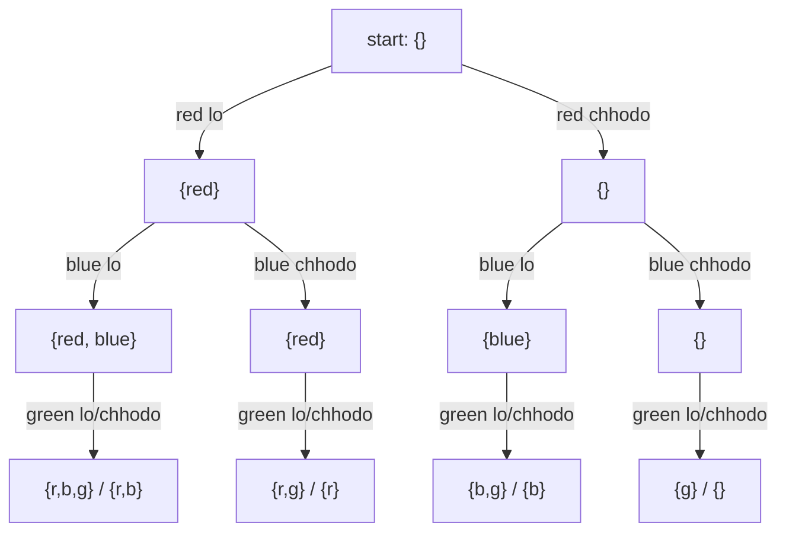
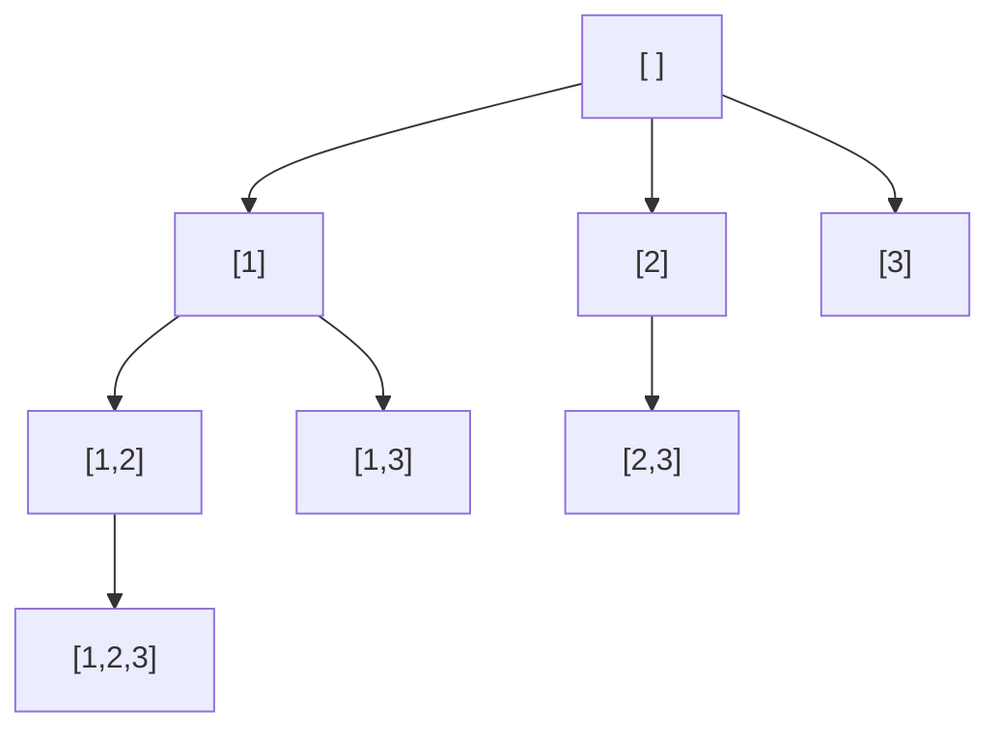
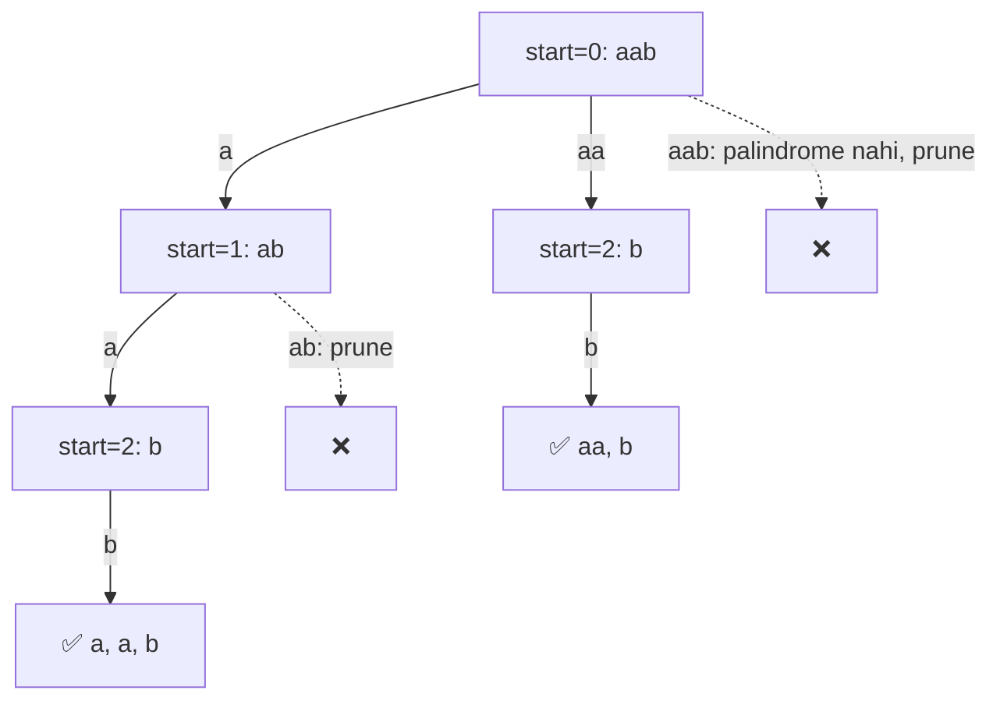

# Chapter 09 · Recursion & Backtracking

> Socho tum ek bhool-bhulaiya (maze) mein ho. Har mod (fork) pe tum ek raasta chunte ho, chalte jaate ho jab tak dead end na aa jaaye, phir **wapas aate ho** pichhle mod tak aur agla raasta try karte ho. Tumhe map ki zaroorat nahi hai. Bas itna yaad rakhna hai ki tum aaye kahan se the. Yahi "try karo, fail ho, ek step peeche aao, phir try karo" wala loop **backtracking** hai. Aur yahi loop Sudoku se lekar N-Queens tak, aur "saare subsets list karo" jaise puzzles solve karta hai.

**Is chapter mein tum seekhoge:**
- Recursion aur call stack ka 5-minute refresher
- Kisi bhi "generate all ..." problem ko **decision tree** ki tarah kaise draw karte hain
- **choose → explore → unchoose** template, jo is chapter ki har problem solve karta hai
- Teen families: **subsets**, **permutations**, **combinations** (aur har ek mein duplicates kaise handle karte hain)
- Classic puzzles: Generate Parentheses, Palindrome Partitioning, Word Search, N-Queens, Sudoku
- **Pruning**: dead branches ko jaldi kaise kaatein. 1 second aur 1 ghante ke beech ka farak yahi hai
- Backtracking solution ki time complexity kaise nikaalte hain

**Isse pehle padho:** [Recursion](../part-1-python/12-recursion.md) · [Functions](../part-1-python/10-functions.md) · [Big-O](01-big-o-complexity.md)

---

## 🧠 The Big Idea · Asli Baat

Tum trip ke liye packing kar rahe ho. Tumhare paas 3 T-shirts hain: red, blue, green. Kitne alag-alag "sets" of T-shirts pack ho sakte hain? Isko ek series of haan/na decisions ki tarah socho. Pehle red ke baare mein decide karo (lun ya na lun), phir blue ke baare mein, phir green ke baare mein:



Upar se neeche tak ka har path ek answer hai. Tree mein 2 × 2 × 2 = 8 leaves hain, isliye 8 subsets hain. Is picture ko **decision tree** kehte hain. Aur har backtracking problem bas itni si hai: **is tree pe chalo, aur jo leaves pasand aayein unhe collect kar lo.**

Lekin jo tree tumne kabhi banaya hi nahi, us pe chaloge kaise? Recursion se. Tum ek node pe khade ho. Ek choice karte ho (ek branch pe neeche jaate ho). Neeche ka saara kaam ek recursive call ko saunp dete ho. Phir **apni choice undo karte ho** aur agli branch try karte ho. Ye undo karna hi backtracking ka "back" hai.

```text
choose   -> put red in the bag
explore  -> recursively decide everything else
unchoose -> take red out of the bag, so the next branch starts clean
```

Hinglish mein yahi teen lines: **choose** = red ko bag mein daalo. **explore** = baaki sab decisions recursion pe chhod do. **unchoose** = red ko bag se wapas nikaalo, taaki agli branch ekdum saaf bag se shuru ho.

> 🇮🇳 **Desi Analogy:** Shaadi ke liye mummy kurta try karwa rahi hain. Ek hi trial room hai, ek hi tum ho. Pehle kurta pehna (**choose**), aaine mein dekha aur us kurte ke saath dupatta, jootiyan, sab combinations check kiye (**explore**), phir kurta **utaara** (**unchoose**) aur agla kurta pehna. Agar tum pehla kurta utaare bina doosra pehen loge, toh do kurte ek saath pehne hoge aur har agla "look" galat dikhega. Trial room = shared `path`. Utaarna = `path.pop()`. Har combination ki photo kheenchna = `path[:]` ki copy save karna, kyunki kurta toh agle second badal jaayega.

> 💡 **The core insight:** backtracking = decision tree ka depth-first walk, jisme **ek hi** shared "current path" hota hai. Neeche jaate waqt usse modify karte ho, upar aate waqt restore karte ho. Asli skill hai tree design karna: "choice" kya hai, aur path "finished" kab maana jaayega?

---

## 🔨 Building It Up · Zero Se Shuru

### 1. Recursion recap in five minutes

**Recursive function** woh function hai jo khud ko call karta hai, problem ke ek chhote version pe. Isme do hisse chahiye:

1. **Base case**: ek itna chhota input jiska answer tum seedha de sakte ho (yahi recursion ko rokta hai).
2. **Recursive case**: problem ko ek chhoti problem mein todo aur us call pe **bharosa** karo ki woh solve kar dega.

```python
def countdown(n):
    if n == 0:                 # base case
        print("liftoff!")
        return
    print(n)
    countdown(n - 1)           # chhoti problem: bharosa karo ki ye kaam karega

def total(nums):
    if not nums:               # base case: kuch nahi ka sum 0 hai
        return 0
    return nums[0] + total(nums[1:])   # pehla element + baaki ka sum

countdown(3)
print(total([4, 5, 6]))
```

```text
3
2
1
liftoff!
15
```

Kya hua yahan: har call apne neeche wali call ke khatam hone ka wait karti hai. Python in waiting calls ko **call stack** pe rakhta hai, har call ka ek **frame**, aur har frame ke apne local variables. Jab base case return karta hai, frames ek-ek karke pop hote hain. Python ki default limit lagbhag 1,000 frames hai (`sys.getrecursionlimit()`). Ye tab matter karta hai jab recursion 10,000 levels gehra jaaye. Backtracking trees usually shallow hote hain (depth ≤ n), isliye ye problem kam hi aati hai.

> 🇮🇳 **Desi Analogy:** Call stack ko canteen mein thaaliyon ka dher samjho. Har nayi call = dher ke upar ek nayi thaali. Thaali uthaoge toh hamesha sabse upar wali (sabse latest call) uthegi. `total([4, 5, 6])` ne `total([5, 6])` ki thaali rakhi, usne `total([6])` ki, usne `total([])` ki. `total([])` ne 0 return kiya, uski thaali hati, phir `[6]` wali ne 6 return kiya, aur aise hi neeche tak: 6, 11, 15.

### 2. Watching the decision tree come alive

Chalo `[1, 2]` ke subsets wala tree print karte hain, indentation se depth dikhegi. Ye wahi include/exclude (lo/chhodo) decision tree hai jo Big Idea mein dekha.

```python
def subsets_traced(nums):
    path = []

    def explore(i, depth):
        pad = "    " * depth
        if i == len(nums):                    # har element ke liye decision ho chuka
            print(pad + "leaf:", path)
            return
        print(pad + f"take {nums[i]}?")
        path.append(nums[i])                  # choose
        explore(i + 1, depth + 1)             # explore
        path.pop()                            # unchoose
        print(pad + f"skip {nums[i]}")
        explore(i + 1, depth + 1)             # doosri branch explore karo

    explore(0, 0)

subsets_traced([1, 2])
```

```text
take 1?
    take 2?
        leaf: [1, 2]
    skip 2
        leaf: [1]
skip 1
    take 2?
        leaf: [2]
    skip 2
        leaf: []
```

Kya hua yahan: poore search ke liye humne **ek hi** list use ki, `path`. "take" branch pe neeche jaate waqt append kiya, wapas upar aate waqt pop kiya. Isliye jab "skip 1" branch shuru hoti hai, `path` phir se khaali hai, bilkul aise jaise "take 1" branch kabhi hui hi nahi. Yahi unchoose ka jaadu hai.

Output ko line-by-line padho aur `path` ko apni ungli pe track karo:

| Output line | `path` us waqt | Kya hua |
|---|---|---|
| `take 1?` | `[]` → `[1]` | 1 ko append kiya |
| `take 2?` | `[1]` → `[1, 2]` | 2 ko append kiya |
| `leaf: [1, 2]` | `[1, 2]` | i == 2, leaf |
| `skip 2` | `[1, 2]` → `[1]` | 2 pop hua, ab bina 2 ke chalo |
| `leaf: [1]` | `[1]` | leaf |
| `skip 1` | `[1]` → `[]` | 1 pop hua |
| `take 2?` ... | `[]` → `[2]` | ab 1 ke bina wali duniya |

### 3. The template: choose → explore → unchoose

Is chapter ki har problem is skeleton mein fit hoti hai:

```py
def backtrack(state):
    if is_complete(state):            # leaf hai: answer ki COPY record karo
        results.append(path[:])
        return
    for choice in choices(state):     # is node se nikalne wali har branch
        if not is_valid(choice):      # pruning: jo branch kaam nahi karegi, skip
            continue
        make(choice)                  # choose
        backtrack(next_state)         # explore
        undo(choice)                  # unchoose
```

Chaar design decisions is template ko solution bana dete hain:

| Decision | Khud se poocho |
|---|---|
| **State** | Har node pe mujhe kya pata hona chahiye? (index, path, used set, remaining sum...) |
| **Choices** | Yahan se kaun-kaun si branches nikalti hain? |
| **Goal** | Path complete answer kab banta hai? |
| **Pruning** | Kab main bina explore kiye bata sakta hoon ki ye branch bekaar hai? |

> 🤔 **Mann mein sawaal:** Ye "state" aur "path" alag kyun hain? Dono same cheez nahi?
>
> **Jawab:** Nahi. `path` woh answer hai jo tum bana rahe ho (jaise `[1, 2]`). State woh extra info hai jo next choices decide karti hai: "agla element kis index se chun sakta hoon" (`start`), "kaun se elements already use ho gaye" (`used`), "target tak pahunchne ke liye kitna bacha" (`remaining`). Path answer hai, state rules hain.

### 4. Subsets

**Problem:** distinct numbers ke saare subsets list karo.

Do natural trees hain. Include/exclude wala tree (section 2) kaam karta hai. Zyada flexible tree hai **"agla element pick karo" tree**: har node pe decide karo ki agla element kaun sa add karna hai, lekin sirf un elements mein se jo pichhle picked element ke **baad** aate hain (taaki `[1, 2]` aur `[2, 1]` dono na aa jaayein). Yahan **har node ek answer hai**, sirf leaves nahi.



```python
def subsets(nums):
    result, path = [], []

    def backtrack(start):
        result.append(path[:])               # har node ek subset hai: copy record karo
        for i in range(start, len(nums)):    # sirf pichhle pick ke baad wale elements
            path.append(nums[i])             # choose
            backtrack(i + 1)                 # explore
            path.pop()                       # unchoose

    backtrack(0)
    return result

print(subsets([1, 2, 3]))
```

```text
[[], [1], [1, 2], [1, 2, 3], [1, 3], [2], [2, 3], [3]]
```

Kya hua yahan: `start` sabse important state hai. Woh kehta hai "tum sirf index `start` se aage wale elements chun sakte ho". Isse guarantee hoti hai ki har subset ek hi baar bane, aur woh bhi increasing index order mein.

Output ka order dekho: `[]`, `[1]`, `[1, 2]`, `[1, 2, 3]`, `[1, 3]`, ... Ye bilkul upar wale diagram ka depth-first walk hai: root, phir sabse left wali branch mein jitna neeche ja sako, phir wapas aake agli branch.

> ⚠️ `result.append(path[:])` likho, `result.append(path)` **nahi**. `path` ek hi list hai jo lagaatar badalti rehti hai. Usse directly append karoge toh `result` mein *usi ek* list ke 8 references store honge, aur end mein woh list khaali ho jaati hai. "Traps" section mein ye disaster live dekhoge.

> 🤔 **Mann mein sawaal:** `path[:]` aur `path` mein farak kya hai? Dono print karo toh same dikhte hain.
>
> **Jawab:** `path` ek naam hai jo memory mein ek list ki taraf point karta hai. `result.append(path)` sirf us list ka "address" save karta hai, photo nahi. Baad mein `path.pop()` hoga toh `result` ke andar wala item bhi badal jaayega, kyunki woh wahi list hai. `path[:]` ek nayi list banata hai jisme abhi ke elements copy hote hain. Woh ek photo hai, jo baad mein nahi badalti.

### 5. Subsets II: with duplicates

**Problem:** `nums = [1, 2, 2]` mein duplicates hain. Saare *unique* subsets return karo. Plain version `[1, 2]` do baar banayega (ek baar pehle 2 se, ek baar doosre 2 se).

**Fix:** pehle sort karo, taaki equal values ek saath baithein. Phir kisi bhi node pe, sibling branches mein har value **sirf ek baar** use karo: `nums[i]` ko skip karo agar woh `nums[i - 1]` ke barabar hai aur `i > start` hai (matlab `nums[i - 1]` isi level pe ek sibling ke roop mein already try ho chuka hai).

```python
def subsets_with_dup(nums):
    nums.sort()                                    # duplicates padosi ban jaate hain
    result, path = [], []

    def backtrack(start):
        result.append(path[:])
        for i in range(start, len(nums)):
            if i > start and nums[i] == nums[i - 1]:
                continue                           # same value is level pe already try ho chuki
            path.append(nums[i])
            backtrack(i + 1)
            path.pop()

    backtrack(0)
    return result

print(subsets_with_dup([1, 2, 2]))
```

```text
[[], [1], [1, 2], [1, 2, 2], [2], [2, 2]]
```

Kya hua yahan: `i > start` hi tricky part hai. Node `[1, 2]` pe (start = 2), doosra 2 us level ki *pehli* choice hai, isliye allowed hai, aur `[1, 2, 2]` milta hai. Lekin root pe, pehle 2 ko branch ki tarah try karne ke baad, doosra 2 ek bilkul identical subtree shuru karega, isliye use skip kar dete hain.

Ek chhota sa picture, root level (start = 0) pe kya hota hai:

| i | nums[i] | i > start? | nums[i] == nums[i-1]? | Result |
|---|---|---|---|---|
| 0 | 1 | nahi | - | branch `[1]` |
| 1 | 2 | haan | nahi (2 ≠ 1) | branch `[2]` |
| 2 | 2 | haan | haan | **skip**, kyunki `[2]` wala subtree ban chuka |

> 💡 **"Skip duplicates among siblings, not along a path."** Matlab: duplicates ko bhaiyon (siblings) ke beech skip karo, ek path ke andar nahi. Ek path pe neeche jaate hue 2 aur phir 2 pick karna bilkul theek hai. Lekin *same* level pe pehli branch 2 aur doosri branch bhi 2, yahi duplicate hai.

> 🇮🇳 **Desi Analogy:** Mohalle ki cricket team ke liye squad chun rahe ho, aur list mein do judwa bhai hain jo bilkul same khelte hain (same value). Selector ka rule hai: "list mein aage chalte jao, har step pe batao squad mein agla banda kaun judega". Root pe tumne pehle judwa ko "agla banda" bana ke try kiya, aur uske neeche saare squads explore ho gaye (jisme dono judwa wala squad bhi aa gaya). Ab root pe hi doosre judwa ko "agla banda" bana ke try karoge, toh neeche bilkul wahi squads dobara banenge, kyunki dono ek jaise hain. Isliye same level pe doosra judwa **skip**. Lekin pehle judwa ke neeche wale level pe doosre judwa ko chunna? Woh "dono judwa squad mein" wala naya squad hai, allowed hai. Same level pe dobara nahi, path ke neeche chalega.

### 6. Permutations

**Problem:** distinct numbers ki saari orderings (arrangements). Ab order matter karta hai, isliye `start` kaam nahi karega: 3 pick karne ke baad bhi humein 1 pick karne ki aazadi chahiye. Iski jagah track karo ki kaun se elements **used** ho chuke hain.

```python
def permute(nums):
    result, path = [], []
    used = [False] * len(nums)

    def backtrack():
        if len(path) == len(nums):          # har element rakh diya: poora permutation
            result.append(path[:])
            return
        for i in range(len(nums)):          # koi bhi unused element agla aa sakta hai
            if used[i]:
                continue
            used[i] = True                  # choose
            path.append(nums[i])
            backtrack()                     # explore
            path.pop()                      # unchoose (state ke DONO hisse!)
            used[i] = False

    backtrack()
    return result

print(permute([1, 2, 3]))
```

```text
[[1, 2, 3], [1, 3, 2], [2, 1, 3], [2, 3, 1], [3, 1, 2], [3, 2, 1]]
```

**Dry run**, pehle kuch steps:

| step | action | path | used |
|---|---|---|---|
| 1 | choose 1 | [1] | T F F |
| 2 | choose 2 | [1, 2] | T T F |
| 3 | choose 3 | [1, 2, 3] | T T T → record |
| 4 | unchoose 3 | [1, 2] | T T F |
| 5 | unchoose 2 | [1] | T F F |
| 6 | choose 3 | [1, 3] | T F T |
| 7 | choose 2 | [1, 3, 2] | T T T → record |

Kya hua yahan: tree mein top pe n choices hain, uske neeche n − 1, aur aise hi: kul n! leaves. Har baar undo karte waqt hum **saari** state undo karte hain jo badli thi (`path` bhi aur `used` bhi).

Step 5 ke baad dhyaan do: `[1]` pe wapas aaye, aur us level ka loop ab `i = 2` pe hai (kyunki `i = 1` yaani 2 wali branch khatam ho chuki). Isliye step 6 mein 3 choose hota hai. Loop variable `i` har frame ka apna hota hai, isliye har level ko yaad rehta hai ki woh kahan tak pahuncha tha.

> 🇮🇳 **Desi Analogy:** Shaadi ki stage pe family photo ke liye 3 kursiyaan hain aur 3 rishtedaar: Chacha, Mama, Fufa. Photographer har possible arrangement ki photo chahta hai. Pehli kursi pe koi bhi baith sakta hai (3 choices). Jo baith gaya, uske naam ke aage register mein tick (`used[i] = True`). Doosri kursi pe sirf bina tick wale (2 choices), teesri pe jo bacha (1 choice). Photo kheenchi (record), phir aakhri banda utha, tick hataya (unchoose), aur agla arrangement. Kul 3 × 2 × 1 = 6 photos. Yahan `start` kyun nahi chalega? Kyunki Fufa ko pehli kursi pe bitha ke bhi Chacha ko doosri kursi pe bithana hai. "Sirf list mein aage walon mein se chuno" wala rule yahan answers kha jaayega.

### 7. Permutations II: with duplicates

**Problem:** `[1, 1, 2]` se 3 unique permutations aane chahiye, 6 nahi.

**Fix:** sort karo, phir `nums[i]` ko skip karo agar woh `nums[i - 1]` ke barabar hai **aur `nums[i - 1]` abhi used nahi hai**. Ye rule identical values ko left-to-right order mein use hone pe majboor karta hai, isliye dono 1 kabhi apne roles swap nahi kar sakte.

```python
def permute_unique(nums):
    nums.sort()
    result, path = [], []
    used = [False] * len(nums)

    def backtrack():
        if len(path) == len(nums):
            result.append(path[:])
            return
        for i in range(len(nums)):
            if used[i]:
                continue
            if i > 0 and nums[i] == nums[i - 1] and not used[i - 1]:
                continue        # pehla judwa free hai: is wale ko pehle use kiya toh duplicate banega
            used[i] = True
            path.append(nums[i])
            backtrack()
            path.pop()
            used[i] = False

    backtrack()
    return result

print(permute_unique([1, 1, 2]))
```

```text
[[1, 1, 2], [1, 2, 1], [2, 1, 1]]
```

Kya hua yahan: dono 1 ko 1ₐ aur 1ᵦ socho. Rule kehta hai "1ᵦ tabhi rakha ja sakta hai jab 1ₐ already rakha ja chuka ho". Isliye sirf woh arrangements allowed hain jisme 1ₐ, 1ᵦ se pehle aata hai. Isse har duplicated pair ke do versions mein se sirf ek bachta hai.

Bina is rule ke 6 permutations bante: `1ₐ1ᵦ2`, `1ᵦ1ₐ2`, `1ₐ21ᵦ`, `1ᵦ21ₐ`, `21ₐ1ᵦ`, `21ᵦ1ₐ`. Print karne pe har pair bilkul same dikhta (`[1, 1, 2]` do baar). Rule ke saath sirf woh teen bachte hain jinme 1ₐ pehle hai.

> 🤔 **Mann mein sawaal:** Subsets II mein rule `i > start` tha, yahan `not used[i - 1]` kyun? Ek hi rule dono jagah kyun nahi?
>
> **Jawab:** Kyunki permutations mein `start` hota hi nahi, har level pe loop `0` se chalta hai. Toh "is level pe ye value pehle try ho chuki?" pata karne ka tareeka alag hai. Agar `nums[i - 1]` (pehla judwa) **used nahi** hai, matlab woh isi level pe ek sibling ki tarah try ho chuka aur wapas free kar diya gaya, toh `nums[i]` ka branch duplicate hoga. Agar `nums[i - 1]` **used hai**, matlab woh path mein upar baitha hai, toh `nums[i]` ko rakhna naya arrangement hai. Idea same hai ("siblings mein duplicate mat karo"), bas check alag hai.

### 8. Combinations

**Problem:** `1..n` mein se `k` numbers chunne ke saare tareeke (order matter nahi karta). Ye subsets hi hai, bas hum sirf length k wale paths record karte hain.

**Pruning:** agar humein `k - len(path)` aur numbers chahiye lekin usse kam bache hain, toh ruk jao. Isliye loop sirf `n - (k - len(path)) + 1` tak jaata hai.

```python
def combine(n, k):
    result, path = [], []

    def backtrack(start):
        if len(path) == k:
            result.append(path[:])
            return
        need = k - len(path)
        for x in range(start, n - need + 2):   # baaki picks ke liye jagah chhodo
            path.append(x)
            backtrack(x + 1)
            path.pop()

    backtrack(1)
    return result

print(combine(4, 2))
print(len(combine(10, 3)))
```

```text
[[1, 2], [1, 3], [1, 4], [2, 3], [2, 4], [3, 4]]
120
```

Kya hua yahan: bina pruning ke bhi code chalta, bas `[4]` jaisi branches explore karta jo kabhi length 2 tak pahunch hi nahi sakti. Bound check karo n = 4, k = 2, khaali path ke saath: need = 2, toh `x` 4 − 2 + 1 = 3 tak jaata hai. 4 se shuru karoge toh uske baad kuch bachega hi nahi. C(10, 3) = 120. ✓

`range(start, n - need + 2)` mein `+2` kahan se aaya? Sabse bada allowed `x` hai `n - need + 1`, aur Python ka `range` end ko exclude karta hai, isliye end ko ek aur badhao: `n - need + 2`. Ye off-by-one yaad rakhne wali cheez hai.

### 9. Combination Sum I, II, III

Teen classic variations, aur har ek mein farak sirf **ek line** ka hai. Farak pakdo.

**Combination Sum (I):** candidates distinct hain, har candidate **unlimited** baar use ho sakta hai, `target` tak pahunchne wale saare combos dhundo. Reuse allowed hai, isliye recurse `i` se karo (`i + 1` se nahi). Sort karne se jaise hi koi candidate bahut bada nikle, hum `break` kar sakte hain.

```python
def combination_sum(candidates, target):
    candidates.sort()
    result, path = [], []

    def backtrack(start, remaining):
        if remaining == 0:
            result.append(path[:])
            return
        for i in range(start, len(candidates)):
            c = candidates[i]
            if c > remaining:
                break                       # sorted hai: baad wale saare bhi bade honge
            path.append(c)
            backtrack(i, remaining - c)     # i, i + 1 nahi: c dobara use ho sakta hai
            path.pop()

    backtrack(0, target)
    return result

print(combination_sum([2, 3, 6, 7], 7))
print(combination_sum([2, 3, 5], 8))
```

```text
[[2, 2, 3], [7]]
[[2, 2, 2, 2], [2, 3, 3], [3, 5]]
```

**Dry run**, `[2, 3, 6, 7]`, target 7 (pehli branches):

| path | remaining | next choices | outcome |
|---|---|---|---|
| [2] | 5 | 2, 3 (6 > 5 → break) | |
| [2, 2] | 3 | 2, 3 | |
| [2, 2, 2] | 1 | 2 > 1 → break | dead end |
| [2, 2, 3] | 0 | | ✅ record |
| [2, 3] | 2 | 3 > 2 → break | dead end |
| [3] | 4 | 3 (6 > 4 → break) | |
| [3, 3] | 1 | 3 > 1 → break | dead end |
| [6] | 1 | 6 > 1 → break | dead end |
| [7] | 0 | | ✅ record |

`[2, 3]` wali row pe dhyaan do: next choices mein 2 nahi hai, sirf 3 se shuru hota hai. Kyunki 3 index 1 pe choose hua tha, toh `start = 1`. Isi wajah se `[3, 2, 2]` jaisa duplicate kabhi nahi banta: combo hamesha non-decreasing order mein banta hai.

> 🇮🇳 **Desi Analogy:** Kirana store pe tumhe exactly ₹7 ka change dena hai, aur galle mein ₹2, ₹3, ₹6, ₹7 ke unlimited sikke/note hain. Kaun-kaun se tareeke hain? ₹2 ka sikka diya, ab bhi ₹5 dene hain, phir se ₹2 de sakte ho (reuse = `i`). Jab bache hue amount se bada note aa gaya (₹6, jab sirf ₹5 bacha hai), toh uske baad wale (₹7) dekhne ka matlab hi nahi, kyunki note chhote se bade order mein rakhe hain (sorted + `break`). Aur "₹3 phir ₹2 phir ₹2" kabhi count nahi hota, kyunki ek baar ₹3 pe aa gaye toh ₹2 wale khaane mein wapas haath nahi daalte (`start`).

**Combination Sum II:** candidates mein duplicates ho sakte hain, har ek **at most once** use hoga, unique combos chahiye. Yaani "recurse `i + 1` se" plus Subsets II wala "duplicate siblings skip karo" rule.

```python
def combination_sum2(candidates, target):
    candidates.sort()
    result, path = [], []

    def backtrack(start, remaining):
        if remaining == 0:
            result.append(path[:])
            return
        for i in range(start, len(candidates)):
            if i > start and candidates[i] == candidates[i - 1]:
                continue                    # duplicate sibling
            if candidates[i] > remaining:
                break
            path.append(candidates[i])
            backtrack(i + 1, remaining - candidates[i])   # i + 1: har ek sirf ek baar
            path.pop()

    backtrack(0, target)
    return result

print(combination_sum2([10, 1, 2, 7, 6, 1, 5], 8))
```

```text
[[1, 1, 6], [1, 2, 5], [1, 7], [2, 6]]
```

Sort ke baad input `[1, 1, 2, 5, 6, 7, 10]` ban jaata hai. `[1, 1, 6]` aaya kyunki doosra 1 path ke neeche pick hua (allowed). Lekin `[1, 7]` sirf ek baar aaya, kyunki root pe doosre 1 se shuru hone wali branch skip ho gayi.

**Combination Sum III:** 1–9 mein se exactly `k` numbers use karo, har ek at most once, jinka sum `n` ho. Do goals ek saath: length k **aur** sum n.

```python
def combination_sum3(k, n):
    result, path = [], []

    def backtrack(start, remaining):
        if len(path) == k:
            if remaining == 0:
                result.append(path[:])
            return                          # length k ho gayi: dono case mein ruk jao
        for x in range(start, 10):
            if x > remaining:
                break
            path.append(x)
            backtrack(x + 1, remaining - x)
            path.pop()

    backtrack(1, n)
    return result

print(combination_sum3(3, 7))
print(combination_sum3(3, 9))
```

```text
[[1, 2, 4]]
[[1, 2, 6], [1, 3, 5], [2, 3, 4]]
```

| Problem | Input mein duplicates? | Reuse? | Recurse with | Extra rule |
|---|---|---|---|---|
| Combination Sum | nahi | haan | `i` | |
| Combination Sum II | haan | nahi | `i + 1` | skip `i > start and c[i] == c[i-1]` |
| Combination Sum III | nahi (1–9) | nahi | `x + 1` | length k pe ruko |

### 10. Letter Combinations of a Phone Number

**Problem:** digits 2–9 purane phone keypad ki tarah letters pe map hote hain. Ek digit string jitni letter strings represent kar sakti hai, sab return karo.

Yahan tree mein har **digit** ka ek level hai, aur branches us digit ke letters hain. Na `start`, na `used`: input mein position hi choices decide karti hai.

```python
def letter_combinations(digits):
    if not digits:
        return []
    keypad = {"2": "abc", "3": "def", "4": "ghi", "5": "jkl",
              "6": "mno", "7": "pqrs", "8": "tuv", "9": "wxyz"}
    result, path = [], []

    def backtrack(i):
        if i == len(digits):
            result.append("".join(path))
            return
        for letter in keypad[digits[i]]:
            path.append(letter)
            backtrack(i + 1)
            path.pop()

    backtrack(0)
    return result

print(letter_combinations("23"))
print(len(letter_combinations("79")))
```

```text
['ad', 'ae', 'af', 'bd', 'be', 'bf', 'cd', 'ce', 'cf']
16
```

Kya hua yahan: "23" ke liye 3 × 3 = 9 strings, "79" ke liye 4 × 4 = 16. Strings ko hum ek **list** mein bana rahe hain aur leaf pe `join` kar rahe hain, kyunki string mein add karne se har baar ek nayi string banti hai (Python strings immutable hain).

> 🇮🇳 **Desi Analogy:** Purane Nokia pe keypad se SMS type karna yaad hai? "2" dabao toh a, b, c. Is problem mein tum har digit pe har possible letter chun rahe ho, bilkul petrol pump ke meter ki tarah: aakhri wala khaana sabse tez ghoomta hai (ad, ae, af), phir pehla khaana ek aage badhta hai (bd, be, bf). Yahi depth-first order hai.

### 11. Generate Parentheses

**Problem:** `n` pairs of parentheses ki saari valid strings.

Har step pe choices: `(` add karo ya `)`. Pruning se string **construction se hi valid** banti hai:
- `(` tabhi add kar sakte ho jab tumne n se kam use kiye hon.
- `)` tabhi add kar sakte ho jab woh kuch close kare: `close < open`.

```python
def generate_parenthesis(n):
    result, path = [], []

    def backtrack(open_count, close_count):
        if len(path) == 2 * n:
            result.append("".join(path))
            return
        if open_count < n:
            path.append("(")
            backtrack(open_count + 1, close_count)
            path.pop()
        if close_count < open_count:
            path.append(")")
            backtrack(open_count, close_count + 1)
            path.pop()

    backtrack(0, 0)
    return result

print(generate_parenthesis(3))
print([len(generate_parenthesis(n)) for n in range(1, 8)])
```

```text
['((()))', '(()())', '(())()', '()(())', '()()()']
[1, 2, 5, 14, 42, 132, 429]
```

Kya hua yahan: hum kabhi invalid string banake phir reject nahi karte; invalid branches mein ghuste hi nahi. Counts 1, 2, 5, 14, 42... famous **Catalan numbers** hain.

Sirf `close < open` kaafi kyun hai? Ek string valid tab hai jab har prefix mein `)` ki ginti `(` se kabhi zyada na ho, aur end mein dono barabar hon. Pehli condition ko `close < open` rule har step pe sambhal leta hai. Doosri apne aap poori hoti hai: leaf pe length 2n hai, `open` max n ho sakta hai, aur `close` kabhi `open` se aage nahi gaya, toh dono exactly n hain.

> 🤔 **Mann mein sawaal:** Saari 2²ⁿ strings bana ke valid wali filter kar lein toh? Simple lagta hai.
>
> **Jawab:** Chalega, lekin bahut bekaar ka kaam hai. n = 10 pe 2²⁰ ≈ 10 lakh strings banengi, aur valid sirf 16,796 hain. Pruning wala version sirf valid prefixes pe chalta hai, toh lagbhag answers jitna hi kaam karta hai. Interview mein filter wala approach bologe toh interviewer turant poochega "can you avoid generating the invalid ones?"

### 12. Palindrome Partitioning

**Problem:** ek string ko aise tukdon mein todo ki har tukda palindrome ho. Saare tareeke return karo. `"aab"` → `[["a","a","b"], ["aa","b"]]`.

Har step pe choice: **agla tukda kahan khatam hoga?** Har possible end position `end` try karo; neeche tabhi jao jab `s[start:end]` palindrome ho.

```python
def partition(s):
    result, path = [], []

    def is_pal(t):
        return t == t[::-1]

    def backtrack(start):
        if start == len(s):                    # poori string kat chuki
            result.append(path[:])
            return
        for end in range(start + 1, len(s) + 1):
            piece = s[start:end]
            if is_pal(piece):                  # prune: sirf palindrome tukde
                path.append(piece)
                backtrack(end)
                path.pop()

    backtrack(0)
    return result

print(partition("aab"))
print(partition("racecar"))
```

```text
[['a', 'a', 'b'], ['aa', 'b']]
[['r', 'a', 'c', 'e', 'c', 'a', 'r'], ['r', 'a', 'cec', 'a', 'r'], ['r', 'aceca', 'r'], ['racecar']]
```

Kya hua yahan: "string ko split karo" wali problems (palindrome partitioning, restore IP addresses, word break II) sab isi shape ki hain: **choice = agle tukde ki length**. Ek optimisation: DP se ek table `is_pal[i][j]` pehle se bana lo ([Chapter 21](21-dp-2d-advanced.md)), taaki har check O(1) ho jaaye.

`"aab"` ka tree aise dikhta hai:



> 🇮🇳 **Desi Analogy:** Halwai ke paas ek lambi barfi ki patti hai aur use tukdon mein kaatna hai. Rule: har tukda "symmetric" hona chahiye (palindrome). Halwai pehla kaat kahan lagaye? 1 cm pe, 2 cm pe, 3 cm pe... har option try karta hai (`end` loop). Jo tukda symmetric nahi, us kaat ko wahin chhod deta hai (prune). Jo theek hai, baaki patti pe yahi process (recursion). Poori patti kat gayi (`start == len(s)`) toh ek valid tareeka note kar lo.

### 13. Word Search

**Problem:** letters ki ek grid mein koi word maujood hai ya nahi? Up/down/left/right chal sakte ho, aur ek path mein har cell sirf ek baar use ho sakta hai.

Har cell se shuru karo. Ek cell se choices hain uske 4 padosi. "Used" ko track karne ke liye cell ko kuch der ke liye `#` se overwrite karte hain (choose), aur baad mein restore karte hain (unchoose).

```python
def exist(board, word):
    rows, cols = len(board), len(board[0])

    def dfs(r, c, i):
        if i == len(word):
            return True                                   # har letter match ho gaya
        if not (0 <= r < rows and 0 <= c < cols) or board[r][c] != word[i]:
            return False                                  # grid ke bahar, ya galat letter
        saved = board[r][c]
        board[r][c] = "#"                                 # choose: used mark karo
        found = (dfs(r + 1, c, i + 1) or dfs(r - 1, c, i + 1) or
                 dfs(r, c + 1, i + 1) or dfs(r, c - 1, i + 1))
        board[r][c] = saved                               # unchoose: restore karo
        return found

    return any(dfs(r, c, 0) for r in range(rows) for c in range(cols))

board = [list("ABCE"), list("SFCS"), list("ADEE")]
print(exist(board, "ABCCED"), exist(board, "SEE"), exist(board, "ABCB"))
```

```text
True True False
```

Kya hua yahan: "ABCB" fail hota hai kyunki C ke paas jo akela B hai, woh pehle hi use ho chuka hai aur `#` se marked hai. Dhyaan do, restore tab bhi hota hai jab `found` True hai, taaki caller ko board bilkul waisa hi mile jaisa tha. Time: L length wale word ke liye O(rows × cols × 3^L) (pehle step ke baad max 3 directions hi nayi hoti hain, chauthi toh wahi cell hai jahan se aaye). Ye grid DFS hai, jisko [Chapter 16](16-graphs-bfs-dfs.md) generalise karta hai.

Grid ko dekh ke "ABCCED" trace karo:

```text
A B C E        A(0,0) -> B(0,1) -> C(0,2)
S F C S        -> C(1,2) -> E(2,2) -> D(2,1)
A D E E
```

> 🤔 **Mann mein sawaal:** `#` lagane ki jagah ek `visited` set kyun nahi use karte?
>
> **Jawab:** Use kar sakte ho, bilkul sahi hai. `visited.add((r, c))` choose, `visited.remove((r, c))` unchoose. `#` wala trick bas extra memory bachata hai aur thoda tez hai, kyunki ek hi check (`board[r][c] != word[i]`) "galat letter" aur "already used" dono pakad leta hai: `#` kisi letter ke barabar nahi hoga. Shart ek hi hai: restore karna kabhi mat bhoolna.

### 14. N-Queens

**Problem:** n × n chessboard pe n queens aise rakho ki koi do ek doosre ko attack na karein (same row, column ya diagonal).

**Tree design:** har row mein ek queen (ek row mein do hongi toh attack karengi). Isliye depth `r` pe decision hai "row r ki queen kis column mein jaaye?". Attacks O(1) mein check karne ke liye teen sets rakho:
- `cols`: jo columns already le liye gaye
- `diag`: "\" diagonal ke har cell ke liye `r - c` same hota hai
- `anti`: "/" diagonal ke har cell ke liye `r + c` same hota hai

```text
r - c values (4x4)        r + c values (4x4)
 0 -1 -2 -3                0  1  2  3
 1  0 -1 -2                1  2  3  4
 2  1  0 -1                2  3  4  5
 3  2  1  0                3  4  5  6
```

Is table ko dhyaan se dekho. Left wali grid mein top-left se bottom-right jaane wali har tirchhi line pe ek hi number hai (jaise saare `0` main diagonal pe). Right wali grid mein top-right se bottom-left jaane wali har line pe ek hi number hai. Kyun? "\" direction mein ek step = row +1 aur column +1, toh `r - c` nahi badalta. "/" direction mein ek step = row +1 aur column −1, toh `r + c` nahi badalta. Isliye ek number poore diagonal ka "naam" ban jaata hai.

```python
def solve_n_queens(n):
    result = []
    queens = []                          # queens[r] = row r wali queen ka column
    cols, diag, anti = set(), set(), set()

    def backtrack(r):
        if r == n:
            result.append(["." * c + "Q" + "." * (n - c - 1) for c in queens])
            return
        for c in range(n):
            if c in cols or (r - c) in diag or (r + c) in anti:
                continue                 # attack ho raha hai: prune
            queens.append(c); cols.add(c); diag.add(r - c); anti.add(r + c)
            backtrack(r + 1)
            queens.pop(); cols.remove(c); diag.remove(r - c); anti.remove(r + c)

    backtrack(0)
    return result

for board in solve_n_queens(4):
    print("\n".join(board))
    print()
print([len(solve_n_queens(n)) for n in range(1, 9)])
```

```text
.Q..
...Q
Q...
..Q.

..Q.
Q...
...Q
.Q..

[1, 0, 0, 2, 10, 4, 40, 92]
```

Kya hua yahan: sets ki wajah se "kya ye square attacked hai?" wala sawaal O(n) scan se O(1) lookups ban jaata hai. 8 × 8 board ka famous answer: **92** solutions.

> 🇮🇳 **Desi Analogy:** Cinema hall mein 4 rows hain aur 4 jhagdaalu rishtedaar, jo ek doosre ko na same row mein, na same column mein, na tirchhi line mein dekhna chahte hain. Usher row-by-row seat deta hai: row 0 mein kisi ko bithaya, register mein us column aur dono tirchhi lines pe "booked" likh diya (teen sets). Row 1 mein sirf woh seat do jo kisi register mein booked nahi. Kisi row mein koi seat nahi bachi? Pichhli row wale ko utha ke agli seat pe bhejo (backtrack), aur uski entries register se mitao.

### 15. Sudoku Solver

**Problem:** 9 × 9 grid aise bharo ki har row, column aur 3 × 3 box mein 1–9 exactly ek-ek baar aaye.

**Tree design:** khaali cells dhundo; har khaali cell pe 1–9 mein se woh digits try karo jo koi rule na todein. Har row, har column aur har box ke used digits ke sets rakho, taaki har check O(1) ho. Box index: `(r // 3) * 3 + c // 3`.

Box index ka formula samjho: `r // 3` batata hai ki cell boxes ki kaunsi "band" (0, 1, 2) mein hai, `c // 3` batata hai kaunsa "stack" (0, 1, 2). Band × 3 + stack = 0 se 8 tak ek unique number. Jaise cell (4, 7): band 1, stack 2, box = 1 × 3 + 2 = 5 (beech wali row ka right wala box).

```python
def solve_sudoku(board):
    rows = [set() for _ in range(9)]
    cols = [set() for _ in range(9)]
    boxes = [set() for _ in range(9)]
    empty = []
    for r in range(9):
        for c in range(9):
            d = board[r][c]
            if d == ".":
                empty.append((r, c))
            else:
                rows[r].add(d); cols[c].add(d); boxes[(r // 3) * 3 + c // 3].add(d)

    def backtrack(k):
        if k == len(empty):
            return True                          # har khaali cell bhar gaya
        r, c = empty[k]
        b = (r // 3) * 3 + c // 3
        for d in "123456789":
            if d in rows[r] or d in cols[c] or d in boxes[b]:
                continue
            board[r][c] = d
            rows[r].add(d); cols[c].add(d); boxes[b].add(d)
            if backtrack(k + 1):
                return True                      # solve ho gaya: search roko, board waisa hi rakho
            board[r][c] = "."
            rows[r].remove(d); cols[c].remove(d); boxes[b].remove(d)
        return False                             # koi digit fit nahi: caller ko backtrack karne bolo

    backtrack(0)

puzzle = ["53..7....", "6..195...", ".98....6.", "8...6...3", "4..8.3..1",
          "7...2...6", ".6....28.", "...419..5", "....8..79"]
board = [list(row) for row in puzzle]
solve_sudoku(board)
for row in board:
    print("".join(row))
```

```text
534678912
672195348
198342567
859761423
426853791
713924856
961537284
287419635
345286179
```

Kya hua yahan: ye **"find one"** backtrack hai, "find all" nahi. Jaise hi ek solution milta hai, function True return karta hai, aur woh True bina kuch undo kiye upar tak bubble hota hai, isliye bhara hua board bach jaata hai. Agar kisi cell ke liye koi legal digit nahi hai, toh woh False return karta hai, aur caller apni choice undo karke agla digit try karta hai.

> 🤔 **Mann mein sawaal:** "Find all" problems mein `return` kuch nahi karta tha, yahan `return True` kyun?
>
> **Jawab:** "Find all" mein humein poora tree ghoomna hai, isliye har leaf ke baad wapas aake agli branch try karte hain. "Find one" mein pehla answer milte hi kaam khatam. `if backtrack(k + 1): return True` matlab "neeche wale ne solve kar diya? toh main bhi undo kiye bina seedha upar bata deta hoon". Agar yahan bhi undo kar dete, toh solution mil ke bhi board wapas khaali ho jaata.

---

## 🔬 Under the Hood · Andar Ki Kahani

### Why one shared `path` works (and why we copy at the leaves)

Poore search ke liye memory mein `path` ki **ek hi** list hai. Call stack ka har frame usi object ko dekhta hai. Ye efficient hai (har step pe copy nahi), aur sahi isliye hai kyunki ek simple promise nibhaya jaata hai: **har function call `path` ko bilkul waisa hi chhod ke jaati hai jaisa use mila tha.** Choose aur unchoose hamesha matched pairs mein aate hain, brackets ki tarah.

Leaf pe `path` mein *is waqt* ek answer hai, lekin agle hi microsecond mein woh badal jaayega. Isliye hum ek **snapshot** store karte hain: `path[:]` (ya `list(path)`, ya strings ke liye `"".join(path)`). Us snapshot ki cost O(length of path) hai, jo neeche wali complexity ka hissa hai.

Doosra style hai har call ko nayi list pass karna: `backtrack(i + 1, path + [x])`. Isme undo ki zaroorat nahi, kyunki har call ko apni copy milti hai, lekin har step pe path copy hota hai. Chhote inputs ke liye theek hai, aur kuch logon ko ye padhne mein aasaan lagta hai.

| Style | Undo chahiye? | Har step ki cost | Kab use karo |
|---|---|---|---|
| Shared `path` + append/pop | haan | O(1) | default, interview mein sabse common |
| Naya list pass karo (`path + [x]`) | nahi | O(len(path)) copy | chhote inputs, ya jab undo confuse kare |

### Memory: O(depth)

Call stack tree ke har level ke liye ek frame rakhta hai, isliye extra space **O(depth)** hai: subsets aur permutations ke liye O(n), Combination Sum ke liye O(target / smallest candidate), Sudoku ke liye 81. Output khud exponential ho sakta hai, lekin usse usually "extra" space mein nahi gina jaata.

### Complexity analysis: count the nodes

Kisi backtracking algorithm ka time roughly hota hai:

> **(tree mein nodes ki ginti) × (har node pe kaam)**, plus har answer copy karne ki cost.

| Problem | Leaves / answers | Work per answer | Time |
|---|---|---|---|
| Subsets | 2ⁿ | copy O(n) | **O(n · 2ⁿ)** |
| Permutations | n! | copy O(n) | **O(n · n!)** |
| Combinations C(n, k) | C(n, k) | copy O(k) | **O(k · C(n, k))** |
| Letter Combinations | up to 4ⁿ | join O(n) | **O(n · 4ⁿ)** |
| Generate Parentheses | Catalan(n) ≈ 4ⁿ / (n^1.5 √π) | O(n) | **O(4ⁿ / √n)** |
| Palindrome Partitioning | up to 2ⁿ⁻¹ cut patterns | O(n) checks per piece | **O(n · 2ⁿ)** |
| Word Search | per start: 4 · 3^(L−1) paths | O(1) | **O(R · C · 3^L)** |
| N-Queens | ≤ n · (n−1) · (n−2) ... | O(1) with sets | **O(n!)** (practice mein kaafi kam) |
| Sudoku (m empty cells) | ≤ 9^m | O(1) with sets | **O(9^m)** (pruning se fast) |

Subsets tree 2ⁿ kyun hai? Har element ke paas do choices hain (andar ya bahar), aur choices multiply hoti hain: 2 × 2 × ... n baar. Permutations ke liye n! kyun? Pehli slot ke liye n choices, doosri ke liye n − 1, ... aakhri ke liye 1. Sabko multiply karo.

Palindrome Partitioning mein 2ⁿ⁻¹ kyun? n characters ke beech n − 1 "gaps" hain, aur har gap pe kaat lagao ya na lagao: 2 choices. Isliye max 2ⁿ⁻¹ tareeke (jaise `"aaaa"` ke saare tukde palindrome hain, toh saare 2³ = 8 tareeke valid).

Tum output ke size ko **beat nahi kar sakte**: agar answer mein 2ⁿ subsets hain, toh koi bhi algorithm unhe likhne mein kam se kam 2ⁿ steps lagayega. Isiliye interviewers yahan exponential time accept karte hain, aur isiliye inputs chhote hote hain (permutations ke liye n ≤ 10, subsets ke liye n ≤ 20).

### Why pruning matters so much

Pruning single nodes nahi, poore **subtrees** hataati hai. n = 10 wale permutation tree mein depth 2 pe ek branch kaati, toh ek `continue` se 8! = 40,320 leaves gayab. N-Queens mein agar har row mein ek queen rakho lekin koi column/diagonal check na karo, toh saare 8⁸ ≈ 1.67 crore (16.7 million) placements explore honge; checks ke saath, n = 8 ke liye search lagbhag 2,000 nodes hi chhoota hai. Worst-case big-O aksar same rehta hai, lekin asli running time kai orders of magnitude gir jaata hai.

> 🇮🇳 **Desi Analogy:** IRCTC pe Tatkal booking ke time tum har train ki har class ka har coach nahi kholte. Pehle hi dikh gaya "Sleeper: REGRET/WL 200", toh poore sleeper class ka subtree chhod diya, seedha agli class. Ek nazar mein hazaaron seats ka check skip. Pruning yahi hai: jaldi pehchano ki branch bekaar hai, aur uske neeche jaao hi mat.

---

## 🧩 Pattern Decoder · Pattern Pakdo

### Signals: when to reach for backtracking

| Problem mein dikhe... | Socho |
|---|---|
| "return **all** subsets / combinations / permutations" | Backtracking (subset / permutation family) |
| "generate all valid ..." (parentheses, IP addresses, words) | Backtracking with validity pruning |
| "all ways to split / partition a string" | Choice = agle tukde ki length |
| "place items so that no two conflict" (queens, sudoku, coloring) | Constraint satisfaction: try, check, undo |
| "find a path in a grid using each cell once" | Grid DFS with mark / unmark |
| chhote constraints: n ≤ 10, n ≤ 15, n ≤ 20 | Exponential allowed hai → backtracking |
| bade n ke saath "**count** the ways" ya "**min/max** ..." | Shayad DP ([Chapter 20](20-dp-1d.md)), backtracking nahi |

### The master template

```py
def solve(input_data):
    result, path = [], []

    def backtrack(state):
        if goal_reached(state):
            result.append(path[:])          # SNAPSHOT, live list kabhi nahi
            return                          # (agar har node answer hai toh return hata do)
        for choice in choices(state):
            if not valid(choice, state):    # jitna jaldi ho sake PRUNE karo
                continue                    # (ya break, agar choices sorted hain)
            path.append(choice)             # CHOOSE
            backtrack(next_state(state, choice))   # EXPLORE
            path.pop()                      # UNCHOOSE: jo badla sab restore karo

    backtrack(initial_state)
    return result
```

### The three families decoded

| Family | Order matters? | State | Loop | Recurse with | Answer recorded |
|---|---|---|---|---|---|
| **Subsets** | nahi | `start` | `for i in range(start, n)` | `i + 1` | har node pe |
| **Combinations** (size k / target sum) | nahi | `start`, remaining | same | `i + 1` (ya reuse ho toh `i`) | jab size ya sum goal pe pahunche |
| **Permutations** | haan | `used[]` | `for i in range(n)`, used skip karo | (koi index nahi) | jab `len(path) == n` |
| **Position-based** (phone, sudoku, N-Queens) | fixed slots | current position | is slot ki choices | position + 1 | jab saare slots bhar jaayein |
| **Split a string** | fixed order | `start` | `for end in range(start+1, n+1)` | `end` | jab `start == n` |

### Handling duplicates: the one rule

Pehle sort karo, phir:

| Family | Skip condition | Matlab |
|---|---|---|
| Subsets / Combinations | `i > start and nums[i] == nums[i-1]` | same value is level pe sibling ki tarah already try ho chuki |
| Permutations | `i > 0 and nums[i] == nums[i-1] and not used[i-1]` | equal values left to right order mein hi use honi chahiye |

### Variation: Restore IP Addresses (split-a-string family)

**Problem:** ek digit string mein teen dots lagao taaki valid IPv4 addresses banein (4 parts, har part 0–255, leading zero nahi chalega jab tak part exactly "0" na ho).

**Idea:** choice = agle part ki length (1, 2 ya 3). Prune karo agar part invalid hai, ya bache hue digits bache hue parts ko bhar hi nahi sakte (har part ko 1–3 digits chahiye).

```python
def restore_ip_addresses(s):
    result, parts = [], []

    def backtrack(start):
        if len(parts) == 4:
            if start == len(s):
                result.append(".".join(parts))
            return
        remaining_parts = 4 - len(parts)
        remaining_chars = len(s) - start
        if not (remaining_parts <= remaining_chars <= 3 * remaining_parts):
            return                                  # prune: khatam karna impossible hai
        for length in (1, 2, 3):
            piece = s[start:start + length]
            if len(piece) < length:
                break
            if (piece[0] == "0" and length > 1) or int(piece) > 255:
                continue                            # leading zero ya bahut bada
            parts.append(piece)
            backtrack(start + length)
            parts.pop()

    backtrack(0)
    return result

print(restore_ip_addresses("25525511135"))
print(restore_ip_addresses("0000"))
print(restore_ip_addresses("101023"))
```

```text
['255.255.11.135', '255.255.111.35']
['0.0.0.0']
['1.0.10.23', '1.0.102.3', '10.1.0.23', '10.10.2.3', '101.0.2.3']
```

Tree mein max 3⁴ = 81 leaves hain, isliye practically ye O(1) hai.

Feasibility check ko ek example se samjho: `"25525511135"` (11 digits). Pehla part `"2"` liya toh 10 digits bache aur 3 parts bache. 3 parts max 9 digits le sakte hain, 10 > 9, toh ye branch turant prune. Bina loop chalaye hi pata chal gaya.

### Variation: Partition to K Equal Sum Subsets (bucket filling)

**Problem:** kya `nums` ko `k` aise groups mein baanta ja sakta hai jinke sums barabar hon?

**Idea:** har group ka sum `target = sum / k` hona chahiye. Numbers ko ek-ek karke k buckets mein daalo. Pruning tricks jo isse fast banati hain:
1. **Descending** sort karo: bade numbers jaldi fail hote hain.
2. Agar ek bucket khaali hai aur number wahan daalna fail ho gaya, toh baaki khaali buckets try mat karo: woh sab identical hain.

```python
def can_partition_k_subsets(nums, k):
    total = sum(nums)
    if total % k:
        return False
    target = total // k
    nums = sorted(nums, reverse=True)       # bade pehle: jaldi fail
    if nums[0] > target:
        return False
    buckets = [0] * k

    def backtrack(i):
        if i == len(nums):
            return True                      # har number rakh diya; saare sums target hi honge
        for b in range(k):
            if buckets[b] + nums[i] <= target:
                buckets[b] += nums[i]
                if backtrack(i + 1):
                    return True
                buckets[b] -= nums[i]
            if buckets[b] == 0:
                break                        # khaali buckets aapas mein interchangeable hain
        return False

    return backtrack(0)

print(can_partition_k_subsets([4, 3, 2, 3, 5, 2, 1], 4))
print(can_partition_k_subsets([1, 2, 3, 4], 3))
```

```text
True
False
```

Worst case O(kⁿ), lekin pruning ki wajah se typical inputs (n ≤ 16) turant solve ho jaate hain.

"Saare sums target hi honge" kyun pakka hai? Kyunki koi bucket kabhi target se zyada nahi bhara (`<= target` check), aur saare numbers ka total exactly `k × target` hai. Agar ek bhi bucket target se kam hota, toh kisi doosre ko target se zyada hona padta, jo impossible hai.

> 🇮🇳 **Desi Analogy:** Shaadi ke baad mithai ke dibbe 4 rishtedaaron mein barabar weight se baantne hain. Sabse bhaari dibba pehle rakho (agar woh hi fit nahi hota toh jaldi pata chal jaayega). Aur agar pehle khaali thaile mein ye dibba rakhna kaam nahi aaya, toh doosre khaali thaile mein rakh ke try karna bekaar hai, sab khaali thaile ek jaise hi toh hain.

### Pruning strategies, collected

1. **Sort + break.** Agar candidates sorted hain aur ye wala already bahut bada hai, toh baad wale saare bhi bade honge. `break` karo, `continue` nahi.
2. **Feasibility bounds.** "Size k tak pahunchne ke liye elements kam bache hain", "bache hue digits bache hue IP parts nahi bhar sakte". Loop se pehle check karo.
3. **Constraint sets.** Jo use ho chuka (columns, diagonals, row digits) uske sets/arrays rakho taaki validity O(1) ho.
4. **Validity by construction.** Generate Parentheses kabhi invalid prefix banata hi nahi.
5. **Symmetry breaking.** Identical buckets, duplicate values: har "kind" ki choice ek level pe sirf ek baar try karo.
6. **Fail-first ordering.** Sabse zyada constrained item pehle rakho (bade numbers pehle; Sudoku mein woh cell jiske options sabse kam hain).
7. **Pehle solution pe ruk jao** jab sirf ek chahiye: True return karo aur upar propagate karo.
8. **Memoise** karo agar same state baar-baar aa rahi hai. Us point pe tum DP kar rahe ho ([Chapter 20](20-dp-1d.md)).

### When NOT to use backtracking

- **Ways count karna** jab n bada ho ("50 seedhiyan chadhne ke kitne tareeke"): count astronomically bada ho sakta hai, lekin DP se O(n) mein nikal jaata hai.
- **Overlapping subproblems wala optimisation** (minimum coins, longest subsequence): DP.
- **Greedy choice provably optimal hai** ([Chapter 22](22-greedy-intervals.md)).
- **Grid/graph mein shortest path:** BFS ([Chapter 16](16-graphs-bfs-dfs.md)). Backtracking har path explore karta hai, BFS seedha shortest wala dhundta hai.
- **n bada hai** (subsets ke liye n > 25, permutations ke liye n > 11) aur problem sab kuch list karne ko nahi keh rahi: koi smarter pattern dhundo.

---

## ⚠️ Traps & Common Mistakes · Yahan Sab Phisalte Hain

1. **Copy ki jagah live list append kar dena.**

```python
def broken_subsets(nums):
    result, path = [], []
    def backtrack(start):
        result.append(path)                 # ❌ har baar wahi list object
        for i in range(start, len(nums)):
            path.append(nums[i]); backtrack(i + 1); path.pop()
    backtrack(0)
    return result

def fixed_subsets(nums):
    result, path = [], []
    def backtrack(start):
        result.append(path[:])              # ✅ snapshot
        for i in range(start, len(nums)):
            path.append(nums[i]); backtrack(i + 1); path.pop()
    backtrack(0)
    return result

print(broken_subsets([1, 2]))
print(fixed_subsets([1, 2]))
```

```text
[[], [], [], []]
[[], [1], [1, 2], [2]]
```

Broken version mein `result` ke andar 4 alag lists nahi hain, ek hi list ke 4 "address" hain. Search khatam hone pe saare pops ho chuke, list khaali hai, toh chaaron jagah `[]` dikhta hai. Jaise WhatsApp pe kisi ko live location bhejo vs screenshot: live location baad mein badal jaati hai, screenshot nahi.

2. **State ka ek hissa undo karna bhool jaana.** N-Queens mein tum chaar cheezein badalte ho (queens, cols, diag, anti); chaaron undo karo. Permutations mein `path` aur `used` dono undo karo.
3. **Permutations ke liye `start` use karna** (ya subsets ke liye `used`). Subsets/combinations: "sirf aage dekho" (`start`). Permutations: "jo bhi used nahi hai" (`used`).
4. Combination Sum mein **`i` vs `i + 1`**. `i` matlab "ye element dobara use ho sakta hai"; `i + 1` matlab "har element at most once". Gadbad karoge toh ya toh recursion infinite jaisi lagegi, ya answers missing honge.
5. Subsets II mein **duplicates `i > start` ki jagah `i > 0` se skip karna**. `i > 0` valid paths jaise `[2, 2]` ko bhi skip kar deta hai, kyunki woh sirf siblings mein nahi, path ke neeche bhi skip karta hai.
6. **Duplicate rule se pehle sort karna bhool jaana.** Rule tabhi kaam karta hai jab equal values padosi hon.
7. **Jahan `break` chalta wahan `continue` (ya ulta).** `break` tabhi safe hai jab candidates sorted hon aur condition baad wale har candidate ke liye bhi sach ho.
8. Word Search mein early return karte waqt **grid restore na karna**. Agar restore se pehle `return True` kar diya, toh caller ka board kharab ho jaata hai. Pehle `found` compute karo, restore karo, phir return.
9. **Mutable default arguments:** `def backtrack(path=[])` outer function ki saari calls mein ek hi list share karta hai. `path` ko outer function ke andar banao.
10. Deep recursion mein **`+=` se strings banana.** Har `+=` string copy karta hai. List use karo aur leaf pe `"".join` karo (ya `s + ch` pass karo, jo chhoti strings ke liye theek hai).

---

## 💡 Tips & Tricks · Pro Wale Moves

- **Pehle chhote input ke liye tree draw karo** (2 ya 3 elements). Edges pe choices likho. Code us drawing ka seedha translation hai.
- **Chaar decisions zor se bolo**: state, choices, goal, pruning.
- **"Order matters?"** ek second mein family decide kar deta hai: nahi → `start`, haan → `used`.
- **Duplicates?** Sort karo, phir ek-line ka skip rule.
- **"Find one" vs "find all":** ek chahiye toh boolean return karo aur True pe ruk jao. Saare chahiye toh collect karte raho aur chalte raho.
- `itertools.combinations`, `itertools.permutations` aur `itertools.product` exist karte hain aur real code mein bahut kaam ke hain, lekin interviewers dekhna chahte hain ki backtracking tum khud likh sakte ho.
- O(1) validity checks ke liye **sets ya boolean arrays** use karo. Kuch used hai ya nahi, ye dekhne ke liye path ko kabhi scan mat karo.
- Agar tumhara recursion same `(index, remaining)` state baar-baar explore kar raha hai, toh `@functools.lru_cache` laga do: tumne abhi backtracking ko DP bana diya.
- Jab poocha jaaye "what's the complexity?", toh **"number of leaves × cost per leaf"** se answer do aur number ka naam lo: 2ⁿ, n!, C(n, k), 4ⁿ.

---

## 🎯 Interview Questions · Interview Mein Yahi Poochenge

### 1. Subsets 🔥🔥🔥

<details><summary>Answer dekho 👀</summary>

Start-index backtracking, har node record karo (section 4). Time O(n · 2ⁿ), space O(n) recursion depth. **Bitmask** alternative bhi zaroor mention karo: 0 se 2ⁿ − 1 tak ka har number ek subset hai (bit i set = `nums[i]` include karo).

```python
def subsets_bitmask(nums):
    n = len(nums)
    return [[nums[i] for i in range(n) if mask >> i & 1] for mask in range(1 << n)]

print(subsets_bitmask([1, 2, 3]))
```

```text
[[], [1], [2], [1, 2], [3], [1, 3], [2, 3], [1, 2, 3]]
```

Bitmask ko aise padho: `mask = 5` binary mein `101` hai. Bit 0 set (nums[0] = 1 lo), bit 1 off (2 chhodo), bit 2 set (3 lo) → `[1, 3]`. `mask >> i & 1` bas "kya bit i on hai?" poochta hai.

> 🗣️ **Interview mein aise bolo:** "I'll backtrack with a start index: at every node I record a copy of the current path, then try adding each later element and undo it after recursing. That generates each subset exactly once. There are 2^n subsets and copying each costs O(n), so it's O(n · 2^n) time and O(n) recursion depth. An iterative alternative is a bitmask from 0 to 2^n − 1."

</details>

### 2. Subsets II 🔥🔥

<details><summary>Answer dekho 👀</summary>

Sort karo, phir `nums[i]` skip karo agar `i > start and nums[i] == nums[i-1]` (section 5). Time O(n · 2ⁿ), space O(n). Interview ka key sentence: "I skip duplicates among siblings at the same level, never along a single path."

</details>

### 3. Permutations 🔥🔥🔥

<details><summary>Answer dekho 👀</summary>

`used[]` array, record jab `len(path) == n` (section 6). Time O(n · n!), space O(n). Ek swap-based version bhi hai: `nums[start]` ko har `nums[i]` (jahan `i >= start`) se swap karo, `start + 1` pe recurse karo, wapas swap karo. Isme `used` array nahi chahiye.

```python
def permute_swap(nums):
    result = []

    def backtrack(start):
        if start == len(nums):
            result.append(nums[:])
            return
        for i in range(start, len(nums)):
            nums[start], nums[i] = nums[i], nums[start]   # is slot ke liye nums[i] choose karo
            backtrack(start + 1)
            nums[start], nums[i] = nums[i], nums[start]   # unchoose

    backtrack(0)
    return result

print(permute_swap([1, 2, 3]))
```

```text
[[1, 2, 3], [1, 3, 2], [2, 1, 3], [2, 3, 1], [3, 2, 1], [3, 1, 2]]
```

Output order dhyaan se dekho: aakhri do `[3, 2, 1], [3, 1, 2]` hain, `used` wale version se ulte. Swap karne se baaki elements ka order thoda hil jaata hai. Answers wahi 6 hain, bas order alag. Agar interviewer sorted order maange toh `used` wala version use karo.

> 🗣️ **Interview mein aise bolo:** "I'll build the permutation slot by slot, using a boolean used array so any unused element can go next. When the path length equals n I record a copy, and after each recursive call I undo both the path and the used flag. There are n! permutations, each copied in O(n), so time is O(n · n!) and the recursion depth is O(n)."

</details>

### 4. Permutations II 🔥🔥

<details><summary>Answer dekho 👀</summary>

Sort karo, phir skip karo agar `nums[i] == nums[i-1] and not used[i-1]` (section 7). Time O(n · n!), space O(n). Rule ko aise explain karo: "identical values must be placed in left-to-right order."

</details>

### 5. Combinations 🔥🔥

<details><summary>Answer dekho 👀</summary>

Start-index backtracking, "enough elements left" wali pruning ke saath (section 8). Time O(k · C(n, k)), space O(k).

</details>

### 6. Combination Sum 🔥🔥🔥

<details><summary>Answer dekho 👀</summary>

Sort karo, `i` se recurse karo (reuse allowed), aur jab candidate remaining sum se bada ho toh `break` (section 9). Time exponential hai: roughly O(n^(T/m)) jahan T target hai aur m sabse chhota candidate (tree ki depth max T/m hai, kyunki har step pe kam se kam m ghatta hai). Space O(T/m).

> 🗣️ **Interview mein aise bolo:** "I sort the candidates and backtrack with a start index and the remaining sum. Since each number can be reused, I recurse with the same index i, and because the list is sorted I break as soon as a candidate exceeds the remaining sum. The tree depth is at most target divided by the smallest candidate, so it's exponential, roughly O(n^(T/m)), with O(T/m) recursion space."

</details>

### 7. Combination Sum II 🔥🔥

<details><summary>Answer dekho 👀</summary>

Sort karo, `i + 1` se recurse karo, duplicate siblings skip karo, bahut bade pe break (section 9). Time O(n · 2ⁿ) worst case, space O(n).

</details>

### 8. Letter Combinations of a Phone Number 🔥🔥🔥

<details><summary>Answer dekho 👀</summary>

Har digit ke liye ek recursion level, us digit ke letters pe branch (section 10). Time O(n · 4ⁿ) (7 aur 9 ke chaar letters hain), space O(n). Empty input handle karo: `[]` return karo, `[""]` nahi.

> 🗣️ **Interview mein aise bolo:** "This is position-based backtracking: one recursion level per digit, and at each level I branch over that digit's letters. I build the string in a list and join it at the leaf. Each digit has at most four letters, so there are up to 4^n strings of length n, giving O(n · 4^n) time and O(n) depth. For empty input I return an empty list."

</details>

### 9. Generate Parentheses 🔥🔥🔥

<details><summary>Answer dekho 👀</summary>

`(` add karo jab tak `open < n`; `)` add karo jab tak `close < open` (section 11). Har leaf construction se hi valid hai. Time O(4ⁿ / √n) (answers ki ginti Catalan number hai × har ek O(n)), space O(n).

> 🗣️ **Interview mein aise bolo:** "I track how many open and close brackets I've used. I may add an open bracket while open is less than n, and a close bracket only while close is less than open, so every string I build is valid by construction and nothing is filtered later. The number of answers is the nth Catalan number, about 4^n over n to the 1.5, so total time is O(4^n / √n) with O(n) recursion depth."

</details>

### 10. Palindrome Partitioning 🔥🔥

<details><summary>Answer dekho 👀</summary>

Choice = agle tukde ka end; recurse sirf tab karo jab tukda palindrome ho (section 12). Time O(n · 2ⁿ), space O(n). Improvement: DP se `is_pal[i][j]` pehle bana lo taaki har check O(1) ho.

</details>

### 11. Word Search 🔥🔥🔥

<details><summary>Answer dekho 👀</summary>

Har cell se DFS, `#` se mark, baad mein restore (section 13). Time O(R · C · 3^L), space O(L). Interviewers ko pasand aane wali pruning: agar board mein kisi letter ki copies word ki zaroorat se kam hain, toh turant False return karo; aur agar word ka last letter pehle letter se rare hai, toh reversed word search karo (kam starting points, chhota tree).

> 🗣️ **Interview mein aise bolo:** "I run a DFS from every cell. At each step I check bounds and that the letter matches, then temporarily mark the cell with a hash so it can't be reused, explore the four neighbours, and restore the cell before returning. After the first letter each step has at most three new directions, so it's O(R · C · 3^L) time and O(L) recursion space. A cheap pre-check on letter counts can reject impossible words immediately."

</details>

### 12. N-Queens 🔥🔥

<details><summary>Answer dekho 👀</summary>

Har row mein ek queen, columns ke liye set, aur `r - c` aur `r + c` diagonals ke liye sets (section 14). Time O(n!), space O(n). **N-Queens II** sirf count poochta hai: same code, boards banane ki jagah counter badhao.

</details>

### 13. Sudoku Solver 🔥🔥

<details><summary>Answer dekho 👀</summary>

Row/column/box sets, har khaali cell mein digits try karo, solve ho jaaye toh stack mein upar True return karo (section 15). m khaali cells ke liye worst case time O(9^m), space O(m). Ek strong follow-up answer: hamesha woh khaali cell agla bharo jiske legal digits **sabse kam** hain ("most constrained variable" heuristic). Isse tree bahut chhota ho jaata hai.

</details>

### 14. Restore IP Addresses 🔥🔥

<details><summary>Answer dekho 👀</summary>

Split-a-string backtracking: part lengths 1–3, leading zeros aur 255 se bade values reject, aur prune jab bachi hui length bache hue parts mein fit na ho. Poora code Pattern Decoder mein hai. Time O(3⁴) = O(1), space O(1).

</details>

### 15. Letter Case Permutation 🔥

Har letter ka case badal ke banne wali saari strings return karo. `"a1b2"` → `["a1b2", "a1B2", "A1b2", "A1B2"]`.

<details><summary>Answer dekho 👀</summary>

Position-based: har letter pe lower aur upper mein branch karo; digits ki ek hi branch hai.

```python
def letter_case_permutation(s):
    result, path = [], []

    def backtrack(i):
        if i == len(s):
            result.append("".join(path))
            return
        options = [s[i].lower(), s[i].upper()] if s[i].isalpha() else [s[i]]
        for ch in options:
            path.append(ch)
            backtrack(i + 1)
            path.pop()

    backtrack(0)
    return result

print(letter_case_permutation("a1b2"))
```

```text
['a1b2', 'a1B2', 'A1b2', 'A1B2']
```

L letters ke liye time O(n · 2^L), space O(n).

</details>

---

## 🏋️ Practice · Ab Tumhari Baari

**🟢 1. All binary strings** of length n. n = 3 → `000, 001, ..., 111`.

<details><summary>Solution dekho 👀</summary>

Position-based family: har position pe do choices, `0` ya `1`.

```python
def binary_strings(n):
    result, path = [], []

    def backtrack():
        if len(path) == n:
            result.append("".join(path))
            return
        for bit in "01":
            path.append(bit)
            backtrack()
            path.pop()

    backtrack()
    return result

print(binary_strings(3))
```

```text
['000', '001', '010', '011', '100', '101', '110', '111']
```

</details>

**🟢 2. Subsets of size exactly k** distinct items ki list se. `["a", "b", "c", "d"]`, k = 3.

<details><summary>Solution dekho 👀</summary>

Ye Combinations hi hai, bas input alag: record sirf jab `len(path) == k`, aur prune jab kaafi items na bache hon.

```python
def subsets_of_size(items, k):
    result, path = [], []

    def backtrack(start):
        if len(path) == k:
            result.append("".join(path))
            return
        for i in range(start, len(items) - (k - len(path)) + 1):
            path.append(items[i])
            backtrack(i + 1)
            path.pop()

    backtrack(0)
    return result

print(subsets_of_size(["a", "b", "c", "d"], 3))
```

```text
['abc', 'abd', 'acd', 'bcd']
```

</details>

**🟡 3. Beautiful Arrangement:** `1..n` ke woh permutations `p` gino jinme har position i (1-based) ke liye `p[i] % i == 0` ya `i % p[i] == 0` ho.

<details><summary>Solution dekho 👀</summary>

Permutation family: positions 1..n bharo, aur jo number current position pe "beautiful" nahi, use prune karo. Yahan list nahi banani, sirf ginti chahiye, isliye har call ek count return karti hai.

```python
def count_arrangement(n):
    used = [False] * (n + 1)

    def backtrack(pos):
        if pos > n:
            return 1
        count = 0
        for x in range(1, n + 1):
            if not used[x] and (x % pos == 0 or pos % x == 0):
                used[x] = True
                count += backtrack(pos + 1)
                used[x] = False
        return count

    return backtrack(1)

print([count_arrangement(n) for n in range(1, 9)])
```

```text
[1, 2, 3, 8, 10, 36, 41, 132]
```

</details>

**🟡 4. Maximum Length of a Concatenated String with Unique Characters.** `arr` mein se kuch strings aise chuno ki unka concatenation mein koi letter repeat na ho; uski length maximise karo. `["un", "iq", "ue"]` → 4.

<details><summary>Solution dekho 👀</summary>

Strings ke subsets, aur har woh choice prune karo jisse koi letter repeat ho. Jin strings ke andar hi repeat hai, unhe shuru mein hi hata do.

```python
def max_length(arr):
    words = [set(w) for w in arr if len(set(w)) == len(w)]
    best = 0

    def backtrack(start, chosen):
        nonlocal best
        best = max(best, len(chosen))
        for i in range(start, len(words)):
            if chosen.isdisjoint(words[i]):          # prune: koi common letter nahi
                backtrack(i + 1, chosen | words[i])  # naya set: undo ki zaroorat nahi

    backtrack(0, set())
    return best

print(max_length(["un", "iq", "ue"]), max_length(["cha", "r", "act", "ers"]), max_length(["aa", "bb"]))
```

```text
4 6 0
```

Yahan hum ek set ko mutate karne ki jagah naya set neeche pass kar rahe hain (`chosen | words[i]`). Dono styles valid hain.

</details>

**🔴 5. Word Break II:** `s` ko dictionary words mein split karke banne wale saare sentences return karo. `"catsanddog"`, `["cat", "cats", "and", "sand", "dog"]`.

<details><summary>Solution dekho 👀</summary>

Split-a-string family; "valid piece" check yahan dictionary membership hai.

```python
def word_break(s, word_dict):
    words = set(word_dict)
    result, path = [], []

    def backtrack(start):
        if start == len(s):
            result.append(" ".join(path))
            return
        for end in range(start + 1, len(s) + 1):
            if s[start:end] in words:
                path.append(s[start:end])
                backtrack(end)
                path.pop()

    backtrack(0)
    return sorted(result)

print(word_break("catsanddog", ["cat", "cats", "and", "sand", "dog"]))
print(word_break("pineapplepenapple", ["apple", "pen", "applepen", "pine", "pineapple"]))
```

```text
['cat sand dog', 'cats and dog']
['pine apple pen apple', 'pine applepen apple', 'pineapple pen apple']
```

`"aaaa...ab"` jaise adversarial inputs ke liye `start` pe memoisation lagao (DP, [Chapter 20](20-dp-1d.md)). Wahan bahut saare prefixes valid hote hain lekin end mein `b` kabhi match nahi hota, toh bina memo ke tree exponential ho jaata hai aur ek bhi answer nahi milta.

</details>

**🔴 6. Matchsticks to Square:** kya saari matchsticks se ek square ban sakta hai (har ek exactly ek baar use ho)? `[1, 1, 2, 2, 2]` → True.

<details><summary>Solution dekho 👀</summary>

k = 4 equal-sum buckets mein partition: bilkul "Partition to K Equal Sum Subsets" wala code.

```python
def makesquare(matchsticks):
    total = sum(matchsticks)
    if len(matchsticks) < 4 or total % 4:
        return False
    side = total // 4
    sticks = sorted(matchsticks, reverse=True)
    if sticks[0] > side:
        return False
    sides = [0] * 4

    def backtrack(i):
        if i == len(sticks):
            return True
        for s in range(4):
            if sides[s] + sticks[i] <= side:
                sides[s] += sticks[i]
                if backtrack(i + 1):
                    return True
                sides[s] -= sticks[i]
            if sides[s] == 0:
                break                       # khaali sides identical hain
        return False

    return backtrack(0)

print(makesquare([1, 1, 2, 2, 2]), makesquare([3, 3, 3, 3, 4]))
```

```text
True False
```

</details>

**🔴 7. Count N-Queens solutions for n = 1..10** jaldi se, bina boards banaye.

<details><summary>Solution dekho 👀</summary>

Section 14 wala hi tree, lekin counts return karo aur speed ke liye boolean arrays use karo. `r - c` negative ho sakta hai (−(n−1) tak), isliye usme `n` jod ke array index banate hain.

```python
def total_n_queens(n):
    cols = [False] * n
    diag = [False] * (2 * n)        # index r - c + n
    anti = [False] * (2 * n)        # index r + c

    def backtrack(r):
        if r == n:
            return 1
        count = 0
        for c in range(n):
            if cols[c] or diag[r - c + n] or anti[r + c]:
                continue
            cols[c] = diag[r - c + n] = anti[r + c] = True
            count += backtrack(r + 1)
            cols[c] = diag[r - c + n] = anti[r + c] = False
        return count

    return backtrack(0)

print([total_n_queens(n) for n in range(1, 11)])
```

```text
[1, 0, 0, 2, 10, 4, 40, 92, 352, 724]
```

</details>

---

## 🧠 Never-Forget Summary · Kabhi Mat Bhoolna

- Backtracking = **decision tree ka depth-first walk**, ek shared path ke saath.
- Template: **choose → explore → unchoose**, aur goal pe **copy** record karo.
- Chaar sawaalon se design karo: **state, choices, goal, pruning**.
- **Subsets / combinations**: `start` index, `i + 1` se recurse (reuse allow karna ho toh `i`).
- **Permutations**: `used[]`, sab pe loop.
- **Duplicates**: sort karo, phir equal siblings skip karo (`i > start`), ya permutations mein skip karo agar pehla judwa unused hai.
- **Split a string**: choice = agla tukda kahan khatam hoga.
- **Constraint puzzles** (N-Queens, Sudoku): O(1) conflict checks ke liye sets; pehle solution pe rukne ke liye True return karo.
- Complexity = leaves × cost per leaf: 2ⁿ, n!, C(n, k), 4ⁿ. Output size ko beat nahi kar sakte.
- Pruning **poore subtrees** kaatti hai: sort + break, bounds, symmetry, fail-first.
- Bade n ke saath "count the ways" ya "min/max" → DP, backtracking nahi.

**Memory hook: "SCOUT"**
- **S**tate: main kya saath le ke chal raha hoon?
- **C**hoices: kaun si branches?
- **O**bjective: kaam khatam kab?
- **U**ndo: jo chhua, sab restore karo
- **T**rim: dead branches jaldi kaato

**🪝 Yaad rakhne ka jugaad:** **"Pehno, ghoomo, utaaro. Photo lo, kurta nahi."** Trial room wala scene yaad karo: kurta pehno (choose), us mein ghoom ke saare combos dekho (explore), utaaro (unchoose). Aur jab look pasand aaye toh *photo* save karo (`path[:]`), kurta nahi (`path`), kyunki kurta toh agle second utarne wala hai. Family chunne ke liye: **"Line mein aage = `start`, kursi pe koi bhi = `used`."**

**Ek picture mein sab:**

| Problem | Family | Key state | Recurse with | Duplicate / validity rule |
|---|---|---|---|---|
| Subsets | subsets | start | i + 1 | har node record karo |
| Subsets II | subsets | start | i + 1 | skip `i > start and equal` |
| Permutations | permutations | used[] | (none) | used skip karo |
| Permutations II | permutations | used[] | (none) | equal skip karo jab twin unused ho |
| Combinations | combinations | start | i + 1 | size k pe ruko |
| Combination Sum | combinations | start, remaining | **i** | sort + break |
| Combination Sum II | combinations | start, remaining | i + 1 | equal siblings skip |
| Phone letters | position | index | i + 1 | letters pe branch |
| Parentheses | position | open, close | (counts) | `open < n`, `close < open` |
| Palindrome Partition | split string | start | end | tukda palindrome ho |
| Word Search | grid DFS | r, c, i | neighbours | cell mark / restore |
| N-Queens / Sudoku | constraints | row / cell | next slot | used values ke sets |

> **Agar sirf ek cheez yaad rakhni hai:** decision tree draw karo, phir use *choose, explore, unchoose* se walk karo. Har "generate all" problem bas yahi ek picture hai.

---
**Aage:** [Chapter 10 · Linked Lists](10-linked-lists.md)  ·  **Wapas** [Contents](../README.md)
