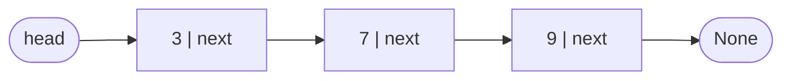
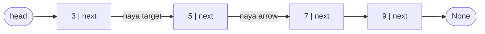
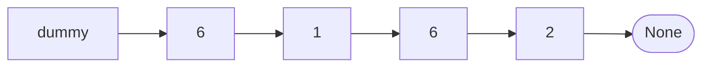
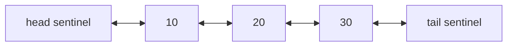
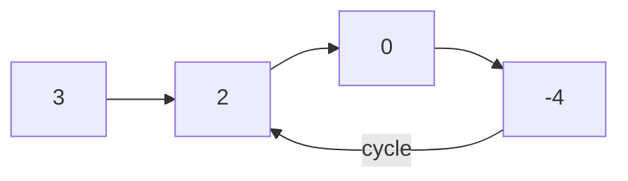
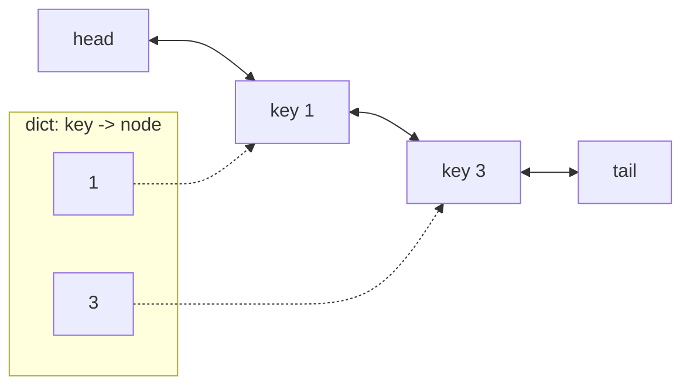

# Chapter 10 · Linked Lists

> Ek treasure hunt socho: pehla clue doormat ke neeche hai, aur us pe likha hai "agla clue fridge mein hai". Fridge wala clue bookshelf ki taraf bhejta hai, aur aise hi aage. Kisi ke paas saari chhupne ki jagahon ki list nahi hai; har clue sirf agle clue ko jaanta hai. Yahi **linked list** hai. Sunne mein bahut basic lagti hai, aur isiliye interviewers ko pasand hai: har problem asal mein ye test karti hai ki kya tum pointers ko idhar-udhar kar sakte ho bina kuch khoye.

**Is chapter mein tum seekhoge:**
- Python mein node aur pointer asal mein kya hote hain, zero se bana ke
- Singly, doubly aur circular linked lists: build, traverse, insert, delete
- **Dummy head** trick, jo tumhare aadhe edge cases gayab kar deti hai
- List ko **reverse** karna, iteratively aur recursively, ek-ek pointer karke
- **Fast & slow pointers**: middle node, cycle detection, cycle start (Floyd ke proof ke saath), happy number
- Classic problems: merge, reorder, palindrome, add two numbers, intersection, random pointers, reverse in k-groups
- Doubly linked list aur dict se **LRU cache** kaise banate hain

**Isse pehle padho:** [OOP I: Classes & Objects](../part-1-python/14-oop-classes-objects.md) · [Two Pointers](03-two-pointers.md) · [Hashing Patterns](05-hashing.md)

---

## 🧠 The Big Idea · Asli Baat

Python list (yaani ek **array**) apne items ko memory ke ek lagaataar row mein rakhti hai, jaise cinema hall ki ek row ki seats. Seat 500 dhundni hai? Seedha wahan jump kar jao. Lekin agar seat 3 pe kisi ko ghusana hai, toh seat 3 se aage wale sabko ek seat right khisakna padega. Woh O(n) hai.

**Linked list** har item ko uske apne chhote se dabbe mein rakhti hai, jise **node** kehte hain. Har node mein ek value hoti hai aur ek **pointer** (ek reference) agle node ki taraf. Ye dabbe memory mein kahin bhi pade ho sakte hain; pointers unhe ek chain mein jodte hain.



3 aur 7 ke beech naya node daalne mein kisi ko khisakna nahi padta. Bas do arrows ko nayi jagah point karo:



Keemat kya hai? "Item 500 pe jump karo" jaisa kuch nahi hota. Wahan pahunchne ke liye head se 500 arrows follow karne padte hain.

| Operation | Array (Python list) | Linked list |
|---|---|---|
| i-th item padhna | **O(1)** | O(n) (chal ke jaana padega) |
| Front pe insert/delete | O(n) (sabko khisakao) | **O(1)** |
| Jo node already haath mein hai uske baad insert/delete | O(n) | **O(1)** |
| End pe append | O(1) amortised | tail pointer ho toh O(1) |
| Value search karna | O(n) | O(n) |
| Har item ki extra memory | thodi | har node pe ek (ya do) pointer |

> 🇮🇳 **Desi Analogy:** Indian Railways ki train socho. Har coach (node) apne agle coach se coupling (pointer) se juda hai. Engine (head) ko pata hai pehla coach kaunsa hai, pehle coach ko pata hai doosra kaunsa. Beech mein ek naya coach jodna hai? Bas do couplings kholo aur lagao, baaki train ko hilana nahi padta (O(1) rewiring). Lekin agar tum S7 coach ke andar ho aur B3 tak jaana hai, toh beech ke har coach se chal ke guzarna padega, koi "teleport" nahi (O(n) access). Array iske ulat cinema ki row hai: seat number bolo, seedha wahan baith jao, lekin beech mein naya banda ghusao toh poori row khisakti hai.

> 💡 **The core insight:** linked list fast *access* ko chhod ke fast *rewiring* leti hai. Har linked-list problem bas itni si hai: arrows ko sahi order mein rewire karo, aur chain ka baaki hissa girne mat do.

---

## 🔨 Building It Up · Zero Se Shuru

### 1. A node, from scratch

Node ek chhota sa object hai jisme do attributes hain: value, aur agle node ka reference (ya end pe `None`).

```python
class ListNode:
    def __init__(self, val, next=None):
        self.val = val
        self.next = next

# 3 -> 7 -> 9 haath se banao
c = ListNode(9)
b = ListNode(7, c)
a = ListNode(3, b)
head = a

print(head.val, head.next.val, head.next.next.val)
print(head.next.next.next)

# traverse: None aane tak arrows follow karo
node = head
while node is not None:
    print(node.val, end=" -> ")
    node = node.next
print("None")
```

```text
3 7 9
None
3 -> 7 -> 9 -> None
```

Kya hua yahan: `head` bas ek variable hai jisme pehle node ka reference hai. Python mein har variable kisi object ka reference hota hai ([Part 1 ka Chapter 2](../part-1-python/02-variables-types-memory.md)), isliye yahan "pointer" ka simple matlab hai "ek attribute jo kisi doosre node object ko refer karta hai". Loop wali line `node = node.next` har linked-list algorithm ki dhadkan hai: **chain pe ek step aage badho**.

Dhyaan do humne nodes ulte order mein banaye: pehle `c` (9), phir `b` (7) jo `c` ko point karta hai, phir `a` (3). Kyun? Kyunki `b` banate waqt hi uska `next` dena tha, aur `c` tab tak exist karna chahiye tha.

> ⚠️ Traverse karte waqt `head` ko khud kabhi move mat karo (`head = head.next`), jab tak tum sach mein yahi na chahte ho. List ke start ka tumhare paas yahi ek handle hai, woh kho jaayega. Alag walker variable use karo jaise `node` ya `curr`.

> 🤔 **Mann mein sawaal:** Python mein toh pointers hote hi nahi, C wale `*` aur `&` kahan hain?
>
> **Jawab:** Python mein explicit pointer syntax nahi hai, lekin har variable aur har attribute andar se ek reference hi hai. `self.next = c` ka matlab hai "`next` naam ka label us object pe chipka do jahan `c` chipka hai". Koi copy nahi banti. Isliye `a.next.next` aur `c` bilkul same object hain (`a.next.next is c` → `True`). Linked list ke liye bas itna hi chahiye.

### 2. Two helpers we'll use everywhere

Baar-baar `ListNode(3, ListNode(7, ...))` likhna jaldi bore karta hai. Ye do helpers Python lists aur linked lists ke beech convert karte hain. Is chapter ka har runnable example inhe dobara define karta hai, taaki har block akela chal sake.

```python
class ListNode:
    def __init__(self, val=0, next=None):
        self.val = val
        self.next = next

def build(values):
    """Python list -> linked list. Returns the head (or None if empty)."""
    dummy = ListNode()             # aage ek nakli node, taaki loop mein koi special case na ho
    tail = dummy
    for v in values:
        tail.next = ListNode(v)
        tail = tail.next
    return dummy.next

def to_list(head):
    """Linked list -> Python list, for printing."""
    out = []
    while head:
        out.append(head.val)
        head = head.next           # *parameter* ko move karna theek hai: caller ka head safe hai
    return out

def length(head):
    count = 0
    while head:
        count += 1
        head = head.next
    return count

h = build([4, 8, 15, 16, 23, 42])
print(to_list(h), "length", length(h))
print(to_list(build([])))
```

```text
[4, 8, 15, 16, 23, 42] length 6
[]
```

Kya hua yahan: `build` ek **dummy** node use karta hai, taaki pehla real node add karna dasvein node add karne se alag na ho. Ye trick tum baar-baar dekhoge.

Bina dummy ke `build` kaisa dikhta? "Agar `head` abhi `None` hai toh `head = node`, warna `tail.next = node`." Har baar ek `if`. Dummy ke saath list kabhi "khaali" hoti hi nahi (kam se kam dummy toh hai), isliye `tail.next = ...` hamesha kaam karta hai. End mein `dummy.next` return karo, jo asli pehla node hai (ya `None` agar kuch add hi nahi hua).

> 🤔 **Mann mein sawaal:** `to_list` ke andar `head = head.next` kiya, kya isse caller ka `h` bhi aage khisak gaya?
>
> **Jawab:** Nahi. Function ke andar `head` ek local naam hai jo shuru mein usi node ko point karta hai jise `h` karta hai. Local naam ko naye node pe chipkaane se `h` pe koi asar nahi padta. Haan, agar tum `head.next = None` jaisa kuch karte (node ke andar ka attribute badalte), toh woh change sabko dikhta, kyunki node object shared hai. **Naam badalna safe, object badalna sabko dikhta hai.**

### 3. A complete singly linked list class

Ab list ko ek class mein lapet dete hain, jisme ek `head`, ek `tail` (taaki append O(1) ho) aur ek `size` ho.

```python
class ListNode:
    def __init__(self, val, next=None):
        self.val = val
        self.next = next

class SinglyLinkedList:
    def __init__(self):
        self.head = None
        self.tail = None
        self.size = 0

    def push_front(self, val):                 # O(1)
        self.head = ListNode(val, self.head)
        if self.tail is None:                  # list khaali thi
            self.tail = self.head
        self.size += 1

    def push_back(self, val):                  # tail pointer ki wajah se O(1)
        node = ListNode(val)
        if self.tail is None:
            self.head = self.tail = node
        else:
            self.tail.next = node
            self.tail = node
        self.size += 1

    def insert_at(self, index, val):           # O(index): chalo, phir O(1) rewire
        if index == 0:
            return self.push_front(val)
        if index == self.size:
            return self.push_back(val)
        prev = self.head
        for _ in range(index - 1):             # jagah se PEHLE wale node pe ruko
            prev = prev.next
        prev.next = ListNode(val, prev.next)   # naya node prev ke purane next ko point karta hai
        self.size += 1

    def delete_value(self, val):               # val wala pehla node hatao
        prev, curr = None, self.head
        while curr and curr.val != val:
            prev, curr = curr, curr.next
        if curr is None:
            return False                       # mila nahi
        if prev is None:
            self.head = curr.next              # head delete ho raha hai
        else:
            prev.next = curr.next              # curr ke upar se kood jao
        if curr is self.tail:
            self.tail = prev
        self.size -= 1
        return True

    def __iter__(self):
        node = self.head
        while node:
            yield node.val
            node = node.next

    def __repr__(self):
        return " -> ".join(map(str, self)) + " -> None"

ll = SinglyLinkedList()
for x in [10, 20, 30]:
    ll.push_back(x)
ll.push_front(5)
ll.insert_at(2, 15)
print(ll, "| size", ll.size)
ll.delete_value(5)
ll.delete_value(30)
ll.delete_value(99)
print(ll, "| size", ll.size, "| tail", ll.tail.val)
```

```text
5 -> 10 -> 15 -> 20 -> 30 -> None | size 5
10 -> 15 -> 20 -> None | size 3 | tail 20
```

Kya hua yahan: singly linked list mein node **delete** karne ka matlab hai uske *pichhle* node (predecessor) se use skip karwana: `prev.next = curr.next`. Skip hue node ka ab koi reference nahi bacha, toh Python use apne aap free kar deta hai. Dekho humein kaun se special cases sambhalne pade: head delete karna (koi `prev` nahi) aur tail delete karna (`self.tail` update karo). Section 4 head wala case gayab kar dega.

`insert_at(2, 15)` ko slow motion mein dekho. List thi `5 -> 10 -> 20 -> 30`. `index - 1 = 1` step chalo: `prev` = node 10. Ab `ListNode(15, prev.next)` banta hai, yaani 15 jiska `next` = 20. Phir `prev.next` = 15. Result: `5 -> 10 -> 15 -> 20 -> 30`.

> 💡 **Insertion order matters.** `insert_at` mein `ListNode(val, prev.next)` purane `prev.next` ko *pehle* pakad leta hai, uske overwrite hone se pehle. Agar tum pehle `prev.next = ListNode(val)` likh dete, toh list ka baaki hissa hamesha ke liye kho jaata.

> 🇮🇳 **Desi Analogy:** Train mein naya coach jodna hai coach A aur coach B ke beech. Agar tumne pehle A ki coupling kholi aur naye coach se jodi, aur B ka pata kahin likha nahi, toh B se aage ki poori train platform pe chhoot gayi! Sahi tareeka: pehle naye coach ko B se jodo (`ListNode(val, prev.next)`), phir A ko naye coach se. **Pehle naya jodo, phir purana todo.**

### 4. The dummy head trick

Problem: **Remove Linked List Elements** (value `val` wale har node ko delete karo). Bina dummy ke head special hai, kyunki uska koi predecessor nahi. Head ke aage ek dummy node rakh do, toh *har* real node ka predecessor ho jaata hai.



```python
class ListNode:
    def __init__(self, val=0, next=None):
        self.val = val
        self.next = next

def build(values):
    dummy = tail = ListNode()
    for v in values:
        tail.next = ListNode(v)
        tail = tail.next
    return dummy.next

def to_list(head):
    out = []
    while head:
        out.append(head.val)
        head = head.next
    return out

def remove_elements(head, val):
    dummy = ListNode(0, head)       # dummy.next asli head hai
    prev = dummy
    while prev.next:
        if prev.next.val == val:
            prev.next = prev.next.next   # unlink karo; prev ko mat hilao (naya next abhi check nahi hua)
        else:
            prev = prev.next
    return dummy.next               # asli head, jo shayad badal gaya ho

print(to_list(remove_elements(build([6, 1, 6, 6, 2, 6]), 6)))
print(to_list(remove_elements(build([7, 7, 7]), 7)))
```

```text
[1, 2]
[]
```

Kya hua yahan: kahin bhi `if prev is None` nahi hai. Dummy ne edge case ko apne andar sokh liya. End mein hum `dummy.next` return karte hain, jo sahi se `None` ban jaata hai jab saare nodes hat gaye hon.

`[6, 1, 6, 6, 2, 6]` pe chalo: `prev` = dummy. `prev.next` = 6 → hatao (prev wahin). Ab `prev.next` = 1 → rakho, prev = 1. `prev.next` = 6 → hatao. `prev.next` = phir se 6 → hatao. Yahi wajah hai ki delete ke baad `prev` ko aage nahi badhate: do lagaatar 6 the, aur doosra wala bhi check hona tha. `prev.next` = 2 → rakho. `prev.next` = 6 → hatao. `prev.next` = None, loop khatam. Result `[1, 2]`.

> 🇮🇳 **Desi Analogy:** Train ke aage hamesha ek engine laga hota hai jisme koi passenger nahi baithta. Uski wajah se har passenger coach ke aage kuch na kuch juda hota hai. Pehla coach hatana ho ya beech wala, tareeka ek hi: "jo usse pehle hai, uski coupling badlo". Dummy wahi engine hai: koi data nahi rakhta, bas "pehle coach ka koi pichhla nahi" wala special case khatam kar deta hai. Train ka asli pehla coach = `dummy.next`.

> 💡 **Rule of thumb:** agar list ka head badal sakta hai (deleting, merging, partitioning, ek section reverse karna), toh `dummy = ListNode(0, head)` se shuru karo aur `dummy.next` return karo.

### 5. Doubly linked lists

**Doubly linked list** har node ko ek `prev` pointer bhi deti hai. Ab tum peeche ki taraf bhi chal sakte ho, aur sabse important: **agar node ka reference tumhare haath mein hai toh use O(1) mein delete kar sakte ho**, kyunki node ko apna predecessor khud pata hai.



Hum do **sentinels** use karenge (dono ends pe dummy nodes), taaki insert aur delete ko kabhi `None` se deal na karna pade.

```python
class DNode:
    def __init__(self, val=None):
        self.val = val
        self.prev = None
        self.next = None

class DoublyLinkedList:
    def __init__(self):
        self.head = DNode()            # sentinels: inme kabhi asli data nahi hota
        self.tail = DNode()
        self.head.next = self.tail
        self.tail.prev = self.head

    def insert_after(self, node, val):            # O(1)
        new = DNode(val)
        new.prev, new.next = node, node.next      # 1. naya node dono taraf point kare
        node.next.prev = new                      # 2. purana padosi wapas usko point kare
        node.next = new                           # 3. node aage usko point kare
        return new

    def push_back(self, val):
        return self.insert_after(self.tail.prev, val)

    def remove(self, node):                       # O(1): padosi node ke upar se kood jaate hain
        node.prev.next = node.next
        node.next.prev = node.prev

    def forward(self):
        out, node = [], self.head.next
        while node is not self.tail:
            out.append(node.val)
            node = node.next
        return out

    def backward(self):
        out, node = [], self.tail.prev
        while node is not self.head:
            out.append(node.val)
            node = node.prev
        return out

dll = DoublyLinkedList()
n10 = dll.push_back(10)
n20 = dll.push_back(20)
dll.push_back(30)
dll.insert_after(n10, 15)
print(dll.forward(), dll.backward())
dll.remove(n20)                     # node haath mein hai: search ki zaroorat nahi
print(dll.forward())
```

```text
[10, 15, 20, 30] [30, 20, 15, 10]
[10, 15, 30]
```

Kya hua yahan: `remove` sirf do lines ka hai, koi loop nahi. Yahi O(1) delete-by-reference wajah hai ki doubly linked lists LRU caches (section 13), browser history, aur Python ke apne `collections.deque` (jo fixed-size blocks ki ek doubly linked list hai) ko power karti hain.

`insert_after` mein steps ka order kyun important hai? Step 2 mein `node.next.prev` likha hai, jahan `node.next` abhi bhi *purana* padosi hai. Agar step 3 (`node.next = new`) pehle kar dete, toh `node.next` naya node ban jaata aur step 2 galat node ko update karta. Isliye: pehle naye node ke dono haath set karo, phir purane padosi ka, aur aakhir mein `node` ka.

> 🤔 **Mann mein sawaal:** Singly list mein bhi node haath mein ho toh delete kyun nahi kar sakte O(1) mein?
>
> **Jawab:** Kyunki delete karne ke liye *pichhle* node ka `next` badalna padta hai, aur singly list mein node ko pata hi nahi uske peeche kaun hai. Use dhundne ke liye head se chalna padega, O(n). Doubly list mein `node.prev` seedha bata deta hai. (Ek jugaad wala exception Practice 2 mein dekhoge: value copy karke agla node delete karna.)

### 6. Circular linked lists

**Circular** list mein last node `None` ki jagah wapas pehle node ko point karta hai. Koi end nahi hai, isliye traversal tab rukta hai jab tum wapas wahin pahunch jao jahan se shuru kiya tha. Jo cheezein gol-gol ghoomti hain, unka ye natural model hai: baari-baari khelte players, round-robin scheduling, repeat pe chalti playlist.

Classic demo, **Josephus problem**: n log ek circle mein khade hain; ginti person 1 se shuru hoti hai, aur har k-th person bahar ho jaata hai. Kaun bachega?

```python
class ListNode:
    def __init__(self, val, next=None):
        self.val = val
        self.next = next

def josephus(n, k):
    head = ListNode(1)
    tail = head
    for i in range(2, n + 1):
        tail.next = ListNode(i)
        tail = tail.next
    tail.next = head                    # circle band karo

    order = []
    prev = tail                         # current se pehle wala node
    while prev.next is not prev:        # ek se zyada log bache hain
        for _ in range(k - 1):          # k-1 steps chalo
            prev = prev.next
        order.append(prev.next.val)     # k-th person bahar
        prev.next = prev.next.next
    return order, prev.val

order, survivor = josephus(7, 3)
print("eliminated:", order)
print("survivor:", survivor)
```

```text
eliminated: [3, 6, 2, 7, 5, 1]
survivor: 4
```

Kya hua yahan: ek node wala circle khud ko point karta hai, isliye `prev.next is not prev` ka matlab hai "ek se zyada bache hain". Deletion wahi purana `prev.next = prev.next.next` hai. Circular list mein ek hi khatra hai: bina stopping condition ka traversal loop. Hamesha tab ruko jab apne starting node pe wapas aa jao.

`prev = tail` se kyun shuru kiya? Kyunki delete karne ke liye humein hamesha target se *pehle* wala node chahiye. Ginti person 1 se shuru honi hai, toh "person 1 se pehle" = tail (person 7). `k - 1 = 2` steps: prev = 1, phir 2. `prev.next` = 3 bahar. Wahi output ki pehli entry.

> 🇮🇳 **Desi Analogy:** Bachpan ka "akkad bakkad bambe bo" yaad hai? Sab gol ghere mein, ek banda gaana gaate hue har ek pe ungli rakhta hai, aur jahan gaana khatam, woh bahar. Ghera kabhi khatam nahi hota, ginti aakhri bande ke baad seedha pehle pe aa jaati hai. Yahi circular list hai: `tail.next = head`. Aur jab sirf ek bacha jo khud ko hi point kar raha hai, woh winner.

### 7. Reversing a list, iteratively

Linked list ka sabse important operation. `1 → 2 → 3 → None` ko in place `3 → 2 → 1 → None` banao.

Teen variables ke saath list pe chalo:
- `prev`: already-reversed hissa (shuru mein `None`)
- `curr`: woh node jise abhi palat rahe hain
- `nxt`: baaki list ka bookmark, arrow todne se **pehle** save kiya hua

```python
class ListNode:
    def __init__(self, val=0, next=None):
        self.val = val
        self.next = next

def build(values):
    dummy = tail = ListNode()
    for v in values:
        tail.next = ListNode(v)
        tail = tail.next
    return dummy.next

def to_list(head):
    out = []
    while head:
        out.append(head.val)
        head = head.next
    return out

def reverse_list(head):
    prev, curr = None, head
    while curr:
        nxt = curr.next        # 1. baaki ka bookmark
        curr.next = prev       # 2. arrow ko peeche ki taraf palto
        prev = curr            # 3. prev aage badhe
        curr = nxt             # 4. curr bookmark pe jaaye
    return prev                # prev naya head hai

print(to_list(reverse_list(build([1, 2, 3]))))
print(to_list(reverse_list(build([42]))), to_list(reverse_list(build([]))))
```

```text
[3, 2, 1]
[42] []
```

**Pointer-by-pointer trace**, `1 → 2 → 3` ka:

| iteration | pehle: prev / curr | nxt saved | flip ke baad | arrows ki halat |
|---|---|---|---|---|
| start | None / 1 | | | `1→2→3→None` |
| 1 | None / 1 | 2 | `1.next = None` | `None←1` aur `2→3→None` |
| 2 | 1 / 2 | 3 | `2.next = 1` | `None←1←2` aur `3→None` |
| 3 | 2 / 3 | None | `3.next = 2` | `None←1←2←3` |
| end | 3 / None | | | return 3 |

Kya hua yahan: har pal list do healthy tukdon mein bati hui hai: ek reversed tukda jo `prev` se shuru hota hai, aur ek untouched tukda jo `curr` se shuru hota hai. Har iteration doosre tukde ka ek node utha ke pehle tukde ke aage laga deti hai. O(n) time, O(1) space.

> 🇮🇳 **Desi Analogy:** Kirana store ke counter pe biscuit ke packets ek line mein rakhe hain, aur tumhe unhe ek-ek karke uthake doosri taraf ek naya dher banana hai. Line se sabse aage wala packet uthao (`curr`), naye dher ke upar rakho (`curr.next = prev`). Lekin uthane se pehle ungli se dekh lo ki line mein agla kaunsa hai (`nxt`), warna line ka pata kho dogi. Jab line khatam, naya dher ulte order mein hai, aur uske upar wala packet (`prev`) naya head hai.

> 💡 Chaar lines ko ek rhythm ki tarah ratt lo: **"save next, flip, step prev, step curr."** (Hinglish mein: "bachao, palto, prev badhao, curr badhao.")

### 8. Reversing a list, recursively

Recursive version "recursion pe bharosa karo" ki badhiya practice hai ([Chapter 09](09-backtracking.md)).

Khud se poocho: "agar kisi ne `head` ke baad ka sab kuch already reverse kar diya hai, toh mere liye kya kaam bacha?"

```text
before the call:  head=1 -> 2 -> 3 -> None
after reversing the rest:  1 -> 2 <- 3     (new_head = 3, and 1 still points to 2)
my job: make 2 point back to 1, and make 1 point to None.
```

Matlab: call se pehle `1 -> 2 -> 3 -> None`. Baaki ko reverse karne ke baad `1 -> 2 <- 3` (new_head = 3, aur 1 ab bhi 2 ko point kar raha hai). Mera kaam: 2 ko wapas 1 pe point karwao, aur 1 ko `None` pe.

```python
class ListNode:
    def __init__(self, val=0, next=None):
        self.val = val
        self.next = next

def build(values):
    dummy = tail = ListNode()
    for v in values:
        tail.next = ListNode(v)
        tail = tail.next
    return dummy.next

def to_list(head):
    out = []
    while head:
        out.append(head.val)
        head = head.next
    return out

def reverse_recursive(head):
    if head is None or head.next is None:
        return head                         # 0 ya 1 node: already reversed
    new_head = reverse_recursive(head.next) # bharosa: baaki ab reversed hai
    head.next.next = head                   # mera purana next (ab reversed hisse ki tail) mujhe point kare
    head.next = None                        # main nayi tail hoon
    return new_head                         # reversed list ka head upar jaate waqt kabhi nahi badalta

print(to_list(reverse_recursive(build([1, 2, 3, 4, 5]))))
```

```text
[5, 4, 3, 2, 1]
```

Kya hua yahan: `head.next.next = head` woh line hai jo sabko confuse karti hai. Ise aise padho: "mere baad wala node mujhe wapas point kare". Recursive call ke baad bhi `head.next` node 2 hi hai (us arrow ko humne chhua nahi), aur node 2 ab reversed hisse ka *aakhri* node hai, toh hum khud ko uske peeche latka dete hain.

Time O(n), lekin call stack ki wajah se space **O(n)** hai. 10,000 nodes wali list pe ye Python ki recursion limit hit kar dega, isliye interviews mein iterative version prefer karo aur wajah bhi batao.

### 9. Fast & slow pointers: find the middle

Do walkers head se shuru karte hain. **Slow** 1 step chalta hai, **fast** 2 steps. Jab fast end pe pahunchta hai, slow ne aadhi doori tay ki hai: woh middle pe hai. (Ye wahi "fast & slow" shape hai jiska [Chapter 03](03-two-pointers.md) ne waada kiya tha.)

```python
class ListNode:
    def __init__(self, val=0, next=None):
        self.val = val
        self.next = next

def build(values):
    dummy = tail = ListNode()
    for v in values:
        tail.next = ListNode(v)
        tail = tail.next
    return dummy.next

def middle_node(head):
    slow = fast = head
    while fast and fast.next:       # fast do steps le sakta hai
        slow = slow.next
        fast = fast.next.next
    return slow

print(middle_node(build([1, 2, 3, 4, 5])).val)
print(middle_node(build([1, 2, 3, 4, 5, 6])).val)
```

```text
3
4
```

**Trace**, `[1, 2, 3, 4, 5, 6]` ke liye:

| step | slow | fast |
|---|---|---|
| start | 1 | 1 |
| 1 | 2 | 3 |
| 2 | 3 | 5 |
| 3 | 4 | None (6 ke aage) → stop |

Kya hua yahan: even length mein do middles hote hain; ye version **doosra** wala (4) return karta hai. Agar tumhe **pehla** middle chahiye (list ko do halves mein todne ke liye kaam ka), toh loop `while fast.next and fast.next.next` likho.

> 🇮🇳 **Desi Analogy:** Do dost Marine Drive pe ek hi point se chalna shuru karte hain. Ek aaram se chalta hai (1 step), doosra jogging karta hai (2 steps). Jab jogger promenade ke end pe pahunchta hai, aaram wala dost theek beech mein hai. Kisi ko promenade ki length pehle se naapni nahi padi. Yahi trick: length jaane bina, ek hi pass mein middle.

> 🤔 **Mann mein sawaal:** `while fast and fast.next` mein dono checks kyun? Sirf `fast.next` kaafi nahi?
>
> **Jawab:** Nahi. Odd length mein fast aakhri node pe rukta hai (`fast.next` None). Even length mein fast aakhri node se *aage* nikal ke `None` ban jaata hai. Agar `fast` khud `None` hai toh `fast.next` likhte hi `AttributeError`. Isliye pehle `fast` check, phir `fast.next`. Python ka `and` short-circuit karta hai, toh pehla False hote hi doosra evaluate hi nahi hota.

### 10. Cycle detection and the cycle's start (Floyd's algorithm)

Koi bug ya puzzle ek **cycle** bana sakta hai: kisi node ka `next` wapas kisi pehle wale node ko point karta hai, aur traversal kabhi khatam nahi hota. O(1) space mein ise detect kaise karein?

List pe slow aur fast walkers chhodo. Agar cycle nahi hai, fast `None` se takrayega. Agar cycle hai, dono loop mein phans jaate hain, aur fast har move pe slow se 1 step zyada nazdeek aata hai, jaise gol track pe tez runner dheere wale ko lap kar deta hai. Unhe **milna hi padega**.



Phir ek doosra, jaadui phase: ek pointer ko wapas head pe rakho, doosre ko meeting point pe hi chhod do, aur **dono** ko ek-ek step chalao. Jahan woh milte hain, wahi **cycle ka start** hai. (Proof Under the Hood mein.)

```python
class ListNode:
    def __init__(self, val=0, next=None):
        self.val = val
        self.next = next

def build_with_cycle(values, pos):
    """Build a list; the tail links back to the node at index pos (-1 = no cycle)."""
    nodes = [ListNode(v) for v in values]
    for a, b in zip(nodes, nodes[1:]):
        a.next = b
    if pos >= 0:
        nodes[-1].next = nodes[pos]
    return nodes[0]

def has_cycle(head):
    slow = fast = head
    while fast and fast.next:
        slow, fast = slow.next, fast.next.next
        if slow is fast:               # same node object, sirf same value nahi
            return True
    return False

def detect_cycle(head):
    slow = fast = head
    while fast and fast.next:
        slow, fast = slow.next, fast.next.next
        if slow is fast:               # phase 1: cycle ke andar mil gaye
            finder = head
            while finder is not slow:  # phase 2: dono 1 step chalte hain
                finder, slow = finder.next, slow.next
            return finder              # cycle ka entrance
    return None

print(has_cycle(build_with_cycle([3, 2, 0, -4], 1)), has_cycle(build_with_cycle([1, 2], -1)))
print(detect_cycle(build_with_cycle([3, 2, 0, -4], 1)).val)
print(detect_cycle(build_with_cycle([1, 2, 3, 4, 5, 6], 2)).val)
```

```text
True False
2
3
```

**Trace**, phase 1 ka, `3 → 2 → 0 → -4 → (wapas 2)` ke liye:

| step | slow | fast | same? |
|---|---|---|---|
| start | 3 | 3 | |
| 1 | 2 | 0 | no |
| 2 | 0 | 2 | no |
| 3 | -4 | -4 | ✅ meet |

Phase 2: `finder` 3 se shuru, `slow` -4 pe. Ek step: finder → 2, slow → 2. Dono **2** pe mile, jo cycle ka start hai. ✓

> ⚠️ Nodes ko `is` se compare karo, `==` se nahi. Do alag nodes mein same value ho sakti hai; humein farak padta hai ki kya woh **same object** hain.

> 🇮🇳 **Desi Analogy:** Stadium ke 400m track pe do runners. Ek seedhi sadak se track tak aate hain, phir track pe gol ghoomte rehte hain. Agar raasta seedha hai (cycle nahi), toh tez wala sadak ke end pe pahunch ke ruk jaata hai (`None`). Agar track hai (cycle), toh tez wala har second dheere wale se thoda aur aage nikalta hai, aur ek point pe use peeche se aa ke pakad leta hai (lap). Dono ka milna guaranteed hai, chahe track kitna bhi bada ho.

**Happy Number** bhes badla hua Floyd's algorithm hai. Ek number ko uske digits ke squares ke sum se replace karo, baar-baar. Agar 1 tak pahunch jaaye toh woh "happy" hai. Warna woh hamesha loop mein ghoomta rehta hai. Numbers ek implicit linked list banate hain (har number agle ko "point" karta hai), toh cycle ko slow aur fast se detect karo:

```python
def next_number(n):
    return sum(int(d) ** 2 for d in str(n))

def is_happy(n):
    slow, fast = n, next_number(n)
    while fast != 1 and slow != fast:
        slow = next_number(slow)                  # 1 step
        fast = next_number(next_number(fast))     # 2 steps
    return fast == 1

print(is_happy(19), is_happy(2), is_happy(7))
```

```text
True False True
```

Kya hua yahan: 19 → 82 → 68 → 100 → 1, happy. 2 → 4 → 16 → 37 → 58 → 89 → 145 → 42 → 20 → 4 → ..., ek cycle jo kabhi 1 ko nahi chhooti. Na nodes, na `next` pointers, lekin pattern wahi: **jahan bhi har state exactly ek next state pe le jaati hai**, woh bhes badli linked list hai.

(19 ka hisaab: 1² + 9² = 1 + 81 = 82. 8² + 2² = 64 + 4 = 68. 6² + 8² = 36 + 64 = 100. 1² + 0 + 0 = 1.)

### 11. K-th node from the end

**Remove Nth Node From End of List.** Tum length gin ke dobara chal sakte ho. One-pass trick: do pointers ek saath shuru karo, **lead** pointer ko n steps aage bhejo, phir dono ko tab tak chalao jab tak lead end se gir na jaaye. n ka gap matlab trailing pointer target ke theek pehle hai.

```python
class ListNode:
    def __init__(self, val=0, next=None):
        self.val = val
        self.next = next

def build(values):
    dummy = tail = ListNode()
    for v in values:
        tail.next = ListNode(v)
        tail = tail.next
    return dummy.next

def to_list(head):
    out = []
    while head:
        out.append(head.val)
        head = head.next
    return out

def remove_nth_from_end(head, n):
    dummy = ListNode(0, head)          # head khud bhi remove ho sakta hai
    lead = trail = dummy
    for _ in range(n + 1):             # n + 1 taaki trail target se PEHLE ruke
        lead = lead.next
    while lead:
        lead, trail = lead.next, trail.next
    trail.next = trail.next.next       # end se n-th ko unlink karo
    return dummy.next

print(to_list(remove_nth_from_end(build([1, 2, 3, 4, 5]), 2)))
print(to_list(remove_nth_from_end(build([1]), 1)))
print(to_list(remove_nth_from_end(build([1, 2]), 2)))
```

```text
[1, 2, 3, 5]
[]
[2]
```

Kya hua yahan: `lead` aur `trail` ke beech n + 1 ka gap hai, toh jab `lead` `None` hota hai (aakhri node se ek aage), `trail` end se n-th node ke theek pehle baitha hota hai. Dummy "head ko remove karo" wala case (aakhri example) free mein sambhal leta hai.

`[1, 2, 3, 4, 5]`, n = 2 pe trace: dummy se lead 3 steps chala → node 3. Ab dono saath: (lead 4, trail 1), (lead 5, trail 2), (lead None, trail 3). `trail.next` = 4, jo end se 2nd hai. Unlink → `[1, 2, 3, 5]`.

> 🇮🇳 **Desi Analogy:** Do dost ek lambi rassi pe chal rahe hain, aur dono ke beech ek fixed length ka danda pakda hua hai. Aage wala dost (lead) jaise hi rassi ke end se neeche girta hai, peeche wala (trail) bilkul utni hi doori pe hai end se jitna danda lamba hai. Length naapne ki zaroorat nahi, danda hi naap hai.

### 12. Merge two sorted lists

Merge sort wale merge ([Chapter 07](07-sorting.md)) ka linked-list version. Merged list ke end pe ek `tail` pointer rakho, aur jo head chhota ho use jodte raho.

```python
class ListNode:
    def __init__(self, val=0, next=None):
        self.val = val
        self.next = next

def build(values):
    dummy = tail = ListNode()
    for v in values:
        tail.next = ListNode(v)
        tail = tail.next
    return dummy.next

def to_list(head):
    out = []
    while head:
        out.append(head.val)
        head = head.next
    return out

def merge_two_lists(a, b):
    dummy = tail = ListNode()
    while a and b:
        if a.val <= b.val:
            tail.next, a = a, a.next      # a ka node jodo, a aage badhao
        else:
            tail.next, b = b, b.next
        tail = tail.next
    tail.next = a or b                    # jo bacha hai jod do (already sorted)
    return dummy.next

print(to_list(merge_two_lists(build([1, 2, 4]), build([1, 3, 4]))))
print(to_list(merge_two_lists(build([]), build([0]))))
```

```text
[1, 1, 2, 3, 4, 4]
[0]
```

Kya hua yahan: koi naya node nahi banta; hum bas existing nodes ko re-point karte hain. O(m + n) time, O(1) extra space. `a or b` jo `None` nahi hai woh return karta hai.

`tail.next, a = a, a.next` ek line mein do kaam karta hai. Python pehle right side poori evaluate karta hai (`a` aur `a.next` dono purani values), phir assign karta hai. Isliye `a` ko aage badhane se pehle hi uska purana node `tail.next` mein chala jaata hai. Koi temp variable nahi chahiye.

### 13. LRU Cache: doubly linked list + dict

Famous design problem. **LRU (Least Recently Used) cache** max `capacity` key-value pairs rakhta hai. `get(key)` value return karta hai (ya -1) aur key ko recently used mark karta hai. `put(key, value)` insert ya update karta hai; agar cache full hai, toh **least recently used** key ko nikaal deta hai (evict). Dono **O(1)** hone chahiye.

Akela koi bhi structure ye nahi kar sakta:
- **Dict** key ko O(1) mein dhundh leta hai, lekin use usage order nahi pata.
- **Doubly linked list** order rakhti hai aur node ko O(1) mein move ya remove kar sakti hai, lekin node dhundne mein O(n) lagta hai.

Dono saath mein: dict `key → node` map karta hai, aur list least recent (front) se most recent (back) tak ordered hai.



> 🇮🇳 **Desi Analogy:** WhatsApp ki chat list socho. Jis chat mein abhi baat hui, woh upar aa jaati hai (most recent). Jo group mahino se chup hai, woh neeche khisakta jaata hai (least recent). Ab socho phone mein sirf 100 chats ki jagah hai: nayi chat aayi toh sabse neeche wali hat jaayegi (evict). Search bar mein naam type karo toh chat turant milti hai (dict: `key → node`), aur list ka order batata hai kaun sabse purana hai (doubly linked list). Kisi chat ko beech se utha ke upar laana O(1) hai kyunki uske upar-neeche wale padosi pata hain (`prev`, `next`).

```python
class DNode:
    def __init__(self, key=0, val=0):
        self.key, self.val = key, val
        self.prev = self.next = None

class LRUCache:
    def __init__(self, capacity):
        self.capacity = capacity
        self.map = {}                         # key -> node
        self.head, self.tail = DNode(), DNode()   # sentinels: head ki taraf = least recent
        self.head.next, self.tail.prev = self.tail, self.head

    def _remove(self, node):                  # O(1) unlink
        node.prev.next, node.next.prev = node.next, node.prev

    def _append(self, node):                  # O(1): tail ke theek pehle daalo (most recent)
        node.prev, node.next = self.tail.prev, self.tail
        self.tail.prev.next = node
        self.tail.prev = node

    def get(self, key):
        if key not in self.map:
            return -1
        node = self.map[key]
        self._remove(node)                    # touch: most-recent end pe le jao
        self._append(node)
        return node.val

    def put(self, key, value):
        if key in self.map:
            self._remove(self.map[key])
        node = DNode(key, value)
        self.map[key] = node
        self._append(node)
        if len(self.map) > self.capacity:
            lru = self.head.next              # least recent head ke theek baad baitha hai
            self._remove(lru)
            del self.map[lru.key]             # isiliye nodes apni key store karte hain

cache = LRUCache(2)
cache.put(1, 1)
cache.put(2, 2)
print(cache.get(1))      # 1 ab most recent hai
cache.put(3, 3)          # key 2 evict hoti hai
print(cache.get(2))
cache.put(4, 4)          # key 1 evict hoti hai
print(cache.get(1), cache.get(3), cache.get(4))
```

```text
1
-1
-1 3 4
```

Kya hua yahan: har operation ek dict lookup plus kuch O(1) pointer changes hai. Nodes apni **key** store karte hain taaki jab front node evict ho, humein pata ho ki dict ki kaunsi entry delete karni hai. Real Python code mein `collections.OrderedDict` ke `move_to_end` aur `popitem(last=False)` yahi kaam karte hain (woh isi idea pe bana hai), lekin interviewers chahte hain ki tum ise haath se banao. LRU caches system design mein har jagah aate hain ([Caching & CDNs](../part-3-system-design/04-caching-cdn.md)).

Order ko step by step dekho (front = least recent, back = most recent):

| Operation | List (front → back) | Note |
|---|---|---|
| `put(1, 1)` | 1 | |
| `put(2, 2)` | 1, 2 | |
| `get(1)` → 1 | 2, 1 | 1 touch hua, back pe gaya |
| `put(3, 3)` | 1, 3 | size 3 > 2, front wala 2 evict |
| `get(2)` → -1 | 1, 3 | 2 hai hi nahi |
| `put(4, 4)` | 3, 4 | front wala 1 evict |
| `get(1)`, `get(3)`, `get(4)` | 3, 4 | -1, 3, 4 (3 aur 4 touch hokar back pe) |

> 🤔 **Mann mein sawaal:** `put` mein agar key pehle se hai, toh purana node remove karke naya kyun banaya? Value update kar dete?
>
> **Jawab:** Woh bhi chalta: `node.val = value`, phir `_remove` + `_append` se use back pe le jao. Dono O(1) hain. Yahan wala version chhota hai kyunki "naya ho ya purana" dono case mein same teen lines chalti hain. Interview mein dono acceptable hain, bas dhyaan rakho ki update ke baad bhi key "recently used" ban jaani chahiye.

---

## 🔬 Under the Hood · Andar Ki Kahani

### What a node costs in Python

Har `ListNode` ek poora Python object hai: ek header (reference count + type pointer), attributes ke liye ek dictionary ya slots, plus value object khud. Ek chhota node aaram se 50–100 bytes le sakta hai, jabki Python list har item ke liye sirf 8 bytes (ek pointer) ek lagaataar block mein rakhti hai. Class mein `__slots__ = ("val", "next")` add karne se har object ki dict hat jaati hai aur memory kaafi kam ho jaati hai.

Lagaataar (contiguous) memory speed ke liye bhi matter karti hai. CPUs memory ko chunks (cache lines) mein load karte hain, isliye array pe chalte waqt padosi data already cache mein hota hai. Linked list pe chalna memory mein idhar-udhar koodna hai, jisse cache misses hote hain. Toh jab dono O(n) hain, tab bhi practice mein Python list usually jeet-ti hai. Isiliye Python mein built-in singly linked list nahi hai: `list` aur `collections.deque` lagbhag saari real zarooratein poori kar dete hain. Linked lists matter karti hain **interviews** ke liye, doosre structures samajhne ke liye (trees aur graphs "zyada arrows wali linked lists" hi hain), aur un specific cases ke liye jahan O(1) rewiring zaroori hai (LRU caches, allocators, OS scheduler).

> 🇮🇳 **Desi Analogy:** Cache line ko aise samjho: tum kirane ki dukaan se ek cheez lene jaate ho aur dukaandaar poori shelf ka ek khaana utha ke de deta hai. Array mein agli cheez usi khaane mein hai, dobara jaana nahi padta. Linked list mein agla node shayad doosri dukaan mein hai, har baar naya chakkar. Big-O dono ka O(n), lekin chakkar ginoge toh array bahut aage hai.

### Garbage collection makes deletion easy

C mein jo node unlink karte ho use `free()` karna padta hai. Python mein jab tum `prev.next = curr.next` likhte ho, skip hue node ka reference count gir jaata hai; jab woh zero hota hai, CPython use turant free kar deta hai. (Objects ki cycles ko alag cycle collector saaf karta hai.)

### Why reversal is correct: the invariant

`reverse_list` mein har loop iteration ke shuru mein:
- `prev` un nodes ki ek sahi reversed list ka head hai jo already visit ho chuke.
- `curr` bache hue untouched hisse ka head hai.

Ek iteration `curr` ko doosri list se utha ke pehli ke aage lagati hai. Invariant phir bhi sach rehta hai. Jab `curr` `None` hota hai, bacha hua hissa khaali hai aur `prev` poori reversed list ka head hai.

(**Invariant** = ek baat jo loop ke har round ke shuru mein sach rehti hai. Ise sabit kar do, aur loop khatam hone pe answer apne aap sahi ho jaata hai. Jaise cricket mein "score = sab batsmen ke runs + extras" har ball ke baad sach rehta hai.)

### Floyd's cycle algorithm: the proof

Maan lo:
- **a** = head se cycle ke start tak kitne steps,
- **c** = cycle ki length,
- **b** = cycle ke start se kitna andar slow aur fast milte hain.

**Woh milte hi kyun hain.** Jab dono pointers cycle mein aa jaate hain, har move pe fast ki badhat 1 badhti hai (fast +2, slow +1). Circle ke hisaab se naapo toh gap har step 1 kam hota hai, isliye c steps ke andar 0 ho jaata hai. Kul kaam O(a + c) = **O(n)**.

**Phase 2 start kyun dhundta hai.** Jab woh milte hain, slow ne `a + b` steps chale hain. Fast ne dugne, `2(a + b)`, aur ye extra doori cycle ke kuch poore laps k ke barabar honi chahiye:

```text
2(a + b) - (a + b) = k * c
           a + b   = k * c
               a   = k * c - b = (k - 1) * c + (c - b)
```

Aakhri line ko ek kahani ki tarah padho. Meeting point se shuru hone wale pointer ko cycle start tak pahunchne mein `c - b` steps lagte hain, phir woh kitne bhi poore laps ghoome, start pe hi rahega. Toh exactly **a** steps ke baad woh cycle start pe hai, aur head se shuru hua pointer bhi **a** steps chal ke wahin hai. Dono saath pahunchte hain. ∎

Ek number wala example: `[1, 2, 3, 4, 5, 6]` jahan 6 wapas 3 pe jaata hai (upar wala doosra test). Yahan a = 2 (1 → 2 → 3), c = 4 (3 → 4 → 5 → 6 → 3). Slow aur fast node 5 pe milte hain, toh b = 2. Formula: a = (k − 1)c + (c − b) = 0 + 2 = 2 (k = 1). Meeting point 5 se 2 steps: 6, 3. Head se 2 steps: 2, 3. Dono 3 pe mile ✓.

> 🤔 **Mann mein sawaal:** Fast 3 steps ya 4 steps kyun nahi chal sakta? 2 hi kyun?
>
> **Jawab:** Milne ke liye 2 zaroori nahi, lekin speed difference 1 hone se guarantee hai ki fast slow ko "kood ke" paar nahi karega: gap har step exactly 1 kam hota hai, toh 0 pe zaroor rukega. Speed 3 pe gap har step 2 kam hota. Agar cycle ki length even ho aur gap odd, toh gap 3, 1, −1 (yaani c − 1), ... aise chalta rahega aur kabhi exactly 0 nahi hoga: dono ek doosre ke upar se koodte rahenge aur shayad kabhi same node pe na milein. Aur phase 2 wala sundar `a = (k − 1)c + (c − b)` formula bhi "fast = 2 × slow" pe hi tika hai.

### Why the "intersection" trick works

**Intersection of Two Linked Lists** (Interview Q10) ke liye, pointer A pehle list A chalta hai phir list B; pointer B pehle list B phir list A. Dono kul `lenA + lenB` steps chalte hain. Agar dono lists ki t length ki ek shared tail hai, toh dono pointers shared hisse tak exactly `lenA + lenB - t` steps ke baad, ek hi pal mein pahunchte hain. Agar shared tail nahi hai, toh dono ek hi pal mein `None` pe pahunchte hain.

> 🇮🇳 **Desi Analogy:** Do dost alag-alag gaon se ek hi highway pe milne wale raaston pe hain, ek ka raasta lamba, ek ka chhota. Agar dono "pehle apna raasta, phir doosre ka" chalein, toh dono ki kul doori barabar ho jaati hai (`lenA + lenB`), aur woh highway ke junction pe ek saath pahunchte hain. Lambe-chhote raaste ka farak apne aap cancel.

---

## 🧩 Pattern Decoder · Pattern Pakdo

### Signals: when it's a linked-list pattern

| Problem mein dikhe... | Socho |
|---|---|
| "the head might change", "remove / insert / partition" | **Dummy head** |
| "reverse the list / a part of it / every k nodes" | **Reverse** (prev, curr, nxt) |
| "middle", "split in half", "palindrome list" | Middle ke liye **Fast & slow** |
| "cycle", "loop", "repeats forever", "duplicate number in 1..n" | **Floyd** fast & slow |
| "n-th from the end", "in one pass" | **Two pointers with a gap** |
| "merge sorted lists", "sort a linked list" | Tail pointer ke saath **Merge** |
| "O(1) get and put with eviction / ordering" | **Doubly linked list + dict** |
| "copy a list with extra pointers" | **Hash map old → new** (ya interleaving) |
| "two lists meet" | **Switch heads** trick |

### Template A: dummy + tail (building or filtering)

```py
dummy = ListNode()
tail = dummy
while ...:
    if keep(node):
        tail.next = node      # jodo
        tail = tail.next
    node = node.next
tail.next = None              # bacha-khucha kaato, warna koi purana link reh sakta hai
return dummy.next
```

### Template B: reverse

```py
prev, curr = None, head
while curr:
    nxt = curr.next   # save
    curr.next = prev  # flip
    prev = curr       # step prev
    curr = nxt        # step curr
return prev
```

### Template C: fast & slow

```py
slow = fast = head
while fast and fast.next:
    slow = slow.next
    fast = fast.next.next
    # cycle check: if slow is fast: ...
# loop khatam hone pe slow (doosra) middle hai
```

### Template D: gap of n

```py
lead = trail = dummy
for _ in range(n + 1):
    lead = lead.next
while lead:
    lead, trail = lead.next, trail.next
# trail.next end se n-th node hai
```

### Combining templates: the "middle + reverse + merge" recipe

Bahut saare medium problems bas in teen building blocks ko jod ke bante hain:

| Problem | Middle | Reverse | Then |
|---|---|---|---|
| Palindrome Linked List | ✅ | second half | halves compare karo |
| Reorder List | ✅ | second half | halves ko gooth do (weave) |
| Sort List | ✅ (split) | | recursively merge sort |
| Maximum Twin Sum | ✅ | second half | pair banao aur max lo |

### Variation: Reverse Linked List II (reverse a section)

**Problem:** position `left` se `right` tak (1-based) ke nodes reverse karo. `[1,2,3,4,5]`, 2, 4 → `[1,4,3,2,5]`.

**Idea:** section ke **pehle** wale node (`before`) tak chalo. Phir baar-baar section ke pehle node ke theek baad wala node uthao aur use section ke front pe le jao ("head insertion"). Dummy `left = 1` sambhal leta hai.

```python
class ListNode:
    def __init__(self, val=0, next=None):
        self.val = val
        self.next = next

def build(values):
    dummy = tail = ListNode()
    for v in values:
        tail.next = ListNode(v)
        tail = tail.next
    return dummy.next

def to_list(head):
    out = []
    while head:
        out.append(head.val)
        head = head.next
    return out

def reverse_between(head, left, right):
    dummy = ListNode(0, head)
    before = dummy
    for _ in range(left - 1):
        before = before.next              # section se theek pehle wala node
    first = before.next                   # ye end mein section ka aakhri node banega
    for _ in range(right - left):
        moved = first.next                # jise front pe le jaana hai
        first.next = moved.next
        moved.next = before.next
        before.next = moved
    return dummy.next

print(to_list(reverse_between(build([1, 2, 3, 4, 5]), 2, 4)))
print(to_list(reverse_between(build([3, 5]), 1, 2)))
```

```text
[1, 4, 3, 2, 5]
[5, 3]
```

**Trace**, `[1, 2, 3, 4, 5]`, left = 2, right = 4 (`before` = 1, `first` = 2):

| move | moved | list after |
|---|---|---|
| start | | 1 → 2 → 3 → 4 → 5 |
| 1 | 3 | 1 → 3 → 2 → 4 → 5 |
| 2 | 4 | 1 → 4 → 3 → 2 → 5 |

O(n) time, O(1) space.

Dhyaan do: `first` (node 2) apni jagah se kabhi "hilta" nahi dikhta, lekin har move ke baad woh ek step peeche khisak jaata hai, kyunki uske aage wala node utha ke front pe chala jaata hai. Jaise queue mein tum khade raho aur tumhare peeche wale ek-ek karke line ke aage chale jaayein.

### Variation: Reverse Nodes in k-Group

**Problem:** k nodes ke har lagaataar group ko reverse karo; k se chhota bacha hua group jaisa hai waisa rahe. `[1,2,3,4,5]`, k = 2 → `[2,1,4,3,5]`.

**Idea:** groups pe loop karo. Har group ke liye: check karo ki k nodes hain; exactly un k ko Template B se reverse karo (group ke baad wale node pe ruk ke); phir dobara jodo: group se pehle wala node naye group head ko point kare, aur purana group head (jo ab group ki tail hai) agle group ke liye "before" node ban jaaye.

```python
class ListNode:
    def __init__(self, val=0, next=None):
        self.val = val
        self.next = next

def build(values):
    dummy = tail = ListNode()
    for v in values:
        tail.next = ListNode(v)
        tail = tail.next
    return dummy.next

def to_list(head):
    out = []
    while head:
        out.append(head.val)
        head = head.next
    return out

def reverse_k_group(head, k):
    dummy = ListNode(0, head)
    group_prev = dummy
    while True:
        kth = group_prev                       # is group ka k-th node dhundo
        for _ in range(k):
            kth = kth.next
            if kth is None:
                return dummy.next              # k se kam bache: kaam khatam
        group_next = kth.next

        prev, curr = group_next, group_prev.next   # group reverse karo; uski tail group_next se judegi
        while curr is not group_next:
            nxt = curr.next
            curr.next = prev
            prev, curr = curr, nxt

        old_first = group_prev.next            # ye group ki tail ban jaata hai
        group_prev.next = kth                  # kth group ka naya head hai
        group_prev = old_first

print(to_list(reverse_k_group(build([1, 2, 3, 4, 5]), 2)))
print(to_list(reverse_k_group(build([1, 2, 3, 4, 5]), 3)))
print(to_list(reverse_k_group(build([1, 2, 3, 4, 5, 6]), 3)))
```

```text
[2, 1, 4, 3, 5]
[3, 2, 1, 4, 5]
[3, 2, 1, 6, 5, 4]
```

Trick: `prev` ko `None` ki jagah `group_next` se shuru karne se reversed group ka aakhri node apne aap baaki list ko point karta hai. O(n) time, O(1) space.

Pehle group (`[1, 2, 3, 4, 5]`, k = 2) ka trace: `group_prev` = dummy, `kth` = 2, `group_next` = 3. Reverse: `prev` = 3 se shuru, toh 1 → 3, phir 2 → 1. Ab `dummy.next` (abhi bhi 1) ko `old_first` mein bachao, `dummy.next = 2`. List: dummy → 2 → 1 → 3 → 4 → 5. `group_prev` = 1, aur agla round 3, 4 pe.

> 🤔 **Mann mein sawaal:** `old_first = group_prev.next` reverse ke *baad* likha hai. Tab tak toh `group_prev.next` badal gaya hoga?
>
> **Jawab:** Nahi. Reverse loop sirf group ke andar ke nodes ke `next` badalta hai. `group_prev.next` ko koi nahi chhoota, woh ab bhi purane pehle node (node 1) ko point kar raha hai. Isliye reverse ke baad bhi `group_prev.next` = purana first = naya tail. Usko next round ka `group_prev` banana hai, isliye overwrite se pehle bacha liya.

### When NOT to use a linked list

- **Random access chahiye** (`a[i]`) ya binary search: array use karo ([Chapter 08](08-binary-search.md)).
- **Python mein bas queue ya stack chahiye:** `collections.deque` ya `list` use karo ([Chapter 11](11-stacks.md), [Chapter 12](12-queues-deques.md)). Woh tez hain aur pehle se likhe hue hain.
- **Memory tight hai:** Python mein har node ka overhead bada hai.
- **Problem tumhe Python list deti hai** aur kuch poochti hai jaise "middle dhundo": seedha indexes use karo. Fast & slow pointers tab ke liye hain jab tum index *nahi* kar sakte.

---

## ⚠️ Traps & Common Mistakes · Yahan Sab Phisalte Hain

1. **List ka baaki hissa kho dena.** `curr.next` ko save kiye bina overwrite kar dena.

```py
# ❌ galat: pehli line ke baad list ka baaki hissa unreachable hai
curr.next = prev
curr = curr.next          # ye PEECHE prev pe chala jaata hai

# ✅ sahi: pehle save karo
nxt = curr.next
curr.next = prev
curr = nxt
```

2. **`None` attribute errors.** `fast.next.next` crash karta hai agar `fast` `None` hai ya `fast.next` `None` hai. Hamesha `while fast and fast.next` se guard karo.
3. **Edge cases bhool jaana:** empty list (`head is None`), single node, do nodes, head remove karna, tail remove karna. Har baar ye chaaron test karo.
4. **Head badal gaya phir bhi `head` return karna.** Delete ya reverse ke baad purana head shayad pehla node na rahe. Dummy ho toh `dummy.next` return karo.
5. **Galti se cycles bana dena.** Reorder List ya partitioning mein agar end nahi kaata (`tail.next = None` ya `first_half_end.next = None`), toh koi purana link bach jaata hai aur print karte waqt list hamesha ghoomti rehti hai.
6. **Nodes ko `==` se compare karna.** "Same node" ke liye `is` use karo. Custom objects pe `==` by default identity hi check karta hai, lekin agar class ne value ke hisaab se `__eq__` define kiya hai, toh `==` tumse jhooth bolega.
7. **Recursion depth.** Recursive reverse ya recursive merge O(n) stack use karte hain. 10,000 nodes ki list pe `RecursionError` milega. Lambi lists ke liye iteration use karo.
8. **Delete ke baad `prev` ko aage badhana.** `remove_elements` mein `prev.next = prev.next.next` ke baad naya `prev.next` abhi check nahi hua. `prev` ko sirf tab aage badhao jab node rakh rahe ho.
9. **Gap mein off-by-one.** "Remove n-th from end" mein dummy se shuru karte waqt lead ko `trail` se `n + 1` steps aage hona chahiye, taaki `trail` target se *pehle* land kare.
10. **Doubly linked list: sirf ek direction update karna.** Har insert/delete mein har affected padosi pair ke **do** pointers badalte hain (`next` aur `prev`). Code likhne se pehle chaaron arrows draw karo.

---

## 💡 Tips & Tricks · Pro Wale Moves

- **Draw karo.** Kaagaz pe boxes aur arrows, aur code ki har line ke baad dobara draw karo. Linked-list bugs dikhte hain, rahasya nahi hote.
- **Default mein dummy node.** Ek line ka kharcha, aur head se jude zyaadatar edge cases gayab.
- **Pointers ke naam unke role se rakho:** `prev`, `curr`, `nxt`, `slow`, `fast`, `lead`, `trail`, `tail`. Code khud apni kahani bata deta hai.
- **Todne se pehle bachao:** jab bhi `x.next` overwrite karo, khud se poocho "kya mujhe purana `x.next` abhi bhi chahiye?"
- Testing ke liye `build` aur `to_list` helpers tayyar rakho; interviewers ko test karte dekhna accha lagta hai.
- Bahut saari hard problems **middle + reverse + merge** ka combination hain. Teeno ko itna practice karo ki har ek 30 second mein likh lo.
- "n + 1 numbers ke array mein 1..n se duplicate number O(1) space mein dhundo" ke liye `i → nums[i]` ko linked list maano aur Floyd chalao. Same algorithm, alag costume.
- Python mein `prev, curr = curr, curr.next` jaisa multiple assignment pehle right side evaluate karta hai, jisse ek temp variable bach sakta hai. Lekin reversal mein `curr.next, prev, curr = prev, curr, curr.next` galat likhna bahut aasaan hai; interviews mein explicit chaar lines zyada safe hain.

---

## 🎯 Interview Questions · Interview Mein Yahi Poochenge

### 1. Reverse Linked List 🔥🔥🔥

<details><summary>Answer dekho 👀</summary>

Iterative: save next, flip, step prev, step curr (section 7). O(n) time, O(1) space. Recursive: `head.next.next = head; head.next = None` (section 8), O(n) stack space. Dono likhne ke liye ready raho aur samjhao ki lambi lists ke liye iterative kyun better hai.

> 🗣️ **Interview mein aise bolo:** "I'll reverse it iteratively with three pointers: prev starts as None and curr at the head. In each step I save curr.next, point curr back to prev, then advance prev and curr. When curr becomes None, prev is the new head. That's O(n) time and O(1) space; the recursive version also works but uses O(n) stack, which can hit Python's recursion limit on long lists."

</details>

### 2. Merge Two Sorted Lists 🔥🔥🔥

<details><summary>Answer dekho 👀</summary>

Dummy + tail, har step pe chhota head jodo, phir bacha hua jod do (section 12). O(m + n) time, O(1) space. Recursive version (`a.next = merge(a.next, b)`) chhota hai lekin O(m + n) stack use karta hai.

> 🗣️ **Interview mein aise bolo:** "I use a dummy node and a tail pointer. While both lists are non-empty I attach the smaller head to the tail and advance that list; at the end I attach whichever list is left, since it's already sorted. No new nodes are created, so it's O(m + n) time and O(1) extra space."

</details>

### 3. Linked List Cycle / Linked List Cycle II 🔥🔥🔥

<details><summary>Answer dekho 👀</summary>

Floyd: slow 1 step, fast 2 steps; woh milte hain agar aur sirf agar (iff) cycle hai. Cycle ka start chahiye toh ek pointer ko head pe reset karo aur dono ko 1-1 step chalao jab tak mil na jaayein (section 10, proof Under the Hood mein). O(n) time, O(1) space. Alternative: visited nodes ka `set`, O(n) space.

> 🗣️ **Interview mein aise bolo:** "I'll use Floyd's tortoise and hare: slow moves one step, fast moves two. If fast reaches None there's no cycle; otherwise they must meet inside the cycle, because the gap shrinks by one each step. To find the cycle's start, I reset one pointer to the head and move both one step at a time; the math a = (k−1)c + (c−b) guarantees they meet at the entrance. O(n) time, O(1) space."

</details>

### 4. Middle of the Linked List 🔥🔥

<details><summary>Answer dekho 👀</summary>

Fast & slow; jab fast do steps nahi le sakta, slow middle pe hai (section 9). O(n), O(1). Dono variants yaad rakho: `while fast and fast.next` doosra middle deta hai, `while fast.next and fast.next.next` pehla.

</details>

### 5. Remove Nth Node From End of List 🔥🔥🔥

<details><summary>Answer dekho 👀</summary>

Dummy + lead/trail jinke beech n + 1 ka gap ho, phir `trail.next` unlink karo (section 11). One pass, O(n) time, O(1) space.

> 🗣️ **Interview mein aise bolo:** "I put a dummy before the head so removing the head isn't a special case. I move a lead pointer n + 1 steps ahead of a trail pointer, then move both until lead falls off the end. At that point trail is just before the target, so I unlink trail.next. One pass, O(n) time, O(1) space."

</details>

### 6. Palindrome Linked List 🔥🔥🔥

Kya list palindrome hai? O(1) extra space mein karo.

<details><summary>Answer dekho 👀</summary>

Middle dhundo, second half reverse karo, dono halves ko node by node compare karo. (Chaho toh baad mein use wapas reverse kar do taaki input waisa hi rahe.)

```python
class ListNode:
    def __init__(self, val=0, next=None):
        self.val = val
        self.next = next

def build(values):
    dummy = tail = ListNode()
    for v in values:
        tail.next = ListNode(v)
        tail = tail.next
    return dummy.next

def is_palindrome(head):
    slow = fast = head
    while fast and fast.next:                 # slow -> middle (even ho toh doosra middle)
        slow, fast = slow.next, fast.next.next
    prev, curr = None, slow                   # second half reverse karo
    while curr:
        nxt = curr.next
        curr.next = prev
        prev, curr = curr, nxt
    left, right = head, prev
    while right:                              # second half kabhi lambi nahi hoti
        if left.val != right.val:
            return False
        left, right = left.next, right.next
    return True

print(is_palindrome(build([1, 2, 2, 1])), is_palindrome(build([1, 2])), is_palindrome(build([1, 2, 3, 2, 1])))
```

```text
True False True
```

O(n) time, O(1) space. (Values ko Python list mein copy karke `vals == vals[::-1]` check karna O(n) space hai; ise simple version ki tarah mention karo.)

Odd length `[1, 2, 3, 2, 1]` mein kya hota hai? Slow 3 pe rukta hai, aur `3 → 2 → 1` reverse hoke `1 → 2 → 3` banta hai. Left half `1 → 2 → 3` hai (kyunki node 2 abhi bhi 3 ko point kar raha hai). Compare: 1=1, 2=2, 3=3. Beech wala 3 khud se compare hota hai, jo hamesha sahi hai. Isliye `while right` kaafi hai.

> 🗣️ **Interview mein aise bolo:** "I find the middle with fast and slow pointers, reverse the second half in place, then walk one pointer from the head and one from the reversed half, comparing values. If all pairs match it's a palindrome. That's O(n) time and O(1) extra space, and I can reverse the second half back afterwards if the input must stay unchanged."

</details>

### 7. Reorder List 🔥🔥

`L0 → L1 → ... → Ln` ko in place `L0 → Ln → L1 → Ln-1 → ...` banao.

<details><summary>Answer dekho 👀</summary>

Middle + second half reverse + weave (gooth do). Cycle se bachne ke liye first half ka end kaato.

```python
class ListNode:
    def __init__(self, val=0, next=None):
        self.val = val
        self.next = next

def build(values):
    dummy = tail = ListNode()
    for v in values:
        tail.next = ListNode(v)
        tail = tail.next
    return dummy.next

def to_list(head):
    out = []
    while head:
        out.append(head.val)
        head = head.next
    return out

def reorder_list(head):
    if not head or not head.next:
        return head
    slow = fast = head
    while fast.next and fast.next.next:       # slow -> pehla middle
        slow, fast = slow.next, fast.next.next
    second, slow.next = slow.next, None       # kaato! first half ab None pe khatam
    prev = None
    while second:                             # second half reverse karo
        nxt = second.next
        second.next = prev
        prev, second = second, nxt
    first, second = head, prev
    while second:                             # weave: har half se ek-ek
        n1, n2 = first.next, second.next
        first.next = second
        second.next = n1
        first, second = n1, n2
    return head

print(to_list(reorder_list(build([1, 2, 3, 4]))))
print(to_list(reorder_list(build([1, 2, 3, 4, 5]))))
```

```text
[1, 4, 2, 3]
[1, 5, 2, 4, 3]
```

O(n) time, O(1) space.

`[1, 2, 3, 4, 5]` pe: pehla middle = 3. Cut ke baad first = `1 → 2 → 3`, second = `4 → 5`, reverse = `5 → 4`. Weave: 1, 5, 2, 4, phir 3 (jo first half mein bacha tha). Result `[1, 5, 2, 4, 3]`.

> 🇮🇳 **Desi Analogy:** Shaadi mein do lines hain: ek ladki wale (shuru se), ek ladke wale (end se, ulte order mein). Jaimala ke baad photo ke liye "ek idhar ka, ek udhar ka" line banani hai. Pehle line ko beech se todo, doosre aadhe ko palto, phir zipper ki tarah ek-ek karke jodo. Bas todna mat bhoolna, warna dono lines aapas mein uljhi rahengi (cycle).

</details>

### 8. Remove Duplicates from Sorted List (I and II) 🔥🔥

I: har value ki ek copy rakho. II: jin values ka duplicate hai unke **saare** nodes delete karo.

<details><summary>Answer dekho 👀</summary>

I: chalo; agar agle node ki value same hai toh use skip karo. II: dummy chahiye (head delete ho sakta hai); jab equal values ka ek run mile, poora run skip karo.

```python
class ListNode:
    def __init__(self, val=0, next=None):
        self.val = val
        self.next = next

def build(values):
    dummy = tail = ListNode()
    for v in values:
        tail.next = ListNode(v)
        tail = tail.next
    return dummy.next

def to_list(head):
    out = []
    while head:
        out.append(head.val)
        head = head.next
    return out

def delete_duplicates(head):                  # I
    curr = head
    while curr and curr.next:
        if curr.next.val == curr.val:
            curr.next = curr.next.next        # copy skip karo; naye next ko check karne ke liye yahin ruko
        else:
            curr = curr.next
    return head

def delete_duplicates_ii(head):               # II
    dummy = ListNode(0, head)
    prev = dummy
    while prev.next:
        curr = prev.next
        if curr.next and curr.next.val == curr.val:
            while curr.next and curr.next.val == curr.val:
                curr = curr.next              # curr -> run ka aakhri node
            prev.next = curr.next             # poora run gira do
        else:
            prev = prev.next
    return dummy.next

print(to_list(delete_duplicates(build([1, 1, 2, 3, 3]))))
print(to_list(delete_duplicates_ii(build([1, 2, 3, 3, 4, 4, 5]))), to_list(delete_duplicates_ii(build([1, 1, 1, 2, 3]))))
```

```text
[1, 2, 3]
[1, 2, 5] [2, 3]
```

Dono O(n) time, O(1) space.

</details>

### 9. Add Two Numbers 🔥🔥🔥

Digits reverse order mein stored hain (`2 → 4 → 3` matlab 342). Sum ko list ki tarah return karo.

<details><summary>Answer dekho 👀</summary>

School wala jod, least significant digit se, jo aaram se head pe hi hai. Carry rakho; jab tak koi list ya carry bacha hai, chalte raho.

```python
class ListNode:
    def __init__(self, val=0, next=None):
        self.val = val
        self.next = next

def build(values):
    dummy = tail = ListNode()
    for v in values:
        tail.next = ListNode(v)
        tail = tail.next
    return dummy.next

def to_list(head):
    out = []
    while head:
        out.append(head.val)
        head = head.next
    return out

def add_two_numbers(l1, l2):
    dummy = tail = ListNode()
    carry = 0
    while l1 or l2 or carry:
        total = carry + (l1.val if l1 else 0) + (l2.val if l2 else 0)
        carry, digit = divmod(total, 10)
        tail.next = ListNode(digit)
        tail = tail.next
        l1 = l1.next if l1 else None
        l2 = l2.next if l2 else None
    return dummy.next

print(to_list(add_two_numbers(build([2, 4, 3]), build([5, 6, 4]))))
print(to_list(add_two_numbers(build([9, 9, 9, 9, 9, 9, 9]), build([9, 9, 9, 9]))))
```

```text
[7, 0, 8]
[8, 9, 9, 9, 0, 0, 0, 1]
```

O(max(m, n)) time, O(1) extra space (output ke alawa). Aakhri carry mat bhoolna (loop mein `or carry` wala hissa).

Pehla example: 342 + 465 = 807. Digit-by-digit: 2 + 5 = 7, 4 + 6 = 10 (likho 0, carry 1), 3 + 4 + 1 = 8. Reverse mein `7 → 0 → 8`. ✓

> 🗣️ **Interview mein aise bolo:** "Because the digits are stored least-significant first, I can add them like grade-school addition from the heads. I keep a carry, and loop while either list or the carry remains, creating one node per digit with divmod by 10. A dummy head makes building the result simple. It's O(max(m, n)) time and O(1) extra space besides the output."

</details>

### 10. Intersection of Two Linked Lists 🔥🔥🔥

Woh node return karo jahan do lists mil jaati hain, ya `None`.

<details><summary>Answer dekho 👀</summary>

Pointer A pehle A chalta hai phir B; pointer B pehle B phir A. `lenA + lenB` steps ke baad dono line up ho jaate hain (proof Under the Hood mein).

```python
class ListNode:
    def __init__(self, val=0, next=None):
        self.val = val
        self.next = next

def build(values):
    dummy = tail = ListNode()
    for v in values:
        tail.next = ListNode(v)
        tail = tail.next
    return dummy.next

def get_intersection_node(head_a, head_b):
    a, b = head_a, head_b
    while a is not b:
        a = a.next if a else head_b      # A khatam -> B ke head pe koodo
        b = b.next if b else head_a      # B khatam -> A ke head pe koodo
    return a                             # shared node, ya None

shared = build([8, 4, 5])
a = ListNode(4, ListNode(1, shared))                   # 4 -> 1 -> 8 -> 4 -> 5
b = ListNode(5, ListNode(6, ListNode(1, shared)))      # 5 -> 6 -> 1 -> 8 -> 4 -> 5
print(get_intersection_node(a, b).val)
print(get_intersection_node(build([1, 2]), build([3])))
```

```text
8
None
```

O(m + n) time, O(1) space. Dhyaan do, intersection same **node** ke baare mein hai, equal values ke baare mein nahi: dono lists ke 1 alag-alag nodes hain.

> 🗣️ **Interview mein aise bolo:** "I walk two pointers: one goes through list A then list B, the other through B then A. Both travel lenA + lenB steps in total, so if the lists share a tail they arrive at the first shared node at the same moment; if not, they both reach None together. I compare nodes by identity, not value. O(m + n) time, O(1) space."

</details>

### 11. Copy List with Random Pointer 🔥🔥

Har node mein `next` aur `random` hai (kahin bhi point kar sakta hai ya `None`). Deep copy banao.

<details><summary>Answer dekho 👀</summary>

Dict `old node → new node` ke saath do passes: pehle saari copies banao, phir dict ke through `next` aur `random` jodo.

```python
class Node:
    def __init__(self, val, next=None, random=None):
        self.val, self.next, self.random = val, next, random

def copy_random_list(head):
    if head is None:
        return None
    clone = {}
    node = head
    while node:                              # pass 1: copies banao
        clone[node] = Node(node.val)
        node = node.next
    node = head
    while node:                              # pass 2: map ke through pointers jodo
        clone[node].next = clone.get(node.next)
        clone[node].random = clone.get(node.random)
        node = node.next
    return clone[head]

def build_random(pairs):
    """pairs: [val, random_index or None]"""
    nodes = [Node(v) for v, _ in pairs]
    for i, (_, r) in enumerate(pairs):
        nodes[i].next = nodes[i + 1] if i + 1 < len(nodes) else None
        nodes[i].random = nodes[r] if r is not None else None
    return nodes[0]

def describe(head):
    nodes, node = [], head
    while node:
        nodes.append(node)
        node = node.next
    index = {id(n): i for i, n in enumerate(nodes)}
    return [[n.val, index[id(n.random)] if n.random else None] for n in nodes]

original = build_random([[7, None], [13, 0], [11, 4], [10, 2], [1, 0]])
copy = copy_random_list(original)
print(describe(copy))
print("deep copy:", copy is not original and copy.next is not original.next)
```

```text
[[7, None], [13, 0], [11, 4], [10, 2], [1, 0]]
deep copy: True
```

O(n) time, O(n) space. O(1)-space follow-up mein copies ko beech mein ghusa dete hain (`A → A' → B → B' ...`), `A'.random = A.random.next` set karte hain, phir dono lists ko alag kar dete hain.

Do passes kyun? Kyunki pass 1 mein jab node 13 ki copy bana rahe ho, uska `random` node 7 ki copy ko point karna chahiye, jo shayad abhi bani hi nahi (ya `random` aage wale node ko point kare). Pehle sabki copy bana lo, phir wiring karo. `clone.get(None)` `None` deta hai, isliye end wale `next` aur khaali `random` apne aap sambhal jaate hain.

> 🇮🇳 **Desi Analogy:** School ka class register copy karna hai jisme har bachche ke aage "best friend" ka naam bhi likha hai. Pehle naye register mein saare naam likh lo (pass 1). Phir har bachche ke aage best friend likho, lekin naye register wala bachcha (pass 2, map se). Agar ek hi pass mein karte toh roll number 3 ka best friend roll number 25 hai, jo abhi naye register mein aaya hi nahi.

</details>

### 12. Reverse Nodes in k-Group 🔥🔥🔥

<details><summary>Answer dekho 👀</summary>

Check karo k nodes hain, unhe `prev` ko group ke baad wale node se shuru karke reverse karo, dobara jodo, `group_prev` ko purane group head pe le jao. Poora code aur explanation Pattern Decoder mein. O(n) time, O(1) space.

> 🗣️ **Interview mein aise bolo:** "I process the list group by group with a dummy and a group_prev pointer. For each group I first check that k nodes exist; if not, I stop. I reverse exactly those k nodes, starting prev at the node after the group so the reversed tail reconnects automatically, then link group_prev to the new group head and move group_prev to the old first node. O(n) time, O(1) space."

</details>

### 13. LRU Cache 🔥🔥🔥

<details><summary>Answer dekho 👀</summary>

Dict `key → node` + sentinels wali doubly linked list, least → most recent order mein (section 13). `get`: node ko back pe le jao. `put`: back pe insert/update karo, capacity se zyada ho toh `head.next` evict karo. Dono O(1). Mention karo ki nodes eviction ke liye apni key store karte hain, aur `OrderedDict` se ek chhota production version ban jaata hai.

> 🗣️ **Interview mein aise bolo:** "I combine a hash map from key to node with a doubly linked list ordered from least to most recently used, using head and tail sentinels. On get, I look up the node and move it to the tail. On put, I insert or update at the tail, and if the size exceeds capacity I remove the node right after the head and delete its key from the map, which is why each node stores its key. Every operation is O(1)."

</details>

### 14. Merge k Sorted Lists 🔥🔥🔥

<details><summary>Answer dekho 👀</summary>

**Divide and conquer:** lists ko jodo-jodo mein merge karo, merge sort ke levels ki tarah. Har round lists ki ginti aadhi kar deta hai, aur har round saare N nodes ko ek baar chhoota hai: O(N log k). (Doosra standard answer k current heads ka min-heap use karta hai, woh bhi O(N log k); dekho [Chapter 15](15-heaps.md).)

```python
class ListNode:
    def __init__(self, val=0, next=None):
        self.val = val
        self.next = next

def build(values):
    dummy = tail = ListNode()
    for v in values:
        tail.next = ListNode(v)
        tail = tail.next
    return dummy.next

def to_list(head):
    out = []
    while head:
        out.append(head.val)
        head = head.next
    return out

def merge_two(a, b):
    dummy = tail = ListNode()
    while a and b:
        if a.val <= b.val:
            tail.next, a = a, a.next
        else:
            tail.next, b = b, b.next
        tail = tail.next
    tail.next = a or b
    return dummy.next

def merge_k_lists(lists):
    if not lists:
        return None
    while len(lists) > 1:
        merged = []
        for i in range(0, len(lists), 2):
            b = lists[i + 1] if i + 1 < len(lists) else None
            merged.append(merge_two(lists[i], b))
        lists = merged
    return lists[0]

print(to_list(merge_k_lists([build([1, 4, 5]), build([1, 3, 4]), build([2, 6])])))
```

```text
[1, 1, 2, 3, 4, 4, 5, 6]
```

O(N log k) time, O(1) extra space (heads ki list ke alawa).

Ek-ek karke merge karna (pehli list + doosri, phir result + teesri, ...) kyun bura hai? Har baar bada hota result dobara chalna padta hai: kul O(N · k). Jodo-jodo mein merge karne se sirf log k rounds lagte hain.

> 🗣️ **Interview mein aise bolo:** "I merge the lists in pairs, like the levels of merge sort: each round merges list 0 with 1, 2 with 3, and so on, halving the number of lists. Each round touches every node once, and there are log k rounds, so it's O(N log k) time with O(1) extra space. A min-heap of the current heads gives the same complexity."

</details>

---

## 🏋️ Practice · Ab Tumhari Baari

**🟢 1. Convert Binary Number in a Linked List to Integer.** `1 → 0 → 1` → 5.

<details><summary>Solution dekho 👀</summary>

List pe chalo; har step pe number ko ek bit left shift karo (yaani 2 se guna) aur naya bit jodo.

```python
class ListNode:
    def __init__(self, val=0, next=None):
        self.val = val
        self.next = next

def build(values):
    dummy = tail = ListNode()
    for v in values:
        tail.next = ListNode(v)
        tail = tail.next
    return dummy.next

def get_decimal_value(head):
    num = 0
    while head:
        num = num * 2 + head.val
        head = head.next
    return num

print(get_decimal_value(build([1, 0, 1])), get_decimal_value(build([1, 1, 1, 1])))
```

```text
5 15
```

`1 → 0 → 1` pe: 0·2 + 1 = 1, 1·2 + 0 = 2, 2·2 + 1 = 5. Bilkul waise jaise decimal mein "123" padhte waqt 1, 12, 123 banta hai (10 se guna karke).

</details>

**🟢 2. Delete Node in a Linked List.** Tumhe sirf woh node diya gaya hai jise delete karna hai (na head, na tail). Use delete karo.

<details><summary>Solution dekho 👀</summary>

Tum pichhle node tak nahi pahunch sakte, isliye **agle node ki value is node mein copy karo, phir agle node ko skip kar do**.

```python
class ListNode:
    def __init__(self, val=0, next=None):
        self.val = val
        self.next = next

def build(values):
    dummy = tail = ListNode()
    for v in values:
        tail.next = ListNode(v)
        tail = tail.next
    return dummy.next

def to_list(head):
    out = []
    while head:
        out.append(head.val)
        head = head.next
    return out

def delete_node(node):
    node.val = node.next.val
    node.next = node.next.next

head = build([4, 5, 1, 9])
delete_node(head.next)          # 5 wala node
print(to_list(head))
```

```text
[4, 1, 9]
```

Ye trick tail pe kaam nahi karti (copy karne ke liye koi agla node hi nahi), isliye problem kehti hai "not the tail".

</details>

**🟡 3. Odd Even Linked List.** Odd positions wale nodes pehle, phir even positions wale, relative order same rakhte hue. `[1,2,3,4,5]` → `[1,3,5,2,4]`.

<details><summary>Solution dekho 👀</summary>

Do chains saath-saath banao: odd wali aur even wali. Har node ko uski chain mein jodo, aur end mein odd chain ke peeche even chain laga do.

```python
class ListNode:
    def __init__(self, val=0, next=None):
        self.val = val
        self.next = next

def build(values):
    dummy = tail = ListNode()
    for v in values:
        tail.next = ListNode(v)
        tail = tail.next
    return dummy.next

def to_list(head):
    out = []
    while head:
        out.append(head.val)
        head = head.next
    return out

def odd_even_list(head):
    if not head:
        return head
    odd, even = head, head.next
    even_head = even
    while even and even.next:
        odd.next = even.next          # odd, even ke upar se koodta hai
        odd = odd.next
        even.next = odd.next          # even, naye odd ke upar se koodta hai
        even = even.next
    odd.next = even_head              # evens ko odds ke peeche chipkao
    return head

print(to_list(odd_even_list(build([1, 2, 3, 4, 5]))), to_list(odd_even_list(build([2, 1, 3, 5, 6, 4, 7]))))
```

```text
[1, 3, 5, 2, 4] [2, 3, 6, 7, 1, 5, 4]
```

Dhyaan do: "odd/even" *positions* ki baat hai, values ki nahi. Doosre example mein value 2 position 1 pe hai, isliye woh odd group mein hai.

</details>

**🟡 4. Rotate List** ko right mein k se. `[1,2,3,4,5]`, k = 2 → `[4,5,1,2,3]`.

<details><summary>Solution dekho 👀</summary>

Ise circular bana do, phir sahi jagah se kaato. k length se bada ho sakta hai, isliye `k % n` use karo.

```python
class ListNode:
    def __init__(self, val=0, next=None):
        self.val = val
        self.next = next

def build(values):
    dummy = tail = ListNode()
    for v in values:
        tail.next = ListNode(v)
        tail = tail.next
    return dummy.next

def to_list(head):
    out = []
    while head:
        out.append(head.val)
        head = head.next
    return out

def rotate_right(head, k):
    if not head or not head.next:
        return head
    n, tail = 1, head
    while tail.next:
        tail = tail.next
        n += 1
    k %= n
    if k == 0:
        return head
    tail.next = head                  # circle bana do
    new_tail = head
    for _ in range(n - k - 1):
        new_tail = new_tail.next
    new_head = new_tail.next
    new_tail.next = None              # circle kaato
    return new_head

print(to_list(rotate_right(build([1, 2, 3, 4, 5]), 2)), to_list(rotate_right(build([0, 1, 2]), 4)))
```

```text
[4, 5, 1, 2, 3] [2, 0, 1]
```

`n - k - 1` kahan se? Rotate ke baad naya head end se k-th node hai, yaani index `n - k`. Naya tail uske theek pehle, index `n - k - 1`. Head (index 0) se itne steps chalo. `[1..5]`, k = 2: index 2 (value 3) naya tail, value 4 naya head.

</details>

**🟡 5. Swap Nodes in Pairs.** `[1,2,3,4]` → `[2,1,4,3]`, nodes ko move karke, values ko nahi.

<details><summary>Solution dekho 👀</summary>

Dummy ke saath, har jodi `a, b` ke liye teen arrows badlo, phir `prev` ko jodi ki nayi tail (`a`) pe le jao.

```python
class ListNode:
    def __init__(self, val=0, next=None):
        self.val = val
        self.next = next

def build(values):
    dummy = tail = ListNode()
    for v in values:
        tail.next = ListNode(v)
        tail = tail.next
    return dummy.next

def to_list(head):
    out = []
    while head:
        out.append(head.val)
        head = head.next
    return out

def swap_pairs(head):
    dummy = ListNode(0, head)
    prev = dummy
    while prev.next and prev.next.next:
        a, b = prev.next, prev.next.next
        a.next = b.next               # a ab jodi ke aage point karta hai
        b.next = a                    # b wapas a ko point karta hai
        prev.next = b                 # pichhla hissa b ko point karta hai
        prev = a                      # a is jodi ki tail hai
    return dummy.next

print(to_list(swap_pairs(build([1, 2, 3, 4]))), to_list(swap_pairs(build([1, 2, 3]))))
```

```text
[2, 1, 4, 3] [2, 1, 3]
```

</details>

**🔴 6. Sort List** O(n log n) time mein (linked list pe merge sort).

<details><summary>Solution dekho 👀</summary>

Pehle middle pe todo, dono halves ko recursively sort karo, merge karo. Recursion depth O(log n) hai.

```python
class ListNode:
    def __init__(self, val=0, next=None):
        self.val = val
        self.next = next

def build(values):
    dummy = tail = ListNode()
    for v in values:
        tail.next = ListNode(v)
        tail = tail.next
    return dummy.next

def to_list(head):
    out = []
    while head:
        out.append(head.val)
        head = head.next
    return out

def merge(a, b):
    dummy = tail = ListNode()
    while a and b:
        if a.val <= b.val:
            tail.next, a = a, a.next
        else:
            tail.next, b = b, b.next
        tail = tail.next
    tail.next = a or b
    return dummy.next

def sort_list(head):
    if not head or not head.next:
        return head
    slow, fast = head, head.next          # slow pehle middle pe rukta hai
    while fast and fast.next:
        slow, fast = slow.next, fast.next.next
    second, slow.next = slow.next, None   # todo
    return merge(sort_list(head), sort_list(second))

print(to_list(sort_list(build([4, 2, 1, 3]))), to_list(sort_list(build([-1, 5, 3, 4, 0]))))
```

```text
[1, 2, 3, 4] [-1, 0, 3, 4, 5]
```

`fast = head.next` se kyun shuru kiya, `head` se kyun nahi? Do nodes wali list (`[4, 2]`) socho. Agar fast = head hota, toh slow doosre node pe rukta, `second` = None, aur first half wahi do nodes: recursion kabhi chhoti nahi hoti, infinite loop. `head.next` se shuru karne pe slow pehle node pe rukta hai aur list barabar tooti hai.

</details>

**🔴 7. Find the Duplicate Number.** `nums` mein `1..n` ke n + 1 integers hain, exactly ek value repeat hoti hai (shayad kai baar). Array ko modify kiye bina, O(1) space mein dhundo.

<details><summary>Solution dekho 👀</summary>

Index `i` ko ek node maano jo `nums[i]` ko point karta hai. Duplicate value ki taraf do arrows aate hain, isliye woh **cycle ka entrance** hai. Floyd chalao.

```python
def find_duplicate(nums):
    slow = fast = nums[0]
    while True:
        slow = nums[slow]
        fast = nums[nums[fast]]
        if slow == fast:
            break
    finder = nums[0]
    while finder != slow:
        finder, slow = nums[finder], nums[slow]
    return finder

print(find_duplicate([1, 3, 4, 2, 2]), find_duplicate([3, 1, 3, 4, 2]), find_duplicate([2, 2, 2, 2]))
```

```text
2 3 2
```

`[1, 3, 4, 2, 2]` ka "linked list" banao: index 0 → `nums[0]` = 1 → `nums[1]` = 3 → `nums[3]` = 2 → `nums[2]` = 4 → `nums[4]` = 2 → 4 → 2 → ... Dekho, node 2 tak do arrows aate hain: index 3 se (`nums[3] = 2`) aur index 4 se (`nums[4] = 2`). Ek node pe do arrows = cycle ka darwaza = duplicate 2. Index 0 pe koi arrow nahi aata (saari values 1..n hain), isliye 0 se shuru karna hamesha cycle ke bahar se shuru karna hai, bilkul linked list ke head jaisa.

</details>

---

## 🧠 Never-Forget Summary · Kabhi Mat Bhoolna

- Linked list = nodes jinme ek value aur agle node ka reference hota hai. Fast rewiring, slow access.
- **Traverse** ek walker se karo (`node = node.next`); `head` kabhi mat khona.
- **Delete** = predecessor se node skip karwao. **Insert** = naya node pehle purana next pakde.
- **Dummy head** jab bhi head badal sakta ho; `dummy.next` return karo.
- **Doubly linked + sentinels** → O(1) delete-by-reference. **Circular** → start pe wapas aate hi ruko.
- **Reverse**: save next, flip, step prev, step curr. Recursive: `head.next.next = head`.
- **Fast & slow**: middle, cycle detection, cycle start (`a = (k−1)c + (c−b)`), happy number, find duplicate.
- End se n-th node ek pass mein: **gap of n**.
- **Middle + reverse + merge** jod ke palindrome, reorder, sort list bante hain.
- **LRU cache** = dict (dhundna) + doubly linked list (order).

**Memory hook: "D-R-F-G"** (bolo "Dr. FG")
- **D**ummy: edge cases ke liye
- **R**everse: save-flip-step-step
- **F**ast & slow: middles aur cycles ke liye
- **G**ap: end se n-th ke liye

**🪝 Yaad rakhne ka jugaad:** **"Dr. FG ki train: pehle naya jodo, phir purana todo."** Socho Dr. FG ek railway guard hain. Train ke aage hamesha ek khaali engine (Dummy). Coaches palatne ka mantra "bachao, palto, badho, badho" (Reverse). Platform pe do runners, ek tez ek dheema (Fast & slow). Aur do dost ek danda pakad ke chal rahe hain (Gap). Aur unka ek hi golden rule: coupling kholne se pehle agle coach ka pata likh lo, warna aadhi train platform pe chhoot jaayegi.

**Ek picture mein sab:**

| Technique | Pointers | Classic problems |
|---|---|---|
| Dummy + tail | `dummy`, `tail` | Remove Elements, Merge Two Lists, Partition, Add Two Numbers |
| Reverse | `prev`, `curr`, `nxt` | Reverse List, Reverse II, k-Group, Palindrome |
| Fast & slow | `slow`, `fast` | Middle, Cycle I/II, Happy Number, Find Duplicate |
| Gap | `lead`, `trail` | Remove Nth From End, k-th From End |
| Switch heads | `a`, `b` | Intersection of Two Lists |
| Map old → new | `dict` | Copy List with Random Pointer |
| DLL + dict | sentinels + map | LRU Cache |

> **Agar sirf ek cheez yaad rakhni hai:** kisi bhi `.next` ko overwrite karne se pehle, jo woh point kar raha tha use bacha lo. Har linked-list bug ek khoya hua pointer hai.

---
**Aage:** [Chapter 11 · Stacks & Monotonic Stacks](11-stacks.md)  ·  **Wapas** [Contents](../README.md)
