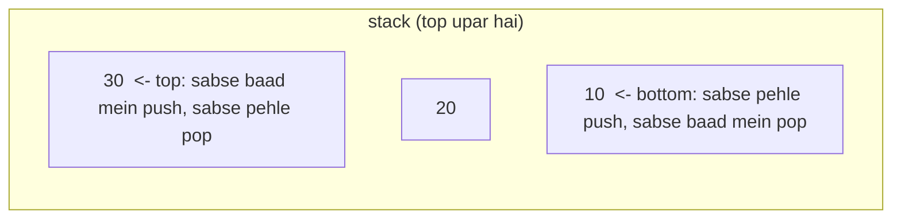

# Chapter 11 · Stacks & Monotonic Stacks

> Jab bhi tum Ctrl+Z dabaate ho, editor tumhara *aakhri* kaam undo karta hai, pehla nahi. Jab bhi browser ka back button dabaate ho, tum us page pe wapas jaate ho jo tumne *sabse haal mein* dekha tha. Dono ke peeche duniya ka sabse seedha-saadha data structure hai: ek dher jisme tum sirf upar wali cheez chhoo sakte ho. Itna simple ki paanch minute mein seekh loge, aur phir baaki chapter ye dhoondhne mein jaayega ki isme kitni taakat chhupi hai.

**Is chapter mein tum seekhoge:**
- **LIFO** ka matlab kya hai aur Python list already ek perfect stack kyun hai
- Stack khud kaise implement karte hain (list pe bhi aur linked list pe bhi)
- **Matching** pattern: valid parentheses, decode string, simplify path, calculators
- Stacks jo extra info yaad rakhte hain: **min stack**, stock span
- **Monotonic stack**: ek template jo O(n) mein har element ka "next greater / smaller element" dhundh deta hai
- Bade monotonic-stack problems: daily temperatures, largest rectangle in histogram, maximal rectangle, trapping rain water, remove k digits
- Stack recursion ki jagah kaise le leta hai (computer waise bhi yahi karta hai)

**Isse pehle padho:** [Lists](../part-1-python/07-lists.md) · [Big-O](01-big-o-complexity.md) · [Linked Lists](10-linked-lists.md)

---

## 🧠 The Big Idea · Asli Baat

Canteen mein plates ka ek dher socho. Tum sirf ye kar sakte ho:
- **push**: upar ek plate rakho,
- **pop**: upar wali plate utha lo,
- **peek**: upar wali plate ko bina uthaye dekh lo.

Beech se plate kheencho toh poora dher gir jaayega. Jo plate tumne sabse aakhir mein rakhi, wahi sabse pehle uthegi: **LIFO**, Last In, First Out.



Itna restricted structure koi kyun chahega? Kyunki bahut saare problems ka shape **"sabse haal ka adhoora kaam"** (most recent unfinished thing) wala hota hai:

- `( [ { } ] )` mein jo bracket agla band hona chahiye, woh **sabse haal mein khula** hua bracket hai.
- Jab function A ne B ko call kiya aur B ne C ko, toh sabse pehle C ko khatam hona hai, jo **sabse haal mein call** hua.
- Jab tum din-ba-din temperatures padh rahe ho, jo din abhi "garam din ka intezaar" kar rahe hain, unke answers **sabse naye** se sabse purane ki taraf milte hain.

Jab bhi tumhe abhi jo chahiye woh sabse haal ka adhoora kaam hai, stack use O(1) mein haath mein de deta hai.

> 🇮🇳 **Desi Analogy:** Tum homework kar rahe ho. Mummy ne awaaz di "chai bana do". Homework wahin chhoda (push), chai chadhayi. Chai ubal rahi thi ki doorbell baji (push chai), darwaza khola, courier wale se baat ki. Courier gaya (pop), wapas chai pe aaye. Chai bani (pop), wapas homework pe. Tum hamesha **sabse naye adhoore kaam** pe lautte ho, sabse purane pe nahi. Tumhara dimaag yahan ek stack chala raha tha: homework sabse neeche, chai beech mein, darwaza sabse upar.

> 💡 **The core insight:** stack "woh kaam jo shuru kiye lekin khatam nahi hue" ki memory hai, aur woh hamesha sabse naya pehle deta hai. Problem mein "most recent unfinished" dikha, matlab stack dikh gaya.

---

## 🔨 Building It Up · Zero Se Shuru

### 1. A Python list is a stack

Python list ka **end** ek perfect stack top hai: `append` push karta hai, `pop()` pop karta hai, `[-1]` peek karta hai, sab O(1).

```python
stack = []
stack.append(10)       # push
stack.append(20)
stack.append(30)
print("stack:", stack, "top:", stack[-1])

print("popped:", stack.pop())
print("popped:", stack.pop())
print("stack:", stack, "empty?", not stack)
print("popped:", stack.pop())
print("empty?", not stack)
```

```text
stack: [10, 20, 30] top: 30
popped: 30
popped: 20
stack: [10] empty? False
popped: 10
empty? True
```

Kya hua yahan: list ka **end** top hai. Front (`insert(0, x)` / `pop(0)`) ko kabhi top mat banao: woh har element ko khisakaate hain aur O(n) lagta hai. `not stack` Python ka "kya ye khaali hai?" wala test hai ([Truthiness](../part-1-python/05-conditionals.md)).

> 🤔 **Mann mein sawaal:** List ke end ko top kyun maana? Front ko top maan lo toh kya farak padta hai, stack toh stack hai?
>
> **Jawab:** Logic mein koi farak nahi, speed mein bahut. List memory mein ek line ki tarah hai. End pe kuch jodna ya hatana = bas aakhri khaane ko chhoona, O(1). Front pe kuch daalna = baaki saare items ek khaana khisakao, O(n). 1 lakh items pe ye 1 lakh guna slow hai. Isliye top hamesha end.

### 2. Implementing a stack yourself

Interviewers kabhi-kabhi khud banane ko kehte hain. Do classic implementations: list ke upar, aur linked list ke upar ([Chapter 10](10-linked-lists.md)), jahan head hi top hai.

```python
class ArrayStack:
    def __init__(self):
        self._items = []

    def push(self, x):
        self._items.append(x)

    def pop(self):
        if not self._items:
            raise IndexError("pop from empty stack")
        return self._items.pop()

    def peek(self):
        if not self._items:
            raise IndexError("peek at empty stack")
        return self._items[-1]

    def __len__(self):
        return len(self._items)


class _Node:
    def __init__(self, val, next=None):
        self.val, self.next = val, next

class LinkedStack:
    def __init__(self):
        self._head = None          # list ka head = stack ka top
        self._size = 0

    def push(self, x):
        self._head = _Node(x, self._head)   # naya node purane top ko point karta hai
        self._size += 1

    def pop(self):
        if self._head is None:
            raise IndexError("pop from empty stack")
        val = self._head.val
        self._head = self._head.next
        self._size -= 1
        return val

    def peek(self):
        if self._head is None:
            raise IndexError("peek at empty stack")
        return self._head.val

    def __len__(self):
        return self._size


for stack in (ArrayStack(), LinkedStack()):
    for x in "abc":
        stack.push(x)
    print(type(stack).__name__, stack.pop(), stack.peek(), len(stack))
    stack.pop(); stack.pop()
    try:
        stack.pop()
    except IndexError as e:
        print("error:", e)
```

```text
ArrayStack c b 2
error: pop from empty stack
LinkedStack c b 2
error: pop from empty stack
```

Kya hua yahan: dono O(1) push/pop/peek dete hain. List wala version practice mein tez hai (contiguous memory); linked wale ko kabhi resize nahi karna padta. Khaali stack pe pop karne pe `IndexError` raise karna wahi hai jo Python ka apna `list.pop()` karta hai.

Linked version mein head ko top kyun banaya, tail ko kyun nahi? Singly linked list mein head pe jodna aur hatana dono O(1) hain. Tail pe jodna O(1) ho sakta hai (tail pointer se), lekin tail *hatana* O(n) hai, kyunki naye tail (pichhle node) tak pahunchne ke liye head se chalna padega.

### 3. Valid Parentheses: the matching pattern

**Problem:** `()[]{}` ki ek string theek se balanced hai ya nahi? `"([]{})"` haan, `"([)]"` nahi.

Har closing bracket ko **sabse haal mein khule, abhi tak band na hue** bracket se match karna chahiye. Woh stack ka top hai.

```python
def is_valid(s):
    pairs = {")": "(", "]": "[", "}": "{"}
    stack = []
    for ch in s:
        if ch in pairs:                              # closer hai
            if not stack or stack[-1] != pairs[ch]:
                return False                         # kuch khula hi nahi, ya galat type
            stack.pop()                              # match hua: woh opener khatam
        else:
            stack.append(ch)                         # opener hai: yaad rakho
    return not stack                                 # bache hue = band na hue openers

for s in ["()[]{}", "(]", "([)]", "{[]}", "(", ")"]:
    print(repr(s), is_valid(s))
```

```text
'()[]{}' True
'(]' False
'([)]' False
'{[]}' True
'(' False
')' False
```

**Dry run**, `"{[]}"` ke liye:

| char | action | stack after |
|---|---|---|
| `{` | push | `{` |
| `[` | push | `{ [` |
| `]` | top `[` hai ✓ pop | `{` |
| `}` | top `{` hai ✓ pop | (khaali) |
| end | stack khaali | ✅ valid |

Kya hua yahan: fail hone ke teen tareeke, har check ka ek: khaali stack pe closer (`")"`), galat type ka closer (`"(]"`), ya end mein bache hue openers (`"("`).

`"([)]"` kyun fail hua? `(` push, `[` push, ab `)` aaya lekin top `[` hai. `)` ko `(` chahiye tha, lekin pehle `[` band hona chahiye kyunki woh baad mein khula tha. Galat type → False.

> 🇮🇳 **Desi Analogy:** Ghar ke steel ke dabbe socho jo ek ke andar ek rakhe jaate hain: bada dabba, uske andar medium, uske andar chhota. Band karte waqt pehle chhota band hoga (jo sabse baad mein khula), phir medium, phir bada. Agar medium ka dhakkan chhote dabbe pe lagaane ki koshish karo toh fit nahi hoga. Opener = dabba kholna (push), closer = dhakkan lagaana (pop), aur dhakkan hamesha sabse upar wale khule dabbe pe hi lagta hai.

### 4. Min Stack: a stack that remembers extra info

**Problem:** ek stack design karo jisme `push`, `pop`, `top` aur `get_min` hon, **sab O(1)**.

Minimum dhundne ke liye scan karna O(n) hai. Trick: har element ke saath store karo **jis pal woh push hua us pal stack ka minimum**. Kyunki stack sirf top se hi hatata hai, neeche wale elements kabhi nahi badalte, toh unke saved minimums sahi rehte hain.

```python
class MinStack:
    def __init__(self):
        self.stack = []                    # pairs: (value, yahan tak sab ka min)

    def push(self, val):
        current_min = min(val, self.stack[-1][1]) if self.stack else val
        self.stack.append((val, current_min))

    def pop(self):
        self.stack.pop()

    def top(self):
        return self.stack[-1][0]

    def get_min(self):
        return self.stack[-1][1]

ms = MinStack()
for x in [-2, 0, -3]:
    ms.push(x)
print(ms.get_min())
ms.pop()
print(ms.top(), ms.get_min())
```

```text
-3
0 -2
```

Kya hua yahan: -2, 0, -3 push karne ke baad stack `[(-2, -2), (0, -2), (-3, -3)]` hai. `(-3, -3)` pop karne se `(0, -2)` saamne aata hai, jiska saved minimum -2 hai, jo bache hue elements ka sahi minimum hai. Stack ki "history" hamesha bas top ke neeche ke elements hoti hai, aur isi wajah se ye kaam karta hai.

> 🇮🇳 **Desi Analogy:** Building mein har floor pe ek board laga hai: "ground floor se is floor tak sabse sasta flat ₹X ka hai". Naya floor banta hai toh uske board pe likhte ho min(is floor ka rate, neeche wale board ka number). Upar ka floor tod do (pop), toh neeche wale floor ka board ab bhi bilkul sahi hai, kyunki uske neeche kuch nahi badla. Kisi bhi waqt "sabse sasta kaunsa?" poocho, bas top floor ka board padh lo: O(1).

> 🤔 **Mann mein sawaal:** Ek variable `self.min` rakh lein toh? Pairs ki kya zaroorat?
>
> **Jawab:** Push pe toh chal jaayega, pop pe phans jaaoge. Agar minimum wala element pop ho gaya, toh naya minimum kya hai? Ek variable ko pata hi nahi ki "pichhla" minimum kya tha, aur dhundhne ke liye poora stack scan karna padega, O(n). Har level pe minimum save karne se pop ke baad bhi purana minimum wahin likha mila.

### 5. Evaluate Reverse Polish Notation

**Reverse Polish Notation (RPN)** mein operators apne operands ke *baad* aate hain: `3 4 +` matlab 3 + 4, aur `2 1 + 3 *` matlab (2 + 1) × 3. Parentheses ki kabhi zaroorat nahi. Calculators aur compilers ise pasand karte hain kyunki stack ise ek pass mein evaluate kar deta hai:

- Number → push karo.
- Operator → do numbers pop karo, operation lagao, result push karo.

```python
def eval_rpn(tokens):
    stack = []
    for tok in tokens:
        if tok in {"+", "-", "*", "/"}:
            b = stack.pop()            # DOOSRA operand top pe hai
            a = stack.pop()
            if tok == "+":
                stack.append(a + b)
            elif tok == "-":
                stack.append(a - b)
            elif tok == "*":
                stack.append(a * b)
            else:
                stack.append(int(a / b))   # zero ki taraf truncate, jaisa problem chahti hai
        else:
            stack.append(int(tok))
    return stack[0]

print(eval_rpn(["2", "1", "+", "3", "*"]))
print(eval_rpn(["4", "13", "5", "/", "+"]))
print(eval_rpn(["10", "6", "9", "3", "+", "-11", "*", "/", "*", "17", "+", "5", "+"]))
```

```text
9
6
22
```

Kya hua yahan: `-` aur `/` ke liye order matter karta hai: stack ka top **right** operand hai. Aur `int(a / b)` zero ki taraf truncate karta hai (`int(-6 / 4)` -1 hai), jabki `a // b` floor karta hai (`-6 // 4` -2 hai). Problem truncation chahti hai.

Doosra example trace karo: `4` push, `13` push, `5` push → stack `[4, 13, 5]`. `/` aaya: b = 5, a = 13, `int(13 / 5)` = 2 → `[4, 2]`. `+` aaya: b = 2, a = 4, 6 → `[6]`. Answer 6.

### 6. The basic calculator idea

**Basic Calculator:** `+`, `-`, parentheses aur spaces wali string evaluate karo, jaise `"(1+(4+5+2)-3)+(6+8)"`.

Bina parentheses ke ye aasaan hai: ek chalta hua `result` rakho, number padho, current `sign` ke saath jodo. Parentheses ek **nayi sub-calculation** shuru karte hain. Jab `(` dikhe, current result aur sign ko **push** karo (hamara "adhoora kaam"), aur fresh shuru karo. Jab `)` dikhe, andar ka result poora karo aur **pop** karke saved kaam ke saath jodo.

```python
def calculate(s):
    stack = []
    result, number, sign = 0, 0, 1
    for ch in s:
        if ch.isdigit():
            number = number * 10 + int(ch)      # multi-digit numbers banao
        elif ch in "+-":
            result += sign * number             # pichhla number khatam karo
            number = 0
            sign = 1 if ch == "+" else -1
        elif ch == "(":
            stack.append(result)                # bahar ka adhoora kaam save karo
            stack.append(sign)
            result, sign = 0, 1                 # andar ki fresh calculation shuru
        elif ch == ")":
            result += sign * number             # andar ki calculation khatam
            number = 0
            result *= stack.pop()               # "(" se pehle wala sign
            result += stack.pop()               # "(" se pehle wala bahar ka result
    return result + sign * number

for expr in ["1 + 1", " 2-1 + 2 ", "(1+(4+5+2)-3)+(6+8)", "-(2+3)"]:
    print(repr(expr), "=", calculate(expr))
```

```text
'1 + 1' = 2
' 2-1 + 2 ' = 3
'(1+(4+5+2)-3)+(6+8)' = 23
'-(2+3)' = -5
```

Kya hua yahan: stack mein exactly woh "rukii hui" bahar ki calculations hain, sabse nayi top pe, jo nested parentheses ko bilkul yahi chahiye. Spaces kisi bhi `if` mein nahi aate, toh ignore ho jaate hain. `*` aur `/` ke saath (Basic Calculator II, Interview Q10) idea thoda badalta hai: signed terms push karo, aur `*` aur `/` ko turant top term pe lagao.

`"-(2+3)"` ko slow motion mein: `-` aaya → result += 1·0 = 0, sign = −1. `(` aaya → push 0, push −1, fresh result = 0, sign = +1. `2`, `+`, `3` → andar result = 2, phir `)` pe 2 + 3 = 5. Pop sign −1 → result = −5. Pop 0 → −5 + 0 = −5. ✓

### 7. Decode String

**Problem:** `"3[a2[c]]"` → `"accaccacc"`. Ek number `k` ke baad `[...]` ka matlab hai "andar wale ko k baar repeat karo", aur brackets nest ho sakte hain.

Calculator wala hi shape: `[` pe ab tak bani **string** aur **repeat count** push karo, phir fresh string shuru karo. `]` pe unhe pop karke jodo: `previous + inner * k`.

```python
def decode_string(s):
    stack = []                 # pairs: (bracket se pehle ki string, repeat count)
    current, k = "", 0
    for ch in s:
        if ch.isdigit():
            k = k * 10 + int(ch)
        elif ch == "[":
            stack.append((current, k))     # bahar ka kaam rok do
            current, k = "", 0
        elif ch == "]":
            prev, times = stack.pop()
            current = prev + current * times
        else:
            current += ch
    return current

print(decode_string("3[a]2[bc]"))
print(decode_string("3[a2[c]]"))
print(decode_string("2[abc]3[cd]ef"))
```

```text
aaabcbc
accaccacc
abcabccdcdcdef
```

**Dry run**, `"3[a2[c]]"` ke liye:

| char | current | k | stack |
|---|---|---|---|
| `3` | "" | 3 | |
| `[` | "" | 0 | ("", 3) |
| `a` | "a" | 0 | ("", 3) |
| `2` | "a" | 2 | ("", 3) |
| `[` | "" | 0 | ("", 3), ("a", 2) |
| `c` | "c" | 0 | ("", 3), ("a", 2) |
| `]` | "a" + "c"×2 = "acc" | 0 | ("", 3) |
| `]` | "" + "acc"×3 = "accaccacc" | 0 | |

> 🇮🇳 **Desi Analogy:** Dabbawala ka tiffin socho jisme ek dabba ke andar doosra dabba hai. Bahar wale pe likha hai "×3", andar wale pe "×2". Andar wala dabba pehle kholna padega (sabse haal mein khula `[`), uska saaman 2 baar copy karo, phir bahar wale ka poora saaman 3 baar. Bahar ka kaam (`"a"`, 2) tab tak stack pe intezaar karta hai.

### 8. Simplify Path

**Problem:** Unix path ko uske sabse simple form mein badlo. `"/a/./b/../../c/"` → `"/c"`. `.` matlab "yahi folder", `..` matlab "ek folder upar jao".

Folders ek stack banate hain: folder ke andar jaana push hai, `..` pop hai.

```python
def simplify_path(path):
    stack = []
    for part in path.split("/"):
        if part == "..":
            if stack:
                stack.pop()          # upar jao (lekin root se upar kabhi nahi)
        elif part and part != ".":
            stack.append(part)       # asli folder ka naam
        # khaali parts ("//" se) aur "." ignore hote hain
    return "/" + "/".join(stack)

for p in ["/home/", "/../", "/home//foo/", "/a/./b/../../c/", "/.../a/../b"]:
    print(p, "->", simplify_path(p))
```

```text
/home/ -> /home
/../ -> /
/home//foo/ -> /home/foo
/a/./b/../../c/ -> /c
/.../a/../b -> /.../b
```

Kya hua yahan: `split("/")` tokenising ka kaam hamare liye kar deta hai. Dhyaan do, `"..."` ek valid folder naam hai, koi special symbol nahi.

`"/a/./b/../../c/"` ka split: `["", "a", ".", "b", "..", "..", "c", ""]`. Stack: `a` → `[a]`, `.` ignore, `b` → `[a, b]`, `..` → `[a]`, `..` → `[]`, `c` → `[c]`. Result `/c`.

### 9. Asteroid Collision

**Problem:** asteroids ek line mein chal rahe hain; positive = right ja raha hai, negative = left ja raha hai, size = absolute value. Jab do takrate hain, chhota phat jaata hai; barabar size pe dono phat jaate hain. Kya bachta hai?

Takkar sirf tab hoti hai jab ek **left-moving** asteroid apne *pehle* (left mein) khade ek **right-moving** asteroid se milta hai. Takkar ka intezaar karne wale right-movers ek stack pe baithe hain; har naya left-mover stack ke top se ladta hai jab tak woh khud mar na jaaye ya stack mein koi right-mover na bache.

```python
def asteroid_collision(asteroids):
    stack = []
    for a in asteroids:
        alive = True
        while alive and a < 0 and stack and stack[-1] > 0:   # aamne-saamne ki takkar
            if stack[-1] < -a:
                stack.pop()              # top phata; a left ki taraf udta raha
            elif stack[-1] == -a:
                stack.pop()              # dono phate
                alive = False
            else:
                alive = False            # a phata
        if alive:
            stack.append(a)
    return stack

print(asteroid_collision([5, 10, -5]))
print(asteroid_collision([8, -8]))
print(asteroid_collision([10, 2, -5]))
print(asteroid_collision([-2, -1, 1, 2]))
```

```text
[5, 10]
[]
[10]
[-2, -1, 1, 2]
```

Kya hua yahan: aakhri example mein koi takkar nahi hoti: left-movers already right-movers ke left mein hain, toh woh ek doosre se door udte hain. Har asteroid ek baar push hota hai aur max ek baar pop: O(n).

`[10, 2, -5]` pe: 10 push, 2 push. −5 aaya: top 2 < 5 → 2 phata, −5 chalta raha. Top 10 > 5 → −5 phata. Result `[10]`.

### 10. The monotonic stack, decoded

Ab aata hai bada wala. **Next Greater Element:** har element ke liye, uske **right** mein pehla aisa element dhundo jo **bada** ho. `[2, 1, 2, 4, 3]` → `[4, 2, 4, -1, -1]`.

Brute force: har element ke liye right mein scan karo. O(n²).

Insight: socho log ek line mein khade hain, aur har koi right ki taraf dekh raha hai ki pehla lamba banda kaun hai. Line mein left se right chalo. Un logon ka ek stack rakho jo **abhi bhi apne answer ka intezaar** kar rahe hain. Jab naya banda aata hai, stack ke top pe usse chhote jitne bhi log hain, unhe **abhi abhi answer mil gaya**: yahi naya banda. Unhe pop karo aur answer likh do. Phir naya banda khud waiting stack mein shamil ho jaata hai.

Dekho isse stack ka kya hota hai: hum naye bande ko tabhi push karte hain jab usse chhote sab hat gaye, isliye stack hamesha bottom se top tak **decreasing** rehta hai. Yahi **monotonic stack** hai: ek stack jiske contents "push se pehle pop karo" wale rule se sorted rehte hain.

```python
def next_greater(nums):
    result = [-1] * len(nums)        # default: right mein koi bada nahi
    stack = []                       # woh indexes jo answer ka intezaar kar rahe hain
    for i, x in enumerate(nums):
        while stack and nums[stack[-1]] < x:
            result[stack.pop()] = x  # x us index ka pehla bada element hai
        stack.append(i)
    return result

print(next_greater([2, 1, 2, 4, 3]))
print(next_greater([1, 3, 2, 4]))
```

```text
[4, 2, 4, -1, -1]
[3, 4, 4, -1]
```

**Dry run**, `[2, 1, 2, 4, 3]` ke liye (padhne mein aasaani ke liye stack mein values dikhayi hain; code indexes store karta hai):

| i | x | pops (aur unka answer) | stack after (values) | result |
|---|---|---|---|---|
| 0 | 2 | koi nahi | 2 | [-1, -1, -1, -1, -1] |
| 1 | 1 | koi nahi (2 > 1) | 2, 1 | |
| 2 | 2 | 1 → answer 2 | 2, 2 | [-1, 2, -1, -1, -1] |
| 3 | 4 | 2 → 4, 2 → 4 | 4 | [4, 2, 4, -1, -1] |
| 4 | 3 | koi nahi (4 > 3) | 4, 3 | |
| end | | 4 aur 3 ko kabhi answer nahi mila | | -1 hi rahe |

Kya hua yahan: har index **ek baar push aur max ek baar pop** hota hai. Toh `for` ke andar `while` hone ke bawajood kul kaam O(n) hai. Yahi amortised argument hai, aur jis bhi interview mein ye pattern aaye, tum ise zaroor bologe.

> 🇮🇳 **Desi Analogy:** School assembly mein bachche ek line mein khade hain, aur har bachcha right ki taraf dekh ke batana chahta hai "mujhse pehla lamba kaun hai?". PT sir left se right chalte hain. Har naya bachcha aata hai toh peeche ke jo chhote bachche abhi tak "intezaar" mein haath uthaye khade hain, unhe sir bolte hain "tumhara answer yahi hai, haath neeche karo" (pop). Jo naye bachche se lamba hai, woh haath uthaye khada rehta hai. Isliye haath uthaye bachche hamesha lambe se chhote order mein hote hain (decreasing). Aur jinke haath end tak uthe rahe, unka answer -1.

> 💡 Stack mein **indexes** store karo, values nahi. Index se tum value (`nums[i]`) *aur* doori (`i - j`) dono nikaal sakte ho, aur tumhe pata hota hai answer kahan likhna hai.

> 🤔 **Mann mein sawaal:** `for` ke andar `while` hai, toh ye O(n²) kyun nahi hai?
>
> **Jawab:** Kyunki `while` har baar ek element *pop* karta hai, aur ek element poore program mein sirf ek baar pop ho sakta hai (kyunki woh sirf ek baar push hua tha). Toh saare `for` iterations milake bhi `while` max n baar chal sakta hai. Socho ek bank mein n log aate hain aur har banda max ek baar counter pe jaata hai: kuch din counter pe 5 log jaate hain, kuch din 0, lekin kul milake n se zyada kabhi nahi. Total O(n) + O(n) = **O(n)**.

### 11. The four flavours: next/previous, greater/smaller

Do cheezein badlo, comparison aur answer kahan se padhte ho, aur charon classic sawaal mil jaate hain:

| Question | Stack rakhta hai... | Pop karo jab tak | Answer kahan se |
|---|---|---|---|
| **Next greater** | decreasing | `nums[top] < x` | pop hue index ko `x` milta hai |
| **Next smaller** | increasing | `nums[top] > x` | pop hue index ko `x` milta hai |
| **Previous greater** | decreasing | `nums[top] <= x` | popping ke baad, `x` ko top milta hai (agar ho) |
| **Previous smaller** | increasing | `nums[top] >= x` | popping ke baad, `x` ko top milta hai (agar ho) |

```python
def next_smaller(nums):
    res, stack = [-1] * len(nums), []
    for i, x in enumerate(nums):
        while stack and nums[stack[-1]] > x:
            res[stack.pop()] = x
        stack.append(i)
    return res

def previous_greater(nums):
    res, stack = [-1] * len(nums), []
    for i, x in enumerate(nums):
        while stack and nums[stack[-1]] <= x:
            stack.pop()                       # ye ab kabhi kisi ka previous greater nahi banega
        res[i] = nums[stack[-1]] if stack else -1
        stack.append(i)
    return res

def previous_smaller(nums):
    res, stack = [-1] * len(nums), []
    for i, x in enumerate(nums):
        while stack and nums[stack[-1]] >= x:
            stack.pop()
        res[i] = nums[stack[-1]] if stack else -1
        stack.append(i)
    return res

nums = [3, 7, 1, 7, 8, 4]
print("next smaller:    ", next_smaller(nums))
print("previous greater:", previous_greater(nums))
print("previous smaller:", previous_smaller(nums))
```

```text
next smaller:     [1, 1, -1, 4, 4, -1]
previous greater: [-1, -1, 7, -1, -1, 8]
previous smaller: [-1, 3, -1, 1, 7, 1]
```

Kya hua yahan: "previous" sawaalon mein `x` ka answer woh hai jo un sabko pop karne **ke baad** top pe bacha hai jo uska answer nahi ho sakte. Pop hue elements `x` ki "parchhai" mein chale gaye: right mein aage aane wala koi bhi pehle `x` ko dekhega, toh pop hue elements hamesha ke liye bekaar hain. Wahi "hamesha ke liye bekaar" wajah hai ki hum unhe phenk sakte hain.

`previous_greater` ko `[3, 7, 1, 7, 8, 4]` pe dekho, aakhri element 4 ke liye: tab stack mein (values) `8` hai. 8 ≤ 4? Nahi, toh pop nahi. Top 8 → answer 8. Aur pehle wala 7 (index 3) kahan gaya? Jab 8 aaya tha, usne 7 ko pop kar diya tha, kyunki 8 ke right mein jo bhi hai woh 7 se pehle 8 ko dekhega, aur 8 bada hai. 7 ki ab koi zaroorat nahi.

> 🇮🇳 **Desi Analogy:** "Previous greater" ko Mumbai ki skyline jaisa socho. Tum Marine Drive pe khade ho kar left ki taraf dekh rahe ho, "mujhse ooncha pehla building kaunsa dikhta hai?". Agar tumhare aur ek chhote building ke beech ek bada tower khada hai, toh chhota building tumhe kabhi dikhega hi nahi, tower use dhak leta hai. Naya tower aate hi peeche ke chhote buildings "parchhai" mein chale jaate hain (pop), kisi ko kabhi nahi dikhenge.

### 12. Daily Temperatures

**Problem:** har din ke liye, kitne din baad zyada garam temperature aayega? Kabhi nahi toh 0. Ye "next greater" hi hai, lekin answer value ki jagah **doori** hai, isiliye hum indexes store karte hain.

```python
def daily_temperatures(temps):
    answer = [0] * len(temps)
    stack = []                                   # garmi ka intezaar karte dinon ke indexes
    for i, t in enumerate(temps):
        while stack and temps[stack[-1]] < t:
            j = stack.pop()
            answer[j] = i - j                    # kitne din intezaar kiya
        stack.append(i)
    return answer

print(daily_temperatures([73, 74, 75, 71, 69, 72, 76, 73]))
```

```text
[1, 1, 4, 2, 1, 1, 0, 0]
```

O(n) time, O(n) space.

Day 2 (75°) ka answer 4 kyun? 75 ke baad 71, 69, 72 sab thande hain. Day 6 (76°) pe jaake garam din aata hai: 6 − 2 = 4. Is beech 75 stack mein neeche baitha intezaar karta raha, jabki 71, 69 upar aaye aur 72 ne unhe pop kar diya.

### 13. Online Stock Span

**Problem:** prices roz ek-ek aati hain. Har din ka **span** = aaj tak (aaj ko milake) lagaataar kitne din price ≤ aaj ki price thi.

Ye hai "pichhli **badi** price kitne din peeche thi?". `(price, span)` pairs ka stack rakho. Jab aaj ki price top se ≥ hai, aaj ka span top ka span **nigal leta hai**: woh din cover ho gaye aur unki alag se kabhi zaroorat nahi padegi.

```python
class StockSpanner:
    def __init__(self):
        self.stack = []                       # (price, span), prices decreasing

    def next(self, price):
        span = 1
        while self.stack and self.stack[-1][0] <= price:
            span += self.stack.pop()[1]       # chhote din ka poora span nigal lo
        self.stack.append((price, span))
        return span

spanner = StockSpanner()
print([spanner.next(p) for p in [100, 80, 60, 70, 60, 75, 85]])
```

```text
[1, 1, 1, 2, 1, 4, 6]
```

Kya hua yahan: 75 wale din stack mein `(100,1), (80,1), (70,2), (60,1)` hai. 75 `(60,1)` aur `(70,2)` ko pop karta hai, span 1 + 1 + 2 = 4 deta hai, aur 80 pe ruk jaata hai. Har price kul milake ek baar push aur ek baar pop hoti hai: har call **amortised O(1)**.

> 🇮🇳 **Desi Analogy:** Sensex ki khabar: "Aaj Sensex pichhle 6 din ka sabse ooncha band hua". News wale har din peeche ke saare din nahi ginte. Kal ka "streak" number yaad hai, toh aaj agar kal se ooncha hai, kal ka poora streak aaj mein jud jaata hai (nigal liya). Jo din kisi bade din ke streak mein ghul gaye, unhe dobara alag se ginne ki zaroorat kabhi nahi.

### 14. Largest Rectangle in Histogram

**Problem:** width 1 ke bars, di gayi heights ke saath. Histogram ke andar fit hone wala sabse bada rectangle ka area dhundo. `[2, 1, 5, 6, 2, 3]` → 10 (heights 5 aur 6, width 2, height 5).

**Key idea:** best rectangle mein koi na koi bar **sabse chhota** hoga, aur rectangle us bar se left aur right tab tak failta hai jab tak koi chhota bar na takra jaaye. Toh har bar ke liye humein uska **previous smaller** aur **next smaller** bar chahiye: us bar ki height wala rectangle in dono ke beech ki jagah bharta hai.

Dono ek hi increasing stack se milte hain. Jab bar `i` top bar se chhota hai, top bar ko apna **next smaller** (`i`) mil gaya. Uska **previous smaller** woh bar hai jo ab stack mein uske neeche hai. Use pop karo aur uska rectangle nikaalo.

```python
def largest_rectangle_area(heights):
    stack = []                                    # indexes, heights increasing
    best = 0
    for i, h in enumerate(heights + [0]):         # sentinel 0 end mein stack khaali kar deta hai
        while stack and heights[stack[-1]] > h:
            height = heights[stack.pop()]         # ye bar apne rectangle mein sabse chhota hai
            left = stack[-1] if stack else -1     # previous smaller index
            width = i - left - 1                  # i next smaller index hai
            best = max(best, height * width)
        stack.append(i)
    return best

print(largest_rectangle_area([2, 1, 5, 6, 2, 3]))
print(largest_rectangle_area([2, 4]))
```

```text
10
4
```

**Dry run**, `[2, 1, 5, 6, 2, 3]` + sentinel `0`:

| i | h | popped bar (height) | left boundary | width | area | stack after (indexes) |
|---|---|---|---|---|---|---|
| 0 | 2 | | | | | 0 |
| 1 | 1 | idx 0 (2) | -1 | 1 | 2 | 1 |
| 2 | 5 | | | | | 1, 2 |
| 3 | 6 | | | | | 1, 2, 3 |
| 4 | 2 | idx 3 (6) | 2 | 1 | 6 | |
| | | idx 2 (5) | 1 | 2 | **10** | 1, 4 |
| 5 | 3 | | | | | 1, 4, 5 |
| 6 | 0 | idx 5 (3) | 4 | 1 | 3 | |
| | | idx 4 (2) | 1 | 4 | 8 | |
| | | idx 1 (1) | -1 | 6 | 6 | 6 |

Best = 10. O(n) time, O(n) space. Ye sabse zyada pooche jaane wale hard stack problems mein se ek hai; sentinel `0` woh trick hai jo alag cleanup loop se bachati hai.

Width ka formula `i - left - 1` kyun? Rectangle `left` aur `i` ke *beech* mein hai, dono ko chhod ke (dono chhote hain). Jaise `left = 1`, `i = 4`: beech mein index 2 aur 3, yaani 4 − 1 − 1 = 2 bars. Aur agar stack khaali hai (`left = -1`), matlab left mein koi chhota bar hai hi nahi, rectangle index 0 tak jaata hai.

> 🇮🇳 **Desi Analogy:** Shaadi ke liye ek lamba shamiana lagana hai jiske neeche alag-alag oonchai ki deewarein (bars) hain, aur shamiana kisi deewar se ooncha nahi ja sakta. Har deewar khud se poochti hai: "agar shamiane ki oonchai meri oonchai ho, toh main left-right kitna fail sakti hoon?" Jawab: jab tak dono taraf mujhse chhoti deewar na mile. Stack wahi deewarein yaad rakhta hai jinka "right mein chhoti deewar" abhi nahi mila.

> 🤔 **Mann mein sawaal:** Sentinel `0` na lagaayein toh kya hoga?
>
> **Jawab:** Loop khatam hone pe kuch bars stack mein reh jaayenge (jaise `[2, 4]` mein dono bars kabhi pop nahi hote, kyunki koi chhota bar aaya hi nahi). Unke rectangles kabhi calculate nahi honge, aur `[2, 4]` ka answer 4 ki jagah 0 aayega. `0` sabse chhota hai, toh woh end mein sabko pop karwa deta hai. Note: `heights + [0]` ek nayi list banata hai, original `heights` ko nahi badalta, isliye `heights[stack[-1]]` mein sentinel index kabhi padha nahi jaata (sentinel khud kabhi pop nahi hota).

### 15. Maximal Rectangle

**Problem:** `"0"`/`"1"` ki ek grid. Sirf 1s wala sabse bada rectangle dhundo.

**Idea:** har row ko ek histogram ki **zameen** maano. `heights[c]` = column c mein, is row pe khatam hone wale, ek ke upar ek kitne lagaataar 1s khade hain. Phir har row pe histogram algorithm chalao.

```python
def largest_rectangle_area(heights):
    stack, best = [], 0
    for i, h in enumerate(heights + [0]):
        while stack and heights[stack[-1]] > h:
            height = heights[stack.pop()]
            left = stack[-1] if stack else -1
            best = max(best, height * (i - left - 1))
        stack.append(i)
    return best

def maximal_rectangle(matrix):
    if not matrix:
        return 0
    heights = [0] * len(matrix[0])
    best = 0
    for row in matrix:
        for c, cell in enumerate(row):
            heights[c] = heights[c] + 1 if cell == "1" else 0   # 0 column ko reset kar deta hai
        best = max(best, largest_rectangle_area(heights))
    return best

grid = [list("10100"),
        list("10111"),
        list("11111"),
        list("10010")]
print(maximal_rectangle(grid))
```

```text
6
```

Kya hua yahan: teesri row ke baad `heights = [3, 1, 3, 2, 2]` hai, aur wahan best histogram rectangle height 2 × width 3 = 6 hai. Time O(rows × cols).

Row by row heights kaise bane:

| Row | Cells | heights |
|---|---|---|
| 1 | `1 0 1 0 0` | [1, 0, 1, 0, 0] |
| 2 | `1 0 1 1 1` | [2, 0, 2, 1, 1] |
| 3 | `1 1 1 1 1` | [3, 1, 3, 2, 2] |
| 4 | `1 0 0 1 0` | [4, 0, 0, 3, 0] |

### 16. Trapping Rain Water, the stack way

Ye tumne [Chapter 03](03-two-pointers.md) mein two pointers se solve kiya tha. Stack wala nazariya paani **parat dar parat** (layer by layer) bharta hai: bars ka ek decreasing stack rakho. Jab ek lamba bar aata hai, top wala bar ek **ghaati ka farsh** (valley floor) hai; naya bar uski right deewar hai aur stack mein uske neeche wala bar uski left deewar. Dono ke beech ka horizontal slab bhar do.

```python
def trap(height):
    stack, water = [], 0
    for i, h in enumerate(height):
        while stack and height[stack[-1]] < h:
            floor = height[stack.pop()]
            if not stack:
                break                                  # left deewar nahi: paani beh jaata hai
            left = stack[-1]
            width = i - left - 1
            depth = min(height[left], h) - floor       # chhoti deewar tak hi bharega
            water += width * depth
        stack.append(i)
    return water

print(trap([0, 1, 0, 2, 1, 0, 1, 3, 2, 1, 2, 1]))
print(trap([4, 2, 0, 3, 2, 5]))
```

```text
6
9
```

Kya hua yahan: two-pointer paani **column by column** (vertical strips) jodta hai; stack use **slab by slab** (horizontal layers) jodta hai. Dono O(n). Stack version O(n) space leta hai; two pointers O(1).

`[4, 2, 0, 3, 2, 5]` mein jab 3 (index 3) aata hai: floor 0 (index 2) pop, left deewar 2 (index 1), width 1, depth min(2, 3) − 0 = 2 → 2 units. Phir floor 2 (index 1) pop, left deewar 4 (index 0), width 2, depth min(4, 3) − 2 = 1 → 2 units. Pehle neeche ki patli layer, phir upar ki chaudi layer.

### 17. Remove K Digits

**Problem:** ek number string se `k` digits hatao taaki **sabse chhota** possible number bane. `"1432219"`, k = 3 → `"1219"`.

**Greedy insight:** number tab chhota hota hai jab uske **left** wale digits chhote hon. Toh left se right scan karte waqt, jab bhi current digit pichhle rakhe hue digit se chhota ho, us pichhle digit ko hatana faayda deta hai. Ye k pops ke budget wala ek **increasing** monotonic stack hai.

```python
def remove_k_digits(num, k):
    stack = []
    for d in num:
        while k and stack and stack[-1] > d:
            stack.pop()              # chhote se pehle bada digit: use hatao
            k -= 1
        stack.append(d)
    if k:
        stack = stack[:-k]           # deletions abhi bache hain: end se hatao (sabse bada tail)
    result = "".join(stack).lstrip("0")
    return result or "0"

print(remove_k_digits("1432219", 3))
print(remove_k_digits("10200", 1))
print(remove_k_digits("10", 2))
print(remove_k_digits("12345", 2))
```

```text
1219
200
0
123
```

Kya hua yahan: `"12345"` mein digits already increasing hain, toh loop kabhi pop nahi karta; bacha hua k hum end pe kharch karte hain. Leading zeros hata diye jaate hain, aur khaali result `"0"` ban jaata hai.

`"1432219"`, k = 3 ka trace: `1` push → [1]. `4` push → [1, 4]. `3` aaya: 4 > 3, 4 hatao (k = 2), push → [1, 3]. `2` aaya: 3 > 2, 3 hatao (k = 1), push → [1, 2]. `2` aaya: barabar hai, pop nahi, push → [1, 2, 2]. `1` aaya: 2 > 1, ek 2 hatao (k = 0), budget khatam, push → [1, 2, 1]. `9` push → [1, 2, 1, 9]. Answer `"1219"` ✓.

> 🇮🇳 **Desi Analogy:** Dukaandaar ne price tag pe `1432219` likha hai aur tumhe usme se 3 digit mitaane ki chhut hai, taaki price sabse kam ho jaaye. Pehla digit sabse bhaari hai: ₹1,xxx aur ₹9,xxx mein farak pehle digit ka hi hai. Toh left se chalo, aur jab bhi dikhe ki pichhla bacha hua digit agle se bada hai, use mita do, kyunki agla chhota digit uski jagah aage aa jaayega aur price turant girega. Chhut (k) khatam, toh mitaana band. Agar poore tag pe digits badhte hi ja rahe hain (`12345`), toh sabse peeche wale (sabse kam weight wale) mitao.

### 18. A stack can replace recursion

Jab function khud ko call karta hai, Python **call stack** pe ek **frame** push karta hai; jab woh return karta hai, frame pop hota hai ([Recursion](../part-1-python/12-recursion.md)). Toh koi bhi recursion tumhare apne explicit stack se dobara likhi ja sakti hai. Kyun mehnat karein? Python ki ~1,000-frame recursion limit se bachne ke liye, aur kyunki interviewers DFS aur tree traversals ke "iterative" versions maangte hain ([Chapter 13](13-binary-trees.md)).

Graph pe **Depth-first search**, recursive aur iterative:

```python
graph = {"A": ["B", "C"], "B": ["D"], "C": ["D", "E"], "D": [], "E": []}

def dfs_recursive(node, seen, order):
    seen.add(node)
    order.append(node)
    for nb in graph[node]:
        if nb not in seen:
            dfs_recursive(nb, seen, order)
    return order

def dfs_iterative(start):
    seen, order = set(), []
    stack = [start]
    while stack:
        node = stack.pop()
        if node in seen:
            continue
        seen.add(node)
        order.append(node)
        for nb in reversed(graph[node]):    # reversed: taaki pehla padosi pehle pop ho
            if nb not in seen:
                stack.append(nb)
    return order

print(dfs_recursive("A", set(), []))
print(dfs_iterative("A"))

def flatten(nested):
    """Flatten arbitrarily deep lists without recursion."""
    out, stack = [], [nested]
    while stack:
        item = stack.pop()
        if isinstance(item, list):
            stack.extend(reversed(item))    # children ko left se right process karo
        else:
            out.append(item)
    return out

print(flatten([1, [2, [3, 4], 5], [[6]]]))
deep = [0]
for i in range(1, 5000):
    deep = [deep, i]                        # 5000 levels: recursion crash ho jaati
print(len(flatten(deep)))
```

```text
['A', 'B', 'D', 'C', 'E']
['A', 'B', 'D', 'C', 'E']
[1, 2, 3, 4, 5, 6]
5000
```

Kya hua yahan: explicit stack "jahan abhi jaana baaki hai" rakhta hai, bilkul waise jaise call stack "jo calls abhi khatam karni baaki hain" rakhta hai. Children ko **reverse** mein push karne se pehla child pehle bahar aata hai, isliye visiting order recursive version se match karta hai. 5,000-deep list recursive flatten ke saath `RecursionError` deti, lekin explicit stack heap pe rehta hai aur memory jitna bada ho sakta hai.

> 🤔 **Mann mein sawaal:** Iterative DFS mein `if node in seen: continue` kyun, jab push karte waqt bhi `if nb not in seen` check kiya hai?
>
> **Jawab:** Kyunki ek node do baar stack pe aa sakta hai, jab tak woh visit nahi hua. Yahan D ko B bhi push kar sakta hai aur C bhi (dono ka padosi hai). Push ke waqt D abhi "seen" nahi tha. Pop ke waqt dobara check karne se D sirf ek baar visit hota hai. Push wala check bas faltu entries kam karta hai; asli guarantee pop wala check deta hai.

---

## 🔬 Under the Hood · Andar Ki Kahani

### Why `list.append` and `list.pop()` are O(1)

Python list ek dynamic array hai: memory ka ek block jiske end pe kuch **spare capacity** hoti hai. `append` agle khaali slot mein likhta hai: O(1). Jab block bhar jaata hai, CPython ek bada block allocate karta hai (lagbhag 12.5% bada plus thoda sa) aur sab kuch copy karta hai: O(n), lekin kabhi-kabhaar. Bahut saare appends pe average karo toh **amortised O(1)** ([Arrays & Strings](02-arrays-strings.md)). End se `pop()` bas length ghata deta hai: O(1).

`pop(0)` aur `insert(0, x)` ko baaki har element ek slot khisakaana padta hai: O(n). Isiliye list-stack ka top **end** hai, aur isiliye queues `collections.deque` use karti hain ([Chapter 12](12-queues-deques.md)).

> 🇮🇳 **Desi Analogy:** Dynamic array ko ek shaadi ka tent samjho jisme 100 kursiyaan lagi hain lekin 80 mehmaan hain. Naya mehmaan aaya, khaali kursi pe baith gaya (O(1)). Jab 100 bhar gayi, tent wale ne bada tent lagaya aur sabko shift kiya (O(n)), lekin ye kabhi-kabhaar hota hai. Aakhri kursi wala uth ke chala jaaye (`pop()`) toh kisi ko hilna nahi padta. Lekin pehli kursi wala uthe aur sab aage khisakein (`pop(0)`), toh poora tent hilta hai.

### The call stack is a real stack

Har chalte hue function ka ek **frame** hota hai jisme uske local variables aur "wapas kahan se shuru karna hai" likha hota hai. Function call karna frame push karta hai; return karna pop karta hai. `RecursionError` sach mein ek stack overflow guard hai: CPython `sys.getrecursionlimit()` (default 1,000) se zyada frames push karne se mana kar deta hai, taaki neeche ka C stack crash na ho. Jab tum recursion ko explicit stack mein badalte ho, tumhara stack heap pe ek normal list hai, jiski limit sirf memory hai.

### Why the monotonic stack is O(n): the amortised argument

Code mein `for` loop ke andar `while` loop hai, jo O(n²) *dikhta* hai. Lekin kul kaam ko alag tareeke se gino: **har index exactly ek baar push hota hai aur max ek baar pop**. Kul pushes ≤ n, kul pops ≤ n, toh poore run mein saare `while` iterations milake max n hote hain. Total: **O(n)**.

### Why popped elements are never needed again (correctness)

"Next greater" mein, jab `x` aata hai aur apne left mein baithe ek chhote element `y` ko pop karta hai, `y` ko uska answer (`x`) mil gaya, toh uska kaam khatam. "Previous greater" mein, jab `x` ek chhote-ya-barabar `y` ko pop karta hai, toh aage aane wala koi bhi element left mein dekhte hue `y` se pehle `x` ko dekhega, aur `x` kam se kam utna bada hai. Toh `y` ab kabhi kisi ka "previous greater" nahi ban sakta. Use phenkne mein kuch nahi khota. Yahi "naya element purane ko **dominate** karta hai" wala argument har monotonic stack ka proof hai.

### Why the stack stays sorted

Hum `x` ko tabhi push karte hain jab uske saath order todne wale har element ko pop kar diya. Toh push ke theek baad top ke do elements order mein hain, aur neeche ka sab pehle se order mein tha. Induction se, stack hamesha monotonic rehta hai. Yahi sortedness `while` loop ko pehle aise element pe rukne deti hai jise pop karne ki zaroorat *nahi* hai.

---

## 🧩 Pattern Decoder · Pattern Pakdo

### Signals: when to reach for a stack

| Problem mein dikhe... | Socho |
|---|---|
| "valid parentheses", "balanced", "matching tags" | Matching stack |
| "nested", `k[...]`, "evaluate expression", "calculator" | Ruke hue kaam ka stack (open pe push, close pe pop) |
| "undo", "back", "path with `..`", "backspace" | Plain stack |
| "collide", "cancel adjacent", "remove adjacent duplicates" | Stack jahan naya item top se ladta hai |
| "next greater / smaller", "previous greater / smaller" | **Monotonic stack** |
| "how many days until warmer / higher", "span" | Indexes store karne wala monotonic stack |
| "largest rectangle", "maximal area of bars" | Monotonic increasing stack + boundaries |
| "remove k digits / letters to get the smallest result" | Monotonic stack + greedy budget |
| "sum over all subarrays of min/max" | Previous & next smaller → contribution counting |
| "iterative DFS / inorder without recursion" | Explicit stack |
| "O(1) getMin / getMax" | Pairs ka stack (value, running min) |

### Template A: matching / suspended work

```py
stack = []
for token in tokens:
    if opens(token):
        stack.append(state_to_resume_later)   # adhoora kaam push karo
    elif closes(token):
        if not stack or not matches(stack[-1], token):
            return invalid
        saved = stack.pop()
        combine(saved, current)               # andar ka hissa khatam karo
    else:
        update(current, token)
return not stack                              # ya final result
```

### Template B: monotonic stack (next greater)

```py
result = [default] * n
stack = []                                  # INDEXES; values monotonic hain
for i in range(n):
    while stack and nums[stack[-1]] < nums[i]:   # "next smaller" ke liye < ko > karo
        j = stack.pop()
        result[j] = nums[i]                 # ya doori ke liye i - j
    stack.append(i)
# stack mein bache indexes ko kabhi answer nahi mila (default rehne do)
```

### Decoding the four knobs

| Knob | Options | Effect |
|---|---|---|
| Comparison | pop condition mein `<` vs `>` | greater vs smaller |
| Strictness | `<` vs `<=` | equal values kaise treat hon ("strictly greater" vs "greater or equal") |
| Answer kab padhte ho | **pop** pe vs popping ke baad **top** se | next vs previous |
| Scan direction | left→right vs right→left | "next" answers nikaalne ka ek aur tareeka (right se scan karo, popping ke baad top padho) |

Memory trick: **"a decreasing stack finds greater elements; an increasing stack finds smaller elements."** (Jo order todta hai, wahi answer hai.) Hinglish mein: **"Ghatta stack bade dhundhta hai, badhta stack chhote."**

### Variation: Next Greater Element II (circular array)

**Problem:** array circular hai: aakhri element ke baad search shuru se continue hota hai. `[1, 2, 1]` → `[2, -1, 2]`.

**Idea:** array pe **do baar** loop karo (indexes `0 .. 2n-1`, `i % n` use karke), lekin indexes sirf pehle pass mein push karo. Doosra pass bas intezaar karne walon ko array ka shuru dikhata hai.

```python
def next_greater_circular(nums):
    n = len(nums)
    result = [-1] * n
    stack = []
    for i in range(2 * n):
        x = nums[i % n]
        while stack and nums[stack[-1]] < x:
            result[stack.pop()] = x
        if i < n:
            stack.append(i)          # sirf asli indexes ko answer chahiye
    return result

print(next_greater_circular([1, 2, 1]))
print(next_greater_circular([1, 2, 3, 4, 3]))
```

```text
[2, -1, 2]
[2, 3, 4, -1, 4]
```

O(n) time, O(n) space.

> 🇮🇳 **Desi Analogy:** Gol table pe baithe rishtedaar, har koi apne right mein "mujhse amir pehla kaun hai" dhundh raha hai. Table gol hai, toh aakhri kursi ke baad pehli kursi aati hai. Ek chakkar mein sabke answer nahi milte, toh doosra chakkar lagao, lekin doosre chakkar mein koi naya rishtedaar list mein nahi judta, sirf purane intezaar karne walon ko answer milta hai.

### Variation: Sum of Subarray Minimums (contribution technique)

**Problem:** **saare** contiguous subarrays ke `min(subarray)` ka sum. `[3, 1, 2, 4]` → 17. Brute force O(n²) ya usse bura hai.

**Idea:** sawaal palat do. "Har subarray ka min kya hai?" ki jagah poocho "**`arr[i]` kitne subarrays ka minimum hai?**" Agar `left` = previous smaller element tak ki doori aur `right` = next smaller-or-equal element tak ki doori, toh `arr[i]` exactly `left × right` subarrays ka minimum hai (left range mein koi bhi start chuno, right range mein koi bhi end). Contribution: `arr[i] × left × right`.

(Ek side pe `<` aur doosri side pe `<=` use karne se pakka hota hai ki equal values mein har subarray exactly ek ke liye gina jaaye.)

```python
def sum_subarray_mins(arr):
    n = len(arr)
    left, right = [0] * n, [0] * n
    stack = []
    for i in range(n):                       # previous strictly smaller
        while stack and arr[stack[-1]] >= arr[i]:
            stack.pop()
        left[i] = i - stack[-1] if stack else i + 1
        stack.append(i)
    stack = []
    for i in range(n - 1, -1, -1):           # next smaller-or-equal (right se scan)
        while stack and arr[stack[-1]] > arr[i]:
            stack.pop()
        right[i] = stack[-1] - i if stack else n - i
        stack.append(i)
    return sum(arr[i] * left[i] * right[i] for i in range(n)) % (10**9 + 7)

print(sum_subarray_mins([3, 1, 2, 4]))
print(sum_subarray_mins([11, 81, 94, 43, 3]))
```

```text
17
444
```

**Trace**, `[3, 1, 2, 4]` ke liye:

| i | arr[i] | left | right | jin subarrays mein ye min hai | contribution |
|---|---|---|---|---|---|
| 0 | 3 | 1 | 1 | [3] | 3 |
| 1 | 1 | 2 | 3 | index 1 wale saare 6 subarrays | 6 |
| 2 | 2 | 1 | 2 | [2], [2,4] | 4 |
| 3 | 4 | 1 | 1 | [4] | 4 |

Total = 3 + 6 + 4 + 4 = 17. ✓ O(n) time. Yahi technique "sum of subarray ranges" bhi solve karti hai (max aur min dono ke liye karo) aur kai hard problems mein aati hai.

`left × right` kyun? Element 1 (index 1) ke liye: start index 0 ya 1 ho sakta hai (left = 2 choices), end index 1, 2 ya 3 (right = 3 choices). Har (start, end) jodi ek alag subarray hai jisme 1 sabse chhota hai: 2 × 3 = 6.

> 🤔 **Mann mein sawaal:** Equal values pe ek side strict aur ek side non-strict kyun? Dono strict kar dein toh?
>
> **Jawab:** `[2, 2]` lo. Subarray `[2, 2]` ka min 2 hai, aur ye exactly ek baar ginna chahiye. Agar dono sides "strictly smaller" pe rukein, toh dono 2 apni range poore array tak failayenge aur `[2, 2]` do baar gina jaayega (double count). Agar dono "smaller-or-equal" pe rukein, toh dono ek doosre pe ruk jaayenge aur `[2, 2]` kisi ke hisse mein nahi aayega (miss). Ek side strict, ek non-strict: "barabar walon mein jo sabse left hai (ya right), credit usko".

### When NOT to use a stack

- **Sabse purana item pehle chahiye** (first come, first served, level-by-level BFS): woh **queue** hai ([Chapter 12](12-queues-deques.md)).
- **Sliding window ka max/min chahiye** jahan items purane end se bhi nikalte hain: woh **monotonic deque** hai ([Chapter 12](12-queues-deques.md)), stack nahi.
- **k-th largest chahiye ya baar-baar "sabse chhota do"**, random inserts ke saath: **heap** ([Chapter 15](15-heaps.md)).
- **Sirf kuch queries ke liye next greater element**: seedha scan shayad simple ho. Monotonic stack tab chamakta hai jab *har* element ka answer chahiye.

---

## ⚠️ Traps & Common Mistakes · Yahan Sab Phisalte Hain

1. **Khaali stack pe pop ya peek.** `[]` pe `stack[-1]` `IndexError` deta hai. Hamesha guard lagao: `while stack and ...`, `if not stack: ...`.
2. **End mein bache hue bhool jaana.** Valid Parentheses mein `"(("` loop ke andar ka har check paas kar leta hai. `not stack` return karo, `True` nahi.
3. **List ke front ko top banana.**

```py
# ❌ galat: har operation O(n)
stack.insert(0, x)
stack.pop(0)

# ✅ sahi: O(1)
stack.append(x)
stack.pop()
```

4. **RPN mein operand order.** `b = pop(); a = pop(); a - b`. Pehle `a` mein pop karoge toh `b - a` calculate hoga.
5. **`//` vs truncation.** `-7 // 2 == -4` lekin problem -3 chahti hai. `int(a / b)` use karo.
6. **Indexes chahiye the, values store kar di.** Daily Temperatures ko doori chahiye; histograms ko width. Indexes store karo aur values `nums[i]` se dekho.
7. **Duplicates ke saath galat strictness.** Sum of Subarray Minimums mein dono sides `>=` use karne se equal minimums double count hote hain; dono sides `>` use karne se kuch miss hote hain. Ek side strict, doosri nahi.
8. Largest Rectangle mein **stack flush karna bhool jaana**. End mein stack pe bache bars kabhi process nahi hue. Sentinel `0` jodo (ya main loop ke baad ek baar aur loop chalao).
9. **Nested `while` = O(n²) maan lena.** Jab har element max ek baar push aur pop hota hai toh ye O(n) hai. Ghabraane ki jagah amortised argument samjhao.
10. Remove K Digits mein **leading zeros na hatana**, ya `"0"` ki jagah `""` return karna.

---

## 💡 Tips & Tricks · Pro Wale Moves

- **"Most recent unfinished"** → stack. Problem padhte waqt ise zor se bolo.
- Monotonic stacks mein **indexes push karo, values nahi**. Values hamesha wapas mil sakti hain.
- **Sentinels** code simple karte hain: histogram ke end mein `0` bar, ya stack ke bottom mein ek dummy element, empty checks hata dete hain.
- "Previous X" problems mein answer hai **popping ke baad ka top**. "Next X" problems mein answer hai **woh element jo pop kar raha hai**.
- **Right se left** scan karke "next greater" chahiye toh x se ≤ sab pop karo, phir top answer hai. Kuch logon ko ye version aasaan lagta hai kyunki ye aaine mein "previous greater" jaisa padhta hai.
- **Tuples ke stacks** (value, extra info) "O(1) min", "span", aur "decode string" type problems solve karte hain.
- **Iterative DFS:** recursive order se match karne ke liye children ko reverse mein push karo.
- Python mein `collections.deque` bhi stack ki tarah kaam karta hai (`append` / `pop`), lekin stack ke liye plain `list` standard choice hai aur thoda tez bhi.

---

## 🎯 Interview Questions · Interview Mein Yahi Poochenge

### 1. Valid Parentheses 🔥🔥🔥

<details><summary>Answer dekho 👀</summary>

Openers push karo; closer pe top uska matching opener hona chahiye; end mein stack khaali hona chahiye (section 3). O(n) time, O(n) space. Ek quick win mention karo: odd-length string ko turant reject kar sakte ho.

> 🗣️ **Interview mein aise bolo:** "I scan the string with a stack. Opening brackets get pushed; for a closing bracket, the top of the stack must be its matching opener, otherwise it's invalid, and then I pop. At the end the stack must be empty, or some openers were never closed. It's O(n) time and O(n) space, and an odd-length string can be rejected immediately."

</details>

### 2. Min Stack 🔥🔥🔥

<details><summary>Answer dekho 👀</summary>

`(value, min_so_far)` pairs store karo (section 4). Saare operations O(1), space O(n). Alternative: ek doosra stack jo sirf tab push karta hai jab nayi value current min se ≤ ho (jab min kam badalta hai tab space bachata hai; `<=` dhyaan do, taaki duplicate minimums bhi track hon).

> 🗣️ **Interview mein aise bolo:** "Each stack entry stores the value together with the minimum of the stack at the moment it was pushed. Since a stack only removes from the top, the entries below never change, so their saved minimums stay valid after any pop. That makes push, pop, top and getMin all O(1), using O(n) space."

</details>

### 3. Evaluate Reverse Polish Notation 🔥🔥

<details><summary>Answer dekho 👀</summary>

Numbers push hote hain; operators do pop karte hain (pehle right operand), calculate karte hain, push karte hain (section 5). O(n) time, O(n) space. `int(a / b)` se zero ki taraf truncation mention karo.

</details>

### 4. Daily Temperatures 🔥🔥🔥

<details><summary>Answer dekho 👀</summary>

Indexes ka monotonic decreasing stack; jab garam din kisi index `j` ko pop karta hai, uska answer `i - j` hai (section 12). O(n) time, kyunki har index ek baar push aur pop hota hai.

> 🗣️ **Interview mein aise bolo:** "This is a next-greater-element problem, so I keep a monotonic decreasing stack of indexes for days still waiting for a warmer day. When today's temperature is higher than the top, I pop that index and its answer is today's index minus its index. Each index is pushed and popped at most once, so it's O(n) time and O(n) space."

</details>

### 5. Next Greater Element I 🔥🔥

`nums1`, `nums2` ka subset hai. `nums1` ke har `x` ke liye, `nums2` mein `x` ka next greater element dhundo.

<details><summary>Answer dekho 👀</summary>

`nums2` pe ek baar monotonic stack chalao, answers ek dict `value → next greater` mein store karo, phir har `nums1` value lookup karo.

```python
def next_greater_element(nums1, nums2):
    nge = {}
    stack = []
    for x in nums2:
        while stack and stack[-1] < x:
            nge[stack.pop()] = x          # values unique hain, toh values keys ban sakti hain
        stack.append(x)
    return [nge.get(x, -1) for x in nums1]

print(next_greater_element([4, 1, 2], [1, 3, 4, 2]), next_greater_element([2, 4], [1, 2, 3, 4]))
```

```text
[-1, 3, -1] [3, -1]
```

O(m + n) time, O(n) space.

</details>

### 6. Next Greater Element II 🔥🔥

<details><summary>Answer dekho 👀</summary>

Circular array: `i % n` ke saath `2n` baar loop, push sirf pehle pass mein (Pattern Decoder dekho). O(n) time, O(n) space.

</details>

### 7. Largest Rectangle in Histogram 🔥🔥🔥

<details><summary>Answer dekho 👀</summary>

Increasing stack; jab chhota bar aaye, lamba bar pop karo aur `height × (i - new_top - 1)` nikaalo; end mein sentinel 0 (section 14, dry run ke saath). O(n) time, O(n) space. *Kyun* bhi samjhao: "each bar is the shortest bar of exactly one maximal rectangle, bounded by its previous and next smaller bars."

> 🗣️ **Interview mein aise bolo:** "In the optimal rectangle some bar is the shortest, and the rectangle extends until the previous and next shorter bars. I keep an increasing stack of indexes; when a shorter bar arrives, the popped bar has found its next smaller, and the new top is its previous smaller, so its width is i minus that index minus one. A sentinel zero at the end flushes the stack. Every bar is pushed and popped once, so it's O(n)."

</details>

### 8. Trapping Rain Water 🔥🔥🔥

<details><summary>Answer dekho 👀</summary>

Ya toh two pointers ([Chapter 03](03-two-pointers.md), O(1) space) ya ek decreasing stack jo paani horizontal layers mein bharta hai (section 16, O(n) space). Dono O(n) time. Dono samjha pao toh strong signal jaata hai.

> 🗣️ **Interview mein aise bolo:** "With a decreasing stack of indexes, whenever a taller bar arrives the popped bar is a valley floor, the new bar is the right wall and the next element on the stack is the left wall. I add width times (min of the two walls minus the floor), filling water in horizontal layers. That's O(n) time and O(n) space; the two-pointer version achieves O(1) space."

</details>

### 9. Decode String 🔥🔥🔥

<details><summary>Answer dekho 👀</summary>

`[` pe `(current_string, k)` push karo; `]` pe pop karke `current = prev + current * k` set karo (section 7). Time O(output ki length), space O(output + nesting depth).

> 🗣️ **Interview mein aise bolo:** "I scan once, building the current string and the current repeat count. On an opening bracket I push the string built so far and the count, then start fresh; on a closing bracket I pop them and set current to the saved prefix plus the inner string repeated k times. The time is proportional to the output length, and the stack depth equals the nesting depth."

</details>

### 10. Basic Calculator II 🔥🔥

Non-negative integers aur `+ - * /` (bina parentheses) wali string evaluate karo, division zero ki taraf truncate.

<details><summary>Answer dekho 👀</summary>

**Signed terms** push karo. `+`/`-` ke liye `±number` push karo. `*`/`/` ke liye aakhri term pop karo, number ke saath combine karo, result push karo. Answer stack ka sum hai. Trick: jab naya operator (ya end) aaye, tab **pichhle** operator pe action lo.

```python
def calculate_ii(s):
    stack = []
    number, op = 0, "+"
    for i, ch in enumerate(s):
        if ch.isdigit():
            number = number * 10 + int(ch)
        if ch in "+-*/" or i == len(s) - 1:        # pichhla operator lagaane ka waqt
            if op == "+":
                stack.append(number)
            elif op == "-":
                stack.append(-number)
            elif op == "*":
                stack.append(stack.pop() * number)
            else:
                stack.append(int(stack.pop() / number))
            op, number = ch, 0
    return sum(stack)

print(calculate_ii("3+2*2"), calculate_ii(" 3/2 "), calculate_ii(" 3+5 / 2 "), calculate_ii("14-3/2"))
```

```text
7 1 5 13
```

O(n) time, O(n) space (aakhri term ek variable mein rakh ke O(1) bhi ho sakta hai).

`"3+2*2"` pe: 3 padha, `+` aaya → pichhla op `+` tha, push 3. 2 padha, `*` aaya → pichhla op `+`, push 2. 2 padha, string khatam → pichhla op `*`, pop 2, push 2 × 2 = 4. Stack `[3, 4]`, sum 7. `*` ne apna kaam turant kar liya, `+` ne intezaar kiya: yahi precedence hai.

</details>

### 11. Asteroid Collision 🔥🔥

<details><summary>Answer dekho 👀</summary>

Survivors ka stack; negative asteroid positive tops se ladta hai jab tak woh mar na jaaye ya koi positive top na bache (section 9). O(n) time, O(n) space.

</details>

### 12. Simplify Path 🔥🔥

<details><summary>Answer dekho 👀</summary>

`/` pe split karo; `""` aur `"."` skip; `".."` ho sake toh pop; baaki sab push (section 8). O(n) time aur space.

</details>

### 13. Remove K Digits 🔥🔥

<details><summary>Answer dekho 👀</summary>

k pops ke budget ke saath increasing stack; bache hue end pe kharch karo; leading zeros hatao (section 17). O(n) time. Greedy samjhao: sabse left wali position jahan digit apne right padosi se bada hai, use pehle delete karna hamesha faayde ka hai.

</details>

### 14. Car Fleet 🔥🔥

`position[i]` pe khadi `speed[i]` wali cars ek one-lane road pe `target` ki taraf ja rahi hain; tez car agar dheemi car ko pakad le toh uski fleet mein shamil ho jaati hai. Kitni fleets pahunchti hain?

<details><summary>Answer dekho 👀</summary>

Cars ko position se sort karo, target ke sabse paas wali pehle. Har car ka arrival time nikaalo. Peeche wali car jo aage wali fleet se **pehle ya saath** pahunchti, woh use pakad ke merge ho jaati hai. Fleet arrival times ka stack use karo.

```python
def car_fleet(target, position, speed):
    cars = sorted(zip(position, speed), reverse=True)    # target ke sabse paas pehle
    stack = []                                           # fleets ke arrival times
    for pos, spd in cars:
        time = (target - pos) / spd
        if not stack or time > stack[-1]:
            stack.append(time)        # aage wali fleet se dheemi: nayi fleet
        # warna: pakad leti hai aur merge, kuch push nahi
    return len(stack)

print(car_fleet(12, [10, 8, 0, 5, 3], [2, 4, 1, 1, 3]), car_fleet(10, [3], [3]))
```

```text
3 1
```

Sorting ke liye O(n log n), O(n) space.

Pehle example ke times: position 10 → (12−10)/2 = 1. Position 8 → 4/4 = 1 (≤ 1, merge). Position 5 → 7/1 = 7 (nayi fleet). Position 3 → 9/3 = 3 (≤ 7, merge). Position 0 → 12/1 = 12 (nayi fleet). Kul 3 fleets.

> 🇮🇳 **Desi Analogy:** Single-lane ghat road pe overtake allowed nahi hai. Peeche wali tez gaadi agar aage wali dheemi truck ko pakad leti hai, toh use truck ki speed se hi chalna padega: dono ek "convoy" ban gaye. Isliye sirf ye dekho ki peeche wali gaadi akele chalti toh truck se pehle pahunchti ya nahi. Pehle pahunchti = convoy mein ghul gayi. Baad mein = apna alag convoy.

</details>

### 15. Longest Valid Parentheses 🔥🔥

Sabse lambi well-formed parentheses substring ki length. `")()())"` → 4.

<details><summary>Answer dekho 👀</summary>

**Indexes** ka stack, base `-1` se shuru, jiska matlab hai "current valid run se pehle wali position". `(` ke indexes push karo. `)` pe pop karo; agar stack khaali ho jaaye, toh ye `)` unmatched hai, toh ye naya base ban jaata hai; warna valid run ki length `i - stack[-1]` hai.

```python
def longest_valid_parentheses(s):
    stack = [-1]
    best = 0
    for i, ch in enumerate(s):
        if ch == "(":
            stack.append(i)
        else:
            stack.pop()
            if not stack:
                stack.append(i)               # unmatched ")": naya base
            else:
                best = max(best, i - stack[-1])
    return best

print(longest_valid_parentheses("(()"), longest_valid_parentheses(")()())"), longest_valid_parentheses(""))
```

```text
2 4 0
```

O(n) time, O(n) space.

`")()())"` ka trace: i=0 `)`: pop −1, khaali → push 0 (naya base). i=1 `(`: push 1. i=2 `)`: pop 1, top 0 → length 2. i=3 `(`: push 3. i=4 `)`: pop 3, top 0 → length 4. i=5 `)`: pop 0, khaali → push 5. Best 4.

</details>

---

## 🏋️ Practice · Ab Tumhari Baari

**🟢 1. Reverse a string using a stack** (phir slicing se compare karo).

<details><summary>Solution dekho 👀</summary>

Saare characters push karo, phir ek-ek pop karo: LIFO apne aap ulta order de deta hai.

```python
def reverse_with_stack(s):
    stack = list(s)
    out = []
    while stack:
        out.append(stack.pop())
    return "".join(out)

print(reverse_with_stack("stack"), reverse_with_stack("stack") == "stack"[::-1])
```

```text
kcats True
```

</details>

**🟢 2. Remove All Adjacent Duplicates In String.** Baar-baar do padosi barabar letters hatao. `"abbaca"` → `"ca"`.

<details><summary>Solution dekho 👀</summary>

Naya letter top se "ladta" hai: barabar letters ek doosre ko cancel kar dete hain.

```python
def remove_duplicates(s):
    stack = []
    for ch in s:
        if stack and stack[-1] == ch:
            stack.pop()
        else:
            stack.append(ch)
    return "".join(stack)

print(remove_duplicates("abbaca"), remove_duplicates("azxxzy"))
```

```text
ca ay
```

`"abbaca"`: a → [a], b → [a, b], b cancel → [a], a cancel → [], c → [c], a → [c, a]. Dhyaan do, "bb" hatne ke baad do `a` padosi ban gaye aur woh bhi cancel ho gaye: stack ye "chain reaction" apne aap sambhal leta hai.

</details>

**🟡 3. Minimum Add to Make Parentheses Valid.** `"())"` → 1, `"((("` → 3.

<details><summary>Solution dekho 👀</summary>

Tumhe stack ki bhi zaroorat nahi, sirf uske size ki: `open_count` hi stack ki height hai.

```python
def min_add_to_make_valid(s):
    open_count = added = 0
    for ch in s:
        if ch == "(":
            open_count += 1
        elif open_count:
            open_count -= 1          # match ho gaya
        else:
            added += 1               # unmatched ")": ek "(" jodna padega
    return added + open_count        # plus har unmatched "(" ke liye ek ")"

print(min_add_to_make_valid("())"), min_add_to_make_valid("((("), min_add_to_make_valid("()))(("))
```

```text
1 3 4
```

</details>

**🟡 4. Removing Stars From a String.** Har `*` apne left ka sabse paas wala non-star character hata deta hai. `"leet**cod*e"` → `"lecoe"`.

<details><summary>Solution dekho 👀</summary>

`*` = backspace key. Backspace hamesha sabse aakhri type kiya letter mitata hai: wahi stack ka top.

```python
def remove_stars(s):
    stack = []
    for ch in s:
        if ch == "*":
            stack.pop()
        else:
            stack.append(ch)
    return "".join(stack)

print(remove_stars("leet**cod*e"), repr(remove_stars("erase*****")))
```

```text
lecoe ''
```

</details>

**🟡 5. Previous smaller element, distance version.** Har din ki price ke liye, kitne din pehle ek strictly kam price thi? Kabhi nahi toh 0. `[5, 3, 4, 6, 2, 7]` → `[0, 0, 1, 1, 0, 1]`.

<details><summary>Solution dekho 👀</summary>

Increasing stack; current price se ≥ sab pop karne ke baad, top previous smaller hai.

```python
def days_since_lower(prices):
    res, stack = [], []
    for i, p in enumerate(prices):
        while stack and prices[stack[-1]] >= p:
            stack.pop()
        res.append(i - stack[-1] if stack else 0)
        stack.append(i)
    return res

print(days_since_lower([5, 3, 4, 6, 2, 7]))
```

```text
[0, 0, 1, 1, 0, 1]
```

</details>

**🔴 6. 132 Pattern.** Kya aise `i < j < k` hain jahan `nums[i] < nums[k] < nums[j]`?

<details><summary>Solution dekho 👀</summary>

Right se decreasing stack ke saath scan karo. Jab ek badi value chhoti values ko pop karti hai, pop hui sabse badi value `nums[k]` (the "2") ka best candidate hai, aur pop karne wali value "3" hai. Agar kabhi us candidate se chhoti value dikh jaaye, woh "1" hai.

```python
def find_132_pattern(nums):
    stack = []
    third = float("-inf")             # ab tak ka best "2" (yaani nums[k])
    for x in reversed(nums):
        if x < third:
            return True               # x "1" hai
        while stack and stack[-1] < x:
            third = stack.pop()       # x ek "3" hai, aur ye "2" uske right mein hai
        stack.append(x)
    return False

print(find_132_pattern([1, 2, 3, 4]), find_132_pattern([3, 1, 4, 2]), find_132_pattern([-1, 3, 2, 0]))
```

```text
False True True
```

O(n) time, O(n) space.

`[3, 1, 4, 2]` pe right se: 2 push. 4 aaya: 2 < 4 pop → third = 2 ("3" = 4, "2" = 2), 4 push. 1 aaya: 1 < third (2)? Haan → True. Pattern: 1, 4, 2.

</details>

**🔴 7. Remove Duplicate Letters.** Duplicates aise hatao ki har letter ek baar aaye aur result lexicographically sabse chhota ho. `"cbacdcbc"` → `"acdb"`.

<details><summary>Solution dekho 👀</summary>

Remove K Digits, ek twist ke saath: tum kisi letter ko sirf tab pop kar sakte ho jab woh **aage dobara aata ho** (taaki use tab le sako), aur jo letters already stack mein hain unhe skip karo.

```python
def remove_duplicate_letters(s):
    last = {ch: i for i, ch in enumerate(s)}      # har letter ki aakhri position
    stack, in_stack = [], set()
    for i, ch in enumerate(s):
        if ch in in_stack:
            continue
        while stack and stack[-1] > ch and last[stack[-1]] > i:
            in_stack.remove(stack.pop())          # chhota letter pehle aa sakta hai; pop hua wala baad mein wapas aayega
        stack.append(ch)
        in_stack.add(ch)
    return "".join(stack)

print(remove_duplicate_letters("bcabc"), remove_duplicate_letters("cbacdcbc"))
```

```text
abc acdb
```

Fixed alphabet ke liye O(n) time, O(1) extra space.

</details>

---

## 🧠 Never-Forget Summary · Kabhi Mat Bhoolna

- Stack **LIFO** hai: push, pop, peek, sab O(1). Python mein: list pe `append`, `pop()`, `[-1]`.
- Pehchaan: **"most recent unfinished thing"**: brackets, nested expressions, undo, back, collisions.
- **Matching / suspended work**: open pe push, close pe pop karke jodo (parentheses, decode string, calculator).
- **Pairs ka stack** extra history rakhta hai: Min Stack `(val, min)`, Stock Span `(price, span)`.
- **Monotonic stack**: naya element jinhe dominate karta hai sabko pop karo, phir use push karo. Decreasing stack → greater elements; increasing stack → smaller elements.
- "Next" answers **pop hote waqt** milte hain; "previous" answers **popping ke baad ka top** hain.
- **Indexes** store karo; values aur doori unse nikaalo.
- Har element ek baar push aur pop: nested loop ke bawajood **O(n) amortised**.
- Histogram: har bar ek rectangle ka sabse chhota bar hai, previous/next smaller se ghira hua. Sentinel 0 flush karta hai.
- Contribution trick: `value × left × right` saare subarrays pe sum deta hai.
- Koi bhi recursion explicit stack se replace ho sakti hai (iterative DFS).

**Memory hook: "The newcomer kicks out the weaklings."** Monotonic stack mein har aane wala element un sabko nikaal deta hai jinhe woh harata hai, aur nikale gaye elements ko abhi abhi apna answer pata chala hai (woh naya element hi hai).

**🪝 Yaad rakhne ka jugaad:** **"Naya bada aaya, chhote ko answer mil gaya."** Bus stop pe log right ki taraf dekh ke apni bus ka intezaar kar rahe hain, aur har koi sirf usse badi bus mein chadhega. Badi bus aayi? Jitne bhi chhote intezaar kar rahe the, sab chadh gaye (pop, answer = ye bus). Jo bus se bade the, woh khade rahe. Aur canteen ki thaali yaad rakho: **"Jo aakhir mein aaya, woh pehle gaya."**

**Ek picture mein sab:**

| Problem | Stack holds | Pop when | Answer |
|---|---|---|---|
| Valid Parentheses | openers | closer top se match kare | end mein khaali |
| Decode String / Calculator | (outer state, count/sign) | `]` ya `)` | andar wale ko saved ke saath jodo |
| Min Stack | (value, min so far) | pop() | `top[1]` |
| Next Greater / Daily Temps | indexes, decreasing | `nums[top] < x` | popped ke liye `x` ya `i - j` |
| Stock Span | (price, span), decreasing | `top.price <= price` | nigle hue spans ka sum |
| Largest Rectangle | indexes, increasing | `h[top] > h` | `h[top] × (i − new_top − 1)` |
| Trapping Rain Water | indexes, decreasing | `h[top] < h` | slab `width × depth` |
| Remove K Digits | digits, increasing | `top > d` aur k > 0 | joined stack, leading zeros ke bina |

> **Agar sirf ek cheez yaad rakhni hai:** stack "sabse haal ka adhoora kaam kya hai?" ka jawab O(1) mein deta hai, aur *monotonic* stack "har kisi ka next bada/chhota kaun?" ka jawab O(n) mein.

---
**Aage:** [Chapter 12 · Queues, Deques & Monotonic Queues](12-queues-deques.md)  ·  **Wapas** [Contents](../README.md)
