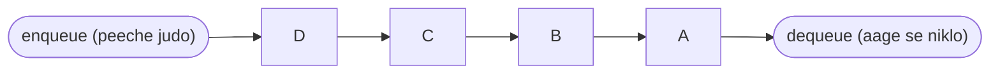
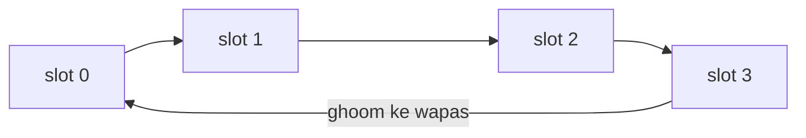
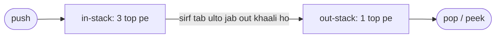

# Chapter 12 · Queues, Deques & Monotonic Queues

> Railway ticket counter ki line fair hoti hai: jo pehle aaya, usko pehle ticket milti hai. Koi line nahi todta (kam se kam theory mein). Yahi simple rule, **first in, first out**, tumhara printer chalata hai, WhatsApp ke messages deliver karta hai, har web server ki requests handle karta hai, aur woh graph algorithm bhi chalata hai jo tum zindagi mein sabse zyada use karoge: **breadth-first search**.

**Is chapter mein tum seekhoge:**
- **FIFO** ka matlab kya hai, aur kab koi problem isko maangti hai
- `list.pop(0)` performance trap kyun hai, aur `collections.deque` isko kaise fix karta hai
- Fixed-size array mein **circular queue** kaise banate hain (ek classic design question)
- **Do stacks** se queue kaise banti hai (aur phir bhi average pe O(1) kyun hai)
- **BFS** ki pehli jhalak, jo queues ke itne important hone ki asli wajah hai
- **Deque** ek double-ended tool ke roop mein, aur **monotonic deque**: sliding window maximum O(n) mein
- Hard deque problems: shortest subarray with sum at least K, longest subarray within a limit
- Design problems: hit counter, recent calls, task scheduler, aur priority queues ka preview

**Isse pehle padho:** [Stacks & Monotonic Stacks](11-stacks.md) · [Sliding Window](04-sliding-window.md) · [Prefix Sums](06-prefix-sums.md) · [Linked Lists](10-linked-lists.md)

---

## 🧠 The Big Idea · Asli Baat

**Queue** matlab logon ki ek line. Naya banda line ke **peeche** (back) judta hai: isko **enqueue** kehte hain. Jo **aage** (front) khada hai, uska kaam hota hai aur woh chala jaata hai: isko **dequeue** kehte hain. Jo sabse pehle aaya, wahi sabse pehle jaata hai: **FIFO**, First In, First Out.



> 🇮🇳 **Desi Analogy:** Railway reservation counter ki line socho. Naya passenger hamesha line ke **end** mein lagta hai (enqueue = `append`). Counter pe jo banda khada hai, sirf usi ka form process hota hai, phir woh nikal jaata hai (dequeue = `popleft`). Counter wali aunty ko sirf **front** dikhta hai, aur naye log sirf **back** dekhte hain. Beech mein koi ghus nahi sakta. Line ka sabse purana banda (jo sabse der se wait kar raha hai) hamesha sabse pehle serve hota hai. Yahi FIFO hai, aur isi wajah se queue "fair" kehlati hai.

[Chapter 11](11-stacks.md) ke stack se compare karo:

| | Stack | Queue |
|---|---|---|
| Rule | Last In, First Out | First In, First Out |
| Real life | plates ka dher, undo | ticket line, printer jobs |
| Tumhe deta hai | sabse **naya** adhoora kaam | sabse **purana** wait karta hua kaam |
| Graph search | DFS (pehle gehrai mein jao) | BFS (pehle chaudai mein, level by level) |

Aur **deque** (bolte hain "deck", **d**ouble-**e**nded **que**ue) ek aisi line hai jisme tum **dono** ends se jud bhi sakte ho aur nikal bhi sakte ho. Ye stack ki tarah bhi kaam kar sakta hai, queue ki tarah bhi, ya kuch aur smart: ek **monotonic deque**, jo ek chalti hui window ka maximum har step pe O(1) mein track karta hai.

> 🇮🇳 **Desi Analogy:** Mumbai local ka ek dabba socho jiske **dono taraf** darwaze hain. Log dono side se chadh bhi sakte hain aur utar bhi sakte hain. Sirf ek darwaza use karo toh ye stack jaisa hai (jo last chadha, wahi pehle utra). Ek darwaze se chadho aur doosre se utro toh ye queue hai. Yahi flexibility **deque** hai.

> 💡 **The core insight:** queue tab use karo jab **aane ka order** matter karta hai (fairness, levels, time windows). Deque tab use karo jab cheezein **dono ends** se nikalti hain: purane items front se expire hote hain, aur naya item back pe ladai karta hai.

---

## 🔨 Building It Up · Zero Se Shuru

### 1. FIFO, and why `list.pop(0)` is a trap

Tum Python list ko queue ki tarah use *kar sakte ho*: back pe judne ke liye `append`, front se nikalne ke liye `pop(0)`. Answer bhi sahi aayega.

```python
queue = []
queue.append("Asha")      # enqueue
queue.append("Ravi")
queue.append("Meera")
print("front:", queue[0])
print("served:", queue.pop(0))      # dequeue (sahi hai, par slow!)
print("served:", queue.pop(0))
print("still waiting:", queue)
```

```text
front: Asha
served: Asha
served: Ravi
still waiting: ['Meera']
```

Lekin list ek contiguous array hai ([Chapter 02](02-arrays-strings.md)), matlab saare elements memory mein ek ke baad ek, bina gap ke baithe hain. Index 0 hatao toh **baaki har element ko ek slot left khisakna padta hai**. Yaani har dequeue **O(n)**. n items process karo toh total **O(n²)**. Ye raha 100,000 items pe ek asli measurement (author ke laptop se; tumhare numbers alag honge, ratio nahi):

```py
import time
from collections import deque

n = 100_000
items = list(range(n))
start = time.perf_counter()
while items:
    items.pop(0)
list_time = time.perf_counter() - start

q = deque(range(n))
start = time.perf_counter()
while q:
    q.popleft()
deque_time = time.perf_counter() - start

print(f"list.pop(0):     {list_time:.3f} s")
print(f"deque.popleft(): {deque_time:.3f} s")
```

```text
list.pop(0):     1.215 s
deque.popleft(): 0.012 s
```

Lagbhag **100 guna** slow, aur n badhne ke saath ye gap aur badhta hai. Ek million nodes wale graph pe BFS karo, toh `pop(0)` ek second ka kaam ek chai break jitna lamba bana deta hai.

> 🇮🇳 **Desi Analogy:** Cinema hall ki ek row socho jisme har seat pe koi baitha hai. Pehli seat wala uthke chala gaya, aur rule hai ki seat 1 khaali nahi reh sakti. Ab poori row ko ek-ek seat left khisakna padega. 100 log = 99 log uthenge-baithenge. `list.pop(0)` exactly yahi karta hai. `deque` mein seats khisakti hi nahi, bas "front kaun hai" ka pointer aage badh jaata hai.

> ⚠️ **Rule:** loop ke andar kabhi bhi `list.pop(0)` ya `list.insert(0, x)` mat likho. `collections.deque` use karo.

### 2. `collections.deque`: the right tool

`deque` tumhe **dono** ends pe O(1) operations deta hai.

```python
from collections import deque

q = deque()
q.append(1)            # right (back) mein add karo
q.append(2)
q.append(3)
print(q, "front:", q[0], "back:", q[-1])
print("popleft:", q.popleft())     # left (front) se hatao: yahi dequeue hai
q.appendleft(0)                    # left mein add karo
print(q)
print("pop:", q.pop())             # right se hatao
print(q, "len:", len(q))

d = deque([1, 2, 3, 4, 5])
d.rotate(2)                        # 2 se right shift (aakhri 2 ghoom ke front pe aa jaate hain)
print("rotated:", d)

recent = deque(maxlen=3)           # bounded: purane items apne aap gir jaate hain
for x in [10, 20, 30, 40, 50]:
    recent.append(x)
print("last 3:", recent)
```

```text
deque([1, 2, 3]) front: 1 back: 3
popleft: 1
deque([0, 2, 3])
pop: 3
deque([0, 2]) len: 2
rotated: deque([4, 5, 1, 2, 3])
last 3: deque([30, 40, 50], maxlen=3)
```

Abhi kya hua: **queue** ki tarah use karna hai toh `append` + `popleft`. **Stack** ki tarah use karna hai toh `append` + `pop`. `maxlen` isko "aakhri k cheezein yaad rakho" wala buffer bana deta hai: jaise hi 4th item aaya, sabse purana khud gir gaya. Ek dhyaan rakhne wali baat: **beech** mein indexing (`d[n // 2]`) O(n) hai, kyunki deque ek contiguous array nahi hai (Under the Hood mein dekhenge).

| Operation | `list` | `deque` |
|---|---|---|
| right pe append / pop | O(1) | O(1) |
| **left** pe append / pop | **O(n)** | **O(1)** |
| beech mein index `x[i]` | **O(1)** | O(n) |
| `len`, `[0]`, `[-1]` | O(1) | O(1) |

> 🤔 **Mann mein sawaal:** Agar deque itna accha hai, toh har jagah list ki jagah deque hi kyun na use karein?
>
> **Jawab:** Kyunki deque beech ke index pe slow hai (O(n)), aur slicing (`d[2:5]`) support hi nahi karta. List random access mein king hai: `x[i]` O(1). Toh rule simple hai: **sirf ends pe kaam hai toh deque, beech mein jaana hai toh list.**

### 3. A queue built on a linked list

Queue ko asal mein kya chahiye, ye samajhne ke liye chalo [Chapter 10](10-linked-lists.md) ki linked list se ek queue banate hain: **head** se dequeue, **tail** pe enqueue. Dono O(1).

```python
class _Node:
    def __init__(self, val):
        self.val, self.next = val, None

class LinkedQueue:
    def __init__(self):
        self.head = self.tail = None
        self.size = 0

    def enqueue(self, val):
        node = _Node(val)
        if self.tail:
            self.tail.next = node
        else:
            self.head = node                # pehla element: yahi head bhi hai
        self.tail = node
        self.size += 1

    def dequeue(self):
        if not self.head:
            raise IndexError("dequeue from empty queue")
        val = self.head.val
        self.head = self.head.next
        if not self.head:
            self.tail = None                # queue khaali ho gayi: tail bhi reset karo
        self.size -= 1
        return val

q = LinkedQueue()
for x in "abc":
    q.enqueue(x)
print(q.dequeue(), q.dequeue(), q.size)
q.enqueue("d")
print(q.dequeue(), q.dequeue(), q.size)
```

```text
a b 1
c d 0
```

Abhi kya hua: yahan ka classic bug hai aakhri node nikalne pe `self.tail = None` bhool jaana. Aisa hua toh `tail` ab bhi purane, nikal chuke node ko point karega. Agla `enqueue` usi stale node ke peeche naya node jod dega, jo queue mein hai hi nahi. Result: naya element "gayab" ho jaata hai, kyunki `head` `None` hai aur koi usse dhundh hi nahi paata.

### 4. Circular queue: a queue in a fixed array

**Design Circular Queue** ek favourite design question hai, aur asli systems (network card buffers, audio buffers, Kafka jaise logs) queues aise hi implement karte hain: ek fixed-size array jisme front aur back **ghoom ke wapas aa jaate hain** (wrap around).

Ek `head` index rakho (front kahan hai) aur ek `count` (kitne elements hain). Back hai `(head + count) % capacity`. Ye `%` (modulo) index ko aakhri slot ke baad wapas 0 pe le aata hai, toh array ek ring ki tarah behave karta hai.



> 🇮🇳 **Desi Analogy:** Shaadi ke buffet mein ek **gol (round) counter** socho jisme 4 hi plates rakhne ki jagah hai: slot 0, 1, 2, 3. Waiter clockwise plates rakhta jaata hai. Slot 3 ke baad agli jagah slot 0 hai, kyunki counter gol hai. Mehmaan bhi clockwise plates uthate hain. Slot 0 ki plate uth gayi toh waiter agli plate wahin rakh dega, bhale woh "line mein sabse peeche" wali plate ho. `head` = mehmaan abhi kis slot se uthayega, `count` = counter pe kitni plates hain, aur `% 4` = "gol counter hai, 3 ke baad 0 aata hai".

```python
class MyCircularQueue:
    def __init__(self, k):
        self.data = [None] * k
        self.capacity = k
        self.head = 0                 # front element ka index
        self.count = 0

    def enqueue(self, value):
        if self.is_full():
            return False
        tail = (self.head + self.count) % self.capacity   # agla khaali slot, wrap karke
        self.data[tail] = value
        self.count += 1
        return True

    def dequeue(self):
        if self.is_empty():
            return False
        self.data[self.head] = None                        # optional: readability ke liye clear karo
        self.head = (self.head + 1) % self.capacity
        self.count -= 1
        return True

    def front(self):
        return -1 if self.is_empty() else self.data[self.head]

    def rear(self):
        return -1 if self.is_empty() else self.data[(self.head + self.count - 1) % self.capacity]

    def is_empty(self):
        return self.count == 0

    def is_full(self):
        return self.count == self.capacity

q = MyCircularQueue(3)
print([q.enqueue(x) for x in [1, 2, 3, 4]])
print("rear:", q.rear(), "full:", q.is_full())
print("dequeue:", q.dequeue(), "enqueue 4:", q.enqueue(4))
print("front:", q.front(), "rear:", q.rear())
print("raw array:", q.data, "head index:", q.head)
```

```text
[True, True, True, False]
rear: 3 full: True
dequeue: True enqueue 4: True
front: 2 rear: 4
raw array: [4, 2, 3] head index: 1
```

Abhi kya hua, step by step:
- Capacity 3 hai. 1, 2, 3 slots 0, 1, 2 mein gaye. 4 ke liye jagah nahi thi, isliye `False`.
- 1 dequeue hua: `head` 0 se 1 ho gaya, `count` 3 se 2.
- Ab 4 aaya. `tail = (1 + 2) % 3 = 0`. Toh 4 **slot 0** mein gaya (wrap around), bhale logically woh line ke sabse peeche hai.
- Raw array `[4, 2, 3]` hai aur head index 1 pe hai, toh queue ko padho head se: `2, 3, 4`.

`count` store karna (sirf head aur tail ki jagah) ek classic confusion se bachata hai: agar sirf head aur tail rakho, toh `head == tail` ka matlab "khaali" bhi ho sakta hai aur "poori bhari" bhi.

> 🤔 **Mann mein sawaal:** `rear()` mein `- 1` kyun? Tail toh `(head + count) % capacity` tha na?
>
> **Jawab:** `(head + count) % capacity` **agla khaali slot** hai, jahan naya element jayega. Aakhri *bhara hua* element usse ek peeche hai, isliye `(head + count - 1) % capacity`. Upar ke example mein head = 1, count = 3: `(1 + 3 - 1) % 3 = 0`, aur slot 0 mein 4 hai. Sahi!

### 5. A queue from two stacks

**Implement Queue using Stacks.** Sirf end pe `append` aur `pop` allowed hain. LIFO se FIFO kaise nikaalein?

Ek stack ko doosre stack mein ulto, toh order palat jaata hai. Pushes ke liye ek **in-stack** rakho aur pops ke liye ek **out-stack**. Jab out-stack khaali ho, tab in-stack ka sab kuch usme ulat do; ab sabse purana element top pe hai.



> 🇮🇳 **Desi Analogy:** Kirana store mein biscuit ke packets ek carton (in-stack) mein aate hain: jo pehle aaya woh neeche dab gaya. Dukaandaar jab shelf (out-stack) khaali dekhta hai, tab poora carton ulta karke shelf pe laga deta hai. Ab sabse purana packet sabse upar hai, aur woh pehle bikta hai (FIFO, expiry ke hisaab se sahi). Lekin agar shelf pe abhi bhi packets hain aur woh naya carton upar se ulat de, toh naye packets purane ke upar aa jayenge aur purane expire ho jayenge. Isliye rule: **shelf khaali ho tabhi carton ulto.**

```python
class MyQueue:
    def __init__(self):
        self.in_stack = []
        self.out_stack = []

    def push(self, x):
        self.in_stack.append(x)

    def _move(self):
        if not self.out_stack:                 # SIRF tab ulto jab out khaali ho
            while self.in_stack:
                self.out_stack.append(self.in_stack.pop())

    def pop(self):
        self._move()
        return self.out_stack.pop()

    def peek(self):
        self._move()
        return self.out_stack[-1]

    def empty(self):
        return not self.in_stack and not self.out_stack

q = MyQueue()
q.push(1)
q.push(2)
print(q.peek(), q.pop(), q.empty())
q.push(3)
print(q.pop(), q.pop(), q.empty())
```

```text
1 1 False
2 3 True
```

Abhi kya hua: pehle `peek` pe in-stack `[1, 2]` ulta hoke out-stack `[2, 1]` bana (1 top pe). `push(3)` ke baad bhi out-stack mein `[2]` tha, toh `pop` ne bina ulte 2 de diya (sahi: 2, 3 se pehle aaya tha). Agar out-stack mein items hote hue bhi ulat dete, toh naye elements purane ke upar aa jaate aur FIFO toot jaata.

**Ye O(1) amortised kyun hai:** har element apni poori life mein in se out **maximum ek baar** move hota hai: ek baar push, ek baar ulta, ek baar pop. Toh n operations ka total cost O(n) hai, bhale hi kabhi-kabhi ek single `pop` O(n) le le.

> 🤔 **Mann mein sawaal:** Ek `pop` O(n) le sakta hai, phir bhi hum O(1) kyun bol rahe hain? Ye toh cheating lagti hai.
>
> **Jawab:** Hum "**amortised** O(1)" bol rahe hain, "worst-case O(1)" nahi. Amortised ka matlab: poori sequence ka total cost lo, aur operations ki ginti se divide karo. Mahine ka bijli bill socho: ek din AC zyada chala, par mahine ka average per din kam hi raha. Waise hi, ek mehenga `pop` n elements ulta karta hai, lekin uske baad agle n pops ekdum free hain. Average nikaalo toh har operation constant.

### 6. BFS preview: why queues matter

**Breadth-first search (BFS)** ek graph ko rings mein explore karta hai: pehle start, phir jo 1 step door hai woh sab, phir jo 2 step door hai, aur aise hi aage. Queue is order ki guarantee deta hai: jo nodes pehle discover hue (paas wale), woh baad mein discover hue nodes (door wale) se pehle process honge. Isi wajah se BFS unweighted graphs mein **shortest paths** dhoondh leta hai. Poori kahani [Chapter 16](16-graphs-bfs-dfs.md) mein hai; yahan bas shape dekh lo.

> 🇮🇳 **Desi Analogy:** Joint family WhatsApp group mein ek khabar daalo. Pehle minute mein jo directly group mein hain unhe pata chalta hai (distance 1). Woh apne doston ko forward karte hain (distance 2), woh apne doston ko (distance 3). Khabar **lehron (waves)** mein phailti hai, jaise taalaab mein patthar phenkne pe gol lehrein. Koi distance 3 wala banda distance 1 wale se pehle khabar nahi paata. Queue yahi order maintain karti hai: jo pehle line mein laga (paas wala), woh pehle process hoga. Isliye jab goal pehli baar milta hai, woh **sabse chhote raaste** se hi mila hota hai.

**Grid mein shortest path** (`.` = khula raasta, `#` = deewar), up/down/left/right chal sakte ho:

```python
from collections import deque

def shortest_path(grid, start, goal):
    rows, cols = len(grid), len(grid[0])
    queue = deque([(start, 0)])               # (cell, start se distance)
    seen = {start}
    while queue:
        (r, c), dist = queue.popleft()        # sabse purana = sabse paas wala unprocessed cell
        if (r, c) == goal:
            return dist
        for dr, dc in ((1, 0), (-1, 0), (0, 1), (0, -1)):
            nr, nc = r + dr, c + dc
            if 0 <= nr < rows and 0 <= nc < cols and grid[nr][nc] == "." and (nr, nc) not in seen:
                seen.add((nr, nc))            # ADD karte waqt mark karo, taaki do baar queue mein na jaaye
                queue.append(((nr, nc), dist + 1))
    return -1

grid = ["..#.",
        "..#.",
        "....",
        "#..."]
print(shortest_path(grid, (0, 0), (0, 3)))
print(shortest_path([".#", "#."], (0, 0), (1, 1)))
```

```text
7
-1
```

Pehle grid mein (0, 0) se (0, 3) jaana hai, par column 2 mein upar ki do rows mein deewar hai. Toh raasta neeche row 2 tak jaata hai, deewar ke neeche se ghoomta hai, phir upar aata hai: 2 neeche + 3 right + 2 upar = **7**. Doosre grid mein start aur goal ke beech dono raaste deewar se band hain, isliye **-1**.

**Level by level:** kabhi-kabhi tumhe pata hona chahiye ki ek level kahan khatam hua aur agla kahan shuru (jaise "family tree ki har generation alag line mein print karo"). Har level ki shuruaat mein queue ki length ko **freeze** kar do:

```python
from collections import deque

children = {"Dadi": ["Papa", "Chachu"], "Papa": ["Me", "Didi"], "Chachu": ["Cousin"],
            "Me": [], "Didi": [], "Cousin": []}

def generations(root):
    levels = []
    queue = deque([root])
    while queue:
        level = []
        for _ in range(len(queue)):           # bilkul current level ke nodes
            person = queue.popleft()
            level.append(person)
            queue.extend(children[person])    # agla level inke peeche wait karta hai
        levels.append(level)
    return levels

for depth, level in enumerate(generations("Dadi")):
    print(depth, level)
```

```text
0 ['Dadi']
1 ['Papa', 'Chachu']
2 ['Me', 'Didi', 'Cousin']
```

Abhi kya hua: `range(len(queue))` loop shuru hone se pehle **sirf ek baar** evaluate hota hai. Jab Papa aur Chachu wale round mein queue ki length 2 thi, toh loop exactly 2 baar chala, bhale hi beech mein Me, Didi, Cousin queue mein jud gaye. Naye bachche is round mein process nahi hote; woh agle round ka hissa hain. Ye "level snapshot" trick hi level-order tree traversal ki neenv hai ([Chapter 13](13-binary-trees.md)).

> 🤔 **Mann mein sawaal:** `range(len(queue))` loop ke andar queue badh rahi hai, toh loop bhi badhna chahiye na?
>
> **Jawab:** Nahi. Python `range(len(queue))` ko ek baar calculate karke ek fixed range object bana leta hai, jaise `range(2)`. Uske baad queue badhe ya ghate, range nahi badalti. Agar tum level ke andar `while queue:` jaisa kuch likhte, toh har baar naye sirey se check hota aur levels mix ho jaate.

### 7. The deque as a double-ended tool

Kyunki deque dono ends pe fast hai, woh un problems ko handle karta hai jahan dono side se cheezein uthani hain.

**Palindrome check**, dono ends chheel ke (peel karke):

```python
from collections import deque

def is_palindrome(word):
    d = deque(ch.lower() for ch in word if ch.isalnum())
    while len(d) > 1:
        if d.popleft() != d.pop():          # dono ends compare karo
            return False
    return True

print(is_palindrome("Madam"), is_palindrome("Was it a car or a cat I saw?"), is_palindrome("deque"))
```

```text
True True False
```

`isalnum()` spaces aur `?` jaise characters hata deta hai aur `lower()` capital letters ko chhota kar deta hai, isliye "Was it a car or a cat I saw?" ek pakka palindrome ban jaata hai: `wasitacaroracatisaw`.

**Moving Average from Data Stream:** aakhri `size` values ka average, har value pe O(1). Deque window ko hold karta hai; running sum dobara se jodne se bachata hai.

```python
from collections import deque

class MovingAverage:
    def __init__(self, size):
        self.size = size
        self.window = deque()
        self.total = 0

    def next(self, val):
        self.window.append(val)
        self.total += val
        if len(self.window) > self.size:
            self.total -= self.window.popleft()     # sabse purani value expire ho gayi
        return self.total / len(self.window)

m = MovingAverage(3)
print([round(m.next(v), 2) for v in [1, 10, 3, 5]])
```

```text
[1.0, 5.5, 4.67, 6.0]
```

Abhi kya hua: ye [Chapter 04](04-sliding-window.md) ka sliding window hi hai, bas deque yaad rakhta hai ki expire hone pe *kaun si* value subtract karni hai. Aakhri step dekho: window `[1, 10, 3]` mein 5 aaya, total 19 hua, window mein 4 values ho gayi, toh 1 bahar gaya. Total 18, window `[10, 3, 5]`, average **6.0**.

### 8. The monotonic deque: Sliding Window Maximum

**Problem:** `nums` pe size k ki window slide karo, aur har window ka maximum batao. `[1, 3, -1, -3, 5, 3, 6, 7]`, k = 3 → `[3, 3, 5, 5, 6, 7]`.

Har window ka `max` dobara nikaalo toh **O(n·k)**. Heap se **O(n log n)**. Deque se **O(n)**.

**Insight**, ek kahani ki tarah. Window ko ek team samjho, aur max ko team ka captain. Jab ek naya player aata hai jo kuch maujooda players se **zyada strong** hai, toh woh kamzor players **kabhi bhi** captain nahi ban sakte: naya player zyada strong bhi hai *aur* window mein zyada der tak rahega (kyunki baad mein aaya). Toh unhe turant bahar karo.

> 🇮🇳 **Desi Analogy:** Ek cricket academy socho jahan har player ka contract sirf 3 season ka hai (window size k = 3), aur captain hamesha sabse strong player banta hai. Ek naya young player aaya jo ek purane senior se zyada runs banata hai. Ab woh senior kabhi captain nahi banega: naya player usse behtar hai **aur** uska contract baad mein khatam hoga. Toh selector senior ko "captain candidates" ki list se seedha kaat deta hai (back se pop). List ke top pe jo hai woh captain hai (front). Aur jab top wale ka contract khatam ho jaaye, woh front se nikal jaata hai (expire). Bas yahi monotonic deque hai.

Jo bacha woh indexes ka ek deque hai jinki values front se back tak **ghatti hui (decreasing)** hain:
- **Front** hamesha current maximum hai.
- Naye elements **back** se kamzor elements ko pop karte hain, phir back pe jud jaate hain (bilkul [Chapter 11](11-stacks.md) ke monotonic stack ki tarah).
- Jab front ka index window se bahar slide ho jaaye, usse **front** se pop karo. Ye woh kaam hai jo stack nahi kar sakta.

```python
from collections import deque

def max_sliding_window(nums, k):
    dq = deque()                     # indexes; nums[dq[0]] > ... > nums[dq[-1]] (non-increasing)
    result = []
    for i, x in enumerate(nums):
        if dq and dq[0] <= i - k:
            dq.popleft()             # front index window se bahar gir gaya
        while dq and nums[dq[-1]] <= x:
            dq.pop()                 # kamzor AUR purana: kabhi max nahi banega
        dq.append(i)
        if i >= k - 1:               # pehli poori window index k - 1 pe khatam hoti hai
            result.append(nums[dq[0]])
    return result

print(max_sliding_window([1, 3, -1, -3, 5, 3, 6, 7], 3))
print(max_sliding_window([9, 8, 7, 6], 2))
```

```text
[3, 3, 5, 5, 6, 7]
[9, 8, 7]
```

**Dry run** `[1, 3, -1, -3, 5, 3, 6, 7]`, k = 3 ke liye (deque ko `index:value` mein dikhaya hai):

| i | x | front expire? | back se pop (kamzor) | deque after | window max |
|---|---|---|---|---|---|
| 0 | 1 | | | 0:1 | |
| 1 | 3 | | 0:1 | 1:3 | |
| 2 | -1 | | | 1:3, 2:-1 | **3** |
| 3 | -3 | | | 1:3, 2:-1, 3:-3 | **3** |
| 4 | 5 | 1:3 (1 ≤ 4−3) | 3:-3, 2:-1 | 4:5 | **5** |
| 5 | 3 | | | 4:5, 5:3 | **5** |
| 6 | 6 | | 5:3, 4:5 | 6:6 | **6** |
| 7 | 7 | | 6:6 | 7:7 | **7** |

Abhi kya hua: har index deque mein ek baar aata hai aur ek baar jaata hai (front se ya back se), toh poora kaam **O(n)** hai, O(k) extra space ke saath. **Minimum** ke liye comparison palat do: back ko tab tak pop karo jab tak `nums[dq[-1]] >= x`.

> 🤔 **Mann mein sawaal:** Deque mein values ki jagah indexes kyun store kar rahe hain? Answer toh value hi chahiye.
>
> **Jawab:** Kyunki front ko expire karne ke liye pata hona chahiye ki woh element window mein **kab** aaya tha. Value `5` se ye pata nahi chalta ki woh index 4 pe tha ya index 0 pe. Index rakho, toh `dq[0] <= i - k` se turant pata chal jaata hai ki woh bahar gaya ya nahi, aur value chahiye toh `nums[dq[0]]` se le lo. Index se dono kaam ho jaate hain.

> 🤔 **Mann mein sawaal:** `for` ke andar `while` loop hai, toh complexity O(n·k) kyun nahi hui?
>
> **Jawab:** Kyunki `while` kisi ek step pe kitna bhi chale, poore program mein total pops n se zyada ho hi nahi sakte: har index sirf ek baar push hota hai, toh ek hi baar pop ho sakta hai. Kisi step pe 3 pops, kisi pe 0, par sabka jod ≤ n. Isliye total **O(n)**.

### 9. Shortest Subarray with Sum at Least K

**Problem:** sabse chhota non-empty contiguous subarray jiska sum ≥ K ho. Values **negative** bhi ho sakti hain. `[84, -37, 32, 40, 95]`, K = 167 → 3 (`[32, 40, 95]`).

Agar saare numbers positive hote, toh sliding window chal jaata ([Chapter 04](04-sliding-window.md)). Negatives usse tod dete hain: window chhoti karne pe sum *badh* bhi sakta hai (agar tumne ek negative number hata diya). Isliye **prefix sums** use karo ([Chapter 06](06-prefix-sums.md)): `P[i]` = pehle i elements ka sum, toh subarray `(j, i]` ka sum `P[i] - P[j]` hai. Humein sabse paas wala `j < i` chahiye jisme `P[j] <= P[i] - K`.

Example ke liye prefix nikaal lo, taaki aage ka logic aankhon ke saamne rahe:

```text
nums   =    [84, -37, 32, 40, 95]
P      = [0, 84,  47, 79, 119, 214]
index     0   1    2   3    4    5
```

`P[5] - P[2] = 214 - 47 = 167 ≥ 167`, aur length `5 - 2 = 3`. Yahi answer hai.

Candidate start indexes `j` ka ek deque rakho jisme `P[j]` **badhta hua (increasing)** ho:
1. **Front:** jab tak `P[i] - P[front] >= K`, humein ek valid subarray mil gaya. Uski length record karo aur front pop karo. (Koi bhi baad wala `i` is `j` se *lamba* subarray hi dega, toh ye `j` ab "used up" hai.)
2. **Back:** jab tak `P[back] >= P[i]`, back pop karo. Ek baad wala start jiska prefix chhota-ya-barabar hai, har tarah se behtar hai: woh *bada* sum bhi deta hai *aur* chhota subarray bhi.

```python
from collections import deque

def shortest_subarray(nums, k):
    prefix = [0]
    for x in nums:
        prefix.append(prefix[-1] + x)
    best = len(nums) + 1
    dq = deque()                                   # candidate starts, prefix badhta hua
    for i, p in enumerate(prefix):
        while dq and p - prefix[dq[0]] >= k:
            best = min(best, i - dq.popleft())     # valid; ye start baad mein isse behtar nahi kar sakta
        while dq and prefix[dq[-1]] >= p:
            dq.pop()                               # i, dq[-1] se behtar start hai
        dq.append(i)
    return best if best <= len(nums) else -1

print(shortest_subarray([1], 1), shortest_subarray([1, 2], 4), shortest_subarray([2, -1, 2], 3))
print(shortest_subarray([84, -37, 32, 40, 95], 167))
```

```text
1 -1 3
3
```

Abhi kya hua: ye woh monotonic deque hai jisme **dono** ends asli kaam kar rahe hain: front answers deta hai, back order maintain karta hai. **O(n)** time. Ye sabse mushkil "standard" deque problems mein se ek hai, aur upar wale do pruning arguments hi woh cheez hain jo interviewer sunna chahta hai.

Example pe dekho back-pop kaise kaam karta hai: index 1 pe `P = 84`, index 2 pe `P = 47`. 84 ≥ 47, toh index 1 back se pop ho gaya. Kyun? Index 2 ke baad se shuru hone wala koi bhi subarray, index 1 ke baad se shuru hone wale se 37 zyada sum deta hai (kyunki -37 usme nahi hai) **aur** ek element chhota bhi hai. Index 1 ab kabhi best nahi ho sakta.

> 🤔 **Mann mein sawaal:** Front pe valid answer milne ke baad usse pop kyun kar diya? Kya pata woh aage kisi aur `i` ke saath bhi valid ho?
>
> **Jawab:** Valid toh hoga, lekin **behtar** nahi. Aage ka koi bhi `i` bada hai, toh `i - j` length aur lambi hogi. Humein sabse chhota chahiye, aur is `j` ke liye sabse chhota answer abhi mil chuka. Toh `j` ka kaam khatam; usse rakhne ka koi fayda nahi.

### 10. Design Hit Counter

**Problem:** timestamps pe hits record karo (seconds mein, kabhi ghatte nahi). `get_hits(t)` pichhle 300 seconds ke hits return kare, yaani `(t - 300, t]` wale timestamps.

Timestamps ki ek queue: hits time order mein aate hain, aur **sabse purane** pehle expire hote hain. FIFO bilkul sahi fit hai.

```python
from collections import deque

class HitCounter:
    WINDOW = 300

    def __init__(self):
        self.hits = deque()

    def hit(self, timestamp):
        self.hits.append(timestamp)

    def get_hits(self, timestamp):
        while self.hits and self.hits[0] <= timestamp - self.WINDOW:
            self.hits.popleft()                     # expire ho gaya: 300 s se purana
        return len(self.hits)

counter = HitCounter()
for t in [1, 2, 3]:
    counter.hit(t)
print(counter.get_hits(4))
counter.hit(300)
print(counter.get_hits(300), counter.get_hits(301))
```

```text
3
4 3
```

Abhi kya hua: time 301 pe, time 1 wala hit expire ho jaata hai (1 ≤ 301 − 300). Har hit ek baar append aur ek baar remove hota hai: amortised O(1). Interviewers ka **follow-up**: "agar har second lakhon hits aayein toh?" Tab `(timestamp, count)` pairs store karo, ya `timestamp % 300` se index hone wala 300 buckets ka fixed array use karo. Traffic kitna bhi ho, memory O(300) hi rahegi. Yahi asli **rate limiters** ka beej hai ([Case Studies I](../part-3-system-design/12-case-studies-1.md)).

> 🇮🇳 **Desi Analogy:** Bank ka display socho jo "pichhle 5 minute mein kitne customers aaye" dikhata hai. Har customer ka token time ek register mein likha jaata hai (append). Jab display update hota hai, guard register ke **upar** se woh entries kaat deta hai jo 5 minute se purani hain (popleft). Jo bacha uski ginti hi answer hai. Register hamesha time order mein hai, isliye purani entries hamesha upar hi milengi, aur guard ko poora register kabhi nahi padhna padta.

### 11. Task Scheduler: the idea

**Problem:** CPU tasks letters se label hain; har ek ek unit time leta hai; do same tasks ke beech kam se kam `n` units ka cooldown chahiye (CPU idle reh sakta hai). Minimum total time kitna?

**Greedy insight:** sabse zyada baar aane wala task hi bottleneck hai. Agar task A `max_count` baar hai, toh woh apni copies ke beech `max_count - 1` gaps banata hai, har gap length `n` ka, aur ye milke `n + 1` size ke "frames" banate hain:

```text
n = 2, tasks A A A B B B
A B _ | A B _ | A B
frames: (max_count - 1) = 2 frames of size n + 1 = 3, plus a final partial frame
holding every task that ties for max_count (here A and B): 2 * 3 + 2 = 8
```

Matlab: `(max_count - 1)` = 2 poore frames, har ek size `n + 1` = 3 ka, aur aakhri mein ek adhoora frame jisme woh saare tasks hain jo `max_count` pe tie karte hain (yahan A aur B): `2 * 3 + 2 = 8`.

Agar alag-alag tasks itne zyada hain ki frames overflow ho jaayein, toh idle ki zaroorat hi nahi padti aur answer seedha `len(tasks)` hai.

> 🇮🇳 **Desi Analogy:** Gali cricket mein ek hi accha bowler hai (task A), aur rule hai ki ek bowler lagataar overs nahi daal sakta: uske do overs ke beech kam se kam `n` overs doosre daalenge. Woh 3 overs daalega, toh uske beech 2 gaps banenge, har gap mein n overs. Doosre bowlers nahi hain? Toh woh overs "khaali" (idle) jaayenge. Bahut saare bowlers hain? Toh koi gap khaali nahi jaata, aur total overs bas utne hi jitne daalne the (`len(tasks)`).

```python
from collections import Counter

def least_interval(tasks, n):
    counts = Counter(tasks).values()
    max_count = max(counts)
    num_max = sum(1 for c in counts if c == max_count)      # sabse frequent pe tie karne wale tasks
    frames = (max_count - 1) * (n + 1) + num_max
    return max(frames, len(tasks))

print(least_interval(["A", "A", "A", "B", "B", "B"], 2))
print(least_interval(["A", "A", "A", "B", "B", "B"], 0))
print(least_interval(["A"] * 6 + list("BCDEFG"), 2))
```

```text
8
6
16
```

Teesra case check karo: A 6 baar hai, n = 2. Frames = `(6 - 1) * 3 + 1 = 16`. Gaps mein 5 × 2 = 10 slots hain; B se G tak ke 6 tasks unme se 6 bhar dete hain, aur 4 idle bachte hain. Total 16, jo `len(tasks) = 12` se bada hai, toh answer 16.

Abhi kya hua: ek **O(n)** formula. **Simulation** wala version, jo actual order bhi batata hai, ek **priority queue** (hamesha woh task chalao jiski sabse zyada copies bachi hain) aur cooldown pe baithe tasks ki ek regular **queue** use karta hai, jo cooldown khatam hone pe wapas release hote hain. Woh version [Chapter 15](15-heaps.md) mein hai.

### 12. Priority queue preview

Regular queue **aane ke time** ke hisaab se serve karti hai. **Priority queue** **priority** ke hisaab se serve karti hai: hospital ka emergency room sabse critical patient ko pehle dekhta hai, chahe pehle koi bhi aaya ho. Python mein ye `heapq` module hai, jo ek list ko aise arrange rakhta hai ki sabse chhota item hamesha index 0 pe ho, aur push/pop O(log n) mein hote hain.

> 🇮🇳 **Desi Analogy:** Sarkari hospital ki OPD line regular queue hai: token number se chalti hai. Lekin casualty ward priority queue hai: accident wala patient seedha andar jaata hai, chahe zukaam wala subah 8 baje se baitha ho. "Sabse chhota number pehle" ka matlab yahan "sabse urgent pehle".

```python
import heapq

er = []
heapq.heappush(er, (3, "sprained ankle"))      # (priority, patient): kam number = zyada urgent
heapq.heappush(er, (1, "heart attack"))
heapq.heappush(er, (2, "broken arm"))
while er:
    priority, patient = heapq.heappop(er)
    print(priority, patient)
```

```text
1 heart attack
2 broken arm
3 sprained ankle
```

Heaps ko scratch se banana, aur top-k, merge-k, median-of-stream aur scheduling problems solve karna, ye sab [Chapter 15](15-heaps.md) mein karenge.

| Zaroorat | Structure | Core ops |
|---|---|---|
| sabse purana pehle | queue (`deque`) | `append`, `popleft`: O(1) |
| sabse naya pehle | stack (`list`) | `append`, `pop`: O(1) |
| dono ends | `deque` | dono ends pe O(1) |
| sliding window ka max/min | monotonic deque | O(1) amortised |
| sabse important pehle | priority queue (`heapq`) | O(log n) push/pop |

---

## 🔬 Under the Hood · Andar Ki Kahani

### How `deque` is built in CPython

`deque` asal mein **blocks ki ek doubly linked list** hai, aur har block mein 64 items ke slots hote hain. Right pe append karo toh sabse right wala block bharta hai; woh bhar gaya toh ek naya block link ho jaata hai. Left pe bhi yahi. Toh:
- Ends O(1) hain: bas end block ke ek slot mein likhna hai (kabhi-kabhi naya block jodna).
- Kabhi koi shifting nahi hoti, `list.pop(0)` ki tarah nahi.
- Indexing `d[i]` ko nazdeek wale end se block-by-block chalna padta hai: worst case O(n). Isliye bade deques pe `d[len(d) // 2]` slow hai.
- Blocks 64 items ko saath rakhte hain, toh memory locality "har item ka alag node" se kaafi behtar hai.

> 🇮🇳 **Desi Analogy:** Mumbai local ki train socho. Har dabba (block) mein 64 seats hain, aur dabbe aage-peeche dono taraf se jude hain (doubly linked). Naye passengers aakhri dabbe mein baithte hain; woh bhar gaya toh peeche ek naya dabba jod do. Aage se utarna ho toh pehle dabbe se utro. Kisi ko seat khisakni nahi padti. Lekin "train ka 500th passenger kahan hai?" poochho, toh dabba-dabba ginna padega. Yahi `d[i]` ka O(n) hai.

`append`, `appendleft`, `pop` aur `popleft` jaise operations CPython mein **thread-safe** bhi hain, isliye producer-consumer code mein `deque` ek common building block hai ([Internals & Concurrency](../part-1-python/18-internals-concurrency.md)).

### Why `list.pop(0)` is O(n)

List pointers ka ek contiguous array hai. Item `i` ko slot `i` mein hi rehna padta hai. Slot 0 hatao toh slot 1 se aage ka har pointer ek slot left copy hota hai (`memmove`). n items ke liye n − 1 copies. Ye n baar karo toh lagbhag n²/2 copies ho gayi.

Numbers mein: n = 100,000 ho toh n²/2 = **5 billion** pointer copies. Wahi upar wala 1.2 second hai (`memmove` bahut fast hai, warna aur zyada lagta).

### The circular buffer's modulo

`(head + count) % capacity` ek hamesha badhti hui logical position ko slots ki ek fixed ring pe map karta hai. Koi element kabhi move nahi hota; sirf do integers badalte hain. Isiliye fixed-size ring buffers systems software mein har jagah hain: O(1) operations, ek baar banane ke baad zero allocation, aur predictable memory.

### Amortised analysis of the two-stack queue

Har element ko push ke waqt 3 "coins" do: 1 push ka kharcha, 1 in-stack se out-stack tak uske ek move ka, 1 uske pop ka. Kisi bhi element ko chautha coin nahi chahiye, kyunki woh maximum ek baar move hota hai. Toh n operations ki kisi bhi sequence ka cost maximum 3n hai: **O(1) amortised per operation**, bhale hi ek unlucky `pop` n elements move kar de.

> 🇮🇳 **Desi Analogy:** Dabbawala har tiffin ke ₹3 pehle hi le leta hai: ₹1 ghar se uthane ka, ₹1 station pe train badalne ka, ₹1 office deliver karne ka. Kisi din station pe ek saath 100 tiffin badalne pade, toh lagega aaj bahut kharcha hua. Lekin us kaam ka paisa toh har tiffin pehle hi de chuka tha. Koi tiffin do baar train nahi badalta, toh ₹3 kabhi kam nahi padte.

### Why the monotonic deque is correct and O(n)

**Correctness**, sliding window maximum ke liye: hum `j` ko back se tab pop karte hain jab ek naya `i` aata hai jisme `nums[i] >= nums[j]`. Ab se, har window jisme `j` hai usme `i` bhi hoga (kyunki `i` naya hai, woh baad mein niklega), aur `nums[i]` kam se kam utna hi bada hai. Toh `j` kisi bhi future window ka unique maximum kabhi nahi ban sakta. Usse phenkna safe hai. Front max hai kyunki deque decreasing hai aur usme har woh element hai jo abhi bhi max ban sakta hai.

**Complexity:** har index exactly ek baar append hota hai aur maximum ek baar remove hota hai (back se ya front se). Saare iterations ka total kaam: **O(n)**.

---

## 🧩 Pattern Decoder · Pattern Pakdo

### Signals: when to reach for a queue or deque

| Problem mein ye dikhe... | Toh socho |
|---|---|
| "first come first served", "in order of arrival", "process in rounds" | Queue (`deque`) |
| unweighted grid ya graph mein "shortest path / minimum steps" | Queue ke saath BFS ([Chapter 16](16-graphs-bfs-dfs.md)) |
| "level by level", "level order", "minimum depth" | `for _ in range(len(q))` ke saath BFS |
| "in the last N seconds / last k items", "recent", "expire" | Timestamps ki queue, expired ko front se pop karo |
| "fixed-size buffer", "ring", "circular" | Modulo ke saath circular array |
| "implement a queue with stacks" / "stack with queues" | Two-stack trick / rotate trick |
| "maximum / minimum of every window of size k" | **Monotonic deque** |
| "longest subarray where max − min ≤ limit" | Do monotonic deques + sliding window |
| **negative** numbers ke saath "shortest subarray with sum ≥ K" | Prefix sums + monotonic deque |
| "dp[i] = best of dp[i−k..i−1] + something" | DP + monotonic deque (dp pe sliding window max) |
| "the most urgent / largest / smallest first" | Priority queue ([Chapter 15](15-heaps.md)) |

### Template A: BFS

```py
from collections import deque

queue = deque([start])
seen = {start}
steps = 0
while queue:
    for _ in range(len(queue)):        # ek poora level
        node = queue.popleft()
        if node == goal:
            return steps
        for nxt in neighbours(node):
            if nxt not in seen:
                seen.add(nxt)          # enqueue pe mark karo, dequeue pe nahi
                queue.append(nxt)
    steps += 1
return -1
```

### Template B: time-window queue

```py
events = deque()
def record(t):
    events.append(t)
def count(t):
    while events and events[0] <= t - WINDOW:   # front se expire karo
        events.popleft()
    return len(events)
```

### Template C: monotonic deque (sliding window max)

```py
from collections import deque

dq = deque()                               # indexes, values front -> back ghatti hui
for i, x in enumerate(nums):
    if dq and dq[0] <= i - k:              # 1. front expire karo (window se bahar)
        dq.popleft()
    while dq and nums[dq[-1]] <= x:        # 2. back se dabe hue (dominated) elements pop karo
        dq.pop()                           #    (window MIN ke liye >= use karo)
    dq.append(i)                           # 3. back pe judo
    if i >= k - 1:
        answer.append(nums[dq[0]])         # 4. front hi window ka best hai
```

Kisi bhi variation ko decode karne ke liye chaar knobs:

| Knob | Options |
|---|---|
| Kya store karte ho | indexes (lagbhag hamesha), taaki expiry check kar sako |
| Back-pop rule | max ke liye `<=`, min ke liye `>=` (ya strict, agar ties matter karte hain) |
| Front-pop rule | index se window ke bahar, ya "used up" (jaise shortest subarray mein) |
| Answer kahan padhte ho | update ke baad front (window max), ya front pop karte waqt (shortest subarray) |

### Variation: Longest Continuous Subarray With Absolute Diff ≤ Limit

**Problem:** sabse lamba subarray jisme `max - min <= limit`. `[10, 1, 2, 4, 7, 2]`, limit 5 → 4 (`[2, 4, 7, 2]`).

**Idea:** variable-size sliding window ([Chapter 04](04-sliding-window.md)) ko har step pe window ka max **aur** min dono chahiye. **Do** monotonic deques rakho: decreasing (max ke liye) aur increasing (min ke liye). Jab `max - min > limit`, left se window chhoti karo, aur jo deque fronts window se bahar gir jaayein unhe expire karo.

```python
from collections import deque

def longest_subarray(nums, limit):
    max_dq, min_dq = deque(), deque()       # values, decreasing / increasing
    left = best = 0
    for right, x in enumerate(nums):
        while max_dq and max_dq[-1] < x:
            max_dq.pop()
        max_dq.append(x)
        while min_dq and min_dq[-1] > x:
            min_dq.pop()
        min_dq.append(x)
        while max_dq[0] - min_dq[0] > limit:    # window invalid: left se chhoti karo
            if nums[left] == max_dq[0]:
                max_dq.popleft()
            if nums[left] == min_dq[0]:
                min_dq.popleft()
            left += 1
        best = max(best, right - left + 1)
    return best

print(longest_subarray([8, 2, 4, 7], 4), longest_subarray([10, 1, 2, 4, 7, 2], 5),
      longest_subarray([4, 2, 2, 2, 4, 4, 2, 2], 0))
```

```text
2 4 3
```

Yahan deques **values** store karte hain, aur strict `<` / `>` use karte hain taaki duplicates bache rahein; tab "kya jaane wala element front ke barabar hai?" wala check exactly ek copy hi hatata hai. O(n) time.

> 🤔 **Mann mein sawaal:** Abhi toh kaha tha ki indexes store karo. Yahan values kaise chal gayi?
>
> **Jawab:** Yahan expiry "index `i - k` se purana" jaisi fixed rule nahi hai; window `left` pointer se ek-ek element karke chhoti hoti hai, aur elements usi order mein nikalte hain jisme aaye the. Jab `nums[left]` bahar jaata hai, toh bas check karo ki kya wahi value front pe baithi hai. Agar baithi hai, toh woh (ya uski barabar wali, jo same baat hai) wahi element hai. Strict comparison ki wajah se duplicates deque mein alag-alag copies ki tarah rehte hain, toh ek copy hatane se doosri bachi rehti hai. Confuse ho rahe ho toh indexes store karna hamesha safe hai.

### Variation: Jump Game VI (DP + monotonic deque)

**Problem:** index 0 se shuru karo, har baar 1 se k steps aage jump karo, aur jis index pe utro uska `nums[i]` collect karo. Aakhri index tak pahunchte waqt total maximize karo.

**Idea:** `dp[i] = nums[i] + max(dp[i-k .. i-1])`. Ye dp array pe "sliding window ka max" hai, toh monotonic deque O(n·k) ko O(n) bana deta hai.

```python
from collections import deque

def max_result(nums, k):
    dp = [0] * len(nums)
    dp[0] = nums[0]
    dq = deque([0])                       # dp ke indexes, dp values ghatti hui
    for i in range(1, len(nums)):
        if dq[0] < i - k:
            dq.popleft()                  # itna peeche se jump nahi ho sakta
        dp[i] = nums[i] + dp[dq[0]]       # pahunch mein sabse accha pichhla score
        while dq and dp[dq[-1]] <= dp[i]:
            dq.pop()
        dq.append(i)
    return dp[-1]

print(max_result([1, -1, -2, 4, -7, 3], 2), max_result([10, -5, -2, 4, 0, 3], 3),
      max_result([1, -5, -20, 4, -1, 3, -6, -3], 2))
```

```text
7 17 0
```

O(n) time, O(n) space. Aise aur "DP with a sliding window optimum" problems tumhe [Chapter 20](20-dp-1d.md) mein milenge.

### When NOT to use a queue / deque

- **Tumhe sabse naya item pehle chahiye:** stack ([Chapter 11](11-stacks.md)).
- **Tumhe priority ke hisaab se best item chahiye**, arrival ya window position ke hisaab se nahi: heap ([Chapter 15](15-heaps.md)).
- **Weighted shortest paths** (edges ke alag-alag costs): BFS galat hai; priority queue ke saath Dijkstra use karo ([Chapter 17](17-graphs-advanced.md)). (Special case: weights sirf 0 aur 1 hain → deque ke saath "0-1 BFS".)
- **Beech mein position se random access:** list use karo.
- **Sirf positive numbers pe sliding window max/sum**, jahan simple running sum kaafi hai: plain sliding window kaafi hai; over-engineer mat karo.

---

## ⚠️ Traps & Common Mistakes · Yahan Sab Phisalte Hain

1. **BFS loop mein `list.pop(0)`.** Answer sahi, lekin O(n²). `deque.popleft()` use karo.
2. **BFS nodes ko enqueue ki jagah dequeue pe seen mark karna.** Same node process hone se pehle kai baar queue mein jud jaata hai: time waste hota hai, aur kabhi-kabhi distances galat aate hain.

```py
# ❌ galat: ek node kai baar queue mein ja sakta hai
node = queue.popleft()
seen.add(node)
for nxt in neighbours(node):
    if nxt not in seen:
        queue.append(nxt)

# ✅ sahi: enqueue ke waqt mark karo
for nxt in neighbours(node):
    if nxt not in seen:
        seen.add(nxt)
        queue.append(nxt)
```

Socho ek cell X ke 4 neighbours hain jo sab queue mein hain. Galat version mein jab tak X khud dequeue nahi hota, woh `seen` mein hai hi nahi, toh chaaron neighbours usse queue mein daal denge: X 4 baar queue mein. Bade grids pe ye duplicate entries queue ko bahut phula deti hain.

3. **Two-stack queue: out-stack khaali na ho phir bhi ulatna.** Isse purane elements naye ke neeche dab jaate hain. Sirf tab ulto jab out khaali ho.
4. **Circular queue: full aur empty mein confusion.** Agar sirf `head` aur `tail` track karte ho, toh `head == tail` ambiguous hai. `count` track karo (ya ek slot hamesha khaali chhodo).
5. **Expiry index se chahiye, aur monotonic deque values store kar raha hai.** Sliding window max mein tumhe pata hona chahiye ki front window se *kab* nikla: indexes store karo.
6. **Sliding window max mein front expire karna bhool jaana:** tum window ke bahar ka maximum report kar doge.
7. **Window answers bahut jaldi record karna.** Pehli poori window index `k - 1` pe khatam hoti hai; `i >= k - 1` check karo.
8. **Numbers negative ho sakte hain phir bhi sliding window use karna** (Shortest Subarray with Sum ≥ K). "Valid hai toh shrink karo" wala logic maan ke chalta hai ki window badhne se sum badhta hai. Negatives ke saath prefix sums + deque use karo.
9. **Level loop ke andar `len(queue)` ko fixed maan lena.** `for _ in range(len(queue))` usse ek baar freeze karta hai; ek `while` loop jo baar-baar `len(queue)` check kare, levels ko mix kar dega.
10. **Loop mein deque ke beech indexing** (bahut saare i ke liye `d[i]`): har baar O(n). Random access chahiye toh list mein convert karo.

---

## 💡 Tips & Tricks · Pro Wale Moves

- Kisi bhi BFS ke liye `from collections import deque` muscle memory honi chahiye.
- **Queue = `append` + `popleft`. Stack = `append` + `pop`.** Same deque, alag end.
- `deque(maxlen=k)` tumhe free mein ek khud-trim hone wala "aakhri k items" buffer deta hai.
- `d.rotate(k)` k se right rotate karta hai (negative k left rotate karta hai): round-robin aur "Josephus" type problems mein kaam aata hai.
- BFS distances ke liye ya toh queue mein `(node, dist)` store karo, ya `range(len(queue))` trick se levels gino.
- Monotonic deque checklist: **front expire karo, back se dominated pop karo, push karo, front padho.**
- Jab DP transition pichhle k states mein se best value leta hai, socho "dp pe sliding window max" → monotonic deque.
- Time-window design questions mein pehle timestamps ka deque do, phir scale ke liye bucket-array optimisation offer karo.

---

## 🎯 Interview Questions · Interview Mein Yahi Poochenge

### 1. Implement Queue using Stacks 🔥🔥🔥

<details><summary>Answer dekho 👀</summary>

Pushes ke liye in-stack, pops ke liye out-stack; ulto sirf tab jab out khaali ho (section 5). `push` O(1); `pop`/`peek` O(1) amortised, kyunki har element maximum ek baar move hota hai. Space O(n). Amortised argument ko "har element ke 3 coins" wali story se samjhane ke liye taiyaar raho.

> 🗣️ **Interview mein aise bolo:** "I'll keep two stacks: an in-stack for pushes and an out-stack for pops. When the out-stack is empty, I pour the in-stack into it, which reverses the order so the oldest element is on top. Each element is pushed once, moved once and popped once, so every operation is O(1) amortised, with O(n) space."

</details>

### 2. Implement Stack using Queues 🔥🔥

<details><summary>Answer dekho 👀</summary>

Ek hi queue: naya element append karne ke baad, saare purane elements ko uske peeche **rotate** kar do (unhe `len - 1` baar popleft karke append karo). Ab sabse naya element front pe hai, toh `pop` bas `popleft` hai.

```python
from collections import deque

class MyStack:
    def __init__(self):
        self.q = deque()

    def push(self, x):
        self.q.append(x)
        for _ in range(len(self.q) - 1):     # purane elements ko x ke peeche bhejo
            self.q.append(self.q.popleft())

    def pop(self):
        return self.q.popleft()

    def top(self):
        return self.q[0]

    def empty(self):
        return not self.q

s = MyStack()
s.push(1); s.push(2); s.push(3)
print(s.top(), s.pop(), s.pop(), s.empty())
```

```text
3 3 2 False
```

Dry run: `push(1)` → `[1]`. `push(2)` → `[1, 2]`, phir 1 ko peeche bhejo → `[2, 1]`. `push(3)` → `[2, 1, 3]`, phir 2 aur 1 ko peeche → `[3, 2, 1]`. Ab front pe sabse naya (3) hai, bilkul stack ka top.

`push` O(n), `pop`/`top` O(1). (Ulta trade-off, O(1) push aur O(n) pop, bhi valid hai.)

</details>

### 3. Design Circular Queue 🔥🔥

<details><summary>Answer dekho 👀</summary>

Fixed array + `head` + `count`; tail hai `(head + count) % k` (section 4). Saare operations O(1), space O(k). Batao ki `count` empty-vs-full wali ambiguity kyun hatata hai. **Design Circular Deque** bhi yahi hai, plus `insert_front` jo `(head - 1) % k` pe likhta hai (positive k ke liye Python ka `%` hamesha non-negative deta hai, toh `(0 - 1) % k = k - 1`, aur ye sahi se wrap hota hai).

</details>

### 4. Number of Recent Calls 🔥🔥

`ping(t)` time `t` pe ek request record karta hai (t badhta hi hai) aur return karta hai ki `[t - 3000, t]` mein kitni requests hui.

<details><summary>Answer dekho 👀</summary>

Timestamps ki queue; front se tab tak pop karo jab tak woh `t - 3000` se purana hai.

```python
from collections import deque

class RecentCounter:
    def __init__(self):
        self.q = deque()

    def ping(self, t):
        self.q.append(t)
        while self.q[0] < t - 3000:
            self.q.popleft()
        return len(self.q)

rc = RecentCounter()
print([rc.ping(t) for t in [1, 100, 3001, 3002]])
```

```text
[1, 2, 3, 3]
```

Har ping pe amortised O(1). Boundary pe dhyaan do: yahan window inclusive `[t − 3000, t]` hai, toh pop tab karo jab `< t − 3000`; Hit Counter ki window `(t − 300, t]` thi, isliye wahan `<=` tha. Boundaries dhyaan se padho. (Time 3002 pe: 3002 − 3000 = 2, aur 1 < 2, toh 1 nikal gaya; 100, 3001, 3002 bache = 3.)

</details>

### 5. Moving Average from Data Stream 🔥

<details><summary>Answer dekho 👀</summary>

Deque window + running sum; jo value bahar giri usse subtract karo (section 7). Har call O(1), space O(size).

</details>

### 6. Sliding Window Maximum 🔥🔥🔥

<details><summary>Answer dekho 👀</summary>

Indexes ka monotonic decreasing deque: front expire karo, back se chhote-ya-barabar pop karo, push karo, front padho (section 8, dry run ke saath). O(n) time, O(k) space. Alternatives bhi batao: lazy deletion wala max-heap O(n log n) hai; deque optimal hai.

> 🗣️ **Interview mein aise bolo:** "I'll keep a deque of indexes whose values are decreasing from front to back. For each new element, I drop the front if it has left the window, then pop from the back every element that is smaller or equal, because it can never be a maximum again. The front is always the window's maximum, and since each index is pushed and popped at most once, it's O(n) time and O(k) space."

</details>

### 7. Shortest Subarray with Sum at Least K 🔥🔥

<details><summary>Answer dekho 👀</summary>

Prefix sums + start indexes ka increasing deque. Front: jab tak `P[i] - P[front] >= K`, record karo aur pop karo (woh start baad mein behtar nahi kar sakta). Back: jab tak `P[back] >= P[i]`, pop karo (naya index usse dominate karta hai). Section 9. O(n) time aur space. Key sentence: "negatives break the sliding window, so I search over prefix sums instead."

> 🗣️ **Interview mein aise bolo:** "Negative numbers break the sliding window, so I work with prefix sums and keep a deque of start indexes with increasing prefix values. From the front, while the current prefix minus the front's prefix is at least K, I record the length and pop, since that start can only give longer answers later. From the back, I pop any start whose prefix is greater than or equal to the current one, because the current index is a strictly better start. That's O(n) time and space."

</details>

### 8. Design Hit Counter 🔥🔥

<details><summary>Answer dekho 👀</summary>

Timestamps ki queue; `get_hits` expired entries pop karta hai (section 10). Amortised O(1). Scalable version: 300 buckets `times[t % 300]`, `counts[t % 300]`; hit aane pe, agar `times[slot] != t`, toh woh bucket reset karo (woh purane second ka data hai). `get_hits` un buckets ko jodta hai jinka time window ke andar hai: O(300) time, O(300) memory, traffic kitna bhi ho.

</details>

### 9. Task Scheduler 🔥🔥🔥

<details><summary>Answer dekho 👀</summary>

`max((max_count - 1) * (n + 1) + num_max, len(tasks))` (section 11). O(N) time, O(1) space (sirf 26 letters). Frame wali picture samjhao. Simulation wala answer max-heap + cooldown queue use karta hai ([Chapter 15](15-heaps.md)).

> 🗣️ **Interview mein aise bolo:** "The most frequent task is the bottleneck. If it appears max_count times, it creates max_count minus one frames of size n plus one, and the last partial frame holds every task tied for that maximum count. So the answer is the larger of that frame count and the total number of tasks, since with enough variety there's no idling at all. It's O(N) time and O(1) space."

</details>

### 10. Rotting Oranges 🔥🔥🔥

Grid: 0 khaali, 1 fresh, 2 rotten. Har minute, rotten oranges apne 4 neighbours ko sada dete hain. Kitne minute mein koi fresh orange nahi bachega, ya -1.

<details><summary>Answer dekho 👀</summary>

**Multi-source BFS**: time 0 pe *saare* rotten oranges queue mein daalo, phir level by level phailao. Har level ek minute hai.

> 🇮🇳 **Desi Analogy:** Mohalle mein ek saath kai gharon mein flu hai. Har din, har beemar insaan apne padosiyon ko beemar karta hai. Tum ek-ek beemar ghar se alag-alag simulation nahi chalate; saare beemar ghar "din 0" ki list mein daalo aur sab ek saath phailao. Wahi multi-source BFS hai.

```python
from collections import deque

def oranges_rotting(grid):
    rows, cols = len(grid), len(grid[0])
    queue = deque()
    fresh = 0
    for r in range(rows):
        for c in range(cols):
            if grid[r][c] == 2:
                queue.append((r, c))
            elif grid[r][c] == 1:
                fresh += 1
    minutes = 0
    while queue and fresh:
        for _ in range(len(queue)):               # ek minute = ek BFS level
            r, c = queue.popleft()
            for dr, dc in ((1, 0), (-1, 0), (0, 1), (0, -1)):
                nr, nc = r + dr, c + dc
                if 0 <= nr < rows and 0 <= nc < cols and grid[nr][nc] == 1:
                    grid[nr][nc] = 2              # sada do (ye seen mark karna bhi hai)
                    fresh -= 1
                    queue.append((nr, nc))
        minutes += 1
    return minutes if fresh == 0 else -1

print(oranges_rotting([[2, 1, 1], [1, 1, 0], [0, 1, 1]]))
print(oranges_rotting([[2, 1, 1], [0, 1, 1], [1, 0, 1]]))
print(oranges_rotting([[0, 2]]))
```

```text
4
-1
0
```

O(rows × cols) time aur space. Dhyaan do `while queue and fresh` pe: jaise hi fresh 0 hua, loop ruk jaata hai, warna aakhri level ke baad ek extra minute gin jaata. Doosre grid mein bottom-left wala orange (2, 0) chaaron taraf se 0 se ghira hai, kabhi sadega nahi, isliye -1.

> 🗣️ **Interview mein aise bolo:** "This is a multi-source BFS. I put every rotten orange into the queue at minute zero and count the fresh ones. Then I process the queue level by level, where each level is one minute, rotting fresh neighbours and decrementing the fresh count. If fresh oranges remain at the end, I return minus one. It's O(rows times cols) time and space."

</details>

### 11. Dota2 Senate 🔥🔥

Do parties (R aur D) ke senators rounds mein act karte hain; har ek opposing party ke ek senator ko ban kar sakta hai. Kaun si party jeetegi?

<details><summary>Answer dekho 👀</summary>

Indexes ki do queues. Dono fronts compare karo: jo senator pehle hai woh doosre ko ban karta hai, phir agle round ke liye line ke end mein chala jaata hai (`index + n`).

```python
from collections import deque

def predict_party_victory(senate):
    n = len(senate)
    radiant = deque(i for i, s in enumerate(senate) if s == "R")
    dire = deque(i for i, s in enumerate(senate) if s == "D")
    while radiant and dire:
        r, d = radiant.popleft(), dire.popleft()
        if r < d:
            radiant.append(r + n)      # r ne d ko ban kiya, aur agle round mein phir vote karega
        else:
            dire.append(d + n)
    return "Radiant" if radiant else "Dire"

print(predict_party_victory("RD"), predict_party_victory("RDD"))
```

```text
Radiant Dire
```

O(n) time aur space: har ban ek senator ko hamesha ke liye hata deta hai. `+ n` kyun? Kyunki agle round mein uski baari current round ke sab logon ke baad aayegi; `n` jodne se uska index sabse bada ho jaata hai, toh woh line mein sahi jagah (peeche) khada hota hai.

</details>

### 12. Longest Continuous Subarray With Absolute Diff ≤ Limit 🔥🔥

<details><summary>Answer dekho 👀</summary>

Sliding window + ek max-deque aur ek min-deque; jab tak `max - min > limit`, shrink karo (Pattern Decoder). O(n) time, O(n) space.

</details>

### 13. Jump Game VI 🔥🔥

<details><summary>Answer dekho 👀</summary>

`dp[i] = nums[i] + max(dp[i-k..i-1])`, aur window max ek monotonic deque mein rakho (Pattern Decoder). O(n) time, O(n) space.

</details>

### 14. Reveal Cards In Increasing Order 🔥

Deck ko aise order karo ki baar-baar "top card reveal karo, agla card bottom pe bhejo" karne pe cards increasing order mein reveal hon.

<details><summary>Answer dekho 👀</summary>

Process ko **positions** pe simulate karo: indexes `0..n-1` ka ek deque. Pehla pop hua index sabse chhota card paata hai; phir agla index peeche rotate hota hai; repeat.

```python
from collections import deque

def deck_revealed_increasing(deck):
    n = len(deck)
    positions = deque(range(n))
    result = [0] * n
    for card in sorted(deck):
        result[positions.popleft()] = card        # ye position agli reveal hogi
        if positions:
            positions.append(positions.popleft()) # uske baad wala card bottom pe jaata hai
    return result

print(deck_revealed_increasing([17, 13, 11, 2, 3, 5, 7]))
```

```text
[2, 13, 3, 11, 5, 17, 7]
```

Sorting ki wajah se O(n log n). Trick ye hai: cards ko move karne ki jagah hum poochte hain "kaun si **position** kab reveal hogi?" Jo position k-th reveal hoti hai, usme k-th sabse chhota card rakh do.

</details>

---

## 🏋️ Practice · Ab Tumhari Baari

**🟢 1. Time Needed to Buy Tickets.** Line mein log hain, har insaan ko `tickets[i]` tickets chahiye; ek ticket kharidne mein 1 second lagta hai, phir kharidne wala line ke peeche jaata hai agar use aur chahiye. Person `k` kitni der mein free hoga?

<details><summary>Solution dekho 👀</summary>

Deque ke saath simulation chalta hai; O(n) insight ye hai: k tak ke log (k ko milake) maximum `tickets[k]` tickets kharidte hain; k ke baad wale log maximum `tickets[k] - 1` kharidte hain (k unki aakhri baari se pehle hi free ho jaata hai).

```python
from collections import deque

def time_required_sim(tickets, k):
    q = deque((t, i) for i, t in enumerate(tickets))
    time = 0
    while True:
        t, i = q.popleft()
        time += 1
        if i == k and t == 1:
            return time
        if t > 1:
            q.append((t - 1, i))

def time_required(tickets, k):
    return sum(min(t, tickets[k] if i <= k else tickets[k] - 1) for i, t in enumerate(tickets))

print(time_required_sim([2, 3, 2], 2), time_required([2, 3, 2], 2))
print(time_required_sim([5, 1, 1, 1], 0), time_required([5, 1, 1, 1], 0))
```

```text
6 6
8 8
```

</details>

**🟢 2. Queue ke pehle k elements reverse karo**, baaki order mein rahein. `[1, 2, 3, 4, 5]`, k = 3 → `[3, 2, 1, 4, 5]`.

<details><summary>Solution dekho 👀</summary>

k items ek stack pe pop karo (ye unhe ulta kar deta hai), unhe end mein wapas daalo, phir bache hue `n - k` items ko peeche rotate karo.

```python
from collections import deque

def reverse_first_k(q, k):
    stack = [q.popleft() for _ in range(k)]
    while stack:
        q.append(stack.pop())
    for _ in range(len(q) - k):
        q.append(q.popleft())
    return q

print(list(reverse_first_k(deque([1, 2, 3, 4, 5]), 3)))
```

```text
[3, 2, 1, 4, 5]
```

Step by step: stack = `[1, 2, 3]`, queue = `[4, 5]`. Stack khaali karo → queue `[4, 5, 3, 2, 1]`. Ab `5 - 3 = 2` items (4, 5) ko peeche bhejo → `[3, 2, 1, 4, 5]`.

</details>

**🟡 3. Har size k ki window mein pehla negative number** (nahi hai toh 0). `[12, -1, -7, 8, -15, 30, 16, 28]`, k = 3.

<details><summary>Solution dekho 👀</summary>

Negative numbers ke indexes ki ek queue; jab front window se bahar jaaye, usse expire karo.

```python
from collections import deque

def first_negatives(nums, k):
    negs = deque()
    out = []
    for i, x in enumerate(nums):
        if x < 0:
            negs.append(i)
        if negs and negs[0] <= i - k:
            negs.popleft()
        if i >= k - 1:
            out.append(nums[negs[0]] if negs else 0)
    return out

print(first_negatives([12, -1, -7, 8, -15, 30, 16, 28], 3))
```

```text
[-1, -1, -7, -15, -15, 0]
```

</details>

**🟡 4. Sliding Window Minimum.** Maximum jaisa hi, bas minimum ke liye. `[4, 2, 12, 3, 8, 1, 7]`, k = 3.

<details><summary>Solution dekho 👀</summary>

Back-pop wala comparison palat ke `>=` kar do.

```python
from collections import deque

def min_sliding_window(nums, k):
    dq, out = deque(), []
    for i, x in enumerate(nums):
        if dq and dq[0] <= i - k:
            dq.popleft()
        while dq and nums[dq[-1]] >= x:
            dq.pop()
        dq.append(i)
        if i >= k - 1:
            out.append(nums[dq[0]])
    return out

print(min_sliding_window([4, 2, 12, 3, 8, 1, 7], 3))
```

```text
[2, 2, 3, 1, 1]
```

</details>

**🟡 5. Open-ended BFS: minimum knight moves**, 8 × 8 board pe `(0, 0)` se `(7, 7)` tak.

<details><summary>Solution dekho 👀</summary>

Board ke squares pe BFS; ghode ki 8 possible chaalein.

```python
from collections import deque

def knight_moves(start, goal, size=8):
    jumps = [(1, 2), (2, 1), (2, -1), (1, -2), (-1, -2), (-2, -1), (-2, 1), (-1, 2)]
    queue = deque([(start, 0)])
    seen = {start}
    while queue:
        (r, c), d = queue.popleft()
        if (r, c) == goal:
            return d
        for dr, dc in jumps:
            nxt = (r + dr, c + dc)
            if 0 <= nxt[0] < size and 0 <= nxt[1] < size and nxt not in seen:
                seen.add(nxt)
                queue.append((nxt, d + 1))
    return -1

print(knight_moves((0, 0), (7, 7)), knight_moves((0, 0), (1, 2)), knight_moves((0, 0), (0, 0)))
```

```text
6 1 0
```

</details>

**🔴 6. Constrained Subsequence Sum.** Ek non-empty subsequence chuno jisme lagataar chune gaye indexes maximum k door hon; sum maximize karo. `[10, 2, -10, 5, 20]`, k = 2 → 37.

<details><summary>Solution dekho 👀</summary>

`dp[i] = nums[i] + max(0, max(dp[i-k..i-1]))` (tum i se fresh start bhi kar sakte ho, isliye `max(0, ...)`). dp pe deque ke saath sliding window max.

```python
from collections import deque

def constrained_subset_sum(nums, k):
    dp = nums[:]
    dq = deque()                              # indexes, dp ghatta hua
    for i in range(len(nums)):
        if dq and dq[0] < i - k:
            dq.popleft()
        if dq:
            dp[i] = nums[i] + max(0, dp[dq[0]])
        while dq and dp[dq[-1]] <= dp[i]:
            dq.pop()
        dq.append(i)
    return max(dp)

print(constrained_subset_sum([10, 2, -10, 5, 20], 2), constrained_subset_sum([-1, -2, -3], 1),
      constrained_subset_sum([10, -2, -10, -5, 20], 2))
```

```text
37 -1 23
```

Pehle example mein 37 = 10 + 2 + 5 + 20: -10 skip kiya, kyunki 2 (index 1) se 5 (index 3) ka gap 2 hai, jo k ke andar hai.

</details>

**🔴 7. Max Value of Equation.** Points x ke hisaab se sorted hain. `i < j` aur `xj - xi <= k` wale pairs pe `yi + yj + |xi - xj|` maximize karo.

<details><summary>Solution dekho 👀</summary>

`i < j` ke liye `xj ≥ xi`, toh `|xi - xj| = xj - xi`, aur value ban jaati hai `(yi - xi) + (yj + xj)`. Har j ke liye, humein distance k ke andar wale pichhle points mein `yi - xi` ka max chahiye: monotonic deque ke saath sliding window max.

```python
from collections import deque

def find_max_value_of_equation(points, k):
    dq = deque()                     # (yi - xi, xi), pehli values ghatti hui
    best = float("-inf")
    for x, y in points:
        while dq and x - dq[0][1] > k:
            dq.popleft()             # left mein bahut door
        if dq:
            best = max(best, dq[0][0] + y + x)
        while dq and dq[-1][0] <= y - x:
            dq.pop()
        dq.append((y - x, x))
    return best

print(find_max_value_of_equation([[1, 3], [2, 0], [5, 10], [6, -10]], 1),
      find_max_value_of_equation([[0, 0], [3, 0], [9, 2]], 3))
```

```text
4 3
```

</details>

---

## 🧠 Never-Forget Summary · Kabhi Mat Bhoolna

- Queue **FIFO** hai: back pe judo, front se niklo. Ye tumhe sabse **purana** wait karta hua item deti hai.
- Python mein **`collections.deque`** use karo: `append` + `popleft`, dono O(1). Loop mein **kabhi `list.pop(0)` nahi** (har baar O(n)).
- `deque` = 64-item blocks ki doubly linked list: dono ends pe O(1), beech mein O(n).
- **Circular queue**: fixed array, `head`, `count`, aur wrap karne ke liye `% capacity`.
- **Do stacks se queue**: in → out sirf tab ulto jab out khaali ho; O(1) amortised.
- **BFS** queue use karke level by level explore karta hai; unweighted graphs mein shortest paths dhoondhta hai. Nodes ko enqueue ke waqt mark karo.
- `for _ in range(len(queue))` exactly ek level process karta hai.
- **Time windows**: timestamps ki queue, expired ko front se pop karo.
- **Monotonic deque**: front expire karo, back se dominated pop karo, push karo, front padho. Sliding window max/min O(n) mein.
- Negatives ho toh **prefix sums + monotonic deque** milao (Shortest Subarray with Sum ≥ K).
- "Sabse important pehle" → **priority queue** (`heapq`, [Chapter 15](15-heaps.md)).

**Memory hook: "Old leaves from the front, the weak leave from the back."** Monotonic deque mein jo elements bahut *purane* hain (window ke bahar) woh front se jaate hain, aur jo bahut *kamzor* hain (kisi naye ne dominate kar diya) woh back se jaate hain.

**🪝 Yaad rakhne ka jugaad:** **"Budhe aage se retire, kamzor peeche se fire."** Monotonic deque ek company hai: jinka contract khatam (window se bahar, *budhe*) woh **front** gate se retire hote hain, aur jo naye joinee se kamzor nikle woh **back** gate se fire hote hain. CEO ki kursi pe hamesha front wala baitha hai, wahi window ka max hai. Aur normal queue ke liye bas itna: **"Line mein lago peeche, ticket milega aage."**

**One picture:**

| Tool | Front | Back | Classic problems |
|---|---|---|---|
| Queue (`deque`) | sabse purana `popleft` | sabse naya `append` | BFS, Rotting Oranges, Recent Calls, Hit Counter |
| Circular array | `head` | `(head + count) % k` | Design Circular Queue, ring buffers |
| Two stacks | out-stack top | in-stack top | Implement Queue using Stacks |
| Monotonic deque | purane expire karo / best padho | dominated pop karo | Sliding Window Max, Jump Game VI |
| Prefix + deque | "used up" starts pop karo | worse starts pop karo | Shortest Subarray with Sum ≥ K |
| Priority queue | sabse chhoti priority | (heap order) | Task Scheduler simulation, ER triage (Ch 15) |

> **Agar sirf ek cheez yaad rakhni hai:** jab aane ka order matter kare, queue use karo (`deque`, kabhi `pop(0)` nahi); jab chalti window ka best chahiye, deque use karo jisme purane front se jaate hain aur kamzor back se.

---
**Aage:** [Chapter 13 · Binary Trees](13-binary-trees.md)  ·  **Wapas** [Contents](../README.md)
