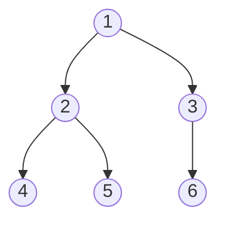
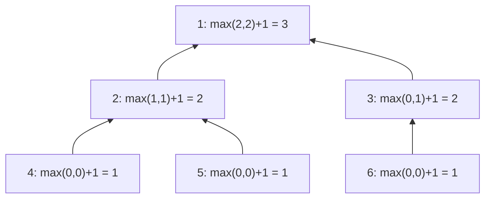
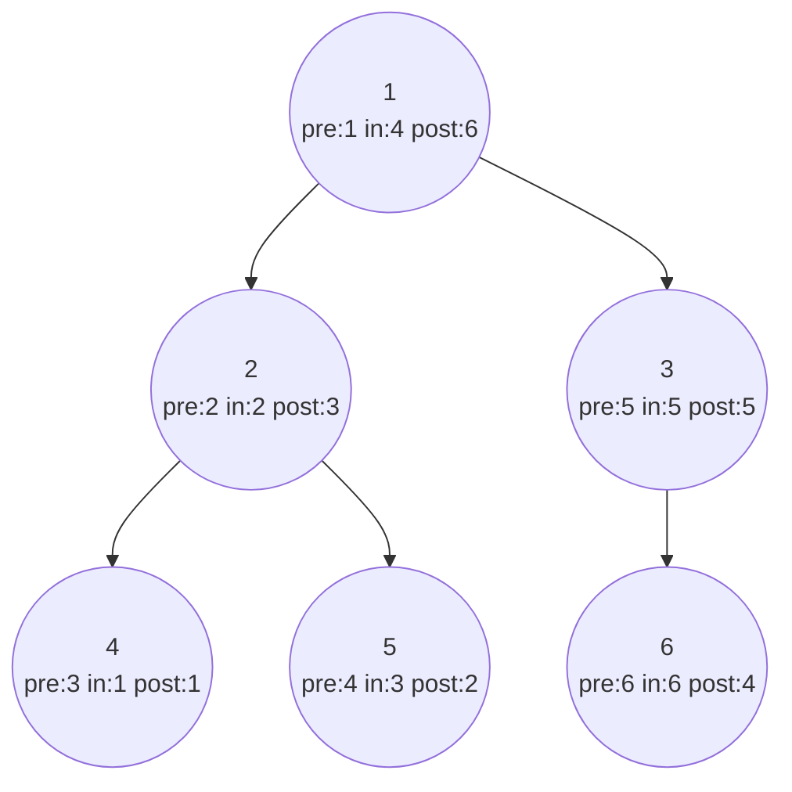
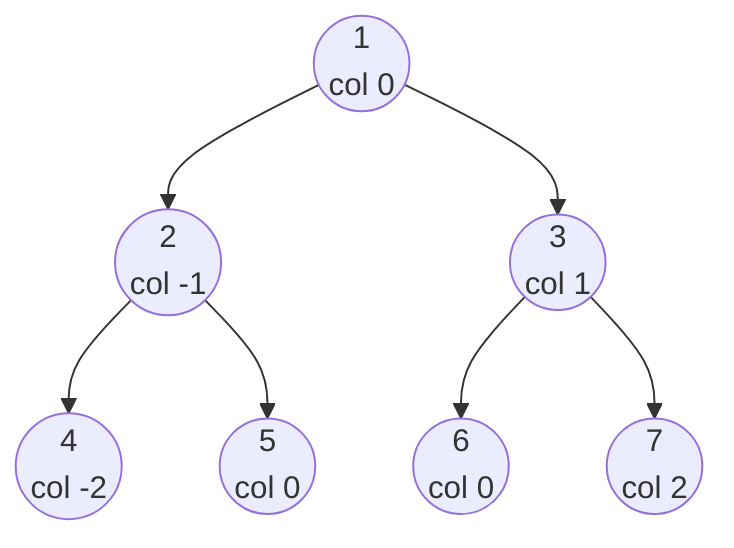

# Chapter 13 · Binary Trees

> Tumhara family tree, tumhari company ka org chart, laptop ke folders, har web page ka HTML, aur compiler jis tarah `2 + 3 * 4` padhta hai: sab trees hain. Trees woh jagah hai jahan recursion ek academic exercise nahi rehta, balki sochne ka sabse natural tareeka ban jaata hai. Bas ek sawaal seekh lo, **"mujhe apne children se kya chahiye?"**, aur tum zyadatar tree problems das line se kam mein solve kar loge.

**Is chapter mein tum seekhoge:**
- Tree vocabulary (root, leaf, depth, height, ...) pictures ke saath, aur binary trees ke types
- Python mein trees kaise banate aur print karte hain, LeetCode ke level-order format se bhi
- **"Apne children se poochho"** wala recursion template jo zyadatar tree problems solve karta hai
- DFS traversals (**preorder, inorder, postorder**), recursive aur iterative dono, aur BFS **level order**
- Classic problems: height, diameter, balanced, same/symmetric/subtree, invert, path sums I/II/III, maximum path sum
- Lowest common ancestor, right side view, zigzag, vertical/top/bottom views
- Traversals se tree banana, serialize aur deserialize karna, complete tree mein nodes ginna
- **Morris traversal**: O(1) extra space mein inorder

**Isse pehle padho:** [Recursion](../part-1-python/12-recursion.md) · [Recursion & Backtracking](09-backtracking.md) · [Stacks](11-stacks.md) · [Queues & Deques](12-queues-deques.md)

---

## 🧠 The Big Idea · Asli Baat

Apne computer ke folders dekho. Sabse upar ek folder hai. Uske andar kuch folders hain, unke andar aur folders, aur bilkul neeche files hain jinke andar kuch nahi. Koi folder ek saath do parents ke andar nahi rehta, aur tum kabhi ghoom ke wapas wahin nahi pahunchte jahan se chale the.

Yahi **tree** hai: ek hierarchy jisme sabse upar wale ko chhod ke har cheez ka exactly ek parent hota hai. **Binary tree** woh tree hai jisme har node ke **maximum do children** hote hain, jinhe **left** aur **right** kehte hain.



> 🇮🇳 **Desi Analogy:** Joint family ka vanshavali (family tree) socho. Sabse upar Dadaji (root). Unke do bete: Papa aur Chachu (children). Papa ke do bachche, Chachu ka ek. Har insaan ka exactly ek "upar wala" hai (parent), sirf Dadaji ka koi nahi. Aur dhyaan do: Papa apne aap mein ek chhoti family ke "Dadaji" hain, kyunki unke neeche unki poori family hai. Binary tree mein bas ek extra rule hai: har insaan ke **maximum do** bachche, left wala aur right wala.

Ab magic dekho. Node 2 ko dekho: woh apne ek chhote tree ka top hai (2, 4, 5). Node 3 ek doosre tree ka top hai (3, 6). **Har node ek chhote tree ka root hai.** Isi wajah se trees *perfectly* recursive hain:

> Tree ya toh khaali hai, ya ek node hai jiske paas ek left tree aur ek right tree hai.

Toh lagbhag har tree problem har node pe ek hi sawaal poochh ke solve ho sakti hai:

```text
"If my left child and my right child each told me the answer for THEIR subtree,
 how would I combine that into the answer for MY subtree?"
```

Matlab: "Agar mera left child aur mera right child, dono mujhe apne-apne subtree ka answer bata dein, toh main un dono ko milake *apne* subtree ka answer kaise banaunga?"

Tree ki height chahiye? Har child se uski height poochho, badi wali lo, 1 jodo. Nodes ki ginti chahiye? Har child se uska count poochho, dono jodo, 1 apna jodo. Tum kabhi poore tree ke baare mein ek saath nahi sochte. Tum sochte ho **ek node aur do answers** ke baare mein.

> 🇮🇳 **Desi Analogy:** Board exam ka result banana hai. Principal har class mein jaake har bachche ke marks nahi ginta. Woh do section teachers se poochhta hai: "Tumhare section ka total kya hai?" Har teacher apne class monitors se poochhti hai, aur monitor apni row ke bachchon se. Neeche se answers upar aate hain, aur har level pe bas **do answers jodo + apna hissa daalo**. Principal ko poore school ka hisaab dimaag mein rakhna hi nahi padta. Yahi "ask your children" hai.

> 💡 **The core insight:** poore tree ko dimaag mein trace mat karo. Recursive call pe bharosa karo ki woh har child ka subtree solve kar dega (wahi problem hai, bas chhoti), aur sirf ye decide karo ki *ek* node apne children ke answers ko kaise combine karega.

> 🤔 **Mann mein sawaal:** Recursive call pe "bharosa" kaise kar loon? Mujhe toh dekhna hai ki andar kya ho raha hai.
>
> **Jawab:** Ye bilkul maths ki induction jaisa hai. Agar tumhara function khaali tree (`None`) ke liye sahi hai, aur "agar children ke liye sahi hai toh mere liye bhi sahi hai" wala step sahi hai, toh woh **har** size ke tree ke liye sahi hai. Andar jaake trace karna debugging ke liye accha hai, lekin code *likhte* waqt sirf ek node ke baare mein socho. Isse dimaag pe load aadha ho jaata hai. (Under the Hood mein isko properly prove karenge.)

---

## 🔨 Building It Up · Zero Se Shuru

### 1. Tree vocabulary

Big Idea wale tree ko use karke:

| Term | Matlab | Example |
|---|---|---|
| **Node** | ek element, jisme ek value hai | har gola |
| **Root** | sabse upar ka node, jiska koi parent nahi | 1 |
| **Parent / child** | seedha upar / neeche wala node | 2, 4 aur 5 ka parent hai |
| **Siblings** | same parent wale nodes (bhai-behen) | 4 aur 5 |
| **Leaf** | jis node ka koi child nahi | 4, 5, 6 |
| **Internal node** | jis node ka kam se kam ek child hai | 1, 2, 3 |
| **Edge** | parent aur child ke beech ki link | 1–2 |
| **Subtree** | ek node plus uske saare descendants | {2, 4, 5} |
| **Ancestor / descendant** | path pe upar / neeche ka koi bhi | 1, 5 ka ancestor hai |
| **Depth of a node** | root se us node tak neeche aane mein kitne edges | depth(1) = 0, depth(5) = 2 |
| **Level** | same depth wale saare nodes | level 1 = {2, 3} |
| **Height of a node** | us node se neeche kisi leaf tak ke sabse lambe path ke edges | height(2) = 1, height(1) = 2 |
| **Height of the tree** | root ki height | 2 |

**Depth vs height** sabse zyada confuse karte hain, toh ek line mein: **depth upar se naapte hain (root se kitna neeche ho), height neeche se naapte hain (sabse door leaf kitni neeche hai).** Building ki floor jaisa: depth = "terrace se kitni manzil neeche ho", height = "tumhare neeche kitni manzilein hain".

> ⚠️ Kuch books (aur LeetCode ka "Maximum Depth" problem) edges ki jagah **nodes** ginte hain, toh upar wale tree ki "depth 3" hogi. Dono galat nahi hain; bas saaf bolo ki tum kaunsa matlab le rahe ho.

Binary trees ke types jinke naam tum sunoge:

| Type | Rule | Kyun matter karta hai |
|---|---|---|
| **Full** | har node ke 0 ya 2 children | expression trees |
| **Complete** | aakhri level ko chhod ke har level bhara hua, aur aakhri level **left se right** bharta hai | heaps ([Chapter 15](15-heaps.md)); array mein store ho sakta hai |
| **Perfect** | har level poora bhara hua | exactly 2^(h+1) − 1 nodes hote hain |
| **Balanced** | har node pe left aur right heights mein maximum 1 ka farak | height O(log n) rehti hai, toh operations fast rehte hain |
| **Degenerate / skewed** | har node ka ek hi child | basically ek linked list; height n − 1 |
| **Binary Search Tree** | har jagah left < node < right | fast search ([Chapter 14](14-binary-search-trees.md)) |

> 🤔 **Mann mein sawaal:** Complete aur perfect mein farak kya hai? Dono "bhare hue" lagte hain.
>
> **Jawab:** **Perfect** = har level, aakhri bhi, poora bhara hua (1, 3, 7, 15... nodes). **Complete** = aakhri level adhoora ho sakta hai, lekin jo bhi bhara hai woh **left se bina gap ke** bhara hai. Cinema hall ki aakhri row socho: complete matlab log left se ek ke baad ek baithe hain, beech mein koi khaali seat nahi. Har perfect tree complete hai, lekin har complete tree perfect nahi.

### 2. Building trees in Python

Tree node ek linked-list node ([Chapter 10](10-linked-lists.md)) jaisa hi hai, bas ek pointer ki jagah do pointers.

```python
class TreeNode:
    def __init__(self, val=0, left=None, right=None):
        self.val = val
        self.left = left
        self.right = right

#        1
#       / \
#      2   3
#     / \   \
#    4   5   6
root = TreeNode(1,
                TreeNode(2, TreeNode(4), TreeNode(5)),
                TreeNode(3, None, TreeNode(6)))

print(root.val, root.left.val, root.right.val)
print(root.left.left.val, root.right.right.val, root.right.left)

def show(node, depth=0):
    """Print the tree sideways: right subtree on top, root on the left."""
    if node:
        show(node.right, depth + 1)
        print("    " * depth + str(node.val))
        show(node.left, depth + 1)

show(root)
```

```text
1 2 3
4 6 None
        6
    3
1
        5
    2
        4
```

Abhi kya hua: apna sar left ki taraf jhukao, aur ye sideways print hi tree *hai*. Right subtree upar print hota hai, root sabse left mein, aur jitna gehra node, utna zyada indent. Jo child nahi hai woh bas `None` hai (dekho `root.right.left` ne `None` print kiya).

LeetCode aur zyadatar interview tools trees ko ek **level-order list** ki tarah describe karte hain, jisme missing children ke liye `None` hota hai: upar wala tree `[1, 2, 3, 4, 5, None, 6]` hai. Neeche wala helper is format se tree banata hai, aur `to_level` wapas list mein convert karta hai. Har runnable block mein hum `TreeNode` aur `build_tree` dobara define karenge, taaki har block akela chal sake.

```python
from collections import deque

class TreeNode:
    def __init__(self, val=0, left=None, right=None):
        self.val, self.left, self.right = val, left, right

def build_tree(values):
    """Level-order list (None = missing child) -> root node."""
    if not values or values[0] is None:
        return None
    root = TreeNode(values[0])
    queue = deque([root])
    i = 1
    while queue and i < len(values):
        node = queue.popleft()
        if i < len(values) and values[i] is not None:      # left child
            node.left = TreeNode(values[i])
            queue.append(node.left)
        i += 1
        if i < len(values) and values[i] is not None:      # right child
            node.right = TreeNode(values[i])
            queue.append(node.right)
        i += 1
    return root

def to_level(root):
    """Root -> level-order list, trailing Nones removed."""
    out, queue = [], deque([root])
    while queue:
        node = queue.popleft()
        if node:
            out.append(node.val)
            queue.append(node.left)
            queue.append(node.right)
        else:
            out.append(None)
    while out and out[-1] is None:
        out.pop()
    return out

root = build_tree([1, 2, 3, 4, 5, None, 6])
print(root.left.right.val, root.right.right.val)
print(to_level(root))
print(to_level(build_tree([])))
```

```text
5 6
[1, 2, 3, 4, 5, None, 6]
[]
```

Abhi kya hua: builder values ko children mein bilkul usi order mein baant-ta hai jisme BFS nodes visit karta hai, ek queue use karke ([Chapter 12](12-queues-deques.md)). Queue se ek parent nikalo, list ki agli do values uske left aur right child bano. Missing children skip ho jaate hain, lekin list mein apna slot phir bhi kha jaate hain. Isliye `[1, 2, 3, 4, 5, None, 6]` mein `None` zaroori hai: woh batata hai ki 3 ka left child nahi hai, aur 6 uska **right** child hai.

### 3. Recursion on trees: "ask your children"

Template, shabdon mein:

1. **Base case:** khaali tree (`None`). "Kuch nahi" ka answer kya hai? (Usually 0, `True`, ya `None`.)
2. Left child se uska answer **poochho**, aur right child se uska.
3. Current node ki value ke saath unhe **combine** karo.

```python
from collections import deque

class TreeNode:
    def __init__(self, val=0, left=None, right=None):
        self.val, self.left, self.right = val, left, right

def build_tree(values):
    if not values or values[0] is None:
        return None
    root = TreeNode(values[0])
    queue, i = deque([root]), 1
    while queue and i < len(values):
        node = queue.popleft()
        if i < len(values) and values[i] is not None:
            node.left = TreeNode(values[i]); queue.append(node.left)
        i += 1
        if i < len(values) and values[i] is not None:
            node.right = TreeNode(values[i]); queue.append(node.right)
        i += 1
    return root

def count_nodes(node):
    if node is None:
        return 0                                               # empty tree has 0 nodes
    return count_nodes(node.left) + count_nodes(node.right) + 1   # children + me

def tree_sum(node):
    if node is None:
        return 0
    return tree_sum(node.left) + tree_sum(node.right) + node.val

def max_value(node):
    if node is None:
        return float("-inf")                                   # neutral for max
    return max(node.val, max_value(node.left), max_value(node.right))

def max_depth(node):
    """Number of NODES on the longest root-to-leaf path (LeetCode's definition)."""
    if node is None:
        return 0
    return 1 + max(max_depth(node.left), max_depth(node.right))

def count_leaves(node):
    if node is None:
        return 0
    if node.left is None and node.right is None:
        return 1                                               # I am a leaf
    return count_leaves(node.left) + count_leaves(node.right)

root = build_tree([1, 2, 3, 4, 5, None, 6])
print(count_nodes(root), tree_sum(root), max_value(root), max_depth(root), count_leaves(root))
```

```text
6 21 6 3 3
```

Abhi kya hua: paanch alag sawaal, ek jaisi shape. Har function har node ko ek baar visit karta hai, toh har ek **O(n) time** aur **O(h) space** hai, jahan h tree ki height hai (recursion maximum h levels gehra jaata hai).

Kuch details dhyaan se dekho:
- `max_value` ka base case `float("-inf")` hai, 0 nahi. Kyun? Agar saari values negative hoti, toh 0 galat jeet jaata. `-inf` max ke liye "neutral" hai: kisi bhi number se haar jaata hai.
- `count_leaves` mein ek **extra** base case hai: "main leaf hoon" (dono children `None`). Kyunki leaf hone ki baat node khud hi bata sakta hai, children nahi.

Yahan dekho `max_depth` ke answers tree mein **upar** kaise behte hain, leaves se root tak:



### 4. DFS traversals: preorder, inorder, postorder

**Traversal** har node ko ek baar visit karta hai. **Depth-first** traversals ek branch mein poora neeche tak jaate hain, phir wapas aate hain. Teeno mein farak sirf itna hai ki **node khud ko kab visit karte ho**, children ke relative:

| Traversal | Order | Memory trick | Typical use |
|---|---|---|---|
| **Preorder** | **node**, left, right | **neeche jaate waqt** visit | tree copy karna, serialize, folder structure print karna |
| **Inorder** | left, **node**, right | children ke **beech mein** visit | BST → sorted order ([Chapter 14](14-binary-search-trees.md)) |
| **Postorder** | left, right, **node** | **upar aate waqt** visit | tree delete karna, sizes nikaalna, expressions evaluate karna |

Socho tum tree ke bahar-bahar ghoom rahe ho, root se shuru karke, tree ko apne left haath pe rakhte hue. Tum har node ke paas se teen baar guzarte ho: ek baar uske left side se (preorder), ek baar uske neeche se (inorder), ek baar uske right side se (postorder).



(Har node dikhata hai ki woh har traversal mein kaun si **position** pe visit hota hai.)

> 🇮🇳 **Desi Analogy:** Shaadi mein ek photographer ghar ke har kamre ki photo leta hai. **Preorder** photographer kamre mein ghuste hi photo leta hai, phir andar ke chhote kamron mein jaata hai (pehle main, phir details): jaise invitation card pe pehle family ka naam, phir members. **Postorder** photographer pehle saare andar ke kamre nipta ke, nikalte waqt bade kamre ki photo leta hai: jaise ghar khaali karte waqt pehle andar ke almari khaali karo, phir kamra lock karo (tree delete karna). **Inorder** beech ka raasta hai: left kamra, phir main hall, phir right kamra.

```python
from collections import deque

class TreeNode:
    def __init__(self, val=0, left=None, right=None):
        self.val, self.left, self.right = val, left, right

def build_tree(values):
    if not values or values[0] is None:
        return None
    root = TreeNode(values[0])
    queue, i = deque([root]), 1
    while queue and i < len(values):
        node = queue.popleft()
        if i < len(values) and values[i] is not None:
            node.left = TreeNode(values[i]); queue.append(node.left)
        i += 1
        if i < len(values) and values[i] is not None:
            node.right = TreeNode(values[i]); queue.append(node.right)
        i += 1
    return root

def preorder(node, out):
    if node:
        out.append(node.val)          # node first
        preorder(node.left, out)
        preorder(node.right, out)
    return out

def inorder(node, out):
    if node:
        inorder(node.left, out)
        out.append(node.val)          # node in the middle
        inorder(node.right, out)
    return out

def postorder(node, out):
    if node:
        postorder(node.left, out)
        postorder(node.right, out)
        out.append(node.val)          # node last
    return out

root = build_tree([1, 2, 3, 4, 5, None, 6])
print("pre: ", preorder(root, []))
print("in:  ", inorder(root, []))
print("post:", postorder(root, []))
```

```text
pre:  [1, 2, 4, 5, 3, 6]
in:   [4, 2, 5, 1, 3, 6]
post: [4, 5, 2, 6, 3, 1]
```

Abhi kya hua: teeno functions bilkul same hain, bas **ek line kahan baithi hai** usme farak hai. Dhyaan do: preorder mein root **pehla** hai aur postorder mein **aakhri**. Yahi fact section 15 mein traversals se tree dobara banane mein kaam aayega.

> 🤔 **Mann mein sawaal:** Teeno traversals mein se interview mein kaunsa kab use karoon? Sab same jaise lagte hain.
>
> **Jawab:** Ek simple rule: **parent ko pehle process karna hai, children ko baad mein (info neeche bhejni hai)? Preorder.** **Children ke answers pehle chahiye, phir parent ka (info upar laani hai)? Postorder.** "Ask your children" wala har bottom-up function asal mein postorder hi hai. **Inorder** tab, jab BST mein sorted order chahiye.

### 5. Iterative traversals with an explicit stack

Recursion call stack use karta hai; tum uski jagah apna khud ka stack use kar sakte ho ([Chapter 11](11-stacks.md)). Interviewers ye check karne ke liye poochhte hain ki tum samajhte ho ki recursion asal mein kya karta hai, aur ye bahut gehre trees pe Python ki recursion limit se bhi bachata hai.

```python
from collections import deque

class TreeNode:
    def __init__(self, val=0, left=None, right=None):
        self.val, self.left, self.right = val, left, right

def build_tree(values):
    if not values or values[0] is None:
        return None
    root = TreeNode(values[0])
    queue, i = deque([root]), 1
    while queue and i < len(values):
        node = queue.popleft()
        if i < len(values) and values[i] is not None:
            node.left = TreeNode(values[i]); queue.append(node.left)
        i += 1
        if i < len(values) and values[i] is not None:
            node.right = TreeNode(values[i]); queue.append(node.right)
        i += 1
    return root

def preorder_iter(root):
    out, stack = [], [root] if root else []
    while stack:
        node = stack.pop()
        out.append(node.val)
        if node.right:
            stack.append(node.right)      # push right FIRST so left is popped first
        if node.left:
            stack.append(node.left)
    return out

def inorder_iter(root):
    out, stack, node = [], [], root
    while stack or node:
        while node:                       # 1. slide down-left, remembering the path
            stack.append(node)
            node = node.left
        node = stack.pop()                # 2. leftmost unvisited node
        out.append(node.val)
        node = node.right                 # 3. then handle its right subtree
    return out

def postorder_iter(root):
    # preorder with children swapped gives node-right-left; reversed, that's left-right-node
    out, stack = [], [root] if root else []
    while stack:
        node = stack.pop()
        out.append(node.val)
        if node.left:
            stack.append(node.left)
        if node.right:
            stack.append(node.right)
    return out[::-1]

root = build_tree([1, 2, 3, 4, 5, None, 6])
print(preorder_iter(root), inorder_iter(root), postorder_iter(root))
```

```text
[1, 2, 4, 5, 3, 6] [4, 2, 5, 1, 3, 6] [4, 5, 2, 6, 3, 1]
```

Teeno ko ek-ek karke samjho:
- **Preorder:** stack se node nikalo, visit karo, phir pehle **right** push karo, phir left. Stack LIFO hai, toh left pehle bahar aayega. Bilkul node-left-right.
- **Inorder:** ye thoda alag hai, neeche dry run dekho.
- **Postorder:** ek chalaak trick. Preorder ko children swap karke chalao toh node-right-left milta hai. Usko ulta (`[::-1]`) karo toh left-right-node, yaani postorder.

`inorder_iter` ka example tree pe **dry run**:

| step | action | stack (bottom → top) | output |
|---|---|---|---|
| 1 | 1 se left slide karo: 1, 2, 4 push | 1, 2, 4 | |
| 2 | 4 pop, visit, right jao (None) | 1, 2 | 4 |
| 3 | 2 pop, visit, right jao → 5 | 1 | 4, 2 |
| 4 | 5 se left slide: 5 push | 1, 5 | |
| 5 | 5 pop, visit, right jao (None) | 1 | 4, 2, 5 |
| 6 | 1 pop, visit, right jao → 3 | | 4, 2, 5, 1 |
| 7 | 3 push; 3 pop, visit, right jao → 6 | | ..., 3 |
| 8 | 6 push; 6 pop, visit; stack khaali, node None → stop | | ..., 3, 6 |

Abhi kya hua: iterative inorder woh hai jo tumhe ratt lena chahiye. Iska stack exactly un ancestors ko hold karta hai jinki left side hum abhi explore kar rahe hain, aur recursive version ka call stack bhi exactly yahi hold karta hai.

> 🇮🇳 **Desi Analogy:** Iterative inorder ek building ki seedhi jaisa hai jisme har floor pe ek "left" darwaza hai. Tum har floor pe ek parchi chhodte jaate ho (push) aur left darwaze se neeche utarte jaate ho, jab tak aur neeche na ja sako. Phir sabse aakhri parchi uthao (pop), us floor ka kaam karo (visit), aur uske "right" darwaze se jao. Wahan phir se left-left neeche. Teen kadam: **slide left, pop, go right.**

### 6. Level-order traversal (BFS)

**Breadth-first** tree ko level by level, left se right visit karta hai. Ye kaam queue karti hai: sabse pehle discover hua node pehle process karo ([Chapter 12](12-queues-deques.md)). Har level ki shuruaat mein `len(queue)` ko freeze kar do, taaki nodes level ke hisaab se group ho jaayein.

> 🇮🇳 **Desi Analogy:** Shaadi ki group photo socho jisme log rows mein khade hain: pehli row mein Dadaji-Dadiji, doosri mein unke bachche, teesri mein pote-potiyan. Photographer har row ko left se right padh ke naam likhta hai, phir agli row. Yahi level order hai. Aur "is row mein kitne log hain" pehle gin lena hi `range(len(queue))` hai, taaki agli row wale galti se is row mein na gine jaayein.

```python
from collections import deque

class TreeNode:
    def __init__(self, val=0, left=None, right=None):
        self.val, self.left, self.right = val, left, right

def build_tree(values):
    if not values or values[0] is None:
        return None
    root = TreeNode(values[0])
    queue, i = deque([root]), 1
    while queue and i < len(values):
        node = queue.popleft()
        if i < len(values) and values[i] is not None:
            node.left = TreeNode(values[i]); queue.append(node.left)
        i += 1
        if i < len(values) and values[i] is not None:
            node.right = TreeNode(values[i]); queue.append(node.right)
        i += 1
    return root

def level_order(root):
    if not root:
        return []
    levels, queue = [], deque([root])
    while queue:
        level = []
        for _ in range(len(queue)):        # exactly this level's nodes
            node = queue.popleft()
            level.append(node.val)
            if node.left:
                queue.append(node.left)
            if node.right:
                queue.append(node.right)
        levels.append(level)
    return levels

def min_depth(root):
    """Nodes on the SHORTEST root-to-leaf path: BFS stops at the first leaf."""
    if not root:
        return 0
    queue, depth = deque([root]), 1
    while queue:
        for _ in range(len(queue)):
            node = queue.popleft()
            if not node.left and not node.right:
                return depth               # first leaf found = shallowest leaf
            if node.left:
                queue.append(node.left)
            if node.right:
                queue.append(node.right)
        depth += 1

print(level_order(build_tree([1, 2, 3, 4, 5, None, 6])))
print(level_order(build_tree([3, 9, 20, None, None, 15, 7])))
print(min_depth(build_tree([3, 9, 20, None, None, 15, 7])), min_depth(build_tree([2, None, 3, None, 4, None, 5])))
```

```text
[[1], [2, 3], [4, 5, 6]]
[[3], [9, 20], [15, 7]]
2 4
```

Abhi kya hua: **minimum depth** ke liye BFS, DFS se behtar hai, kyunki woh pehli leaf milte hi ruk sakta hai. DFS ko poora tree explore karna padta. Doosra example dhyaan se dekho: ek "tree" jo bas ek chain `2 → 3 → 4 → 5` hai, uski minimum depth 4 hai, 1 nahi, kyunki root leaf nahi hai (uska ek child hai).

> 🤔 **Mann mein sawaal:** Chain `2 → 3 → 4 → 5` mein root ka left child toh `None` hai. Toh shortest path "root se None tak" 1 kyun nahi?
>
> **Jawab:** Kyunki path **leaf** pe khatam hona chahiye, aur `None` koi node hi nahi hai, leaf toh bilkul nahi. Leaf woh hai jiske **dono** children `None` hon. Root 2 ka right child 3 hai, toh 2 leaf nahi hai. Yahi woh jagah hai jahan `min(left, right) + 1` wala naive recursion galat ho jaata hai (Traps #3 dekho).

### 7. Diameter: when the answer isn't what you return

**Diameter** = **kinhi bhi** do nodes ke beech ke sabse lambe path mein edges ki ginti. Ye path root se guzre, zaroori nahi.

Har node pe, jo sabse lamba path us node pe **mudta (bend hota)** hai, woh left side mein jitna ho sake neeche jaata hai aur right side mein jitna ho sake neeche: `height(left) + height(right)` edges (heights nodes mein gin ke). Toh:

- Har call apni height **return** karta hai (jo parent ko chahiye).
- Har call `left + right` ko ek running best mein **record** karta hai (yahi asli answer hai).

Ye "ek cheez return karo, doosri record karo" wali shape sabse important tree patterns mein se ek hai.

> 🇮🇳 **Desi Analogy:** Ek kite (patang) ke manjhe ko socho jo ek ped ki shaakhon mein ulajh gaya hai. Manjhe ka sabse lamba seedha tukda kisi ek shaakh ke jod (node) pe "V" shape mein mudta hai: ek taraf left shaakh mein neeche, doosri taraf right shaakh mein neeche. Har jod apne parent ko sirf itna batata hai "meri sabse lambi ek taraf ki shaakh kitni lambi hai" (height), kyunki parent ke liye path tumhare jod se **ek hi taraf** aage ja sakta hai. Lekin har jod chupke se ek register mein likh deta hai "mere pe mudne wala V kitna lamba hai" (`left + right`). Register ka sabse bada number hi diameter hai.

```python
from collections import deque

class TreeNode:
    def __init__(self, val=0, left=None, right=None):
        self.val, self.left, self.right = val, left, right

def build_tree(values):
    if not values or values[0] is None:
        return None
    root = TreeNode(values[0])
    queue, i = deque([root]), 1
    while queue and i < len(values):
        node = queue.popleft()
        if i < len(values) and values[i] is not None:
            node.left = TreeNode(values[i]); queue.append(node.left)
        i += 1
        if i < len(values) and values[i] is not None:
            node.right = TreeNode(values[i]); queue.append(node.right)
        i += 1
    return root

def diameter_of_binary_tree(root):
    best = 0

    def height(node):                       # returns height in NODES
        nonlocal best
        if node is None:
            return 0
        left = height(node.left)
        right = height(node.right)
        best = max(best, left + right)      # longest path bending here (in edges)
        return 1 + max(left, right)         # what my parent needs

    height(root)
    return best

print(diameter_of_binary_tree(build_tree([1, 2, 3, 4, 5])))
print(diameter_of_binary_tree(build_tree([1, 2, None, 3, 4, 5, None, None, 6])))
```

```text
3
4
```

`[1, 2, 3, 4, 5]` ke liye **trace** (tree: 1 ke children 2 aur 3; 2 ke children 4 aur 5):

| node | left height | right height | node se guzarta path (edges) | best | returns |
|---|---|---|---|---|---|
| 4 | 0 | 0 | 0 | 0 | 1 |
| 5 | 0 | 0 | 0 | 0 | 1 |
| 2 | 1 | 1 | 2 | 2 | 2 |
| 3 | 0 | 0 | 0 | 2 | 1 |
| 1 | 2 | 1 | **3** | 3 | 3 |

Sabse lamba path 4 → 2 → 1 → 3 (ya 5 → 2 → 1 → 3) hai: 3 edges. Doosre example mein sabse lamba path (5 → 3 → 2 → 4 → 6) root ko chhoota bhi nahi, aur code phir bhi usse dhoondh leta hai, kyunki har node ko "bend" banne ka mauka milta hai. `nonlocal best` inner function ko bahar wala variable update karne deta hai ([Functions](../part-1-python/10-functions.md)).

> 🤔 **Mann mein sawaal:** Heights nodes mein gin rahe hain lekin diameter edges mein. `left + right` edges kaise ban gaya?
>
> **Jawab:** Left subtree ki height (nodes mein) = current node se left mein sabse door leaf tak ke **edges**, kyunki current node se left child tak ek edge hai, aur phir left child ke andar (height − 1) edges. Total = height. Right ke liye bhi same. Toh `left + right` = poore V ke edges. Example: node 2 pe left = 1, right = 1: path 4 → 2 → 5 mein exactly 2 edges.

### 8. Is the tree balanced?

Tree **height-balanced** hai agar **har** node pe left aur right subtree ki heights mein maximum 1 ka farak ho.

Naive tareeka har node pe `height()` call karta hai: skewed tree pe O(n²). Smart tareeka ek hi pass mein karta hai: har call apni height return karta hai, ya **-1 ek signal ki tarah** jiska matlab hai "mera subtree pehle se unbalanced hai". Ek baar -1 aaya, woh seedha upar tak chala jaata hai.

```python
from collections import deque

class TreeNode:
    def __init__(self, val=0, left=None, right=None):
        self.val, self.left, self.right = val, left, right

def build_tree(values):
    if not values or values[0] is None:
        return None
    root = TreeNode(values[0])
    queue, i = deque([root]), 1
    while queue and i < len(values):
        node = queue.popleft()
        if i < len(values) and values[i] is not None:
            node.left = TreeNode(values[i]); queue.append(node.left)
        i += 1
        if i < len(values) and values[i] is not None:
            node.right = TreeNode(values[i]); queue.append(node.right)
        i += 1
    return root

def is_balanced(root):
    def check(node):                  # height, or -1 if unbalanced anywhere below
        if node is None:
            return 0
        left = check(node.left)
        if left == -1:
            return -1                 # stop early: already unbalanced
        right = check(node.right)
        if right == -1 or abs(left - right) > 1:
            return -1
        return 1 + max(left, right)

    return check(root) != -1

print(is_balanced(build_tree([3, 9, 20, None, None, 15, 7])))
print(is_balanced(build_tree([1, 2, 2, 3, 3, None, None, 4, 4])))
print(is_balanced(build_tree([])))
```

```text
True
False
True
```

Abhi kya hua: ek hi return value **do** cheezein carry kar rahi hai (ek height, ya "fail ho gaya"). Ye sentinel trick poore check ko O(n) rakhti hai.

Doosre example `[1, 2, 2, 3, 3, None, None, 4, 4]` mein: left side 1 → 2 → 3 → 4 tak 4 levels gehri hai, right side sirf 1 → 2, toh root pe heights 3 aur 1: farak 2. Unbalanced.

> 🤔 **Mann mein sawaal:** -1 hi kyun? Koi aur number bhi toh le sakte the.
>
> **Jawab:** Height kabhi negative nahi hoti (minimum 0, khaali tree ke liye). Toh -1 ek aisi value hai jo kabhi "asli" answer ho hi nahi sakti, isliye usse "error" ka matlab dena safe hai. Isko **sentinel** kehte hain: ek value jo pehredaar ki tarah khabar deti hai. Chaaho toh `None` bhi use kar sakte ho, bas consistent raho.

### 9. Same, symmetric, subtree: recursion on two trees at once

Ye problems **do** trees (ya ek tree ke do halves) ko saath-saath, kadam se kadam milake chalti hain.

- **Same Tree:** dono khaali → same. Ek khaali → alag. Warna values barabar hon, aur left left se match kare, aur right right se.
- **Symmetric Tree:** tree khud ka mirror hai. Left subtree ko right subtree se compare karo, lekin **cross karke (crosswise)**: bahar wala bahar wale se (`a.left` vs `b.right`), andar wala andar wale se (`a.right` vs `b.left`).
- **Subtree of Another Tree:** kya `sub`, `root` ke kisi subtree jaisa bilkul same hai? Har node pe "same tree" try karo.

> 🇮🇳 **Desi Analogy:** Symmetric tree ko aaine (mirror) ke saamne khade insaan ki tarah socho. Tumhara **left haath** aaine mein **right** side dikhta hai. Toh check karte waqt tumhare left ki ungli ko aaine wale ke right ki ungli se milao, aur andar ki taraf (anguutha) ko andar ki taraf se. Isliye `a.left` ko `b.right` se, aur `a.right` ko `b.left` se compare karte hain. Rangoli designs bhi aise hi symmetric banti hain: beech ki line ke dono taraf bilkul ulti copy.

```python
from collections import deque

class TreeNode:
    def __init__(self, val=0, left=None, right=None):
        self.val, self.left, self.right = val, left, right

def build_tree(values):
    if not values or values[0] is None:
        return None
    root = TreeNode(values[0])
    queue, i = deque([root]), 1
    while queue and i < len(values):
        node = queue.popleft()
        if i < len(values) and values[i] is not None:
            node.left = TreeNode(values[i]); queue.append(node.left)
        i += 1
        if i < len(values) and values[i] is not None:
            node.right = TreeNode(values[i]); queue.append(node.right)
        i += 1
    return root

def is_same_tree(p, q):
    if p is None and q is None:
        return True
    if p is None or q is None or p.val != q.val:
        return False
    return is_same_tree(p.left, q.left) and is_same_tree(p.right, q.right)

def is_symmetric(root):
    def mirror(a, b):
        if a is None and b is None:
            return True
        if a is None or b is None or a.val != b.val:
            return False
        return mirror(a.left, b.right) and mirror(a.right, b.left)   # crosswise
    return root is None or mirror(root.left, root.right)

def is_subtree(root, sub):
    if root is None:
        return sub is None
    return is_same_tree(root, sub) or is_subtree(root.left, sub) or is_subtree(root.right, sub)

print(is_same_tree(build_tree([1, 2, 3]), build_tree([1, 2, 3])),
      is_same_tree(build_tree([1, 2]), build_tree([1, None, 2])))
print(is_symmetric(build_tree([1, 2, 2, 3, 4, 4, 3])), is_symmetric(build_tree([1, 2, 2, None, 3, None, 3])))
print(is_subtree(build_tree([3, 4, 5, 1, 2]), build_tree([4, 1, 2])),
      is_subtree(build_tree([3, 4, 5, 1, 2, None, None, None, None, 0]), build_tree([4, 1, 2])))
```

```text
True False
True False
True False
```

Abhi kya hua: `is_same_tree` mein teen checks ka order matter karta hai: pehle "dono khaali", phir "exactly ek khaali ya values alag", aur sirf tab recurse karo (jab dono nodes pakka exist karte hain). Agar order ulta karo aur pehle `p.val` check karo, toh `None.val` pe crash. Complexities: same tree O(n), symmetric O(n), subtree worst case O(m × n) (ek O(m + n) version dono trees ko serialize karke string matching karta hai, Interview Q15 dekho).

### 10. Invert a binary tree

Har node ke left aur right children swap kar do: tree ki mirror image. (Ye problem famous isliye hai kyunki Homebrew ke creator ne tweet kiya tha ki Google ne unhe reject kar diya kyunki woh isse whiteboard pe solve nahi kar paaye.)

```python
from collections import deque

class TreeNode:
    def __init__(self, val=0, left=None, right=None):
        self.val, self.left, self.right = val, left, right

def build_tree(values):
    if not values or values[0] is None:
        return None
    root = TreeNode(values[0])
    queue, i = deque([root]), 1
    while queue and i < len(values):
        node = queue.popleft()
        if i < len(values) and values[i] is not None:
            node.left = TreeNode(values[i]); queue.append(node.left)
        i += 1
        if i < len(values) and values[i] is not None:
            node.right = TreeNode(values[i]); queue.append(node.right)
        i += 1
    return root

def to_level(root):
    out, queue = [], deque([root])
    while queue:
        node = queue.popleft()
        if node:
            out.append(node.val); queue.append(node.left); queue.append(node.right)
        else:
            out.append(None)
    while out and out[-1] is None:
        out.pop()
    return out

def invert_tree(node):
    if node is None:
        return None
    node.left, node.right = invert_tree(node.right), invert_tree(node.left)
    return node

print(to_level(invert_tree(build_tree([4, 2, 7, 1, 3, 6, 9]))))
print(to_level(invert_tree(build_tree([2, 1, 3]))))
```

```text
[4, 7, 2, 9, 6, 3, 1]
[2, 3, 1]
```

Abhi kya hua: Python assign karne se pehle poora right-hand side (dono recursive calls) evaluate kar leta hai, isliye ek line mein swap safe hai. O(n) time, O(h) space.

> 🤔 **Mann mein sawaal:** Agar main do lines mein likhun, `node.left = invert_tree(node.right)` phir `node.right = invert_tree(node.left)`, toh kya galat hoga?
>
> **Jawab:** Pehli line ke baad `node.left` badal chuka hai (ab usme inverted right subtree hai). Doosri line wahi naya `node.left` dobara invert karke right mein daal degi, aur original left subtree kho jaayega. Do lines mein likhna hai toh pehle `old_left = node.left` save karo. Python ka tuple assignment ye kaam apne aap karta hai.

### 11. Path Sum I, II and III: passing information down

Ab tak answers **upar** beh rahe the (children parents ko report karte hain). Path problems aksar information **neeche** bhejti hain: har call ko milta hai "root se mujh tak ke path pe kya hua".

- **Path Sum I:** kya koi root-to-leaf path hai jiski values ka jod `target` ho? **Bacha hua (remaining)** target neeche bhejo; leaf pe check karo ki kya woh exactly leaf ki value hai.
- **Path Sum II:** aise **saare** paths return karo. Same idea plus ek path list backtracking ke saath: choose, explore, unchoose ([Chapter 09](09-backtracking.md)).
- **Path Sum III:** woh paths gino jinka sum `target` hai, jo **neeche ki taraf** jaate hain lekin **kahin bhi** shuru aur khatam ho sakte hain. Ye har root-to-node path pe "subarray sum equals k" ([Chapter 06](06-prefix-sums.md)) hai: current path pe dekhe gaye prefix sums ki ek dict rakho.

> 🇮🇳 **Desi Analogy:** Path Sum I ko ek road trip socho jisme tumhare paas ₹22 ka petrol budget hai. Har shehar (node) mein kuch kharcha hota hai. Tum har shehar se aage wale ko batate ho "mere paas ab itna bacha hai" (remaining target neeche jaata hai). Aakhri shehar (leaf) pe pahunch ke check karo: kya bacha hua paisa exactly us shehar ke kharche jitna hai? Haan toh perfect trip mil gayi.

```python
from collections import deque, defaultdict

class TreeNode:
    def __init__(self, val=0, left=None, right=None):
        self.val, self.left, self.right = val, left, right

def build_tree(values):
    if not values or values[0] is None:
        return None
    root = TreeNode(values[0])
    queue, i = deque([root]), 1
    while queue and i < len(values):
        node = queue.popleft()
        if i < len(values) and values[i] is not None:
            node.left = TreeNode(values[i]); queue.append(node.left)
        i += 1
        if i < len(values) and values[i] is not None:
            node.right = TreeNode(values[i]); queue.append(node.right)
        i += 1
    return root

def has_path_sum(node, target):
    if node is None:
        return False
    if node.left is None and node.right is None:
        return target == node.val                     # at a leaf: is the rest exactly me?
    rest = target - node.val
    return has_path_sum(node.left, rest) or has_path_sum(node.right, rest)

def path_sum_ii(root, target):
    result, path = [], []

    def dfs(node, remaining):
        if node is None:
            return
        path.append(node.val)                         # choose
        if node.left is None and node.right is None and remaining == node.val:
            result.append(path[:])
        dfs(node.left, remaining - node.val)          # explore
        dfs(node.right, remaining - node.val)
        path.pop()                                    # unchoose

    dfs(root, target)
    return result

def path_sum_iii(root, target):
    seen = defaultdict(int)
    seen[0] = 1                                       # the empty prefix

    def dfs(node, running):
        if node is None:
            return 0
        running += node.val
        count = seen[running - target]                # paths ending here with sum target
        seen[running] += 1                            # this prefix is now on the path
        count += dfs(node.left, running) + dfs(node.right, running)
        seen[running] -= 1                            # leaving: remove it (backtrack)
        return count

    return dfs(root, 0)

t1 = build_tree([5, 4, 8, 11, None, 13, 4, 7, 2, None, None, None, 1])
print(has_path_sum(t1, 22), has_path_sum(t1, 100))
t2 = build_tree([5, 4, 8, 11, None, 13, 4, 7, 2, None, None, 5, 1])
print(path_sum_ii(t2, 22))
t3 = build_tree([10, 5, -3, 3, 2, None, 11, 3, -2, None, 1])
print(path_sum_iii(t3, 8))
```

```text
True False
[[5, 4, 11, 2], [5, 8, 4, 5]]
3
```

Abhi kya hua: Path Sum III mein `running - target` ye poochhta hai: "kya **isi** root-to-node path pe pehle koi point tha jahan running sum, abhi ke sum se exactly `target` kam tha?" Agar haan, toh wahan se yahan tak ka tukda `target` ke barabar hai. Bahar nikalte waqt decrement bahut zaroori hai: **doosri** branch ke prefixes count nahi hone chahiye. 8 jodne wale teen paths hain 5→3, 5→2→1, aur -3→11. O(n) time ("har starting node try karo" ke O(n²) ke muqable).

Ek chhota sa trace, path 10 → 5 → 3 pe: running sums 10, 15, 18. Node 3 pe `18 - 8 = 10`. Kya 10 pehle dekha? Haan (root pe)! Matlab root ke baad se 3 tak ka tukda (5 + 3) = 8. Ek path mil gaya.

> 🤔 **Mann mein sawaal:** `seen[0] = 1` shuru mein kyun daala?
>
> **Jawab:** Taaki woh paths bhi gine jaayein jo **root se hi** shuru hote hain. Agar root se kisi node tak ka poora sum hi `target` hai, toh `running - target = 0`, aur humein "0 ek baar dekha gaya" chahiye. Ye "khaali prefix" hai, path shuru hone se pehle ka sum. Bilkul [Chapter 06](06-prefix-sums.md) wali trick.

### 12. Binary Tree Maximum Path Sum

"Ek cheez return karo, doosri record karo" family ka sabse mushkil classic. **Path** connected nodes ka koi bhi sequence hai (har node ek baar), zaroori nahi root se guzre, aur values **negative** bhi ho sakti hain. Maximum sum dhoondho.

Diameter jaisi hi shape:
- Har node pe woh best path **record** karo jo yahan **mudta** hai: `node.val + left_gain + right_gain`.
- Parent ko woh best path **return** karo jo **upar continue** hota hai, jo sirf **ek** side use kar sakta hai: `node.val + max(left_gain, right_gain)`.
- Kisi child ka gain 0 se kam ho toh woh sirf nuksaan karega, isliye usse clamp karo: `max(gain, 0)` (yaani "woh branch mat lo").

> 🇮🇳 **Desi Analogy:** Ek dukaandaar ki chain socho jahan kuch dukaanein profit mein hain, kuch loss mein (negative). Tum ek connected route chunna chahte ho jisme total profit maximum ho. Har dukaan apne upar wali dukaan ko sirf ek taraf ka best route bata sakti hai (route mein U-turn nahi le sakte). Aur agar kisi taraf ka route loss mein hai, toh dukaan seedha bolti hai "us taraf mat jao, 0 maan lo". Har dukaan register mein likhti hai "agar route mujh pe mude, dono taraf ka best leke, toh kitna profit?" Register ka max hi answer hai.

```python
from collections import deque

class TreeNode:
    def __init__(self, val=0, left=None, right=None):
        self.val, self.left, self.right = val, left, right

def build_tree(values):
    if not values or values[0] is None:
        return None
    root = TreeNode(values[0])
    queue, i = deque([root]), 1
    while queue and i < len(values):
        node = queue.popleft()
        if i < len(values) and values[i] is not None:
            node.left = TreeNode(values[i]); queue.append(node.left)
        i += 1
        if i < len(values) and values[i] is not None:
            node.right = TreeNode(values[i]); queue.append(node.right)
        i += 1
    return root

def max_path_sum(root):
    best = float("-inf")

    def gain(node):
        nonlocal best
        if node is None:
            return 0
        left = max(gain(node.left), 0)        # negative branches are dropped
        right = max(gain(node.right), 0)
        best = max(best, node.val + left + right)    # path bending at this node
        return node.val + max(left, right)           # path continuing to my parent

    gain(root)
    return best

print(max_path_sum(build_tree([1, 2, 3])))
print(max_path_sum(build_tree([-10, 9, 20, None, None, 15, 7])))
print(max_path_sum(build_tree([-3])))
```

```text
6
42
-3
```

`[-10, 9, 20, None, None, 15, 7]` ke liye **trace**:

| node | left gain | right gain | yahan bend = val + L + R | best | returns val + max(L, R) |
|---|---|---|---|---|---|
| 9 | 0 | 0 | 9 | 9 | 9 |
| 15 | 0 | 0 | 15 | 15 | 15 |
| 7 | 0 | 0 | 7 | 15 | 7 |
| 20 | 15 | 7 | **42** | 42 | 35 |
| -10 | 9 | 35 | 34 | 42 | 25 |

Best path 15 → 20 → 7 = 42 hai, jo root ko poori tarah skip karta hai. `best` `-inf` se shuru hota hai (0 se nahi), taaki `[-3]` jaisa saara-negative tree -3 return kare.

> 🤔 **Mann mein sawaal:** Parent ko `val + L + R` kyun nahi return kar sakte? Woh toh bada hai.
>
> **Jawab:** Kyunki path ek seedhi line hai, ped ki shaakh nahi. Agar path already is node pe mud chuka hai (left se aaya, right mein gaya), toh woh upar parent ki taraf **teesri** direction mein nahi ja sakta; ek node ke paas path mein sirf do neighbours ho sakte hain. Parent ke liye path tumhare andar **ek hi taraf** se aa sakta hai. Isliye return mein sirf `max(L, R)`.

### 13. Lowest Common Ancestor

Nodes p aur q ka **lowest common ancestor (LCA)** woh sabse gehra node hai jiske subtree mein p aur q dono hon (ek node apna khud ka descendant bhi gina jaata hai).

> 🇮🇳 **Desi Analogy:** Tum aur tumhara cousin, dono ka "sabse paas wala common buzurg" kaun hai? Agar tum Papa ki taraf ho aur cousin Chachu ki taraf, toh Papa aur Chachu dono ke upar Dadaji hain: Dadaji LCA hain. Agar tum aur tumhari Didi ho, toh LCA Papa hain (Dadaji bhi common hain, lekin Papa zyada "lowest", yaani paas hain). Aur agar sawaal hai "tum aur Papa", toh LCA khud Papa hain, kyunki ek insaan apna khud ka descendant gina jaata hai.

"Ask your children": har subtree mein p aur q dhoondho.
- Agar ye node khud p ya q **hai**, toh isse return kar do (aur gehra dekhne ki zaroorat nahi: neeche jo bhi ho, ye node ya toh answer hai ya uska hissa).
- Warna dono children se poochho. Agar **dono** taraf kuch mila, toh p aur q alag-alag sides pe hain, toh **ye** node LCA hai. Agar sirf ek taraf kuch mila, woh result upar bhej do.

```python
from collections import deque

class TreeNode:
    def __init__(self, val=0, left=None, right=None):
        self.val, self.left, self.right = val, left, right

def build_tree(values):
    if not values or values[0] is None:
        return None
    root = TreeNode(values[0])
    queue, i = deque([root]), 1
    while queue and i < len(values):
        node = queue.popleft()
        if i < len(values) and values[i] is not None:
            node.left = TreeNode(values[i]); queue.append(node.left)
        i += 1
        if i < len(values) and values[i] is not None:
            node.right = TreeNode(values[i]); queue.append(node.right)
        i += 1
    return root

def find(node, val):
    if node is None or node.val == val:
        return node
    return find(node.left, val) or find(node.right, val)

def lowest_common_ancestor(node, p, q):
    if node is None or node is p or node is q:
        return node
    left = lowest_common_ancestor(node.left, p, q)
    right = lowest_common_ancestor(node.right, p, q)
    if left and right:
        return node                  # p and q split here
    return left or right             # both on one side (or neither: None)

root = build_tree([3, 5, 1, 6, 2, 0, 8, None, None, 7, 4])
p, q = find(root, 5), find(root, 1)
print(lowest_common_ancestor(root, p, q).val)
p, q = find(root, 5), find(root, 4)
print(lowest_common_ancestor(root, p, q).val)
p, q = find(root, 7), find(root, 8)
print(lowest_common_ancestor(root, p, q).val)
```

```text
3
5
3
```

Abhi kya hua: (5, 4) ke liye, search node 5 milte hi usse return kar deta hai, uske neeche 4 ko dekhe bina. Ye sahi hai kyunki problem guarantee deti hai ki dono nodes exist karte hain: agar 4 kahin aur nahi mila, toh woh 5 ke neeche hi hoga, aur 5 LCA hai. O(n) time, O(h) space. (**BST** ke liye ek faster O(h) method hai, [Chapter 14](14-binary-search-trees.md).)

> 🤔 **Mann mein sawaal:** Function ka naam LCA hai, lekin kabhi woh p return karta hai, kabhi q, kabhi None. Ek function itni alag cheezein kaise return kar sakta hai?
>
> **Jawab:** Isko aise padho: function return karta hai "**is subtree mein mujhe kya interesting mila**". Kuch nahi mila → `None`. Sirf p ya sirf q mila → woh node. Dono alag-alag sides pe mile → LCA. Jo node upar tak pahunchta hai, woh root pe aakar final answer ban jaata hai. Ek hi return value ke kai matlab, bilkul balanced wale -1 jaisa.

### 14. Right side view and zigzag order: BFS variations

**Right Side View:** tree ke right side khade ho jao; kaun se nodes dikhte hain? Har level ka **aakhri** node.

**Zigzag Level Order:** level order, lekin direction alternate karo: left→right, phir right→left, aur aise hi.

```python
from collections import deque

class TreeNode:
    def __init__(self, val=0, left=None, right=None):
        self.val, self.left, self.right = val, left, right

def build_tree(values):
    if not values or values[0] is None:
        return None
    root = TreeNode(values[0])
    queue, i = deque([root]), 1
    while queue and i < len(values):
        node = queue.popleft()
        if i < len(values) and values[i] is not None:
            node.left = TreeNode(values[i]); queue.append(node.left)
        i += 1
        if i < len(values) and values[i] is not None:
            node.right = TreeNode(values[i]); queue.append(node.right)
        i += 1
    return root

def right_side_view(root):
    view, queue = [], deque([root] if root else [])
    while queue:
        size = len(queue)
        for i in range(size):
            node = queue.popleft()
            if i == size - 1:
                view.append(node.val)          # last node of this level
            if node.left:
                queue.append(node.left)
            if node.right:
                queue.append(node.right)
    return view

def zigzag_level_order(root):
    result, queue = [], deque([root] if root else [])
    left_to_right = True
    while queue:
        level = deque()
        for _ in range(len(queue)):
            node = queue.popleft()
            if left_to_right:
                level.append(node.val)
            else:
                level.appendleft(node.val)     # build this level backwards
            if node.left:
                queue.append(node.left)
            if node.right:
                queue.append(node.right)
        result.append(list(level))
        left_to_right = not left_to_right
    return result

print(right_side_view(build_tree([1, 2, 3, None, 5, None, 4])), right_side_view(build_tree([1, 2, 3, 4])))
print(zigzag_level_order(build_tree([3, 9, 20, None, None, 15, 7])))
```

```text
[1, 3, 4] [1, 3, 4]
[[3], [20, 9], [15, 7]]
```

Abhi kya hua: doosre right-side example mein node 4 **left** side pe latka hai, lekin woh apne level ka akela node hai, isliye right se dekho toh woh dikhta hai. Isi wajah se "bas right children follow karo" galat hai. Right side view ka ek DFS alternative: left se pehle right visit karo, aur har nayi depth pe dekha gaya pehla node record karo.

> 🇮🇳 **Desi Analogy:** Ek building ke har floor pe kuch flats hain, aur tum building ke right side wali sadak se dekh rahe ho. Har floor ka sabse right wala flat tumhe dikhega. Agar kisi floor pe sirf ek hi flat hai jo left kone mein hai, toh bhi woh dikhega, kyunki uske aage koi nahi. Zigzag toh bilkul bachchon ka "saanp-seedhi" board hai: pehli row left se right, doosri right se left.

### 15. Construct a tree from preorder and inorder

Preorder aur inorder traversals diye hain (unique values ke saath); tree dobara banao.

Key facts:
- **Preorder ki pehli value root hai.**
- **Inorder** mein root ke left mein jo kuch hai woh left subtree hai; right mein jo hai woh right subtree.
- Toh left subtree mein `k` nodes hain, jahan k inorder slice mein root ki position hai. Preorder ki agli k values left subtree ki hain; baaki right ki.

```text
preorder: [3 | 9 | 20 15 7]        inorder: [9 | 3 | 15 20 7]
           root left  right                  left root right
```

> 🇮🇳 **Desi Analogy:** Preorder ek attendance register jaisa hai jisme hamesha **team captain ka naam pehle** likha hota hai, phir left team, phir right team. Inorder ek group photo hai jisme captain **beech mein** khada hai: left mein left team, right mein right team. Register se pata chala captain kaun hai (3). Photo mein 3 ko dhoondho: uske left mein sirf 9 hai, toh left team mein 1 insaan. Right mein 15, 20, 7. Ab har team pe yahi process dobara.

```python
from collections import deque

class TreeNode:
    def __init__(self, val=0, left=None, right=None):
        self.val, self.left, self.right = val, left, right

def to_level(root):
    out, queue = [], deque([root])
    while queue:
        node = queue.popleft()
        if node:
            out.append(node.val); queue.append(node.left); queue.append(node.right)
        else:
            out.append(None)
    while out and out[-1] is None:
        out.pop()
    return out

def build_from_pre_in(preorder, inorder):
    index_in = {v: i for i, v in enumerate(inorder)}   # O(1) lookup of the root's position
    pre_iter = iter(preorder)                           # roots come out in preorder

    def build(lo, hi):                                  # inorder slice [lo, hi]
        if lo > hi:
            return None
        root_val = next(pre_iter)
        mid = index_in[root_val]
        node = TreeNode(root_val)
        node.left = build(lo, mid - 1)                  # must build LEFT first (preorder order)
        node.right = build(mid + 1, hi)
        return node

    return build(0, len(inorder) - 1)

print(to_level(build_from_pre_in([3, 9, 20, 15, 7], [9, 3, 15, 20, 7])))
print(to_level(build_from_pre_in([1, 2, 4, 5, 3, 6], [4, 2, 5, 1, 3, 6])))
```

```text
[3, 9, 20, None, None, 15, 7]
[1, 2, 3, 4, 5, None, 6]
```

Abhi kya hua: lists slice karne ki jagah (jo har call pe O(n) leta hai aur total O(n²)), hum `inorder` mein index bounds pass karte hain aur roots ek single preorder iterator se nikaalte hain. Kyunki hum right se pehle left subtree **poora** bana lete hain, iterator bilkul sahi order mein sahi roots deta hai. O(n) time, dict ke liye O(n) space.

> 🤔 **Mann mein sawaal:** Iterator se `next(pre_iter)` karte hain, lekin humne kahin nahi bataya ki ye root left subtree ka hai ya right ka. Phir sahi kaise aata hai?
>
> **Jawab:** Preorder ka order hi hai: root, phir **poora** left subtree, phir **poora** right subtree. Humara `build` bhi exactly yahi karta hai: root banao, phir `build(lo, mid - 1)` poora left subtree banake hi lautega, tab right shuru hoga. Toh jab right subtree `next()` maangta hai, tab tak left subtree apne saare roots kha chuka hota hai. Dono same rhythm mein chal rahe hain. Isiliye "LEFT pehle banao" wala comment zaroori hai.

> 💡 Preorder + inorder, ya postorder + inorder, ek tree ko uniquely tay karte hain (distinct values ke saath). Sirf preorder + postorder **nahi** karte (tum bata nahi sakte ki akela child left hai ya right).

### 16. Serialize and deserialize

**Serialization** tree ko ek string mein badalta hai (disk pe save karne ya network pe bhejne ke liye); **deserialization** usse dobara banata hai. `None` ke liye ek marker (jaise `#`) ke saath preorder tree ko **uniquely** rebuild karne ke liye kaafi hai, kyunki markers batate hain ki har subtree exactly kahan khatam hota hai.

> 🇮🇳 **Desi Analogy:** Ghar shift karte waqt tum furniture ko khol ke boxes mein pack karte ho, aur har box pe likhte ho "almari, left drawer", "khaali" waghaira. Packers & movers naye ghar mein un labels ke **same order** mein padh ke furniture dobara jod dete hain. `#` wahi "yahan kuch nahi hai" wala label hai. Bina uske packer ko pata nahi chalega ki ek drawer khatam hua aur doosra shuru, aur almari galat jud jaayegi.

```python
from collections import deque

class TreeNode:
    def __init__(self, val=0, left=None, right=None):
        self.val, self.left, self.right = val, left, right

def build_tree(values):
    if not values or values[0] is None:
        return None
    root = TreeNode(values[0])
    queue, i = deque([root]), 1
    while queue and i < len(values):
        node = queue.popleft()
        if i < len(values) and values[i] is not None:
            node.left = TreeNode(values[i]); queue.append(node.left)
        i += 1
        if i < len(values) and values[i] is not None:
            node.right = TreeNode(values[i]); queue.append(node.right)
        i += 1
    return root

def serialize(root):
    out = []
    def dfs(node):
        if node is None:
            out.append("#")
            return
        out.append(str(node.val))
        dfs(node.left)
        dfs(node.right)
    dfs(root)
    return ",".join(out)

def deserialize(data):
    tokens = iter(data.split(","))
    def build():
        tok = next(tokens)
        if tok == "#":
            return None
        node = TreeNode(int(tok))
        node.left = build()          # same order as serialize: node, left, right
        node.right = build()
        return node
    return build()

s = serialize(build_tree([1, 2, 3, None, None, 4, 5]))
print(s)
print(serialize(deserialize(s)) == s)
print(repr(serialize(None)), deserialize("#"))
```

```text
1,2,#,#,3,4,#,#,5,#,#
True
'#' None
```

Abhi kya hua: `deserialize`, `serialize` ka bilkul aaina hai: ek token padho; `#` matlab "khaali subtree, ho gaya"; warna ek node banao aur recursively pehle uska left subtree padho, phir right. Dono O(n) hain. Tree ko database ya file mein store karne ka bhi yahi tareeka hai ([Storage, Search & Unique IDs](../part-3-system-design/10-storage-search-ids.md) bade scale pe serialization formats ki baat karta hai).

String `1,2,#,#,3,4,#,#,5,#,#` ko padho: 1 root. Uska left 2. 2 ka left `#`, right `#`: 2 leaf hai. Wapas 1 ka right: 3. 3 ka left 4 (`#`, `#`), right 5 (`#`, `#`). Tree poora!

### 17. Count nodes in a complete tree faster than O(n)

**Complete** tree mein tum nodes **O(log² n)** mein gin sakte ho. Kisi bhi node pe, sirf left edges pe chal ke height naapo, aur sirf right edges pe chal ke. Agar dono barabar hain, toh subtree **perfect** hai, aur usme `2^h − 1` nodes hain: unhe visit karne ki zaroorat hi nahi. Warna dono children mein recurse karo; unme se ek perfect hoga.

```python
from collections import deque

class TreeNode:
    def __init__(self, val=0, left=None, right=None):
        self.val, self.left, self.right = val, left, right

def build_tree(values):
    if not values or values[0] is None:
        return None
    root = TreeNode(values[0])
    queue, i = deque([root]), 1
    while queue and i < len(values):
        node = queue.popleft()
        if i < len(values) and values[i] is not None:
            node.left = TreeNode(values[i]); queue.append(node.left)
        i += 1
        if i < len(values) and values[i] is not None:
            node.right = TreeNode(values[i]); queue.append(node.right)
        i += 1
    return root

def count_complete(node):
    if node is None:
        return 0
    left_h, n = 0, node
    while n:
        left_h += 1
        n = n.left
    right_h, n = 0, node
    while n:
        right_h += 1
        n = n.right
    if left_h == right_h:
        return (1 << left_h) - 1          # perfect subtree: 2^h - 1 nodes
    return 1 + count_complete(node.left) + count_complete(node.right)

print(count_complete(build_tree([1, 2, 3, 4, 5, 6])))
print(count_complete(build_tree(list(range(1, 1001)))))
```

```text
6
1000
```

Abhi kya hua: recursion ka har level heights naapne mein O(log n) kaam karta hai, aur har level pe sirf ek child ko poori recursion chahiye (doosra perfect hai aur turant return karta hai), toh depth O(log n) hai: total **O(log² n)**. Ek million nodes ke liye ye lagbhag 400 steps hai, million ki jagah.

> 🤔 **Mann mein sawaal:** "Dono children mein recurse karo" toh likha hai, phir ye O(n) kyun nahi hua?
>
> **Jawab:** Complete tree ki khaasiyat ki wajah se. Aakhri level left se bharta hai, toh jahan woh "khatam" hota hai, woh ya toh left subtree mein hai ya right mein. Jis side woh nahi hai, woh side perfect hai: uski left height aur right height barabar niklegi aur woh `2^h − 1` seedha return kar dega, ek bhi child visit kiye bina. Toh har level pe asli kaam sirf ek raaste pe hota hai: log n levels × log n height naapna = log² n. `1 << h` bas 2^h likhne ka fast tareeka hai.

### 18. Vertical order, top view and bottom view

Har node ko ek **column** do: root column 0, left child `column − 1`, right child `column + 1`. **Row** (depth) bhi track karo.

- **Vertical Order Traversal (LeetCode 987):** nodes ko column by column list karo, left se right; ek column ke andar, row ke hisaab se upar se neeche; same row aur column pe tie ho toh value ke hisaab se.
- **Top view:** har column mein upar se dekhne pe pehla node (sabse chhoti row).
- **Bottom view:** har column mein upar se aakhri node (sabse badi row; tie ho toh woh jo level order mein baad mein aata hai).



> 🇮🇳 **Desi Analogy:** Tree ko ek building samjho jisme columns flats ke number hain. **Top view** = drone se upar se photo: har column ka sabse upar wala flat dikhega. **Bottom view** = basement se upar dekho: har column ka sabse neeche wala. **Vertical order** = society ka maintenance register, jo flat-column ke hisaab se, phir floor ke hisaab se likha gaya hai.

```python
from collections import deque, defaultdict

class TreeNode:
    def __init__(self, val=0, left=None, right=None):
        self.val, self.left, self.right = val, left, right

def build_tree(values):
    if not values or values[0] is None:
        return None
    root = TreeNode(values[0])
    queue, i = deque([root]), 1
    while queue and i < len(values):
        node = queue.popleft()
        if i < len(values) and values[i] is not None:
            node.left = TreeNode(values[i]); queue.append(node.left)
        i += 1
        if i < len(values) and values[i] is not None:
            node.right = TreeNode(values[i]); queue.append(node.right)
        i += 1
    return root

def bfs_with_columns(root):
    """Yield (node, row, col) in level order."""
    queue = deque([(root, 0, 0)] if root else [])
    while queue:
        node, row, col = queue.popleft()
        yield node, row, col
        if node.left:
            queue.append((node.left, row + 1, col - 1))
        if node.right:
            queue.append((node.right, row + 1, col + 1))

def vertical_traversal(root):
    cells = sorted((col, row, node.val) for node, row, col in bfs_with_columns(root))
    columns = defaultdict(list)
    for col, row, val in cells:
        columns[col].append(val)
    return [columns[c] for c in sorted(columns)]

def top_view(root):
    first = {}
    for node, row, col in bfs_with_columns(root):
        if col not in first:
            first[col] = node.val          # BFS meets the topmost node of a column first
    return [first[c] for c in sorted(first)]

def bottom_view(root):
    last = {}
    for node, row, col in bfs_with_columns(root):
        last[col] = node.val               # keep overwriting: the deepest (latest) wins
    return [last[c] for c in sorted(last)]

t = build_tree([1, 2, 3, 4, 5, 6, 7])
print(vertical_traversal(t))
print(vertical_traversal(build_tree([3, 9, 20, None, None, 15, 7])))
print("top:", top_view(t), "bottom:", bottom_view(t))
```

```text
[[4], [2], [1, 5, 6], [3], [7]]
[[9], [3, 15], [20], [7]]
top: [4, 2, 1, 3, 7] bottom: [4, 2, 6, 3, 7]
```

Abhi kya hua: nodes 5 aur 6 dono row 2 aur column 0 share karte hain, toh vertical order unhe value se sort karta hai. Top view BFS use karta hai taaki har column mein mila pehla node sabse upar wala ho. (DFS ko rows bhi compare karni padti, kyunki DFS kisi column ke gehre node tak uske upar wale node se pehle pahunch sakta hai.) Sort ki wajah se time O(n log n).

---

## 🔬 Under the Hood · Andar Ki Kahani

### Why tree recursion is O(n) time and O(h) space

Har node exactly ek baar visit hota hai, aur har visit recursive calls ke bahar O(1) kaam karta hai: **O(n) time**. Call stack mein kabhi bhi sirf woh nodes hote hain jo root se current node tak ke path pe hain: **O(h) space**, jahan h height hai.

| Tree shape | Height h | Stack space |
|---|---|---|
| Balanced (complete, perfect, AVL...) | lagbhag log₂ n | O(log n): ek million nodes ke liye ~20 |
| Skewed (ek chain) | n − 1 | O(n) |

Python mein ye matter karta hai: default recursion limit lagbhag 1,000 frames hai. 5,000 nodes wala skewed tree recursive traversal ko `RecursionError` se crash kar dega. Fixes: iterative versions use karo (section 5), ya `sys.setrecursionlimit` se limit dhyaan se badhao (risky, kyunki C stack phir bhi overflow ho sakta hai).

> 🇮🇳 **Desi Analogy:** Call stack ko dabbawala ki relay chain samjho. Ek dabbawala doosre ko tiffin deta hai aur tab tak wait karta hai jab tak khaali tiffin wapas na aaye. Jitni lambi relay (tree ki height), utne log ek saath "wait" kar rahe hain (stack frames). Balanced tree mein relay chhoti hai (20 log million tiffins ke liye). Skewed tree mein relay mein n log khade hain, aur Python sirf ~1,000 logon ki line allow karta hai.

### Why "ask your children" is correct: induction

Recursive tree algorithms **structural induction** se correct prove kiye jaate hain:
1. **Base:** function khaali tree ke liye sahi hai.
2. **Step:** maan lo woh left aur right subtrees ke liye sahi hai (woh chhote hain). Dikhao ki unke answers combine karne se poore tree ka sahi answer milta hai.

Yahi exactly "recursive call pe bharosa karo" wali soch hai. Agar tum ek single node ke liye step 2 ka argument de sakte ho, toh tumhara code har tree ke liye sahi hai.

> 🇮🇳 **Desi Analogy:** Domino ki line. Pehla domino girta hai (base case sahi hai). Aur har domino apne agle ko gira deta hai (step sahi hai). Toh line kitni bhi lambi ho, saare girenge. Tumhe har domino ko alag se check nahi karna padta.

### How a tree sits in memory

Har `TreeNode` ek alag Python object hai jo teen references (`val`, `left`, `right`) rakhta hai, aur ye objects heap memory mein idhar-udhar bikhre hote hain. Iske ulat, ek **complete** tree ko array mein store karo: index i wale node ke children `2i + 1` aur `2i + 2` pe, aur parent `(i − 1) // 2` pe. Koi pointer hi nahi. Yahi array layout exactly heaps ka tareeka hai ([Chapter 15](15-heaps.md)).

Example: `[1, 2, 3, 4, 5, 6]` array mein, index 1 (value 2) ke children index 3 aur 4 (values 4, 5) hain, aur parent index `(1 − 1) // 2 = 0` (value 1). Railway reservation chart jaisa: seat number se hi pata chal jaata hai ki tumhara berth kis coach mein kahan hai, kisi se poochhna nahi padta.

### Morris traversal: inorder in O(1) extra space

Iterative inorder ko O(h) ka stack chahiye. **Morris traversal** koi stack use nahi karta. Trick: leaves ke khaali `right` pointers ko thodi der ke liye udhaar lo, unse unke inorder successor tak wapas "threads" banao, phir unhe hata do.

> 🇮🇳 **Desi Analogy:** Jungle mein trekking karte waqt tum wapas aane ka raasta yaad rakhne ke liye map (stack) nahi le jaate. Uski jagah, jahan se neeche utarte ho, wahan ki aakhri shaakh pe ek rassi baandh dete ho jo seedha tumhe upar wapas le aaye. Wapas aate waqt rassi use karo aur **khol do**, taaki jungle waisa hi rahe jaisa tha. Rassi = thread, aur kholna = tree ko restore karna.

Current node ke liye:
- Agar uska koi left child nahi: usse visit karo, right jao.
- Warna, uska **predecessor** dhoondho (left subtree ka sabse right wala node).
  - Agar predecessor ka `right` khaali hai: usse current node ki taraf wapas point karo (thread banao), phir left jao.
  - Agar woh pehle se current node ko point karta hai: hum thread ke through wapas upar aa gaye hain. Thread hatao, current node visit karo, right jao.

```python
from collections import deque

class TreeNode:
    def __init__(self, val=0, left=None, right=None):
        self.val, self.left, self.right = val, left, right

def build_tree(values):
    if not values or values[0] is None:
        return None
    root = TreeNode(values[0])
    queue, i = deque([root]), 1
    while queue and i < len(values):
        node = queue.popleft()
        if i < len(values) and values[i] is not None:
            node.left = TreeNode(values[i]); queue.append(node.left)
        i += 1
        if i < len(values) and values[i] is not None:
            node.right = TreeNode(values[i]); queue.append(node.right)
        i += 1
    return root

def morris_inorder(root):
    out, curr = [], root
    while curr:
        if curr.left is None:
            out.append(curr.val)
            curr = curr.right                     # may follow a thread back up
        else:
            pred = curr.left
            while pred.right and pred.right is not curr:
                pred = pred.right                 # rightmost node of the left subtree
            if pred.right is None:
                pred.right = curr                 # create thread, go left
                curr = curr.left
            else:
                pred.right = None                 # thread used: remove it
                out.append(curr.val)
                curr = curr.right
    return out

root = build_tree([1, 2, 3, 4, 5, None, 6])
print(morris_inorder(root))
print(morris_inorder(root))       # the tree is restored, so it works twice
```

```text
[4, 2, 5, 1, 3, 6]
[4, 2, 5, 1, 3, 6]
```

Time abhi bhi O(n) hai: har edge constant number of times chala jaata hai (predecessors dhoondhne mein maximum do baar, threads follow karne mein ek baar aur). Space O(1). Ye thodi der ke liye tree ko **modify** karta hai, isliye agar koi aur code saath-saath tree padh raha ho toh ye unsafe hai. Iski zaroorat kam padti hai, lekin "kya tum O(1) space mein inorder kar sakte ho?" wale follow-up ka ye zabardast answer hai.

---

## 🧩 Pattern Decoder · Pattern Pakdo

### Signals: what kind of tree problem is it?

| Problem mein ye dikhe... | Toh socho |
|---|---|
| "height", "depth", "count", "sum", "is it balanced" | **Bottom-up** recursion: children se poochho, combine karo |
| "longest path between any two nodes", "max path sum", "diameter" | Bottom-up, **ek cheez return, doosri record** (global best) |
| "root-to-leaf path", "path with sum", "depth of each node" | **Top-down**: info parameters ki tarah neeche bhejo |
| "all paths" | Top-down + backtracking (`path.append` / `path.pop`) |
| "paths anywhere going downward with sum k" | Top-down + prefix-sum dict (Path Sum III) |
| "level", "level by level", "right side view", "zigzag", "minimum depth" | `for _ in range(len(queue))` ke saath **BFS** |
| "same", "mirror", "symmetric", "merge two trees" | Do trees pe **two-pointer recursion** |
| "ancestor", "LCA", "distance between nodes" | Bottom-up search jo mile hue nodes return kare |
| "construct from traversals" | Pre/postorder se root, inorder index se split |
| "serialize", "encode", "store the tree" | None ke liye `#` ke saath preorder |
| "column", "vertical", "top/bottom view" | (row, col) coordinates ke saath BFS |
| "complete tree" + "faster than O(n)" | Leftmost aur rightmost heights compare karo |
| "O(1) space traversal" | Morris |

### Template A: bottom-up ("ask your children")

```py
def solve(node):
    if node is None:
        return BASE                     # answer for an empty tree
    left = solve(node.left)             # trust it
    right = solve(node.right)           # trust it
    return combine(node.val, left, right)
```

### Template B: bottom-up with a global answer

```py
def solve(root):
    best = INITIAL

    def dfs(node):
        nonlocal best
        if node is None:
            return BASE
        left, right = dfs(node.left), dfs(node.right)
        best = max(best, answer_through(node, left, right))   # path that BENDS here
        return value_for_parent(node, left, right)            # path that CONTINUES up
    dfs(root)
    return best
```

### Template C: top-down (pass state down)

```py
def dfs(node, state):
    if node is None:
        return
    new_state = update(state, node.val)
    if node.left is None and node.right is None:
        check_leaf(new_state)           # e.g. remaining sum == 0
    dfs(node.left, new_state)
    dfs(node.right, new_state)
```

### Template D: level order

```py
queue = deque([root])
while queue:
    for i in range(len(queue)):         # one level
        node = queue.popleft()
        # process node (i == 0 is leftmost, i == size - 1 is rightmost)
        if node.left:  queue.append(node.left)
        if node.right: queue.append(node.right)
```

### Decoding "what do I return?"

Har bottom-up problem ko kholne wala sawaal: **mere parent ko mujhse kya chahiye?** Aksar ye final answer *nahi* hota.

| Problem | Parent ko return | Globally record | Base case |
|---|---|---|---|
| Max depth | meri height | | 0 |
| Diameter | meri height | `left + right` | 0 |
| Balanced | meri height, ya -1 = "failed" | | 0 |
| Max path sum | best neeche wala path `val + max(L, R, 0)` | `val + L + R` | 0 |
| LCA | mere subtree mein mila p/q/LCA, ya None | | None |
| Count good nodes (Interview Q14) | mere subtree ka count | | 0 (max-so-far **neeche** bhejo) |
| Binary Tree Cameras (Practice 7) | meri state: covered / has camera / needs cover | camera count | "covered" |

> 🤔 **Mann mein sawaal:** Mujhe kaise pata chale ki "return" aur "record" alag hone chahiye?
>
> **Jawab:** Ek test lagao: **kya mera answer parent ke answer mein seedha use ho sakta hai?** Max depth mein haan: parent ko meri depth hi chahiye. Diameter mein nahi: mera "V" shape path parent ke kisi kaam ka nahi, kyunki parent sirf ek seedhi shaakh extend kar sakta hai. Jab bhi answer "mud" sakta hai (path jo node pe bend ho), samjho return aur record alag honge.

### Variation: All Nodes Distance K in Binary Tree (tree → graph)

**Problem:** `target` node se exactly `k` edges door saare nodes return karo. Distances parents ke through **upar** bhi jaati hain, lekin tree nodes ko apne parents pata nahi hote.

**Idea:** ek DFS se har node ka parent record karo, aur tree ek undirected graph ban jaata hai. Phir `target` se k levels tak BFS karo ([Chapter 16](16-graphs-bfs-dfs.md) mein iska preview hai).

> 🇮🇳 **Desi Analogy:** Tumhare family tree mein har insaan sirf apne bachchon ko jaanta hai. Lekin "mujhse 2 rishte door kaun hai?" mein chacha bhi aate hain (upar Papa, phir side mein Chachu). Toh pehle ek register banao "kiska parent kaun hai". Ab family ek WhatsApp network ban gayi jahan tum upar-neeche dono taraf message bhej sakte ho, aur k hops ke baad jo log hain wahi answer hain.

```python
from collections import deque

class TreeNode:
    def __init__(self, val=0, left=None, right=None):
        self.val, self.left, self.right = val, left, right

def build_tree(values):
    if not values or values[0] is None:
        return None
    root = TreeNode(values[0])
    queue, i = deque([root]), 1
    while queue and i < len(values):
        node = queue.popleft()
        if i < len(values) and values[i] is not None:
            node.left = TreeNode(values[i]); queue.append(node.left)
        i += 1
        if i < len(values) and values[i] is not None:
            node.right = TreeNode(values[i]); queue.append(node.right)
        i += 1
    return root

def distance_k(root, target_val, k):
    parent = {}
    target = None
    stack = [(root, None)]
    while stack:                                    # record parents, find target
        node, par = stack.pop()
        parent[node] = par
        if node.val == target_val:
            target = node
        for child in (node.left, node.right):
            if child:
                stack.append((child, node))

    queue, seen = deque([target]), {target}
    for _ in range(k):                              # BFS exactly k levels
        for _ in range(len(queue)):
            node = queue.popleft()
            for nb in (node.left, node.right, parent[node]):
                if nb and nb not in seen:
                    seen.add(nb)
                    queue.append(nb)
    return sorted(node.val for node in queue)

root = build_tree([3, 5, 1, 6, 2, 0, 8, None, None, 7, 4])
print(distance_k(root, 5, 2), distance_k(root, 5, 0), distance_k(root, 7, 3))
```

```text
[1, 4, 7] [5] [3, 6]
```

O(n) time aur space. "Ye tree problem asal mein graph problem hai" pehchaanna apne aap mein ek skill hai.

### When NOT to use plain tree recursion

- **Tree ek BST hai aur tum search kar rahe ho** kisi value ya range ke liye: ordering use karke sirf ek side neeche jao, O(n) ki jagah O(h) ([Chapter 14](14-binary-search-trees.md)).
- **Tree bahut gehra ho sakta hai** (skewed, 10⁴+ nodes) Python mein: recursion limit hit ho jaayegi. Explicit stack ya BFS use karo.
- **Updates ke saath baar-baar "k-th smallest" ya "min" queries chahiye**: dobara traverse karne se heap ya balanced BST behtar hai ([Chapter 15](15-heaps.md)).
- **Distances jo upar aur neeche dono jaati hain**: pure recursion ko zabardasti mat ghuseddo, parent pointers ke saath graph mein convert karo (upar wala variation).

---

## ⚠️ Traps & Common Mistakes · Yahan Sab Phisalte Hain

1. **`None` base case bhool jaana.** Leaf pe `node.left.val` crash karega. Har recursive tree function `if node is None: return ...` se shuru hota hai.
2. **"Leaf" aur "None" mein confusion.** Path Sum ko target **leaf pe** check karna chahiye (`not node.left and not node.right`), `None` tak pahunchne pe nahi. Warna ek child wala node ek aisa "path" gin lega jo beech mein hi ruk gaya.

```py
# ❌ wrong: for tree 1 -> (left 2), target 1 returns True via the empty right side
def has_path_sum(node, target):
    if node is None:
        return target == 0
    return has_path_sum(node.left, target - node.val) or has_path_sum(node.right, target - node.val)

# ✅ right: only leaves end a path
def has_path_sum(node, target):
    if node is None:
        return False
    if not node.left and not node.right:
        return target == node.val
    rest = target - node.val
    return has_path_sum(node.left, rest) or has_path_sum(node.right, rest)
```

Galat version mein tree `1 -> (left 2)`, target 1: root 1 ka right child `None` hai, toh `has_path_sum(None, 0)` → `0 == 0` → `True`. Lekin "1" akela koi root-to-leaf path nahi hai, kyunki 1 leaf nahi hai (uska left child 2 hai)! Sahi answer `False` hai.

3. **Min depth `min(left, right) + 1` se.** Agar ek child missing hai, toh uski depth 0 jeet jaati hai aur answer galat aata hai. Missing child leaf nahi hai. BFS use karo, ya ek-child wale nodes ko alag se handle karo.
4. **Edges vs nodes.** Diameter edges ginta hai; LeetCode ka max depth nodes ginta hai. Bolo kaunsa use kar rahe ho aur consistent raho.
5. **Values negative ho sakti hain aur global max 0 se shuru karna.** Max Path Sum `-inf` se shuru hona chahiye.
6. **Top-down backtracking mein state undo na karna.** Path Sum II ko `path.pop()` chahiye; Path Sum III ko `seen[running] -= 1`. Ye bhoole toh ek branch ki state doosri branch mein leak ho jaati hai.
7. **Right side view sirf right children follow karke.** Jab right side chhoti ho toh left side ke nodes bhi dikh sakte hain.
8. **Traversals se tree banate waqt lists slice karna** (`preorder[1:k+1]`): sahi hai lekin O(n²). Index bounds plus value → index dict use karo.
9. **LCA mein nodes ko `==` se compare karna.** `is` use karo: do alag nodes mein same value ho sakti hai.
10. **Python mein skewed trees pe recursion depth.** Iterative alternatives pata hone chahiye.

---

## 💡 Tips & Tricks · Pro Wale Moves

- **Har tree problem is sawaal se shuru karo: "top-down ya bottom-up?"** Kya node ko apne ancestors se info chahiye (neeche bhejo) ya apne descendants se (upar return karo)?
- **"Mere parent ko mujhse kya chahiye?"** return value decide karta hai. Final answer ek alag global ho sakta hai.
- **3 se 5 nodes ka ek tree draw karo** aur us pe apna function trace karo, ek aise node ke saath jiska sirf ek child ho. Ek-child wale nodes zyadatar bugs pakad lete hain.
- LeetCode-format lists ke liye **ek `build_tree` helper rakho**; testing aasan ho jaati hai.
- **Level wale sawaal → BFS** (`for _ in range(len(queue))`). Path wale sawaal → DFS.
- **BST ka inorder sorted hota hai.** [Chapter 14](14-binary-search-trees.md) mein ye baar-baar use karoge.
- **Iterative inorder** (slide left, pop, go right) ekdum ratt lo; ye BST iterators aur k-th smallest ki neenv hai.
- Nested function ke andar running best ke liye **`nonlocal` use karo**, ya helper se values ka tuple return karo.
- **Parents chahiye?** Ek DFS mein `parent` dict banao aur tree ko graph ki tarah treat karo.

---

## 🎯 Interview Questions · Interview Mein Yahi Poochenge

### 1. Maximum Depth of Binary Tree 🔥🔥🔥

<details><summary>Answer dekho 👀</summary>

`1 + max(depth(left), depth(right))`, base 0 (section 3). O(n) time, O(h) space. Levels ginta hua BFS iterative alternative hai.

> 🗣️ **Interview mein aise bolo:** "The depth of a tree is one plus the larger of its children's depths, and an empty tree has depth zero. I'll recurse on both children and combine. Every node is visited once, so it's O(n) time and O(h) space for the call stack. If the tree could be very deep, I'd switch to a BFS that counts levels."

</details>

### 2. Invert Binary Tree 🔥🔥🔥

<details><summary>Answer dekho 👀</summary>

Children ko recursively swap karo: `node.left, node.right = invert(node.right), invert(node.left)` (section 10). O(n) time, O(h) space. Ek BFS jo har dequeue hue node ke children swap kare, woh bhi chalta hai.

> 🗣️ **Interview mein aise bolo:** "Inverting a tree means swapping the left and right children at every node. I recursively invert both subtrees and assign them crosswise in a single tuple assignment, so nothing gets overwritten. It visits each node once: O(n) time and O(h) space. An iterative BFS that swaps children as it dequeues works equally well."

</details>

### 3. Same Tree / Symmetric Tree 🔥🔥🔥

<details><summary>Answer dekho 👀</summary>

Do trees pe lockstep recursion; symmetric crosswise compare karta hai: `(a.left, b.right)` aur `(a.right, b.left)` (section 9). Dono O(n) time, O(h) space.

> 🗣️ **Interview mein aise bolo:** "I walk both trees in lockstep. If both nodes are null they match; if only one is null or the values differ, they don't; otherwise I recurse on the children. For symmetry I compare the left subtree against the right subtree crosswise, outer with outer and inner with inner. Both are O(n) time and O(h) space."

</details>

### 4. Diameter of Binary Tree 🔥🔥🔥

<details><summary>Answer dekho 👀</summary>

Height return karo, har node pe `left + right` record karo (section 7, trace ke saath). O(n) time, O(h) space. Key sentence: "the longest path bends at some node, so I try every node as the bend."

> 🗣️ **Interview mein aise bolo:** "The longest path bends at some node, so I try every node as the bend. A helper returns each subtree's height to its parent, and at every node I record left height plus right height as a candidate diameter in a running best. One pass, so O(n) time and O(h) space."

</details>

### 5. Balanced Binary Tree 🔥🔥

<details><summary>Answer dekho 👀</summary>

Height return karo, ya -1 ek "unbalanced" sentinel ki tarah jo upar tak propagate ho (section 8). O(n) time. Naive "har node pe height check karo" skewed tree pe O(n²) hai; batao ki tumne usse kyun avoid kiya.

</details>

### 6. Binary Tree Level Order Traversal 🔥🔥🔥

<details><summary>Answer dekho 👀</summary>

Queue ke saath BFS aur `range(len(queue))` wala level snapshot (section 6). O(n) time, O(w) space jahan w maximum width hai (perfect tree ke aakhri level ke liye lagbhag n/2 tak).

> 🗣️ **Interview mein aise bolo:** "I'll do a BFS with a queue. At the start of each level I take a snapshot of the queue's length, pop exactly that many nodes into the current level's list, and enqueue their children for the next level. It's O(n) time and O(w) space, where w is the maximum width of the tree."

</details>

### 7. Binary Tree Right Side View / Zigzag Level Order 🔥🔥

<details><summary>Answer dekho 👀</summary>

Dono level-order BFS ke variants hain (section 14): right view har level ka aakhri node leta hai; zigzag har level ke liye ek deque mein baari-baari `append` aur `appendleft` karta hai. O(n) time.

</details>

### 8. Lowest Common Ancestor of a Binary Tree 🔥🔥🔥

<details><summary>Answer dekho 👀</summary>

p/q milte hi return karo; agar dono subtrees kuch return karein, toh current node LCA hai; warna jo side non-empty hai usse upar bhejo (section 13). O(n) time, O(h) space. Follow-ups: agar p ya q missing ho sakte hain, toh gino ki actually kitne mile; BST ke liye, ordering use karke O(h) mein neeche chalo.

> 🗣️ **Interview mein aise bolo:** "I search both subtrees recursively. If the current node is p or q, I return it. If both the left and right calls return a node, p and q are on different sides, so the current node is the lowest common ancestor; otherwise I pass up whichever side found something. It's O(n) time and O(h) space, and for a BST I could do it in O(h) using the ordering."

</details>

### 9. Path Sum II / Path Sum III 🔥🔥

<details><summary>Answer dekho 👀</summary>

II: remaining sum ke saath top-down, backtracking wali path list, leaves pe record karo (paths copy karne ki wajah se worst case O(n²)). III: current root-to-node path pe prefix-sum dict, andar aate waqt increment, bahar jaate waqt decrement, O(n) (section 11).

</details>

### 10. Binary Tree Maximum Path Sum 🔥🔥🔥

<details><summary>Answer dekho 👀</summary>

`val + max(L, R)` return karo, negative gains ko 0 pe clamp karke; globally `val + L + R` record karo; best `-inf` se shuru karo (section 12, trace ke saath). O(n) time, O(h) space.

> 🗣️ **Interview mein aise bolo:** "Each node returns the best downward path starting at it, which is its value plus the larger child gain, with negative gains clamped to zero. At every node I also record the path that bends there, value plus left gain plus right gain, in a global best initialised to negative infinity so all-negative trees work. It's O(n) time and O(h) space."

</details>

### 11. Construct Binary Tree from Preorder and Inorder Traversal 🔥🔥🔥

<details><summary>Answer dekho 👀</summary>

Preorder roots order mein deta hai; root ka inorder index left/right split karta hai. Value → index dict aur preorder pe ek iterator use karo; right se pehle left banao (section 15). O(n) time aur space.

> 🗣️ **Interview mein aise bolo:** "The first value in preorder is always the root, and its position in inorder splits the remaining nodes into the left and right subtrees. I store each inorder value's index in a hash map and pull roots from a preorder iterator, recursing on index bounds and always building the left subtree before the right. That avoids slicing, so it's O(n) time and O(n) space."

</details>

### 12. Serialize and Deserialize Binary Tree 🔥🔥🔥

<details><summary>Answer dekho 👀</summary>

`#` markers ke saath preorder; deserialize tokens ko usi order mein recursively consume karke (section 16). Dono taraf O(n). `#` ke saath BFS level-order (LeetCode ka apna format jaisa) bhi utna hi valid alternative hai; batao ki markers hi encoding ko unambiguous banate hain.

> 🗣️ **Interview mein aise bolo:** "I serialize with a preorder traversal, writing a marker like a hash sign for every null child, joined by commas. The null markers tell me exactly where each subtree ends, so deserializing is just reading tokens in the same node, left, right order and recursing. Both directions are O(n) time and space."

</details>

### 13. Count Complete Tree Nodes 🔥🔥

<details><summary>Answer dekho 👀</summary>

Leftmost aur rightmost heights compare karo; barabar → perfect → `2^h − 1`; warna `1 + count(left) + count(right)` (section 17). O(log² n) time, O(log n) space.

</details>

### 14. Count Good Nodes in Binary Tree 🔥🔥

Ek node "good" hai agar root se us tak ke path pe koi bhi node usse badi value wala na ho.

<details><summary>Answer dekho 👀</summary>

Top-down: ab tak dekha gaya maximum neeche bhejo; bottom-up: har subtree se count return karo. Dono directions ka ek accha mix.

```python
from collections import deque

class TreeNode:
    def __init__(self, val=0, left=None, right=None):
        self.val, self.left, self.right = val, left, right

def build_tree(values):
    if not values or values[0] is None:
        return None
    root = TreeNode(values[0])
    queue, i = deque([root]), 1
    while queue and i < len(values):
        node = queue.popleft()
        if i < len(values) and values[i] is not None:
            node.left = TreeNode(values[i]); queue.append(node.left)
        i += 1
        if i < len(values) and values[i] is not None:
            node.right = TreeNode(values[i]); queue.append(node.right)
        i += 1
    return root

def good_nodes(root):
    def dfs(node, max_so_far):
        if node is None:
            return 0
        good = 1 if node.val >= max_so_far else 0
        new_max = max(max_so_far, node.val)
        return good + dfs(node.left, new_max) + dfs(node.right, new_max)
    return dfs(root, float("-inf"))

print(good_nodes(build_tree([3, 1, 4, 3, None, 1, 5])), good_nodes(build_tree([3, 3, None, 4, 2])))
```

```text
4 3
```

O(n) time, O(h) space. Pehle example mein good nodes: 3 (root), 4 (3 se bada), 3 (left wala, 3 ≥ 3), aur 5. Node 1 good nahi, kyunki uske upar 3 hai.

</details>

### 15. Subtree of Another Tree 🔥🔥

<details><summary>Answer dekho 👀</summary>

`root` ke har node pe `is_same_tree` try karo (section 9): worst case O(m × n). Faster O(m + n): dono trees ko null markers ke saath preorder mein serialize karo, **aur har value ke dono taraf delimiters** lagao (jaise `",4,1,#,#,2,#,#"`), phir KMP se substring containment check karo ([Chapter 24](24-advanced-structures.md)). Delimiters "12" ke andar "2" jaise galat matches rokte hain.

</details>

### 16. Vertical Order Traversal of a Binary Tree 🔥🔥

<details><summary>Answer dekho 👀</summary>

BFS/DFS ke dauraan (row, col) assign karo, (col, row, value) se sort karo, column ke hisaab se group karo (section 18). O(n log n) time. Top view = BFS mein har column ka pehla node; bottom view = BFS mein har column ka aakhri node.

</details>

---

## 🏋️ Practice · Ab Tumhari Baari

**🟢 1. Sum of Left Leaves.** `[3, 9, 20, None, None, 15, 7]` → 24 (9 + 15).

<details><summary>Solution dekho 👀</summary>

Neeche bhejo ki current node left child hai ya nahi.

```python
from collections import deque

class TreeNode:
    def __init__(self, val=0, left=None, right=None):
        self.val, self.left, self.right = val, left, right

def build_tree(values):
    if not values or values[0] is None:
        return None
    root = TreeNode(values[0])
    queue, i = deque([root]), 1
    while queue and i < len(values):
        node = queue.popleft()
        if i < len(values) and values[i] is not None:
            node.left = TreeNode(values[i]); queue.append(node.left)
        i += 1
        if i < len(values) and values[i] is not None:
            node.right = TreeNode(values[i]); queue.append(node.right)
        i += 1
    return root

def sum_of_left_leaves(node, is_left=False):
    if node is None:
        return 0
    if not node.left and not node.right:
        return node.val if is_left else 0
    return sum_of_left_leaves(node.left, True) + sum_of_left_leaves(node.right, False)

print(sum_of_left_leaves(build_tree([3, 9, 20, None, None, 15, 7])), sum_of_left_leaves(build_tree([1])))
```

```text
24 0
```

</details>

**🟢 2. Merge Two Binary Trees.** Overlap karne wale nodes apni values jodte hain; warna jo bhi node exist karta hai woh le lo.

<details><summary>Solution dekho 👀</summary>

```python
from collections import deque

class TreeNode:
    def __init__(self, val=0, left=None, right=None):
        self.val, self.left, self.right = val, left, right

def build_tree(values):
    if not values or values[0] is None:
        return None
    root = TreeNode(values[0])
    queue, i = deque([root]), 1
    while queue and i < len(values):
        node = queue.popleft()
        if i < len(values) and values[i] is not None:
            node.left = TreeNode(values[i]); queue.append(node.left)
        i += 1
        if i < len(values) and values[i] is not None:
            node.right = TreeNode(values[i]); queue.append(node.right)
        i += 1
    return root

def to_level(root):
    out, queue = [], deque([root])
    while queue:
        node = queue.popleft()
        if node:
            out.append(node.val); queue.append(node.left); queue.append(node.right)
        else:
            out.append(None)
    while out and out[-1] is None:
        out.pop()
    return out

def merge_trees(a, b):
    if a is None:
        return b
    if b is None:
        return a
    return TreeNode(a.val + b.val, merge_trees(a.left, b.left), merge_trees(a.right, b.right))

print(to_level(merge_trees(build_tree([1, 3, 2, 5]), build_tree([2, 1, 3, None, 4, None, 7]))))
```

```text
[3, 4, 5, 5, 4, None, 7]
```

Dhyaan do: jab ek side `None` hai, hum doosri side ka **poora subtree** seedha return kar dete hain, usme aur neeche jaane ki zaroorat nahi.

</details>

**🟡 3. Flatten Binary Tree to Linked List** in place, preorder mein, `right` pointers use karke (saare `left` None ho jaate hain).

<details><summary>Solution dekho 👀</summary>

Reverse preorder (right, left, node) mein process karo, pichhle process hue node ko yaad rakhte hue: har node ka `right` woh node ban jaata hai.

```python
from collections import deque

class TreeNode:
    def __init__(self, val=0, left=None, right=None):
        self.val, self.left, self.right = val, left, right

def build_tree(values):
    if not values or values[0] is None:
        return None
    root = TreeNode(values[0])
    queue, i = deque([root]), 1
    while queue and i < len(values):
        node = queue.popleft()
        if i < len(values) and values[i] is not None:
            node.left = TreeNode(values[i]); queue.append(node.left)
        i += 1
        if i < len(values) and values[i] is not None:
            node.right = TreeNode(values[i]); queue.append(node.right)
        i += 1
    return root

def flatten(root):
    prev = None
    def dfs(node):
        nonlocal prev
        if node is None:
            return
        dfs(node.right)
        dfs(node.left)
        node.right, node.left = prev, None
        prev = node
    dfs(root)

root = build_tree([1, 2, 5, 3, 4, None, 6])
flatten(root)
out, node = [], root
while node:
    out.append(node.val)
    node = node.right
print(out)
```

```text
[1, 2, 3, 4, 5, 6]
```

Ulta kyun? Preorder 1, 2, 3, 4, 5, 6 hai. Agar hum ise peeche se banaayein (6, phir 5, phir 4...), toh har node ko bas "jo abhi banaya" (`prev`) apne right mein lagana hai. Jaise train ke dabbe peeche se jodte jao: har naya dabba pichhle jude hue train ke aage lag jaata hai.

</details>

**🟡 4. Maximum Width of Binary Tree.** Ek level ki width = uske sabse left aur sabse right non-null nodes ke beech ki doori, beech ke null gaps ko gin ke. `[1, 3, 2, 5, 3, None, 9]` → 4.

<details><summary>Solution dekho 👀</summary>

Nodes ko heap array ki tarah number karo: position p ke children `2p` aur `2p + 1`. Level ki width = aakhri position − pehli position + 1. Numbers chhote rakhne ke liye har level pe positions re-base karo.

```python
from collections import deque

class TreeNode:
    def __init__(self, val=0, left=None, right=None):
        self.val, self.left, self.right = val, left, right

def build_tree(values):
    if not values or values[0] is None:
        return None
    root = TreeNode(values[0])
    queue, i = deque([root]), 1
    while queue and i < len(values):
        node = queue.popleft()
        if i < len(values) and values[i] is not None:
            node.left = TreeNode(values[i]); queue.append(node.left)
        i += 1
        if i < len(values) and values[i] is not None:
            node.right = TreeNode(values[i]); queue.append(node.right)
        i += 1
    return root

def width_of_binary_tree(root):
    best, queue = 0, deque([(root, 0)])
    while queue:
        first = queue[0][1]
        last = queue[-1][1]
        best = max(best, last - first + 1)
        for _ in range(len(queue)):
            node, pos = queue.popleft()
            pos -= first                              # re-base to avoid huge numbers
            if node.left:
                queue.append((node.left, 2 * pos))
            if node.right:
                queue.append((node.right, 2 * pos + 1))
    return best

print(width_of_binary_tree(build_tree([1, 3, 2, 5, 3, None, 9])),
      width_of_binary_tree(build_tree([1, 3, 2, 5, None, None, 9, 6, None, 7])))
```

```text
4 7
```

Re-base kyun? 3,000 levels ke skewed tree mein position 2^3000 tak pahunch sakti hai. Python ke integers itne bade numbers bhi handle kar lete hain, lekin slow ho jaate hain (aur Java/C++ mein overflow ho jaata). Har level pe pehli position ghata do, toh numbers hamesha chhote rehte hain.

</details>

**🟡 5. Construct Binary Tree from Inorder and Postorder Traversal.**

<details><summary>Solution dekho 👀</summary>

Postorder ki **aakhri** value root hai. Roots end se pop karo, aur **right** subtree pehle banao (kyunki postorder ko ulta padho toh node, right, left milta hai).

```python
from collections import deque

class TreeNode:
    def __init__(self, val=0, left=None, right=None):
        self.val, self.left, self.right = val, left, right

def to_level(root):
    out, queue = [], deque([root])
    while queue:
        node = queue.popleft()
        if node:
            out.append(node.val); queue.append(node.left); queue.append(node.right)
        else:
            out.append(None)
    while out and out[-1] is None:
        out.pop()
    return out

def build_from_in_post(inorder, postorder):
    index_in = {v: i for i, v in enumerate(inorder)}
    post = list(postorder)

    def build(lo, hi):
        if lo > hi:
            return None
        node = TreeNode(post.pop())                 # roots from the end
        mid = index_in[node.val]
        node.right = build(mid + 1, hi)             # right first!
        node.left = build(lo, mid - 1)
        return node

    return build(0, len(inorder) - 1)

print(to_level(build_from_in_post([9, 3, 15, 20, 7], [9, 15, 7, 20, 3])))
```

```text
[3, 9, 20, None, None, 15, 7]
```

</details>

**🔴 6. Distance between two nodes.** Values `a` aur `b` wale nodes ke beech edges ki ginti return karo.

<details><summary>Solution dekho 👀</summary>

distance(a, b) = depth(a) + depth(b) − 2 × depth(LCA). LCA dhoondho, phir usse depths naapo (LCA se naapo toh `− 2 × depth(LCA)` apne aap ho jaata hai).

```python
from collections import deque

class TreeNode:
    def __init__(self, val=0, left=None, right=None):
        self.val, self.left, self.right = val, left, right

def build_tree(values):
    if not values or values[0] is None:
        return None
    root = TreeNode(values[0])
    queue, i = deque([root]), 1
    while queue and i < len(values):
        node = queue.popleft()
        if i < len(values) and values[i] is not None:
            node.left = TreeNode(values[i]); queue.append(node.left)
        i += 1
        if i < len(values) and values[i] is not None:
            node.right = TreeNode(values[i]); queue.append(node.right)
        i += 1
    return root

def lca(node, a, b):
    if node is None or node.val in (a, b):
        return node
    left, right = lca(node.left, a, b), lca(node.right, a, b)
    return node if left and right else left or right

def depth_of(node, val, d=0):
    if node is None:
        return -1
    if node.val == val:
        return d
    left = depth_of(node.left, val, d + 1)
    return left if left != -1 else depth_of(node.right, val, d + 1)

def distance(root, a, b):
    anc = lca(root, a, b)
    return depth_of(anc, a) + depth_of(anc, b)

root = build_tree([3, 5, 1, 6, 2, 0, 8, None, None, 7, 4])
print(distance(root, 7, 8), distance(root, 5, 4), distance(root, 6, 6))
```

```text
5 2 0
```

</details>

**🔴 7. Binary Tree Cameras.** Kisi node pe camera uske parent, khud, aur uske children ko cover karta hai. Har node cover karne ke liye minimum cameras.

<details><summary>Solution dekho 👀</summary>

Greedy, bottom-up. Har node ek state return karta hai: 0 = "covered nahi, parent ki madad chahiye", 1 = "camera hai", 2 = "covered, camera nahi". `None` child covered (2) gina jaata hai. Agar koi child cover maang raha hai, toh yahan camera lagao. Agar kisi child pe camera hai, toh ye node covered hai. Warna is node ko parent se cover chahiye. Leaves pe kabhi camera nahi lagta (unka parent zyada cover karta hai).

> 🇮🇳 **Desi Analogy:** Society mein CCTV lagane hain. Har camera apni flat, upar wali flat aur neeche wali flats dekh sakta hai. Sabse neeche wale (leaves) ke flat mein camera lagana bekaar hai, kyunki unke upar wale flat mein lagao toh woh khud, unka upar wala, aur saare neeche wale cover ho jaate hain. Isliye neeche se upar chalo: jab koi neeche wala chillaye "mujhe koi nahi dekh raha!", tab camera lagao.

```python
from collections import deque

class TreeNode:
    def __init__(self, val=0, left=None, right=None):
        self.val, self.left, self.right = val, left, right

def build_tree(values):
    if not values or values[0] is None:
        return None
    root = TreeNode(values[0])
    queue, i = deque([root]), 1
    while queue and i < len(values):
        node = queue.popleft()
        if i < len(values) and values[i] is not None:
            node.left = TreeNode(values[i]); queue.append(node.left)
        i += 1
        if i < len(values) and values[i] is not None:
            node.right = TreeNode(values[i]); queue.append(node.right)
        i += 1
    return root

def min_camera_cover(root):
    cameras = 0
    NEEDS, CAMERA, COVERED = 0, 1, 2

    def dfs(node):
        nonlocal cameras
        if node is None:
            return COVERED
        left, right = dfs(node.left), dfs(node.right)
        if left == NEEDS or right == NEEDS:
            cameras += 1
            return CAMERA
        if left == CAMERA or right == CAMERA:
            return COVERED
        return NEEDS

    if dfs(root) == NEEDS:
        cameras += 1                     # the root has no parent to help it
    return cameras

print(min_camera_cover(build_tree([0, 0, None, 0, 0])),
      min_camera_cover(build_tree([0, 0, None, 0, None, 0, None, None, 0])),
      min_camera_cover(build_tree([0])))
```

```text
1 2 1
```

O(n) time. Ye decoder table ki "return a state" wali row hai.

</details>

---

## 🧠 Never-Forget Summary · Kabhi Mat Bhoolna

- Tree ek node hai jiske paas ek left tree aur ek right tree hai, isliye **har tree problem recursive hai**.
- **Ask your children**: `None` ka base case, left aur right answers lo, combine karo. O(n) time, O(h) space.
- **Preorder** = node pehle (copy, serialize). **Inorder** = node beech mein (BST sorted). **Postorder** = node aakhri (sizes, delete).
- Iterative inorder: **slide left, pop, go right**. Preorder: stack, pehle right phir left push. Postorder: ulta kiya hua "node, right, left".
- **Level order** = queue aur `for _ in range(len(queue))` ke saath BFS; min depth, right view, zigzag iske variations hain.
- **Ek cheez return, doosri record**: diameter (`L + R`), max path sum (`val + L + R` record, `val + max(L, R)` return).
- **Sentinels** extra info carry karte hain: -1 = unbalanced.
- Root-to-leaf paths ke liye **top-down**; "all paths" ke liye backtracking jodo, "any downward path" ke liye prefix-sum dict.
- **LCA**: agar dono sides ko kuch mila, toh main hi answer hoon.
- **Preorder + inorder** se value→index dict ke saath banao; preorder + `#` se **serialize** karo.
- Complete tree count **O(log² n)** mein; **Morris** O(1)-space inorder deta hai.

**Memory hook: "Ask, Combine, Return"**
- Apne children se **Ask** karo (recursion pe bharosa)
- Unke answers ko apni value ke saath **Combine** karo
- Woh **Return** karo jo tumhare *parent* ko chahiye (asli answer alag hai toh usse globally record karo)

**🪝 Yaad rakhne ka jugaad:** **"Bachchon se poochho, milake socho, Papa ko utna hi do jitna unhe chahiye."** Aur traversals ke liye: **"Pre mein pehle main, In mein beech mein main, Post mein aakhri main"** (main = node). Diameter/path sum ke liye socho **"V register mein, I upar"**: mudne wala V-shape path register (global) mein likho, aur seedhi I-shape shaakh parent ko do.

**One picture:**

```text
            pre: N L R   (node on the way down)
   N        in:  L N R   (node between children)
  / \       post: L R N  (node on the way up)
 L   R      level: row by row with a queue
```

| Problem | Direction | Returns | Records |
|---|---|---|---|
| Max depth / count / sum | bottom-up | subtree ki value | |
| Diameter | bottom-up | height | `L + R` |
| Balanced | bottom-up | height ya -1 | |
| Max path sum | bottom-up | `val + max(L, R, 0)` | `val + L + R` |
| LCA | bottom-up | mila hua node | |
| Path Sum I/II | top-down | bool / kuch nahi | leaves pe paths |
| Path Sum III | top-down | count | prefix-sum dict |
| Right view / zigzag / min depth | BFS | | har level ke results |
| Same / symmetric | do trees | bool | |
| Construct / serialize | preorder order | node | |

> **Agar sirf ek cheez yaad rakhni hai:** har node pe poochho "mujhe apne children se kya chahiye, aur mere parent ko mujhse kya chahiye?" Iska jawab do, `None` ka base case likho, aur baaki kaam recursion kar dega.

---
**Aage:** [Chapter 14 · Binary Search Trees](14-binary-search-trees.md)  ·  **Wapas** [Contents](../README.md)
