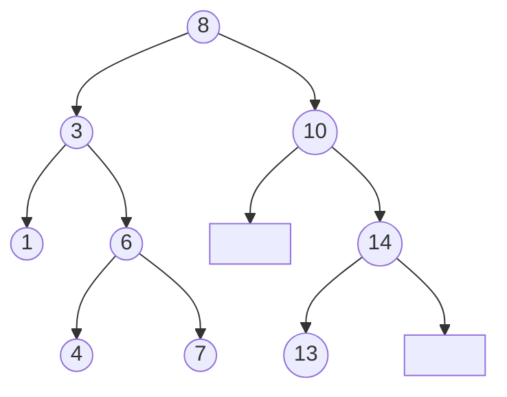
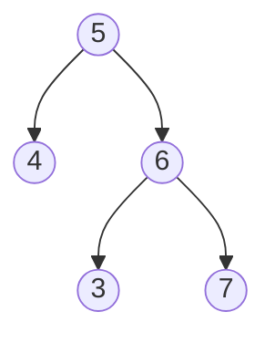
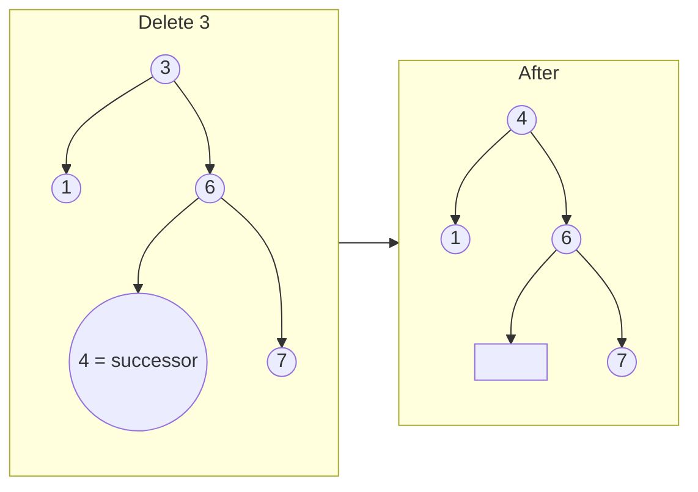
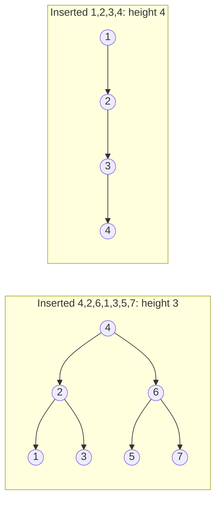

# Chapter 14 · Binary Search Trees

> "Guess my number" wala game yaad hai? "50 hai?" "Kam." "25?" "Zyada." Har jawab bache hue options mein se aadhe phenk deta hai. **Binary search tree** wahi game hai jo ek data structure mein jam gaya hai: har node poochhta hai "chhota ya bada?", aur tum seedha apne answer tak chal ke pahunch jaate ho.

**Is chapter mein tum seekhoge:**
- **BST property** (aur woh baareek galti jo zyadatar log isme karte hain)
- Search, insert aur **delete**, delete ke teeno cases ke saath
- **BST ka inorder traversal sorted kyun aata hai**, aur ye ek fact aadhe interview problems kaise solve karta hai
- Floor, ceil, k-th smallest, LCA, BST iterator, two sum, toote hue BST ko recover karna
- Trees "kharab" (skewed) kyun ho jaate hain aur **AVL** aur **red-black** trees unhe balanced kaise rakhte hain
- Asli Python code mein kya use karein, kyunki Python mein koi built-in BST nahi hai
- Ek Pattern Decoder jo batata hai ki problem chaar BST templates mein se kaunsa maang rahi hai

**Isse pehle padho:** [Recursion](../part-1-python/12-recursion.md) · [Binary Search](08-binary-search.md) · [Stacks](11-stacks.md) · [Binary Trees](13-binary-trees.md)

---

## 🧠 The Big Idea · Asli Baat

[Chapter 08](08-binary-search.md) mein tumne **sorted array** pe binary search kiya tha: beech mein dekho, phir aadha phenk do. Ye O(log n) hai, jo kamaal hai, lekin sorted arrays ki ek badi kamzori hai: naya value **insert** karne ke liye uske baad wale sab kuch ko khisakna padta hai. Woh O(n) hai.

Agar hum "beech wale" values ko ek tree ki tarah store karein toh? Beech wali value ko sabse upar rakho. Jo chhota hai woh left branch mein, jo bada hai woh right branch mein, aur har branch bhi isi tarah organise ho. Ab:

- Search ab bhi "dekho, phir left ya right jao" hai, toh O(height).
- Insert bas itna hai: "neeche chalte jao jab tak tree se gir na jao, aur naya node wahin latka do". Koi shifting nahi!

> 🇮🇳 **Desi Analogy:** Railway enquiry pe PNR ke hisaab se files rakhi hain. Sorted almari (sorted array) mein dhoondhna fast hai, lekin nayi file beech mein ghusaani ho toh saari files ek-ek khaana aage khiskaani padti hain. Ab socho clerk ne files ek **decision tree** jaisi rakh di: pehle drawer pe likha hai "PNR 5000 se chhota? Left almari. Bada? Right almari." Har almari ke andar phir yahi sawaal. Nayi file aayi? Sawaal follow karte jao, jahan khaali jagah mile wahan rakh do. Kisi aur file ko hilana hi nahi pada.

Ye raha ek BST jo `8, 3, 10, 1, 6, 14, 4, 7, 13` ko isi order mein insert karke bana hai. Poore chapter mein yahi tree use karenge:



(Khaali boxes khaali children hain: 10 ka left child nahi hai, 14 ka right child nahi hai.)

7 dhoondhna hai: 8 se shuru karo. 7 < 8, left jao. 7 > 3, right jao. 7 > 6, right jao. 7 mil gaya. Teen steps, aur humne 10/14/13 wali side ki taraf dekha bhi nahi.

> 💡 **The core insight:** BST ek sorted array hai jise tree mein "fold" kar diya gaya hai, taaki insert aur delete bhi saste ho jaayein. Har node raaste ka ek mod hai jispe board laga hai "chhota ← → bada".

---

## 🔨 Building It Up · Zero Se Shuru

### 1. The BST property (the real one)

Ek binary tree **binary search tree** hai agar, **har** node ke liye:

- uske left subtree ki **har** value node se **chhoti** ho, aur
- uske right subtree ki **har** value node se **badi** ho.

Ise do baar padho: ye *subtree ki har value* bolta hai, *child* nahi. Ye tree BST **nahi** hai, bhale hi har parent-child jodi theek lag rahi ho:



3, 5 ke right subtree mein hai, toh usse 5 se bada hona chahiye. Woh nahi hai. Ye picture dimaag mein rakho; interviews mein ye BST ka number one bug hai (section 7 mein isko fix karenge).

> 🇮🇳 **Desi Analogy:** School assembly mein rule hai: "jo Ramesh se chhote hain woh uske left mein, bade woh right mein". Ramesh (5) ke right mein Suresh (6) khada hai, aur Suresh ke left mein chhota Pappu (3). Pappu ne sirf Suresh ko dekha: "main Suresh se chhota hoon, left mein theek hoon." Lekin woh bhool gaya ki woh poori line ke hisaab se **Ramesh ke right** mein bhi hai, toh usse Ramesh se bhi bada hona chahiye tha. Rule sirf apne seedhe upar wale ke liye nahi, **saare upar walon** ke liye hai.

> 💡 **Duplicates:** is chapter mein values **distinct** hain, jo zyadatar interview problems maan ke chalti hain. Agar duplicates chahiye, toh ek rule chuno aur usi pe tike raho (jaise "barabar wala right jaata hai"), ya har node mein ek `count` field rakho.

Chalo node class likhte hain. Ye wahi `TreeNode` hai jo tum [Chapter 13](13-binary-trees.md) mein mil chuke ho:

```python
class TreeNode:
    def __init__(self, val, left=None, right=None):
        self.val = val
        self.left = left
        self.right = right

# Build the "not a BST" tree from above by hand
root = TreeNode(5, TreeNode(4), TreeNode(6, TreeNode(3), TreeNode(7)))
print(root.val, root.left.val, root.right.val, root.right.left.val)
```

```text
5 4 6 3
```

Abhi kya hua: BST koi naya type ka node nahi hai. Ye ek normal binary tree hai jiski values ek rule maanti hain. Saari taakat usi rule se aati hai.

### 2. Search: walk down, never back up

Har node pe sirf teen possibilities hain: mil gaya, left jao, ya right jao.

```python
class TreeNode:
    def __init__(self, val, left=None, right=None):
        self.val, self.left, self.right = val, left, right

def insert(root, val):
    if root is None:
        return TreeNode(val)
    if val < root.val:
        root.left = insert(root.left, val)
    else:
        root.right = insert(root.right, val)
    return root

def search_recursive(node, target):
    if node is None or node.val == target:
        return node
    if target < node.val:
        return search_recursive(node.left, target)
    return search_recursive(node.right, target)

def search_iterative(node, target):
    while node and node.val != target:
        node = node.left if target < node.val else node.right
    return node

root = None
for v in [8, 3, 10, 1, 6, 14, 4, 7, 13]:
    root = insert(root, v)

print(search_recursive(root, 7).val)
print(search_iterative(root, 13).val)
print(search_iterative(root, 5))
```

```text
7
13
None
```

Abhi kya hua: har step **ek level neeche** jaata hai, toh steps ki ginti maximum tree ki **height** `h` hai. Practice mein iterative version better hai: same speed, lekin O(h) stack frames ki jagah O(1) memory.

> 🤔 **Mann mein sawaal:** Binary search toh O(log n) tha. BST search ko O(h) kyun bol rahe ho, O(log n) kyun nahi?
>
> **Jawab:** Kyunki BST hamesha "achhe shape" ka nahi hota. Agar tree bhara-poora (balanced) hai, toh h ≈ log n aur search O(log n). Lekin agar tree ek lambi line ban gaya (jaise sorted data insert karne se), toh h = n aur search O(n). Isliye interview mein hamesha bolo **"O(h): O(log n) if balanced, O(n) worst case"**. Section 14 mein dekhenge ki ise kaise theek karte hain.

### 3. Insert: search until you fall off, then hang the node there

`insert` hum upar use kar chuke hain. Chalo isse aaram se dekhte hain, kyunki ye pattern `root.left = insert(root.left, val); return root` insert, delete, trim aur kai jagah aata hai.

```python
class TreeNode:
    def __init__(self, val, left=None, right=None):
        self.val, self.left, self.right = val, left, right

def insert(root, val):
    if root is None:              # fell off the tree: this is the spot
        return TreeNode(val)
    if val < root.val:
        root.left = insert(root.left, val)    # re-attach (maybe new) left subtree
    else:
        root.right = insert(root.right, val)
    return root                   # hand my (unchanged) self back to my parent

def insert_iterative(root, val):
    new = TreeNode(val)
    if root is None:
        return new
    node = root
    while True:
        if val < node.val:
            if node.left is None:
                node.left = new
                return root
            node = node.left
        else:
            if node.right is None:
                node.right = new
                return root
            node = node.right

def preorder(node, out):
    if node:
        out.append(node.val)
        preorder(node.left, out)
        preorder(node.right, out)
    return out

a = None
for v in [8, 3, 10, 1, 6, 14, 4, 7, 13]:
    a = insert(a, v)
b = None
for v in [8, 3, 10, 1, 6, 14, 4, 7, 13]:
    b = insert_iterative(b, v)
print(preorder(a, []))
print(preorder(b, []))
```

```text
[8, 3, 1, 6, 4, 7, 10, 14, 13]
[8, 3, 1, 6, 4, 7, 10, 14, 13]
```

Abhi kya hua: dono versions bilkul same tree banate hain. Recursive wala **"naye subtree ka root return karo"** wali trick use karta hai: har call apne subtree ka root return karta hai, aur parent usse dobara jod deta hai. Zyadatar nodes ke liye kuch nahi badalta (woh khud ko hi return karte hain), lekin bilkul neeche `None` ki jagah naya node aa jaata hai. Ye trick ek baar seekh lo, delete aasan ho jaayega.

> 🇮🇳 **Desi Analogy:** Office mein ek file upar se neeche bheji ja rahi hai: Manager → Team Lead → tumhare paas. Har insaan file aage bhejta hai aur jo wapas aata hai usse apni tray mein wapas rakh leta hai (`root.left = ...`). Zyadatar log ko wahi tray wapas mil jaati hai jo pehle thi (kuch nahi badla). Sirf aakhri insaan ke paas khaali tray thi (`None`), aur wahan nayi file rakh di gayi. Agar koi beech wala "wapas rakhna" bhool gaya, toh poori file kho jaayegi. Yahi Traps #3 hai.

> ⚠️ **Insert ka order hi shape tay karta hai.** `1, 2, 3, 4, 5` insert karo toh right ki taraf jhuki ek seedhi line (ek "danda") milti hai. Height 5 (nodes mein gin ke), toh search O(n) ho jaata hai. Ise section 14 mein theek karenge.

### 4. The magic fact: inorder traversal is sorted

Inorder ka matlab hai **left subtree, node, right subtree** ([Chapter 13](13-binary-trees.md)). BST mein left pe sab kuch chhota hai aur right pe sab kuch bada, toh inorder values ko **badhte order (increasing order)** mein visit karta hai.

```python
class TreeNode:
    def __init__(self, val, left=None, right=None):
        self.val, self.left, self.right = val, left, right

def insert(root, val):
    if root is None:
        return TreeNode(val)
    if val < root.val:
        root.left = insert(root.left, val)
    else:
        root.right = insert(root.right, val)
    return root

def inorder(node, out):
    if node:
        inorder(node.left, out)
        out.append(node.val)
        inorder(node.right, out)
    return out

root = None
for v in [8, 3, 10, 1, 6, 14, 4, 7, 13]:
    root = insert(root, v)
print(inorder(root, []))
```

```text
[1, 3, 4, 6, 7, 8, 10, 13, 14]
```

**Ye hamesha sach kyun hai (induction se 3 line ka proof):** size 0 ya 1 ke tree ke liye ye apne aap sorted hai. Bade tree ke liye, inorder pehle `inorder(left)` deta hai, phir `root`, phir `inorder(right)`. Induction se har hissa sorted hai. Har left value < root < har right value, toh unhe isi order mein jodne pe bhi sorted rehta hai. Ho gaya.

Isse tumhe ek superpower milti hai: **sorted array ke baare mein koi bhi sawaal BST ke baare mein poochha ja sakta hai**, aur answer hai "inorder ke dauraan karo". k-th smallest? Inorder mein k-th value. Validate? Check karo ki inorder strictly increasing hai. Two sum? Inorder sequence pe two pointers. Ye baat pakad ke rakho.

> 🇮🇳 **Desi Analogy:** BST ek kirana store ki shelf jaisa hai jo bahar se ulta-pulta dikhta hai, lekin ek raaz hai: agar tum hamesha "pehle left wala section, phir beech ka item, phir right wala section" ke hisaab se chalo, toh items apne aap price ke hisaab se sorted line mein milte hain. Toh "teesra sabse sasta item?" ka jawab hai: is order mein chalo aur teesre pe ruk jao.

> 💡 Bonus: n values BST mein insert karo, phir unhe inorder padho, aur tumne unhe sort kar diya. Ise **tree sort** kehte hain: average O(n log n), aur tree skewed ho jaaye toh O(n²).

### 5. Min, max, floor and ceil

**Minimum** sabse left wala node hai (left jaate raho). **Maximum** sabse right wala.

**Floor(x)** = x se chhoti-ya-barabar sabse badi value. **Ceil(x)** = x se badi-ya-barabar sabse chhoti value. Ye [Chapter 08](08-binary-search.md) ke `bisect` ke BST versions hain, wahi "candidate" idea ke saath: jab bhi koi node answer ho sakta hai, usse yaad rakho, phir aur behtar wala dhoondhte raho.

> 🇮🇳 **Desi Analogy:** Tumhare paas ₹5 hain aur chai tapri pe items ₹1, ₹3, ₹4, ₹6, ₹7, ₹8... ke hain. **Floor(5)** = "₹5 mein sabse mehenga kya le sakta hoon?" → ₹4 wala. **Ceil(5)** = "₹5 se kam mein kuch nahi chahiye, toh sabse sasta kaunsa hai jo kam se kam ₹5 ka ho?" → ₹6 wala. Dhoondhte waqt, har affordable item ko "abhi ka best" maan ke likh lo, aur phir thoda mehenga try karo.

```python
class TreeNode:
    def __init__(self, val, left=None, right=None):
        self.val, self.left, self.right = val, left, right

def insert(root, val):
    if root is None:
        return TreeNode(val)
    if val < root.val:
        root.left = insert(root.left, val)
    else:
        root.right = insert(root.right, val)
    return root

def bst_min(node):
    while node.left:
        node = node.left
    return node.val

def bst_max(node):
    while node.right:
        node = node.right
    return node.val

def floor(node, x):
    best = None
    while node:
        if node.val == x:
            return x
        if node.val < x:
            best = node.val       # a valid floor; maybe a bigger one is to the right
            node = node.right
        else:
            node = node.left      # too big, can't be the floor
    return best

def ceil(node, x):
    best = None
    while node:
        if node.val == x:
            return x
        if node.val > x:
            best = node.val       # a valid ceil; maybe a smaller one is to the left
            node = node.left
        else:
            node = node.right
    return best

root = None
for v in [8, 3, 10, 1, 6, 14, 4, 7, 13]:
    root = insert(root, v)
print(bst_min(root), bst_max(root))
print(floor(root, 5), ceil(root, 5))
print(floor(root, 9), ceil(root, 9))
print(floor(root, 0), ceil(root, 15))
```

```text
1 14
4 6
8 10
None None
```

**Dry run: `floor(root, 5)`**

| step | node | compare | best | move |
|---|---|---|---|---|
| 1 | 8 | 8 > 5, bahut bada | None | left |
| 2 | 3 | 3 < 5, candidate | 3 | right (bada dhoondho) |
| 3 | 6 | 6 > 5, bahut bada | 3 | left |
| 4 | 4 | 4 < 5, candidate | 4 | right |
| 5 | None | ruko | **4** | |

> 🤔 **Mann mein sawaal:** Floor mein candidate milne ke baad **right** kyun jaate hain? Left mein bhi toh chhoti values hain.
>
> **Jawab:** Left mein jo hai woh is candidate se bhi **chhota** hai, toh woh behtar floor ho hi nahi sakta (humein x ke andar **sabse bada** chahiye). Right mein woh values hain jo candidate se badi hain, aur unme se koi x se chhota bhi ho sakta hai. Toh agar improvement possible hai, toh sirf right mein. Ceil ke liye bilkul ulta: candidate mila toh left jao.

### 6. Delete: the three cases

Delete hi ek aisa BST operation hai jisme asli sochna padta hai. Pehle node dhoondho, phir:

| Case | Picture | Kya karna hai |
|---|---|---|
| **1. Leaf** (koi child nahi) | 1 delete karo | bas hata do: parent ko `None` return karo |
| **2. Ek child** | 10 delete karo (akela child 14) | node ko uske child se replace karo: child return karo |
| **3. Do children** | 3 delete karo (children 1 aur 6) | **inorder successor** (right subtree ki sabse chhoti value) ko copy karo, phir us successor ko right subtree se delete karo |

Successor hi kyun? Humein ek aisi value chahiye jo left ki har cheez se badi ho aur right ki har cheez se chhoti. Successor (right ka sabse chhota) exactly wahi hai. Aur successor ka **koi left child nahi hota** (warna woh child usse bhi chhota hota), toh usse delete karna case 1 ya 2 hai. Aasan. (**Inorder predecessor**, left ka sabse bada, bhi utna hi accha kaam karta hai.)

> 🇮🇳 **Desi Analogy:** Cricket team ka batting order rating ke hisaab se sorted hai, aur ek middle-order batsman (do taraf "padosi" wala) injured ho gaya. Uski jagah kisko bhejoge taaki order sorted rahe? Woh khiladi jo usse **just** behtar hai (successor), right group ka sabse kamzor. Woh uski jagah aa gaya, aur ab us khiladi ki purani jagah khaali karni hai. Lekin woh "right group ka sabse kamzor" tha, toh uske neeche left mein koi nahi hai: uski jagah khaali karna ekdum aasan case hai.



```python
class TreeNode:
    def __init__(self, val, left=None, right=None):
        self.val, self.left, self.right = val, left, right

def insert(root, val):
    if root is None:
        return TreeNode(val)
    if val < root.val:
        root.left = insert(root.left, val)
    else:
        root.right = insert(root.right, val)
    return root

def inorder(node, out):
    if node:
        inorder(node.left, out)
        out.append(node.val)
        inorder(node.right, out)
    return out

def preorder(node, out):
    if node:
        out.append(node.val)
        preorder(node.left, out)
        preorder(node.right, out)
    return out

def delete(root, key):
    if root is None:
        return None                       # key not found: nothing to do
    if key < root.val:
        root.left = delete(root.left, key)
    elif key > root.val:
        root.right = delete(root.right, key)
    else:
        # Found it. Cases 1 and 2: at most one child.
        if root.left is None:
            return root.right
        if root.right is None:
            return root.left
        # Case 3: two children. Find the inorder successor.
        succ = root.right
        while succ.left:
            succ = succ.left
        root.val = succ.val                          # copy successor's value up
        root.right = delete(root.right, succ.val)    # remove the successor below
    return root

root = None
for v in [8, 3, 10, 1, 6, 14, 4, 7, 13]:
    root = insert(root, v)

root = delete(root, 3)     # case 3: two children
print(preorder(root, []))
root = delete(root, 1)     # case 1: leaf
print(preorder(root, []))
root = delete(root, 10)    # case 2: one child
print(preorder(root, []))
root = delete(root, 8)     # deleting the root (two children)
print(preorder(root, []))
print(inorder(root, []))   # still sorted!
```

```text
[8, 4, 1, 6, 7, 10, 14, 13]
[8, 4, 6, 7, 10, 14, 13]
[8, 4, 6, 7, 14, 13]
[13, 4, 6, 7, 14]
[4, 6, 7, 13, 14]
```

Abhi kya hua: jab humne 3 delete kiya, uska successor 4 upar aaya, aur 4 ki purani jagah ek recursive call ne saaf kar di (leaf delete). Dhyaan do ki case 1 aur 2 *same* do lines se handle ho rahe hain: leaf ka `left is None` hai, toh hum `root.right` return karte hain, jo bhi `None` hai. Kya baat hai. Jab humne 8 delete kiya, uska successor 13 tha (right subtree `14 → 13` ka sabse chhota).

Time: O(h). Node dhoondhne ke liye ek baar neeche chalte hain, aur successor dhoondhne aur delete karne ke liye ek baar aur.

> 🤔 **Mann mein sawaal:** Successor ka value copy karke usse dobara delete kyun karna? Seedha node hi utha ke upar kyun na rakh dein?
>
> **Jawab:** Rakh sakte ho, lekin tab tumhe successor ke parent ka pointer, successor ke right child, aur purane node ke dono children, sabko dhyaan se jodna padega: chaar-paanch pointer changes, aur bugs ki poori fauj. Value copy karna aur phir "successor ko right subtree se delete karo" bolna us kaam ko ek aise case mein badal deta hai jo humare paas pehle se hai (case 1 ya 2). Kam code, kam galtiyan.

### 7. Validate a BST: pass down the allowed range

Section 1 wala trap tree yaad karo. Har node pe `left.val < node.val < right.val` check karna **kaafi nahi** hai. Fix: har node ek **allowed range** `(low, high)` ke andar rehta hai jo uske ancestors tay karte hain.

- Root kuch bhi ho sakta hai: `(-inf, +inf)`.
- Value v wale node se **left** jao: naya upper bound v ban jaata hai.
- **Right** jao: naya lower bound v ban jaata hai.

> 🇮🇳 **Desi Analogy:** Ek Swiggy delivery boy ko address samjha rahe hain: "Sector 5 se aage, lekin flyover se pehle." Har mod pe ek nayi shart judti hai, aur purani shartein hatti nahi. Tum right mude toh "kam se kam itna aage" wali shart badh gayi; left mude toh "isse aage nahi" wali. Ghar sahi hai sirf tab jab woh **saari** jamaa shartein ek saath maane. Yahi `(low, high)` hai: neeche jaate-jaate range sirf **sikudti** hai.

```python
import math

class TreeNode:
    def __init__(self, val, left=None, right=None):
        self.val, self.left, self.right = val, left, right

def is_valid_bst(node, low=-math.inf, high=math.inf):
    if node is None:
        return True
    if not (low < node.val < high):
        return False
    return (is_valid_bst(node.left, low, node.val) and
            is_valid_bst(node.right, node.val, high))

def children_only_check(node):          # the WRONG way, for comparison
    if node is None:
        return True
    if node.left and node.left.val >= node.val:
        return False
    if node.right and node.right.val <= node.val:
        return False
    return children_only_check(node.left) and children_only_check(node.right)

good = TreeNode(5, TreeNode(3, TreeNode(1), TreeNode(4)), TreeNode(8))
trap = TreeNode(5, TreeNode(4), TreeNode(6, TreeNode(3), TreeNode(7)))
print(is_valid_bst(good), is_valid_bst(trap))
print(children_only_check(trap))   # fooled!
```

```text
True False
True
```

**Trap tree pe dry run:**

| node | allowed range | ok? |
|---|---|---|
| 5 | (-inf, inf) | ✅ |
| 4 | (-inf, 5) | ✅ |
| 6 | (5, inf) | ✅ |
| 3 | (5, 6) | ❌ 3, 5 se bada nahi hai |

Validate karne ka doosra tareeka: inorder traversal karo aur check karo ki har value pichhli se **strictly badi** hai. Dono O(n) time hain.

### 8. k-th smallest: stop the inorder walk early

Inorder sorted hai, toh visit hui k-th value hi k-th smallest hai. [Chapter 13](13-binary-trees.md) wala **stack ke saath iterative inorder** use karo, aur jaise hi k nodes pop ho jaayein, ruk jao. Poora tree chalne ki zaroorat nahi.

```python
class TreeNode:
    def __init__(self, val, left=None, right=None):
        self.val, self.left, self.right = val, left, right

def insert(root, val):
    if root is None:
        return TreeNode(val)
    if val < root.val:
        root.left = insert(root.left, val)
    else:
        root.right = insert(root.right, val)
    return root

def kth_smallest(root, k):
    stack, node = [], root
    while stack or node:
        while node:                 # dive left, saving the path
            stack.append(node)
            node = node.left
        node = stack.pop()          # smallest unvisited value
        k -= 1
        if k == 0:
            return node.val
        node = node.right           # then its right subtree

root = None
for v in [8, 3, 10, 1, 6, 14, 4, 7, 13]:
    root = insert(root, v)
print([kth_smallest(root, k) for k in range(1, 10)])
```

```text
[1, 3, 4, 6, 7, 8, 10, 13, 14]
```

Time O(h + k), space O(h). k-th **largest** ke liye reverse inorder karo (right, node, left).

> 💡 **Follow-up jo interviewers ko bahut pasand hai:** "Agar tree baar-baar modify hota hai aur tumse kai baar k-th smallest poochha jaata hai toh?" Har node mein **uske subtree ka size** store karo. Phir ek node pe jiske left mein `left_size` nodes hain: agar `k == left_size + 1` toh yahi node hai; agar `k <= left_size` toh left jao; warna `k -= left_size + 1` karke right jao. Har query O(h). Ise **order-statistic tree** kehte hain.

> 🇮🇳 **Desi Analogy:** Order-statistic tree ko exam hall ke seating plan jaisa socho, jahan har block ke bahar likha hai "is block mein kitne students hain". Roll number 37 dhoondhna hai? Left block mein 30 hain, toh 37 left mein nahi. Main desk 31st hai. Toh right block mein jao aur wahan 37 − 31 = 6th student dhoondho. Har student gin-ne ki zaroorat nahi.

### 9. Lowest Common Ancestor in a BST

Do nodes p aur q ka **LCA** woh sabse gehra node hai jiske subtree mein dono hon. General binary tree mein iske liye poora search chahiye ([Chapter 13](13-binary-trees.md)). BST mein ye ek simple walk hai:

- Agar p aur q dono node se **chhote** hain, toh LCA left mein hai.
- Agar dono **bade** hain, toh right mein.
- Warna woh yahan **alag** hote hain (ya unme se ek khud *yahi* node hai), toh yahi node LCA hai.

> 🇮🇳 **Desi Analogy:** Do dost Delhi metro mein alag-alag stations jaana chahte hain aur saath mein shuru karte hain. Jab tak dono ki manzil ek hi direction mein hai, woh saath chalte hain. Jis interchange station pe ek ko left line leni hai aur doosre ko right, wahi unka "LCA" hai: aakhri station jahan dono saath the.

```python
class TreeNode:
    def __init__(self, val, left=None, right=None):
        self.val, self.left, self.right = val, left, right

def insert(root, val):
    if root is None:
        return TreeNode(val)
    if val < root.val:
        root.left = insert(root.left, val)
    else:
        root.right = insert(root.right, val)
    return root

def lca(root, p, q):
    node = root
    while node:
        if p < node.val and q < node.val:
            node = node.left
        elif p > node.val and q > node.val:
            node = node.right
        else:
            return node.val      # the split point

root = None
for v in [8, 3, 10, 1, 6, 14, 4, 7, 13]:
    root = insert(root, v)
print(lca(root, 4, 7), lca(root, 4, 14), lca(root, 1, 4), lca(root, 13, 14))
```

```text
6 8 3 14
```

Abhi kya hua: (13, 14) ke liye, node 14 pe na "dono chhote" sach hai na "dono bade", kyunki q, 14 ke *barabar* hai. Ek node apna khud ka ancestor hota hai, toh 14 LCA hai. O(h) time, O(1) space.

### 10. Build a balanced BST from a sorted array

**Beech wala** element root lo (taaki left aur right halves barabar size ke hon), phir har half ke liye yahi recursively karo. Ye binary search hi hai, jo chalte-chalte tree banata jaata hai.

```python
class TreeNode:
    def __init__(self, val, left=None, right=None):
        self.val, self.left, self.right = val, left, right

def sorted_array_to_bst(nums):
    def build(lo, hi):                # build from nums[lo..hi] inclusive
        if lo > hi:
            return None
        mid = (lo + hi) // 2
        node = TreeNode(nums[mid])
        node.left = build(lo, mid - 1)
        node.right = build(mid + 1, hi)
        return node
    return build(0, len(nums) - 1)

def preorder(node, out):
    if node:
        out.append(node.val)
        preorder(node.left, out)
        preorder(node.right, out)
    return out

def height(node):
    return 0 if node is None else 1 + max(height(node.left), height(node.right))

print(preorder(sorted_array_to_bst([-10, -3, 0, 5, 9]), []))
big = sorted_array_to_bst(list(range(1, 1024)))     # 1023 values
print(height(big))
```

```text
[0, -10, -3, 5, 9]
10
```

Abhi kya hua: 1023 = 2¹⁰ − 1 values ne height 10 ka ek **perfect** tree diya. Iska compare karo 1..1023 ko ek-ek karke plain BST mein insert karne se: height 1023. Hum slicing (`nums[:mid]`) ki jagah indexes `lo, hi` pass karte hain taaki array copy na ho: total O(n) time, O(log n) recursion depth.

### 11. BST Iterator: inorder, one step at a time

Kabhi-kabhi tum BST se values **lazily** nikaalna chahte ho, har call pe ek, Python iterator ki tarah ([Chapter 16 of Part 1](../part-1-python/16-iterators-generators-decorators.md)). Trick: section 8 wala iterative inorder chalao, lekin pops ke beech **pause** karo. Stack hi woh paused state *hai*.

> 🇮🇳 **Desi Analogy:** Netflix pe series dekhte waqt tum "pause" dabate ho, aur app ko bas itna yaad rakhna hai ki tum kahan the. Poori series dobara download nahi hoti. BST iterator ka stack wahi "kahan tha" wala bookmark hai: agla `next()` wahin se shuru hota hai jahan pichhla ruka tha.

```python
class TreeNode:
    def __init__(self, val, left=None, right=None):
        self.val, self.left, self.right = val, left, right

def insert(root, val):
    if root is None:
        return TreeNode(val)
    if val < root.val:
        root.left = insert(root.left, val)
    else:
        root.right = insert(root.right, val)
    return root

class BSTIterator:
    def __init__(self, root):
        self.stack = []
        self._push_left(root)

    def _push_left(self, node):        # save the path to the smallest value
        while node:
            self.stack.append(node)
            node = node.left

    def next(self):
        node = self.stack.pop()
        self._push_left(node.right)    # successor lives in the right subtree
        return node.val

    def has_next(self):
        return bool(self.stack)

root = None
for v in [8, 3, 10, 1, 6, 14, 4, 7, 13]:
    root = insert(root, v)
it = BSTIterator(root)
print(it.next(), it.next(), it.next())
print(it.has_next())
rest = []
while it.has_next():
    rest.append(it.next())
print(rest)
```

```text
1 3 4
True
[6, 7, 8, 10, 13, 14]
```

**Cost:** ek `next()` call kai nodes push kar sakta hai, lekin saare n calls milake har node ek baar push aur ek baar pop hota hai. Toh **amortised** cost per call O(1) hai, aur memory O(h) (stack pe sirf ek root-to-leaf path hota hai). LeetCode problem exactly yahi maangta hai.

> 💡 Pythonic version ek generator hai: `def inorder(node): if node: yield from inorder(node.left); yield node.val; yield from inorder(node.right)`. Generators apne aap pause ho jaate hain. Interviewers usually explicit stack hi chahte hain, kyunki usse dikhta hai ki tum state samajhte ho.

### 12. Two Sum in a BST

"Kya koi jodi hai jinka sum k ho?" Sorted array pe ye two pointers hai ([Chapter 03](03-two-pointers.md)). BST bhes badla hua sorted array *hi* hai, toh hum:

- **Simple:** tree chalo, dekhi hui values ka ek set rakho, `k - val in seen` check karo ([Chapter 05](05-hashing.md)). O(n) time, O(n) space.
- **Clever:** ek forward iterator (chhote se shuru) aur ek backward iterator (bade se shuru) chalao aur two pointers karo. O(n) time, **O(h) space**.

```python
class TreeNode:
    def __init__(self, val, left=None, right=None):
        self.val, self.left, self.right = val, left, right

def insert(root, val):
    if root is None:
        return TreeNode(val)
    if val < root.val:
        root.left = insert(root.left, val)
    else:
        root.right = insert(root.right, val)
    return root

class Iter:
    """Inorder iterator; reverse=True walks from largest to smallest."""
    def __init__(self, root, reverse):
        self.stack, self.reverse = [], reverse
        self._push(root)

    def _push(self, node):
        while node:
            self.stack.append(node)
            node = node.right if self.reverse else node.left

    def next(self):
        node = self.stack.pop()
        self._push(node.left if self.reverse else node.right)
        return node.val

def find_target(root, k):
    lo_it, hi_it = Iter(root, False), Iter(root, True)
    lo, hi = lo_it.next(), hi_it.next()
    while lo < hi:                    # values are distinct, so lo < hi means two nodes
        s = lo + hi
        if s == k:
            return True
        if s < k:
            lo = lo_it.next()
        else:
            hi = hi_it.next()
    return False

root = None
for v in [8, 3, 10, 1, 6, 14, 4, 7, 13]:
    root = insert(root, v)
print(find_target(root, 17), find_target(root, 28), find_target(root, 2))
```

```text
True False False
```

Abhi kya hua: 17 = 3 + 14 (ya 4 + 13, ya 7 + 10). 28 ke liye 14 + 14 chahiye, aur hum same node do baar use nahi kar sakte. 2 ke liye 1 + 1 chahiye. Pointers milte hi ruk jaate hain, bilkul opposite-end two pointers ki tarah.

> 🤔 **Mann mein sawaal:** Do iterators ka itna jhanjhat kyun? Inorder list bana ke two pointers kyun na chala dein?
>
> **Jawab:** Chala sakte ho, aur woh bilkul sahi hai: O(n) time, lekin **O(n) space** list ke liye. Do iterators ka fayda sirf space mein hai: O(h). Balanced tree pe ye log n hai, matlab ek million nodes ke liye 20 ki jagah ek million. Interview mein pehle simple wala bolo, phir "can we do better on space?" pe ye wala.

### 13. Recover a BST where two values were swapped

Kisi ne galti se do nodes ki values swap kar di. Tree ki shape badle bina usse theek karo.

**Idea:** sahi BST ka inorder sequence sorted hota hai. Do values swap karne se "descents" bante hain (ek value jo apne pehle wali se chhoti ho):

- Swapped values inorder mein **adjacent nahi**: sorted `1 3 4 6 7 8` lo aur 3 aur 7 swap karo: `1 7 4 6 3 8`. Descents: `7 > 4` aur `6 > 3`. Galat values hain **pehle descent ka pehla element** (7) aur **aakhri descent ka doosra element** (3).
- Swapped values **adjacent**: `1 3 6 4 7 8` mein ek hi descent hai `6 > 4`. Dono usi ek descent se aate hain.

Same rule ("first = pehle descent ka left, second = sabse latest descent ka right") dono cases handle karta hai.

> 🇮🇳 **Desi Analogy:** Railway reservation chart pe naam seat number ke hisaab se sorted hone chahiye, lekin kisi ne do naam galat seats pe likh diye. TT chart padhta hai aur jahan-jahan order "ulta" lagta hai wahan nishaan lagata hai. Pehle ulte jagah ka **pehla** naam (jo apni jagah se aage bhaag aaya) aur aakhri ulte jagah ka **doosra** naam (jo peeche reh gaya), yahi do galat log hain. Unki seats aapas mein badal do.

```python
class TreeNode:
    def __init__(self, val, left=None, right=None):
        self.val, self.left, self.right = val, left, right

def insert(root, val):
    if root is None:
        return TreeNode(val)
    if val < root.val:
        root.left = insert(root.left, val)
    else:
        root.right = insert(root.right, val)
    return root

def inorder_nodes(node, out):
    if node:
        inorder_nodes(node.left, out)
        out.append(node)
        inorder_nodes(node.right, out)
    return out

def recover_tree(root):
    first = second = prev = None
    stack, node = [], root
    while stack or node:
        while node:
            stack.append(node)
            node = node.left
        node = stack.pop()
        if prev and prev.val > node.val:     # a descent
            if first is None:
                first = prev                 # left side of the FIRST descent
            second = node                    # right side of the LATEST descent
        prev = node
        node = node.right
    first.val, second.val = second.val, first.val

root = None
for v in [8, 3, 10, 1, 6, 14, 4, 7, 13]:
    root = insert(root, v)
nodes = inorder_nodes(root, [])
nodes[1].val, nodes[4].val = nodes[4].val, nodes[1].val   # break it: swap 3 and 7
print([n.val for n in inorder_nodes(root, [])])
recover_tree(root)
print([n.val for n in inorder_nodes(root, [])])
```

```text
[1, 7, 4, 6, 3, 8, 10, 13, 14]
[1, 3, 4, 6, 7, 8, 10, 13, 14]
```

O(n) time, O(h) space. (Ek O(1)-space version **Morris traversal** se bhi hai, jo thodi der ke liye right pointers ko rewire karta hai. Interview mein iska zikr karo; code karne ki zaroorat kam padti hai.)

### 14. Why trees go bad, and how balanced trees fix it

Ab tak sab kuch **O(h)** ka hai. Agar tree ghana (bushy) hai, toh h ≈ log₂ n. Lekin sorted data insert karo aur tree ek danda ban jaata hai:



**Self-balancing BST** har insert/delete ke baad apni shape khud theek karta hai, taaki data kisi bhi order mein aaye, h O(log n) hi rahe. Iska tool hai **rotation**: teen pointers ki ek local adla-badli jo shape badal deti hai lekin **inorder order waisa hi rakhti hai**.

```text
        y                         x
       / \     rotate_right      / \
      x   C    ------------>    A   y
     / \       <------------       / \
    A   B       rotate_left       B   C

Inorder both sides: A  x  B  y  C   (unchanged!)
```

> 🇮🇳 **Desi Analogy:** Rotation ko ek family photo ki tarah socho jahan log height ke hisaab se left se right khade hain: A, x, B, y, C. Photographer ko lagta hai ki frame ek taraf jhuka hua hai, toh woh **kaun aage (upar) khada hai** badal deta hai: pehle y beech mein aage tha, ab x. Lekin left-se-right ka order (A x B y C) bilkul nahi badla. Sirf "kaun kiske peeche hai" badla. Isliye BST property safe rehti hai.

**AVL tree** (Adelson-Velsky aur Landis, 1962): har node apni height store karta hai, aur rule hai: *left aur right subtrees ki heights mein maximum 1 ka farak*. Is farak ko **balance factor** kehte hain. Insert ke baad wapas upar chalo; agar kisi node ka balance factor +2 ya −2 ho jaaye, toh rotate karo:

| Case | Shape | Fix |
|---|---|---|
| **LL** | nayi key left child ke left mein gayi | rotate_right(node) |
| **RR** | right child ke right mein | rotate_left(node) |
| **LR** | left child ke right mein | rotate_left(left child), phir rotate_right(node) |
| **RL** | right child ke left mein | rotate_right(right child), phir rotate_left(node) |

LL aur RR "seedhi line" wale cases hain: ek rotation kaafi hai. LR aur RL "tedhe (zigzag)" cases hain: pehle ek chhoti rotation se line seedhi karo (straighten), phir LL/RR jaisa fix karo.

Ye raha ek complete AVL insert. Dekho ki 1 se 7 tak sorted order mein insert karne se (plain BST ka worst case) ek perfect tree kaise banta hai:

```python
class Node:
    def __init__(self, key):
        self.key, self.left, self.right, self.height = key, None, None, 1

def h(n):
    return n.height if n else 0

def update(n):
    n.height = 1 + max(h(n.left), h(n.right))

def rotate_right(y):
    x = y.left
    y.left = x.right       # subtree B changes parent
    x.right = y
    update(y)              # y is now lower, so update it first
    update(x)
    return x

def rotate_left(x):
    y = x.right
    x.right = y.left
    y.left = x
    update(x)
    update(y)
    return y

def avl_insert(node, key):
    if node is None:
        return Node(key)
    if key < node.key:
        node.left = avl_insert(node.left, key)
    elif key > node.key:
        node.right = avl_insert(node.right, key)
    else:
        return node                        # ignore duplicates
    update(node)
    balance = h(node.left) - h(node.right)
    if balance > 1:                        # left-heavy
        if key > node.left.key:            # LR: straighten first
            node.left = rotate_left(node.left)
        return rotate_right(node)          # LL
    if balance < -1:                       # right-heavy
        if key < node.right.key:           # RL: straighten first
            node.right = rotate_right(node.right)
        return rotate_left(node)           # RR
    return node

def plain_insert(node, key):
    if node is None:
        return Node(key)
    if key < node.key:
        node.left = plain_insert(node.left, key)
    else:
        node.right = plain_insert(node.right, key)
    return node

def preorder(n, out):
    if n:
        out.append(n.key)
        preorder(n.left, out)
        preorder(n.right, out)
    return out

def height(n):
    return 0 if n is None else 1 + max(height(n.left), height(n.right))

avl = plain = None
for k in range(1, 8):
    avl = avl_insert(avl, k)
    plain = plain_insert(plain, k)
print("AVL  :", preorder(avl, []), "height", height(avl))
print("plain:", preorder(plain, []), "height", height(plain))

big = None
for k in range(1, 1001):
    big = avl_insert(big, k)
print("AVL with 1000 sorted inserts, height", height(big))
```

```text
AVL  : [4, 2, 1, 3, 6, 5, 7] height 3
plain: [1, 2, 3, 4, 5, 6, 7] height 7
AVL with 1000 sorted inserts, height 10
```

Abhi kya hua: 1, 2, 3 insert karne ke baad, node 1 do se right-heavy tha (RR case), toh woh left rotate hua aur 2 root ban gaya. Ye baar-baar hota rehta hai, aur tree perfectly balanced rehta hai. 1000 sorted inserts se height 1000 ki jagah 10 aati hai. (log₂ 1000 ≈ 10.)

> 🤔 **Mann mein sawaal:** `rotate_right` mein pehle `update(y)` phir `update(x)` kyun? Order ulta ho toh?
>
> **Jawab:** Rotation ke baad y, x ka child ban gaya hai. x ki height y ki height pe depend karti hai (`1 + max(...)`). Agar pehle x update karo, toh woh y ki **purani** (galat) height use karega. Isliye hamesha **neeche wala pehle, upar wala baad mein** update karo.

**Red-black tree** (sirf high level; interview mein koi tumse iska code nahi likhwata). Har node red ya black rangeen hota hai, in rules ke saath:

1. Root black hai.
2. Red node ka child red nahi ho sakta.
3. Kisi node se neeche kisi bhi khaali jagah tak har path mein **black nodes ki ginti same** hoti hai.

Rules 2 aur 3 milke matlab hai ki sabse lamba path sabse chhote path se maximum do guna ho sakta hai, toh height maximum lagbhag **2 log₂(n+1)** hai. Jab koi insert/delete ek rule todta hai, tree nodes ko recolour karta hai aur maximum kuch hi rotations karta hai.

Rules ka logic aise samjho: rule 3 kehta hai har raaste mein black nodes barabar hain (maan lo b). Sabse chhota raasta = sirf b black nodes. Rule 2 kehta hai do red lagataar nahi aa sakte, toh sabse lamba raasta = black-red-black-red..., yaani maximum 2b nodes. Isliye lamba ≤ 2 × chhota.

| | AVL | Red-black |
|---|---|---|
| Balance rule | heights mein ≤ 1 ka farak | colour rules |
| Height bound | ≈ 1.44 log₂ n | ≈ 2 log₂ n |
| Lookups | thode faster (chhota tree) | thode slower |
| Inserts/deletes | zyada rotations | kam rotations (har insert pe ≤ 2, har delete pe ≤ 3) |
| Kahan use hota hai | kuch databases aur in-memory indexes | Java `TreeMap`, C++ `std::map`, Linux kernel scheduler |

> 💡 Interview one-liner: "A plain BST can degrade to O(n). Self-balancing trees like AVL or red-black use rotations to keep the height O(log n), so search, insert and delete are all O(log n) worst case."

Databases iska ek cousin use karte hain jise **B-tree** kehte hain: har node mein sainkdon keys hoti hain, toh tree bahut chhota (kam height ka) hota hai aur har level ek disk read hai. Isse tum [System Design Chapter 03](../part-3-system-design/03-databases.md) mein miloge.

### 15. BSTs in real Python code

Python mein **koi built-in balanced BST nahi hai**. Practice mein:

- **`dict` / `set`** ([Chapter 09](../part-1-python/09-dictionaries.md)) agar sirf lookup chahiye. Average O(1), kisi bhi tree ko haraata hai.
- **Sorted list + `bisect`** agar order chahiye lekin inserts kam hain. Search O(log n), lekin shifting ki wajah se `insort` O(n) hai.
- **`sortedcontainers`** (ek popular third-party package, `pip install sortedcontainers`, aur LeetCode pe available) agar tumhe fast inserts, deletes aur "floor/ceil/k-th" queries ke saath ek sorted collection chahiye:

```py
from sortedcontainers import SortedList   # third-party package

sl = SortedList([8, 3, 10])
sl.add(6)                       # ~O(log n)
sl.remove(10)                   # ~O(log n)
print(sl)                       # SortedList([3, 6, 8])
print(sl[0], sl[-1])            # min, max, k-th by index
i = sl.bisect_right(7)          # floor(7) is sl[i-1] if i > 0
print(sl[i - 1])                # 6
```

(Andar se ye tree hai hi nahi: ye chhoti-chhoti sorted lists ki ek list hai. Python mein ye pointer-based tree se fast hai.)

`bisect` ke saath floor/ceil ka standard-library version:

```python
import bisect

data = [1, 3, 4, 6, 7, 8, 10, 13, 14]          # sorted, like a BST's inorder

def floor(x):
    i = bisect.bisect_right(data, x)          # first index with value > x
    return data[i - 1] if i > 0 else None

def ceil(x):
    i = bisect.bisect_left(data, x)           # first index with value >= x
    return data[i] if i < len(data) else None

print(floor(5), ceil(5), floor(0), ceil(15))
bisect.insort(data, 5)                        # O(n): shifts elements
print(data)
```

```text
4 6 None None
[1, 3, 4, 5, 6, 7, 8, 10, 13, 14]
```

`bisect_right(data, 5)` = 3 (kyunki pehli value jo 5 se badi hai, 6, index 3 pe hai), toh floor = `data[2]` = 4. `bisect_left(data, 5)` bhi 3 hai, toh ceil = `data[3]` = 6. Bilkul BST wale answers.

---

## 🔬 Under the Hood · Andar Ki Kahani

### Everything is O(h), so h is everything

Search, insert, delete, floor, ceil, LCA aur min/max sab **ek root-to-leaf path** pe chalte hain. Inka cost O(h) hai, jahan h height hai. n nodes wale tree ki height kahin beech mein hoti hai (yahan height nodes mein gin rahe hain):

- **Best (balanced):** ⌈log₂(n+1)⌉, kyunki level d pe maximum 2^d nodes hote hain, toh height h ka tree maximum 2^h − 1 nodes rakh sakta hai.
- **Worst (danda):** n.

**Random insertion order** ke liye expected height O(log n) hai (analysis wahi hai jo quicksort ke average case ka, [Chapter 07](07-sorting.md): root ek random pivot jaisa hai). Lekin asli data aksar sorted ya lagbhag sorted hota hai (IDs, timestamps), jo bilkul worst case hai. Isiliye production libraries hamesha self-balancing trees use karti hain.

> 🇮🇳 **Desi Analogy:** Aadhaar numbers ya order IDs badhte hue aate hain: 1001, 1002, 1003... Plain BST mein har naya ID pichhle ke right mein lagega, aur tumhara "tree" asal mein ek lambi Mumbai local ki line ban jaayega jisme har search ko line ke aakhri dabbe tak chalna padega. Isiliye real systems kabhi plain BST pe bharosa nahi karte.

### Complexity table

| Operation | Balanced BST | Unbalanced worst case | Sorted array | Hash set |
|---|---|---|---|---|
| Search | O(log n) | O(n) | O(log n) | O(1) avg |
| Insert | O(log n) | O(n) | O(n) | O(1) avg |
| Delete | O(log n) | O(n) | O(n) | O(1) avg |
| Min / max | O(log n) | O(n) | O(1) | O(n) |
| Floor / ceil | O(log n) | O(n) | O(log n) | O(n) |
| Sorted iteration | O(n) | O(n) | O(n) | O(n log n) (sort karna padega) |
| k-th smallest | sizes ke saath O(log n), warna O(h + k) | O(n) | O(1) | O(n log n) |
| Space | O(n) | O(n) | O(n) | O(n) |

BST ka selling point: table mein yahi ek structure hai jo **dono** kaamon mein fast hai: "data badlo" aur "order wale sawaal poochho".

### Why rotations are safe

Rotation teen subtrees A, B, C aur do nodes x, y ko move karta hai. Pehle: inorder `A x B y C` hai. Baad mein: abhi bhi `A x B y C`. Kyunki inorder order nahi badla, BST property abhi bhi hold karti hai. Aur ye sirf constant number of pointers chhoota hai, toh O(1) hai. Ek AVL insert maximum ek single ya double rotation (O(1)) karta hai, plus upar jaate waqt O(log n) height updates.

### Why AVL height is O(log n)

Maan lo N(h) woh **sabse kam** nodes hain jo height h ke AVL tree mein ho sakte hain. Height h ka sabse patla AVL tree: ek root, ek subtree height h−1 ka aur ek height h−2 ka (jitna patla allowed hai). Toh N(h) = 1 + N(h−1) + N(h−2). Ye Fibonacci recurrence hai! Fibonacci numbers 1.618^h ki tarah badhte hain, toh n ≥ 1.618^h, matlab h ≤ log₁.₆₁₈ n ≈ 1.44 log₂ n.

Seedhi bhasha mein: sabse "kanjoos" AVL tree bhi har height pe kam se kam Fibonacci jitne nodes rakhta hai, aur Fibonacci exponential speed se badhta hai. Toh height logarithmic hi reh sakti hai.

### Memory

Har node ek Python object hai jisme ek value aur do pointers hain. CPython mein ye lagbhag 50–100 bytes per node hai (ek object header plus teen references, `__dict__` ke saath aur zyada). Iske muqable list mein har slot 8 bytes. Class mein `__slots__ = ("val", "left", "right")` jodne se ([Chapter 18 of Part 1](../part-1-python/18-internals-concurrency.md)) memory kaafi kam ho jaati hai. Pointers ke peeche bhaagna (pointer-chasing) array scan karne se kam cache-friendly bhi hai, aur ye ek wajah hai ki `sortedcontainers` lists use karta hai.

### Recursion depth

Recursive BST code O(h) stack frames use karta hai. 10,000 nodes wale skewed tree pe, ye 10,000 frames hai, jo Python ki default limit 1,000 se zyada hai ([Chapter 12](../part-1-python/12-recursion.md)). Iterative versions (search, insert, floor, LCA, stack-based inorder) mein ye problem nahi hai.

---

## 🧩 Pattern Decoder · Pattern Pakdo

### Signals: when it's a BST problem

| Problem mein ye dikhe... | Toh socho |
|---|---|
| "binary search tree", "BST" | Ordering use karo! Aisa solution kabhi mat likho jo isse ignore kare. |
| "k-th smallest / largest", "sorted order", "median of BST" | **Inorder walk** (Template B) |
| "validate", "is it a BST" | **Bounds passing** (Template C) ya inorder increasing |
| "closest value", "floor", "ceil", "successor", "predecessor" | **Candidate ke saath guided walk** (Template A) |
| "LCA in a BST", "search / insert / delete" | **Guided walk** (Template A) |
| "range [low, high]", "trim", "range sum" | **Pruning** ke saath guided walk (Template A) |
| "sorted array/list → tree", "balance a BST" | **Beech se divide** (Template D) |
| "two values swapped", "pair with sum in BST", "iterator" | Inorder ek **sorted stream** ki tarah (Template B) |
| "construct BST from preorder / postorder" | Bounds passing (Template C) |
| "maintain sorted data under inserts, ask floor/rank" | Balanced BST / `SortedList` |

### Template A: Guided walk (one path, O(h))

```py
def guided_walk(root, target):
    node, best = root, None
    while node:
        if node.val == target:
            return node.val               # exact hit (if the problem allows it)
        if <node could be the answer>:
            best = node.val               # remember the candidate
        if target < node.val:
            node = node.left              # answer (or a better one) is on the left
        else:
            node = node.right
    return best
```

Kahan use hota hai: search, insert, floor, ceil, closest value, inorder successor, LCA.

### Template B: Inorder as a sorted stream

```py
def inorder_stream(root):
    stack, node, prev = [], root, None
    while stack or node:
        while node:
            stack.append(node)
            node = node.left
        node = stack.pop()
        # ---- "visit": node.val arrives in increasing order ----
        # compare with prev (validate, min diff, recover),
        # count down k (k-th smallest), or stop early
        prev = node
        node = node.right
```

Kahan use hota hai: k-th smallest, validate, recover, minimum absolute difference, BST iterator, two sum (do streams).

### Template C: Pass the allowed range down

```py
def with_bounds(node, low=-inf, high=inf):
    if node is None:
        return BASE
    if not (low < node.val < high):
        return FAIL
    left  = with_bounds(node.left,  low, node.val)    # going left caps the max
    right = with_bounds(node.right, node.val, high)   # going right raises the min
    return combine(left, right)
```

Kahan use hota hai: validate BST, preorder se BST banana, range mein nodes ginna.

### Template D: Divide at the middle

```py
def build(lo, hi):
    if lo > hi:
        return None
    mid = (lo + hi) // 2
    node = TreeNode(values[mid])
    node.left  = build(lo, mid - 1)
    node.right = build(mid + 1, hi)
    return node
```

Kahan use hota hai: sorted array → BST, sorted list → BST, BST balance karna (pehle inorder se list, phir build).

> 🤔 **Mann mein sawaal:** Chaar templates hain. Kisi naye problem pe kaise decide karoon kaunsa lagaun?
>
> **Jawab:** Teen sawaal poochho. (1) Kya answer **ek hi value** hai jo ek raaste pe mil jaayegi (search, floor, LCA)? → **A**. (2) Kya problem mein **sorted order** ya "pichhla vs agla" ki baat hai? → **B**. (3) Kya har node ko apne **saare ancestors ki shart** maanni hai (validate, construct)? → **C**. Aur agar tree **banana** hai sorted data se → **D**.

### Variation: Closest value in a BST (Template A)

**Problem:** BST mein woh value return karo jo float `target` ke sabse paas hai. Humara tree, target 5.4 → 6.

**Idea:** sabse paas wali value `target` ke search path pe hi hoti hai. Kyun? Path se bahar ka koi bhi node `target` se path ke kisi aise node ke through alag hai jo zyada paas hai. Path pe chalo, best yaad rakho.

```python
class TreeNode:
    def __init__(self, val, left=None, right=None):
        self.val, self.left, self.right = val, left, right

def insert(root, val):
    if root is None:
        return TreeNode(val)
    if val < root.val:
        root.left = insert(root.left, val)
    else:
        root.right = insert(root.right, val)
    return root

def closest_value(root, target):
    node, best = root, root.val
    while node:
        if abs(node.val - target) < abs(best - target):
            best = node.val
        node = node.left if target < node.val else node.right
    return best

root = None
for v in [8, 3, 10, 1, 6, 14, 4, 7, 13]:
    root = insert(root, v)
print(closest_value(root, 5.4), closest_value(root, 11.2), closest_value(root, 100))
```

```text
6 10 14
```

**Dry run: target 5.4**

| node | distance | best | move |
|---|---|---|---|
| 8 | 2.6 | 8 | 5.4 < 8 → left |
| 3 | 2.4 | 3 | 5.4 > 3 → right |
| 6 | 0.6 | 6 | 5.4 < 6 → left |
| 4 | 1.4 | 6 | 5.4 > 4 → right |
| None | | **6** | ruko |

O(h) time, O(1) space.

### Variation: Range Sum of BST (Template A with pruning)

**Problem:** `[low, high]` ke andar ki saari values jodo. Humara tree, `[4, 10]` → 4 + 6 + 7 + 8 + 10 = 35.

**Idea:** ek plain tree traversal sab kuch visit karta hai. BST humein **prune** (kaant-chhant) karne deta hai: agar `node.val < low`, toh poora left subtree aur bhi chhota hai, usse skip karo. Agar `node.val > high`, toh right subtree skip karo.

> 🇮🇳 **Desi Analogy:** Tumhe ₹400 se ₹1000 ke beech ke saare shirts chahiye. Dukaandaar ne racks price ke hisaab se lagaye hain. Agar tum ₹200 wale rack pe ho, toh uske left wale (aur saste) racks dekhne ka koi matlab nahi: seedha right jao. Yahi pruning hai.

```python
class TreeNode:
    def __init__(self, val, left=None, right=None):
        self.val, self.left, self.right = val, left, right

def insert(root, val):
    if root is None:
        return TreeNode(val)
    if val < root.val:
        root.left = insert(root.left, val)
    else:
        root.right = insert(root.right, val)
    return root

def range_sum(node, low, high):
    if node is None:
        return 0
    if node.val < low:
        return range_sum(node.right, low, high)     # left side is all too small
    if node.val > high:
        return range_sum(node.left, low, high)      # right side is all too big
    return node.val + range_sum(node.left, low, high) + range_sum(node.right, low, high)

root = None
for v in [8, 3, 10, 1, 6, 14, 4, 7, 13]:
    root = insert(root, v)
print(range_sum(root, 4, 10), range_sum(root, 13, 100))
```

```text
35 27
```

O(h + m) jahan m range mein nodes ki ginti hai (plus boundary paths). Worst case O(n).

### Variation: Construct BST from Preorder Traversal (Template C)

**Problem:** BST ka preorder diya hai, usse dobara banao. `[8, 5, 1, 7, 10, 12]`.

**Idea:** preorder "root pehle" hai. Values left se right ek shared index ke saath padho. Koi value current subtree mein tabhi aati hai jab woh current `(low, high)` range mein fit ho. Agar fit nahi hoti, `None` return karo aur kisi ancestor ko usse lene do. Har value ek baar consume hoti hai: O(n). (Naive "ek-ek karke insert karo" skewed input pe O(n²) hai.)

Trace karke dekho: 8 root, range `(-inf, inf)`. Left ke liye range `(-inf, 8)`: 5 fit hota hai. 5 ke left ke liye `(-inf, 5)`: 1 fit. 1 ke left ke liye `(-inf, 1)`: 7 fit nahi hota, `None`. 1 ke right `(1, 5)`: 7 fit nahi, `None`. Wapas 5 ke right `(5, 8)`: 7 fit! 7 ke children ke liye 10 fit nahi. Wapas 8 ke right `(8, inf)`: 10 fit, aur 10 ke right mein 12.

```python
import math

class TreeNode:
    def __init__(self, val, left=None, right=None):
        self.val, self.left, self.right = val, left, right

def bst_from_preorder(preorder):
    i = 0
    def build(low, high):
        nonlocal i
        if i == len(preorder) or not (low < preorder[i] < high):
            return None
        node = TreeNode(preorder[i])
        i += 1
        node.left = build(low, node.val)
        node.right = build(node.val, high)
        return node
    return build(-math.inf, math.inf)

def inorder(n, out):
    if n:
        inorder(n.left, out); out.append(n.val); inorder(n.right, out)
    return out

root = bst_from_preorder([8, 5, 1, 7, 10, 12])
print(root.val, root.left.val, root.right.val, root.left.left.val, root.left.right.val)
print(inorder(root, []))
```

```text
8 5 10 1 7
[1, 5, 7, 8, 10, 12]
```

### Variation: Balance a BST (Template B + D)

**Problem:** koi bhi BST diya hai (shayad ek danda), same values ke saath ek balanced BST return karo.

**Idea:** inorder se sorted list milti hai (Template B), phir beech se build karo (Template D). O(n) time, O(n) space. Poora code Practice 🟡 5 mein hai.

### When NOT to use BST thinking

- **Tree ek general binary tree hai**, BST nahi. Pruning aur guided walks chupchaap galat answers denge. Problem statement check karo!
- **Tumhe sirf membership / lookup chahiye.** `set` ya `dict` O(1) aur simple hai.
- **Tumhe baar-baar sirf min ya max chahiye** (floor/ceil ya kisi bhi item ka delete nahi). **Heap** simple aur fast hai ([Chapter 15](15-heaps.md)).
- **Data static hai.** Sorted list + `bisect` kisi bhi tree se chhota aur fast hai.
- **Strings pe prefix/word queries.** Woh **trie** hai ([Chapter 19](19-tries.md)).

---

## ⚠️ Traps & Common Mistakes · Yahan Sab Phisalte Hain

1. **Sirf children check karke validate karna.** Section 1 ka trap tree children check pass kar leta hai lekin BST nahi hai. Bounds neeche bhejo, ya check karo ki inorder strictly increasing hai.

```py
# ❌ wrong: only compares with direct children
def valid(node):
    if node is None: return True
    if node.left and node.left.val >= node.val: return False
    if node.right and node.right.val <= node.val: return False
    return valid(node.left) and valid(node.right)

# ✅ right: every node must fit the range set by ALL its ancestors
def valid(node, low=-inf, high=inf):
    if node is None: return True
    if not (low < node.val < high): return False
    return valid(node.left, low, node.val) and valid(node.right, node.val, high)
```

2. **Initial "prev" ke liye `0` use karna.** Agar tum "prev value" se validate kar rahe ho, toh `None` (ya `-math.inf`) se shuru karo, `0` se nahi. Trees mein negative numbers ho sakte hain, aur `0` unhe galat tareeke se reject kar dega. (Example: tree mein sirf `-5` hai. Prev = 0 se shuru kiya toh `-5 <= 0` → "invalid"! Jabki ek node ka tree hamesha valid BST hai.)
3. **Recursive insert/delete mein dobara jodna (re-attach) bhool jaana.** `root.left = ...` ke bina `insert(root.left, val)` naye node ko phenk deta hai. Aur end mein `return root` bhoole toh parent `None` jod dega.
4. **Delete case 3: successor ko galat subtree se delete karna.** Successor ki value node mein copy karne ke baad, usse `root.right` se delete karo, `root` se nahi (warna woh pehle wahi node dhoondh lega jise tumne abhi overwrite kiya).
5. **Maan lena ki tree balanced hai.** Plain BST ke liye "search is O(log n)" bolna galat hai. Bolo "O(h): O(log n) if balanced, O(n) worst case".
6. **Duplicates ke saath `<=` aur `<` ko inconsistent use karna.** Agar insert barabar values ko right bhejta hai, toh search ko bhi barabar pe right jaana chahiye. Ek baar decide karo.
7. **Gehre skewed trees pe recursion.** 10,000 sorted inserts → recursion depth error. Iterative walks prefer karo.
8. **BST mein Two Sum mein same node do baar use karna.** k = 2 × val ke liye, set-based solution ko current value add karne se *pehle* check karna chahiye; two-iterator solution ko pointers milte hi ruk jaana chahiye.

---

## 💡 Tips & Tricks · Pro Wale Moves

- Kisi bhi tree problem pe khud se pehla sawaal: **"Kya ye BST hai?"** Agar haan, toh intended solution almost pakka ordering use karta hai (pruning, guided walk, ya inorder).
- Ek hi sentence mein "sorted" + "tree" = inorder.
- Iterative inorder ratt lo (`while stack or node: dive left, pop, visit, go right`). Iterator, k-th smallest, validate, recover aur two sum sab isi pe chalte hain.
- "k-th largest" ke liye **reverse inorder** use karo: right, node, left.
- Jab code ko "modified subtree ka root" chahiye, **return-the-subtree** style use karo: `node.left = f(node.left)`.
- Jis node ka right child **hai**, uska inorder successor = right subtree ka sabse left wala node. Jiska **nahi** hai, uska = woh aakhri ancestor jahan tum left mude the.
- Initial bounds ke liye `math.inf` aur `-math.inf` use karo. Ye kisi bhi int ke saath sahi compare hote hain.
- Asli Python projects mein apna tree likhne se pehle `bisect` ya `sortedcontainers.SortedList` uthao.

---

## 🎯 Interview Questions · Interview Mein Yahi Poochenge

### 1. Validate Binary Search Tree 🔥🔥🔥

Ek binary tree ka root diya hai; batao ki kya ye valid BST hai.

<details><summary>Answer dekho 👀</summary>

`(low, high)` bounds neeche bhejo (section 7), ya inorder walk karke strictly increasing check karo. Ye raha inorder version, jo recursion limits se bachta hai:

```python
class TreeNode:
    def __init__(self, val, left=None, right=None):
        self.val, self.left, self.right = val, left, right

def is_valid_bst(root):
    stack, node, prev = [], root, None
    while stack or node:
        while node:
            stack.append(node)
            node = node.left
        node = stack.pop()
        if prev is not None and node.val <= prev:
            return False
        prev = node.val
        node = node.right
    return True

print(is_valid_bst(TreeNode(2, TreeNode(1), TreeNode(3))))
print(is_valid_bst(TreeNode(5, TreeNode(1), TreeNode(4, TreeNode(3), TreeNode(6)))))
```

```text
True
False
```

Time O(n), space O(h). `<=` pe dhyaan do: is problem mein barabar values allowed nahi hain.

> 🗣️ **Interview mein aise bolo:** "Checking each node only against its children isn't enough, because every node must respect bounds set by all its ancestors. I'll do an iterative inorder traversal, since a valid BST's inorder is strictly increasing, and return false as soon as a value is less than or equal to the previous one. That's O(n) time and O(h) space. Alternatively, I can recurse while passing down a low and high bound."

</details>

### 2. Kth Smallest Element in a BST 🔥🔥🔥

<details><summary>Answer dekho 👀</summary>

Iterative inorder, k-th pop pe ruk jao (section 8). Time O(h + k), space O(h).

Follow-up "BST baar-baar modify hota hai": O(h) queries ke liye har node mein subtree sizes store karo (order-statistic tree), ya data ko `SortedList` mein rakho.

> 🗣️ **Interview mein aise bolo:** "The inorder traversal of a BST visits values in sorted order, so the k-th node I pop in an iterative inorder is the answer, and I can stop early. That's O(h plus k) time and O(h) space. If the tree is modified often and queried many times, I'd store subtree sizes in each node to answer each query in O(h)."

</details>

### 3. Lowest Common Ancestor of a Binary Search Tree 🔥🔥🔥

<details><summary>Answer dekho 👀</summary>

Root se chalo: dono chhote → left, dono bade → right, warna yahi split point hai (section 9). Time O(h), space O(1). (LeetCode nodes `p` aur `q` pass karta hai, toh `p.val` aur `q.val` compare karo.)

Interviewers aksar ye general-binary-tree LCA ke turant baad poochhte hain. Batao ki BST version ko dono subtrees search karne ki zaroorat nahi padti.

> 🗣️ **Interview mein aise bolo:** "Because it's a BST, I don't need to search both subtrees. Starting from the root, if both values are smaller than the current node I go left, if both are bigger I go right, and otherwise this node is where they split, so it's the lowest common ancestor. That's O(h) time and O(1) space."

</details>

### 4. Convert Sorted Array to Binary Search Tree 🔥🔥

<details><summary>Answer dekho 👀</summary>

Beech wala element root, dono halves pe indexes ke saath recurse (section 10). O(n) time, O(log n) recursion depth. Beech ka koi bhi choice (`(lo+hi)//2` ya `(lo+hi+1)//2`) ek valid height-balanced answer deta hai.

</details>

### 5. Delete Node in a BST 🔥🔥

<details><summary>Answer dekho 👀</summary>

Teen cases (section 6): leaf → `None` return karo; ek child → wahi child return karo; do children → inorder successor ki value copy karo, phir successor ko right subtree se delete karo. Time O(h), recursion ke liye space O(h).

Key sentence: "The successor has no left child, so deleting it is always the easy case."

> 🗣️ **Interview mein aise bolo:** "I first walk down to find the node. If it has at most one child, I return that child to its parent, which also handles leaves. If it has two children, I copy in its inorder successor, the smallest value in the right subtree, and then delete that successor from the right subtree; the successor has no left child, so that's always the easy case. It runs in O(h) time."

</details>

### 6. Insert into a Binary Search Tree 🔥

<details><summary>Answer dekho 👀</summary>

Search ki tarah neeche chalo jab tak `None` na mile, aur naya node wahan latka do (section 3). Iterative: O(h) time, O(1) space. Koi bhi valid BST accept hota hai, toh rebalancing ki zaroorat nahi.

</details>

### 7. Binary Search Tree Iterator 🔥🔥

`next()` (agla sabse chhota return kare) aur `hasNext()` implement karo, O(1) amortised time aur O(h) memory ke saath.

<details><summary>Answer dekho 👀</summary>

Ek stack rakho jisme "left-dive" nodes ka path hai (section 11). `next()` ek node pop karta hai, phir uske right subtree ki left spine push karta hai. Overall har node ek baar push aur pop hota hai, toh n calls ka total O(n): O(1) amortised. Memory O(h).

</details>

### 8. Two Sum IV – Input is a BST 🔥🔥

<details><summary>Answer dekho 👀</summary>

Option A: hash set ke saath DFS (`if k - val in seen: return True`), O(n) time aur space.

```python
class TreeNode:
    def __init__(self, val, left=None, right=None):
        self.val, self.left, self.right = val, left, right

def find_target(root, k):
    seen, stack = set(), [root]
    while stack:
        node = stack.pop()
        if node is None:
            continue
        if k - node.val in seen:      # check BEFORE adding: no reusing a node
            return True
        seen.add(node.val)
        stack.append(node.left)
        stack.append(node.right)
    return False

root = TreeNode(5, TreeNode(3, TreeNode(2), TreeNode(4)), TreeNode(6, None, TreeNode(7)))
print(find_target(root, 9), find_target(root, 28))
```

```text
True False
```

Option B (BST property use karta hai, space behtar): forward aur backward inorder iterators two pointers ki tarah (section 12). O(n) time, O(h) space.

</details>

### 9. Recover Binary Search Tree 🔥

<details><summary>Answer dekho 👀</summary>

Inorder walk, descents dhoondho (`prev.val > node.val`). `first` = pehle descent ka `prev`, `second` = aakhri descent ka `node`. Unki values swap karo (section 13). O(n) time, O(h) space; Morris traversal se O(1).

</details>

### 10. Inorder Successor in BST 🔥🔥

Ek node p diya hai; woh node return karo jiski value p ki value se badi values mein sabse chhoti hai.

<details><summary>Answer dekho 👀</summary>

Ye strict `>` wala **ceil** hai: root se chalo; jab bhi `node.val > p`, usse candidate record karo aur left jao (aur chhota dhoondhne); warna right jao.

```py
def inorder_successor(root, p):
    node, best = root, None
    while node:
        if node.val > p.val:
            best = node            # candidate; look for a smaller one on the left
            node = node.left
        else:
            node = node.right
    return best
# On the chapter's tree: successor of 7 -> 8, of 4 -> 6, of 14 -> None
```

O(h) time, O(1) space. Predecessor iska mirror image hai.

</details>

### 11. Range Sum of BST 🔥🔥

<details><summary>Answer dekho 👀</summary>

Pruning ke saath DFS (Pattern Decoder): `node.val < low` ho toh left subtree skip, `node.val > high` ho toh right skip. Worst case O(n) lekin usually kaafi kam; O(h) space.

</details>

### 12. Trim a Binary Search Tree 🔥

`[low, high]` ke bahar ke saare nodes hatao, relative structure rakhte hue.

<details><summary>Answer dekho 👀</summary>

Return-the-subtree style. Agar `node.val < low`, toh node aur uska poora left subtree jaata hai; answer trimmed right subtree hai. `> high` ke liye mirror. Warna dono children trim karo aur node rakho.

```py
def trim_bst(node, low, high):
    if node is None:
        return None
    if node.val < low:
        return trim_bst(node.right, low, high)   # node + left subtree are all too small
    if node.val > high:
        return trim_bst(node.left, low, high)    # node + right subtree are all too big
    node.left = trim_bst(node.left, low, high)
    node.right = trim_bst(node.right, low, high)
    return node
# Chapter's tree trimmed to [3, 8] -> preorder [8, 3, 6, 4, 7]
```

O(n) time, O(h) space.

</details>

### 13. Construct Binary Search Tree from Preorder Traversal 🔥🔥

<details><summary>Answer dekho 👀</summary>

Shared index ke saath bounds passing (Pattern Decoder, Template C). Har value ek baar place hoti hai: O(n) time, O(h) space. O(n²) worst-case wale "ek-ek karke insert karo" alternative ka zikr karo, aur batao bounds version behtar kyun hai.

</details>

### 14. Minimum Absolute Difference in BST 🔥

<details><summary>Answer dekho 👀</summary>

Sorted sequence mein sabse paas wali jodi hamesha **adjacent** hoti hai. Toh inorder walk karo aur `node.val - prev` track karo.

```py
def get_minimum_difference(root):
    best, prev = float("inf"), None
    stack, node = [], root
    while stack or node:
        while node:
            stack.append(node)
            node = node.left
        node = stack.pop()
        if prev is not None:
            best = min(best, node.val - prev)
        prev = node.val
        node = node.right
    return best
# Tree 4 -> (2 -> (1, 3), 6): inorder 1 2 3 4 6, answer 1
```

O(n) time, O(h) space.

</details>

### 15. Why not always use a BST instead of a hash map? 🔥🔥 (conceptual)

<details><summary>Answer dekho 👀</summary>

Hash map average O(1) lookup/insert/delete deta hai lekin **koi ordering nahi**: min/max, floor/ceil, range queries, ya sorted iteration bina sort kiye nahi milte. Balanced BST sab kuch O(log n) mein deta hai, order queries **samet**. Hash map tab chuno jab sirf exact-key lookup chahiye; balanced BST (Java `TreeMap`, C++ `std::map`, Python `SortedDict`) tab chuno jab order chahiye. Aur: bure hashing ke saath hash maps ke O(n) worst cases hote hain, jabki balanced BSTs O(log n) guarantee karte hain.

> 🇮🇳 **Desi Analogy:** Hash map ek locker room hai: locker number bolo, turant khul jaata hai, lekin "sabse chhota locker number kiska hai?" ya "50 se 60 ke beech kaun hai?" poochho toh saare lockers kholne padenge. BST ek railway chart hai jo seat order mein likha hai: kisi ka naam dhoondhne mein thoda zyada time, lekin "agla kaun", "range mein kaun" turant.

> 🗣️ **Interview mein aise bolo:** "A hash map gives O(1) average lookups but keeps no order, so min, max, floor, ceiling, range queries and sorted iteration all need a full scan or a sort. A balanced BST does every operation in O(log n), including those order queries, and its bound is a worst-case guarantee rather than an average. So I pick a hash map for pure key lookups and a balanced BST like TreeMap or SortedDict when order matters."

</details>

---

## 🏋️ Practice · Ab Tumhari Baari

**🟢 1. Search in a Binary Search Tree.** Value `val` wale node pe rooted subtree return karo, ya `None`.

<details><summary>Solution dekho 👀</summary>

```python
class TreeNode:
    def __init__(self, val, left=None, right=None):
        self.val, self.left, self.right = val, left, right

def search_bst(node, val):
    while node and node.val != val:
        node = node.left if val < node.val else node.right
    return node

root = TreeNode(4, TreeNode(2, TreeNode(1), TreeNode(3)), TreeNode(7))
found = search_bst(root, 2)
print(found.val, found.left.val, found.right.val)
print(search_bst(root, 5))
```

```text
2 1 3
None
```

</details>

**🟢 2. k-th largest** value BST mein (reverse inorder use karo).

<details><summary>Solution dekho 👀</summary>

Section 8 ka code, `left` aur `right` swap karke:

```py
def kth_largest(root, k):
    stack, node = [], root
    while True:
        while node:
            stack.append(node)
            node = node.right            # dive RIGHT first
        node = stack.pop()
        k -= 1
        if k == 0:
            return node.val
        node = node.left
# Chapter's tree: k=1 -> 14, k=3 -> 10
```

</details>

**🟡 3. Range mein nodes gino** `[low, high]`, pruning use karke.

<details><summary>Solution dekho 👀</summary>

Range Sum hi hai, bas `node.val` ki jagah `1`:

```py
def count_in_range(node, low, high):
    if node is None:
        return 0
    if node.val < low:
        return count_in_range(node.right, low, high)
    if node.val > high:
        return count_in_range(node.left, low, high)
    return 1 + count_in_range(node.left, low, high) + count_in_range(node.right, low, high)
# Chapter's tree, [4, 10] -> 5  (4, 6, 7, 8, 10)
```

</details>

**🟡 4. Inorder predecessor:** x se strictly chhoti sabse badi value.

<details><summary>Solution dekho 👀</summary>

Successor ka mirror: jab `node.val < x`, record karo aur right jao.

```py
def predecessor(root, x):
    node, best = root, None
    while node:
        if node.val < x:
            best = node.val          # candidate; look for a bigger one on the right
            node = node.right
        else:
            node = node.left
    return best
# Chapter's tree: predecessor(8) -> 7, predecessor(6) -> 4, predecessor(1) -> None
```

</details>

**🟡 5. Balance a Binary Search Tree.** Ek skewed BST ko balanced mein badlo.

<details><summary>Solution dekho 👀</summary>

Inorder → sorted list → beech se build.

```python
class TreeNode:
    def __init__(self, val, left=None, right=None):
        self.val, self.left, self.right = val, left, right

def height(n):
    return 0 if n is None else 1 + max(height(n.left), height(n.right))

def balance_bst(root):
    values, stack, node = [], [], root
    while stack or node:                  # iterative inorder (safe for sticks)
        while node:
            stack.append(node)
            node = node.left
        node = stack.pop()
        values.append(node.val)
        node = node.right

    def build(lo, hi):
        if lo > hi:
            return None
        mid = (lo + hi) // 2
        return TreeNode(values[mid], build(lo, mid - 1), build(mid + 1, hi))
    return build(0, len(values) - 1)

stick = TreeNode(1)                       # a right-leaning stick 1 -> 2 -> ... -> 100
cur = stick
for v in range(2, 101):
    cur.right = TreeNode(v)
    cur = cur.right
print(height(stick), height(balance_bst(stick)))
```

```text
100 7
```

O(n) time aur space. 2⁷ − 1 = 127 ≥ 100, toh height 7 optimal hai (height 6 ka tree maximum 63 nodes rakh sakta hai, jo 100 se kam hai).

</details>

**🔴 6. Serialize and Deserialize BST** jitna ho sake compact (`null` markers ki zaroorat nahi).

<details><summary>Solution dekho 👀</summary>

BST ke liye preorder kaafi hai, kyunki bounds batate hain ki har value kahan jaayegi (Template C). Chapter 13 ke general tree serialize mein `#` markers chahiye the; yahan BST property hi woh kaam kar deti hai, toh string chhoti ho jaati hai.

```python
import math

class TreeNode:
    def __init__(self, val, left=None, right=None):
        self.val, self.left, self.right = val, left, right

def serialize(root):
    out, stack = [], [root]
    while stack:
        node = stack.pop()
        if node:
            out.append(str(node.val))
            stack.append(node.right)      # push right first so left pops first
            stack.append(node.left)
    return ",".join(out)

def deserialize(data):
    values = [int(x) for x in data.split(",")] if data else []
    i = 0
    def build(low, high):
        nonlocal i
        if i == len(values) or not (low < values[i] < high):
            return None
        node = TreeNode(values[i])
        i += 1
        node.left = build(low, node.val)
        node.right = build(node.val, high)
        return node
    return build(-math.inf, math.inf)

root = TreeNode(8, TreeNode(3, TreeNode(1), TreeNode(6)), TreeNode(10, None, TreeNode(14)))
s = serialize(root)
print(s)
print(serialize(deserialize(s)) == s)
```

```text
8,3,1,6,10,14
True
```

Dono taraf O(n).

</details>

**🔴 7. Largest BST Subtree:** ek general binary tree mein, sabse bade aise subtree ka size dhoondho jo BST ho.

<details><summary>Solution dekho 👀</summary>

Postorder: har call apne subtree ka `(is_bst, size, min, max)` return karta hai. Ek node BST root hai agar dono children BSTs hain aur `left.max < node.val < right.min`. O(n) time.

```python
import math

class TreeNode:
    def __init__(self, val, left=None, right=None):
        self.val, self.left, self.right = val, left, right

def largest_bst_subtree(root):
    best = 0
    def post(node):
        nonlocal best
        if node is None:
            return True, 0, math.inf, -math.inf
        lb, ls, lmin, lmax = post(node.left)
        rb, rs, rmin, rmax = post(node.right)
        if lb and rb and lmax < node.val < rmin:
            size = ls + rs + 1
            best = max(best, size)
            return True, size, min(lmin, node.val), max(rmax, node.val)
        return False, 0, -math.inf, math.inf
    post(root)
    return best

root = TreeNode(10, TreeNode(5, TreeNode(1), TreeNode(8)), TreeNode(15, None, TreeNode(7)))
print(largest_bst_subtree(root))
```

```text
3
```

Subtree `5 → (1, 8)` sabse bada BST hai. Non-BST ke liye min/max ke roop mein `(-inf, +inf)` return karna guarantee karta hai ki koi ancestor BST nahi ban sakta.

Ye trick dhyaan se dekho: khaali subtree `(min = inf, max = -inf)` return karta hai, taaki `lmax < node.val < rmin` hamesha sach ho (khaali taraf koi rukawat na bane). Aur toota hua subtree ulta `(min = -inf, max = inf)` return karta hai, taaki woh condition hamesha **jhooth** ho jaaye. Ek hi tuple, do ulte "sentinel" values.

</details>

---

## 🧠 Never-Forget Summary · Kabhi Mat Bhoolna

- **BST property:** har node ke liye, left ki *saari* values < node < right ki *saari* values. Sirf children nahi.
- Search / insert / delete / floor / ceil / LCA ek **single walk down** hain: O(h).
- h balanced ho toh O(log n), skewed ho toh **O(n)** (jaise sorted inserts).
- **BST ka inorder sorted hai.** k-th smallest, validate, recover, min difference, iterator, two sum sab isi pe chalte hain.
- **Delete:** leaf → hatao; ek child → jod do (splice); do children → successor copy karo, successor delete karo.
- `(low, high)` bounds neeche bhej ke **validate** karo.
- **Floor/ceil/closest/successor:** guided walk + best candidate yaad rakho.
- **Sorted array → BST:** beech wala root, recurse.
- **Balanced trees** (AVL, red-black) O(1) rotations use karte hain jo inorder order bachate hain, taaki O(log n) guarantee ho.
- Python: lookup ke liye `dict`/`set`, static sorted data ke liye `bisect`, dynamic ordered data ke liye `SortedList`.

**Memory hook: "LEFT LESS, RIGHT MORE, INORDER IN ORDER"**
- **Left less, right more** → har operation "left jao ya right jao" hai.
- **Inorder in order** → sorted order ke baare mein kuch bhi ho, woh inorder walk hai.

**🪝 Yaad rakhne ka jugaad:** **"Chhote baayen, bade daayen, beech se padho toh line mein aayen."** Socho ek shaadi ka stage jahan dulha (node) beech mein khada hai: chhote bhai-behen baayen, bade daayen, aur yahi rule har rishtedaar ke apne group pe bhi laagu hai. Photographer baayen se daayen photo le (inorder), toh sab umar ke hisaab se line mein aa jaate hain. Aur danda mat banne do: **"Sorted data seedha daala, toh tree ka nikla diwala"** (isliye AVL / red-black).

**One picture:**

| Template | Shape | Cost | Problems |
|---|---|---|---|
| A · Guided walk | ek root-to-leaf path, ek candidate rakho | O(h) | search, insert, floor/ceil, closest, successor, LCA, range prune |
| B · Inorder stream | stack-based inorder, sorted order mein visit | O(n) ya O(h + k) | k-th smallest, validate, recover, min diff, iterator, two sum |
| C · Bounds down | `(low, high)` neeche bhejo | O(n) | validate, preorder se build, serialize BST |
| D · Middle split | beech = root, halves pe recurse | O(n) | sorted array → BST, balance BST |

> **Agar sirf ek cheez yaad rakhni hai:** BST ek sorted array hai jiski shape tree jaisi hai. Ek value wale sawaalon ke liye isme *neeche* chalo, sorted order wale sawaalon ke liye isme *inorder* chalo.

---
**Aage:** [Chapter 15 · Heaps & Priority Queues](15-heaps.md)  ·  **Wapas** [Contents](../README.md)
