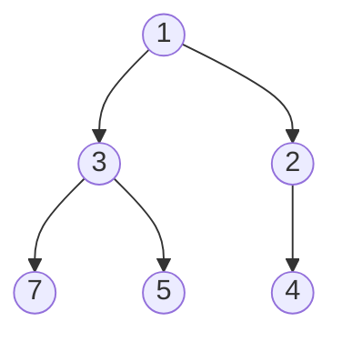

# Chapter 15 · Heaps & Priority Queues

> Hospital ka emergency room patients ko "jo pehle aaya, wo pehle" wale order mein treat nahi karta. 10:05 pe heart attack wala patient aaya, toh wo 9:30 wale moch (sprained ankle) wale se pehle jaayega. Receptionist ko bas ek hi sawaal ka jawab chahiye hota hai: "*abhi is waqt* sabse urgent kaun hai?" Heap ekdum isi sawaal ka jawab deta hai, **O(1)** mein, aur har naye patient ko **O(log n)** mein line mein fit kar deta hai.

**Is chapter mein tum seekhoge:**
- **Priority queue** kya hoti hai, aur sorted list se isse banana galat tareeka kyun hai
- **Binary heap** ek poore tree ko ek simple Python list ke andar kaise chhupa leta hai (index ka maths)
- **Sift up** aur **sift down**, step by step trace karke
- n items se heap banana sirf **O(n)** kyun leta hai, aur **heap sort** kaise kaam karta hai
- Python ka `heapq` module: tuples, tie-breakers, aur **max-heap trick**
- Heap ke paanch patterns: **top-k**, **k-way merge**, **two heaps**, **greedy scheduling**, **lazy deletion**
- 13 classic interview problems: k-th largest, merge k lists, median of a stream, meeting rooms, task scheduler, aur bhi bahut kuch

**Isse pehle padho:** [Big-O](01-big-o-complexity.md) · [Sorting](07-sorting.md) · [Binary Trees](13-binary-trees.md) · [Binary Search Trees](14-binary-search-trees.md)

---

## 🧠 The Big Idea · Asli Baat

**Priority queue** ek aisi line hai jisme har item ke saath ek priority judi hoti hai. Line se agla item hamesha wahi nikalta hai jiski priority sabse best hai (convention ke hisaab se, sabse **chhoti** value = sabse best). Teen operations matter karte hain:

| Operation | Matlab |
|---|---|
| `push(item)` | koi naya aaya |
| `peek()` | sabse urgent kaun hai? (nikalo mat, bas dekho) |
| `pop()` | sabse urgent wale ko serve karo (aur line se hatao) |

> 🇮🇳 **Desi Analogy:** Railway station pe Tatkal counter socho, jahan line "pehle aao" se nahi, **urgency** se chalti hai. Har passenger ke haath mein ek token hai jispe urgency number likha hai (1 = sabse urgent). `push` = naya passenger token leke aaya. `peek` = clerk ne bas dekha ki sabse chhota token kiska hai. `pop` = clerk ne usko ticket de ke line se bahar kar diya. Clerk ko poori line ka ranking nahi chahiye, sirf "abhi sabse urgent kaun" chahiye. Yahi priority queue ka contract hai.

Jo tum ab tak jaante ho, usse isse kaise banaoge?

| Idea | push | pop min | Problem |
|---|---|---|---|
| Unsorted list | O(1) append | O(n) scan | har pop pe sabko scan karna padta hai |
| Sorted list | O(n) insert (shifting) | O(1) | har push pe sabko shift karna padta hai |
| Balanced BST ([Ch 14](14-binary-search-trees.md)) | O(log n) | O(log n) | chalta hai, lekin bhaari hai: pointers, rotations, aur ye *poora* order maintain karta hai jo humein chahiye hi nahi |
| **Binary heap** | **O(log n)** | **O(log n)**, peek O(1) | is kaam ke liye koi problem nahi |

Asli insight ye hai: humein sab kuch sorted nahi chahiye. Humein sirf **minimum** pata hona chahiye. Heap ek bahut kamzor, aur isliye sasta, order rakhta hai: **har parent apne children se chhota ya barabar hota hai**. Bas itna hi. Siblings (bhai-behen) kisi bhi order mein ho sakte hain. Cousins bhi kisi bhi order mein. Lekin sabse chhota element top pe baitha hai, ye guaranteed hai.



Ek company ka org chart socho, jisme har boss apne neeche walon se "zyada urgent" hai. CEO poori company mein sabse urgent hai. Lekin tum ye nahi bata sakte ki Sales ka manager Marketing ke manager se zyada urgent hai ya kam. Aur tumhe ye jaanne ki zaroorat bhi nahi hai.

Upar wale diagram mein dekho: 3 aur 2 siblings hain, aur 2 right side pe hai, left pe nahi. Koi baat nahi. 7 (left subtree mein) 4 (right subtree mein) se bada hai. Koi baat nahi. Sirf ek rule check hota hai: upar wala ≤ neeche wala.

> 💡 **The core insight:** heap "lazily sorted" hota hai. Ye utna hi ordering ka kaam karta hai jitna minimum ko hamesha jaanne ke liye zaroori hai. Isi wajah se ye sab kuch sorted rakhne se tez hai.

> 🤔 **Mann mein sawaal:** Agar heap poora sorted nahi hai, toh doosra sabse chhota element kaise milega?
>
> **Jawab:** Seedha nahi milega, aur ye jaan-boojh ke hai. Pehle `pop` karo (sabse chhota nikal gaya), phir heap khud ko theek karta hai aur naya sabse chhota top pe aa jaata hai. Heap ka wada sirf ek hai: "top pe minimum". Doosra, teesra wagairah tum ek-ek pop karke nikaalte ho, har baar O(log n) mein.

---

## 🔨 Building It Up · Zero Se Shuru

### 1. The shape: a complete binary tree

Binary heap ek **complete binary tree** hota hai: har level poora bhara hota hai, sirf aakhri level adhoora ho sakta hai, aur aakhri level **left se right** bina gap ke bharta hai. Is shape ka ek khoobsurat fayda hai: hum tree ko ek simple list mein, level by level, store kar sakte hain, **bina kisi pointer ke**.

```text
            index 0: 1
          /            \
    index 1: 3       index 2: 2
     /      \         /
 idx 3: 7  idx 4: 5  idx 5: 4

list:  [1, 3, 2, 7, 5, 4]
index:  0  1  2  3  4  5
```

> 🇮🇳 **Desi Analogy:** Cinema hall ki seats socho, jahan tickets row by row, left se right bechi jaati hain, beech mein koi seat khaali nahi chhodi jaati. Pehli row mein 1 seat, doosri mein 2, teesri mein 4. Kyunki koi gap nahi hai, seat number se hi pata chal jaata hai ki tum kis row mein ho aur tumhare "neeche" wali row mein kaun baitha hai. Koi register (pointer) nahi chahiye, bas seat number ka maths.

Index ka maths (ye teen lines ratt lo):

| Index `i` se | Formula |
|---|---|
| left child | `2*i + 1` |
| right child | `2*i + 2` |
| parent | `(i - 1) // 2` |

Ek chhota check: index 1 ke children `2*1+1 = 3` aur `2*1+2 = 4` hain, yaani values 7 aur 5. Index 4 ka parent `(4-1)//2 = 1` hai, yaani value 3. Diagram se match karo, ekdum sahi hai.

```python
heap = [1, 3, 2, 7, 5, 4]

for i in range(len(heap)):
    left, right = 2 * i + 1, 2 * i + 2
    kids = [heap[c] for c in (left, right) if c < len(heap)]
    parent = heap[(i - 1) // 2] if i > 0 else None
    print(f"i={i} value={heap[i]} parent={parent} children={kids}")
```

```text
i=0 value=1 parent=None children=[3, 2]
i=1 value=3 parent=1 children=[7, 5]
i=2 value=2 parent=1 children=[4]
i=3 value=7 parent=3 children=[]
i=4 value=5 parent=3 children=[]
i=5 value=4 parent=2 children=[]
```

Kya hua yahan: "tree" sirf hamare dimaag mein exist karta hai. Child ya parent pe jaana bas ek multiplication ya division hai. Kyunki tree complete hai, list mein koi chhed (hole) nahi hai, aur iski height ⌊log₂ n⌋ hai. Yahi height wajah hai ki har operation **O(log n)** hai.

**The heap property (min-heap):** har i > 0 ke liye `heap[parent(i)] <= heap[i]`. Example pe check karo: 1 ≤ 3, 1 ≤ 2, 3 ≤ 7, 3 ≤ 5, 2 ≤ 4. ✅ **Max-heap** isko ulta kar deta hai: har parent ≥ apne children.

> 🤔 **Mann mein sawaal:** Parent ka formula `(i - 1) // 2` kyun hai, `i // 2` kyun nahi?
>
> **Jawab:** Kyunki hamara index 0 se shuru hota hai. Children `2i+1` aur `2i+2` hain. Ulta chalo: `(2i+1 - 1)//2 = i` aur `(2i+2 - 1)//2 = (2i+1)//2 = i`. Dono children ka parent `i` hi aata hai. `i // 2` wala formula tab chalta hai jab array 1 se index ho (kuch textbooks index 0 khaali chhod dete hain). Python mein hum 0 se chalte hain, isliye `(i - 1) // 2`.

### 2. Push: append, then sift up

Ek value add karte waqt humein dono cheezein bachaani hain: **shape** (complete) aur **order** (parent ≤ child):

1. Usse list ke end mein append karo. Shape ✅. Order toot sakta hai: nayi value apne parent se chhoti ho sakti hai.
2. **Sift up** (isko *bubble up* bhi kehte hain): jab tak value apne parent se chhoti hai, dono ko swap karo.

`[1, 3, 2, 7, 5, 4]` mein 0 push karo:

| step | list | nayi value kahan | parent (index, value) | action |
|---|---|---|---|---|
| append | `[1, 3, 2, 7, 5, 4, 0]` | 6 | (2, 2) | 0 < 2 → swap |
| 1 | `[1, 3, 0, 7, 5, 4, 2]` | 2 | (0, 1) | 0 < 1 → swap |
| 2 | `[0, 3, 1, 7, 5, 4, 2]` | 0 | koi nahi | root pe aa gaye, ruk jao |

Har level pe zyada se zyada ek swap, isliye **O(log n)**.

> 🇮🇳 **Desi Analogy:** Office mein ek naya, bahut talented banda join karta hai. Usse sabse neeche wali seat milti hai (append). Phir har review mein agar wo apne boss se better nikla, toh dono ki position swap ho jaati hai (sift up). Jaise hi wo kisi boss se better nahi raha, promotion ruk jaata hai. Ek level pe ek hi promotion, isliye utne hi steps jitni company ki height.

### 3. Pop: swap root with last, then sift down

Minimum `heap[0]` hai. Lekin hum index 0 ko seedha delete nahi kar sakte, usse ek chhed ban jaayega aur saare indexes shift ho jaayenge (aur saare parent-child rishte bigad jaayenge). Isliye ye karo:

1. `heap[0]` yaad rakh lo (yahi answer hai).
2. **Aakhri** element ko root pe le aao aur list ko ek chhota kar do. Shape ✅.
3. **Sift down**: jab tak value apne chhote child se badi hai, usko **chhote** child ke saath swap karo.

*Chhota* child hi kyun? Swap ke baad wo child doosre child ka parent ban jaata hai, isliye usse dono mein se chhota hona hi padega. Agar bade child ko upar bhej diya, toh wo apne naye child (chhote wale) se bada hoga, aur heap property wahi toot jaayegi.

`[0, 3, 1, 7, 5, 4, 2]` se pop karo:

| step | list | value kahan | children (index: value) | action |
|---|---|---|---|---|
| 0 nikaalo, 2 ko root pe lao | `[2, 3, 1, 7, 5, 4]` | 0 | 1: 3, 2: 1 | chhota child 1 < 2 → swap |
| 1 | `[1, 3, 2, 7, 5, 4]` | 2 | 5: 4 | 2 ≤ 4, ruk jao |

0 return hua, aur heap wapas `[1, 3, 2, 7, 5, 4]` ban gaya.

> 🤔 **Mann mein sawaal:** Aakhri element hi root pe kyun laate hain? Koi aur element kyun nahi?
>
> **Jawab:** Kyunki shape bachaani hai. Complete tree mein sirf aakhri slot hi aisa hai jisko hataane se koi gap nahi banta. Toh hum aakhri slot ko "khaali" karte hain aur uski value root pe rakh dete hain. Order toot gaya? Koi baat nahi, sift down usse O(log n) mein theek kar dega. Shape ko theek karna mehenga hota, order ko theek karna sasta hai.

### 4. A min-heap from scratch

Ab code. Ise ek baar haath se zaroor likho; iske baad baaki sab kuch apne aap samajh aa jaata hai.

```python
class MinHeap:
    def __init__(self):
        self.data = []

    def __len__(self):
        return len(self.data)

    def peek(self):
        return self.data[0]

    def push(self, value):
        self.data.append(value)
        self._sift_up(len(self.data) - 1)

    def pop(self):
        data = self.data
        last = data.pop()               # shape: aakhri slot hatao
        if not data:
            return last                 # yahi ek akela element tha
        top, data[0] = data[0], last    # aakhri element root pe jaata hai
        self._sift_down(0)
        return top

    def _sift_up(self, i):
        data = self.data
        while i > 0:
            parent = (i - 1) // 2
            if data[i] >= data[parent]:
                break                   # order wapas theek ho gaya
            data[i], data[parent] = data[parent], data[i]
            i = parent

    def _sift_down(self, i):
        data, n = self.data, len(self.data)
        while True:
            smallest = i
            left, right = 2 * i + 1, 2 * i + 2
            if left < n and data[left] < data[smallest]:
                smallest = left
            if right < n and data[right] < data[smallest]:
                smallest = right
            if smallest == i:
                break                   # dono children bade hain: kaam khatam
            data[i], data[smallest] = data[smallest], data[i]
            i = smallest

h = MinHeap()
for x in [1, 3, 2, 7, 5, 4]:
    h.push(x)
print(h.data)
h.push(0)
print(h.data)
print(h.pop(), h.data)
print([h.pop() for _ in range(len(h))])
```

```text
[1, 3, 2, 7, 5, 4]
[0, 3, 1, 7, 5, 4, 2]
0 [1, 3, 2, 7, 5, 4]
[1, 2, 3, 4, 5, 7]
```

Kya hua yahan: sab kuch pop karne pe values sorted order mein mili. n items push karo, phir n items pop karo, toh ye ek sorting algorithm ban gaya, **O(n log n)**. Yahi heap sort ka beej hai.

Code ke chhote details pe dhyaan do:
- `pop` mein pehle `data.pop()` se aakhri element nikaala. Agar uske baad list khaali ho gayi, toh wahi akela element tha, seedha return.
- `_sift_down` mein `smallest` teen mein se sabse chhote ka index hai: khud `i`, left child, right child. Agar `i` khud hi sabse chhota hai, toh kaam khatam.
- `left < n` aur `right < n` wale checks zaroori hain, kyunki aakhri levels pe children exist nahi karte.

### 5. Heapify: build a heap in O(n)

Agar poori list ek saath mil jaaye, toh tum items ek-ek karke push kar sakte ho: O(n log n). Lekin ek tez tareeka hai, **bottom-up heapify**: har non-leaf node ko sift down karo, aakhri non-leaf se shuru karke peeche ki taraf root tak.

Ye kaam kyun karta hai? Leaves (list ka doosra aadha hissa) pehle se hi size 1 ke chhote, valid heaps hain. Agar node i ke dono subtrees pehle se valid heaps hain, toh i ko sift down karne se i wala poora subtree valid heap ban jaata hai. Peeche ki taraf chalne se ye guarantee milti hai ki subtrees hamesha pehle ready ho chuke hote hain.

> 🇮🇳 **Desi Analogy:** Joint family mein shaadi ki seating plan socho. Pehle har chhoti family unit (leaf) apne aap mein theek hai. Phir har chacha apni family ko theek karta hai: agar unke bachche unse "zyada senior" nikle, toh jagah badal lete hain. Phir dadaji poori family ko theek karte hain. Neeche se upar jaane ka fayda ye hai ki jab dadaji ki baari aati hai, toh neeche ke saare hisse pehle se set hote hain, unhe bas apni jagah sahi karni hai.

```python
def sift_down(data, i, n):
    while True:
        smallest, left, right = i, 2 * i + 1, 2 * i + 2
        if left < n and data[left] < data[smallest]:
            smallest = left
        if right < n and data[right] < data[smallest]:
            smallest = right
        if smallest == i:
            return
        data[i], data[smallest] = data[smallest], data[i]
        i = smallest

def heapify(data):
    n = len(data)
    for i in range(n // 2 - 1, -1, -1):     # aakhri non-leaf se neeche root tak
        sift_down(data, i, n)
        print(f"after sifting index {i}: {data}")

nums = [9, 5, 7, 2, 8, 1, 3]
heapify(nums)
```

```text
after sifting index 2: [9, 5, 1, 2, 8, 7, 3]
after sifting index 1: [9, 2, 1, 5, 8, 7, 3]
after sifting index 0: [1, 2, 3, 5, 8, 7, 9]
```

Kya hua yahan: index `n // 2 - 1` wo aakhri node hai jiska koi child hai (yahan n = 7, toh index 2). Indexes 3 se 6 leaves hain, unhe skip kiya. Har sift-down ne ek subtree theek kiya, aur aakhri wale (root) ne poora tree theek kar diya.

Step by step dekho:
- **Index 2** (value 7): children index 5 (1) aur index 6 (3). Chhota child 1 hai, 1 < 7, swap. List: `[9, 5, 1, 2, 8, 7, 3]`.
- **Index 1** (value 5): children index 3 (2) aur index 4 (8). Chhota child 2 hai, 2 < 5, swap. 5 ab index 3 pe hai, wo leaf hai, ruk gaye.
- **Index 0** (value 9): children 2 aur 1. Chhota 1 hai (index 2), swap. 9 ab index 2 pe hai, children 7 aur 3. Chhota 3, swap. 9 ab leaf pe, ruk gaye.

Ye O(n) hai, O(n log n) nahi, iska proof Under the Hood mein hai. Interview mein ye bahut favourite follow-up hai.

### 6. Heap sort

Heap sort **in place** sort karta hai, sirf O(1) extra memory ke saath, aur guaranteed **O(n log n)** mein:

1. Poore array ka **max**-heap banao (heapify, O(n)).
2. Baar-baar max (index 0) ko heap region ke aakhri element se swap karo, heap ko ek se chhota karo, aur naye root ko sift down karo.

Sorted hissa right side se badhta hai, bilkul selection sort ki tarah. Fark ye hai ki har "max dhoondo" ka kharcha O(n) nahi, sirf O(log n) hai.

> 🇮🇳 **Desi Analogy:** Cricket team ka batting order banana hai, sabse kamzor se sabse strong tak. Selector ke paas ek "max-heap" hai jo hamesha sabse strong player ko top pe rakhta hai. Har round mein wo top wale ko list ke **aakhri** khaali slot pe bhej deta hai (wo slot ab final hai), aur bache hue players mein se naya top nikaal leta hai. Aakhri slot se pehle slot tak bharte bharte poori list sorted ho jaati hai, aur alag se koi doosri list nahi banani padi.

```python
def sift_down_max(a, i, n):
    while True:
        largest, left, right = i, 2 * i + 1, 2 * i + 2
        if left < n and a[left] > a[largest]:
            largest = left
        if right < n and a[right] > a[largest]:
            largest = right
        if largest == i:
            return
        a[i], a[largest] = a[largest], a[i]
        i = largest

def heap_sort(a):
    n = len(a)
    for i in range(n // 2 - 1, -1, -1):     # 1. max-heap banao
        sift_down_max(a, i, n)
    for end in range(n - 1, 0, -1):         # 2. max ko peeche bhejo, heap chhota karo
        a[0], a[end] = a[end], a[0]
        sift_down_max(a, 0, end)
    return a

print(heap_sort([9, 5, 7, 2, 8, 1, 3]))
print(heap_sort([5, -1, 5, 0, 2]))
```

```text
[1, 2, 3, 5, 7, 8, 9]
[-1, 0, 2, 5, 5]
```

Dhyaan do: `sift_down_max(a, 0, end)` mein teesra argument `end` hai, `n` nahi. Matlab sift down sirf heap region (index 0 se `end - 1` tak) ke andar hota hai. Jo elements already peeche bhej diye, wo touch nahi hote.

| Property | Heap sort |
|---|---|
| Time (best/avg/worst) | O(n log n) / O(n log n) / O(n log n) |
| Extra space | O(1) |
| Stable? | Nahi (door-door ke swaps barabar items ka order bigaad dete hain) |
| Practice mein | quicksort/Timsort se slow: memory mein idhar-udhar koodta hai (cache ka use kharab) |

[Chapter 07](07-sorting.md) ke sorts se compare karo: jab koi poochhe "**O(n log n) worst case aur O(1) extra space** dono chahiye", tab heap sort ka naam lo.

### 7. Python's `heapq`: the heap you'll actually use

Python ki standard library mein ek tez (C mein likha hua) min-heap aata hai jo ek **plain list** pe kaam karta hai. Koi Heap class nahi hai: tum list ko functions mein pass karte ho.

```python
import heapq

h = []
for x in [5, 1, 8, 3, 2]:
    heapq.heappush(h, x)          # O(log n)
print(h)                          # ek valid heap, sorted list NAHI
print(h[0])                       # min ko peek karo: O(1)
print(heapq.heappop(h), h)        # O(log n)

nums = [9, 5, 7, 2, 8, 1, 3]
heapq.heapify(nums)               # in place, O(n)
print(nums)

# push aur pop ek hi step mein (dono alag karne se tez)
print(heapq.heappushpop(nums, 0))     # 0 push hua, min pop hua -> 0 seedha wapas aa gaya
# pop aur phir push ek hi step mein (heap ka size same rehta hai)
print(heapq.heapreplace(nums, 6), nums)

data = [4, 1, 7, 3, 8, 5]
print(heapq.nlargest(3, data), heapq.nsmallest(2, data))
words = ["kiwi", "fig", "banana", "apple"]
print(heapq.nsmallest(2, words, key=len))
print(list(heapq.merge([1, 4, 9], [2, 3, 10], [5])))   # sorted iterables ko merge karo
```

```text
[1, 2, 8, 5, 3]
1
1 [2, 3, 8, 5]
[1, 2, 3, 5, 8, 7, 9]
0
1 [2, 5, 3, 6, 8, 7, 9]
[8, 7, 5] [1, 3]
['fig', 'kiwi']
[1, 2, 3, 4, 5, 9, 10]
```

| Function | Kya karta hai | Cost |
|---|---|---|
| `heappush(h, x)` | x add karo | O(log n) |
| `heappop(h)` | min hatao aur return karo | O(log n) |
| `h[0]` | min ko peek karo | O(1) |
| `heapify(lst)` | list ko in place heap banao | O(n) |
| `heappushpop(h, x)` | x push karo, phir min pop karo | O(log n) |
| `heapreplace(h, x)` | min pop karo, phir x push karo | O(log n) |
| `nlargest(k, it, key=)` / `nsmallest` | top k items | O(n log k) |
| `merge(*sorted_its)` | sorted inputs ko lazily merge karo | O(N log k) |

> ⚠️ Heap sorted **nahi** hota. `print(h)` dikhata hai `[1, 2, 8, 5, 3]`, aur `h[1]` zaroori nahi ki doosra sabse chhota ho. Sirf `h[0]` ka matlab guaranteed hai.

> 🤔 **Mann mein sawaal:** `heappushpop` aur `heapreplace` mein fark kya hai? Dono push bhi karte hain, pop bhi.
>
> **Jawab:** Order ka fark hai. `heappushpop(h, x)` **pehle push**, phir pop: agar x khud sabse chhota hai, toh x hi wapas aa jaata hai aur heap touch bhi nahi hota (upar `0` seedha wapas aaya). `heapreplace(h, x)` **pehle pop**, phir push: purana min hamesha nikalta hai, chahe x usse bhi chhota ho. Isliye `heapreplace` tab use karo jab tumhe pakka pata ho ki x andar jaana chahiye (jaise top-k mein, jab `x > heap[0]` pehle hi check kar liya).

### 8. Tuples as entries: priority + data

Aksar tum priority ke saath *cheezein* store karna chahte ho, jaise `(priority, task)`. Python tuples ko element by element compare karta hai ([Chapter 08 of Part 1](../part-1-python/08-tuples-sets.md)), isliye pehla element priority ka kaam karta hai.

Lekin agar do priorities barabar (tie) ho gayi toh? Tab Python **doosra** element compare karta hai. Agar wo kuch aisa hai jo compare nahi ho sakta (dict, custom object), toh tumhe `TypeError` milega. Standard fix hai beech mein ek **tie-breaker counter**:

```python
import heapq
import itertools

class Task:                       # koi __lt__ nahi: Tasks compare nahi ho sakte
    def __init__(self, name):
        self.name = name

counter = itertools.count()       # 0, 1, 2, ... ek unique, badhta hua tie-breaker
h = []
for priority, name in [(2, "write tests"), (1, "fix prod bug"), (2, "code review")]:
    heapq.heappush(h, (priority, next(counter), Task(name)))

while h:
    priority, _, task = heapq.heappop(h)
    print(priority, task.name)
```

```text
1 fix prod bug
2 write tests
2 code review
```

Kya hua yahan: dono priority-2 tasks counter se compare hue ("write tests" ko 0 mila, "code review" ko 2), `Task` objects tak baat pahunchi hi nahi. Bonus: ties **insertion order** mein nikalte hain (first in, first out), jo usually tumhe chahiye hi hota hai.

> 🇮🇳 **Desi Analogy:** Bank mein do log same "Senior Citizen" category mein aaye. Teller unki height ya naam compare nahi karta (wo compare karna hi bekaar hai). Wo **token number** dekhta hai: jo pehle aaya, uska token chhota. Counter yahi token machine hai: har naye item ko agla number deti hai, toh tie hamesha token se toot jaata hai, object tak jaana hi nahi padta.

### 9. The max-heap trick: negate

`heapq` sirf min-heaps karta hai. Max-heap ke liye keys ko **negate** (minus) karke push karo, aur pop karte waqt dobara negate karo:

```python
import heapq

nums = [3, 1, 4, 1, 5, 9, 2, 6]
max_heap = [-x for x in nums]
heapq.heapify(max_heap)
print(-max_heap[0])                                   # max ko peek karo
print([-heapq.heappop(max_heap) for _ in range(3)])   # teen sabse bade

# Tuples ke saath, sirf priority wala hissa negate karo
scores = [("asha", 82), ("ravi", 95), ("meera", 88)]
h = [(-score, name) for name, score in scores]
heapq.heapify(h)
neg, name = heapq.heappop(h)
print(name, -neg)
```

```text
9
[9, 6, 5]
ravi 95
```

Kyun kaam karta hai: agar `a > b`, toh `-a < -b`. Matlab sabse bada number, minus lagane ke baad, sabse chhota ban jaata hai, aur min-heap usse top pe rakh deta hai. 9 → -9, jo sabse chhota hai.

Jo values negate nahi ho sakti (jaise strings), unhe ek chhoti class mein wrap karo jiska `__lt__` ulta ho ([Chapter 15 of Part 1](../part-1-python/15-oop-inheritance-magic.md)), ya `heapq.nlargest` use karo. (Python 3.14 ne public max-heap functions add kiye, jaise `heapq.heappush_max`, lekin negation trick har version mein chalta hai aur interviewers yahi expect karte hain.)

### 10. Removing an arbitrary item: lazy deletion

Heap sirf top ko efficiently hata sakta hai. Agar koi task beech mein kahin baitha hai aur **cancel** ho gaya toh? Usse dhoondhna hi O(n) hai. Trick hai **lazy deletion**: abhi mat hatao. Bas yaad rakho ki wo "dead" hai, aur jab wo aakhir mein top pe pahunche, tab usse phenk do.

> 🇮🇳 **Desi Analogy:** Doctor ke clinic mein token system hai. Ek patient bina bataaye chala gaya. Receptionist poori line mein usse dhoondhne nahi jaati. Wo bas register mein "token 7: chala gaya" likh deti hai (O(1)). Jab token 7 ki baari aati hai, wo register dekhti hai, "ye toh chala gaya", aur agle ko bula leti hai. Kaam baad mein hua, lekin sirf ek baar hua.

```python
import heapq

class LazyHeap:
    def __init__(self):
        self.heap = []
        self.dead = {}                 # value -> kitni copies delete hui hain

    def push(self, x):
        heapq.heappush(self.heap, x)

    def remove(self, x):               # O(1): bas mark karo
        self.dead[x] = self.dead.get(x, 0) + 1

    def _clean_top(self):              # top pe baithe dead items phenko
        while self.heap and self.dead.get(self.heap[0], 0):
            self.dead[self.heap[0]] -= 1
            heapq.heappop(self.heap)

    def peek(self):
        self._clean_top()
        return self.heap[0]

    def pop(self):
        self._clean_top()
        return heapq.heappop(self.heap)

lh = LazyHeap()
for x in [5, 1, 8, 3]:
    lh.push(x)
lh.remove(1)                           # 1 min hai, lekin heap ko hum touch nahi karte
lh.remove(8)
print(lh.peek())
print(lh.pop(), lh.pop())
print(lh.heap)                         # 8 abhi bhi physically andar hai!
```

```text
3
3 5
[8]
```

Kya hua yahan: removals O(1) mein hue; safai ka kharcha baad mein diya gaya, aur har item overall zyada se zyada ek baar pop hota hai, isliye total O(n log n) hi rehta hai. Catch ye hai: dead items tab tak jagah gherte hain jab tak wo top pe na aa jaayein. Aur agar tumhe heap ka **size** chahiye, toh live items ka count khud track karo (`len(self.heap)` mein dead bhi gine jaate hain). Ye trick Sliding Window Median aur Dijkstra's algorithm ([Chapter 17](17-graphs-advanced.md)) ko power karta hai.

`dead` ek dict hai jo **count** rakhta hai, sirf True/False nahi. Kyun? Kyunki same value heap mein do baar ho sakti hai, aur tumne shayad sirf ek copy delete ki ho. Count se pata rehta hai ki kitni copies phenkni hain.

---

## 🔬 Under the Hood · Andar Ki Kahani

### Why push and pop are O(log n)

n nodes wale complete binary tree ki height ⌊log₂ n⌋ hoti hai, kyunki level d pe 2^d nodes hote hain aur aakhri ke alawa har level poora bhara hai. Sift up har swap mein ek level upar jaata hai; sift down har swap mein ek level neeche. Toh dono zyada se zyada ⌊log₂ n⌋ swaps karte hain. Das lakh (ek million) items ke liye, ye lagbhag **20 swaps** hain.

### Why heapify is O(n), not O(n log n)

Intuition: **zyaadatar nodes neeche hote hain, aur neeche wale nodes saste hote hain**.

n nodes ke heap mein lagbhag n/2 nodes leaves hain (sift-down cost 0), lagbhag n/4 ek level upar hain (cost ≤ 1), lagbhag n/8 do level upar (cost ≤ 2), aur aise hi aage. Total kaam:

```text
  (n/4)·1 + (n/8)·2 + (n/16)·3 + ...  =  n · (1/4 + 2/8 + 3/16 + ...)  =  n · 1  =  O(n)
```

Series Σ h/2^(h+1) ka total 1 pe converge karta hai. Isse one-by-one push se compare karo: wahan neeche ke *bahut saare* nodes hi sabse *door* tak travel karte hain (har ek log n tak), jisse O(n log n) aata hai. Heapify isko ulta kar deta hai: lambe, mehenge trips sirf upar ke gine-chune nodes karte hain.

> 🇮🇳 **Desi Analogy:** Ek pyramid jaisi company socho, 1000 employees. Agar har employee ko ek-ek karke neeche se "CEO tak promotion ki race" mein daalo (one-by-one push), toh neeche ke 500 log, har ek lagbhag 10 level tak chadh sakta hai: bahut kaam. Heapify mein ulta hai: har boss sirf **neeche** jaata hai, aur neeche jaane ka raasta sirf upar walon ke liye lamba hai. 500 interns (leaves) ko kuch karna hi nahi padta, 250 junior managers zyada se zyada 1 step, aur sirf CEO ko 10 steps. Total kaam lagbhag 1000 hi rehta hai.

> 💡 Isliye `heapq.heapify(list)` ek loop of `heappush` calls se better hai. Agar saara data shuru mein hi tumhare paas hai, toh usse heapify karo.

### Why the list layout works so well

- **Koi pointers nahi:** node ke children arithmetic se mil jaate hain, toh har element ka kharcha ek list slot hai, na ki do references wala ek node object ([Chapter 14](14-binary-search-trees.md) ka BST compare karo).
- **Completeness = koi gap nahi:** list dense hai, toh memory contiguous (lagaataar) hai.
- **`heapq` C mein likha hai**, isliye practice mein ye upar wali haath se likhi class se bahut tez hai.

### Heap vs BST, honestly

| Zaroorat | Heap | Balanced BST |
|---|---|---|
| sirf min (ya max) | ✅ O(1) peek, O(log n) pop | O(log n) |
| min aur max dono | two heaps ya min-max heap | ✅ O(log n) |
| koi bhi value search karna | ❌ O(n) | ✅ O(log n) |
| koi bhi value delete karna | lazy deletion trick | ✅ O(log n) |
| sorted iteration | ❌ (sab pop karo, O(n log n)) | ✅ O(n) |
| n items se banana | ✅ O(n) | O(n log n) |
| practice mein memory / speed | ✅ compact list | pointer-heavy |

Rule: agar sawaal hamesha sirf "abhi sabse chhota/bada kya hai?" hai, toh heap use karo.

### Stability and ties

`heapq` stable nahi hai: barabar priorities kisi bhi (unspecified) order mein nikal sakti hain, jab tak tum tie-breaker counter (section 8) add na karo. Kai problems (task scheduler, Dijkstra) ko isse fark nahi padta; kuch (event simulation, LRU jaisi ordering) ko padta hai.

---

## 🧩 Pattern Decoder · Pattern Pakdo

### Signals: when to reach for a heap

| Problem mein ye dikhe... | Ye socho |
|---|---|
| "k-th largest / smallest", "top k", "k most frequent", "k closest" | **Top-K**: size k ka heap (Template A) |
| "merge k sorted lists/arrays", "smallest range across k lists", "k-th smallest in sorted matrix" | **K-way merge** (Template B) |
| stream ka "median", "middle", "balance two halves" | **Two heaps** (Template C) |
| "minimum number of rooms / machines", "schedule", "maximise profit with limited picks", "greedy: hamesha best available lo" | **Sort + heap greedy** (Template D) |
| "baar-baar do sabse bade / chhote lo" (stones, ropes, sticks) | Heap simulation |
| "koi bhi element remove karo", "sliding window + max/median" | **Lazy deletion** (Template E) |
| "weights ke saath shortest path" | Dijkstra = heap wala BFS ([Chapter 17](17-graphs-advanced.md)) |
| "data ek-ek karke aata hai" + upar wala kuch bhi | Heap (jo stream abhi khatam hi nahi hui, usse sort nahi kar sakte) |

### Template A: Top-K with a heap of size k

k **sabse bade** rakhne hain, toh size k ka **min**-heap use karo. Iska top *bado mein sabse chhota* hai, yaani gatekeeper (darbaan): naya item tabhi andar jaata hai jab wo gatekeeper ko hara de.

> 🇮🇳 **Desi Analogy:** IPL ki points table ka "top 4" (playoffs) socho. Playoffs ki list mein 4 teams hain, aur dhyaan sirf **4th position** wali team pe hai, kyunki wahi kick out hone ke sabse kareeb hai. Nayi team tabhi andar aayegi jab uske points 4th wali se zyada hon, aur tab 4th wali bahar. 1st position wali team ki fikar kisi ko nahi. Isliye "top k bade" ke liye **min**-heap: uska top = 4th position = gatekeeper.

```py
import heapq

def top_k_largest(items, k):
    heap = []                              # min-heap jisme ab tak ke k sabse bade hain
    for x in items:
        if len(heap) < k:
            heapq.heappush(heap, x)
        elif x > heap[0]:                  # top k ke sabse kamzor ko haraya
            heapq.heapreplace(heap, x)     # kamzor ko pop karo, x ko push karo
    return heap                            # heap[0] hi k-th largest hai
```

Cost: **O(n log k)** time, **O(k) space**. Jab k chhota ho, toh sorting (O(n log n)) se better hai, aur ye stream pe bhi chalta hai.

> 💡 Ulta lagne wala hissa: **k largest → min-heap; k smallest → max-heap.** Heap *rakhne layak* items (keepers) ko pakadta hai, aur uska top wo hai jo sabse pehle bahar phenka jaayega.

> 🤔 **Mann mein sawaal:** k sabse bade chahiye, toh seedha max-heap kyun nahi? Usme top pe sabse bada hi toh hai.
>
> **Jawab:** Max-heap mein saare n items daalne padenge (O(n) space), phir k baar pop (O(n + k log n) time). Stream pe ye kaam nahi karta, kyunki tumhe sab kuch yaad rakhna padta hai. Size-k min-heap sirf k items rakhta hai, aur naye item ko sirf ek sawaal poochta hai: "kya tum mere sabse kamzor member se better ho?" Ye sawaal sirf min-heap ka top hi O(1) mein answer kar sakta hai.

### Template B: K-way merge

```py
import heapq

def k_way_merge(lists):
    heap = [(lst[0], i, 0) for i, lst in enumerate(lists) if lst]   # (value, list id, index)
    heapq.heapify(heap)
    out = []
    while heap:
        val, i, j = heapq.heappop(heap)    # saari lists ke fronts mein sabse chhota
        out.append(val)
        if j + 1 < len(lists[i]):          # usi list ke agle element se replace karo
            heapq.heappush(heap, (lists[i][j + 1], i, j + 1))
    return out
```

Heap mein kabhi bhi k se zyada items nahi hote (har list ka ek "front"). N total elements ke liye total **O(N log k)**.

> 🇮🇳 **Desi Analogy:** Board exam ke results ka merit list banana hai, aur k alag-alag schools ne apni-apni **sorted** lists bheji hain. Tumhe sabki lists ek saath table pe phailaani nahi hain. Har school ki list ka sirf **sabse upar wala naam** dekho (heap mein k naam). Unme se jo best hai, merit list mein likho, aur usi school ki list ka agla naam utha lo. Har waqt sirf k naam compare ho rahe hain, chahe total lakhon students hon.

### Template C: Two heaps (median of a stream)

```py
small = []   # max-heap (negatives store karo): chhota aadha hissa
large = []   # min-heap: bada aadha hissa
# Invariants: small ki har value <= large ki har value
#             len(small) == len(large) ya len(small) == len(large) + 1
def add(x):
    heapq.heappush(small, -x)
    heapq.heappush(large, -heapq.heappop(small))   # small ka max doosri taraf bhejo
    if len(large) > len(small):
        heapq.heappush(small, -heapq.heappop(large))
def median():
    if len(small) > len(large):
        return -small[0]
    return (-small[0] + large[0]) / 2
```

> 🇮🇳 **Desi Analogy:** School assembly mein bachche height ke hisaab se do lines mein khade hain. Left line mein chhote bachche (unka sabse lamba bachcha sabse aage, yaani max-heap ka top). Right line mein lambe bachche (unka sabse chhota bachcha sabse aage, yaani min-heap ka top). Dono lines ki length barabar ya left mein ek zyada. Median jaanne ke liye poori class ko line mein lagaane ki zaroorat nahi: bas dono lines ke **aage wale** bachchon ko dekho. Wahi beech wale hain.

### Template D: Sort by one key, heap by another (greedy)

```py
items.sort(key=when_it_becomes_available)          # jaise start time, zaroori capital
heap = []
for item in items (or: while picking):
    release / add everything that has become available into the heap
    use heap[0] (the best available by the OTHER key: end time, profit, ...)
```

Matlab: ek key se decide hota hai *kab* koi option available hota hai (isliye usse sort karo), aur doosri key se decide hota hai available options mein *best kaunsa* hai (isliye usse heap mein rakho). Do alag sawaal, do alag tools.

### Template E: Lazy deletion

```py
dead = Counter()
def remove(x): dead[x] += 1                         # O(1), heap ko touch mat karo
def clean_top(heap):
    while heap and dead[heap[0]]:
        dead[heap[0]] -= 1
        heapq.heappop(heap)
# har peek/pop se pehle clean_top call karo; live size khud track karo
```

### Variation: K Closest Points to Origin (Template A)

**Problem:** (0, 0) ke sabse kareeb k points return karo. `[[3,3],[5,-1],[-2,4]]`, k = 2 → `[[3,3],[-2,4]]`.

**Idea:** k **sabse chhoti** distances → size k ka **max**-heap (distance ko negate karo). Squared distances compare karo; `sqrt` ki zaroorat nahi kyunki usse order nahi badalta (agar a² < b² aur dono positive hain, toh a < b).

```python
import heapq

def k_closest(points, k):
    heap = []                                   # (-dist², x, y): distance ke hisaab se max-heap
    for x, y in points:
        d = x * x + y * y
        if len(heap) < k:
            heapq.heappush(heap, (-d, x, y))
        elif d < -heap[0][0]:                   # sabse door wale keeper se zyada kareeb
            heapq.heapreplace(heap, (-d, x, y))
    return sorted([x, y] for _, x, y in heap)

print(k_closest([[3, 3], [5, -1], [-2, 4]], 2))
print(k_closest([[1, 3], [-2, 2]], 1))
```

```text
[[-2, 4], [3, 3]]
[[-2, 2]]
```

Pehle example mein distances²: (3,3) → 18, (5,-1) → 26, (-2,4) → 20. Sabse kareeb do: 18 aur 20. Trace: (3,3) aur (5,-1) pehle aaye, heap abhi full nahi tha, toh dono andar baith gaye. Gatekeeper (sabse door keeper) = 26. Phir (-2,4) aaya: 20 < 26, toh `heapreplace` ne (5,-1) ko bahar kar diya.

O(n log k) time, O(k) space. (Quickselect se O(n) average milta hai; follow-up ke roop mein uska naam lo.)

### Variation: Merge k Sorted Lists (Template B)

**Problem:** k sorted linked lists ko merge karke ek sorted list banao.

**Idea:** heap har list ka current head rakhta hai. Sabse chhota pop karo, usse jodo, aur uska `next` push karo. List index `i` tie-breaker hai, taaki hum kabhi do `ListNode` objects ko compare na karein.

```python
import heapq

class ListNode:
    def __init__(self, val, next=None):
        self.val, self.next = val, next

def build(values):
    head = None
    for v in reversed(values):
        head = ListNode(v, head)
    return head

def merge_k_lists(lists):
    heap = [(node.val, i, node) for i, node in enumerate(lists) if node]
    heapq.heapify(heap)
    dummy = tail = ListNode(0)
    while heap:
        _, i, node = heapq.heappop(heap)
        tail.next = node
        tail = node
        if node.next:
            heapq.heappush(heap, (node.next.val, i, node.next))
    return dummy.next

merged = merge_k_lists([build([1, 4, 5]), build([1, 3, 4]), build([2, 6])])
out = []
while merged:
    out.append(merged.val)
    merged = merged.next
print(out)
```

```text
[1, 1, 2, 3, 4, 4, 5, 6]
```

O(N log k) time, O(k) heap space. (Har list ki ek waqt pe zyada se zyada ek hi entry heap mein hoti hai, isliye `(val, i)` hamesha unique hai aur node kabhi compare nahi hota.)

### Variation: Find Median from Data Stream (Template C)

**Problem:** numbers ek-ek karke aate hain; har number ke baad median batao.

**Idea:** numbers ko do hisson mein baanto: **chhota aadha** (max-heap) aur **bada aadha** (min-heap). Median tops pe rehta hai. Har naya number pehle `small` mein jaata hai, phir `small` ka sabse bada `large` mein jaata hai (taaki dono hisse ordered rahein), phir sizes rebalance karte hain.

```python
import heapq

class MedianFinder:
    def __init__(self):
        self.small = []      # negatives se max-heap
        self.large = []      # min-heap

    def add_num(self, num):
        heapq.heappush(self.small, -num)
        heapq.heappush(self.large, -heapq.heappop(self.small))
        if len(self.large) > len(self.small):
            heapq.heappush(self.small, -heapq.heappop(self.large))

    def find_median(self):
        if len(self.small) > len(self.large):
            return -self.small[0]
        return (-self.small[0] + self.large[0]) / 2

mf = MedianFinder()
for x in [5, 15, 1, 3]:
    mf.add_num(x)
    print(x, "->", mf.find_median(), " small:", sorted(-v for v in mf.small), "large:", sorted(mf.large))
```

```text
5 -> 5  small: [5] large: []
15 -> 10.0  small: [5] large: [15]
1 -> 5  small: [1, 5] large: [15]
3 -> 4.0  small: [1, 3] large: [5, 15]
```

`add_num(3)` ka **dry run** (pehle: small = {1, 5}, large = {15}):

| step | small (max-heap) | large (min-heap) | kyun |
|---|---|---|---|
| 3 ko small mein push karo | {1, 3, 5} | {15} | hamesha small se entry |
| small ka max (5) large mein bhejo | {1, 3} | {5, 15} | har small ≤ har large bana rahe |
| sizes 2 vs 2 | {1, 3} | {5, 15} | balanced, kuch move nahi |
| median | top 3 | top 5 | (3 + 5) / 2 = **4.0** |

`add_num` O(log n) hai, `find_median` O(1).

> 🤔 **Mann mein sawaal:** Har number ko pehle `small` mein daal ke phir `large` mein kyun bhejte hain? Seedha sahi heap mein kyun nahi daalte?
>
> **Jawab:** Daal sakte ho, lekin tab ek `if` lagaana padta hai ("x small ke max se chhota hai ya nahi?") aur edge cases (small khaali hai?) sambhaalne padte hain. "Small mein daalo, small ka max large mein bhejo" wala chakkar automatic guarantee deta hai ki **small ki har value ≤ large ki har value**, bina kisi if ke. Thoda extra kaam (do O(log n) operations), lekin bug ka chance zero. Interview mein yahi version safe hai.

### Variation: Meeting Rooms II (Template D)

**Problem:** meeting intervals diye hain, minimum kitne rooms chahiye? `[[0,30],[5,10],[15,20]]` → 2.

**Idea:** meetings ko **start time** ke order mein process karo (sort). Jo rooms use mein hain unke **end times** ka min-heap rakho. Agar sabse jaldi khaali hone wala room is meeting ke start tak free ho chuka hai (`heap[0] <= start`), toh wahi room reuse karo (uska end time badal do); warna naya room kholo.

> 🇮🇳 **Desi Analogy:** Shaadi ke season mein ek banquet hall manager socho jiske paas kai halls hain. Bookings start time ke order mein aati hain. Manager ke paas ek register hai: "kaunsa hall kab khaali hoga". Nayi booking aayi, toh wo sirf ek sawaal poochta hai: "jo hall **sabse jaldi** khaali hoga, kya wo is booking ke start tak khaali ho jaayega?" Haan → wahi hall do. Nahi → naya hall kholo. Agar sabse jaldi wala bhi free nahi, toh koi bhi free nahi, isliye sirf top dekhna kaafi hai.

```python
import heapq

def min_meeting_rooms(intervals):
    intervals.sort()                        # start time ke hisaab se
    ends = []                               # use mein chal rahe rooms ke end times
    for start, end in intervals:
        if ends and ends[0] <= start:
            heapq.heapreplace(ends, end)    # jo room sabse pehle free hota hai usse reuse karo
        else:
            heapq.heappush(ends, end)       # naya room chahiye
    return len(ends)

print(min_meeting_rooms([[0, 30], [5, 10], [15, 20]]))
print(min_meeting_rooms([[7, 10], [2, 4]]))
print(min_meeting_rooms([[1, 5], [2, 6], [3, 7], [6, 8]]))
```

```text
2
1
3
```

`[[1,5],[2,6],[3,7],[6,8]]` ka **dry run**:

| meeting | heap pehle | earliest end ≤ start? | heap baad mein | rooms |
|---|---|---|---|---|
| [1,5] | [] | abhi koi room nahi | [5] | 1 |
| [2,6] | [5] | 5 ≤ 2? nahi | [5, 6] | 2 |
| [3,7] | [5, 6] | 5 ≤ 3? nahi | [5, 6, 7] | 3 |
| [6,8] | [5, 6, 7] | 5 ≤ 6? haan, reuse | [6, 7, 8] | 3 |

O(n log n) time, O(n) space. Heap kabhi chhota nahi hota, isliye uska final size hi ek saath chal rahi meetings ka peak number hai.

### Variation: IPO (Template D, "unlock then pick the best")

**Problem:** tum capital `w` se shuru karte ho aur zyada se zyada `k` projects kar sakte ho. Project i shuru karne ke liye `capital[i]` chahiye aur wo tumhari capital mein `profits[i]` jodta hai. Final capital maximise karo. k = 2, w = 0, profits `[1,2,3]`, capital `[0,1,1]` → 4.

**Idea:** projects ko zaroori capital ke hisaab se sort karo. Har pick se pehle, jo bhi project ab afford ho sakta hai usse ek **max-heap of profits** mein push karo, phir sabse profitable wala lo. Greedy safe hai: sabse bada available profit lene se kabhi nuksaan nahi hota, kyunki wo sirf capital badhata hai aur aur projects unlock karta hai.

```python
import heapq

def find_maximized_capital(k, w, profits, capital):
    projects = sorted(zip(capital, profits))      # zaroori capital ke hisaab se
    available = []                                # profits ka max-heap (negated)
    i = 0
    for _ in range(k):
        while i < len(projects) and projects[i][0] <= w:
            heapq.heappush(available, -projects[i][1])   # ab afford ho sakta hai
            i += 1
        if not available:
            break                                 # kuch afford nahi: phas gaye
        w += -heapq.heappop(available)
    return w

print(find_maximized_capital(2, 0, [1, 2, 3], [0, 1, 1]))
print(find_maximized_capital(3, 0, [1, 2, 3], [0, 1, 2]))
```

```text
4
6
```

Pehle example ko trace karo: w = 0. Sirf project (capital 0, profit 1) afford hota hai, lo, w = 1. Ab (1, 2) aur (1, 3) dono unlock, sabse bada 3 lo, w = 4. k = 2 khatam. Answer 4.

O(n log n) time.

### Variation: Task Scheduler (heap simulation, and the formula)

**Problem:** CPU tasks (letters) mein har ek 1 unit leta hai; same task ke do runs ke beech `n` units ka cooldown chahiye. Minimum total time? `["A","A","A","B","B","B"]`, n = 2 → 8 (`A B idle A B idle A B`).

**Idea (simulation):** greedily wo task chalao jiski **sabse zyada copies bachi hain** (counts ka max-heap). Jo task abhi chala, wo ek cooldown queue ([Chapter 12](12-queues-deques.md)) mein `time + n` tak wait karta hai.

> 🇮🇳 **Desi Analogy:** Cricket mein ek bowler lagaataar do overs nahi daal sakta. Captain hamesha us bowler ko ball deta hai jiske sabse zyada overs bache hain (max-heap), kyunki aakhir mein wahi phasega. Jisne abhi over daala, wo "cooldown" pe fine leg pe khada hai (queue), aur ek over baad wapas available hota hai. Agar koi bowler available hi nahi, toh wo "idle" over hai.

```python
import heapq
from collections import Counter, deque

def least_interval(tasks, n):
    heap = [-c for c in Counter(tasks).values()]     # bachi hui counts ka max-heap
    heapq.heapify(heap)
    cooling = deque()                                # (kab dobara ready hoga, -count)
    time = 0
    while heap or cooling:
        time += 1
        if heap:
            remaining = heapq.heappop(heap) + 1      # ek copy chalao (counts negative hain)
            if remaining:
                cooling.append((time + n, remaining))
        if cooling and cooling[0][0] == time:        # cooldown khatam: wapas heap mein
            heapq.heappush(heap, cooling.popleft()[1])
    return time

def least_interval_formula(tasks, n):
    counts = Counter(tasks).values()
    max_f = max(counts)
    num_max = sum(1 for c in counts if c == max_f)
    return max(len(tasks), (max_f - 1) * (n + 1) + num_max)

tasks = ["A", "A", "A", "B", "B", "B"]
print(least_interval(tasks, 2), least_interval_formula(tasks, 2))
print(least_interval(tasks, 0), least_interval_formula(tasks, 0))
t2 = list("AAAAAABCDEFG")
print(least_interval(t2, 2), least_interval_formula(t2, 2))
```

```text
8 8
6 6
16 16
```

Formula: sabse frequent task `max_f − 1` poore "frames" banata hai, har frame ki length `n + 1`, plus ek aakhri adhoora frame jisme wo saare tasks hain jo max pe tied hain. Agar baaki tasks itne hain ki saare gaps bhar dein, toh koi idle time nahi chahiye aur answer bas `len(tasks)` hai. O(n) time. Interviewers dono accept karte hain; heap wala version variants pe bhi generalise hota hai.

Pehle example pe formula dekho (max_f = 3, n = 2, num_max = 2):

```text
frame 1: A B _      (length n + 1 = 3)
frame 2: A B _
last:    A B        (num_max = 2 tasks)
total = (3 - 1) * 3 + 2 = 8
```

### Variation: Reorganize String (greedy with a "hold back" slot)

**Problem:** string ko aise rearrange karo ki koi do adjacent characters same na hon, ya `""` return karo. `"aab"` → `"aba"`, `"aaab"` → `""`.

**Idea:** hamesha sabse frequent bacha hua character rakho, lekin same character lagaataar do baar nahi rakh sakte. Isliye ek character use karne ke baad, usse ek round ke liye **bahar rok lo (hold)**, phir wapas push karo.

```python
import heapq
from collections import Counter

def reorganize_string(s):
    heap = [(-c, ch) for ch, c in Counter(s).items()]
    heapq.heapify(heap)
    out = []
    held = None                              # jo char abhi use hua, ek turn bahar baitha hai
    while heap:
        count, ch = heapq.heappop(heap)
        out.append(ch)
        if held:
            heapq.heappush(heap, held)       # pichhla char dobara use ho sakta hai
        held = (count + 1, ch) if count + 1 < 0 else None
    return "".join(out) if len(out) == len(s) else ""

print(reorganize_string("aab"), repr(reorganize_string("aaab")), reorganize_string("aaabbc"))
```

```text
aba '' ababac
```

O(n log 26) = O(n). Agar sabse frequent letter ⌈n/2⌉ se zyada baar aata hai, toh ye impossible hai; loop ko ye tab pata chalta hai jab heap khaali ho jaata hai aur ek character abhi bhi hold mein baitha hai.

`"aaab"` trace karo: heap {a:3, b:1}. `a` lo, hold a(2). `b` lo, a(2) wapas, hold khaali (b khatam). `a` lo, hold a(1). Heap khaali! Loop ruk gaya, `out = "aba"`, length 3 ≠ 4, toh `""`.

### Variation: Sliding Window Median (two heaps + lazy deletion, the idea)

**Problem:** size k ki har window ka median batao.

**Idea:** Template C ek badhte hue set ka median rakhta hai. Yahan elements window se **bahar bhi jaate** hain, aur heaps beech se remove nahi kar sakte. Templates C aur E ko jodo: jaane wali value ko dead mark karo, jis half mein wo thi uska "live size" adjust karo, rebalance karo, aur jab bhi dead values kisi top pe pahunchein unhe saaf karo. Har step O(log n) hai. Poora code Practice 🔴 6 mein hai.

### When NOT to use a heap

- **Tumhe poori cheez ek baar sorted chahiye.** Bas `sorted()` call karo. Timsort n heap pops se tez hai.
- **k lagbhag n ke barabar hai.** Heap se top-k O(n log k) ≈ O(n log n) hai: seedha sort karo. Ya average O(n) ke liye quickselect use karo.
- **Tumhe baar-baar koi bhi item search ya delete karna hai.** Balanced BST / `SortedList` ([Chapter 14](14-binary-search-trees.md)) use karo, ya hash map plus lazy deletion.
- **Sliding window maximum** (median nahi). Monotonic deque total O(n) hai, jo heap ke O(n log n) ko harata hai ([Chapter 12](12-queues-deques.md)).
- **Priorities chhote integers hain** (jaise 0 se 100). Buckets ka array (bucket queue) har operation O(1) mein karta hai.

---

## ⚠️ Traps & Common Mistakes · Yahan Sab Phisalte Hain

1. **Heap list ko sorted samajhna.** `h = [1, 2, 8, 5, 3]` ek valid heap hai. Sirf `h[0]` ka matlab hai. Items order mein dekhne hain toh pop karo (ya `sorted(h)`).
2. **Bhool jaana ki `heapq` min-heap hai.** "Largest" ke liye negate karo. Aur value padhte waqt wapas negate karna mat bhoolna.
3. **Top-k ke liye galat heap type.** k largest → size k ka min-heap. Saare n items ka max-heap bhi chal jaata hai, lekin wo O(n) space aur O(n + k log n) time hai, jo stream pe poora point hi khatam kar deta hai.
4. **Ties pe un-comparable objects compare karna.**

```py
# ❌ jab do priorities barabar hon toh TypeError: '<' not supported between ListNode
heapq.heappush(h, (node.val, node))

# ✅ object se pehle ek unique tie-breaker daalo
heapq.heappush(h, (node.val, i, node))          # i = list index ya itertools.count()
```

5. **Item ki priority ko in place badalna.** `h[3] = 0` chupchaap heap property tod deta hai. Ek nayi entry push karo aur purani ko lazily delete karo (ya dobara `heapify` call karo, O(n)).
6. **`heapq.heapify` `None` return karta hai.** `h = heapq.heapify(nums)` se `h` `None` ban jaata hai. Ye in place kaam karta hai: `heapq.heapify(nums)`, phir `nums` use karo.
7. **Lazy deletion ke saath `len(heap)`.** List mein dead items bhi hain; apna live counter rakho.
8. **Khaali heap ko peek karna.** `[]` pe `h[0]` `IndexError` deta hai. `if h:` se guard karo.
9. **Jab sirf k matter karte hain tab saare n items push karna.** `nlargest(k, data)` aur size-k heap isi liye hain: O(n log n) ki jagah O(n log k).

---

## 💡 Tips & Tricks · Pro Wale Moves

- **Heap ka kaam zor se bolo:** "Ye heap ab tak ke k best rakhta hai, aur iska top unme sabse kamzor hai." Phir code apne aap likh jaata hai.
- `heapq.heappushpop(h, x)` ek tez "push phir pop" hai; `heapreplace(h, x)` hai "pop phir push". Dono do ki jagah ek O(log n) operation hain.
- Bade data pe chhote k ke liye, `heapq.nlargest(k, data, key=...)` ek saaf one-liner hai. k = 1 ke liye bas `max()`/`min()` use karo.
- Tuples lexicographically sort hote hain: `(priority, tie_breaker, payload)` heap ki universal entry hai.
- Sabse chhota aur sabse bada dono ek saath chahiye? Two heaps (agar items bahar jaa sakte hain toh lazy deletion ke saath), ya `SortedList`.
- Agar saara data shuru mein hi hai, toh ek-ek push (O(n log n)) ki jagah `heapify` (O(n)) karo.
- "Interval + minimum number of resources" → start se sort, end times ka min-heap.
- "Naye options unlock hote hue greedily k items chuno" → unlock condition se sort, value ka max-heap.

---

## 🎯 Interview Questions · Interview Mein Yahi Poochenge

### 1. Kth Largest Element in an Array 🔥🔥🔥

<details><summary>Answer dekho 👀</summary>

Size k ka min-heap (Template A); end mein top hi answer hai. **O(n log k)** time, **O(k)** space.

```python
import heapq

def find_kth_largest(nums, k):
    heap = nums[:k]
    heapq.heapify(heap)
    for x in nums[k:]:
        if x > heap[0]:
            heapq.heapreplace(heap, x)
    return heap[0]

print(find_kth_largest([3, 2, 1, 5, 6, 4], 2), find_kth_largest([3, 2, 3, 1, 2, 4, 5, 5, 6], 4))
```

```text
5 4
```

Pehle k items ko seedha heapify kiya (O(k)), phir baaki items gatekeeper se compare kiye. End mein heap mein k sabse bade hain, aur unme sabse chhota (top) hi k-th largest hai.

Follow-up: **quickselect** average mein O(n) hai (worst case O(n²)). Ye quicksort ki tarah partition karta hai ([Chapter 07](07-sorting.md)), lekin sirf ek side mein recurse karta hai. Dono ka naam lo; heap zyada safe hai aur stream pe bhi chalta hai.

> 🗣️ **Interview mein aise bolo:** "I'll keep a min-heap of size k holding the k largest elements seen so far. Its top is the weakest of them, so each new element only enters if it beats the top. At the end the top is the k-th largest, giving O(n log k) time and O(k) space. If average O(n) matters, I can mention quickselect."

</details>

### 2. Top K Frequent Elements 🔥🔥🔥

<details><summary>Answer dekho 👀</summary>

`Counter` se count karo, phir sabse badi counts wali k keys lo: `heapq.nlargest(k, counts, key=counts.get)`, O(n log k). Ek O(n) alternative hai **bucket sort**: bucket i mein wo numbers jo exactly i baar aaye; buckets ko high se low padho.

```python
import heapq
from collections import Counter

def top_k_frequent(nums, k):
    counts = Counter(nums)
    return heapq.nlargest(k, counts, key=counts.get)

print(top_k_frequent([1, 1, 1, 2, 2, 3], 2), top_k_frequent([4], 1))
```

```text
[1, 2] [4]
```

Bucket sort wala idea kyun kaam karta hai? Koi number n se zyada baar nahi aa sakta, toh sirf n + 1 buckets chahiye. Har number ko uski count wale bucket mein daalo, phir sabse bade bucket se neeche chalte jao jab tak k numbers na mil jaayein. Koi comparison sorting nahi, isliye O(n).

> 🗣️ **Interview mein aise bolo:** "First I count frequencies with a hash map in O(n). Then I need the k keys with the highest counts, which is a top-k problem: a size-k min-heap keyed by count gives O(n log k). If they want linear time, I'd use bucket sort by frequency, since a frequency can never exceed n."

</details>

### 3. K Closest Points to Origin 🔥🔥🔥

<details><summary>Answer dekho 👀</summary>

Squared distance pe keyed size k ka max-heap (Pattern Decoder). O(n log k) time, O(k) space. Shortcut answer: `heapq.nsmallest(k, points, key=lambda p: p[0]**2 + p[1]**2)`.

> 🗣️ **Interview mein aise bolo:** "I want the k smallest distances, so I keep a max-heap of size k, using negated squared distances since Python's heapq is a min-heap. The top is the farthest of my current keepers, and a new point replaces it only if it's closer. I skip the square root because it doesn't change the order. That's O(n log k) time and O(k) space."

</details>

### 4. Merge k Sorted Lists 🔥🔥🔥

<details><summary>Answer dekho 👀</summary>

Current heads ka heap, tie-breaker index ke saath (Pattern Decoder, Template B). O(N log k) time, O(k) space. Alternative: divide and conquer, lists ko jodiyon mein merge karo (merge sort ki tarah), ye bhi O(N log k) hai, recursion ke alawa O(1) extra space ke saath.

> 🗣️ **Interview mein aise bolo:** "I put the head of each list into a min-heap, with the list index as a tie-breaker so two nodes are never compared directly. I repeatedly pop the smallest node, append it to the result, and push that node's next. The heap never holds more than k items, so it's O(N log k) time and O(k) extra space."

</details>

### 5. Find Median from Data Stream 🔥🔥🔥

<details><summary>Answer dekho 👀</summary>

Two heaps (Template C): neeche wale aadhe ke liye max-heap, upar wale aadhe ke liye min-heap, sizes mein zyada se zyada 1 ka fark. `addNum` O(log n), `findMedian` O(1). Follow-ups: "agar saare numbers 0..100 mein hain" → 101 buckets ka count array; "agar 99% numbers 0..100 mein hain" → buckets plus do overflow counters (ek 0 se neeche walon ke liye, ek 100 se upar walon ke liye; median lagbhag hamesha buckets mein hi girega).

> 🗣️ **Interview mein aise bolo:** "I split the stream into two halves: a max-heap for the lower half and a min-heap for the upper half. I keep every value in the lower half less than or equal to every value in the upper half, and their sizes within one of each other. Then the median is either the top of the bigger heap or the average of both tops. Adding is O(log n) and reading the median is O(1)."

</details>

### 6. Meeting Rooms II 🔥🔥🔥

<details><summary>Answer dekho 👀</summary>

Start se sort, end times ka min-heap (Pattern Decoder). O(n log n). Heap ke bina alternative: starts aur ends ko alag-alag sort karo aur two pointers se sweep karo, start pe `+1` aur end pe `-1` gino ([Chapter 22](22-greedy-intervals.md) mein intervals detail mein hain).

> 🗣️ **Interview mein aise bolo:** "I sort meetings by start time and keep a min-heap of end times for rooms currently in use. For each meeting, if the earliest-ending room is free by its start, I reuse that room by replacing its end time; otherwise I open a new room. The heap size at the end is the peak overlap, which is the answer, in O(n log n) time."

</details>

### 7. Task Scheduler 🔥🔥

<details><summary>Answer dekho 👀</summary>

Counts ka max-heap + cooldown queue simulation, ya formula `max(len(tasks), (max_f − 1)(n + 1) + num_max)` (Pattern Decoder). Formula ke liye "frames" wali picture samjhao: sabse frequent task skeleton (dhaancha) set karta hai, aur baaki tasks gaps bharte hain.

</details>

### 8. Reorganize String 🔥🔥

<details><summary>Answer dekho 👀</summary>

Count se max-heap, hamesha sabse frequent char rakho, aakhri use hue char ko ek turn ke liye bahar rok lo (Pattern Decoder). O(n). Impossible tabhi hai jab koi char `(n + 1) // 2` se zyada baar aata hai.

</details>

### 9. Last Stone Weight 🔥🔥

Har turn mein do sabse bhaari stones ko takrao; agar alag hain, toh fark wapas jaata hai. Aakhri stone ka weight return karo (ya 0).

<details><summary>Answer dekho 👀</summary>

Max-heap simulation.

```python
import heapq

def last_stone_weight(stones):
    heap = [-s for s in stones]
    heapq.heapify(heap)
    while len(heap) > 1:
        y = -heapq.heappop(heap)          # sabse bhaari
        x = -heapq.heappop(heap)          # doosra sabse bhaari
        if y != x:
            heapq.heappush(heap, -(y - x))
    return -heap[0] if heap else 0

print(last_stone_weight([2, 7, 4, 1, 8, 1]), last_stone_weight([5, 5]))
```

```text
1 0
```

O(n log n) time, O(n) space.

</details>

### 10. Kth Largest Element in a Stream 🔥🔥

Ek class design karo jo har `add(val)` ke baad ab tak ka k-th largest return kare.

<details><summary>Answer dekho 👀</summary>

k sabse bade ka min-heap rakho; top hi answer hai.

```python
import heapq

class KthLargest:
    def __init__(self, k, nums):
        self.k = k
        self.heap = []
        for x in nums:
            self.add(x)

    def add(self, val):
        if len(self.heap) < self.k:
            heapq.heappush(self.heap, val)
        elif val > self.heap[0]:
            heapq.heapreplace(self.heap, val)
        return self.heap[0]

kl = KthLargest(3, [4, 5, 8, 2])
print([kl.add(v) for v in [3, 5, 10, 9, 4]])
```

```text
[4, 5, 5, 8, 8]
```

Har `add` O(log k) hai.

</details>

### 11. IPO 🔥

<details><summary>Answer dekho 👀</summary>

Capital se sort karo, afford hone wale projects ko profits ke max-heap mein push karo, k baar best lo (Pattern Decoder). O(n log n). Greedy argument: sabse profitable affordable project lene se capital sirf badhti hai, isliye koi option kabhi band nahi hota.

</details>

### 12. Kth Smallest Element in a Sorted Matrix 🔥🔥

Har row aur column ascending sorted hai. k-th smallest dhoondo.

<details><summary>Answer dekho 👀</summary>

Rows pe k-way merge: har row ke pehle element se shuru karo (zyada se zyada k rows), k - 1 baar pop karo, har baar popped row ka agla element push karo. Uske baad top hi k-th smallest hai.

```python
import heapq

def kth_smallest(matrix, k):
    n = len(matrix)
    heap = [(matrix[r][0], r, 0) for r in range(min(n, k))]
    heapq.heapify(heap)
    for _ in range(k - 1):
        val, r, c = heapq.heappop(heap)
        if c + 1 < n:
            heapq.heappush(heap, (matrix[r][c + 1], r, c + 1))
    return heap[0][0]

m = [[1, 5, 9], [10, 11, 13], [12, 13, 15]]
print(kth_smallest(m, 8), kth_smallest(m, 1))
```

```text
13 1
```

O(k log min(n, k)). Follow-up: value range pe binary search, ek counting walk ke saath, O(n log(max − min)) hai ([Chapter 08](08-binary-search.md)).

</details>

### 13. Why is building a heap O(n)? 🔥🔥 (conceptual)

<details><summary>Answer dekho 👀</summary>

Bottom-up heapify har non-leaf ko sift down karta hai. Aadhe nodes leaves hain (0 kaam), ek chauthai zyada se zyada 1 swap karte hain, ek aathvaan hissa zyada se zyada 2, aur aage aise hi: n·Σ h/2^(h+1) = O(n). Key point: mehenge sifts (height log n) sirf root ke paas ke gine-chune nodes ke liye hote hain. Ek-ek push karna O(n log n) hai kyunki tab neeche ke bahut saare nodes hi door tak travel kar sakte hain.

> 🗣️ **Interview mein aise bolo:** "Bottom-up heapify sifts down every non-leaf node, and a node's cost is bounded by its height, not by log n. Half the nodes are leaves and cost nothing, a quarter cost at most one swap, an eighth at most two, and so on. That sum is n times a series that converges to 1, so the total is O(n)."

</details>

---

## 🏋️ Practice · Ab Tumhari Baari

**🟢 1. Minimum cost to connect ropes.** Lengths a aur b ki ropes jodne ka kharcha a + b hai aur isse length a + b ki ek rope banti hai. Saari ropes jodne ka minimum total kharcha dhoondo. `[4, 3, 2, 6]` → 29.

<details><summary>Solution dekho 👀</summary>

Hamesha do sabse chhoti ropes jodo (Huffman coding ki tarah): lambi ropes jitni kam baar judein utna accha, kyunki har baar judne pe unki poori length kharche mein dobara gin ti hai.

```python
import heapq

def connect_ropes(ropes):
    heapq.heapify(ropes)
    cost = 0
    while len(ropes) > 1:
        a, b = heapq.heappop(ropes), heapq.heappop(ropes)
        cost += a + b
        heapq.heappush(ropes, a + b)
    return cost

print(connect_ropes([4, 3, 2, 6]))
```

```text
29
```

Trace: 2+3 = 5 (cost 5), ropes {4, 5, 6}. 4+5 = 9 (cost 14), ropes {6, 9}. 6+9 = 15 (cost 29).

</details>

**🟢 2. n items ka array sort karo jisme har item apni sorted jagah se zyada se zyada k positions door hai** ("nearly sorted"). `[6, 5, 3, 2, 8, 10, 9]`, k = 3.

<details><summary>Solution dekho 👀</summary>

Bacha hua sabse chhota item agle k + 1 items mein se hi koi hona chahiye (kyunki wo apni jagah se k se zyada door nahi ho sakta). Size k + 1 ka heap rakho: O(n log k).

```python
import heapq

def sort_k_sorted(nums, k):
    heap = nums[:k + 1]
    heapq.heapify(heap)
    out = []
    for x in nums[k + 1:]:
        out.append(heapq.heappushpop(heap, x))
    while heap:
        out.append(heapq.heappop(heap))
    return out

print(sort_k_sorted([6, 5, 3, 2, 8, 10, 9], 3))
```

```text
[2, 3, 5, 6, 8, 9, 10]
```

</details>

**🟡 3. Sort Characters By Frequency.** `"tree"` → `"eert"` (ya `"eetr"`).

<details><summary>Solution dekho 👀</summary>

```python
import heapq
from collections import Counter

def frequency_sort(s):
    heap = [(-c, ch) for ch, c in Counter(s).items()]
    heapq.heapify(heap)
    parts = []
    while heap:
        c, ch = heapq.heappop(heap)
        parts.append(ch * -c)
    return "".join(parts)

print(frequency_sort("tree"), frequency_sort("cccaaa"))
```

```text
eert aaaccc
```

Yahan ties alphabetically tootte hain, kyunki tuple ka doosra element character hai (`"cccaaa"` mein a aur c dono 3 baar, toh a pehle).

</details>

**🟡 4. Find K Pairs with Smallest Sums** do sorted arrays se. `[1,7,11]`, `[2,4,6]`, k = 3 → `[[1,2],[1,4],[1,6]]`.

<details><summary>Solution dekho 👀</summary>

K-way merge: row i ko pairs `(a[i], b[0]), (a[i], b[1]), ...` socho, har row sorted hai. Pehli k rows ke column 0 se shuru karo.

```python
import heapq

def k_smallest_pairs(a, b, k):
    heap = [(a[i] + b[0], i, 0) for i in range(min(k, len(a)))]
    heapq.heapify(heap)
    out = []
    while heap and len(out) < k:
        _, i, j = heapq.heappop(heap)
        out.append([a[i], b[j]])
        if j + 1 < len(b):
            heapq.heappush(heap, (a[i] + b[j + 1], i, j + 1))
    return out

print(k_smallest_pairs([1, 7, 11], [2, 4, 6], 3))
print(k_smallest_pairs([1, 1, 2], [1, 2, 3], 2))
```

```text
[[1, 2], [1, 4], [1, 6]]
[[1, 1], [1, 1]]
```

O(k log k).

</details>

**🔴 5. Smallest Range Covering Elements from K Lists.** Sabse chhota `[lo, hi]` dhoondo jisme har list se kam se kam ek number ho.

<details><summary>Solution dekho 👀</summary>

K-way merge, saath mein current maximum track karte hue. Heap mein har list ka ek element hai, isliye `[heap min, current max]` hamesha saari lists ko cover karta hai. Us list ko aage badhao jiska minimum hai (range chhoti karne ka yahi ek tareeka ho sakta hai; max wali list aage badhaane se range sirf badhegi).

```python
import heapq

def smallest_range(lists):
    heap = [(lst[0], i, 0) for i, lst in enumerate(lists)]
    heapq.heapify(heap)
    cur_max = max(lst[0] for lst in lists)
    best = [heap[0][0], cur_max]
    while True:
        val, i, j = heapq.heappop(heap)
        if cur_max - val < best[1] - best[0]:
            best = [val, cur_max]
        if j + 1 == len(lists[i]):
            return best                     # ye list khatam: ab isse cover nahi kar sakte
        nxt = lists[i][j + 1]
        cur_max = max(cur_max, nxt)
        heapq.heappush(heap, (nxt, i, j + 1))

print(smallest_range([[4, 10, 15, 24, 26], [0, 9, 12, 20], [5, 18, 22, 30]]))
```

```text
[20, 24]
```

O(N log k).

</details>

**🔴 6. Sliding Window Median.** Size k ki har window ka median return karo. `[1,3,-1,-3,5,3,6,7]`, k = 3 → `[1.0, -1.0, -1.0, 3.0, 5.0, 6.0]`.

<details><summary>Solution dekho 👀</summary>

Two heaps + lazy deletion. `small_size`/`large_size` (yahan `sizes` dict) **live** elements ginte hain; `prune` hamesha tops ko live rakhta hai.

```python
import heapq
from collections import defaultdict

def median_sliding_window(nums, k):
    small, large = [], []                 # small: max-heap (negated), large: min-heap
    dead = defaultdict(int)
    sizes = {"small": 0, "large": 0}      # live counts

    def prune(heap, sign):
        while heap and dead[sign * heap[0]]:
            dead[sign * heap[0]] -= 1
            heapq.heappop(heap)

    def rebalance():
        if sizes["small"] > sizes["large"] + 1:
            heapq.heappush(large, -heapq.heappop(small))
            sizes["small"] -= 1; sizes["large"] += 1
            prune(small, -1)
        elif sizes["small"] < sizes["large"]:
            heapq.heappush(small, -heapq.heappop(large))
            sizes["large"] -= 1; sizes["small"] += 1
            prune(large, 1)

    def add(x):
        if not small or x <= -small[0]:
            heapq.heappush(small, -x); sizes["small"] += 1
        else:
            heapq.heappush(large, x); sizes["large"] += 1
        rebalance()

    def remove(x):
        dead[x] += 1
        if x <= -small[0]:
            sizes["small"] -= 1
            if x == -small[0]:
                prune(small, -1)
        else:
            sizes["large"] -= 1
            if large and x == large[0]:
                prune(large, 1)
        rebalance()

    def median():
        return float(-small[0]) if k % 2 else (-small[0] + large[0]) / 2

    for x in nums[:k]:
        add(x)
    out = [median()]
    for i in range(k, len(nums)):
        add(nums[i])
        remove(nums[i - k])
        out.append(median())
    return out

print(median_sliding_window([1, 3, -1, -3, 5, 3, 6, 7], 3))
print(median_sliding_window([1, 2, 3, 4, 2, 3, 1, 4, 2], 3))
```

```text
[1.0, -1.0, -1.0, 3.0, 5.0, 6.0]
[2.0, 3.0, 3.0, 3.0, 2.0, 3.0, 2.0]
```

`sign` ka role samjho: `small` mein values negative store hain, toh `sign = -1` se asli value milti hai (`-1 * heap[0]`), aur `large` ke liye `sign = 1`. Ek hi `prune` function dono heaps pe chal jaata hai.

O(n log n) time. (`SortedList` ke saath code bahut chhota hai: add, remove, aur beech wala index padho.)

</details>

---

## 🧠 Never-Forget Summary · Kabhi Mat Bhoolna

- **Priority queue** is sawaal ka jawab deti hai: "sabse urgent item kaunsa hai?"; **binary heap** iska standard implementation hai.
- Heap = list mein store hua **complete binary tree**. i ke children: `2i+1`, `2i+2`. Parent: `(i−1)//2`.
- **Heap property:** parent ≤ children (min-heap). Sirf root "sorted" hai.
- **Push** = append + sift up. **Pop** = aakhri ko root pe lao + sift down (*chhote* child se swap). Dono O(log n). Peek O(1).
- Bottom-up **heapify** **O(n)** hai: zyaadatar nodes neeche hain aur mushkil se hilte hain.
- **Heap sort:** max-heapify, phir baar-baar max ko peeche swap karo. O(n log n), O(1) space, stable nahi.
- `heapq` plain lists pe ek **min-heap** hai. Max-heap → **negate**. Ties → `(priority, counter, item)`.
- **Top-k largest → size k ka min-heap** (aur ulta bhi). O(n log k).
- **K-way merge:** heap mein har list ki ek entry. O(N log k).
- **Two heaps** → running median. **Sort + heap** → greedy scheduling. **Lazy deletion** → beech se remove karna.

**Memory hook: "TOP, MERGE, MIDDLE, SCHEDULE, LAZY"**
- **Top** k → ulte type ka size-k heap
- **Merge** k sorted → fronts ka heap
- **Middle** (median) → two heaps
- **Schedule** → start se sort, end/profit se heap
- **Lazy** → dead mark karo, jab upar aaye tab saaf karo

**🪝 Yaad rakhne ka jugaad:** "**Top Mein Masti, Schedule Lazy**" (Top-K, Merge, Middle, Schedule, Lazy). Aur heap ka asli rule ek line mein: "**Boss hamesha chhota, bhai-behen ka koi order nahi.**" Top-k ke liye ulta yaad rakho: "**Bade chahiye? Chhote ka darbaan rakho.**" (k largest → min-heap, kyunki darbaan sabse kamzor member hai.)

**Ek picture mein:**

| Pattern | Heap mein kya hai | Top ka matlab | Classic problems |
|---|---|---|---|
| Top-K | ab tak ke k best | sabse kamzor keeper (gatekeeper) | Kth Largest, Top K Frequent, K Closest |
| K-way merge | har list ka ek front | poore mein agla sabse chhota | Merge k Lists, Sorted Matrix, Smallest Range |
| Two heaps | neeche wala aadha / upar wala aadha | beech ki do values | Median Stream, Sliding Window Median |
| Greedy schedule | abhi available options | abhi ka best option | Meeting Rooms II, IPO, Task Scheduler |
| Lazy deletion | live + dead items | live best (safai ke baad) | Sliding Window Median, Dijkstra |

> **Agar sirf ek cheez yaad rakhni hai:** heap tumhe *abhi ka best item*, sasta, hamesha deta hai. Jab bhi problem baar-baar poochhe "*is waqt* sabse chhota/bada kya hai?", heap uthao.

---
**Aage:** [Chapter 16 · Graphs I: BFS, DFS & Grids](16-graphs-bfs-dfs.md)  ·  **Wapas** [Contents](../README.md)
