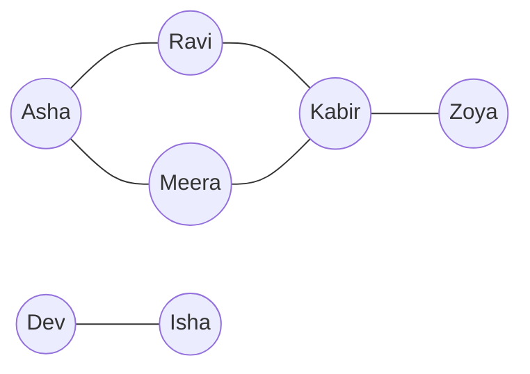
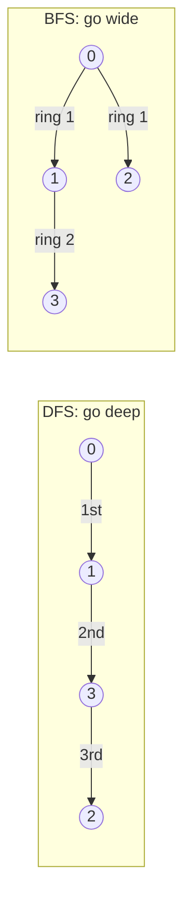

# Chapter 16 · Graphs I: BFS, DFS & Grids

> Google Maps, Instagram ka "people you may know", Delhi Metro, college courses ke prerequisites, ek maze, ek Sudoku: ye sab ek hi cheez hain, bas alag-alag kapde pehen ke aaye hain. Graph pe chalne ke do tareeke seekh lo, **DFS** aur **BFS**, aur achaanak bahut saare problems ek hi problem ban jaate hain.

**Is chapter mein tum seekhoge:**
- Graph ki vocabulary simple shabdon mein: vertices, edges, directed, weighted, degree, path, cycle, component
- Graph store karne ke teen tareeke (**adjacency list**, **matrix**, **edge list**) aur kab kaunsa use karna hai
- **DFS** (recursive aur iterative) aur **BFS**, aur node ko visited kab mark karna hai, ekdum exact
- BFS unweighted graphs mein **shortest paths** kyun dhoondhta hai (proof bas teen sentences ka hai)
- **Grids as graphs**: 4/8-direction wala template jo islands, flood fill, rotting oranges aur unke doston ko solve karta hai
- **Multi-source BFS**, **boundary-first** soch, **state-space BFS** (Word Ladder) aur **0-1 BFS**
- Graph clone karna, bipartite checks, aur undirected aur directed dono graphs mein **cycle detection**

**Isse pehle padho:** [Recursion](../part-1-python/12-recursion.md) · [Hashing](05-hashing.md) · [Stacks](11-stacks.md) · [Queues & Deques](12-queues-deques.md) · [Binary Trees](13-binary-trees.md)

---

## 🧠 The Big Idea · Asli Baat

**Graph** bas **cheezein** aur **cheezon ke beech connections** hai. Cheezon ko **vertices** (ya **nodes**) kehte hain, connections ko **edges**.



Ye ek friendship network hai. Asha aur Kabir dost nahi hain, lekin Ravi (ya Meera) ke through jude hue hain. Dev aur Isha apni chhoti si alag duniya mein rehte hain: baaki koi unhe reach nahi kar sakta.

[Chapter 13](13-binary-trees.md) wala tree ek special graph hai: connected, aur bina loops ke. General graphs mein **cycles** ho sakte hain (Asha → Ravi → Kabir → Meera → Asha), toh ek naya khatra hai: **hamesha ke liye gol-gol ghoomte rehna**. Ilaaj bhi utna hi simple hai: yaad rakho tum kahan-kahan ho aaye (ek `visited` set).

> 🇮🇳 **Desi Analogy:** Delhi Metro ka map socho. Har **station** ek vertex hai, do stations ke beech ki **track** ek edge hai. Rajiv Chowk jaise interchange pe bahut saari edges milti hain (high degree). Circle line pe ghoomte raho toh wapas wahi aa jaate ho: yahi **cycle** hai. Aur agar tum "kahan-kahan gaya" yaad na rakho, toh Circle line pe zindagi bhar ghoomte rahoge. `visited` set tumhari metro card ki travel history hai.

Graph explore karne ke do classic tareeke hain:

- **DFS (Depth-First Search):** maze ka explorer. Ek raasta pakdo aur jitna **gehra** ja sakte ho jao; jab dead end aaye, toh pichhle junction pe wapas aao aur agla raasta try karo. **Stack** (ya recursion) use karta hai.
- **BFS (Breadth-First Search):** talaab mein pathar phenkne se bani lehrein (ripples). Pehle 1 step door wale sab, phir 2 step door wale sab, phir 3... **Queue** use karta hai.



> 🇮🇳 **Desi Analogy:** Joint family ke WhatsApp group mein ek khabar faili. **BFS** waali khabar: pehle dadi ne apne saare bachchon ko bataya (ring 1), phir har bachche ne apne bachchon ko (ring 2). Generation by generation. **DFS** waali khabar: dadi ne bade chacha ko bataya, chacha ne apne bete ko, bete ne apni beti ko, jab tak line khatam na ho jaaye, phir wapas aake dadi ne chhote chacha ko bataya. Ek "pehle sab kareebi", doosra "pehle ek line poori gehri".

> 💡 **The core insight:** lagbhag har graph problem bas itna hai: "graph pe DFS ya BFS se chalo, aur raaste mein thoda hisaab-kitaab (bookkeeping) karo". Hisaab-kitaab badalta hai; chalne ka tareeka nahi.

---

## 🔨 Building It Up · Zero Se Shuru

### 1. Vocabulary in one table

| Term | Matlab | Example |
|---|---|---|
| **Vertex / node** | ek cheez | ek insaan, ek shehar, ek grid cell |
| **Edge** | do vertices ke beech ek connection | dosti, sadak, "bagal mein hai" |
| **Undirected** | edges dono taraf chalti hain | dosti |
| **Directed** (digraph) | edges ki ek direction hoti hai, `u → v` | Instagram "follows", course prerequisites |
| **Weighted** | har edge pe ek number (cost, distance, time) | sadak ki length km mein |
| **Neighbours** (adjacent) | wo vertices jo v se ek edge se jude hain | Asha ke dost |
| **Degree** | ek vertex pe kitni edges; directed graphs mein **in-degree** aur **out-degree** | followers vs following |
| **Path** | edges se jude vertices ka ek sequence | Asha → Ravi → Kabir |
| **Cycle** | wo path jo wapas apne start pe aa jaaye | Asha → Ravi → Kabir → Meera → Asha |
| **Connected** | har vertex har doosre tak pahunch sakta hai (undirected) | |
| **Connected component** | aapas mein pahunch sakne wale vertices ka sabse bada group | {Asha, Ravi, Meera, Kabir, Zoya} aur {Dev, Isha} |
| **DAG** | Directed Acyclic Graph: directed, koi cycle nahi | task dependencies ([Chapter 17](17-graphs-advanced.md)) |
| **Sparse / dense** | kam edges (E ≈ V) / bahut edges (E ≈ V²) | road map / sab sabko jaante hain |

Vertices ki ginti ke liye **V** aur edges ki ginti ke liye **E** likhte hain. Graph complexities dono se likhi jaati hain, jaise **O(V + E)**.

> 🤔 **Mann mein sawaal:** O(V + E) kyun, sirf O(E) kyun nahi? Edges toh zyada hi hoti hain na?
>
> **Jawab:** Hamesha nahi. Ek graph socho jisme 1000 vertices hain aur ek bhi edge nahi. Tab bhi har vertex ko kam se kam ek baar dekhna padega (visited check, component count), toh kaam V ke proportional hai. Aur ek dense graph mein E bahut bada hota hai. Dono cases cover karne ke liye hum dono jodte hain: V + E.

### 2. Three ways to store a graph

Vertices 0..6 aur edges `0-1, 0-2, 1-3, 2-3, 3-4, 5-6` wala undirected graph lo. (Ye wahi friendship picture hai, naamon ki jagah numbers.)

```python
from collections import defaultdict

n = 7
edges = [(0, 1), (0, 2), (1, 3), (2, 3), (3, 4), (5, 6)]   # 1. edge list: jo tumhe diya jaata hai

# 2. Adjacency list: har vertex ke liye, uske neighbours ki list
adj = defaultdict(list)
for u, v in edges:
    adj[u].append(v)
    adj[v].append(u)            # undirected: dono directions add karo
print(dict(adj))

# 3. Adjacency matrix: agar u-v edge hai toh matrix[u][v] == 1
matrix = [[0] * n for _ in range(n)]
for u, v in edges:
    matrix[u][v] = matrix[v][u] = 1
for row in matrix[:4]:
    print(row)

print("neighbours of 3:", adj[3])
print("edge 1-2?", matrix[1][2] == 1, " edge 1-3?", matrix[1][3] == 1)
```

```text
{0: [1, 2], 1: [0, 3], 2: [0, 3], 3: [1, 2, 4], 4: [3], 5: [6], 6: [5]}
[0, 1, 1, 0, 0, 0, 0]
[1, 0, 0, 1, 0, 0, 0]
[1, 0, 0, 1, 0, 0, 0]
[0, 1, 1, 0, 1, 0, 0]
neighbours of 3: [1, 2, 4]
edge 1-2? False  edge 1-3? True
```

| | Adjacency list | Adjacency matrix | Edge list |
|---|---|---|---|
| Space | **O(V + E)** | O(V²) | O(E) |
| "Kya u–v edge hai?" | O(deg u) (sets ke saath O(1)) | **O(1)** | O(E) |
| u ke neighbours pe loop | **O(deg u)** | O(V) | O(E) |
| Best for | lagbhag sab kuch: BFS, DFS, sparse graphs | dense graphs, Floyd-Warshall ([Ch 17](17-graphs-advanced.md)) | Kruskal's MST, Bellman-Ford, union-find |

> 🇮🇳 **Desi Analogy:** Mohalle ke log aur unki dosti. **Adjacency list** = har ghar ke darwaaze pe ek chhoti diary jisme sirf us ghar ke doston ke naam hain. **Adjacency matrix** = ek bada chart jisme har ghar ki ek row aur har ghar ka ek column hai, aur har khaane mein "dost / dost nahi" likha hai. 1000 ghar hain toh chart mein 10 lakh khaane, jinme se zyaadatar "dost nahi" se bhare hain (barbaadi). **Edge list** = society secretary ka register jisme bas "A-B dost hain" type ki lines likhi hain.

> 💡 **Default mein adjacency list use karo.** Interview mein input usually edge list ke roop mein aata hai; tumhare code ki pehli teen lines usse convert karti hain. Real-world graphs (roads, social networks) sparse hote hain: das lakh users, har ek ke ~200 dost, toh matrix ko 10¹² cells chahiye, lekin list ko sirf ~2×10⁸ entries.

### 3. Building graphs in Python: the recipes

```py
# Vertices 0..n-1 hain: list of lists sabse tez hai
adj = [[] for _ in range(n)]          # [[]] * n NAHI (wo EK hi list ke n references hain!)
for u, v in edges:
    adj[u].append(v)                  # directed: sirf ye line
    adj[v].append(u)                  # undirected: ye bhi add karo

# Vertices strings ya koi bhi labels hain: defaultdict
adj = defaultdict(list)

# Weighted: (neighbour, weight) pairs store karo
for u, v, w in weighted_edges:
    adj[u].append((v, w))

# Implicit graph: kuch bhi build mat karo! Neighbours chalte-chalte generate karo.
def neighbours(r, c):                 # ek grid cell ke neighbours (section 10)
    ...
```

> ⚠️ `defaultdict` ke saath, jis vertex ki **koi edge nahi** hai wo `adj` mein kabhi aata hi nahi. Agar problem kehti hai "n nodes", toh `range(n)` pe loop karo, `adj` pe nahi.

### 4. DFS, recursive: the maze explorer with chalk

Ek vertex mein ghuso, usse chalk se mark karo ("visited"), phir har us neighbour ke liye jo abhi mark nahi hua, usse poora explore karo, uske baad hi agla neighbour try karo.

> 🇮🇳 **Desi Analogy:** Purani Delhi ki galiyon mein ek dost ka ghar dhoondh rahe ho, haath mein chalk hai. Har gali ke mod pe chalk se nishaan lagao. Jo gali pehle dikhi usme ghuste chale jao jab tak band gali (dead end) na aa jaaye. Band gali aayi? Pichhle mod pe wapas aao aur agli bina-nishaan wali gali pakdo. Jis gali pe nishaan hai, usme dobara mat jao. Yahi DFS hai; "wapas aana" recursion ka return hai.

```python
adj = {0: [1, 2], 1: [0, 3], 2: [0, 3], 3: [1, 2, 4], 4: [3], 5: [6], 6: [5]}

def dfs(node, visited, order):
    visited.add(node)                 # andar aate hi chalk ka nishaan
    order.append(node)
    for nxt in adj[node]:
        if nxt not in visited:
            dfs(nxt, visited, order)

order = []
dfs(0, set(), order)
print(order)
```

```text
[0, 1, 3, 2, 4]
```

**Trace:** 0 pe ho, pehle neighbour 1 pe jao. 1 pe, neighbour 0 marked hai, toh 3 pe jao. 3 pe, neighbour 1 marked hai, toh 2 pe jao. 2 pe, dono neighbours (0 aur 3) marked hain: dead end, 3 pe wapas aao. 3 pe, 4 try karo. Phir poora raasta wapas. 5 aur 6 tak kabhi nahi pahunche (alag component hai).

Har vertex mein ek baar ghuste hain, aur har edge do baar dekhi jaati hai (dono siron se ek-ek baar): **O(V + E)** time, aur `visited` plus recursion stack ke liye **O(V)** space.

### 5. DFS, iterative: same idea, explicit stack

Python ki recursion limit (~1000) bade graphs pe recursive DFS ko tod sakti hai ([Chapter 12 of Part 1](../part-1-python/12-recursion.md)). Call stack ki jagah apni khud ki list use karo:

```python
adj = {0: [1, 2], 1: [0, 3], 2: [0, 3], 3: [1, 2, 4], 4: [3], 5: [6], 6: [5]}

def dfs_iterative(start):
    visited, order = set(), []
    stack = [start]
    while stack:
        node = stack.pop()
        if node in visited:
            continue                          # do baar push hua tha; purani copy skip karo
        visited.add(node)
        order.append(node)
        for nxt in reversed(adj[node]):       # reversed: taaki pehla neighbour pehle pop ho
            if nxt not in visited:
                stack.append(nxt)
    return order

print(dfs_iterative(0))
```

```text
[0, 1, 3, 2, 4]
```

Kya hua yahan: hum node ko tab mark karte hain jab wo **pop** hota hai, push hone pe nahi. Isliye ek node stack mein ek se zyada baar baith sakta hai (isi liye already visited ho toh skip karte hain). Ye recursive wala order ekdum same reproduce karta hai. Agar exact order ki parwaah nahi (usually nahi hoti), toh `reversed` hata sakte ho. Worst case mein stack ka size O(E) hai, ye bhi theek hai.

`reversed` kyun? Stack LIFO (last in, first out) hai. 0 ke neighbours `[1, 2]` hain. Agar seedha push kiya, toh 2 upar baithega aur pehle pop hoga. Recursive version 1 pe pehle jaata hai. Ulta push karo (`2` phir `1`), toh 1 upar aata hai. Order match.

### 6. BFS: ripples in a pond

**Queue** use karo ([Chapter 12](12-queues-deques.md)): first in, first out. Start ko andar daalo. Baar-baar aage wala vertex nikaalo, aur uske unvisited neighbours ko peeche jod do.

> 🇮🇳 **Desi Analogy:** Swiggy ka delivery radius socho. Pehle wo restaurants jo tumse 1 km pe hain, phir 2 km wale, phir 3 km wale. BFS bilkul aise hi ring by ring phailta hai. Queue ek line hai: jo restaurant pehle "discover" hua, uske neighbours pehle check honge. Isliye jo bhi pehli baar mila, wo sabse kam steps mein mila.

```python
from collections import deque

adj = {0: [1, 2], 1: [0, 3], 2: [0, 3], 3: [1, 2, 4], 4: [3], 5: [6], 6: [5]}

def bfs(start):
    dist = {start: 0}                 # yahi visited set ka kaam bhi karta hai
    queue = deque([start])
    order = []
    while queue:
        node = queue.popleft()
        order.append(node)
        for nxt in adj[node]:
            if nxt not in dist:       # ENQUEUE pe mark karo, pop pe nahi
                dist[nxt] = dist[node] + 1
                queue.append(nxt)
    return order, dist

order, dist = bfs(0)
print(order)
print(dist)
```

```text
[0, 1, 2, 3, 4]
{0: 0, 1: 1, 2: 1, 3: 2, 4: 3}
```

**Trace:**

| pop | naye neighbours add karne ke baad queue | jo dist pata chala |
|---|---|---|
| 0 | [1, 2] | 1→1, 2→1 |
| 1 | [2, 3] | 3→2 (0 pehle hi dekh liya) |
| 2 | [3] | (0 aur 3 pehle hi dekh liye) |
| 3 | [4] | 4→3 |
| 4 | [] | |

Kya hua yahan: `dist` humein 0 se har reachable vertex tak ki **sabse kam edges** deta hai. Yahi BFS ki superpower hai, jiska proof Under the Hood mein hai. **O(V + E)** time, O(V) space.

### 7. Visited: when to mark (this matters)

| Algorithm | Visited tab mark karo jab... | Kyun |
|---|---|---|
| Recursive DFS | node mein enter karo | standard |
| Iterative DFS | pop karo (aur already marked ho toh skip) | asli DFS order deta hai |
| **BFS** | **enqueue** (push) karo | agar pop tak ruke, toh alag-alag neighbours same node ko kai baar enqueue kar denge: bekaar kaam, aur dense graphs pe ye O(E) repeat queue entries tak phat jaata hai |

> ⚠️ Classic BFS bug: pop pe mark karna. Distances ke answers phir bhi sahi aate hain, lekin ye bahut zyada slow ho sakta hai (grids pe Time Limit Exceeded).

> 🤔 **Mann mein sawaal:** BFS mein enqueue pe mark karna safe kaise hai? Kya pata baad mein koi chhota raasta mil jaaye?
>
> **Jawab:** BFS mein nahi milega. Queue distance ke order mein chalti hai: pehle saare distance-d wale, phir saare d+1 wale. Jab kisi node ko pehli baar dekha, toh wo kisi distance-d node ke through dekha, toh uska distance d+1 hai. Baad mein jo bhi usse dekhega, wo khud d ya usse door hai, toh usse better raasta de hi nahi sakta. **Pehli khoj hi best khoj hai.** (Ye guarantee sirf unweighted graphs ke liye hai; weighted mein Dijkstra chahiye.)

### 8. Connected components: "how many separate islands of friends?"

**Har** vertex pe loop karo. Jab bhi koi unvisited mile, wo ek naya component hai: usse DFS/BFS chalao taaki uska poora component mark ho jaaye.

```python
from collections import defaultdict

def count_components(n, edges):
    adj = defaultdict(list)
    for u, v in edges:
        adj[u].append(v)
        adj[v].append(u)
    visited = set()
    components = []
    for start in range(n):                # har vertex, akele wale bhi
        if start in visited:
            continue
        group, stack = [], [start]
        visited.add(start)
        while stack:
            node = stack.pop()
            group.append(node)
            for nxt in adj[node]:
                if nxt not in visited:
                    visited.add(nxt)      # jab order matter nahi karta, push pe mark karna bhi chalta hai
                    stack.append(nxt)
        components.append(sorted(group))
    return components

print(count_components(7, [(0, 1), (0, 2), (1, 3), (2, 3), (3, 4), (5, 6)]))
print(len(count_components(5, [(0, 1), (2, 3)])))
```

```text
[[0, 1, 2, 3, 4], [5, 6]]
3
```

Kya hua yahan: doosri call mein vertex 4 ki koi edge hi nahi hai, lekin phir bhi wo apna khud ka component hai, isi liye hum `range(n)` pe loop karte hain. Components hain {0, 1}, {2, 3}, {4} = 3. Total kharcha phir bhi O(V + E) hai: saari searches milake har vertex aur edge ek hi baar process hota hai. (Union-Find bhi ise solve karta hai: [Chapter 18](18-union-find.md).)

> 🇮🇳 **Desi Analogy:** Shaadi mein kitne alag-alag "groups" aaye hain, ye ginna hai. Tum entry gate pe har guest se milte ho. Agar ye guest abhi tak kisi group mein tick nahi hua, toh ek naya group shuru (count + 1), aur usse poochte ho "tumhare saath kaun-kaun aaya?", phir unse bhi poochte ho, jab tak poora group tick na ho jaaye. Jo akela aaya (koi edge nahi), wo bhi ek group hai.

### 9. Getting the actual path, not just its length

Har vertex ka **parent** store karo (wo vertex jisse ye discover hua). Phir target se ulta chalo.

```python
from collections import deque

adj = {0: [1, 2], 1: [0, 3], 2: [0, 3], 3: [1, 2, 4], 4: [3], 5: [6], 6: [5]}

def shortest_path(start, target):
    parent = {start: None}
    queue = deque([start])
    while queue:
        node = queue.popleft()
        if node == target:
            path = []
            while node is not None:       # parents ke peeche-peeche start tak wapas jao
                path.append(node)
                node = parent[node]
            return path[::-1]
        for nxt in adj[node]:
            if nxt not in parent:
                parent[nxt] = node
                queue.append(nxt)
    return None                           # pahunch hi nahi sakte

print(shortest_path(0, 4), shortest_path(4, 2), shortest_path(0, 6))
```

```text
[0, 1, 3, 4] [4, 3, 2] None
```

`parent` dict do kaam karta hai: visited set bhi hai, aur "breadcrumbs" (raaste ke nishaan) bhi. Target se `parent` follow karte hue start tak pahunchte ho, toh path ulta milta hai (`4, 3, 1, 0`), isliye `[::-1]` se seedha karte hain.

### 10. Grids are graphs in disguise

2D grid ek graph hai jisme har **cell** ek vertex hai, aur jo cells ek doosre ko chhoote hain unke beech edges hain. Tum kabhi adjacency list build nahi karte; neighbours chalte-chalte **direction vectors** se calculate karte ho:

```text
4 directions (up, down, left, right):     8 directions (adds diagonals):
            (r-1, c)                       (r-1,c-1) (r-1,c) (r-1,c+1)
   (r, c-1)  (r, c)  (r, c+1)              (r, c-1)   (r,c)  (r, c+1)
            (r+1, c)                       (r+1,c-1) (r+1,c) (r+1,c+1)
```

> 🇮🇳 **Desi Analogy:** Chess board ya ek housing society ke plots ka naksha socho. Har plot (cell) ka ek address hai: (row, column). Uske padosi kaun hain, ye kisi register mein likhne ki zaroorat nahi: bas "ek upar, ek neeche, ek left, ek right" ginlo. Haan, society ki deewar ke bahar koi plot nahi hai, isliye bounds check zaroori hai.

```python
DIRS4 = [(-1, 0), (1, 0), (0, -1), (0, 1)]
DIRS8 = DIRS4 + [(-1, -1), (-1, 1), (1, -1), (1, 1)]

def neighbours(grid, r, c, dirs=DIRS4):
    rows, cols = len(grid), len(grid[0])
    for dr, dc in dirs:
        nr, nc = r + dr, c + dc
        if 0 <= nr < rows and 0 <= nc < cols:     # grid ke andar hi raho
            yield nr, nc

grid = [[0] * 3 for _ in range(3)]
print(list(neighbours(grid, 0, 0)))
print(list(neighbours(grid, 1, 1)))
print(len(list(neighbours(grid, 1, 1, DIRS8))))
```

```text
[(1, 0), (0, 1)]
[(0, 1), (2, 1), (1, 0), (1, 2)]
8
```

Corner cell (0, 0) ke sirf 2 neighbours hain (upar aur left grid ke bahar hain). Beech wale cell (1, 1) ke poore 4, aur 8 directions mein poore 8.

R rows aur C columns wale grid mein V = R·C vertices aur zyada se zyada 4·R·C edges hain, toh ek poora DFS/BFS **O(R·C)** hai.

> 💡 **Grids pe visited:** ya toh `(r, c)` pairs ka ek `set`, ya ek alag `visited` 2D list, ya **grid ko hi overwrite kar do** (jaise land `"1"` ko dekhte hi water `"0"` bana do). Overwrite karna sabse tez hai aur extra memory nahi leta, lekin input barbaad ho jaata hai; interview mein ye bol ke batao.

Ab sabse famous grid problem, **Number of Islands**: horizontally/vertically jude `"1"`s ke groups gino. Ye bilkul grid pe "count connected components" (section 8) hai.

```python
def num_islands(grid):
    rows, cols = len(grid), len(grid[0])
    count = 0

    def sink(r, c):                              # DFS jo island ko paani bana deta hai
        if r < 0 or r >= rows or c < 0 or c >= cols or grid[r][c] != "1":
            return
        grid[r][c] = "0"                         # dubo ke visited mark karo
        sink(r + 1, c); sink(r - 1, c); sink(r, c + 1); sink(r, c - 1)

    for r in range(rows):
        for c in range(cols):
            if grid[r][c] == "1":
                count += 1                       # naya island mila
                sink(r, c)                       # usse mita do taaki dobara na gine
    return count

grid = [list("11000"),
        list("11000"),
        list("00100"),
        list("00011")]
print(num_islands(grid))
```

```text
3
```

Kya hua yahan: bahar wala double loop ek unvisited land cell dhoondhta hai, usse ginta hai, aur DFS har judi hui land cell ko "dubo" (sink) deta hai. Ye "recursive call ke shuru mein check karo" wala style (bounds ke bahar ya land nahi hai toh turant return) sabse chhota grid-DFS hai jo tum likh sakte ho. O(R·C) time; worst case mein O(R·C) recursion depth (saanp jaisa lamba island), isliye bahut bade grids ke liye BFS ya explicit stack use karo.

> 🇮🇳 **Desi Analogy:** Upar se dekhne pe Sundarbans ke tapu (islands) gin rahe ho. Ek tapu dikha, count + 1, aur ek magic button dabaya jo poore tapu ko paani mein dubo deta hai. Ab wo dobara nahi dikhega, toh dobara nahi ginoge. Map pe aage scan karte raho. Jitni baar button dabaya, utne tapu.

### 11. Multi-source BFS: many ripples at once

Agar starting points **kai** hain aur sab same speed se phail rahe hain, jaise ek saath kai jagah aag lagi ho, toh? **Saare** sources ko distance 0 pe queue mein daalo, phir normal BFS chalao. Har cell ko uske **sabse kareebi** source ka distance mil jaata hai, sab ek hi O(R·C) pass mein.

> 🇮🇳 **Desi Analogy:** Diwali ki raat ek mohalle mein kai jagah ek saath diye jalaaye gaye. Har diye ki roshni har minute ek ghar aage badhti hai. Har ghar ko pehli roshni **sabse kareebi** diye se milti hai. Agar har diye ke liye alag se simulation chalao toh k guna kaam. Multi-source BFS mein saare diye minute 0 pe ek saath queue mein, aur roshni ek hi baar mein sab taraf phail jaati hai.

**Rotting Oranges:** `2` = sada hua, `1` = taaza, `0` = khaali. Har minute, sade hue oranges apne 4 neighbours ko sada dete hain. Kitne minute mein koi taaza orange nahi bachega (ya impossible ho toh −1)?

```python
from collections import deque

def oranges_rotting(grid):
    rows, cols = len(grid), len(grid[0])
    queue, fresh = deque(), 0
    for r in range(rows):
        for c in range(cols):
            if grid[r][c] == 2:
                queue.append((r, c))          # har sada orange ek source hai
            elif grid[r][c] == 1:
                fresh += 1
    minutes = 0
    while queue and fresh:
        for _ in range(len(queue)):           # exactly ek "minute" process karo (ek BFS level)
            r, c = queue.popleft()
            for dr, dc in [(-1, 0), (1, 0), (0, -1), (0, 1)]:
                nr, nc = r + dr, c + dc
                if 0 <= nr < rows and 0 <= nc < cols and grid[nr][nc] == 1:
                    grid[nr][nc] = 2          # enqueue pe mark karo
                    fresh -= 1
                    queue.append((nr, nc))
        minutes += 1
    return minutes if fresh == 0 else -1

print(oranges_rotting([[2, 1, 1], [1, 1, 0], [0, 1, 1]]))
print(oranges_rotting([[2, 1, 1], [0, 1, 1], [1, 0, 1]]))
print(oranges_rotting([[0, 2]]))
```

```text
4
-1
0
```

Pehle grid ka **dry run** (`R` = sada, `.` = khaali, `f` = taaza):

| minute | grid (rows `/` se jude) | kitne taaza bache |
|---|---|---|
| 0 | `R f f / f f . / . f f` | 6 |
| 1 | `R R f / R f . / . f f` | 4 |
| 2 | `R R R / R R . / . f f` | 2 |
| 3 | `R R R / R R . / . R f` | 1 |
| 4 | `R R R / R R . / . R R` | 0 ✅ |

Doosre grid mein bottom-left wala `1` (row 2, col 0) chaaron taraf se khaali ya bahar se ghira hai, koi sada orange wahan tak pahunch hi nahi sakta, isliye −1. Teesre mein koi taaza orange hai hi nahi, toh 0 minute.

`for _ in range(len(queue))` wala trick queue ko **ek level at a time** process karta hai, isi se hum minutes ginte hain. Yaad rakho: [Chapter 13](13-binary-trees.md) wala "level-order BFS" bhi yahi trick hai.

> 🤔 **Mann mein sawaal:** `while queue and fresh` mein `and fresh` kyun? Sirf `while queue` kaafi nahi?
>
> **Jawab:** Socho saare oranges minute 4 pe sad gaye. Queue mein abhi bhi un aakhri oranges ki entries hain. Agar `while queue` hi rakha, toh ek aur round chalega jisme kuch naya nahi sadega, lekin `minutes` 5 ho jaayega. Galat answer. `fresh` 0 hote hi ruk jaana sahi count deta hai. Aur `[[0, 2]]` jaise case mein (koi taaza nahi) loop chalta hi nahi, answer 0.

### 12. Bipartite check: can you 2-colour the graph?

Graph **bipartite** tab hai jab tum har vertex ko red ya blue rang sako aise ki har edge ek red aur ek blue ko jode (jaise "students aur courses", ya "logon ko do teams mein baanto taaki koi do dushman ek team mein na hon"). BFS/DFS chalao aur har naye vertex ko uske parent ka **ulta** rang do. Agar kabhi do same rang wale vertices ke beech edge dikhi, toh bipartite nahi hai. (Fact: graph bipartite tabhi hai jab usme **koi odd-length cycle nahi** ho.)

> 🇮🇳 **Desi Analogy:** Gully cricket mein do teams banani hain, aur kuch bachchon ki aapas mein ladaai hai (wo edges hain). Pehle bachche ko Team A mein daalo. Usse jiski ladaai hai, wo zaroor Team B mein. Unse jiski ladaai hai, wo Team A mein... Agar kabhi do ladne wale bachche ek hi team mein aa gaye, toh do teams mein baantna impossible hai. Teen bachche jinki aapas mein sabki ladaai hai (triangle, odd cycle): pehla A, doosra B, teesra? Dono se ladta hai, kahin fit nahi hota.

```python
from collections import deque

def is_bipartite(graph):                       # graph[u] = neighbours ki list
    color = {}
    for start in range(len(graph)):            # graph disconnected bhi ho sakta hai
        if start in color:
            continue
        color[start] = 0
        queue = deque([start])
        while queue:
            u = queue.popleft()
            for v in graph[u]:
                if v not in color:
                    color[v] = 1 - color[u]    # ulta rang
                    queue.append(v)
                elif color[v] == color[u]:
                    return False               # ek hi rang ke andar edge
    return True

print(is_bipartite([[1, 3], [0, 2], [1, 3], [0, 2]]))         # square: even cycle
print(is_bipartite([[1, 2, 3], [0, 2], [0, 1, 3], [0, 2]]))   # isme triangle 0-1-2 hai
```

```text
True
False
```

### 13. Cycle detection in an undirected graph

Undirected graph mein har edge "jahan se aaya wahan wapas" wali edge jaisi dikhti hai (u–v hi v–u bhi hai). Isliye DFS ke dauraan visited neighbour dikhna cycle ka matlab hai, **sivaay** jab wo neighbour wahi **parent** ho jisse hum abhi aaye hain.

```python
from collections import defaultdict

def has_cycle_undirected(n, edges):
    adj = defaultdict(list)
    for u, v in edges:
        adj[u].append(v)
        adj[v].append(u)
    visited = set()
    for start in range(n):
        if start in visited:
            continue
        visited.add(start)
        stack = [(start, -1)]                  # (node, jis parent se aaye)
        while stack:
            node, parent = stack.pop()
            for nxt in adj[node]:
                if nxt == parent:
                    continue                   # bas wahi edge jisse yahan aaye
                if nxt in visited:
                    return True                # pehle dekhe hue node pe kisi aur raaste se pahunche
                visited.add(nxt)
                stack.append((nxt, node))
    return False

print(has_cycle_undirected(4, [(0, 1), (1, 2), (2, 3)]))          # ek seedhi line
print(has_cycle_undirected(4, [(0, 1), (1, 2), (2, 0), (2, 3)]))  # triangle 0-1-2
```

```text
False
True
```

(Parallel edges ke saath, jaise 0–1 ki do alag edges, vertex ke basis pe "parent" skip karne se wo 2-cycle miss ho jaayegi; agar input mein duplicates ho sakte hain toh edge index track karo. Union-Find bhi ek badhiya cycle check deta hai: [Chapter 18](18-union-find.md).)

> 🤔 **Mann mein sawaal:** Parent wala check kyun? Visited neighbour dikha matlab cycle, simple?
>
> **Jawab:** Undirected graph mein 0–1 edge ka matlab hai 1 ki list mein bhi 0 hai. Toh 0 se 1 pe aaye, aur 1 ke neighbours dekhe, toh 0 dikhega, jo visited hai. Agar parent skip nahi kiya, toh har ek edge "cycle" lagegi, chahe graph ek seedhi line ho. Parent wo darwaaza hai jisse tum andar aaye; usse wapas dekhna cycle nahi hai.

### 14. Cycle detection in a directed graph: three colours

Parent wala trick directed graphs pe fail ho jaata hai. `0 → 1`, `0 → 2`, `2 → 1` socho. 0 se DFS pehle 1 visit karta hai, phir 2, aur 2 se dekhta hai ki 1 pehle se visited hai. Ye cycle **nahi** hai: 1 ek pehle wali branch mein poora finish ho chuka tha. Asli cycle ka matlab hai ek aise vertex pe pahunchna jo **abhi bhi current path pe hai** (DFS mein ek ancestor).

Isliye teen states use karo:

| Rang | Matlab |
|---|---|
| **WHITE** (0) | abhi visit nahi hua |
| **GRAY** (1) | current DFS path pe hai (andar aaye, finish nahi hua) |
| **BLACK** (2) | poora finish, saare descendants explore ho chuke |

GRAY vertex ki taraf edge → **cycle**. BLACK vertex ki taraf edge → koi nuksaan nahi.

> 🇮🇳 **Desi Analogy:** IRCTC pe ticket book karte waqt tum ek page se doosre pe jaate ho (directed edges). **GRAY** = wo pages jo tumhare browser tabs mein abhi khule hain (current path). **BLACK** = wo pages jinka kaam poora karke tab band kar diya. Agar kisi page ka link tumhe wapas ek **khule hue tab** (GRAY) pe le aaye, toh tum ek loop mein phas gaye ho: cycle. Lekin kisi band tab (BLACK) ka page dobara dikhna koi loop nahi, wo bas ek purana kaam hai jo pehle hi khatam ho chuka.

```python
def has_cycle_directed(n, edges):
    adj = [[] for _ in range(n)]
    for u, v in edges:
        adj[u].append(v)
    WHITE, GRAY, BLACK = 0, 1, 2
    color = [WHITE] * n

    def dfs(u):
        color[u] = GRAY                       # u current path pe hai
        for v in adj[u]:
            if color[v] == GRAY:
                return True                   # back edge: v, u ka ancestor hai
            if color[v] == WHITE and dfs(v):
                return True
        color[u] = BLACK                      # kaam khatam: path se hat jao
        return False

    return any(color[u] == WHITE and dfs(u) for u in range(n))

print(has_cycle_directed(3, [(0, 1), (0, 2), (2, 1)]))     # diamond jaisa: koi cycle nahi
print(has_cycle_directed(3, [(0, 1), (1, 2), (2, 0)]))     # 0 -> 1 -> 2 -> 0
```

```text
False
True
```

Ye **Course Schedule** aur **topological sort** ([Chapter 17](17-graphs-advanced.md)) ka dil hai.

### 15. 0-1 BFS: when edges cost 0 or 1

Plain BFS maan ke chalta hai ki har edge ka cost 1 hai. Agar kuch edges ka cost **0** aur kuch ka **1** hai, toh BFS toot jaata hai, lekin ek chhota sa badlaav isse theek kar deta hai: **deque** use karo, aur jo neighbour 0-edge se mila usse **aage** push karo (wo current node jitna hi paas hai), aur jo 1-edge se mila usse **peeche**. Deque distance ke hisaab se sorted rehta hai, toh ye Dijkstra ([Chapter 17](17-graphs-advanced.md)) jaisa behave karta hai, lekin BFS ki speed pe, O(V + E).

> 🇮🇳 **Desi Analogy:** Mumbai local mein ek hi platform pe train badalna free hai (0-edge), lekin platform badalne ke liye overbridge chadhna padta hai (1-edge). Jo station bina overbridge ke mil gaya, wo utna hi "kareeb" hai jitna tum abhi ho, isliye usse line ke **aage** khada karo. Jisme ek overbridge laga, wo ek step door hai, line ke **peeche**. Line hamesha "kam overbridge pehle" ke order mein rehti hai.

**Minimum Obstacle Removal to Reach Corner:** grid mein `0` (khaali) aur `1` (obstacle jo hata sakte ho). Obstacle wale cell mein jaane ka cost 1, khaali cell mein 0. Top-left se bottom-right tak minimum kitne obstacles hataane padenge?

```python
from collections import deque

def minimum_obstacles(grid):
    rows, cols = len(grid), len(grid[0])
    INF = float("inf")
    dist = [[INF] * cols for _ in range(rows)]
    dist[0][0] = 0
    dq = deque([(0, 0)])
    while dq:
        r, c = dq.popleft()
        for dr, dc in [(-1, 0), (1, 0), (0, -1), (0, 1)]:
            nr, nc = r + dr, c + dc
            if 0 <= nr < rows and 0 <= nc < cols:
                w = grid[nr][nc]                      # us cell mein kadam rakhne ka cost
                if dist[r][c] + w < dist[nr][nc]:
                    dist[nr][nc] = dist[r][c] + w
                    if w == 0:
                        dq.appendleft((nr, nc))       # same distance: aage
                    else:
                        dq.append((nr, nc))           # ek zyada: peeche
    return dist[rows - 1][cols - 1]

print(minimum_obstacles([[0, 1, 1], [1, 1, 0], [1, 1, 0]]))
print(minimum_obstacles([[0, 1, 0, 0, 0], [0, 1, 0, 1, 0], [0, 0, 0, 1, 0]]))
```

```text
2
0
```

Kya hua yahan: plain BFS se alag, ek cell ka distance ek se zyada baar improve ho sakta hai (hum "visited" ki jagah `dist + w < dist[...]` check karte hain), lekin har cell pehli baar jab apne sabse chhote distance ke saath pop hota hai tab final ho jaata hai, isliye total kaam O(R·C) hi rehta hai.

---

## 🔬 Under the Hood · Andar Ki Kahani

### Why DFS and BFS are O(V + E)

Har vertex ek baar mark hota hai, toh wo stack/queue mein zyada se zyada ek baar jaata hai (BFS mein, ya push pe mark karne wale DFS mein), aur ek baar process hota hai: O(V). Jab ek vertex process hota hai, hum uski neighbour list pe loop karte hain. Saare vertices ki in lists ki total length E (directed) ya 2E (undirected) hai: O(E). Adjacency list ke saath total **O(V + E)**. Adjacency matrix ke saath, har vertex ke neighbours dhoondhne mein O(V) lagta hai, toh ye **O(V²)** ho jaata hai.

### Why BFS gives shortest paths (unweighted)

Claim: BFS vertices ko distance ke non-decreasing order mein pop karta hai, aur jab pehli baar v tak pahunchta hai, toh wo ek shortest path se hi pahunchta hai.

1. Queue mein hamesha zyada se zyada do lagaataar "rings" ke vertices hote hain: aage kuch distance d wale, unke peeche kuch d + 1 wale. (Ring-d vertex ko pop karne se sirf ring-(d+1) vertices hi append hote hain.)
2. Isliye saare ring-d vertices kisi bhi ring-(d+1) vertex se pehle pop hote hain.
3. Jis vertex ka asli distance d + 1 hai, uska ek neighbour distance d pe hai. Wo neighbour ring d ke dauraan pop hota hai, aur tabhi v ko discover karta hai, usse d + 1 label deta hai. v pehle discover nahi ho sakta (uske liye distance < d wala neighbour chahiye, jisse v ka distance < d + 1 ho jaata, jo galat hai).

Bas itna hi. Isi wajah se **enqueue pe mark karna** safe hai: pehli khoj hi already best hai.

DFS aisi **koi** guarantee nahi deta. Wo pehle ek lamba raasta pakad ke ghoom sakta hai aur target tak "ghoom-phir ke" pahunch sakta hai. Unweighted graphs mein shortest path ke liye: BFS, hamesha.

> 🇮🇳 **Desi Analogy:** Talaab mein pathar phenko. Lehrein gol-gol phailti hain: pehle 1 meter wala circle, phir 2 meter wala. Koi lehar 1 meter wale circle ko chhode bina 2 meter tak nahi pahunch sakti. Isliye kinare pe jo lehar **pehli** baar pahunchi, wo sabse chhote raaste se hi aayi. BFS ki queue yahi lehrein hain.

### DFS on a directed graph: edge types

DFS ke dauraan har edge `u → v` in mein se ek hai: **tree edge** (v WHITE tha), **back edge** (v GRAY hai, ek ancestor: matlab cycle), **forward edge** (v BLACK hai, ek descendant), ya **cross edge** (v BLACK hai, kisi doosri branch mein). Sirf back edges cycles batate hain, isi liye three-colour method kaam karta hai.

### Recursion depth and memory

Recursive DFS current path pe har vertex ke liye ek stack frame use karta hai, V tak gehra. 1000×1000 ka grid jo ek bada saanp jaisa island ho, usse das lakh frames chahiye, jo Python ki default limit 1000 se bahut zyada hai. `sys.setrecursionlimit` limit badha deta hai, lekin bahut gehri recursion pe interpreter crash kar sakta hai (C stack overflow ho jaata hai). Bade inputs ke liye iterative DFS ya BFS likho.

BFS ki memory sabse chaudi "ring" ki width hai. DFS ki memory sabse gehre path ki length hai. Grid pe dono O(R·C) ho sakte hain.

### 0-1 BFS correctness in one line

Deque mein hamesha distances `d` (aage wala hissa) aur `d + 1` (peeche wala hissa) wale vertices hote hain. 0-edge distance d deti hai (aage jaata hai), 1-edge d + 1 deti hai (peeche jaata hai), toh deque sorted rehta hai, bilkul Dijkstra ki priority queue ki tarah, lekin log factor ke bina.

---

## 🧩 Pattern Decoder · Pattern Pakdo

### Signals: which walk, which template?

| Problem mein ye dikhe... | Ye socho |
|---|---|
| "number of islands / provinces / groups / connected components" | har unvisited node se DFS/BFS, starts gino (Template A) |
| "flood fill", "paint", "area of", "size of region" | Grid DFS (Template A) |
| "shortest path", "minimum steps / moves", "fewest transformations", unweighted | **BFS** (Template B) |
| "X ko phailne mein minimum time", "nearest X tak distance", kai starting points | **Multi-source BFS** (Template C) |
| "regions jo border se jude nahi hain", "cells jo edge/ocean tak pahunch sakte hain" | **Boundary-first**: search border se shuru karo (Template D) |
| "word/state A ko B mein badlo, ek baar mein ek change" | **State-space BFS**: states hi vertices hain (Template B) |
| "graph ki deep copy" | `old → new` dict ke saath DFS/BFS |
| "two groups", "two colours", "koi do adjacent same nahi" | **Bipartite** colouring |
| "detect cycle", "deadlock", "kya saare courses finish ho sakte hain?" | DFS colours (directed) ya parent check / DSU (undirected) |
| edges ka cost 0 ya 1 | deque ke saath **0-1 BFS** |
| edges ke arbitrary positive weights | Dijkstra ([Chapter 17](17-graphs-advanced.md)) |

### Template A: Grid DFS (iterative, safe for big grids)

```py
def grid_dfs(grid, sr, sc):
    rows, cols = len(grid), len(grid[0])
    stack = [(sr, sc)]
    seen = {(sr, sc)}
    size = 0
    while stack:
        r, c = stack.pop()
        size += 1                                   # "visit": gino, rang do, collect karo...
        for dr, dc in ((-1, 0), (1, 0), (0, -1), (0, 1)):
            nr, nc = r + dr, c + dc
            if (0 <= nr < rows and 0 <= nc < cols  # 1. grid ke andar
                    and (nr, nc) not in seen       # 2. visited nahi
                    and grid[nr][nc] == TARGET):   # 3. ja sakte hain / same type
                seen.add((nr, nc))
                stack.append((nr, nc))
    return size
```

Teen checks hamesha isi order mein: **andar hai? dekha nahi? jaane layak hai?** Pehla check pehle, warna grid ke bahar index padh loge.

### Template B: BFS shortest path (level by level)

```py
from collections import deque

def bfs_steps(start, is_goal, neighbours):
    queue, seen, steps = deque([start]), {start}, 0
    while queue:
        for _ in range(len(queue)):        # ek poora level = ek step
            state = queue.popleft()
            if is_goal(state):
                return steps
            for nxt in neighbours(state):
                if nxt not in seen:
                    seen.add(nxt)          # enqueue pe mark karo!
                    queue.append(nxt)
        steps += 1
    return -1                              # pahunch nahi sakte
```

### Template C: Multi-source BFS

```py
queue = deque(all_sources)             # jaise har sada orange, har 0, har gate
seen = set(all_sources)                # sab distance 0 pe
# ... phir bilkul Template B
```

### Template D: Boundary-first (reverse the question)

```py
# "Kaunse cells border tak NAHI pahunch sakte?" mushkil hai. "Kaunse PAHUNCH sakte hain?" aasaan hai:
for every cell on the border that qualifies:
    dfs/bfs from it, marking everything it reaches
answer = cells that were NOT marked (or were marked, depending on the question)
```

> 🇮🇳 **Desi Analogy:** Baarish mein society ke kaunse ghar mein paani bhar jaayega aur kaunse bache rahenge? Har ghar se "kya mera paani naale tak jaa sakta hai?" poochna mehenga hai. Ulta socho: **naale se** shuru karo aur dekho paani kahan-kahan se wahan tak aa sakta hai. Jo ghar is search mein nahi aaye, unhi mein paani atkega. Ek sawaal ko ulta karte hi n searches ek search ban gayi.

### Variation: Flood Fill (Template A)

**Problem:** `(sr, sc)` se shuru karke, usse (4-directionally) jude har us cell ko naya rang do jiska original rang same hai.

```python
def flood_fill(image, sr, sc, color):
    original = image[sr][sc]
    if original == color:
        return image                   # kuch karna hi nahi (aur infinite loop se bhi bachaata hai!)
    rows, cols = len(image), len(image[0])
    stack = [(sr, sc)]
    image[sr][sc] = color              # rang dena hi "visited" ka kaam karta hai
    while stack:
        r, c = stack.pop()
        for dr, dc in ((-1, 0), (1, 0), (0, -1), (0, 1)):
            nr, nc = r + dr, c + dc
            if 0 <= nr < rows and 0 <= nc < cols and image[nr][nc] == original:
                image[nr][nc] = color
                stack.append((nr, nc))
    return image

print(flood_fill([[1, 1, 1], [1, 1, 0], [1, 0, 1]], 1, 1, 2))
```

```text
[[2, 2, 2], [2, 2, 0], [2, 0, 1]]
```

Bottom-right wala `1` juda hua nahi hai (sirf diagonally chhoota hai), isliye wo waisa hi rehta hai. O(R·C).

### Variation: Max Area of Island (Template A, counting)

```python
def max_area_of_island(grid):
    rows, cols = len(grid), len(grid[0])
    best = 0
    for sr in range(rows):
        for sc in range(cols):
            if grid[sr][sc] != 1:
                continue
            grid[sr][sc] = 0                     # chalte-chalte dubo do
            stack, area = [(sr, sc)], 0
            while stack:
                r, c = stack.pop()
                area += 1
                for dr, dc in ((-1, 0), (1, 0), (0, -1), (0, 1)):
                    nr, nc = r + dr, c + dc
                    if 0 <= nr < rows and 0 <= nc < cols and grid[nr][nc] == 1:
                        grid[nr][nc] = 0
                        stack.append((nr, nc))
            best = max(best, area)
    return best

grid = [[1, 1, 0, 0, 0],
        [1, 1, 0, 0, 1],
        [0, 0, 0, 1, 1],
        [0, 0, 0, 1, 1]]
print(max_area_of_island(grid))
```

```text
5
```

Do islands hain: top-left wala 4 cells ka, aur right wala 5 cells ka. Max = 5.

### Variation: Surrounded Regions (Template D)

**Problem:** jo `'O'` regions poori tarah `'X'` se ghire hain, unhe capture karo (`'X'` mein badal do). Jo `'O'` region border ko chhoota hai, wo bach jaata hai.

**Idea:** "kya ye region ghira hua hai?" poochna awkward hai. Ulta karo: har border wale `'O'` se DFS karo aur uske region ko **safe** (`'S'`) mark karo. Phir har bache hue `'O'` ko `'X'` karo, aur `'S'` ko wapas `'O'`.

```python
def solve(board):
    rows, cols = len(board), len(board[0])

    def mark_safe(r, c):
        stack = [(r, c)]
        board[r][c] = "S"
        while stack:
            r, c = stack.pop()
            for dr, dc in ((-1, 0), (1, 0), (0, -1), (0, 1)):
                nr, nc = r + dr, c + dc
                if 0 <= nr < rows and 0 <= nc < cols and board[nr][nc] == "O":
                    board[nr][nc] = "S"
                    stack.append((nr, nc))

    for r in range(rows):
        for c in range(cols):
            on_border = r in (0, rows - 1) or c in (0, cols - 1)
            if on_border and board[r][c] == "O":
                mark_safe(r, c)
    for r in range(rows):
        for c in range(cols):
            board[r][c] = {"O": "X", "S": "O"}.get(board[r][c], board[r][c])
    return board

board = [list("XXXX"), list("XOOX"), list("XXOX"), list("XOXX")]
for row in solve(board):
    print("".join(row))
```

```text
XXXX
XXXX
XXXX
XOXX
```

Neeche wala `'O'` border ko chhoota hai, isliye wo bach gaya. O(R·C).

### Variation: Pacific Atlantic Water Flow (Template D, twice)

**Problem:** paani ek cell se us neighbour mein behta hai jiski height **barabar ya kam** ho. Pacific top aur left edges ko chhoota hai, Atlantic bottom aur right ko. Wo cells return karo jahan se paani **dono** oceans tak pahunch sake.

**Idea:** har cell se search chalaana O((R·C)²) hai. Flow ko ulta karo: har ocean ke border se shuru karo aur **upar ki taraf** (jin neighbours ki height ≥ current hai) chalo. Isse wo har cell mark ho jaata hai jo us ocean mein drain ho sakta hai. Answer = dono ka intersection.

```python
def pacific_atlantic(heights):
    rows, cols = len(heights), len(heights[0])

    def reachable(starts):
        seen = set(starts)
        stack = list(starts)
        while stack:
            r, c = stack.pop()
            for dr, dc in ((-1, 0), (1, 0), (0, -1), (0, 1)):
                nr, nc = r + dr, c + dc
                if (0 <= nr < rows and 0 <= nc < cols and (nr, nc) not in seen
                        and heights[nr][nc] >= heights[r][c]):     # ulti disha mein upar chadho
                    seen.add((nr, nc))
                    stack.append((nr, nc))
        return seen

    pacific = [(0, c) for c in range(cols)] + [(r, 0) for r in range(rows)]
    atlantic = [(rows - 1, c) for c in range(cols)] + [(r, cols - 1) for r in range(rows)]
    both = reachable(pacific) & reachable(atlantic)
    return sorted([r, c] for r, c in both)

heights = [[1, 2, 2, 3, 5],
           [3, 2, 3, 4, 4],
           [2, 4, 5, 3, 1],
           [6, 7, 1, 4, 5],
           [5, 1, 1, 2, 4]]
print(pacific_atlantic(heights))
```

```text
[[0, 4], [1, 3], [1, 4], [2, 2], [3, 0], [3, 1], [4, 0]]
```

O(R·C): bas do searches.

> 🤔 **Mann mein sawaal:** Ulta chalte waqt `>=` kyun, `<=` kyun nahi? Paani toh neeche behta hai.
>
> **Jawab:** Paani asli mein high se low (ya barabar) behta hai: cell A se B tab jaata hai jab `B <= A`. Hum ocean se **ulta** chal rahe hain, yaani B (neeche) se A (upar) ki taraf. Toh B se A pe tab jaate hain jab `A >= B`. Code mein current cell `(r, c)` = B hai aur neighbour `(nr, nc)` = A, isliye `heights[nr][nc] >= heights[r][c]`. Direction ulti, toh comparison bhi ulta.

### Variation: Shortest Path in Binary Matrix (Template B, 8 directions)

**Problem:** top-left se bottom-right tak sabse chhota clear path (0 wale cells), 8 directions mein chal sakte ho. Path length cells mein gini jaati hai. Agar koi path nahi toh −1.

```python
from collections import deque

def shortest_path_binary_matrix(grid):
    n = len(grid)
    if grid[0][0] or grid[n - 1][n - 1]:
        return -1
    queue = deque([(0, 0, 1)])                     # (row, col, ab tak path ki length)
    grid[0][0] = 1                                 # visited mark karo
    while queue:
        r, c, length = queue.popleft()
        if (r, c) == (n - 1, n - 1):
            return length
        for dr in (-1, 0, 1):
            for dc in (-1, 0, 1):
                nr, nc = r + dr, c + dc
                if 0 <= nr < n and 0 <= nc < n and grid[nr][nc] == 0:
                    grid[nr][nc] = 1
                    queue.append((nr, nc, length + 1))
    return -1

print(shortest_path_binary_matrix([[0, 1], [1, 0]]))
print(shortest_path_binary_matrix([[0, 0, 0], [1, 1, 0], [1, 1, 0]]))
print(shortest_path_binary_matrix([[1, 0, 0], [1, 1, 0], [1, 1, 0]]))
```

```text
2
4
-1
```

(`dr = dc = 0` cell khud hai, jo already marked hai, toh apne aap skip ho jaata hai.) Distance ko queue entry ke andar store karna level loop ka ek alternative hai.

### Variation: Word Ladder (state-space BFS)

**Problem:** `beginWord` ko `endWord` mein badlo, ek baar mein ek letter badal ke, aur beech ka har word `wordList` mein hona chahiye. Sabse chhote sequence mein kitne words hain wo return karo (impossible ho toh 0). `hit → hot → dot → dog → cog` = 5.

**Idea:** words vertices hain; jo do words ek letter se alag hain unke beech edge hai. Saari edges build mat karo (O(N²·L)). Uski jagah, words ko **wildcard patterns** se group karo: `hot` in teeno mein aata hai: `*ot`, `h*t`, `ho*`. Do words neighbours tabhi hain jab wo koi pattern share karte hain.

> 🇮🇳 **Desi Analogy:** Antakshari ka ek ulta version socho jisme har round mein sirf ek akshar badal sakte ho. "hit" se "cog" tak pahunchna hai. Har word ek station hai, ek-akshar ka badlaav ek train hai. BFS har round mein saare "ek badlaav door" wale words try karta hai, isliye jo pehli baar "cog" pe pahuncha, wahi sabse chhota raasta hai. Pattern buckets ek "same tune wale gaane" ki diary hai: `h*t` wale page pe hit, hot, hat sab likhe hain, toh neighbours dhoondhne ke liye poori dictionary nahi palatni padti.

```python
from collections import defaultdict, deque

def ladder_length(begin, end, word_list):
    words = set(word_list)
    if end not in words:
        return 0
    buckets = defaultdict(list)                  # pattern -> jo words is pattern se match karte hain
    for w in words:
        for i in range(len(w)):
            buckets[w[:i] + "*" + w[i + 1:]].append(w)

    queue, seen = deque([(begin, 1)]), {begin}
    while queue:
        word, steps = queue.popleft()
        if word == end:
            return steps
        for i in range(len(word)):
            pattern = word[:i] + "*" + word[i + 1:]
            for nxt in buckets[pattern]:
                if nxt not in seen:
                    seen.add(nxt)
                    queue.append((nxt, steps + 1))
            buckets[pattern] = []                # ye bucket poora use ho gaya: dobara kabhi scan mat karo
    return 0

words = ["hot", "dot", "dog", "lot", "log", "cog"]
print(ladder_length("hit", "cog", words))
print(ladder_length("hit", "cog", ["hot", "dot", "dog", "lot", "log"]))
```

```text
5
0
```

N words, har ek length L, ke liye O(N·L²) time (har pattern banane mein L lagta hai). **Bidirectional BFS** (dono siron se search karo, hamesha chhoti frontier ko expand karo) ek common follow-up hai jo explore hone wali jagah ko bahut kam kar deta hai.

`buckets[pattern] = []` kyun? Jab ek pattern ke saare words ek baar queue mein daal diye, toh dobara wahi pattern kisi aur word se aaye toh bhi kuch naya nahi milega. Bucket khaali karne se wo bekaar scan bach jaata hai.

### Variation: Clone Graph (DFS with an old → new map)

**Problem:** ek node diya hai, ek connected undirected graph ki deep copy banao.

**Idea:** dict `clones` har original node ko uski copy se map karta hai. Ye visited set bhi hai aur neighbours ko jodne ka tareeka bhi (cycles ke saath bhi).

```python
class Node:
    def __init__(self, val, neighbors=None):
        self.val = val
        self.neighbors = neighbors if neighbors is not None else []

def clone_graph(node):
    if node is None:
        return None
    clones = {node: Node(node.val)}
    stack = [node]
    while stack:
        cur = stack.pop()
        for nb in cur.neighbors:
            if nb not in clones:
                clones[nb] = Node(nb.val)        # pehli baar dikhte hi copy banao
                stack.append(nb)
            clones[cur].neighbors.append(clones[nb])   # copy ko copy se jodo
    return clones[node]

# Adjacency list (1-indexed) se square 1-2-3-4-1 banao
adj = [[2, 4], [1, 3], [2, 4], [1, 3]]
nodes = [Node(i + 1) for i in range(4)]
for i, nbs in enumerate(adj):
    nodes[i].neighbors = [nodes[j - 1] for j in nbs]

copy = clone_graph(nodes[0])
seen, stack, result = {copy}, [copy], {}
while stack:
    cur = stack.pop()
    result[cur.val] = [nb.val for nb in cur.neighbors]
    for nb in cur.neighbors:
        if nb not in seen:
            seen.add(nb); stack.append(nb)
print(dict(sorted(result.items())))
print(copy is nodes[0], copy.neighbors[0] is nodes[1])
```

```text
{1: [2, 4], 2: [1, 3], 3: [2, 4], 4: [1, 3]}
False False
```

Shape wahi, objects bilkul naye. O(V + E).

### When NOT to use plain BFS/DFS

- **Weighted shortest paths** (arbitrary positive weights): BFS galat hai. Dijkstra use karo ([Chapter 17](17-graphs-advanced.md)). Exception: weights 0/1 → 0-1 BFS.
- **Bahut saare "kya ye connected hain?" queries jab edges add hoti ja rahi hain**: har baar BFS dobara chalaana slow hai. Union-Find use karo ([Chapter 18](18-union-find.md)).
- **Dependencies wale tasks ko order karna**: wo topological sort hai ([Chapter 17](17-graphs-advanced.md)), DFS/BFS ka ek variant jiska apna template hai.
- **Paths ginna / aise best path jahan choices ek doosre pe asar daalti hain**: aksar graph ya grid pe DP ([Chapter 20](20-dp-1d.md)), khaas kar agar movement sirf right/down hai (koi cycle nahi).
- **Saare simple paths / har arrangement**: wo backtracking hai ([Chapter 09](09-backtracking.md)), exponential, aur wapas aate waqt visited ko un-mark karte ho.

---

## ⚠️ Traps & Common Mistakes · Yahan Sab Phisalte Hain

1. **`visited` bilkul bhool jaana** → pehle hi cycle pe infinite loop.
2. **BFS mein pop pe visited mark karna** → same node kai baar enqueue hota hai. Enqueue pe mark karo.
3. **Search sirf node 0 se shuru karna** jab graph disconnected ho sakta hai. Saare vertices pe loop karo.
4. **Adjacency lists ke liye `[[]] * n`** → saari n entries *ek hi* list hain.

```py
adj = [[]] * 3; adj[0].append(1); print(adj)    # ❌ [[1], [1], [1]]
adj = [[] for _ in range(3)]                    # ✅ teen alag lists
```

5. **Undirected graph ke liye sirf ek direction add karna.** `adj[u].append(v)` likha, lekin `adj[v].append(u)` nahi.
6. **Grid bounds checks galat order mein.** `grid[r][c]` padhne se **pehle** `0 <= r < rows` check karo, warna `IndexError` milega (ya usse bhi bura, Python ki negative indexing `grid[-1]` ko chupchaap aakhri row bana degi!).
7. **Bade grids pe recursive DFS** → `RecursionError`. Explicit stack use karo.
8. **Shortest paths ke liye DFS use karna.** DFS *koi* path dhoondhta hai, sabse chhota nahi.
9. **Flood fill jab naya rang purane rang ke barabar ho** → agar rang hi visited marker hai toh infinite loop. Pehle hi return karo.
10. **Undirected wala parent trick directed graphs pe use karna** (ya ulta). Directed → three colours.

---

## 💡 Tips & Tricks · Pro Wale Moves

- Interview mein pehla sentence: "I'll model this as a graph: vertices are ___, edges are ___." Isse structure dikhta hai aur galatfehmiyaan jaldi pakdi jaati hain.
- **Shortest + unweighted = BFS.** Ise dimaag mein jala ke likh lo.
- Grids ke liye ek `DIRS = [(-1,0),(1,0),(0,-1),(0,1)]` constant rakho; chaar alag calls likhne ki jagah uspe loop karo.
- Jab **levels** chahiye (minutes, steps) tab `for _ in range(len(queue))` use karo; jab nahi chahiye tab queue mein `(node, dist)` store karo.
- Input grid ko hi visited marker bana dena memory bachaata hai; ye batao, aur agar mutation allowed nahi toh `seen` set offer karo.
- "Har cell se, kya wo X tak pahunch sakta hai?" ke liye, ulta **X se** search karo (boundary-first / reverse search).
- Har source se alag BFS chalaane ki jagah saare sources ek saath queue mein daalo: O(k·R·C) ki jagah O(R·C).
- Grid DFS visited state ko `grid[r][c] = '#'` se encode kar sakta hai aur backtracking mein baad mein restore kar sakta hai (Word Search, [Chapter 09](09-backtracking.md)).

---

## 🎯 Interview Questions · Interview Mein Yahi Poochenge

### 1. Number of Islands 🔥🔥🔥

<details><summary>Answer dekho 👀</summary>

Har cell scan karo; unvisited land mile toh count +1 karo aur DFS/BFS se poora island dubo do (section 10). O(R·C) time, worst-case O(R·C) space. Follow-ups: "grid bahut bada hai / row by row stream ho raha hai" → Union-Find ([Chapter 18](18-union-find.md)); "land ek-ek cell karke add ho raha hai" → Number of Islands II, ye bhi Union-Find.

> 🗣️ **Interview mein aise bolo:** "I treat each land cell as a vertex connected to its four neighbours, so islands are connected components. I scan the grid, and whenever I find unvisited land I increment the count and flood it with DFS or BFS, marking it visited by sinking it to water. Every cell is visited a constant number of times, so it's O(R times C) time, and I'd use an iterative stack to avoid recursion limits on large grids."

</details>

### 2. Flood Fill 🔥🔥

<details><summary>Answer dekho 👀</summary>

`(sr, sc)` se original rang wale cells pe grid DFS, chalte-chalte rang bharte jao (Pattern Decoder). Agar naya rang original ke barabar hai toh pehle hi return. O(R·C).

</details>

### 3. Max Area of Island 🔥🔥

<details><summary>Answer dekho 👀</summary>

Number of Islands hi hai, bas har DFS island ka size return karta hai; maximum track karo (Pattern Decoder). O(R·C).

</details>

### 4. Rotting Oranges 🔥🔥🔥

<details><summary>Answer dekho 👀</summary>

Saare sade oranges se multi-source BFS, level by level; levels gino; agar koi taaza orange bacha toh −1 (section 11). Interview ki key line: "Running BFS from each rotten orange separately would be O(k·R·C); seeding the queue with all of them handles simultaneous spreading in one O(R·C) pass."

> 🗣️ **Interview mein aise bolo:** "This is multi-source BFS. I put every rotten orange in the queue at time zero and count fresh oranges. Then I process the queue level by level, where each level is one minute, rotting fresh neighbours and decrementing the fresh count. When the queue empties or no fresh oranges remain, I return the minutes, or minus one if some fresh orange was never reached. It's O(R times C)."

</details>

### 5. 01 Matrix 🔥🔥

Har cell ke liye, sabse kareebi 0 tak ka distance.

<details><summary>Answer dekho 👀</summary>

**Har 0** se ek saath multi-source BFS. Distances bahar ki taraf bharte jaate hain.

```python
from collections import deque

def update_matrix(mat):
    rows, cols = len(mat), len(mat[0])
    dist = [[-1] * cols for _ in range(rows)]
    queue = deque()
    for r in range(rows):
        for c in range(cols):
            if mat[r][c] == 0:
                dist[r][c] = 0
                queue.append((r, c))
    while queue:
        r, c = queue.popleft()
        for dr, dc in ((-1, 0), (1, 0), (0, -1), (0, 1)):
            nr, nc = r + dr, c + dc
            if 0 <= nr < rows and 0 <= nc < cols and dist[nr][nc] == -1:
                dist[nr][nc] = dist[r][c] + 1
                queue.append((nr, nc))
    return dist

print(update_matrix([[0, 0, 0], [0, 1, 0], [1, 1, 1]]))
```

```text
[[0, 0, 0], [0, 1, 0], [1, 2, 1]]
```

O(R·C). (Two-pass DP bhi chalta hai: pehle top-left se sweep, phir bottom-right se sweep.)

Yahan `dist = -1` hi "visited nahi" ka nishaan hai, alag set nahi chahiye. Galti se har 1 se BFS karke nearest 0 dhoondhoge toh O((R·C)²) ho jaayega; ulta, 0s se shuru karo.

</details>

### 6. Surrounded Regions 🔥🔥

<details><summary>Answer dekho 👀</summary>

Boundary-first: border se pahunch sakne wale `'O'`s ko safe mark karo, baaki flip kar do (Pattern Decoder). O(R·C).

</details>

### 7. Pacific Atlantic Water Flow 🔥🔥

<details><summary>Answer dekho 👀</summary>

Ulta flow: har ocean ke border se upar ki taraf search karo, dono reachable sets ka intersection lo (Pattern Decoder). O(R·C). Zor se bolne wali key insight: "Instead of asking where each cell's water goes, I ask which cells each ocean can be reached from."

</details>

### 8. Shortest Path in Binary Matrix 🔥🔥

<details><summary>Answer dekho 👀</summary>

8 directions ke saath BFS, path length cells mein gini jaati hai (Pattern Decoder). O(n²). Pehle check karo ki start aur end cells khule hain.

</details>

### 9. Word Ladder 🔥🔥🔥

<details><summary>Answer dekho 👀</summary>

Wildcard buckets ke saath state-space BFS (Pattern Decoder). O(N·L²). Optimisation ke roop mein bidirectional BFS ka naam lo. Word Ladder II (saare shortest sequences return karo) level by level ek parent map banata hai, phir backtracking karta hai.

> 🗣️ **Interview mein aise bolo:** "I model each word as a vertex, with edges between words that differ by one letter, and the answer is the BFS distance from the begin word to the end word. To find neighbours quickly, I precompute wildcard patterns like h-star-t that map to all matching words. BFS guarantees the first time I reach the end word is the shortest sequence, in O(N times L squared). Bidirectional BFS is a good optimisation."

</details>

### 10. Clone Graph 🔥🔥🔥

<details><summary>Answer dekho 👀</summary>

`original → copy` dict ke saath DFS/BFS, jo visited set ka kaam bhi karta hai (Pattern Decoder). O(V + E). "Copy List with Random Pointer" ([Chapter 10](10-linked-lists.md)) wala hi trick hai.

> 🗣️ **Interview mein aise bolo:** "I traverse the graph with DFS or BFS and keep a hash map from each original node to its copy. The map doubles as my visited set: when I see a neighbour for the first time I create its copy and schedule it, and either way I append the neighbour's copy to the current copy's neighbour list. That handles cycles naturally and runs in O(V + E)."

</details>

### 11. Is Graph Bipartite? 🔥🔥

<details><summary>Answer dekho 👀</summary>

Har uncoloured vertex se BFS 2-colouring; same-colour edge ka matlab bipartite nahi (section 12). O(V + E). Barabar wali condition: koi odd cycle nahi. "Possible Bipartition" (ek doosre ko na pasand karne walon ko do groups mein baanto) edge list ke saath wahi problem hai.

</details>

### 12. Number of Connected Components in an Undirected Graph 🔥🔥

<details><summary>Answer dekho 👀</summary>

Adjacency list banao, saare n vertices pe loop karo, har unvisited se DFS shuru karo aur gino (section 8). O(V + E). Alternative: Union-Find, n components se shuru karo aur har successful union pe 1 ghatao ([Chapter 18](18-union-find.md)).

</details>

### 13. Find if Path Exists in Graph 🔥

<details><summary>Answer dekho 👀</summary>

`source` se BFS/DFS, agar `destination` tak pahunche toh True return karo.

```python
from collections import defaultdict, deque

def valid_path(n, edges, source, destination):
    adj = defaultdict(list)
    for u, v in edges:
        adj[u].append(v)
        adj[v].append(u)
    seen, queue = {source}, deque([source])
    while queue:
        node = queue.popleft()
        if node == destination:
            return True
        for nxt in adj[node]:
            if nxt not in seen:
                seen.add(nxt)
                queue.append(nxt)
    return False

print(valid_path(3, [[0, 1], [1, 2], [2, 0]], 0, 2))
print(valid_path(6, [[0, 1], [0, 2], [3, 5], [5, 4], [4, 3]], 0, 5))
```

```text
True
False
```

O(V + E).

</details>

### 14. Detect a cycle in a directed vs an undirected graph 🔥🔥 (conceptual)

<details><summary>Answer dekho 👀</summary>

**Undirected:** DFS; ek visited neighbour jo parent nahi hai, matlab cycle (ya Union-Find: ek aisi edge jiske dono sire already same root share karte hain). **Directed:** three colours ke saath DFS; GRAY (current path pe) vertex ki taraf edge ek back edge hai, matlab cycle. BLACK vertex tak pahunchna theek hai: wo kisi doosri branch mein finish ho chuka tha. Kahn's algorithm (topological sort) bhi directed cycles pakadta hai: agar saare vertices process nahi hue, toh cycle hai ([Chapter 17](17-graphs-advanced.md)).

> 🗣️ **Interview mein aise bolo:** "For an undirected graph, I run DFS and report a cycle when I reach an already-visited neighbour that isn't the parent I came from; union-find also works. For a directed graph, that's not enough, because reaching a finished node from another branch isn't a cycle. So I use three colours, white, gray and black, and only an edge to a gray node, which is still on the current path, means a cycle. Both are O(V + E)."

</details>

---

## 🏋️ Practice · Ab Tumhari Baari

**🟢 1. Find the Town Judge** (degree ginne wala warm-up). n logon ke ek directed graph mein, `trust[i] = [a, b]` ka matlab a, b pe trust karta hai. Judge kisi pe trust nahi karta aur baaki sab usspe trust karte hain. Judge return karo ya −1.

<details><summary>Solution dekho 👀</summary>

Koi traversal nahi chahiye: bas degrees. Judge ka `in − out == n − 1` hota hai (n − 1 log usspe trust karte hain, wo kisi pe nahi).

```python
def find_judge(n, trust):
    score = [0] * (n + 1)
    for a, b in trust:
        score[a] -= 1          # out-degree
        score[b] += 1          # in-degree
    for person in range(1, n + 1):
        if score[person] == n - 1:
            return person
    return -1

print(find_judge(3, [[1, 3], [2, 3]]), find_judge(3, [[1, 3], [2, 3], [3, 1]]))
```

```text
3 -1
```

</details>

**🟢 2. Island Perimeter.** 1s ka ek island; uska perimeter return karo.

<details><summary>Solution dekho 👀</summary>

Har land cell 4 sides deta hai, aur har adjacent land cells ke jode ke liye 2 ghatao (har shared edge ek hi baar gino, isliye sirf upar aur left check karo). 2 kyun? Shared edge dono cells ki ek-ek side chhupa deti hai.

```python
def island_perimeter(grid):
    perimeter = 0
    for r, row in enumerate(grid):
        for c, cell in enumerate(row):
            if cell:
                perimeter += 4
                if r > 0 and grid[r - 1][c]:
                    perimeter -= 2
                if c > 0 and grid[r][c - 1]:
                    perimeter -= 2
    return perimeter

print(island_perimeter([[0, 1, 0, 0], [1, 1, 1, 0], [0, 1, 0, 0], [1, 1, 0, 0]]))
```

```text
16
```

</details>

**🟡 3. Number of Enclaves.** Wo land cells gino jahan se tum grid se bahar nahi chal sakte.

<details><summary>Solution dekho 👀</summary>

Boundary-first: border se pahunch sakne wali saari land dubo do, jo bacha wo gino.

```python
def num_enclaves(grid):
    rows, cols = len(grid), len(grid[0])
    stack = [(r, c) for r in range(rows) for c in range(cols)
             if grid[r][c] == 1 and (r in (0, rows - 1) or c in (0, cols - 1))]
    for r, c in stack:
        grid[r][c] = 0
    while stack:
        r, c = stack.pop()
        for dr, dc in ((-1, 0), (1, 0), (0, -1), (0, 1)):
            nr, nc = r + dr, c + dc
            if 0 <= nr < rows and 0 <= nc < cols and grid[nr][nc] == 1:
                grid[nr][nc] = 0
                stack.append((nr, nc))
    return sum(map(sum, grid))

print(num_enclaves([[0, 0, 0, 0], [1, 0, 1, 0], [0, 1, 1, 0], [0, 0, 0, 0]]))
```

```text
3
```

</details>

**🟡 4. Minimum Knight Moves** ek infinite chessboard pe (0, 0) se (x, y) tak.

<details><summary>Solution dekho 👀</summary>

Positions pe BFS. Symmetry se, `(|x|, |y|)` ke liye solve karo aur coordinates ko −2 tak neeche jaane do (kuch optimal paths thoda sa negative mein jaate hain, jaise (1, 1) tak pahunchne ke liye).

```python
from collections import deque

def min_knight_moves(x, y):
    x, y = abs(x), abs(y)
    moves = [(1, 2), (2, 1), (-1, 2), (-2, 1), (1, -2), (2, -1), (-1, -2), (-2, -1)]
    queue, seen = deque([(0, 0, 0)]), {(0, 0)}
    while queue:
        r, c, d = queue.popleft()
        if (r, c) == (x, y):
            return d
        for dr, dc in moves:
            nr, nc = r + dr, c + dc
            if (nr, nc) not in seen and nr >= -2 and nc >= -2:
                seen.add((nr, nc))
                queue.append((nr, nc, d + 1))

print(min_knight_moves(2, 1), min_knight_moves(5, 5), min_knight_moves(1, 1))
```

```text
1 4 2
```

</details>

**🟡 5. Possible Bipartition.** Log 1..n; `dislikes[i] = [a, b]` ka matlab a aur b same group mein nahi ho sakte. Kya sabko do groups mein baant sakte ho?

<details><summary>Solution dekho 👀</summary>

Ye "dislike" graph pe bipartite check hi hai.

```python
from collections import defaultdict, deque

def possible_bipartition(n, dislikes):
    adj = defaultdict(list)
    for a, b in dislikes:
        adj[a].append(b)
        adj[b].append(a)
    color = {}
    for start in range(1, n + 1):
        if start in color:
            continue
        color[start] = 0
        queue = deque([start])
        while queue:
            u = queue.popleft()
            for v in adj[u]:
                if v not in color:
                    color[v] = 1 - color[u]
                    queue.append(v)
                elif color[v] == color[u]:
                    return False
    return True

print(possible_bipartition(4, [[1, 2], [1, 3], [2, 4]]))
print(possible_bipartition(3, [[1, 2], [1, 3], [2, 3]]))
```

```text
True
False
```

</details>

**🔴 6. Shortest Bridge.** Grid mein exactly do islands hain. Sabse kam 0s flip karke unhe jodo.

<details><summary>Solution dekho 👀</summary>

DFS se pehle island ke saare cells dhoondho aur mark karo; phir us poore island se **multi-source BFS** karo jab tak doosre ko na chhoo lo. Us waqt ka BFS level hi answer hai.

```python
from collections import deque

def shortest_bridge(grid):
    n = len(grid)
    dirs = ((-1, 0), (1, 0), (0, -1), (0, 1))
    start = next((r, c) for r in range(n) for c in range(n) if grid[r][c] == 1)
    queue = deque()
    stack = [start]
    grid[start[0]][start[1]] = 2                 # 2 = pehla island / visited
    while stack:                                 # DFS: pehla island collect karo
        r, c = stack.pop()
        queue.append((r, c))
        for dr, dc in dirs:
            nr, nc = r + dr, c + dc
            if 0 <= nr < n and 0 <= nc < n and grid[nr][nc] == 1:
                grid[nr][nc] = 2
                stack.append((nr, nc))
    flips = 0
    while queue:                                 # poore pehle island se bahar ki taraf BFS
        for _ in range(len(queue)):
            r, c = queue.popleft()
            for dr, dc in dirs:
                nr, nc = r + dr, c + dc
                if 0 <= nr < n and 0 <= nc < n:
                    if grid[nr][nc] == 1:
                        return flips             # doosre island ko chhoo liya
                    if grid[nr][nc] == 0:
                        grid[nr][nc] = 2
                        queue.append((nr, nc))
        flips += 1

print(shortest_bridge([[0, 1], [1, 0]]))
print(shortest_bridge([[0, 1, 0], [0, 0, 0], [0, 0, 1]]))
print(shortest_bridge([[1, 1, 1, 1, 1], [1, 0, 0, 0, 1], [1, 0, 1, 0, 1], [1, 0, 0, 0, 1], [1, 1, 1, 1, 1]]))
```

```text
1
2
1
```

O(n²).

</details>

**🔴 7. Minimum Cost to Make at Least One Valid Path in a Grid.** Har cell mein ek arrow hai (1 right, 2 left, 3 down, 4 up). Arrow follow karna free hai; ek cell ka arrow badalna 1 cost karta hai. Top-left se bottom-right tak minimum cost?

<details><summary>Solution dekho 👀</summary>

0-1 BFS: arrow ki direction mein jaana 0-edge hai, koi bhi doosri direction 1-edge.

```python
from collections import deque

def min_cost(grid):
    rows, cols = len(grid), len(grid[0])
    dirs = {1: (0, 1), 2: (0, -1), 3: (1, 0), 4: (-1, 0)}
    dist = [[float("inf")] * cols for _ in range(rows)]
    dist[0][0] = 0
    dq = deque([(0, 0)])
    while dq:
        r, c = dq.popleft()
        for arrow, (dr, dc) in dirs.items():
            nr, nc = r + dr, c + dc
            if 0 <= nr < rows and 0 <= nc < cols:
                w = 0 if grid[r][c] == arrow else 1
                if dist[r][c] + w < dist[nr][nc]:
                    dist[nr][nc] = dist[r][c] + w
                    if w == 0:
                        dq.appendleft((nr, nc))
                    else:
                        dq.append((nr, nc))
    return dist[rows - 1][cols - 1]

print(min_cost([[1, 1, 1, 1], [2, 2, 2, 2], [1, 1, 1, 1], [2, 2, 2, 2]]))
print(min_cost([[1, 1, 3], [3, 2, 2], [1, 1, 4]]))
```

```text
3
0
```

O(R·C).

</details>

---

## 🧠 Never-Forget Summary · Kabhi Mat Bhoolna

- Graph = vertices + edges. Directed ya nahi, weighted ya nahi. Trees bina cycles wale graphs hain.
- Default mein **adjacency list**: O(V + E) space. Dense graphs / O(1) edge checks ke liye matrix. Kruskal / Bellman-Ford ke liye edge list.
- **DFS** = stack/recursion, gehre jao. **BFS** = queue, chaude phailo. Dono **O(V + E)**.
- Hamesha **visited** rakho. BFS mein, **enqueue pe mark karo**.
- **BFS = unweighted graphs mein shortest path** (rings wala argument). DFS iski guarantee nahi deta.
- Disconnected graphs (components) handle karne ke liye **saare** vertices pe loop karo.
- **Grids:** cells vertices hain, `DIRS` neighbours deta hai, pehle bounds check karo. O(R·C).
- **Multi-source BFS:** saare sources distance 0 pe queue mein.
- **Boundary-first:** har cell se nahi, border/ocean/exit se search karo.
- **Bipartite** = 2-colourable = koi odd cycle nahi. **Directed cycle** = GRAY vertex ki taraf edge. **Undirected cycle** = visited neighbour jo parent nahi hai.
- **0-1 BFS:** deque, 0-edges aage, 1-edges peeche.

**Memory hook: "DEEP STACK, WIDE QUEUE"**
- DFS **deep** jaata hai **stack** ke saath: explore, cycles, components, flood fill.
- BFS **wide** jaata hai **queue** ke saath: shortest, nearest, minimum steps, spreading.

**🪝 Yaad rakhne ka jugaad:** "**DFS = Deewana, gali ke end tak jaata hai. BFS = Baraat, poora mohalla saath-saath chalta hai.**" Deewana (DFS) ek gali mein ghus ke aakhir tak jaata hai, phir wapas mudta hai (stack). Baraat (BFS) ek-ek kadam sab saath badhte hain, isliye jo ghar pehle aaya wo sabse paas wala hai (queue = shortest). Aur visited ke liye: "**BFS mein ticket line mein lagte hi kaato, counter pe pahunch ke nahi.**"

**Ek picture mein:**

| Problem ki shape | Walk | Trick | Classics |
|---|---|---|---|
| regions gino / size nikaalo | DFS | saare cells pe loop, chalte-chalte dubo do | Islands, Max Area, Flood Fill, Components |
| sabse kam steps | BFS | enqueue pe mark, levels | Binary Matrix, Word Ladder, Knight Moves |
| kai jagah se phailna | multi-source BFS | saare sources seed karo | Rotting Oranges, 01 Matrix, Walls & Gates |
| "edge se juda hai?" | border se DFS | sawaal ulta karo | Surrounded Regions, Pacific Atlantic, Enclaves |
| copy / colour / cycle | DFS/BFS + map | old→new dict, 2 colours, 3 colours | Clone Graph, Bipartite, Cycle Detection |
| weights 0/1 | 0-1 BFS | deque front/back | Obstacle Removal, Valid Path Cost |

> **Agar sirf ek cheez yaad rakhni hai:** problem ko aise model karo: "vertices kya hain, edges kya hain?", phir poochho "mujhe *shortest* chahiye (BFS) ya bas *jo bhi reachable hai* (DFS)?" Ye ek sawaal zyaadatar graph problems solve kar deta hai.

---
**Aage:** [Chapter 17 · Graphs II: Topological Sort, Shortest Paths & MST](17-graphs-advanced.md)  ·  **Wapas** [Contents](../README.md)
