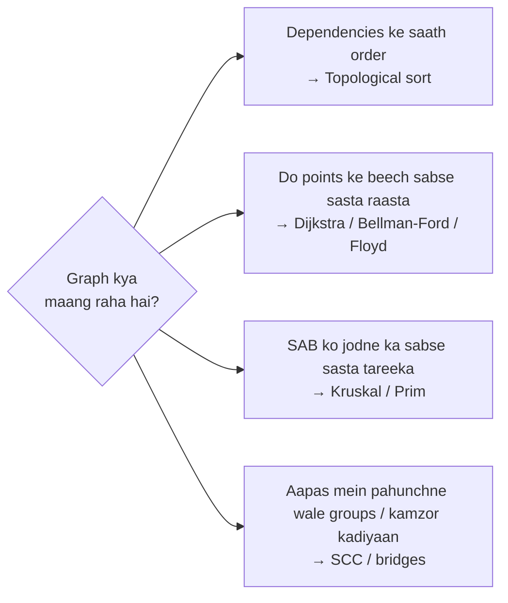
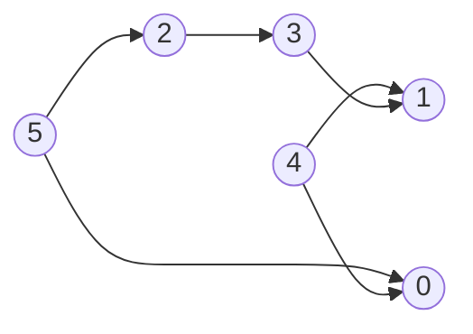
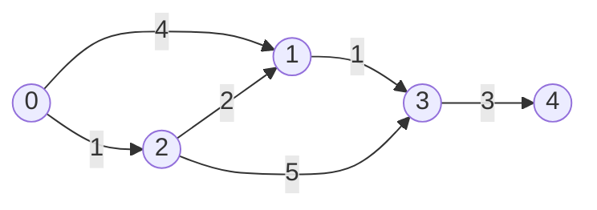
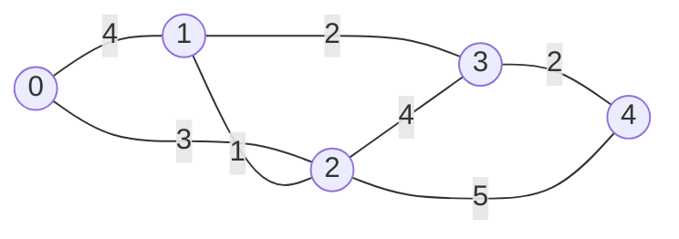

# Chapter 17 · Graphs II: Topological Sort, Shortest Paths & MST

> Tumhe Pune se Patna sabse saste mein jaana hai, airline sirf do layovers allow karti hai, ek route pe aisa "cashback" hai jo usse negative-cost bana deta hai, aur saath mein agle semester ke courses bhi plan karne hain ki pehle kaunsa lena hai. Alag sawaal, alag algorithms. Ye chapter tumhe poora toolbox deta hai, aur ek table bhi jo paanch second mein bata deti hai ki kaunsa tool uthana hai.

**Is chapter mein tum seekhoge:**
- **Topological sort** do tareeqon se (Kahn's BFS aur DFS) aur ye impossible schedules kaise pakadta hai
- Heap ke saath **Dijkstra's algorithm**, lazy (stale) entries, aur ye sahi *kyun* hai
- Negative edges aur negative-cycle detection ke liye **Bellman-Ford**, aur iski "at most k edges" wali superpower
- Saare pairs ke liye **Floyd-Warshall**, bas paanch lines mein
- **Kruskal** (sort + union-find) aur **Prim** (heap) se **minimum spanning trees**
- **Strongly connected components** (Kosaraju, Tarjan) aur **bridges / articulation points**, utna jitna interviews mein chahiye
- Ek decision table: "ye problem hai, toh kaunsa algorithm?"

**Isse pehle padho:** [Heaps](15-heaps.md) · [Graphs I: BFS, DFS & Grids](16-graphs-bfs-dfs.md) · [Recursion](../part-1-python/12-recursion.md)

---

## 🧠 The Big Idea · Asli Baat

[Chapter 16](16-graphs-bfs-dfs.md) mein har edge barabar thi: ek step matlab ek step, aur BFS ka raaj tha. Asli graphs zyada nakhre wale hote hain:

- **Edges ka order hota hai** (Algorithms se pehle Data Structures lena zaroori hai). → **Topological sort**: vertices ko aise line mein lagao ki har arrow aage ki taraf point kare.
- **Edges ka cost hota hai** (sadkon ki length, flights ki price). → **Shortest path** algorithms: Dijkstra, Bellman-Ford, Floyd-Warshall.
- **Sab kuch sabse saste mein jodna hai** (har gaon tak fibre-optic cable bichhaani hai). → **Minimum spanning tree**: Kruskal, Prim.



Acchi khabar: yahan ka har algorithm BFS/DFS mein ek chhota sa twist hai, plus ek data structure jo tum pehle se jaante ho (queue, heap, ya ek 2D table).

> 💡 **The core insight:** Dijkstra wahi BFS hai jisme queue ki jagah heap aa gaya. Kahn's algorithm wahi BFS hai jisme vertex queue mein tabhi aata hai jab uske saare prerequisites ho chuke hon. Prim wahi Dijkstra hai bas "distance" ki definition alag hai. Ye khaandani rishta (family resemblance) samajh lo, aur ek ki keemat mein paanch algorithms seekh liye.

> 🇮🇳 **Desi Analogy:** Ek hi khaandaan ke paanch bhai socho. Bada bhai BFS hai: line mein lagta hai, jo pehle aaya wo pehle. Dijkstra wahi bhai hai lekin VIP queue mein: jiska "total kharcha" sabse kam, wo pehle. Kahn wahi bhai hai jo shaadi ki rasmein karata hai: haldi tabhi jab sagaai ho chuki, phere tabhi jab haldi ho chuki. Prim wo bhai hai jo poore gaon mein bijli ki line bichhata hai: "abhi tak ke network se sabse sasta naya connection kaunsa?" Chehre alag, khoon ek.

---

## 🔨 Building It Up · Zero Se Shuru

### 1. Topological sort: lining up tasks

Directed graph ka **topological order** har vertex ko aise list karta hai ki har edge `u → v` ke liye, u, v se **pehle** aaye. "Kapde pehenna" socho: jooton se pehle mozey, tie se pehle shirt.

Ye **sirf DAGs** (directed acyclic graphs) ke liye exist karta hai. Agar A ko B chahiye aur B ko A, toh koi order kaam nahi karega. Isliye topological sort ek **cycle detector** ka kaam bhi karta hai.

> 🇮🇳 **Desi Analogy:** Shaadi ki rasmein: sagaai → haldi → mehendi → phere → vidaai. Har arrow ka matlab "ye pehle hona chahiye". Topological order wo timetable hai jisme koi rasm apni zaroori rasm se pehle nahi aati. Ab socho pandit ji bolein "phere se pehle vidaai", aur ghar wale bolein "vidaai se pehle phere". Ye cycle hai: koi timetable bana hi nahi sakta. Topological sort yahi pakad leta hai.

Hamara example (edges ka matlab "pehle aana chahiye"):



### 2. Kahn's algorithm (BFS with in-degrees)

**Idea:** jis vertex ki **in-degree 0** hai, uska koi prerequisite baaki nahi, toh wo abhi ja sakta hai. Usse lo, uski outgoing edges "delete" karo (uske neighbours ki in-degree ek kam karo), aur jo neighbour 0 pe aa gaya wo ready ho gaya.

> 🇮🇳 **Desi Analogy:** College ka course registration. Har course ke saath likha hai "itne prerequisites baaki hain" (in-degree). Jin courses ka count 0 hai, unki line lagti hai (queue). Ek course pass kiya, toh jin courses ka wo prerequisite tha, unka count ek kam ho jaata hai. Kisi ka count 0 hua? Wo bhi line mein aa gaya. Agar kuch courses ka count kabhi 0 hi nahi hua, toh unke prerequisites aapas mein ek gol chakkar (cycle) mein phase hain.

```python
from collections import deque

def kahn_topo_sort(n, edges):
    adj = [[] for _ in range(n)]
    indegree = [0] * n
    for u, v in edges:
        adj[u].append(v)
        indegree[v] += 1
    queue = deque(v for v in range(n) if indegree[v] == 0)    # abhi ke abhi ready
    order = []
    while queue:
        u = queue.popleft()
        order.append(u)
        for v in adj[u]:
            indegree[v] -= 1                # u ho gaya: v ka ek prerequisite kam
            if indegree[v] == 0:
                queue.append(v)
    return order if len(order) == n else []   # kuch vertices kabhi ready nahi hue -> cycle

edges = [(5, 2), (5, 0), (4, 0), (4, 1), (2, 3), (3, 1)]
print(kahn_topo_sort(6, edges))
print(kahn_topo_sort(3, [(0, 1), (1, 2), (2, 0)]))
```

```text
[4, 5, 2, 0, 3, 1]
[]
```

**Dry run:**

| pop | ab tak ka order | in-degree mein badlaav | naye ready (baad mein queue) |
|---|---|---|---|
| start | | indeg: 0→2, 1→2, 2→1, 3→1, 4→0, 5→0 | [4, 5] |
| 4 | [4] | 0: 2→1, 1: 2→1 | [5] |
| 5 | [4, 5] | 2: 1→0, 0: 1→0 | [2, 0] |
| 2 | [4, 5, 2] | 3: 1→0 | [0, 3] |
| 0 | [4, 5, 2, 0] | (koi out-edge nahi) | [3] |
| 3 | [4, 5, 2, 0, 3] | 1: 1→0 | [1] |
| 1 | [4, 5, 2, 0, 3, 1] | | [] |

Kya hua yahan: cycle wale example mein har vertex ki in-degree 1 hai, toh koi kabhi ready hi nahi hota, `order` chhota reh jaata hai, aur hum `[]` return karte hain. **"n se kam vertices process hue" = cycle hai.** O(V + E) time.

> 💡 Topological orders usually **unique nahi** hote. Yahan `[5, 4, 2, 3, 1, 0]` bhi valid hai. Agar problem lexicographically sabse chhota order maange, toh deque ki jagah min-heap use karo.

### 3. Topological sort with DFS (reverse postorder)

**Idea:** DFS mein ek vertex tabhi **finish** hota hai (uske saare descendants explore ho chuke) jab us par depend karne wala sab kuch finish ho chuka ho. Isliye **finish order ko ulta** karo, toh topological order mil jaata hai. Cycles pakadne ke liye [Chapter 16](16-graphs-bfs-dfs.md) ke teen colours use karo.

```python
def dfs_topo_sort(n, edges):
    adj = [[] for _ in range(n)]
    for u, v in edges:
        adj[u].append(v)
    WHITE, GRAY, BLACK = 0, 1, 2
    color = [WHITE] * n
    finished = []

    def dfs(u):
        color[u] = GRAY
        for v in adj[u]:
            if color[v] == GRAY:
                return False                  # back edge: cycle
            if color[v] == WHITE and not dfs(v):
                return False
        color[u] = BLACK
        finished.append(u)                    # u apne saare dependents ke baad finish hota hai
        return True

    for u in range(n):
        if color[u] == WHITE and not dfs(u):
            return []
    return finished[::-1]

edges = [(5, 2), (5, 0), (4, 0), (4, 1), (2, 3), (3, 1)]
print(dfs_topo_sort(6, edges))
print(dfs_topo_sort(3, [(0, 1), (1, 2), (2, 0)]))
```

```text
[5, 4, 2, 3, 1, 0]
[]
```

Trace karke dekho: `dfs(0)` → 0 ki koi out-edge nahi, finished `[0]`. `dfs(1)` → finished `[0, 1]`. `dfs(2)` → 3 pe jaata hai, 3 se 1 (already BLACK, koi dikkat nahi), finished `[0, 1, 3, 2]`. Phir 4 aur 5: `[0, 1, 3, 2, 4, 5]`. Ulta karo: `[5, 4, 2, 3, 1, 0]`. Har vertex apne "baad wale" sab ke finish hone ke baad finish hua, isliye ulta karne pe wo unse pehle aata hai.

| | Kahn (BFS) | DFS |
|---|---|---|
| Cycle detection | processed count < n | GRAY vertex ki taraf edge |
| Recursion | nahi | haan (gehre graphs → iterative ya Kahn) |
| Natural extras | "levels" (minimum semesters), heap ke saath lexicographic order | finish times (Kosaraju's SCC mein use hote hain) |
| Interview default | ✅ usually sahi likhna aasaan | ye bhi theek hai |

> 🤔 **Mann mein sawaal:** Interview mein Kahn likhoon ya DFS wala?
>
> **Jawab:** Default Kahn. Wajah: (1) recursion nahi, toh bade graphs pe `RecursionError` ka dar nahi; (2) cycle check bas ek line hai, `len(order) < n`; (3) "minimum semesters" jaise follow-ups mein level by level chalaana Kahn mein natural hai. DFS wala tab useful hai jab finish times khud chahiye (jaise Kosaraju), ya interviewer specifically DFS maange.

### 4. Dijkstra: shortest paths with positive weights

Weights ke saath BFS fail ho jaata hai: 3 saste edges wala path 1 mehenge edge wale path ko hara sakta hai. **Dijkstra's algorithm** ise ek badlaav se theek karta hai: queue ki jagah (jo *edges ki ginti* ke order mein process karti hai), ek **min-heap** use karo jiski key ho **ab tak ka total distance** (yaani *cost* ke order mein process karo).

Socho source pe paani daala gaya aur wo pipes mein phail raha hai, jinki lengths edge weights hain. Paani vertices tak distance ke order mein pahunchta hai. Dijkstra yahi simulate karta hai: hamesha agla wo vertex settle karta hai jo abhi tak unsettled vertices mein sabse paas hai.

> 🇮🇳 **Desi Analogy:** Google Maps pe tum Pune mein ho. Dijkstra ek aisa delivery boy hai jiske paas ek register (heap) hai: "kaunsa shehar ab tak kitne km mein pahunch sakte hain". Har baar wo register mein **sabse kam km** wala shehar uthata hai aur us pe "final" ki muhar laga deta hai, kyunki saari sadkein positive length ki hain, toh kisi aur shehar se ghoom ke aane se km sirf badhenge. Phir us shehar se nikalne wali sadkon se register update karta hai.



```python
import heapq

def dijkstra(n, edges, source):
    adj = [[] for _ in range(n)]
    for u, v, w in edges:
        adj[u].append((v, w))
    dist = [float("inf")] * n
    dist[source] = 0
    heap = [(0, source)]                    # (ab tak ka distance, vertex)
    while heap:
        d, u = heapq.heappop(heap)
        if d > dist[u]:
            continue                        # stale entry: isse behtar pehle hi mil chuka
        for v, w in adj[u]:
            nd = d + w
            if nd < dist[v]:                # edge u -> v ko "relax" karo
                dist[v] = nd
                heapq.heappush(heap, (nd, v))
    return dist

edges = [(0, 1, 4), (0, 2, 1), (2, 1, 2), (1, 3, 1), (2, 3, 5), (3, 4, 3)]
print(dijkstra(5, edges, 0))
```

```text
[0, 3, 1, 4, 7]
```

**"Relax" ka matlab:** "kya u ke through v tak pahunchna, v ke abhi tak ke best se sasta hai? Haan toh update karo." Bas itna hi. Rubber band ki tarah socho jo dheela (relax) ho raha hai jaise-jaise chhota raasta milta hai.

**Dry run** (heap entries `(dist, vertex)` hain):

| pop | stale? | relaxations | baad mein dist | baad mein heap |
|---|---|---|---|---|
| (0, 0) | nahi | 1: ∞→4, 2: ∞→1 | [0, 4, 1, ∞, ∞] | (1,2), (4,1) |
| (1, 2) | nahi | 1: 4→**3**, 3: ∞→6 | [0, 3, 1, 6, ∞] | (3,1), (4,1), (6,3) |
| (3, 1) | nahi | 3: 6→**4** | [0, 3, 1, 4, ∞] | (4,1), (4,3), (6,3) |
| (4, 1) | **haan** (4 > 3) | skip | | (4,3), (6,3) |
| (4, 3) | nahi | 4: ∞→7 | [0, 3, 1, 4, 7] | (6,3), (7,4) |
| (6, 3) | **haan** | skip | | (7,4) |
| (7, 4) | nahi | kuch nahi | | khaali |

**Lazy entries:** jab hum `dist[1]` ko 4 se 3 karte hain, purani entry `(4, 1)` heap mein hi padi rehti hai (heaps in place update nahi kar sakte, [Chapter 15](15-heaps.md)). Jab wo baad mein pop hoti hai, `d > dist[u]` usse stale ke roop mein pakad leta hai aur hum skip kar dete hain. Yahi lazy deletion hai, aur Python mein sab Dijkstra aise hi likhte hain.

**Complexity:** har edge ek entry push kar sakti hai, toh heap mein zyada se zyada E entries: **O((V + E) log V)** time (log E ≤ 2 log V), O(V + E) space.

> ⚠️ **Dijkstra ko non-negative weights chahiye.** Counter-example Under the Hood mein hai.

### 5. Getting the path, and stopping early

BFS wala hi parent trick ([Chapter 16](16-graphs-bfs-dfs.md)): record karo ki har vertex ko aakhri baar kisne relax kiya. Aur agar sirf ek target chahiye, toh **target pop hote hi ruk sakte ho**, kyunki pop hue (non-stale) vertex ka distance final hai.

```python
import heapq

def dijkstra_path(adj, source, target):
    dist = {source: 0}
    parent = {source: None}
    heap = [(0, source)]
    while heap:
        d, u = heapq.heappop(heap)
        if u == target:                       # pop hote hi final
            path = []
            while u is not None:
                path.append(u)
                u = parent[u]
            return d, path[::-1]
        if d > dist[u]:
            continue
        for v, w in adj[u]:
            if d + w < dist.get(v, float("inf")):
                dist[v] = d + w
                parent[v] = u
                heapq.heappush(heap, (d + w, v))
    return float("inf"), []

adj = {"Pune": [("Mumbai", 150), ("Nagpur", 700)],
       "Mumbai": [("Delhi", 1400), ("Nagpur", 800)],
       "Nagpur": [("Delhi", 1000), ("Patna", 1100)],
       "Delhi": [("Patna", 1000)],
       "Patna": []}
print(dijkstra_path(adj, "Pune", "Patna"))
print(dijkstra_path(adj, "Pune", "Delhi"))
```

```text
(1800, ['Pune', 'Nagpur', 'Patna'])
(1550, ['Pune', 'Mumbai', 'Delhi'])
```

Dekho: Pune → Mumbai pehla step sabse sasta hai (150), lekin Patna ke liye Mumbai wala raasta mehenga padta hai (150 + 800 + 1100 = 2050, ya Delhi se 150 + 1400 + 1000 = 2550). Dijkstra lalach mein pehla sasta step nahi pakadta; wo **total** dekhta hai.

### 6. Bellman-Ford: negative edges and negative cycles

Kabhi-kabhi edges negative ho sakti hain (cashback, energy gain, log form mein currency exchange rate). **Bellman-Ford** slow hai lekin inhe sambhaal leta hai:

> V − 1 baar repeat karo: **har** edge `u → v` (weight w) ke liye, agar `dist[u] + w < dist[v]`, toh `dist[v]` update karo.

V − 1 rounds kyun? Ek shortest path (bina cycles ke) zyada se zyada V − 1 edges use karta hai. Round 1 ke baad, 1 edge wale saare shortest paths sahi hain; round i ke baad, ≤ i edges wale saare sahi hain. Toh V − 1 rounds sab kuch cover kar lete hain.

> 🇮🇳 **Desi Analogy:** Joint family ka WhatsApp group, jisme ek khabar (sabse sasta rate) har round mein sirf **ek hop** aage badhti hai. Round 1 mein dadaji ke direct contacts ko pata chala, round 2 mein unke contacts ko. Family mein V log hain, toh sabse lamba "seedha" chain V − 1 hops ka hai. V − 1 rounds ke baad sabko sahi khabar mil chuki hogi. Agar V-th round mein bhi koi bole "mujhe aur sasta mila!", toh koi gol-gol chain hai jo har chakkar pe rate aur gira rahi hai: negative cycle.

**Negative cycle detection:** agar **V-th** round mein bhi kuch improve hota hai, toh ek aisa cycle exist karta hai jiska total weight negative hai (uspe hamesha ghoomte raho, aur sasta, aur sasta), isliye "shortest path" defined hi nahi hai.

```python
def bellman_ford(n, edges, source):
    INF = float("inf")
    dist = [INF] * n
    dist[source] = 0
    for _ in range(n - 1):
        changed = False
        for u, v, w in edges:
            if dist[u] != INF and dist[u] + w < dist[v]:
                dist[v] = dist[u] + w
                changed = True
        if not changed:
            break                              # jaldi bahar: sab already settle ho chuka
    for u, v, w in edges:                      # ek aur round: koi improvement = negative cycle
        if dist[u] != INF and dist[u] + w < dist[v]:
            return None
    return dist

print(bellman_ford(4, [(0, 1, 4), (0, 2, 5), (1, 2, -3), (2, 3, 4)], 0))
print(bellman_ford(3, [(0, 1, 1), (1, 2, -1), (2, 1, -1)], 0))
```

```text
[0, 4, 1, 5]
None
```

Kya hua yahan: pehle graph mein, 0 → 1 → 2 ka cost 4 + (−3) = 1 hai, jo seedhi 0 → 2 edge (5) se sasta hai. Doosre mein, cycle 1 → 2 → 1 ka total −2 hai, isliye hum use report karte hain. **O(V·E)** time, O(V) space.

### 7. Bellman-Ford's superpower: "at most k edges"

Kyunki round i ≤ i edges wale har path ko sahi kar deta hai, exactly k rounds chalaane se **at most k edges** use karne wala sabse sasta path milta hai. Ek baareek baat: ek round ke andar, **pichhle** round ke distances use karo (ek copy), warna ek hi round kai edges ko chain kar sakta hai.

Ye bilkul **Cheapest Flights Within K Stops** hai (k stops = k + 1 flights):

```python
def find_cheapest_price(n, flights, src, dst, k):
    INF = float("inf")
    prices = [INF] * n
    prices[src] = 0
    for _ in range(k + 1):                    # zyada se zyada k+1 flights
        new_prices = prices[:]                # purana padho, naya likho
        for u, v, cost in flights:
            if prices[u] != INF and prices[u] + cost < new_prices[v]:
                new_prices[v] = prices[u] + cost
        prices = new_prices
    return prices[dst] if prices[dst] != INF else -1

flights = [[0, 1, 100], [1, 2, 100], [2, 0, 100], [1, 3, 600], [2, 3, 200]]
print(find_cheapest_price(4, flights, 0, 3, 1))
print(find_cheapest_price(3, [[0, 1, 100], [1, 2, 100], [0, 2, 500]], 0, 2, 0))
```

```text
700
500
```

**Dry run** (pehla example, k = 1, toh 2 rounds):

| round | prices[0..3] | kyun |
|---|---|---|
| start | [0, ∞, ∞, ∞] | |
| 1 (1 flight) | [0, 100, ∞, ∞] | known price wale city se sirf 0 → 1 reachable hai |
| 2 (2 flights) | [0, 100, 200, 700] | 1 → 2 = 200, 1 → 3 = 700 |

Path 0 → 1 → 2 → 3 sirf 400 ka hai, lekin usme 3 flights (2 stops) hain, isliye allowed nahi. Copy ke bina, round 2 mein 2 ka abhi-abhi update hua price use ho jaata aur galat answer 400 aata. O(k·E).

> 🤔 **Mann mein sawaal:** `new_prices = prices[:]` wali copy itni zaroori kyun hai? Ek hi array mein update karte toh kya bigadta?
>
> **Jawab:** Round 2 ke andar edges is order mein process hoti hain: `[1,2]` pehle, `[2,3]` baad mein. Bina copy ke, `[1,2]` ne `prices[2] = 200` likh diya, aur usi round mein `[2,3]` ne us fresh 200 ko padh ke `prices[3] = 400` bana diya. Matlab ek round mein **do** flights jud gayi (1→2 aur 2→3). Round count ab "flights ki ginti" nahi raha. Copy rakhne se har round sirf pichhle round ka data padhta hai, toh har round mein exactly ek flight judti hai. (Plain Bellman-Ford mein ye chalta hai kyunki wahan humein edge count se matlab hi nahi.)

> 🇮🇳 **Desi Analogy:** MakeMyTrip pe "max 1 stop" filter laga hai. Round 1 = "sirf direct flights se kahan-kahan pahunch sakte ho", round 2 = "ek connecting flight ke saath kahan-kahan". Agar round 2 mein tum round 2 ke hi naye results se aur flights jodne lagoge, toh filter ka matlab hi khatam: 3 flights wali itinerary bhi "1 stop" mein dikh jaayegi.

### 8. Floyd-Warshall: all pairs at once

**Har** pair of vertices ke beech shortest distance chahiye? Floyd-Warshall chalao:

> Har vertex k (ek possible "stopover" ke roop mein) ke liye, har pair (i, j) ke liye: `dist[i][j] = min(dist[i][j], dist[i][k] + dist[k][j])`.

Stopover k process karne ke baad, `dist[i][j]` i se j tak ka wo shortest path hai jo sirf `{0..k}` mein se stopovers use karta hai. Saare k ke baad, ye asli shortest path hai. Ye "kaunse stopovers allowed hain" pe dynamic programming ([Chapter 20](20-dp-1d.md)) hai.

> 🇮🇳 **Desi Analogy:** Railway ka distance chart, jo har station se har station ki doori batata hai. Shuru mein chart mein sirf direct trains ki doori hai. Phir railway kehti hai: "ab Itarsi junction pe badalna allowed hai" (k = Itarsi), aur har pair check hota hai, "kya Itarsi ho ke jaana sasta hai?". Phir "ab Nagpur junction bhi allowed", aur aise hi har junction ek-ek karke. Saare junctions allow hone ke baad chart mein har pair ki asli sabse kam doori hai.

```python
def floyd_warshall(n, edges):
    INF = float("inf")
    dist = [[0 if i == j else INF for j in range(n)] for i in range(n)]
    for u, v, w in edges:
        dist[u][v] = min(dist[u][v], w)
    for k in range(n):                     # k ko SABSE BAHAR wala loop hona hi chahiye
        for i in range(n):
            for j in range(n):
                if dist[i][k] + dist[k][j] < dist[i][j]:
                    dist[i][j] = dist[i][k] + dist[k][j]
    return dist

edges = [(0, 1, 3), (1, 0, 3), (1, 2, 1), (2, 1, 1), (1, 3, 4), (3, 1, 4), (2, 3, 1), (3, 2, 1)]
for row in floyd_warshall(4, edges):
    print(row)
```

```text
[0, 3, 4, 5]
[3, 0, 1, 2]
[4, 1, 0, 1]
[5, 2, 1, 0]
```

Example: 0 se 3 tak koi direct edge nahi. 0 → 1 → 2 → 3 = 3 + 1 + 1 = 5. Ye 0 → 1 → 3 (3 + 4 = 7) se sasta hai, aur chart mein 5 hi aaya.

**O(V³)** time, **O(V²)** space. V kuch sau tak ho toh theek hai. Negative edges handle karta hai (negative cycles nahi; diagonal pe negative value `dist[i][i] < 0` ek negative cycle ka pata deti hai).

### 9. Minimum Spanning Tree: connect everything cheaply

Ek connected, undirected, weighted graph ka **spanning tree** edges ka ek subset hai jo saare V vertices ko bina cycle ke jodta hai: exactly **V − 1 edges**. **Minimum spanning tree (MST)** wo hai jiska total weight sabse kam hai. Socho: aise cable bichhao ki har gaon juda rahe, aur kharcha sabse kam ho.

> 🇮🇳 **Desi Analogy:** Sarkar ko 5 gaon tak bijli pahunchaani hai. Har do gaon ke beech line bichhane ka alag kharcha hai. Har gaon ko har gaon se seedha jodne ki zaroorat nahi; bas itna chahiye ki har gaon kisi na kisi raaste grid se juda ho. Koi loop (cycle) bekaar hai, kyunki loop ki ek line hata do toh bhi sab jude rahenge. Isliye answer hamesha V − 1 lines ka hota hai, aur MST wo set hai jiska bill sabse chhota hai.

**The cut property** (neeche wale greedy algorithms kyun kaam karte hain): vertices ko kinhi bhi do groups mein baanto. **Dono groups ke beech cross karne wali sabse halki edge** MST mein daalna safe hai. (Agar kisi MST ne usse use nahi kiya, toh usse add karo: isse ek cycle banegi jo split ko kisi doosri, bhaari-ya-barabar edge se dobara cross karti hai. Us edge ko hata do: tree ab bhi spanning hai, aur bhaari nahi hua. Toh koi na koi MST hamari edge ko zaroor rakhta hai.)



### 10. Kruskal: cheapest edges first, skip cycles

Saari edges ko weight se sort karo. Unpe chalo; edge tabhi add karo jab wo do **alag** components ko jodti ho (warna cycle ban jaayegi). V − 1 edges pe ruk jao.

"Kya u aur v pehle se same component mein hain?" iska jawab ek **Union-Find** (Disjoint Set Union) turant deta hai. Yahan ek chhota version use kar rahe hain; [Chapter 18](18-union-find.md) samjhaata hai ki ye itna tez kyun hai.

> 🇮🇳 **Desi Analogy:** Bijli wale contractor ke paas saari possible lines ki list hai, sabse saste se sabse mehenge tak. Wo list ke upar se shuru karta hai: "kya ye line do aise gaon jodti hai jo abhi tak aapas mein (kisi bhi raaste) jude nahi hain?" Haan → bichha do. Nahi → skip, kyunki wo bas ek loop banayegi. Union-Find uska register hai jo batata hai ki kaunsa gaon kis "jude hue group" mein hai.

```python
def kruskal(n, edges):
    parent = list(range(n))

    def find(x):                               # x ke component ka root
        while parent[x] != x:
            parent[x] = parent[parent[x]]      # path compression (Chapter 18)
            x = parent[x]
        return x

    total, chosen = 0, []
    for w, u, v in sorted((w, u, v) for u, v, w in edges):
        ru, rv = find(u), find(v)
        if ru == rv:
            continue                           # same component: cycle ban jaayegi
        parent[ru] = rv                        # dono components ko jod do
        total += w
        chosen.append((u, v, w))
        if len(chosen) == n - 1:
            break
    return total, chosen

edges = [(0, 1, 4), (0, 2, 3), (1, 2, 1), (1, 3, 2), (2, 3, 4), (3, 4, 2), (2, 4, 5)]
print(kruskal(5, edges))
```

```text
(8, [(1, 2, 1), (1, 3, 2), (3, 4, 2), (0, 2, 3)])
```

Trace: 1–2 lo (1), 1–3 lo (2), 3–4 lo (2), 0–2 lo (3). Paanch vertices ke liye chaar edges: ho gaya. Edges 0–1 (4), 2–3 (4), 2–4 (5) ki kabhi zaroorat hi nahi padi. Sorting ke liye **O(E log E)**; union-find ka kaam har edge pe lagbhag O(1) hai.

`sorted((w, u, v) for u, v, w in edges)` pe dhyaan do: tuple mein weight ko **pehle** rakha taaki sorting weight se ho.

### 11. Prim: grow one tree outward

Kisi bhi vertex se shuru karo. Baar-baar **tree se bahar jaane wali sabse sasti edge** add karo (cut property, jisme split hai "tree vs baaki sab"). `(weight, vertex)` ka min-heap wo edge dhoondhta hai. Ye lagbhag bilkul Dijkstra jaisa dikhta hai; fark sirf key mein hai: **edge weight**, total distance nahi.

```python
import heapq

def prim(n, edges):
    adj = [[] for _ in range(n)]
    for u, v, w in edges:
        adj[u].append((w, v))
        adj[v].append((w, u))
    in_tree = [False] * n
    heap = [(0, 0)]                      # (jodne ka cost, vertex): vertex 0 se shuru
    total = 0
    while heap:
        w, u = heapq.heappop(heap)
        if in_tree[u]:
            continue                     # stale: pehle hi saste mein jud chuka
        in_tree[u] = True
        total += w
        for wv, v in adj[u]:
            if not in_tree[v]:
                heapq.heappush(heap, (wv, v))
    return total if all(in_tree) else None   # None: graph connected nahi hai

edges = [(0, 1, 4), (0, 2, 3), (1, 2, 1), (1, 3, 2), (2, 3, 4), (3, 4, 2), (2, 4, 5)]
print(prim(5, edges))
```

```text
8
```

| | Kruskal | Prim |
|---|---|---|
| Idea | global: kahin bhi sabse sasti edges | local: ek tree ko badhao |
| Data structure | sort + union-find | heap |
| Time | O(E log E) | O(E log V) (heap), array ke saath O(V²) |
| Best for | sparse graphs, edges list ke roop mein di gayi hon | dense graphs (jaise points ke saare pairs, O(V²) array version use karo) |

> 🤔 **Mann mein sawaal:** Prim aur Dijkstra ka code itna same hai. Toh answer alag kyun aata hai?
>
> **Jawab:** Heap mein kya push hota hai, bas wahi fark hai. Dijkstra push karta hai `d + w` (source se **total** door), Prim push karta hai sirf `w` (tree se **ek edge** door). Example: A–B = 5, B–C = 5, A–C = 8. Dijkstra (A se) C tak ka best 8 dega (seedha, kyunki 5 + 5 = 10). Prim C ko B se jodega (5), kyunki use sirf "tree tak pahunchne ka kharcha" chahiye, A se door hone ki parwaah nahi. Dijkstra = "har ghar tak sabse chhota raasta", Prim = "sab ghar jodne ka sabse sasta network".

### 12. Strongly connected components (overview + Kosaraju)

**Directed** graph mein, **strongly connected component (SCC)** ek aisa sabse bada group hai jisme har vertex har doosre tak pahunch sakta hai. Example: Twitter jaise "follows" mein, logon ka ek group jo sab (indirectly) ek doosre ko follow karte hain. Har SCC ko ek bindu mein sikod do, toh hamesha ek DAG bachta hai.

> 🇮🇳 **Desi Analogy:** Ek office mein "kaun kisko email forward kar sakta hai" (directed). Ek team ke andar, A ki email B tak, B ki C tak, aur C ki wapas A tak pahunch jaati hai: ye ek SCC hai, ek "gang" jisme khabar andar hi andar ghoomti hai. Lekin agar Marketing ki email Sales tak jaati hai par Sales ki Marketing tak kabhi wapas nahi aati, toh wo do alag SCCs hain. Har gang ko ek dabba bana do, toh dabbon ke beech ka flow ek taraf hi hota hai (DAG).

**Kosaraju's algorithm** (do DFS passes):
1. Graph pe DFS karo aur vertices ko **finishing** time ke order mein record karo.
2. Har edge ko **ulta** karo. Vertices ko **ghatte** hue finish time ke order mein process karo; reversed graph mein har DFS exactly ek SCC collect karta hai.

Kyun kaam karta hai (intuition): jo vertex sabse aakhir mein finish hota hai, wo ek "source" SCC mein hai. Reversed graph mein wo SCC "sink" ban jaata hai, toh usse DFS bahar nikal hi nahi sakta aur sirf apna SCC collect karta hai. Usse hatao aur repeat karo.

```python
def kosaraju_scc(n, edges):
    adj = [[] for _ in range(n)]
    radj = [[] for _ in range(n)]
    for u, v in edges:
        adj[u].append(v)
        radj[v].append(u)                  # ulta graph

    seen, finish = [False] * n, []
    def dfs1(u):
        seen[u] = True
        for v in adj[u]:
            if not seen[v]:
                dfs1(v)
        finish.append(u)                   # finish hone ka order record karo

    for u in range(n):
        if not seen[u]:
            dfs1(u)

    comp = [-1] * n
    def dfs2(u, label):
        comp[u] = label
        for v in radj[u]:
            if comp[v] == -1:
                dfs2(v, label)

    sccs = []
    for u in reversed(finish):            # sabse aakhir mein finish hone wala pehle
        if comp[u] == -1:
            dfs2(u, len(sccs))
            sccs.append(sorted(x for x in range(n) if comp[x] == len(sccs)))
    return sccs

edges = [(0, 1), (1, 2), (2, 0), (1, 3), (3, 4), (4, 5), (5, 3), (6, 5)]
print(kosaraju_scc(7, edges))
```

```text
[[6], [0, 1, 2], [3, 4, 5]]
```

O(V + E). **Tarjan's algorithm** SCCs ko ek **single** DFS mein dhoondhta hai, "low-link" values (agle section ke bridges wala hi idea) aur ek stack use karke. Interviews mein dono mein se koi bhi code karwana rare hai; ye jaano ki SCC kya hai, ki ye O(V + E) hai, aur dono naam.

### 13. Bridges and articulation points (overview + code)

Undirected graph mein, **bridge** wo edge hai jise hataane se graph toot jaata hai (do shehron ko jodne wali ek akeli sadak). **Articulation point** wo vertex hai jise hataane se graph toot jaata hai (ek akela airport hub). Inhe dhoondhna = network ke single points of failure dhoondhna.

> 🇮🇳 **Desi Analogy:** Kolkata aur Howrah ke beech agar sirf ek hi pul hota, toh wo **bridge** hota: band hua aur dono taraf ka sampark khatam. Ek gaon jahan se hi har bus guzarti hai, wo **articulation point** hai: wahan hartaal hui toh aage ke saare gaon kat gaye. Lekin jahan do alag raaste hain (ek cycle), wahan ek raasta band hone se fark nahi padta.

**Tarjan's low-link idea:** DFS ke dauraan, har vertex ko ek discovery time `disc[u]` do. `low[u]` = u ke DFS subtree se **zyada se zyada ek back edge** use karke pahunch sakne wala sabse pehla discovery time. Phir, ek tree edge `u → v` ke liye:

- `low[v] > disc[u]` → v ka subtree is edge ke bina u ya usse upar tak nahi pahunch sakta → **u–v ek bridge hai**.
- `low[v] >= disc[u]` (aur u root nahi hai) → **u ek articulation point hai**. Root tab articulation point hai jab uske 2+ DFS children hon.

Bridge ke liye `>` aur articulation point ke liye `>=` kyun? Agar `low[v] == disc[u]`, toh v ka subtree **u tak** wapas aa sakta hai (u–v edge ke alawa kisi raaste), toh edge hataane se kuch nahi tootega. Lekin u ko hi hata do, toh wo raasta bhi gaya, isliye u articulation point hai.

```python
def bridges_and_cut_vertices(n, edges):
    adj = [[] for _ in range(n)]
    for u, v in edges:
        adj[u].append(v)
        adj[v].append(u)
    disc, low = [-1] * n, [0] * n
    time = 0
    bridges, cuts = [], set()

    def dfs(u, parent):
        nonlocal time
        disc[u] = low[u] = time
        time += 1
        children = 0
        for v in adj[u]:
            if v == parent:
                continue
            if disc[v] == -1:                      # tree edge
                children += 1
                dfs(v, u)
                low[u] = min(low[u], low[v])
                if low[v] > disc[u]:
                    bridges.append(sorted((u, v)))
                if parent != -1 and low[v] >= disc[u]:
                    cuts.add(u)
            else:                                  # back edge
                low[u] = min(low[u], disc[v])
        if parent == -1 and children > 1:
            cuts.add(u)

    for u in range(n):
        if disc[u] == -1:
            dfs(u, -1)
    return sorted(bridges), sorted(cuts)

print(bridges_and_cut_vertices(4, [(0, 1), (1, 2), (2, 0), (1, 3)]))
print(bridges_and_cut_vertices(5, [(0, 1), (1, 2), (2, 3), (3, 4), (4, 2)]))
```

```text
([[1, 3]], [1])
([[0, 1], [1, 2]], [1, 2])
```

Kya hua yahan: pehle graph mein, 0–1–2 ek triangle hai (koi bhi ek edge hata do, phir bhi juda rahega), lekin 1–3 hi 3 tak ka akela link hai. O(V + E). Ye LeetCode ka **Critical Connections in a Network** hai.

---

## 🔬 Under the Hood · Andar Ki Kahani

### Why Dijkstra is correct (and why negatives break it)

**Claim:** jab ek vertex u distance d ke saath (non-stale) pop hota hai, toh d hi asli shortest distance hai.

**Intuition:** maan lo u tak koi aur sasta path exist karta hai. Wo path already-settled vertices ke set ke andar se shuru hota hai aur kisi point pe us set se bahar nikalta hai, kisi unsettled vertex x ki taraf ek edge se. Wo vertex x pehle se heap mein hai, ek distance ke saath jo ≤ (x tak us path ka cost) hai. Kyunki saare weights **non-negative** hain, x se u tak bacha hua path ≥ 0 jodta hai, toh x ka distance ≤ us path ka total < d. Matlab x, u se **pehle** pop hota. Contradiction (virodh).

Argument exactly "bacha hua path ≥ 0 jodta hai" wali jagah pe toot jaata hai. Ek negative edge ke saath:

```text
0 → 1 (weight 2),  0 → 2 (weight 5),  2 → 1 (weight -10)
```

Dijkstra 1 ko distance 2 ke saath pop karta hai aur usse final declare kar deta hai. Lekin 0 → 2 → 1 ka cost 5 − 10 = −5 hai. Galat answer. (Lazy version shayad baad mein `dist[1]` ko "theek" kar de, lekin us galat value se jo kuch pehle calculate ho chuka, wo general mein sahi tareeke se dobara nahi dekha jaata, aur running time ki guarantee bhi chali jaati hai.) Bellman-Ford use karo.

> 🇮🇳 **Desi Analogy:** Dijkstra ka "pop hua matlab final" wala bharosa aise hai jaise tum Ola mein dekho ki Station A tak 2 km hai aur declare kar do "isse chhota raasta ho hi nahi sakta, kyunki koi bhi aur raasta pehle hi 5 km pe hai, aur aage chalne se km sirf badhenge". Ab socho ek raaste pe ₹10 ka cashback hai (negative edge). 5 km wala raasta cashback ke baad sasta ho gaya. Tumhara "final" faisla galat nikla. Negative edge "aage chalne se sirf badhta hai" wale bharose ko tod deta hai.

> 🤔 **Mann mein sawaal:** Toh saare weights mein ek bada number jod do taaki sab positive ho jaayein, phir Dijkstra chala do?
>
> **Jawab:** Ye ek classic galat jugaad hai. Har edge mein c jodne se jis path mein zyada edges hain, uska cost zyada badhta hai (k edges → k·c extra). Toh "kam edges wale" paths ko faayda mil jaata hai aur shortest path badal sakta hai. Example: 0 → 1 → 2 (−1, −1, total −2) vs 0 → 2 (0). Har edge mein +3 jodo (taaki sab positive ho jaayein): pehla 2 + 2 = 4, doosra 3. Ab seedha raasta jeet gaya, jabki asli mein pehla (−2) sasta tha. Negative weights ke liye Bellman-Ford hi sahi tool hai. (Johnson's algorithm ek smart re-weighting karta hai, lekin wo Bellman-Ford se hi potentials nikaalta hai.)

### Complexity of each algorithm

| Algorithm | Time | Space | Weights | Kya batata hai |
|---|---|---|---|---|
| BFS | O(V + E) | O(V) | unweighted (ya sab barabar) | single-source shortest |
| 0-1 BFS | O(V + E) | O(V) | 0 ya 1 | single-source shortest |
| Dijkstra (binary heap) | O((V + E) log V) | O(V + E) | non-negative | single-source shortest |
| Bellman-Ford | O(V · E) | O(V) | koi bhi; negative cycles pakadta hai | single-source; "≤ k edges" |
| Floyd-Warshall | O(V³) | O(V²) | koi bhi (negative cycles nahi) | all pairs |
| Topological sort (Kahn/DFS) | O(V + E) | O(V) | n/a | order; DAG check |
| DAG shortest path (topo + relax) | O(V + E) | O(V) | koi bhi (sirf DAG) | single-source |
| Kruskal | O(E log E) | O(V + E) | koi bhi | MST |
| Prim (heap) | O(E log V) | O(V + E) | koi bhi | MST |
| Kosaraju / Tarjan SCC | O(V + E) | O(V) | n/a | SCCs |
| Tarjan bridges / cut vertices | O(V + E) | O(V) | n/a | single points of failure |

### Why Floyd-Warshall's loop order matters

DP state hai "i se j tak ka shortest path, sirf {0..k} wale stopovers use karke". Layer k calculate karne ke liye saare pairs ki layer k − 1 **poori** chahiye, isliye k ko **sabse bahar** wala loop hona padega. Usse andar daala toh aadhe-adhoore updated values jud jaayengi: galat answers. (In place update karna safe hai kyunki round k ke dauraan row k aur column k nahi badalte: `dist[k][k] = 0` hai, toh `dist[i][k]` ko k ke through improve karne se `dist[i][k] + 0` hi milta hai.)

### Why Kruskal and Prim are both correct

Dono sirf wahi edge add karte hain jo kisi cut ko cross karne wali sabse halki edge ho:
- **Kruskal:** edge do components A aur B ko jodti hai, aur har halki edge ya toh pehle hi use ho chuki ya kisi component ke andar thi. Toh ye "A vs baaki sab" cut ko cross karne wali sabse halki edge hai.
- **Prim:** edge current tree se bahar jaane wali sabse halki hai, yaani "tree vs baaki" ko cross karti hai.

Cut property ke hisaab se, aisi har edge kisi na kisi MST ka hissa hai, toh final result ek MST hai. Agar saare weights alag-alag (distinct) hain, toh MST unique hai.

### Dijkstra's heap: lazy vs decrease-key

Textbooks ek "decrease-key" operation batati hain jo heap mein ek entry ko update karta hai. Python ke `heapq` mein ye nahi hai, isliye hum duplicates push karte hain aur stale wale skip karte hain. Heap O(V) ki jagah O(E) entries tak badh sakta hai, jisse log V ki jagah log E aata hai, aur log E ≤ log V² = 2 log V. Big-O wahi, code simple. (Fibonacci heap theory mein O(E + V log V) deta hai; practice mein slow hai aur interviews mein kabhi expect nahi kiya jaata.)

---

## 🧩 Pattern Decoder · Pattern Pakdo

### Signals

| Problem mein ye dikhe... | Ye socho |
|---|---|
| "prerequisites", "dependencies", "must happen before", "build order", "kya saare tasks finish ho sakte hain?" | **Topological sort** (Kahn) |
| dependencies ke saath "minimum number of semesters / rounds / levels" | Kahn **level by level** |
| "sorted examples se ordering nikaalo" (alien dictionary) | Comparisons se edges banao, phir topo sort |
| "shortest / cheapest / fastest" + positive weights | **Dijkstra** |
| "signal ko saare nodes tak pahunchne ka minimum time" | Dijkstra, answer = max distance |
| "path pe **maximum** edge ko minimise karo" (effort, water level) | `+` ki jagah `max` wala Dijkstra (minimax) |
| "probabilities ka **product** maximise karo" | Max-heap aur `*` wala Dijkstra |
| "negative weights", "arbitrage / negative cycle detect karo" | **Bellman-Ford** |
| "at most k stops / edges" | **k rounds wala Bellman-Ford** (ya pruning ke saath level by level BFS) |
| "har pair ke beech distance", chhota n (≤ ~400), "har city se threshold distance" | **Floyd-Warshall** |
| "saare points / cities ko minimum total cost mein jodo" | **MST** (Kruskal ya Prim) |
| "critical connection", "single point of failure" | **Bridges / articulation points** |
| directed graph mein "aapas mein pahunch sakne wale nodes ke groups" | **SCC** |

### Template A: Kahn's topological sort

```py
indegree = [0] * n; adj = [[] for _ in range(n)]
for before, after in deps:
    adj[before].append(after); indegree[after] += 1
queue = deque(v for v in range(n) if indegree[v] == 0)
order = []
while queue:
    u = queue.popleft(); order.append(u)
    for v in adj[u]:
        indegree[v] -= 1
        if indegree[v] == 0: queue.append(v)
has_cycle = len(order) < n
```

### Template B: Dijkstra (lazy)

```py
dist = {src: 0}; heap = [(0, src)]
while heap:
    d, u = heapq.heappop(heap)
    if d > dist.get(u, inf): continue          # stale
    if u == target: return d                   # optional jaldi exit
    for v, w in adj[u]:
        nd = COMBINE(d, w)                     # d + w, ya max(d, w), ya d * w ...
        if nd < dist.get(v, inf):              # "behtar" (max wale problems mein ulta karo)
            dist[v] = nd; heapq.heappush(heap, (nd, v))
```

`COMBINE` hi wo ek jagah hai jahan problems badalti hain. Shart sirf ek hai: path lamba hone pe cost kabhi "behtar" nahi honi chahiye (sum non-negative weights ke saath, max, ya ≤ 1 probabilities ka product). Yahi shart Dijkstra ke proof ko zinda rakhti hai.

### Template C: Bellman-Ford with k rounds

```py
dist = [inf] * n; dist[src] = 0
for _ in range(ROUNDS):                         # plain ke liye n-1, "k stops" ke liye k+1
    new = dist[:]                               # copy sirf "k" wale variant mein matter karti hai
    for u, v, w in edges:
        if dist[u] + w < new[v]: new[v] = dist[u] + w
    dist = new
```

### Template D: Kruskal

```py
parent = list(range(n))
for w, u, v in sorted(edges_by_weight):
    if find(u) != find(v):
        union(u, v); total += w; used += 1
        if used == n - 1: break
```

### Variation: Course Schedule II (Template A)

**Problem:** `numCourses`, `prerequisites[i] = [a, b]` ka matlab a se pehle b lo. Ek valid order return karo, ya impossible ho toh `[]`.

```python
from collections import deque

def find_order(num_courses, prerequisites):
    adj = [[] for _ in range(num_courses)]
    indegree = [0] * num_courses
    for course, pre in prerequisites:
        adj[pre].append(course)                  # edge: pre -> course
        indegree[course] += 1
    queue = deque(c for c in range(num_courses) if indegree[c] == 0)
    order = []
    while queue:
        c = queue.popleft()
        order.append(c)
        for nxt in adj[c]:
            indegree[nxt] -= 1
            if indegree[nxt] == 0:
                queue.append(nxt)
    return order if len(order) == num_courses else []

print(find_order(4, [[1, 0], [2, 0], [3, 1], [3, 2]]))
print(find_order(2, [[1, 0], [0, 1]]))
```

```text
[0, 1, 2, 3]
[]
```

Course Schedule I wahi code hai jo `len(order) == num_courses` return karta hai. O(V + E).

### Variation: Alien Dictionary (build edges, then Template A)

**Problem:** words ek anjaan alphabet mein sorted hain. Letters ka ek valid order return karo, ya agar input contradictory hai toh `""`.

**Idea:** har **adjacent** words ke jode ko compare karo. Pehli position jahan wo alag hote hain, wo ek edge `a → b` deti hai (a, b se pehle aata hai). Us position ke baad kuch bhi kuch nahi batata. Special case: agar ek lamba word apne hi prefix se pehle aaye (`"abc"` phir `"ab"`), toh input invalid hai.

> 🇮🇳 **Desi Analogy:** Kisi anjaan bhasha ki dictionary ke do lagaataar pages dekho. "wrt" aur "wrf": pehle do akshar same, teesre pe t aur f alag. Bas isse pata chala ki is bhasha mein t, f se pehle aata hai. "rt" ke baad kya likha hai usse kuch nahi pata chalta, jaise humari dictionary mein "cat" "cow" se pehle hai sirf 'a' < 'o' ki wajah se, 't' aur 'w' ka isse koi lena-dena nahi.

```python
from collections import deque

def alien_order(words):
    adj = {ch: set() for w in words for ch in w}           # har letter ek vertex hai
    indegree = {ch: 0 for ch in adj}
    for first, second in zip(words, words[1:]):
        for a, b in zip(first, second):
            if a != b:
                if b not in adj[a]:
                    adj[a].add(b)
                    indegree[b] += 1
                break                                    # sirf pehla fark count hota hai
        else:
            if len(first) > len(second):
                return ""                                # "abc" phir "ab": impossible
    queue = deque(ch for ch in indegree if indegree[ch] == 0)
    order = []
    while queue:
        ch = queue.popleft()
        order.append(ch)
        for nxt in sorted(adj[ch]):                      # sorted: har baar same output
            indegree[nxt] -= 1
            if indegree[nxt] == 0:
                queue.append(nxt)
    return "".join(order) if len(order) == len(adj) else ""

print(alien_order(["wrt", "wrf", "er", "ett", "rftt"]))
print(repr(alien_order(["z", "x", "z"])))
print(repr(alien_order(["abc", "ab"])))
```

```text
wertf
''
''
```

Mili hui edges: t→f, w→e, r→t, e→r, jisse w→e→r→t→f banta hai. Doosre example mein z→x aur x→z dono hain: cycle, toh `""`. O(total characters).

`for ... else` wala Python trick yaad rakho: `else` tab chalta hai jab loop **bina `break`** ke khatam hua, yaani dono words ke common hisse mein koi fark nahi mila (ek doosre ka prefix hai). Tab hi prefix wala invalid case check karna hai.

### Variation: Network Delay Time (Template B)

**Problem:** ek signal node k se shuru hota hai; `times[i] = (u, v, w)` ek directed edge hai jo w time leti hai. Saare n nodes (1-indexed) tak pahunchne mein kitna time lagega? Agar koi kabhi nahi pahunchta toh −1.

```python
import heapq
from collections import defaultdict

def network_delay_time(times, n, k):
    adj = defaultdict(list)
    for u, v, w in times:
        adj[u].append((v, w))
    dist = {}
    heap = [(0, k)]
    while heap:
        d, u = heapq.heappop(heap)
        if u in dist:
            continue                      # pehle hi settle ho chuka (stale entry)
        dist[u] = d                       # pehla pop = final distance
        for v, w in adj[u]:
            if v not in dist:
                heapq.heappush(heap, (d + w, v))
    return max(dist.values()) if len(dist) == n else -1

print(network_delay_time([[2, 1, 1], [2, 3, 1], [3, 4, 1]], 4, 2))
print(network_delay_time([[1, 2, 1]], 2, 2))
```

```text
2
-1
```

Ye lazy Dijkstra ka doosra common style hai: distance tab record karo jab vertex **pehli baar pop** ho (ek "settled" dict), relax hone pe nahi. Dono sahi hain. O(E log V).

Answer `max` kyun? Signal sab taraf ek saath phail raha hai; sabse aakhir mein jo node sunega, uske sunne pe hi "sab ne sun liya". Toh answer sabse door wale node ka shortest distance hai.

### Variation: Path With Minimum Effort (Template B, minimax)

**Problem:** height grid mein, ek path ka **effort** lagaataar cells ke beech ka maximum absolute height difference hai. Top-left se bottom-right tak minimum effort dhoondho.

**Idea:** Dijkstra tab bhi kaam karta hai jab "path cost" sum ki jagah ab tak ki **max** edge ho, kyunki sum ki tarah max bhi path lamba hone pe kabhi ghatta nahi. Dijkstra ke proof ko bas itna hi chahiye.

> 🇮🇳 **Desi Analogy:** Trekking pe ek dadi ji ko le ja rahe ho. Unhe total doori se farak nahi padta; unhe farak padta hai **sabse oonchi ek seedhi** se, kyunki wahi unki mushkil hai. Toh tum wo raasta dhoondhte ho jisme sabse badi chadhaai sabse chhoti ho. Lamba raasta chalega, bas koi ek kadam bahut ooncha na ho. Yahi minimax hai.

```python
import heapq

def minimum_effort_path(heights):
    rows, cols = len(heights), len(heights[0])
    best = [[float("inf")] * cols for _ in range(rows)]
    best[0][0] = 0
    heap = [(0, 0, 0)]                            # (ab tak ka effort, r, c)
    while heap:
        effort, r, c = heapq.heappop(heap)
        if (r, c) == (rows - 1, cols - 1):
            return effort
        if effort > best[r][c]:
            continue
        for dr, dc in ((-1, 0), (1, 0), (0, -1), (0, 1)):
            nr, nc = r + dr, c + dc
            if 0 <= nr < rows and 0 <= nc < cols:
                step = abs(heights[nr][nc] - heights[r][c])
                new_effort = max(effort, step)    # minimax: + ki jagah max se jodo
                if new_effort < best[nr][nc]:
                    best[nr][nc] = new_effort
                    heapq.heappush(heap, (new_effort, nr, nc))
    return 0

print(minimum_effort_path([[1, 2, 2], [3, 8, 2], [5, 3, 5]]))
print(minimum_effort_path([[1, 2, 3], [3, 8, 4], [5, 3, 5]]))
```

```text
2
1
```

O(R·C log(R·C)). Alternatives: effort pe binary search + BFS ([Chapter 08](08-binary-search.md)), ya Kruskal-style union-find jo edges ko badhte difference ke order mein add karta hai jab tak start aur end jud na jaayein ([Chapter 18](18-union-find.md)).

### Variation: Min Cost to Connect All Points (MST, dense)

**Problem:** ek plane pe points; do ko jodne ka cost unka Manhattan distance `|x1−x2| + |y1−y2|` hai. Sabko jodne ka minimum cost.

**Idea:** har pair ek possible edge hai (E ≈ V²/2), yaani dense graph. **Array-based Prim** use karo: `min_cost[v]` rakho (tree se v tak ki sabse sasti edge) aur scan karke minimum chuno. O(V²), na heap, na edge list.

```python
def min_cost_connect_points(points):
    n = len(points)
    in_tree = [False] * n
    min_cost = [float("inf")] * n
    min_cost[0] = 0
    total = 0
    for _ in range(n):
        u = min((v for v in range(n) if not in_tree[v]), key=lambda v: min_cost[v])
        in_tree[u] = True
        total += min_cost[u]
        ux, uy = points[u]
        for v in range(n):                         # u ke through jodne ka cost update karo
            if not in_tree[v]:
                d = abs(ux - points[v][0]) + abs(uy - points[v][1])
                if d < min_cost[v]:
                    min_cost[v] = d
    return total

print(min_cost_connect_points([[0, 0], [2, 2], [3, 10], [5, 2], [7, 0]]))
print(min_cost_connect_points([[3, 12], [-2, 5], [-4, 1]]))
```

```text
20
18
```

O(V²) time, O(V) space. Kruskal ko saari V²/2 edges sort karni padti: O(V² log V).

### Variation: shortest path in a DAG (topological order + relax)

Agar graph DAG hai, toh na heap chahiye na V − 1 rounds: vertices ko **topological order** mein process karo aur unki outgoing edges ek baar relax karo. Jab tum kisi vertex pe pahunchte ho, uske andar aane wale saare paths pehle hi consider ho chuke hote hain. Ye **negative** weights ke saath bhi chalta hai, O(V + E) mein. DAG mein **longest** path bhi aise hi milta hai (weights negate karo, ya max use karo): project plan ka "critical path". Practice 🟢 2 dekho.

### Choose-the-algorithm decision table

| Situation | Algorithm | Time |
|---|---|---|
| Unweighted, single source | BFS | O(V + E) |
| Weights 0/1 | 0-1 BFS | O(V + E) |
| Non-negative weights, single source | **Dijkstra** | O((V + E) log V) |
| Negative weights, single source / negative cycle detect karna | **Bellman-Ford** | O(V·E) |
| At most k edges / stops | k rounds wala Bellman-Ford (har round copy) | O(k·E) |
| DAG, koi bhi weights (shortest ya longest) | Topological order + relax | O(V + E) |
| All pairs, n ≤ ~400 | **Floyd-Warshall** | O(V³) |
| All pairs, sparse, non-negative | har vertex se Dijkstra | O(V·(V + E) log V) |
| Dependencies ke saath ordering / directed graph mein cycle | **Topological sort** (Kahn) | O(V + E) |
| Sab kuch minimum total cost mein jodo | **Kruskal** (sparse) / **Prim** (dense) | O(E log E) / O(V²) |
| Path pe maximum edge minimise karo | Dijkstra (max) ya weight ke order mein union-find | O(E log V) |
| Single points of failure | Tarjan bridges / articulation points | O(V + E) |
| Aapas mein pahunchne wale groups (directed) | Kosaraju / Tarjan SCC | O(V + E) |

### When NOT to use these

- **Unweighted graph?** Dijkstra mat uthao. BFS simple bhi hai aur tez bhi.
- **Negative edges?** Dijkstra kabhi nahi.
- **Bada n (10⁴+) aur tum "all pairs" soch rahe ho?** Floyd-Warshall ka V³ = 10¹² operations. Dobara socho: shayad tumhe sirf single-source chahiye.
- **"Shortest path jo har node visit kare"** travelling salesman problem hai: inme se koi kaam nahi karta; chhote n ke liye ye bitmask DP hai ([Chapter 21](21-dp-2d-advanced.md)).
- **Directed graph pe MST** wo nahi hai jo Kruskal/Prim solve karte hain (wo ek alag problem hai, "minimum arborescence").

---

## ⚠️ Traps & Common Mistakes · Yahan Sab Phisalte Hain

1. **Prerequisites mein edge ki direction.** `[a, b]` = "a lene ke liye b chahiye" ka matlab edge `b → a` hai. Ulta kiya toh order ulta aayega (ya cycle ka galat answer).
2. **Dijkstra mein stale-entry check bhoolna.** `if d > dist[u]: continue` ke bina code phir bhi sahi answers deta hai, lekin adversarial inputs pe O(E·V) tak phat sakta hai.
3. **Dijkstra vertices ko push karte waqt visited mark karna** (BFS ki aadat). Vertex ka distance tabhi final hai jab wo **pop** ho.

```py
# ❌ BFS ki aadat: vertex ko bahut jaldi settle kar deta hai
if v not in seen: seen.add(v); heapq.heappush(heap, (d + w, v))

# ✅ khul ke relax karo, pop pe settle karo
if d + w < dist[v]: dist[v] = d + w; heapq.heappush(heap, (d + w, v))
```

4. **Negative weights ke saath Dijkstra use karna.** Chupchaap galat answers.
5. **"k stops" wala Bellman-Ford pichhle round ki copy ke bina.** Ek round kai edges chain kar deta hai, "≤ k edges" ki guarantee toot jaati hai.
6. **Floyd-Warshall mein k andar wala loop.** Sabse bahar hona chahiye.
7. **Kruskal bina cycles check kiye** (ya har baar ek slow "kya connected hai?" BFS ke saath). Union-find use karo.
8. **Alien Dictionary: non-adjacent words compare karna ya saari alag positions use karna.** Padosi words ke beech sirf pehla fark hi jaankari hai. Aur invalid-prefix wala case mat bhoolna.
9. **MST ya "sab tak pahunchne ka time" mein graph ko connected maan lena.** Check karo ki n vertices tak pahunche; warna −1 / None return karo.
10. **Bellman-Ford mein infinity ka hisaab.** `float('inf') + (-5)` phir bhi inf hai (theek hai), lekin agar infinity ke liye `10**9` jaisa bada integer use kiya, toh relax karne se pehle `dist[u] != INF` check karo, warna "infinity minus 5" ek nakli distance ban jaata hai.

---

## 💡 Tips & Tricks · Pro Wale Moves

- Teen sawaal poochho: **Directed? Weighted? Negative?** Ye lagbhag apne aap algorithm chun lete hain.
- Dijkstra mein heap entry `(distance, vertex)` hai, distance **pehle** taaki heap usi se order kare.
- k-th shortest path ya "constraint ke saath shortest" (fuel, stops, keys) ke liye **state** ko bada karo: `(cost, node, stops_used)`. States pe Dijkstra/BFS.
- Max-product ya max-probability paths: **max-heap** (negate) aur `+` ki jagah `*` wala Dijkstra, valid kyunki ≤ 1 probabilities path pe kabhi badhti nahi.
- "Minimum semesters" ke liye Kahn ko **level by level** (`for _ in range(len(queue))`) chalao aur levels gino.
- Kahn mein deque ki jagah min-heap se **lexicographically sabse chhota** topological order milta hai.
- MST ka total weight unique hota hai, chahe MST khud unique na ho.
- Agar `n ≤ 100` hai aur tum confused ho, toh distance wale sawaalon ka sabse simple sahi answer aksar Floyd-Warshall hota hai.

---

## 🎯 Interview Questions · Interview Mein Yahi Poochenge

### 1. Course Schedule 🔥🔥🔥

Prerequisite pairs diye hain, kya tum saare courses finish kar sakte ho?

<details><summary>Answer dekho 👀</summary>

Ye asal mein "kya directed graph mein cycle hai?" hai. Kahn's algorithm: `len(order) == numCourses` return karo (Pattern Decoder, Course Schedule II ka code). Ya three colours wala DFS. O(V + E). Bolo: "If some courses never reach in-degree 0, they're stuck in a cycle of prerequisites."

> 🗣️ **Interview mein aise bolo:** "I model courses as vertices with an edge from each prerequisite to the course that needs it. All courses can be finished exactly when this directed graph has no cycle. I use Kahn's algorithm: start with courses of in-degree zero, and each time I take one, decrement its dependents' in-degrees. If I process all n courses, it's possible; otherwise the leftovers are stuck in a cycle. That's O(V + E)."

</details>

### 2. Course Schedule II 🔥🔥🔥

<details><summary>Answer dekho 👀</summary>

Agar Kahn ke `order` mein saare courses hain toh wahi return karo, warna `[]` (Pattern Decoder). O(V + E). Edge direction pe dhyaan: `[a, b]` ka matlab `b → a`.

> 🗣️ **Interview mein aise bolo:** "Same graph as Course Schedule, but now I return Kahn's processing order itself, since every course is taken only after all its prerequisites have been popped. I'm careful with direction: the pair a, b means an edge from b to a. If the order has fewer than n courses, there's a cycle and I return an empty list. Time and space are O(V + E)."

</details>

### 3. Alien Dictionary 🔥🔥

<details><summary>Answer dekho 👀</summary>

Adjacent word pairs → pehla alag letter ek edge deta hai; agar koi word apne hi prefix se pehle aaye toh invalid; topological sort; cycle pe `""` (Pattern Decoder). O(C), jahan C total characters ki ginti hai.

</details>

### 4. Network Delay Time 🔥🔥🔥

<details><summary>Answer dekho 👀</summary>

k se Dijkstra; answer sabse bada distance hai, ya agar koi node unreachable hai toh −1 (Pattern Decoder). O(E log V).

> 🗣️ **Interview mein aise bolo:** "The signal spreads along all edges at once, so each node receives it at its shortest-path distance from k. Since weights are non-negative, I run Dijkstra with a min-heap, settling each node the first time it's popped. The answer is the largest settled distance, or minus one if fewer than n nodes were reached. That's O(E log V)."

</details>

### 5. Cheapest Flights Within K Stops 🔥🔥🔥

<details><summary>Answer dekho 👀</summary>

k + 1 rounds ka Bellman-Ford, pichhle round ki copy se padhte hue (section 7). O(k·E). Alternative: states `(cost, city, stops)` pe Dijkstra/BFS, har city ke liye ab tak ka best stops-count rakh ke prune karo. Samjhao ki plain Dijkstra kyun fail hota hai: kisi beech wale city tak ka sabse sasta path shayad bahut zyada stops use kare, jabki ek mehenga lekin kam stops wala path hi akela valid answer tak le jaata hai.

> 🗣️ **Interview mein aise bolo:** "The stop limit means I need the cheapest path using at most k plus one edges, which is exactly what k plus one rounds of Bellman-Ford compute. In each round I relax every flight, reading from the previous round's prices and writing into a copy, so one round adds at most one flight. That's O(k times E). Plain Dijkstra fails because the cheapest route to a middle city might already use too many stops."

</details>

### 6. Path With Minimum Effort 🔥🔥

<details><summary>Answer dekho 👀</summary>

Grid pe minimax Dijkstra: path cost = ab tak ki max edge (Pattern Decoder). O(R·C log(R·C)).

</details>

### 7. Min Cost to Connect All Points 🔥🔥

<details><summary>Answer dekho 👀</summary>

Points ke complete graph pe MST. Graph dense hai, isliye O(V²) array-based Prim best hai (Pattern Decoder). Kruskal bhi pass ho jaata hai: O(V² log V).

</details>

### 8. Swim in Rising Water 🔥🔥

Time t pe tum un cells mein tair sakte ho jinki elevation ≤ t hai. Top-left se bottom-right tak jaane ka minimum time?

<details><summary>Answer dekho 👀</summary>

Phir se minimax: answer saare paths mein se path pe **maximum** elevation ka minimum hai. "Ab tak ki max elevation" pe keyed Dijkstra.

```python
import heapq

def swim_in_water(grid):
    n = len(grid)
    seen = {(0, 0)}
    heap = [(grid[0][0], 0, 0)]
    while heap:
        t, r, c = heapq.heappop(heap)
        if (r, c) == (n - 1, n - 1):
            return t
        for dr, dc in ((-1, 0), (1, 0), (0, -1), (0, 1)):
            nr, nc = r + dr, c + dc
            if 0 <= nr < n and 0 <= nc < n and (nr, nc) not in seen:
                seen.add((nr, nc))   # yahan safe hai: cell ki key max(t, uski height) hai, sabse chhote t se pahunchte hi fix
                heapq.heappush(heap, (max(t, grid[nr][nc]), nr, nc))

print(swim_in_water([[0, 2], [1, 3]]))
print(swim_in_water([[0, 1, 2, 3, 4], [24, 23, 22, 21, 5], [12, 13, 14, 15, 16],
                     [11, 17, 18, 19, 20], [10, 9, 8, 7, 6]]))
```

```text
3
16
```

O(n² log n). Yahan push pe mark karna safe hai kyunki heap times ko non-decreasing order mein pop karta hai aur ek cell mein ghusne ka cost `max(current time, uski height)` hai: jab pehli baar kisi cell tak pahunch sakte ho, wahi already optimal hai.

> 🤔 **Mann mein sawaal:** Trap 3 mein kaha tha Dijkstra mein push pe mark mat karo. Yahan kar diya, toh galat kyun nahi?
>
> **Jawab:** Normal Dijkstra mein cell tak pahunchne ka cost **raaste pe depend** karta hai (`d + w`), toh pehli baar push hua matlab best nahi. Yahan cost `max(t, height)` hai, aur jo pop ho raha hai uska `t` hamesha non-decreasing hai. Pehli baar jab kisi cell ko push kiya, wo sabse chhote `t` wale popped neighbour se hua. Baad wala koi bhi neighbour bada ya barabar `t` laayega, aur `max(t, height)` usse chhota nahi ho sakta. Matlab is problem ki khaas shape ki wajah se shortcut safe hai. Shak ho toh normal `best` array wala version likho.

</details>

### 9. Find the City With the Smallest Number of Neighbors at a Threshold Distance 🔥

<details><summary>Answer dekho 👀</summary>

All pairs ke liye Floyd-Warshall, har city ke liye threshold ke andar pahunch sakne wale cities gino; sabse chhota count chuno, ties mein bada index.

```python
def find_the_city(n, edges, threshold):
    INF = float("inf")
    d = [[0 if i == j else INF for j in range(n)] for i in range(n)]
    for u, v, w in edges:
        d[u][v] = d[v][u] = w
    for k in range(n):
        for i in range(n):
            for j in range(n):
                if d[i][k] + d[k][j] < d[i][j]:
                    d[i][j] = d[i][k] + d[k][j]
    best_city, best_count = -1, INF
    for i in range(n):
        count = sum(1 for j in range(n) if j != i and d[i][j] <= threshold)
        if count <= best_count:               # <= : ties bade index ko jaate hain
            best_city, best_count = i, count
    return best_city

print(find_the_city(4, [[0, 1, 3], [1, 2, 1], [1, 3, 4], [2, 3, 1]], 4))
```

```text
3
```

O(n³).

</details>

### 10. Path with Maximum Probability 🔥🔥

<details><summary>Answer dekho 👀</summary>

Probability pe max-heap (`-p` push karo) aur multiplication wala Dijkstra. Valid kyunki ≤ 1 probability se multiply karne pe value kabhi nahi badhti, bilkul "non-negative weight jodne se sum kabhi nahi ghatta" ka aaina.

```python
import heapq
from collections import defaultdict

def max_probability(n, edges, succ_prob, start, end):
    adj = defaultdict(list)
    for (u, v), p in zip(edges, succ_prob):
        adj[u].append((v, p))
        adj[v].append((u, p))
    best = [0.0] * n
    best[start] = 1.0
    heap = [(-1.0, start)]
    while heap:
        neg_p, u = heapq.heappop(heap)
        p = -neg_p
        if u == end:
            return p
        if p < best[u]:
            continue
        for v, pv in adj[u]:
            if p * pv > best[v]:
                best[v] = p * pv
                heapq.heappush(heap, (-best[v], v))
    return 0.0

print(max_probability(3, [[0, 1], [1, 2], [0, 2]], [0.5, 0.5, 0.2], 0, 2))
```

```text
0.25
```

O(E log V).

</details>

### 11. Critical Connections in a Network 🔥

<details><summary>Answer dekho 👀</summary>

Tarjan's bridges: ek edge `u–v` (v, u ka DFS child) critical hai iff `low[v] > disc[u]` (section 13). O(V + E). Bade inputs ke liye DFS iteratively likho ya recursion limit badhao.

</details>

### 12. Minimum Height Trees 🔥🔥

Ek tree diya hai, wo saare roots return karo jo minimum height dete hain.

<details><summary>Answer dekho 👀</summary>

"Topological peeling" (pyaaz ki tarah chheelna): baar-baar saari current **leaves** (degree 1) hatao, jaise undirected tree pe Kahn's algorithm. Aakhir mein jo 1 ya 2 vertices bachte hain, wahi centres hain.

```python
from collections import deque

def find_min_height_trees(n, edges):
    if n <= 2:
        return list(range(n))
    adj = [set() for _ in range(n)]
    for u, v in edges:
        adj[u].add(v)
        adj[v].add(u)
    leaves = deque(v for v in range(n) if len(adj[v]) == 1)
    remaining = n
    while remaining > 2:
        remaining -= len(leaves)
        for _ in range(len(leaves)):
            leaf = leaves.popleft()
            nb = adj[leaf].pop()
            adj[nb].remove(leaf)
            if len(adj[nb]) == 1:
                leaves.append(nb)
    return sorted(leaves)

print(find_min_height_trees(4, [[1, 0], [1, 2], [1, 3]]))
print(find_min_height_trees(6, [[3, 0], [3, 1], [3, 2], [3, 4], [5, 4]]))
```

```text
[1]
[3, 4]
```

O(V).

Kyun kaam karta hai? Tree ka centre wo hai jo sabse lambe path ke beech mein ho. Dono siron se leaves ek saath chheelte jao, toh aakhir mein beech wala (ya beech ke do) hi bachega, jaise dono taraf se ek saath mombatti jalao toh beech mein milti hai.

</details>

### 13. Dijkstra vs Bellman-Ford vs Floyd-Warshall: when to use which? 🔥🔥 (conceptual)

<details><summary>Answer dekho 👀</summary>

Dijkstra: single source, non-negative weights, O((V + E) log V); default yahi. Bellman-Ford: negative weights ke saath single source, negative cycles pakadta hai, "at most k edges" sambhaalta hai, O(VE). Floyd-Warshall: all pairs, chhota V, O(V³), sabse simple code. Saath mein jodo: unweighted ke liye BFS, 0/1 weights ke liye 0-1 BFS, DAGs ke liye topo-order relaxation.

> 🗣️ **Interview mein aise bolo:** "If weights are non-negative and I need one source, Dijkstra with a heap is the default at O((V + E) log V). If there are negative edges, or I need to detect a negative cycle or limit the number of edges, I use Bellman-Ford at O(V times E). If I need every pair and V is a few hundred at most, Floyd-Warshall's triple loop at O(V cubed) is the simplest. And for unweighted graphs or DAGs, plain BFS or topological-order relaxation is linear."

</details>

---

## 🏋️ Practice · Ab Tumhari Baari

**🟢 1. Find All Possible Recipes from Given Supplies.** Har recipe ko ingredients chahiye (jo khud doosri recipes bhi ho sakti hain). Tum kaunsi recipes bana sakte ho?

<details><summary>Solution dekho 👀</summary>

Kahn's algorithm: supplies shuruaati in-degree-0 items hain; ek recipe tab ready hoti hai jab uske saare ingredients ready hon.

```python
from collections import defaultdict, deque

def find_all_recipes(recipes, ingredients, supplies):
    needs = {r: len(ing) for r, ing in zip(recipes, ingredients)}
    used_by = defaultdict(list)
    for r, ing in zip(recipes, ingredients):
        for item in ing:
            used_by[item].append(r)
    queue, made = deque(supplies), []
    while queue:
        item = queue.popleft()
        for r in used_by[item]:
            needs[r] -= 1
            if needs[r] == 0:
                made.append(r)
                queue.append(r)
    return made

print(find_all_recipes(["bread", "sandwich", "burger"],
                       [["yeast", "flour"], ["bread", "meat"], ["sandwich", "meat", "bread"]],
                       ["yeast", "flour", "meat"]))
```

```text
['bread', 'sandwich', 'burger']
```

Rasoi wali soch: maa ke paas atta, yeast, sabzi hai (supplies). Roti ke saare ingredients ho gaye → roti ban gayi, aur ab roti khud ek ingredient hai jo "roti + sabzi = thaali" ko ready karta hai. `needs` har recipe ki "baaki ingredients" ki ginti hai, bilkul in-degree.

</details>

**🟢 2. Longest path in a DAG** (critical path): har task ka ek duration hai, edges dependencies hain. Minimum project time?

<details><summary>Solution dekho 👀</summary>

Topological order, phir `finish[v] = max(finish[v], finish[u] + duration[v])`.

```python
from collections import deque

def project_time(durations, deps):
    n = len(durations)
    adj, indeg = [[] for _ in range(n)], [0] * n
    for u, v in deps:
        adj[u].append(v)
        indeg[v] += 1
    finish = durations[:]                     # time 0 pe shuru karein toh sabse jaldi finish
    queue = deque(v for v in range(n) if indeg[v] == 0)
    while queue:
        u = queue.popleft()
        for v in adj[u]:
            finish[v] = max(finish[v], finish[u] + durations[v])
            indeg[v] -= 1
            if indeg[v] == 0:
                queue.append(v)
    return max(finish)

print(project_time([3, 2, 4, 1], [(0, 1), (0, 2), (1, 3), (2, 3)]))
```

```text
8
```

Path 0 → 2 → 3: 3 + 4 + 1 = 8. Ye LeetCode ka **Parallel Courses III** hai.

`max` kyun, `min` kyun nahi? Task 3 tab tak shuru nahi ho sakta jab tak uske **saare** prerequisites (1 aur 2) khatam na ho jaayein. Toh wo sabse der se khatam hone wale ka intezaar karta hai. Shaadi mein phere tabhi jab dulha **aur** dulhan dono taiyaar hon: jo der se taiyaar hua, wahi time decide karta hai.

</details>

**🟡 3. Parallel Courses:** saare courses lene ke liye minimum semesters (ek semester mein kitne bhi), ya impossible ho toh −1.

<details><summary>Solution dekho 👀</summary>

Kahn level by level.

```python
from collections import deque

def minimum_semesters(n, relations):
    adj, indeg = [[] for _ in range(n + 1)], [0] * (n + 1)
    for pre, nxt in relations:
        adj[pre].append(nxt)
        indeg[nxt] += 1
    queue = deque(c for c in range(1, n + 1) if indeg[c] == 0)
    semesters = taken = 0
    while queue:
        semesters += 1
        for _ in range(len(queue)):
            c = queue.popleft()
            taken += 1
            for nxt in adj[c]:
                indeg[nxt] -= 1
                if indeg[nxt] == 0:
                    queue.append(nxt)
    return semesters if taken == n else -1

print(minimum_semesters(3, [[1, 3], [2, 3]]), minimum_semesters(3, [[1, 2], [2, 3], [3, 1]]))
```

```text
2 -1
```

</details>

**🟡 4. Detect arbitrage.** Exchange rates diye hain, kya tum ek currency ki 1 unit se shuru karke ek loop mein trade karke 1 se zyada ke saath khatam kar sakte ho?

<details><summary>Solution dekho 👀</summary>

Rates ka product > 1 wala loop ⇔ `−log(rate)` ka sum < 0: ek **negative cycle**. Ek virtual source se Bellman-Ford (har distance 0 se shuru karo).

```python
import math

def has_arbitrage(n, rates):
    edges = [(u, v, -math.log(r)) for u, v, r in rates]
    dist = [0.0] * n                          # virtual source jo sabse juda hai
    for _ in range(n - 1):
        for u, v, w in edges:
            if dist[u] + w < dist[v] - 1e-12:
                dist[v] = dist[u] + w
    return any(dist[u] + w < dist[v] - 1e-12 for u, v, w in edges)

print(has_arbitrage(3, [(0, 1, 0.9), (1, 2, 0.8), (2, 0, 1.5)]))   # 0.9*0.8*1.5 = 1.08
print(has_arbitrage(2, [(0, 1, 0.5), (1, 0, 1.9)]))                 # 0.95
```

```text
True
False
```

Chhota epsilon floating-point ke shor (noise) se bachaata hai.

Log ka jaadu step by step: product > 1 ⇔ log(product) > 0 ⇔ sum of log(rate) > 0 ⇔ sum of −log(rate) < 0. Multiplication ko addition mein, aur "bada" ko "chhota" mein badal diya, taaki "negative cycle dhoondho" wala standard tool kaam aa jaaye.

</details>

**🟡 5. Number of Ways to Arrive at Destination:** 0 se n − 1 tak kitne shortest paths hain gino (mod 10⁹ + 7).

<details><summary>Solution dekho 👀</summary>

Dijkstra, plus ek `ways` array: strictly better distance mila toh count reset; barabar distance mila toh count mein jodo.

```python
import heapq

def count_paths(n, roads):
    MOD = 10**9 + 7
    adj = [[] for _ in range(n)]
    for u, v, t in roads:
        adj[u].append((v, t))
        adj[v].append((u, t))
    dist = [float("inf")] * n
    ways = [0] * n
    dist[0], ways[0] = 0, 1
    heap = [(0, 0)]
    while heap:
        d, u = heapq.heappop(heap)
        if d > dist[u]:
            continue
        for v, t in adj[u]:
            if d + t < dist[v]:
                dist[v], ways[v] = d + t, ways[u]
                heapq.heappush(heap, (d + t, v))
            elif d + t == dist[v]:
                ways[v] = (ways[v] + ways[u]) % MOD
    return ways[n - 1]

roads = [[0, 6, 7], [0, 1, 2], [1, 2, 3], [1, 3, 3], [6, 3, 3], [3, 5, 1], [6, 5, 1],
         [2, 5, 1], [0, 4, 5], [4, 6, 2]]
print(count_paths(7, roads))
```

```text
4
```

Sahi isliye hai kyunki ek vertex ka `ways` pop hote waqt final hota hai: uske saare shortest-path predecessors ke distances chhote hain aur wo pehle pop ho chuke. (Ye maan ke chalta hai ki road times positive hain; zero-time roads hon toh barabar distance wale predecessors baad mein pop ho sakte hain.)

</details>

**🔴 6. Kosaraju in practice:** ek directed graph diya hai, use strongly connected banane ke liye (kam se kam) kitni edges add karni padengi? (Hint: SCCs ko condense karke ek DAG banao.)

<details><summary>Solution dekho 👀</summary>

Har SCC ko ek node mein condense karo. Banne wale DAG mein, `s` = sources ki ginti (in-degree 0) aur `t` = sinks (out-degree 0). Answer `max(s, t)` hai, ya agar sirf ek SCC hai toh 0 (ek jaana-maana theorem).

```python
def min_edges_to_strongly_connect(n, edges):
    adj = [[] for _ in range(n)]
    radj = [[] for _ in range(n)]
    for u, v in edges:
        adj[u].append(v)
        radj[v].append(u)
    seen, order = [False] * n, []
    for s in range(n):                        # pass 1, finish order ke liye iterative DFS
        if seen[s]:
            continue
        seen[s] = True
        stack = [(s, iter(adj[s]))]
        while stack:
            u, it = stack[-1]
            nxt = next(it, None)
            if nxt is None:
                order.append(u)
                stack.pop()
            elif not seen[nxt]:
                seen[nxt] = True
                stack.append((nxt, iter(adj[nxt])))
    comp, c = [-1] * n, 0
    for s in reversed(order):                 # pass 2, ulte graph pe
        if comp[s] != -1:
            continue
        comp[s], stack = c, [s]
        while stack:
            u = stack.pop()
            for v in radj[u]:
                if comp[v] == -1:
                    comp[v] = c
                    stack.append(v)
        c += 1
    if c == 1:
        return 0
    has_in, has_out = [False] * c, [False] * c
    for u, v in edges:
        if comp[u] != comp[v]:
            has_out[comp[u]] = True
            has_in[comp[v]] = True
    sources = sum(1 for i in range(c) if not has_in[i])
    sinks = sum(1 for i in range(c) if not has_out[i])
    return max(sources, sinks)

print(min_edges_to_strongly_connect(7, [(0, 1), (1, 2), (2, 0), (1, 3), (3, 4), (4, 5), (5, 3), (6, 5)]))
print(min_edges_to_strongly_connect(3, [(0, 1), (1, 2), (2, 0)]))
```

```text
2
0
```

SCCs {0,1,2}, {3,4,5}, {6}: sources {0,1,2} aur {6} hain, sink {3,4,5} hai, toh max(2, 1) = 2. O(V + E), iterative hai isliye bade graphs pe safe hai.

Iterative DFS ka trick: stack mein sirf node nahi, `(node, uske neighbours ka iterator)` rakho. Har baar top ka agla neighbour lo; jab iterator khatam (`None`), tab node "finish" hua. Ye recursion ke "function wapas lauta" wale moment ko exactly copy karta hai.

</details>

---

## 🧠 Never-Forget Summary · Kabhi Mat Bhoolna

- **Topological sort** DAG ko aise order karta hai ki arrows aage point karein. **Kahn:** baar-baar in-degree-0 vertices lo. n se kam liye ⇒ **cycle**.
- **DFS topo:** finishing order ka ulta; GRAY neighbour ⇒ cycle.
- **Dijkstra** = distance pe min-heap wala BFS. Sirf non-negative weights. **Stale** entries skip karo. O((V + E) log V).
- Pop hue vertex ka distance **final** hai (yahi proof hai, aur isi liye settle pop pe karte ho, push pe nahi).
- **Bellman-Ford:** har edge ko V − 1 baar relax karo; V-th improvement ⇒ **negative cycle**. k rounds (copy ke saath) ⇒ "at most k edges".
- **Floyd-Warshall:** `dist[i][j] = min(dist[i][j], dist[i][k] + dist[k][j])`, **k sabse bahar**. O(V³).
- **MST:** V − 1 edges, minimum total. **Kruskal** = sorted edges + union-find. **Prim** = heap se ek tree badhao. Dono **cut property** pe tike hain.
- **Minimax / max-probability paths** bhi Dijkstra hi hain, bas combine alag hai.
- **SCC** (Kosaraju: do DFS passes, ek ulte graph pe) aur **bridges/articulation points** (Tarjan low-link) O(V + E) hain.

**Memory hook: "ORDER, ROUTE, CONNECT"**
- **Order** → topological sort (Kahn: "zeros ko chheelo")
- **Route** → Dijkstra (positive), Bellman (negative / k stops), Floyd (all pairs)
- **Connect** → Kruskal (saste edges pehle) ya Prim (ek tree badhao)

Aur Dijkstra ke liye: **"Pop it, it's final."**

**🪝 Yaad rakhne ka jugaad:** "**Rasm, Raasta, Rishta**" (Order, Route, Connect). **Rasm** = shaadi ki rasmein order mein (topological sort). **Raasta** = Google Maps (Dijkstra), cashback wala raasta (Bellman-Ford), poore Bharat ka distance chart (Floyd). **Rishta** = har gaon ko sabse saste mein jodna (MST). Aur Dijkstra ka mantra: "**Heap se nikla, faisla pakka.**" Negative edge dikhe toh: "**Cashback dikha, Dijkstra bhaga, Bellman jaga.**"

**Ek picture mein:**

| Sawaal | Algorithm | Engine | Cost |
|---|---|---|---|
| dependencies ke saath order? | Kahn / DFS topo | in-degree 0 ki queue | O(V + E) |
| sabse sasta raasta, weights ≥ 0 | Dijkstra | min-heap | O((V + E) log V) |
| negative weights / ≤ k edges | Bellman-Ford | saari edges pe V−1 (ya k) rounds | O(V·E) |
| har pair | Floyd-Warshall | 3 nested loops, k bahar | O(V³) |
| sabko jodo, min cost | Kruskal / Prim | union-find / heap | O(E log E) |
| kamzor kadiyaan / tight groups | Tarjan / Kosaraju | low-link wala DFS / do passes | O(V + E) |

> **Agar sirf ek cheez yaad rakhni hai:** poochho *directed? weighted? negative?* aur table mein row dekh lo. Zyaadatar "hard" graph problems ek standard algorithm hi hote hain, bas vertex, edge ya cost ki definition thodi alag hoti hai.

---
**Aage:** [Chapter 18 · Union-Find (Disjoint Set Union)](18-union-find.md)  ·  **Wapas** [Contents](../README.md)
