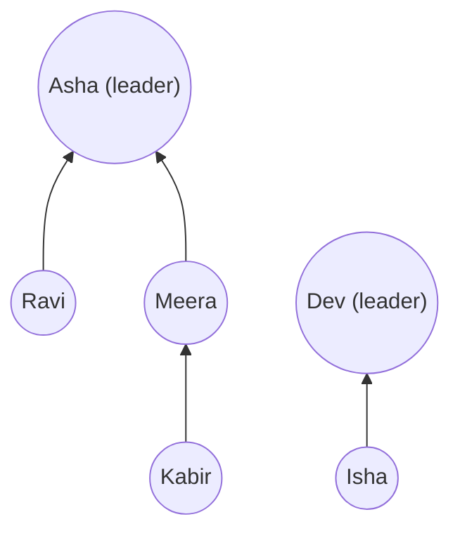

# Chapter 18 · Union-Find (Disjoint Set Union)

> Ek shaadi socho. Mehmaan chhote-chhote groups mein aa rahe hain. Jab bhi do log discover karte hain ki woh rishtedaar hain ("Tumhari mummy ke cousin toh mere mama hain!"), unke dono family groups merge hokar ek ho jaate hain. Beech shaadi mein koi poochta hai: "Priya aur Arjun ek hi family ke hain kya?" Union-Find iska jawab practically **O(1)** mein deta hai, chahe kitne bhi merges ho chuke hon.

**Is chapter mein tum seekhoge:**
- **Disjoint sets** kya hote hain, aur do operations: **find** aur **union**
- Naive version, aur exactly kaunsa input usse slow kar deta hai
- **Union by rank/size** aur **path compression**, aur intuition ki dono milke nearly O(1) kyun ho jaate hain (inverse Ackermann function)
- Ek saaf, reusable **DSU template class**
- Classic problems: provinces, redundant connection, valid tree, accounts merge, islands II, equality equations, smallest string with swaps
- DSU kaise **Kruskal's MST** ko power karta hai, aur kab DSU BFS/DFS se better hai (aur kab nahi)

**Isse pehle padho:** [Hashing](05-hashing.md) · [Graphs I: BFS, DFS & Grids](16-graphs-bfs-dfs.md) · [Graphs II](17-graphs-advanced.md) (Kruskal)

---

## 🧠 The Big Idea · Asli Baat

Socho har group ka ek **leader** hai. Har insaan ko sirf ek cheez pata hai: woh kisko report karta hai. Leader khud ko report karta hai.

- **find(x):** "x ke group ka leader kaun hai?" "Tum kisko report karte ho?" wali chain follow karte jao, jab tak koi aisa na mile jo khud ko hi report karta ho.
- **union(x, y):** "x ka group aur y ka group merge karo." Dono ke leaders dhoondo. Agar alag hain, toh ek leader ko doosre ko report karwa do. Bas. Ab dono groups ke sab logon ka ultimate leader ek hi hai.
- **Same group?** `find(x) == find(y)`.



Kabir → Meera → Asha: Kabir ki leader Asha hai. Isha ka leader Dev hai. Leaders alag, toh groups alag. Ab `union(Kabir, Isha)` karo: leaders hain Asha aur Dev; Dev ka arrow Asha ki taraf kar do. **Sirf ek arrow badla**, aur achanak paanch log ek family ban gaye.

Dhyaan do hum kya store **nahi** karte: actual edges, ya kaun kisse mila. Sirf "tum kisko report karte ho". Isi wajah se ye itna fast hai, aur yahi iski limitation bhi hai: Union-Find tumhe bata sakta hai **ki** do cheezein connected hain ya nahi, kabhi nahi bata sakta **kaise** connected hain.

> 🇮🇳 **Desi Analogy:** Joint family socho. Har family ka ek **mukhiya** hai (root). Har member ko sirf apne direct bade ka pata hai: bahu ko saas ka, saas ko dadaji ka, aur dadaji kisi ko report nahi karte, woh khud mukhiya hain (`parent[dadaji] == dadaji`). **find** = "bade se poochte poochte mukhiya tak pahunchna". **union** = do families ki shaadi se rishta judna: ek family ke mukhiya ko doosri family ke mukhiya ke under maan lo. Dono families ke baaki logon ko kuch nahi badalna padta, kyunki unki chain ab bhi upar jaake ek hi mukhiya pe khatam hoti hai. Aur family tree mein ye nahi likha hota ki kaun kis shaadi mein kisse mila, sirf "mera bada kaun". Isliye "Priya aur Arjun same family?" ka jawab mil jaata hai, lekin "kaise related?" ka nahi.

> 💡 **The core insight:** har group ko ek tree ki tarah represent karo jo **upar ki taraf** root ko point karta hai. Do groups merge karna = ek pointer change. Membership check karna = root tak upar chadhna. Do tricks trees ko itna flat rakhte hain ki upar chadhna practically instant ho jaata hai.

---

## 🔨 Building It Up · Zero Se Shuru

### 1. Disjoint sets

**Disjoint sets** aise groups hain jo kabhi overlap nahi karte: har element exactly ek set mein hota hai. Shuru mein har element akela hai: `{0} {1} {2} {3} {4}`. Unions sirf sets ko **merge** karte hain; kabhi split nahi karte.

Hum ise ek hi list mein store karte hain: `parent[i]` = woh element jisko i report karta hai. Root ke liye `parent[i] == i`.

```python
parent = list(range(5))          # har koi apna leader khud hai
print(parent)

def find(x):
    while parent[x] != x:        # root milne tak upar chadho
        x = parent[x]
    return x

def union(x, y):
    rx, ry = find(x), find(y)
    if rx != ry:
        parent[rx] = ry          # x ka leader ab y ke leader ko report karega

union(0, 1)
union(2, 3)
union(1, 3)
print(parent)
print(find(0), find(2), find(4))
print("0 and 2 together?", find(0) == find(2), "| 0 and 4?", find(0) == find(4))
```

```text
[0, 1, 2, 3, 4]
[1, 3, 3, 3, 4]
3 3 4
0 and 2 together? True | 0 and 4? False
```

Kya hua, step by step:
- `union(0, 1)` ke baad 0 → 1 point karta hai.
- `union(2, 3)` ke baad 2 → 3.
- `union(1, 3)`: leaders mile 1 aur 3, toh 1 ko 3 pe point kara diya.
- Ab 0 → 1 → 3 aur 2 → 3. Ek group {0, 1, 2, 3} jiska leader 3 hai, aur {4} akela.

Dhyaan do: `parent[0]` abhi bhi 1 hai, 3 nahi. Matlab `parent` list directly leader nahi batati; leader ke liye `find` hi chalana padta hai. Ye baat aage Traps mein phir aayegi.

### 2. The problem with the naive version

`find` ka cost tree ki **height** jitna hai. Agar unions unlucky order mein hue, toh tree ek lambi chain ban jaata hai:

```python
n = 10
parent = list(range(n))

def find(x):
    steps = 0
    while parent[x] != x:
        x = parent[x]
        steps += 1
    return x, steps

def union(x, y):
    rx, _ = find(x)
    ry, _ = find(y)
    if rx != ry:
        parent[rx] = ry

for i in range(n - 1):
    union(i, i + 1)              # 0 -> 1 -> 2 -> ... -> 9: ek chain
print(parent)
print(find(0))                   # (leader, kitne steps lage)
```

```text
[1, 2, 3, 4, 5, 6, 7, 8, 9, 9]
(9, 9)
```

Chain kyun bani? Trace karo. `union(0, 1)` ke baad 0 → 1, root 1. `union(1, 2)` mein `find(1) = 1` (purane group ka root) aur `find(2) = 2` (akela element). Naive code `parent[rx] = ry` karta hai, yaani **poore purane group** ka root naye **akele** element ke neeche chala jaata hai: 0 → 1 → 2. Har union ke saath yahi hota hai, aur chain ek level lambi hoti jaati hai. Element 0 sabse neeche hai, toh `find(0)` ko 9 steps lagte hain.

Ek million elements ho toh ek `find` ek million steps le sakta hai, aur m operations ka cost **O(m·n)**. Ye toh har baar BFS chalane se bhi better nahi hai. Do fixes hain, dono simple, aur saath mein jaadu.

### 3. Fix #1: union by size (or rank)

Merge karte waqt **chhote** tree ko **bade** tree ke root ke neeche lagao. Isse koi lamba-sa tree kabhi kisi chhote tree ke neeche push nahi hota.

> 🇮🇳 **Desi Analogy:** Ek 5000 logon ki company ek 5 logon ke startup ko acquire karti hai. Sensible tareeka: startup ka founder badi company ke CEO ko report kare. Ab sirf **5 log** ek level neeche gaye (unhe boss tak pahunchne mein ek extra step lagega). Ulta karo, CEO ko startup founder ke under daal do, toh **5000 log** ek level neeche chale jaate hain. Union by size yahi common sense hai: jis team ko neeche jaana pade, woh **chhoti** team ho, taaki kam logon ka rasta lamba ho.

```python
n = 10
parent = list(range(n))
size = [1] * n

def find(x):
    steps = 0
    while parent[x] != x:
        x = parent[x]
        steps += 1
    return x, steps

def union(x, y):
    rx, _ = find(x)
    ry, _ = find(y)
    if rx == ry:
        return
    if size[rx] < size[ry]:
        rx, ry = ry, rx              # rx ko bada tree banao
    parent[ry] = rx                  # chhota tree bade ke neeche
    size[rx] += size[ry]

for i in range(n - 1):
    union(i, i + 1)                  # wahi "evil" sequence jo pehle chain banata tha
print(parent)
print(max(find(i)[1] for i in range(n)))     # sabse gehra find
```

```text
[0, 0, 0, 0, 0, 0, 0, 0, 0, 0]
1
```

Kya hua: har baar badhta hua group {0, 1, ..., i} akele `i + 1` se bada tha, isliye `i + 1` seedha root 0 ke neeche laga. Ab har find sirf **1 step** ka hai.

**Height hamesha ≤ log₂ n kyun rehti hai:** koi node sirf tab gehra (deeper) hota hai jab uska tree kisi **kam se kam utne hi bade** tree ke neeche lagaya jaata hai. Toh jab bhi kisi node ki depth 1 badhti hai, uske group ka size kam se kam **double** ho jaata hai. Ek example se dekho: node ka group size 1 → 2 → 4 → 8 → ... Tum n se zyada ho jaane se pehle log₂ n se zyada baar double nahi kar sakte (n = 1024 ho toh max 10 doublings). Isliye union by size ke saath find **O(log n) worst case** hai.

**Union by rank** bilkul yahi idea hai, bas size ki jagah height ki ek upper bound ("rank") use hoti hai: lower-rank root ko higher-rank root ke neeche lagao; agar dono equal hain, toh koi ek chuno aur uska rank 1 badha do. Dono same guarantees dete hain. Size zyada handy hai kyunki group sizes waise bhi aksar chahiye hote hain ("largest group", "max area").

> 🤔 **Mann mein sawaal:** Union by size aur union by rank mein interview mein kaunsa likhun?
>
> **Jawab:** **Size.** Complexity dono ki same hai. Lekin size exact hota hai aur "sabse bada group kitna bada hai?" jaise sawaalon mein seedha kaam aata hai, jabki rank sirf ek andaaza (upper bound) hai jo kisi aur kaam ka nahi. Ek array, do kaam.

### 4. Fix #2: path compression

`find` mein root tak upar chadhte waqt, jin nodes se guzre unhe **seedha root** (ya root ke kareeb) point karwa do. Leader dhoondne ki mehnat tumne kar hi li hai; usse cache kar lo taaki agla find instant ho.

> 🇮🇳 **Desi Analogy:** Sarkari daftar mein pehli baar file leke gaye: peon ne kaha clerk ke paas jao, clerk ne kaha section officer, section officer ne kaha bade sahab. Bade sahab mil gaye (root). Ab wapas aate waqt tum peon, clerk aur section officer, teeno ko bol dete ho: "Agli baar koi aaye toh seedha bade sahab ka cabin bata dena." Yahi **path compression** hai: raste mein mile har node ka `parent` ab seedha root hai. Agli baar kisi ko 3 chakkar nahi, 1 chakkar lagega. **Path halving** thoda aalsi version hai: tum har bande ko sirf itna bolte ho "apne boss ko chhodo, boss ke boss ke paas bhejo". Ek baar mein rasta aadha hota hai, aur baar-baar find hone se flat ho jaata hai.

```python
parent = [1, 2, 3, 4, 4]           # ek chain: 0 -> 1 -> 2 -> 3 -> 4

def find_recursive(x):             # full compression: path ka har node -> root
    if parent[x] != x:
        parent[x] = find_recursive(parent[x])
    return parent[x]

print(find_recursive(0), parent)

parent = [1, 2, 3, 4, 4]
def find_halving(x):               # path halving: iterative, recursion nahi
    while parent[x] != x:
        parent[x] = parent[parent[x]]   # ek level skip: grandparent ko point karo
        x = parent[x]
    return x

print(find_halving(0), parent)
print(find_halving(0), parent)     # doosra find ise aur flat karta hai
```

```text
4 [4, 4, 4, 4, 4]
4 [2, 2, 4, 4, 4]
4 [4, 2, 4, 4, 4]
```

Kya hua:
- **Recursive version** ne poora path ek hi baar mein flat kar diya: 0, 1, 2, 3 sab ab seedha 4 ko point karte hain.
- **Path halving** ko trace karo. x = 0: `parent[0] = parent[1] = 2`, phir x = 2. x = 2: `parent[2] = parent[3] = 4`, phir x = 4, root. Result `[2, 2, 4, 4, 4]`. Path ki length 4 se 2 ho gayi, yaani aadhi.
- Doosre find mein x = 0: `parent[0] = parent[2] = 4`, aur seedha root. Ab `[4, 2, 4, 4, 4]`.

Path halving har node ko uske grandparent pe point karata hai, toh har baar path ki length aadhi hoti hai. Isme recursion nahi chahiye (huge inputs pe safe), aur amortised guarantee same hai. Dono theek hain; template mein hum halving use karenge.

### 5. Both together: nearly constant time

**Union by rank/size + path compression** ke saath, n elements pe m operations ka koi bhi sequence **O(m · α(n))** cost karta hai, jahan α hai **inverse Ackermann function**. α itni absurdly slowly badhti hai ki jitna bhi n tum kabhi store kar sakte ho, uske liye α(n) ≤ 4 hai (universe ke atoms ki ginti bhi us point se bahut, bahut neeche hai jahan ye 5 tak pahunchti hai). Toh practice mein: **O(1) amortised per operation**.

| Version | find (worst / amortised) |
|---|---|
| Naive | O(n) |
| Union by size/rank only | O(log n) |
| Path compression only | O(log n) amortised |
| **Both** | **O(α(n)) amortised ≈ O(1)** |

> 🤔 **Mann mein sawaal:** "Amortised" O(1) ka matlab kya hai? Kya har ek find O(1) hai?
>
> **Jawab:** Nahi, har single find guarantee se O(1) nahi hai. Kabhi kabhi ek find lamba path chadhta hai. Lekin wahi find us path ko flat bhi kar deta hai, toh aage ke finds sasta ho jaate hain. **Amortised** matlab: poore sequence ka total cost baant do, toh average per operation O(α(n)) aata hai. Jaise metro card ka monthly pass: kisi din tum 10 trips karte ho, kisi din 1, lekin per-trip average fixed rehta hai.

### 6. The template

Ye class yaad kar lo. Lagbhag har DSU problem yahi class + 5 se 10 lines hai.

```python
class DSU:
    def __init__(self, n):
        self.parent = list(range(n))
        self.size = [1] * n
        self.count = n                         # kitne alag groups hain

    def find(self, x):
        while self.parent[x] != x:
            self.parent[x] = self.parent[self.parent[x]]   # path halving
            x = self.parent[x]
        return x

    def union(self, a, b):
        ra, rb = self.find(a), self.find(b)
        if ra == rb:
            return False                       # pehle se saath: matlab "ye edge cycle banata hai"
        if self.size[ra] < self.size[rb]:
            ra, rb = rb, ra
        self.parent[rb] = ra                   # chhota bade ke neeche
        self.size[ra] += self.size[rb]
        self.count -= 1
        return True

    def connected(self, a, b):
        return self.find(a) == self.find(b)

d = DSU(6)
for a, b in [(0, 1), (2, 3), (1, 3), (4, 5)]:
    d.union(a, b)
    print(f"union({a},{b}) -> parent={d.parent} groups={d.count}")
print(d.connected(0, 2), d.connected(0, 4), d.size[d.find(0)])
print(d.union(0, 3))                           # pehle se connected
```

```text
union(0,1) -> parent=[0, 0, 2, 3, 4, 5] groups=5
union(2,3) -> parent=[0, 0, 2, 2, 4, 5] groups=4
union(1,3) -> parent=[0, 0, 0, 2, 4, 5] groups=3
union(4,5) -> parent=[0, 0, 0, 2, 4, 4] groups=2
True False 4
False
```

Output ko line by line padho:
- `union(0,1)`: dono size 1, tie mein `ra = 0` hi rehta hai, toh 1 → 0. Groups 6 se 5.
- `union(2,3)`: same tarah 3 → 2.
- `union(1,3)`: `find(1) = 0`, `find(3) = 2`. Dono ka size 2, tie, toh root 2 ko root 0 ke neeche. Dhyaan do `parent[3]` abhi bhi 2 hai, 0 nahi. Group {0, 1, 2, 3} ka leader 0.
- `union(4,5)`: 5 → 4. Groups 2.
- Last mein `union(0, 3)`: dono ka root 0, toh `False`.

Teen details jo baar baar kaam aate hain:
- `union` **False return karta hai** jab dono pehle se connected the. Wahi ek bit cycles detect karta hai (sections 8, 9).
- `count` bina kisi extra pass ke components ki ginti rakhta hai.
- `size[find(x)]` x ke group ka size hai.

> 🤔 **Mann mein sawaal:** Path compression ke baad nodes idhar udhar re-point hote hain. Toh `size` galat nahi ho jaata?
>
> **Jawab:** Nahi. Path compression kisi node ka **group** nahi badalta, sirf group ke andar uska shortcut badalta hai. Root wahi rehta hai, members wahi rehte hain. Aur `size` ko hum sirf **root** pe padhte hain (`size[find(x)]`). Non-root nodes ka `size` purana kachra ho sakta hai, lekin use koi padhta hi nahi.

**Arbitrary keys ke liye** (strings, coordinates), dicts use karo aur elements ko lazily banao:

```py
class DSUDict:
    def __init__(self):
        self.parent, self.size = {}, {}
    def find(self, x):
        if x not in self.parent:              # x pehli baar dikha: apna group khud
            self.parent[x], self.size[x] = x, 1
        while self.parent[x] != x:
            self.parent[x] = self.parent[self.parent[x]]
            x = self.parent[x]
        return x
    # union / connected: bilkul DSU jaisa
```

### 7. Number of Provinces: counting groups

**Problem:** `isConnected[i][j] = 1` agar city i aur j directly connected hain. Ek province directly ya indirectly connected cities ka group hai. Kitne provinces hain?

Approach seedha hai: n cities = n akele groups se shuru karo. Har connected pair pe `union`. Jo bacha, woh `count`.

```python
class DSU:
    def __init__(self, n):
        self.parent, self.size, self.count = list(range(n)), [1] * n, n
    def find(self, x):
        while self.parent[x] != x:
            self.parent[x] = self.parent[self.parent[x]]
            x = self.parent[x]
        return x
    def union(self, a, b):
        ra, rb = self.find(a), self.find(b)
        if ra == rb:
            return False
        if self.size[ra] < self.size[rb]:
            ra, rb = rb, ra
        self.parent[rb] = ra
        self.size[ra] += self.size[rb]
        self.count -= 1
        return True

def find_circle_num(is_connected):
    n = len(is_connected)
    dsu = DSU(n)
    for i in range(n):
        for j in range(i + 1, n):              # sirf upper triangle: matrix symmetric hai
            if is_connected[i][j]:
                dsu.union(i, j)
    return dsu.count

print(find_circle_num([[1, 1, 0], [1, 1, 0], [0, 0, 1]]))
print(find_circle_num([[1, 0, 0], [0, 1, 0], [0, 0, 1]]))
```

```text
2
3
```

n groups se shuru karo; har successful union do groups ko ek kar deta hai, toh `count` ek kam hota hai. Pehle example mein city 0 aur 1 judi, 2 akeli: 2 provinces. Doosre mein koi judi hi nahi: 3. Complexity **O(n² · α(n))**, kyunki matrix ke n² cells padhne hi padenge. ([Chapter 16](16-graphs-bfs-dfs.md) wala DFS bhi ise O(n²) mein solve karta hai.)

Upper triangle (`j` from `i + 1`) kyun? Kyunki `isConnected[i][j]` aur `isConnected[j][i]` same hain, aur diagonal hamesha 1 hai jo kuch naya nahi batata. Aadhe kaam mein poora answer.

### 8. Redundant Connection: the edge that makes a cycle

**Problem:** n nodes ka ek tree plus **ek extra edge**, edge list ki form mein diya hai. Woh edge return karo jise hata ke phir se tree ban jaaye (agar kai options hon, toh jo input mein sabse last aata hai).

**Idea:** edges ek-ek karke add karo. Pehla edge jiske dono endpoints **pehle se connected** hain, woh cycle close karta hai. Kyunki exactly ek hi extra edge hai, ye pehla aisa edge cycle ka input order mein **last** edge bhi hai, aur wahi maanga gaya hai.

> 🤔 **Mann mein sawaal:** Question bolta hai "jo sabse last aaye", aur hum **pehla** failed union return kar rahe hain. Ye ulta nahi hai?
>
> **Jawab:** Nahi, dono same cheez hain. Graph mein exactly ek cycle hai. Jab tak cycle ka last edge nahi aaya, cycle poora bana hi nahi, toh tab tak koi union fail nahi hota. Jis pal cycle ka **last** edge aata hai, uske endpoints pehle se connected hain, aur union fail hota hai. Cycle ke bahar wale edges kabhi fail nahi hote (aur unhe hatane se graph disconnect ho jaata, toh woh answer ho bhi nahi sakte). Toh "pehla failed union" = "cycle ka last edge" = maanga gaya answer.

```python
class DSU:
    def __init__(self, n):
        self.parent, self.size = list(range(n)), [1] * n
    def find(self, x):
        while self.parent[x] != x:
            self.parent[x] = self.parent[self.parent[x]]
            x = self.parent[x]
        return x
    def union(self, a, b):
        ra, rb = self.find(a), self.find(b)
        if ra == rb:
            return False
        if self.size[ra] < self.size[rb]:
            ra, rb = rb, ra
        self.parent[rb] = ra
        self.size[ra] += self.size[rb]
        return True

def find_redundant_connection(edges):
    dsu = DSU(len(edges) + 1)                   # nodes 1..n hain
    for u, v in edges:
        if not dsu.union(u, v):
            return [u, v]

print(find_redundant_connection([[1, 2], [1, 3], [2, 3]]))
print(find_redundant_connection([[1, 2], [2, 3], [3, 4], [1, 4], [1, 5]]))
```

```text
[2, 3]
[1, 4]
```

`DSU(len(edges) + 1)` kyun? Tree mein n nodes aur n − 1 edges hote hain; ek extra edge ke saath edges = n. Nodes 1 se n tak numbered hain, toh index n tak chahiye, yaani size n + 1. (Index 0 bas khaali pada rehta hai.)

**Dry run** doosre input ke liye:

| edge | find(u), find(v) | same? | action |
|---|---|---|---|
| [1, 2] | 1, 2 | no | union → {1,2} |
| [2, 3] | 1, 3 | no | union → {1,2,3} |
| [3, 4] | 1, 4 | no | union → {1,2,3,4} |
| [1, 4] | 1, 1 | **yes** | **cycle! answer [1, 4]** |

Complexity **O(n · α(n))**.

### 9. Graph Valid Tree

**Problem:** n nodes aur ek edge list. Kya ye ek valid tree hai?

Graph tree tabhi hai jab woh **connected** ho aur usme **koi cycle na ho**. Isi ka equivalent aur check karne mein aasaan version: **exactly n − 1 edges aur koi cycle nahi** (n − 1 edges bina cycle ke hon, toh graph connected hona hi padega).

Woh last claim kyun sach hai? Shuru mein n akele groups hain. Har edge jo cycle nahi banata, woh ek successful union hai aur groups ek kam karta hai. n − 1 successful unions ke baad groups = n − (n − 1) = **1**. Ek group matlab connected.

```python
class DSU:
    def __init__(self, n):
        self.parent, self.size = list(range(n)), [1] * n
    def find(self, x):
        while self.parent[x] != x:
            self.parent[x] = self.parent[self.parent[x]]
            x = self.parent[x]
        return x
    def union(self, a, b):
        ra, rb = self.find(a), self.find(b)
        if ra == rb:
            return False
        if self.size[ra] < self.size[rb]:
            ra, rb = rb, ra
        self.parent[rb] = ra
        self.size[ra] += self.size[rb]
        return True

def valid_tree(n, edges):
    if len(edges) != n - 1:
        return False                        # kam edges: disconnected; zyada edges: cycle
    dsu = DSU(n)
    return all(dsu.union(u, v) for u, v in edges)

print(valid_tree(5, [[0, 1], [0, 2], [0, 3], [1, 4]]))
print(valid_tree(5, [[0, 1], [1, 2], [2, 3], [1, 3], [1, 4]]))
print(valid_tree(4, [[0, 1], [2, 3]]))
```

```text
True
False
False
```

Teeno cases samjho: pehla ek proper tree hai. Doosre mein 5 edges hain (n − 1 = 4 hone chahiye), toh seedha False; waise bhi 1-2-3 ek cycle hai. Teesre mein sirf 2 edges hain (3 chahiye), toh graph do tukdon mein hai: False.

### 10. Accounts Merge: union by shared items

**Problem:** har account `[name, email1, email2, ...]` hai. Do accounts same insaan ke hain agar unme **koi bhi** email common hai. Unhe merge karo; har insaan ke emails sorted output karo.

**Idea:** jab bhi do **accounts** (index se) ek email share karein, unka union karo. Ek dict `email → pehla account index jisme ye email tha` sharing detect karta hai.

> 🇮🇳 **Desi Analogy:** Bank ka KYC socho. Ek hi insaan ke alag-alag accounts hain: ek mein mobile number A aur PAN, doosre mein mobile A aur ek email. Bank ko pata chalta hai dono same insaan ke hain kyunki **mobile A common hai**. Naam "Rahul Sharma" toh lakhon logon ka hai, us pe bharosa nahi. Yahan bhi wahi: accounts = elements, email = KYC detail, **shared email = same insaan = union**, aur naam sirf ek label hai.

```python
class DSU:
    def __init__(self, n):
        self.parent, self.size = list(range(n)), [1] * n
    def find(self, x):
        while self.parent[x] != x:
            self.parent[x] = self.parent[self.parent[x]]
            x = self.parent[x]
        return x
    def union(self, a, b):
        ra, rb = self.find(a), self.find(b)
        if ra == rb:
            return False
        if self.size[ra] < self.size[rb]:
            ra, rb = rb, ra
        self.parent[rb] = ra
        self.size[ra] += self.size[rb]
        return True

def accounts_merge(accounts):
    dsu = DSU(len(accounts))
    owner = {}                                     # email -> koi ek account index
    for i, (_, *emails) in enumerate(accounts):
        for email in emails:
            if email in owner:
                dsu.union(i, owner[email])         # email shared: same insaan
            else:
                owner[email] = i
    groups = {}                                    # root account -> emails ka set
    for email, i in owner.items():
        groups.setdefault(dsu.find(i), set()).add(email)
    return sorted([accounts[root][0]] + sorted(emails) for root, emails in groups.items())

accounts = [["John", "johnsmith@mail.com", "john_newyork@mail.com"],
            ["John", "johnsmith@mail.com", "john00@mail.com"],
            ["Mary", "mary@mail.com"],
            ["John", "johnnybravo@mail.com"]]
for acc in accounts_merge(accounts):
    print(acc)
```

```text
['John', 'john00@mail.com', 'john_newyork@mail.com', 'johnsmith@mail.com']
['John', 'johnnybravo@mail.com']
['Mary', 'mary@mail.com']
```

Kya hua:
- Accounts 0 aur 1 dono mein `johnsmith@mail.com` hai, toh merge ho gaye.
- Account 3 ek alag John hai: naam same, lekin koi email shared nahi. (**Naam identity nahi hai!**)
- Code ka ek chhota detail: `for i, (_, *emails) in enumerate(accounts)` mein `_` naam ko pakadta hai aur `*emails` baaki saare emails ko ek list mein.
- Last mein har email ko uske account ke **root** ke under group kiya, aur root account ka naam aage laga diya.

Complexity N total emails ke liye **O(N·α + N log N)**; sorting dominate karti hai.

### 11. Number of Islands II: the online version

**Problem:** ek m × n grid shuru mein poora paani hai. Land ek-ek cell karke add hoti hai. Har addition ke baad islands ki ginti batao.

Har addition ke baad BFS dobara chalao toh har baar O(m·n) lagta hai. DSU har addition ~O(1) mein handle karta hai: naya cell ek naya island hai (`count += 1`); phir use har land neighbour ke saath union karo (har successful union `count -= 1` karta hai).

```python
def num_islands2(m, n, positions):
    parent, size = {}, {}
    count = 0
    result = []

    def find(x):
        while parent[x] != x:
            parent[x] = parent[parent[x]]
            x = parent[x]
        return x

    for r, c in positions:
        if (r, c) in parent:                   # pehle se land: kuch nahi badla
            result.append(count)
            continue
        parent[(r, c)], size[(r, c)] = (r, c), 1
        count += 1                             # ek bilkul naya island...
        for dr, dc in ((-1, 0), (1, 0), (0, -1), (0, 1)):
            nb = (r + dr, c + dc)
            if nb in parent:                   # ...jo neighbours se merge ho sakta hai
                ra, rb = find((r, c)), find(nb)
                if ra != rb:
                    if size[ra] < size[rb]:
                        ra, rb = rb, ra
                    parent[rb] = ra
                    size[ra] += size[rb]
                    count -= 1
        result.append(count)
    return result

print(num_islands2(3, 3, [[0, 0], [0, 1], [1, 2], [2, 1], [1, 1]]))
```

```text
[1, 1, 2, 3, 1]
```

Step by step:

| add | naya island? | merges | count |
|---|---|---|---|
| (0, 0) | +1 | koi land neighbour nahi | 1 |
| (0, 1) | +1 | (0, 0) se merge, −1 | 1 |
| (1, 2) | +1 | koi land neighbour nahi | 2 |
| (2, 1) | +1 | koi land neighbour nahi | 3 |
| (1, 1) | +1 | (0, 1), (2, 1), (1, 2) teeno se, −3 | 1 |

Last cell (1, 1) teen alag islands ko chhoota hai aur sabko jod deta hai: 3 + 1 − 3 = 1. Neighbour grid ke bahar hai ya nahi, ye check karne ki zaroorat nahi, kyunki bahar ka cell kabhi `parent` dict mein hota hi nahi. Complexity k additions ke liye **O(k · α)**. Ye shape, "cheezein sirf merge hoti hain, aur mujhe har step ke baad answer chahiye", DSU ka **home turf** hai.

### 12. Satisfiability of Equality Equations

**Problem:** single letters pe `"a==b"` aur `"b!=c"` jaise equations. Kya sab ek saath sach ho sakte hain?

**Idea:** do passes. Pehle har `==` pair ka union karo (equalities transitive hoti hain, toh groups bante hain). Phir har `!=` pair check karo: agar dono sides same group mein hain, toh contradiction.

```python
def equations_possible(equations):
    parent = list(range(26))

    def find(x):
        while parent[x] != x:
            parent[x] = parent[parent[x]]
            x = parent[x]
        return x

    for eq in equations:
        if eq[1] == "=":                              # "a==b"
            parent[find(ord(eq[0]) - 97)] = find(ord(eq[3]) - 97)
    for eq in equations:
        if eq[1] == "!" and find(ord(eq[0]) - 97) == find(ord(eq[3]) - 97):
            return False
    return True

print(equations_possible(["a==b", "b!=a"]), equations_possible(["b==a", "a==b"]))
print(equations_possible(["a==b", "b==c", "a==c"]), equations_possible(["a==b", "b!=c", "c==a"]))
```

```text
False True
True False
```

Code ke chhote details: har equation exactly 4 characters ka hai. `eq[0]` pehla letter, `eq[1]` ya toh `=` ya `!`, `eq[3]` doosra letter. `ord(letter) - 97` letter ko 0..25 index mein badalta hai (`ord("a")` = 97).

(Sirf 26 elements hain, toh union-by-size chhod dena harmless hai.) **Order** important hai: saare `==` kisi bhi `!=` se pehle process karo, kyunki baad wali equality un do letters ko jod sakti hai jinka zikr pehle wale `!=` mein tha. Last example dekho: `b!=c` ke time pe b aur c alag dikhte, lekin `c==a` (aur `a==b`) ke baad woh ek hi group mein aa jaate hain.

### 13. Smallest String With Swaps

**Problem:** tum index pairs `pairs[i] = [a, b]` pe characters jitni baar chaho swap kar sakte ho. Lexicographically sabse chhoti possible string return karo.

**Idea:** swaps transitive hain. Agar tum 0↔3 aur 3↔2 swap kar sakte ho, toh {0, 2, 3} ke characters ko **kisi bhi** order mein arrange kar sakte ho. Toh: DSU se indices group karo, phir har group ke andar characters sort karo aur unhe sorted indices mein rakh do.

> 🇮🇳 **Desi Analogy:** School assembly ki line. Teacher ne kuch pairs ko permission di hai ki woh aapas mein jagah badal sakte hain. Agar Ramesh-Suresh badal sakte hain aur Suresh-Mahesh bhi, toh in teeno ko kisi bhi order mein khada kar sakte ho (swaps ki chain se koi bhi arrangement ban jaata hai, jaise bubble sort mein). Lekin jis bacche ko kisi se swap ki permission nahi, woh apni jagah fixed hai. Har "swap group" = DSU ka ek component, aur us group ke andar height-wise sort karna = chars ko sort karke sorted indices mein rakhna.

```python
from collections import defaultdict

def smallest_string_with_swaps(s, pairs):
    n = len(s)
    parent = list(range(n))

    def find(x):
        while parent[x] != x:
            parent[x] = parent[parent[x]]
            x = parent[x]
        return x

    for a, b in pairs:
        parent[find(a)] = find(b)
    groups = defaultdict(list)
    for i in range(n):
        groups[find(i)].append(i)              # indices pehle se sorted order mein aate hain
    result = list(s)
    for indices in groups.values():
        chars = sorted(s[i] for i in indices)
        for i, ch in zip(indices, chars):      # sabse chhota char -> sabse chhota index
            result[i] = ch
    return "".join(result)

print(smallest_string_with_swaps("dcab", [[0, 3], [1, 2]]))
print(smallest_string_with_swaps("dcab", [[0, 3], [1, 2], [0, 2]]))
print(smallest_string_with_swaps("cba", [[0, 1], [1, 2]]))
```

```text
bacd
abcd
abc
```

Pehla example trace karo: "dcab", groups {0, 3} aur {1, 2}. Group {0, 3} ke chars `d, b` → sorted `b, d` → index 0 pe b, index 3 pe d. Group {1, 2} ke chars `c, a` → `a, c` → index 1 pe a, index 2 pe c. Result "bacd".

Complexity **O(n log n)**. Interview mein ye insight bol ke batao: "Any permutation is achievable within a connected component of swap pairs, because adjacent swaps generate all permutations."

### 14. Kruskal's MST: DSU's most famous job

[Chapter 17](17-graphs-advanced.md) mein Kruskal's algorithm ne edges ko weight se sort kiya aur har edge add kiya, **jab tak woh cycle na banaye**. "Kya ye cycle banayega?" = "kya iske endpoints pehle se connected hain?" = `not dsu.union(u, v)`. Bas yahi poora connection hai:

```py
dsu = DSU(n)
total = 0
for w, u, v in sorted(edges):
    if dsu.union(u, v):          # True sirf tab jab u aur v alag trees mein the
        total += w
```

DSU ke bina har cycle check ke liye ek BFS chahiye hota: **O(E · (V + E))** instead of **O(E log E)**. Dhyaan do, ab Kruskal ka bottleneck sorting hai, DSU nahi.

---

## 🔬 Under the Hood · Andar Ki Kahani

### Why union by size gives O(log n) height (the doubling argument)

Koi bhi element x lo. Uski depth sirf tab 1 badhti hai jab x ke tree ka root kisi doosre root ke neeche attach hota hai. Union by size ke saath ye tabhi hota hai jab doosra tree **kam se kam utna hi bada** ho. Toh merge ke baad x jis tree mein hai, woh x ke purane tree ke size ka **kam se kam double** hai. Sizes n se zyada nahi ho sakte, toh ye zyada se zyada log₂ n baar ho sakta hai. Isliye depth ≤ log₂ n.

Numbers se feel karo: n = 1,000,000 ho toh log₂ n ≈ 20. Matlab sirf union by size se hi koi find 20 steps se zyada nahi lega. Naive mein yahi 10 lakh steps tha.

### Why path compression helps so much

Akela path compression bhi har lamba path sirf **ek baar** pay karwata hai: ek find ke baad path ka har node root ke bahut kareeb aa jaata hai, aur unke through aage ke finds saste hote hain. m operations ka total cost union by size ke bina bhi **O(m log n) amortised** hai.

Union by rank ke saath combine karo, toh Tarjan (1975) ne prove kiya ki total **O(m · α(n))** hai, aur baad ke kaam ne dikhaya ki ye bound **tight** hai: worst case mein koi bhi union-find structure asymptotically isse better nahi kar sakta. Interview ke liye proof nahi chahiye; ye sentence chahiye: *"With path compression and union by rank, the amortised cost per operation is O(α(n)), the inverse Ackermann function, which is at most 4 for any realistic n, so it's effectively constant."*

### What α(n) looks like

Ackermann function A(k) explode karta hai: A(1) = 3, A(2) = 7, A(3) = 61, A(4) lagbhag 65,536 levels ooncha 2s ka tower hai (2 ki power 2 ki power 2 ki power ..., 65,536 baar). α(n) woh sabse chhota k hai jiske liye A(k) ≥ n (roughly; definitions thodi alag alag hoti hain). Toh:

| n | α(n) |
|---|---|
| up to 3 | ≤ 1 |
| up to 7 | ≤ 2 |
| up to 61 | ≤ 3 |
| up to an unimaginably huge number | ≤ 4 |

Seedhi baat: tumhare computer ki poori memory bhi elements se bhar do, α(n) phir bhi 4 se upar nahi jaayega. Isliye log ise "effectively constant" bolte hain.

### Rank vs size

- **Rank** = tree height ki ek upper bound. Path compression ise update nahi karta (heights ghat-ti hain, ranks nahi), aur ye theek hai; ye ab bhi ek valid bound hai.
- **Size** = elements ki ginti. Hamesha exact, "largest group" type sawaalon ke liye useful.

Dono ki complexity identical hai. Size use karo.

### What DSU can't do

- **Split / delete** a union. Koi efficient "un-union" nahi hai (kai nodes ke pointers us link se hokar guzar sakte hain, aur path compression ke baad toh pata bhi nahi kaun kahan se aaya tha). Agar time ke saath edges hat rahe hain, toh common trick hai events ko **ulte order mein** process karna (removals additions ban jaate hain). Advanced variants (DSU with rollback, offline algorithms mein use hota hai) sabse recent unions undo kar sakte hain, lekin sirf stack order mein aur bina path compression ke.
- **Paths:** DSU ko "same group?" pata hai, "kaise?" ya "kitni door?" nahi.
- **Directed reachability:** "a, b tak pahunch sakta hai" symmetric nahi hai; DSU sirf symmetric, transitive relations (equivalence relations) model karta hai.

> 🤔 **Mann mein sawaal:** "Ulta process karo" wali trick kaise kaam karti hai?
>
> **Jawab:** Maan lo graph mein se edges ek-ek karke kat rahe hain, aur har cut ke baad poochte hain "kitne components?". DSU cut nahi kar sakta. Toh last state se shuru karo (saare cuts ho chuke), aur time ko peeche chalao: har "cut" ab ek "add" ban jaata hai, jo DSU ka favourite kaam hai. Answers ulte order mein milenge; end mein unhe reverse kar do. Ye tabhi chalta hai jab saare events pehle se pata hon (offline).

### Memory

Length n ki do integer lists: **O(n)**. Adjacency list ke O(V + E) ke saamne bahut chhota. DSU edges ko kabhi store hi nahi karta, isliye ye edges ki aisi streams ke liye perfect hai jinhe tum rakh hi nahi sakte.

---

## 🧩 Pattern Decoder · Pattern Pakdo

### Signals

| Problem mein dikhe... | Socho |
|---|---|
| "number of connected components / groups / provinces / friend circles" | DSU `count` (ya DFS) |
| "is it a valid tree?", "find the redundant edge", "detect cycle in undirected graph" | `union` False return kare ⇒ cycle |
| "merge accounts / groups that share X" | jo X share karte hain unhe union karo (map X → first owner) |
| "elements added one by one; after each step report groups/islands" | **DSU (online)**, BFS kaam dobara karega |
| "a == b", "a is similar to b", "can be swapped" (**transitive**, **symmetric** relations) | equivalence classes pe DSU |
| "minimum cost to connect everything" | Kruskal = sort edges + DSU |
| "earliest time when everyone is connected" | events ko time se sort karo, `count == 1` hone tak union |
| "minimise the maximum edge on a path" / "can reach with threshold t" | edges weight se sort karo, start ~ end connect hone tak union |
| "ratios a/b = k, query x/y" | **weighted DSU** (Evaluate Division dekho) |

### Template

```py
class DSU:
    def __init__(self, n):
        self.parent = list(range(n)); self.size = [1] * n; self.count = n
    def find(self, x):
        while self.parent[x] != x:
            self.parent[x] = self.parent[self.parent[x]]   # path halving
            x = self.parent[x]
        return x
    def union(self, a, b):
        ra, rb = self.find(a), self.find(b)
        if ra == rb: return False                          # pehle se connected (cycle!)
        if self.size[ra] < self.size[rb]: ra, rb = rb, ra
        self.parent[rb] = ra; self.size[ra] += self.size[rb]; self.count -= 1
        return True
```

Ise use kaise karein, teen sawaalon mein:
1. **Elements kya hain?** (nodes, cells `r*cols + c`, letters, accounts, stones ki rows/cols)
2. **Union kis wajah se hota hai?** (ek edge, email share karna, ek `==`, ek swap pair)
3. **Answer kis cheez se banta hai?** (`count`, ek failed union, sizes, group contents)

Ye teen sawaal har DSU problem ka skeleton hain. Naya problem dikhe toh pehle in teeno ka jawab kaagaz pe likho, code baad mein.

### Variation: Number of Operations to Make Network Connected

**Problem:** n computers, cable connections. Tum koi bhi cable kahin se bhi nikaal ke kahin bhi laga sakte ho. Saare computers jodne ke liye minimum moves kitne, ya −1.

**Idea:** kam se kam n − 1 cables chahiye (warna −1). Har **redundant** cable (ek failed union) ek spare hai. `count` components ko jodne ke liye `count − 1` moves chahiye, aur jab cables ≥ n − 1 hain, toh itne spares hone ki guarantee hai.

Guarantee kyun? `count` components banane mein n − count cables "useful" lage (har useful cable ne groups 1 kam kiye). Baaki sab spare: spares = cables − (n − count) ≥ (n − 1) − (n − count) = count − 1. Bilkul utne jitne chahiye.

```python
class DSU:
    def __init__(self, n):
        self.parent, self.size, self.count = list(range(n)), [1] * n, n
    def find(self, x):
        while self.parent[x] != x:
            self.parent[x] = self.parent[self.parent[x]]
            x = self.parent[x]
        return x
    def union(self, a, b):
        ra, rb = self.find(a), self.find(b)
        if ra == rb:
            return False
        if self.size[ra] < self.size[rb]:
            ra, rb = rb, ra
        self.parent[rb] = ra
        self.size[ra] += self.size[rb]
        self.count -= 1
        return True

def make_connected(n, connections):
    if len(connections) < n - 1:
        return -1
    dsu = DSU(n)
    for a, b in connections:
        dsu.union(a, b)
    return dsu.count - 1

print(make_connected(4, [[0, 1], [0, 2], [1, 2]]))
print(make_connected(6, [[0, 1], [0, 2], [0, 3], [1, 2], [1, 3]]))
print(make_connected(6, [[0, 1], [0, 2], [0, 3], [1, 2]]))
```

```text
1
2
-1
```

### Variation: Most Stones Removed with Same Row or Column

**Problem:** grid pe stones hain; ek stone tab hata sakte ho jab koi doosra stone uski row ya column share kare. Maximum kitne hata sakte ho?

**Idea:** row/column share karne wale stones groups banate hain; har group ko **ek** stone tak ghataya ja sakta hai. Answer = stones − groups. Clever modelling: stone ki **row** ko uske **column** se union karo (rows aur columns ko elements maano; columns ko offset kar do taaki rows se clash na ho, jaise `~c` ya `c + 10001`).

Ye modelling kyun kaam karti hai? Stone (r, c) row r aur column c ke beech ek "pul" hai. Do stones same row mein hain toh dono us row node se jude hain, toh same group. Same column mein hain toh column node ke through. Isse stone-to-stone har pair compare karne (O(n²)) ki zaroorat khatam.

```python
def remove_stones(stones):
    parent = {}

    def find(x):
        parent.setdefault(x, x)
        while parent[x] != x:
            parent[x] = parent[parent[x]]
            x = parent[x]
        return x

    for r, c in stones:
        parent[find(r)] = find(~c)           # ~c = -c-1: columns negative numbers mein rehte hain
    groups = len({find(x) for x in parent})
    return len(stones) - groups

print(remove_stones([[0, 0], [0, 1], [1, 0], [1, 2], [2, 1], [2, 2]]))
print(remove_stones([[0, 0], [0, 2], [1, 1], [2, 0], [2, 2]]))
```

```text
5
3
```

`~c` ka jaadu: Python mein `~0 = -1`, `~1 = -2`, `~5 = -6`. Rows 0, 1, 2, ... positive side pe hain, columns −1, −2, −3, ... negative side pe. Row 0 aur column 0 ab kabhi ek hi key nahi banenge.

Complexity **O(n · α)**. Rows/columns ko elements banane se O(n²) stone-to-stone comparisons bach jaate hain.

### Variation: Evaluate Division (weighted DSU)

**Problem:** `a / b = 2.0`, `b / c = 3.0`. Queries jaise `a / c` (6.0), `b / a` (0.5) ka answer do, unknown variable → −1.0.

**Idea:** har node store karta hai `weight[x] = x / parent[x]`. Toh `x / root` = path ke saare weights ka product, aur `find` multiply karte karte compress kar sakta hai. Query `x / y` ke liye agar root same hai: `(x / root) / (y / root)`.

> 🇮🇳 **Desi Analogy:** Currency exchange socho. 1 dollar = 83 rupees, 1 euro = 1.1 dollar. Euro ko rupee mein chahiye? Raste ke rates multiply karo: 1.1 × 83. Yahan "root" ek base currency hai (jaise rupee), aur `weight[x]` batata hai "1 x = kitne root". Do currencies compare karni hon toh dono ko rupee mein convert karo aur divide kar do. Agar do currencies ka koi conversion chain hi nahi (alag roots), toh answer −1.0.

```python
def calc_equation(equations, values, queries):
    parent, weight = {}, {}                  # weight[x] = x / parent[x]

    def find(x):
        if parent[x] != x:
            root = find(parent[x])           # iske baad, weight[parent[x]] = parent[x] / root
            weight[x] *= weight[parent[x]]   # x/root = x/parent * parent/root
            parent[x] = root                 # path compression
        return parent[x]

    for (a, b), val in zip(equations, values):
        for v in (a, b):
            if v not in parent:
                parent[v], weight[v] = v, 1.0
        ra, rb = find(a), find(b)
        if ra != rb:
            parent[ra] = rb
            weight[ra] = val * weight[b] / weight[a]   # ra/rb = (a/b) * (b/rb) / (a/ra)

    out = []
    for x, y in queries:
        if x not in parent or y not in parent or find(x) != find(y):
            out.append(-1.0)
        else:
            out.append(weight[x] / weight[y])
    return out

print(calc_equation([["a", "b"], ["b", "c"]], [2.0, 3.0],
                    [["a", "c"], ["b", "a"], ["a", "e"], ["a", "a"], ["x", "x"]]))
```

```text
[6.0, 0.5, -1.0, 1.0, -1.0]
```

Woh `weight[ra]` wali line sabse tricky hai, toh dheere se: humein `ra / rb` chahiye. Humare paas hai `a / b = val`, `a / ra = weight[a]` aur `b / rb = weight[b]` (dono `find` ke baad compressed hain). Ab `ra / rb = (ra / a) · (a / b) · (b / rb) = (1 / weight[a]) · val · weight[b]`. Wahi code mein likha hai.

Aur ek interesting case: `["x", "x"]` ka answer −1.0 hai, 1.0 nahi, kyunki x kabhi kisi equation mein aaya hi nahi; unknown variable hai.

(Recursive find yahan theek hai: inputs chhote hain. Doosra standard solution hai ek graph pe BFS/DFS jisme edge weights `a→b: 2`, `b→a: 0.5` hon.)

### Variation: "earliest moment everyone is connected"

**Problem (The Earliest Moment When Everyone Become Friends):** logs `[time, a, b]` ka matlab a aur b `time` pe dost bane. Saare n log pehli baar kab connected hue?

**Idea:** logs ko time se sort karo, union karo, aur woh time return karo jab `count` 1 ho jaaye.

```python
def earliest_acq(logs, n):
    parent = list(range(n))
    count = n

    def find(x):
        while parent[x] != x:
            parent[x] = parent[parent[x]]
            x = parent[x]
        return x

    for t, a, b in sorted(logs):
        ra, rb = find(a), find(b)
        if ra != rb:
            parent[ra] = rb
            count -= 1
            if count == 1:
                return t
    return -1

logs = [[20190101, 0, 1], [20190104, 3, 4], [20190107, 2, 3], [20190211, 1, 5],
        [20190224, 2, 4], [20190301, 0, 3], [20190312, 1, 2], [20190322, 4, 5]]
print(earliest_acq(logs, 6))
```

```text
20190301
```

Trace: {0,1}, {3,4}, {2,3,4}, {0,1,5}; 20190224 pe (2, 4) pehle se saath the, kuch nahi badla; 20190301 pe (0, 3) ne dono bade groups jod diye, count = 1. Answer 20190301.

### When DSU beats BFS/DFS (and when it doesn't)

| Situation | Better choice | Why |
|---|---|---|
| Edges time ke saath aate hain, har baar connectivity query | **DSU** | BFS har query pe O(V + E) kaam dobara karega |
| Fixed graph pe bahut saari "same group?" queries | **DSU** (ya ek BFS se components label karo) | per query near-O(1) |
| Saare edges store nahi kar sakte (streaming) | **DSU** | sirf O(V) store karta hai |
| Kruskal / "sort edges, add until connected" | **DSU** | cycle check ~O(1) mein |
| Equivalence relations (==, similar, swappable) | **DSU** | transitivity ko seedha model karta hai |
| **Path** ya **shortest distance** chahiye | BFS / Dijkstra | DSU bhool jaata hai cheezein kaise judi |
| **Directed** graphs, directed graphs mein cycles | DFS colours / Kahn | DSU symmetric relations ke liye hai |
| Edges **delete** hote hain | BFS/DFS (ya offline reverse trick) | DSU split nahi kar sakta |
| Grid problem ek hi baar answer karna (ek Number of Islands) | dono chalega; DFS chhota hai | amortise karne ko repeated queries hi nahi |

---

## ⚠️ Traps & Common Mistakes · Yahan Sab Phisalte Hain

1. **Roots ki jagah elements compare karna.**

```py
# ❌ galat: x aur y same set mein ho sakte hain bina ek doosre ko point kiye
if parent[x] == parent[y]: ...

# ✅ sahi: unke roots compare karo
if find(x) == find(y): ...
```

Example: section 6 ke template output mein `parent = [0, 0, 0, 2, 4, 4]`. Element 1 aur 3 same group mein hain, lekin `parent[1] = 0` aur `parent[3] = 2`. Galat check "alag" bolega.

2. **Roots ki jagah elements ko link karna.** `parent[a] = b` a ka purana link phenk deta hai aur groups tod sakta hai (a ke neeche jo log the woh a ke saath chale jaate hain, lekin a ke purane group ke baaki log peeche chhoot jaate hain). Hamesha `parent[find(a)] = find(b)`.
3. **Unions ke baad `parent[x]` ko "leader" samajhna.** Agar us exact path pe compression nahi hua, toh `parent[x]` koi beech ka node ho sakta hai. Jab bhi group chahiye, `find(x)` call karo, jaise end mein indices group karte waqt.
4. **Dict-based DSU entries initialise karna bhool jaana** (KeyError). `setdefault` ya `find` mein lazy check use karo.
5. **1-indexed nodes ke saath off-by-one.** Redundant Connection jaise problems nodes 1..n use karte hain: `DSU(n + 1)` banao.
6. **Lambi chains pe recursive find**, compression se pehle → 10⁵ elements pe `RecursionError`. Iterative halving version use karo.
7. Equation problems mein **saare `==` se pehle `!=` process karna.** Pehle saare unions, phir saare checks.
8. **Galat root ka size/rank update karna** (rb ko ra ke neeche lagane ke baad `size[rb]` mein add karna).
9. **Directed cycles ke liye DSU use karne ki koshish.** `0 → 1, 1 → 2, 0 → 2` mein koi directed cycle nahi hai, lekin DSU teesre edge ko flag kar dega (kyunki undirected nazar se 0, 1, 2 ek triangle hain).

---

## 💡 Tips & Tricks · Pro Wale Moves

- `union` ka boolean return karna sabse useful single line hai: "pehle se connected" hi cycle detector hai, redundant-edge finder hai aur spare-cable counter bhi.
- Ek `count` field rakho; bahut saare answers bas `dsu.count` ya `dsu.count - 1` hote hain.
- **Grid cells → integers:** `index = r * cols + c`. Ek extra virtual node add karo (jaise index `rows * cols`) jo "border" ya "ocean" represent kare, aur border cells ko usse union karo (Surrounded Regions via DSU). End mein jo cell us virtual node se connected nahi, woh surrounded hai.
- **Rows aur columns as nodes** (Most Stones) aur **letters as nodes** (equations, smallest equivalent string) O(n²) comparisons ko O(n) bana dete hain.
- "Minimise the maximum edge" ya "earliest time" ke liye pehle **edges/events sort karo**, phir condition true hone tak union.
- Agar deletions dikhein, toh poocho: "kya main events ko ulta process kar sakta hoon?"
- Interviews mein pehle DSU class likho (90 seconds), phir problem logic. Isse structure dikhta hai aur bugs bachte hain.

---

## 🎯 Interview Questions · Interview Mein Yahi Poochenge

### 1. Number of Provinces 🔥🔥🔥

<details><summary>Answer dekho 👀</summary>

n cities pe DSU banao, har `isConnected[i][j] == 1` pair ka union karo (sirf upper triangle), answer `count` hai (section 7). **O(n² α(n))**. DFS bhi utna hi accha hai; dono mention karo.

> 🗣️ **Interview mein aise bolo:** "I'll treat each city as its own group and union every pair that's directly connected, scanning only the upper triangle since the matrix is symmetric. The DSU keeps a running count that drops by one on every successful union, so the answer is just the final count. That's O(n² · α(n)), essentially O(n²), and a DFS over the matrix would work equally well."

</details>

### 2. Redundant Connection 🔥🔥

<details><summary>Answer dekho 👀</summary>

Edges order mein add karo; pehla edge jiska `union` fail ho, wahi answer (section 8). **O(n α(n))**. Follow-up **Redundant Connection II** (directed, ek node ke do parents ho sakte hain) mushkil hai: pehle check karo koi node ke do parents hain kya, phir har candidate ko hata ke try karo.

</details>

### 3. Graph Valid Tree 🔥🔥

<details><summary>Answer dekho 👀</summary>

`len(edges) == n - 1` aur har union successful ho (section 9). **O(n α(n))**. Alternative: BFS/DFS check kare ki saare n nodes reach hue aur edges n − 1 hain.

</details>

### 4. Accounts Merge 🔥🔥🔥

<details><summary>Answer dekho 👀</summary>

Jo accounts email share karte hain unhe union karo (map email → pehla account index), phir emails ko root ke hisaab se group karke sort karo (section 10). **O(N α + N log N)**. Saaf saaf bolo: "Same name doesn't mean same person; only a shared email does."

> 🗣️ **Interview mein aise bolo:** "I'll union accounts, not emails: a hash map from each email to the first account index that had it tells me when two accounts share an email, and then I union them. After that I bucket every email under its account's root and sort each bucket. Same name doesn't mean same person; only a shared email does. It's O(N · α(N)) for the unions plus O(N log N) for the sorting, where N is the total number of emails."

</details>

### 5. Number of Islands II 🔥

<details><summary>Answer dekho 👀</summary>

Cells pe online DSU: har naya land cell ek island add karta hai, aur har land neighbour ke saath successful union ek island kam karta hai (section 11). k positions ke liye **O(k α)**, jabki baar-baar BFS O(k·m·n). Duplicate positions handle karna mat bhoolna.

</details>

### 6. Satisfiability of Equality Equations 🔥🔥

<details><summary>Answer dekho 👀</summary>

Pehle saare `==` pairs ka union, phir fail karo agar koi `!=` pair same root share kare (section 12). 26 elements ke saath **O(n)**.

</details>

### 7. Smallest String With Swaps 🔥🔥

<details><summary>Answer dekho 👀</summary>

DSU se indices group karo, har group ke andar characters sort karo, aur sorted index order mein wapas rakh do (section 13). **O(n log n)**.

</details>

### 8. Number of Operations to Make Network Connected 🔥🔥

<details><summary>Answer dekho 👀</summary>

Agar cables < n − 1 → −1; warna answer = components − 1 (Pattern Decoder). **O((n + E) α)**.

</details>

### 9. Most Stones Removed with Same Row or Column 🔥🔥

<details><summary>Answer dekho 👀</summary>

Har stone ki row ko uske (offset kiye) column se union karo; answer = stones − groups ki ginti (Pattern Decoder). **O(n α)**.

</details>

### 10. Evaluate Division 🔥🔥

<details><summary>Answer dekho 👀</summary>

Weighted DSU jahan `weight[x] = x / parent[x]`, path compression ke dauraan multiply hota hai (Pattern Decoder). Queries: roots alag ya variable unknown → −1.0; warna `weight[x] / weight[y]`. Alternative: reciprocal edge weights wale graph pe BFS, **O(Q·(V + E))**.

</details>

### 11. Longest Consecutive Sequence 🔥🔥🔥

Ek unsorted array diya hai; consecutive integers ki sabse lambi run ki length batao, O(n) mein.

<details><summary>Answer dekho 👀</summary>

Standard answer hash set hai: sirf un numbers se ginti shuru karo jinka `x − 1` set mein nahi hai ([Chapter 05](05-hashing.md)). DSU wala answer: jab bhi `x` aur `x + 1` dono present hon, unka union karo; answer sabse bade group ka size hai.

```python
def longest_consecutive(nums):
    parent, size = {}, {}

    def find(x):
        while parent[x] != x:
            parent[x] = parent[parent[x]]
            x = parent[x]
        return x

    for x in set(nums):
        parent[x], size[x] = x, 1
    for x in parent:
        if x + 1 in parent:
            ra, rb = find(x), find(x + 1)
            if ra != rb:
                if size[ra] < size[rb]:
                    ra, rb = rb, ra
                parent[rb] = ra
                size[ra] += size[rb]
    return max(size[find(x)] for x in parent) if parent else 0

print(longest_consecutive([100, 4, 200, 1, 3, 2]), longest_consecutive([0, 3, 7, 2, 5, 8, 4, 6, 0, 1]))
```

```text
4 9
```

**O(n α(n))**. Pehle example mein groups bane {1, 2, 3, 4}, {100}, {200}; sabse bada 4. `set(nums)` duplicates hata deta hai (doosre example mein do 0 hain), aur khaali input pe `if parent else 0` crash bachata hai.

> 🗣️ **Interview mein aise bolo:** "The standard O(n) solution is a hash set where I only start counting from numbers whose predecessor is missing, so each number is visited a constant number of times. An alternative is union-find: I union every x with x + 1 when both are present and track group sizes, and the answer is the largest group. Both are linear in practice; I'd code the hash-set version because it's shorter."

</details>

### 12. Why is union-find "almost O(1)"? 🔥🔥 (conceptual)

<details><summary>Answer dekho 👀</summary>

Union by size trees ki height ≤ log n rakhta hai (ek node tabhi gehra hota hai jab uska group kam se kam double ho). Path compression har us path ko flat karta hai jis pe woh chalta hai. Dono milke m operations ka cost **O(m · α(n))** (Tarjan), jahan α inverse Ackermann function hai, jo kisi bhi practical n ke liye ≤ 4 hai. Toh har operation amortised mein effectively constant time hai.

> 🗣️ **Interview mein aise bolo:** "Union by size guarantees the trees stay at most log n tall, because a node only gets deeper when its group at least doubles. Path compression then flattens every path a find walks, so later finds are cheap. Together, Tarjan showed m operations cost O(m · α(n)), where α is the inverse Ackermann function, which never exceeds 4 for any realistic input, so each operation is effectively constant time, amortised."

</details>

---

## 🏋️ Practice · Ab Tumhari Baari

**🟢 1. Find if Path Exists in Graph** DSU se karo.

<details><summary>Solution dekho 👀</summary>

Path exist karta hai ⇔ source aur destination same component mein hain. Saare edges ka union, phir roots compare.

```python
def valid_path(n, edges, source, destination):
    parent = list(range(n))

    def find(x):
        while parent[x] != x:
            parent[x] = parent[parent[x]]
            x = parent[x]
        return x

    for u, v in edges:
        parent[find(u)] = find(v)
    return find(source) == find(destination)

print(valid_path(3, [[0, 1], [1, 2], [2, 0]], 0, 2))
print(valid_path(6, [[0, 1], [0, 2], [3, 5], [5, 4], [4, 3]], 0, 5))
```

```text
True
False
```

</details>

**🟢 2. Size of the largest group:** n log aur dost pairs diye hain; sabse bade friend circle ka size return karo.

<details><summary>Solution dekho 👀</summary>

Union by size ka `size` array yahan seedha answer deta hai. Bas root pe padhna yaad rakho: `size[find(i)]`.

```python
def largest_group(n, pairs):
    parent, size = list(range(n)), [1] * n

    def find(x):
        while parent[x] != x:
            parent[x] = parent[parent[x]]
            x = parent[x]
        return x

    for a, b in pairs:
        ra, rb = find(a), find(b)
        if ra != rb:
            if size[ra] < size[rb]:
                ra, rb = rb, ra
            parent[rb] = ra
            size[ra] += size[rb]
    return max(size[find(i)] for i in range(n))

print(largest_group(7, [(0, 1), (1, 2), (3, 4), (5, 6), (6, 4)]))
```

```text
4
```

Groups: {0, 1, 2} aur {3, 4, 5, 6}. Sabse bada 4.

</details>

**🟡 3. Lexicographically Smallest Equivalent String.** `s1[i]` aur `s2[i]` equivalent hain (equivalence transitive hai). `baseStr` ke har letter ko uske sabse chhote equivalent letter se replace karo.

<details><summary>Solution dekho 👀</summary>

Letters ka union karo, aur hamesha **chhote** letter ko root banao. Tab `find` seedha group ka sabse chhota letter dega.

```python
def smallest_equivalent_string(s1, s2, base):
    parent = list(range(26))

    def find(x):
        while parent[x] != x:
            parent[x] = parent[parent[x]]
            x = parent[x]
        return x

    for a, b in zip(s1, s2):
        ra, rb = find(ord(a) - 97), find(ord(b) - 97)
        if ra != rb:
            parent[max(ra, rb)] = min(ra, rb)      # chhota letter root banta hai
    return "".join(chr(find(ord(ch) - 97) + 97) for ch in base)

print(smallest_equivalent_string("parker", "morris", "parser"))
print(smallest_equivalent_string("hello", "world", "hold"))
```

```text
makkek
hdld
```

Pehle example mein groups bante hain {m, p}, {a, o}, {k, r, s}, {e, i}. "parser" → p→m, a→a, r→k, s→k, e→e, r→k = "makkek".

</details>

**🟡 4. Similar String Groups.** Do strings (ek doosre ke anagrams) similar hain agar woh equal hain ya ek ke do letters swap karne se doosri ban jaati hai. Kitne groups?

<details><summary>Solution dekho 👀</summary>

Har similar pair ka union karo: **O(n² · L)**. Similar hone ki condition: alag positions ya toh 0 hon, ya exactly 2 aur woh aapas mein cross-match karein.

```python
def num_similar_groups(strs):
    n = len(strs)
    parent = list(range(n))
    count = n

    def find(x):
        while parent[x] != x:
            parent[x] = parent[parent[x]]
            x = parent[x]
        return x

    def similar(a, b):
        diff = [i for i in range(len(a)) if a[i] != b[i]]
        return len(diff) == 0 or (len(diff) == 2 and a[diff[0]] == b[diff[1]] and a[diff[1]] == b[diff[0]])

    for i in range(n):
        for j in range(i + 1, n):
            if similar(strs[i], strs[j]):
                ri, rj = find(i), find(j)
                if ri != rj:
                    parent[ri] = rj
                    count -= 1
    return count

print(num_similar_groups(["tars", "rats", "arts", "star"]), num_similar_groups(["omv", "ovm"]))
```

```text
2 1
```

"tars" ~ "rats" (t, r swap), "rats" ~ "arts" (r, a swap), toh teeno ek group. "star" kisi se ek swap door nahi: alag group. Total 2. Dhyaan do "tars" aur "arts" directly similar nahi hain, phir bhi same group mein hain: yahi transitivity hai.

</details>

**🔴 5. Regions Cut By Slashes.** Ek n × n grid jisme `' '`, `'/'`, `'\'` hain. Regions gino.

<details><summary>Solution dekho 👀</summary>

Har cell ko 4 triangles mein todo (top 0, right 1, bottom 2, left 3). `'/'` top+left aur right+bottom ko jodta hai; `'\'` top+right aur bottom+left ko jodta hai; `' '` chaaron ko jodta hai. Phir har cell ka right triangle right neighbour ke left se jodo, aur bottom triangle neeche wale neighbour ke top se. Answer = groups ki ginti.

Picture banao: cell ek square hai, dono diagonals khinch do, 4 triangles ban gaye. `/` slash bottom-left se top-right jaata hai, toh woh top aur left triangles ko ek taraf, right aur bottom ko doosri taraf rakhta hai. `\` top-left se bottom-right jaata hai, toh top+right ek taraf, bottom+left doosri taraf.

```python
def regions_by_slashes(grid):
    n = len(grid)
    parent = list(range(4 * n * n))
    count = 4 * n * n

    def find(x):
        while parent[x] != x:
            parent[x] = parent[parent[x]]
            x = parent[x]
        return x

    def union(a, b):
        nonlocal count
        ra, rb = find(a), find(b)
        if ra != rb:
            parent[ra] = rb
            count -= 1

    for r in range(n):
        for c in range(n):
            base = 4 * (r * n + c)
            ch = grid[r][c]
            if ch == "/":
                union(base + 0, base + 3); union(base + 1, base + 2)
            elif ch == "\\":
                union(base + 0, base + 1); union(base + 2, base + 3)
            else:
                union(base + 0, base + 1); union(base + 1, base + 2); union(base + 2, base + 3)
            if c + 1 < n:
                union(base + 1, 4 * (r * n + c + 1) + 3)     # mera right ~ neighbour ka left
            if r + 1 < n:
                union(base + 2, 4 * ((r + 1) * n + c) + 0)   # mera bottom ~ neeche wale ka top
    return count

print(regions_by_slashes([" /", "/ "]), regions_by_slashes([" /", "  "]), regions_by_slashes(["/\\", "\\/"]))
```

```text
2 1 5
```

**O(n² α)**. (Code mein `"\\"` ek hi backslash character hai; Python string mein backslash ko escape karna padta hai.)

</details>

**🔴 6. Remove Max Number of Edges to Keep Graph Fully Traversable.** Edge types: 1 = sirf Alice, 2 = sirf Bob, 3 = dono. Jitne zyada edges ho sake hatao, lekin dono har node tak pahunch sakein; impossible ho toh −1.

<details><summary>Solution dekho 👀</summary>

Do DSUs ke saath greedy: pehle type-3 edges add karo (woh dono ke kaam aate hain), phir type 1 Alice ke DSU mein, type 2 Bob ke mein. Har edge jiska union fail ho, hataya ja sakta hai.

Type-3 pehle kyun? Ek type-3 edge do kaam ek saath karta hai. Agar pehle type-1 aur type-2 se Alice aur Bob dono connect ho gaye, toh woh type-3 bekaar ho jaata, aur humne do edges use kar liye jahan ek kaafi tha. Zyada kaam ka edge pehle lo.

```python
class DSU:
    def __init__(self, n):
        self.parent, self.count = list(range(n + 1)), n
    def find(self, x):
        while self.parent[x] != x:
            self.parent[x] = self.parent[self.parent[x]]
            x = self.parent[x]
        return x
    def union(self, a, b):
        ra, rb = self.find(a), self.find(b)
        if ra == rb:
            return False
        self.parent[ra] = rb
        self.count -= 1
        return True

def max_num_edges_to_remove(n, edges):
    alice, bob = DSU(n), DSU(n)
    used = 0
    for t, u, v in edges:
        if t == 3:
            a, b = alice.union(u, v), bob.union(u, v)
            used += a or b                     # kaam ka hai agar kisi ek ki bhi madad ki
    for t, u, v in edges:
        if t == 1:
            used += alice.union(u, v)
        elif t == 2:
            used += bob.union(u, v)
    if alice.count != 1 or bob.count != 1:
        return -1
    return len(edges) - used

print(max_num_edges_to_remove(4, [[3, 1, 2], [3, 2, 3], [1, 1, 3], [1, 2, 4], [1, 1, 2], [2, 3, 4]]))
print(max_num_edges_to_remove(4, [[3, 1, 2], [3, 2, 3], [1, 1, 4], [2, 1, 4]]))
print(max_num_edges_to_remove(4, [[3, 2, 3], [1, 1, 2], [2, 3, 4]]))
```

```text
2
0
-1
```

**O(E α)**. (Type-3 edges dono DSUs mein ek saath process hote hain, toh dono DSUs mein bilkul same unions hote hain, aur ya toh dono succeed hote hain ya dono fail; `a or b` bas defensive hai.) Chhota detail: `DSU(n)` andar `n + 1` size ka list banata hai kyunki nodes 1..n hain, lekin `count = n` se shuru hota hai, toh index 0 ginti mein nahi aata. Aur `used += True` Python mein 1 jodta hai, kyunki `bool` int ka subclass hai.

</details>

---

## 🧠 Never-Forget Summary · Kabhi Mat Bhoolna

- Union-Find **merging** ke beech **disjoint groups** sambhalta hai. Har group ek upward tree hai; **root** group ki ID hai.
- **find(x):** root tak chadho. **union(a, b):** ek root ko doosre ke neeche link karo. **connected:** roots compare karo.
- Naive trees chains ban sakte hain → per find O(n).
- **Union by size/rank:** chhota bade ke neeche → height ≤ log₂ n (doubling argument).
- **Path compression / halving:** chadhte chadhte flat karte jao.
- Dono saath mein: **O(α(n)) amortised ≈ O(1)**, kisi bhi real input ke liye α(n) ≤ 4.
- `union` ka **False** return = "pehle se connected" = **cycle** / redundant edge / spare cable.
- Groups ka **`count`** rakho: provinces, islands, "sab connected?".
- Sirf **symmetric, transitive** relations ke liye; split nahi kar sakta, paths nahi deta, directed graphs ke liye nahi.
- Kruskal = sort edges + DSU.

**Memory hook: "FIND THE BOSS, MERGE THE BOSSES"**
- Employees ko kabhi link mat karo, hamesha **bosses** (roots) ko link karo.
- **Chhoti team badi team join karti hai** (union by size).
- **Ek baar poochh liya, toh boss tak shortcut** (path compression).

**🪝 Yaad rakhne ka jugaad:** *"Mukhiya dhoondo, mukhiya jodo; chhota kunba bade mein chhodo; raste mein jo mila, use seedha mukhiya se jodo."* Teen line, teen rules: **find + union on roots**, **union by size**, **path compression**. Aur bonus: "rishta judta hai, tootta nahi", yaani DSU merge karta hai, split kabhi nahi.

**Ek picture:**

| Problem | Elements | Union kab | Answer |
|---|---|---|---|
| Provinces / components | nodes | edge | `count` |
| Redundant connection / valid tree | nodes | edge | pehla failed union / sab succeed + n−1 edges |
| Accounts merge | accounts | shared email | emails ko root se group karo |
| Islands II | cells | adjacent land | har add ke baad `count` |
| Equality equations | letters | `==` | koi `!=` ek hi group ke andar? |
| Smallest string with swaps | indices | swap pair | har group mein chars sort |
| Most stones | rows + columns | (r, c) pe ek stone | stones − groups |
| Kruskal MST | nodes | weight order mein edge | successful unions ka total |

> **Agar sirf ek cheez yaad rakhni hai:** jab cheezein sirf **merge** hoti hain aur tum baar baar poochte ho **"same group?"**, toh Union-Find use karo, aur hamesha **roots** ko link karo, chhota bade ke neeche, aur upar chadhte hue compress karte jao.

---
**Aage:** [Chapter 19 · Tries](19-tries.md)  ·  **Wapas** [Contents](../README.md)
