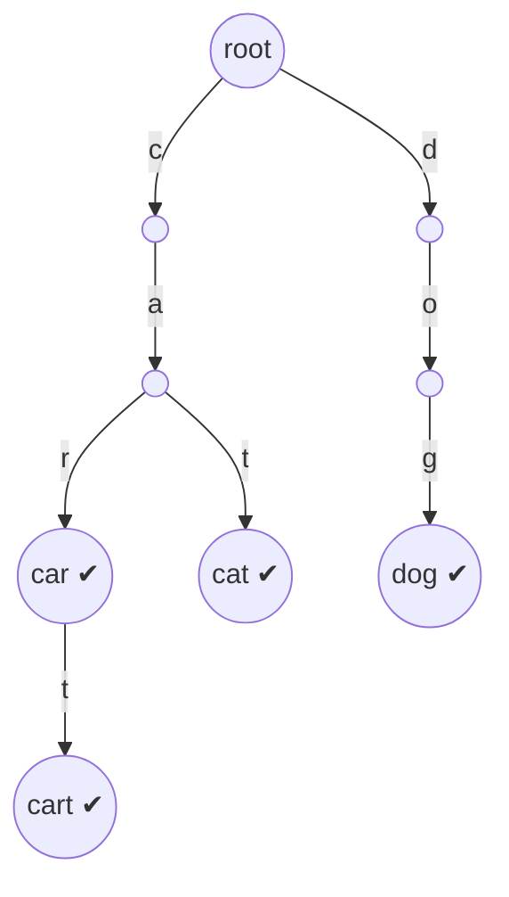

# Chapter 19 · Tries

> Tum search box mein "pyt" type karte ho, aur ungli uthne se pehle hi suggestions aa jaate hain: "python", "python tutorial", "pytorch". Usne ek arab search terms scan nahi kiye. Usne ek tree mein bas teen step neeche walk kiya, jahan "pyt" se shuru hone wala har word ek hi branch mein rehta hai. Wahi tree ek **trie** hai, aur ye data structure ek hi kaam ke liye bana hai: **prefixes**.

**Is chapter mein tum seekhoge:**
- Hash set "kaun se words ... se shuru hote hain?" efficiently kyun nahi bata sakta, aur trie kyun bata sakta hai
- Trie node: **dict of children vs array of 26**, aur end-of-word flag
- Insert, search, startsWith, **delete**, aur **count words with a prefix**, step by step trace ke saath
- Wildcard search (`.` kisi bhi letter se match karta hai) aur **Word Search II** (trie + grid backtracking)
- Longest common prefix, replace words, **autocomplete / search suggestions**
- **Maximum XOR** problems ke liye **bitwise trie**
- Space/time trade-offs, aur kab trie overkill hai

**Isse pehle padho:** [Strings](../part-1-python/04-strings.md) · [Dictionaries](../part-1-python/09-dictionaries.md) · [Backtracking](09-backtracking.md) · [Binary Trees](13-binary-trees.md) · [Graphs I](16-graphs-bfs-dfs.md) (grid DFS)

---

## 🧠 The Big Idea · Asli Baat

Ek printed dictionary kholo. "ca" se shuru hone wale saare words ek saath baithe hain: cab, cake, car, card, care, cart, cat. Koi tab pe "c-a" saat baar nahi likhta; common shuruaat us section tak pahunchne ka **rasta** hai.

Ek **trie** (re**trie**val se aaya naam; zyada log ise "try" bolte hain taaki "tree" se confusion na ho) words ko bilkul aise hi store karta hai: har **edge** ek letter hai, root se har **path** ek prefix spell karta hai, aur jo words ek prefix share karte hain woh path bhi share karte hain. Node pe ek flag batata hai "yahan ek poora word khatam hota hai".

Ye raha `car, cart, cat, dog` ka trie:



- **"car"** ek word hai: c → a → r ke baad wala node ✔ marked hai.
- **"ca"** prefix hai lekin word nahi: node exist karta hai, lekin ✔ nahi.
- **"cap"** toh prefix bhi nahi: "ca" ke baad koi `p` edge hi nahi hai. Ye humein 3 steps mein pata chal gaya, chahe trie mein 4 words hon ya 40 lakh.

> 🇮🇳 **Desi Analogy:** India ka **PIN code** system ek trie hi hai. Pehla digit region batata hai (1 = Delhi-Haryana-Punjab wala north), pehle do digits sub-region, pehle teen digits sorting district, aur poore 6 digits ek specific post office. Har digit = ek **edge**. Har partial code jaise "110" = ek **prefix** (ek poora area). Jo addresses "110" share karte hain, woh dakiye ke liye ek hi raste pe hain, bilkul jaise shared prefix wale words trie mein ek hi path share karte hain. Aur "110" khud koi post office nahi hai, sirf ek area hai: yahi farak hai "prefix" (node exist karta hai) aur "word" (node pe ✔ hai) mein. Sorting office kabhi poore desh ke saare addresses scan nahi karta; woh digit by digit neeche jaata hai.

> 💡 **The core insight:** trie mein kisi bhi lookup ka cost **word ki length** (L) pe depend karta hai, is baat pe nahi ki **kitne words** stored hain (n). Aur har prefix sawaal ("X se shuru hone wala kuch hai?", "X ke neeche saare words", "X ke neeche kitne?") ban jaata hai "X tak walk karo, phir neeche dekho".

---

## 🔨 Building It Up · Zero Se Shuru

### 1. Why not just use a set?

| Sawaal | Words ka `set` | Sorted list + `bisect` | **Trie** |
|---|---|---|---|
| Kya "cart" ek word hai? | O(L) average (word ko hash karo) | O(L log n) | O(L) |
| "ca" se shuru hone wala koi word? | O(n · L): har word check karo | O(L log n) | **O(L)** |
| "ca" se shuru hone wale saare words? | O(n · L) | O(L log n + output) | **O(L + output)** |
| "ca" se kitne shuru hote hain? | O(n · L) | O(L log n) (do bisects) | counts ke saath **O(L)** |
| Ek word insert karo | O(L) | O(n) (shifting) | O(L) |
| Wildcards, "c.t" | O(n · L) | awkward | sirf `.` pe branch |
| Letter grid mein chhupe words dhoondo | har path ko set ke against check karo | | **jo paths prefix nahi hain unhe prune karo** |

Set **exact** membership mein zabardast hai. Jaise hi sawaal **prefixes** ke baare mein hota hai, trie jeet jaata hai, aur grid-search problems mein ye jeet bahut badi hai (section 10).

> 🤔 **Mann mein sawaal:** Set mein lookup bhi O(L) hai, trie mein bhi O(L). Toh trie ka fayda kya hai?
>
> **Jawab:** Exact lookup ke liye koi fayda nahi, ulta trie zyada memory khaata hai. Fayda tab hai jab sawaal **prefix** ka ho. Set ke paas "ca se shuru hone wala koi hai?" ka koi shortcut nahi; hash poore word ka banta hai, "ca" ka hash "cart" ke hash se koi rishta nahi rakhta. Toh set ko har word check karna padta hai: O(n · L). Trie mein "ca" tak walk karo, bas: O(2).

### 2. The node

Har node ko do cheezein chahiye: uske **children** (letter → child node), aur kya yahan koi word **khatam** hota hai.

```python
class TrieNode:
    def __init__(self):
        self.children = {}        # letter -> TrieNode
        self.is_end = False       # kya is node pe koi poora word khatam hota hai?

root = TrieNode()
root.children["c"] = TrieNode()
root.children["c"].children["a"] = TrieNode()
root.children["c"].children["a"].is_end = True     # word "ca" (bas shape dikhane ke liye)
print(list(root.children), list(root.children["c"].children), root.children["c"].children["a"].is_end)
```

```text
['c'] ['a'] True
```

Dhyaan do: node ke andar letter store nahi hota. Letter **edge** pe hai, yaani parent ki `children` dict ki **key**. Node khud sirf "yahan tak ka prefix" represent karta hai.

**Dict vs array of 26:**

| | `dict` children | `[None] * 26` children |
|---|---|---|
| Child lookup | `node.children.get(ch)` | `node.children[ord(ch) - 97]` |
| Memory | sirf existing children store karta hai | har node pe 26 slots, zyada tar khaali |
| Alphabet | kuch bhi (Unicode, digits, words) | fixed, chhota alphabet |
| Children ko sorted order mein iterate karna | `sorted(node.children)` | free: index order *hi* alphabetical hai |
| Python mein typical use | ✅ default | jab built-in alphabetical order chahiye, ya C++/Java mein speed ke liye |

```py
class TrieNodeArray:
    __slots__ = ("children", "is_end")
    def __init__(self):
        self.children = [None] * 26      # children[0] 'a' hai, children[25] 'z'
        self.is_end = False
```

Python mein dict version use karo, jab tak alphabetical traversal free mein na chahiye. (`__slots__` Python ko har object ke liye alag `__dict__` banane se rokta hai, aur memory kaafi kam ho jaati hai: [Chapter 18 of Part 1](../part-1-python/18-internals-concurrency.md).)

### 3. Insert

Letter by letter neeche chalo; child missing ho toh **bana do**. Last node ko word end mark karo.

```python
class TrieNode:
    def __init__(self):
        self.children = {}
        self.is_end = False

def insert(root, word):
    node = root
    for ch in word:
        if ch not in node.children:
            node.children[ch] = TrieNode()     # nayi branch
        node = node.children[ch]
    node.is_end = True

def count_nodes(node):
    return 1 + sum(count_nodes(child) for child in node.children.values())

root = TrieNode()
for w in ["car", "cart", "cat", "dog"]:
    insert(root, w)
    print(f"after {w!r}: {count_nodes(root)} nodes")
```

```text
after 'car': 4 nodes
after 'cart': 5 nodes
after 'cat': 6 nodes
after 'dog': 9 nodes
```

**"cat" insert karne ka trace** ("car" aur "cart" pehle se andar hain):

| char | kis node pe hain | child exist karta hai? | action |
|---|---|---|---|
| c | "" (root) | yes | "c" pe jao |
| a | "c" | yes | "ca" pe jao |
| t | "ca" | **no** | "cat" banao, wahan jao |
| end | "cat" | | `is_end = True` |

Kya hua: "car" ne 4 nodes banaye (root + c + a + r). "cart" ki keemat sirf **ek** naya node thi, kyunki "car" ne rasta pehle hi bana diya tha. "cat" ne ek aur liya. "dog" ka koi prefix share nahi hua, toh 3 naye nodes. Shared prefixes ek hi baar store hote hain: yahi trie ka compression hai. Insert **O(L)** hai.

### 4. Search and startsWith

Dono same tarah neeche walk karte hain. Farak sirf last check mein hai:
- **search(word):** path exist karna chahiye **aur** aise node pe khatam hona chahiye jiska `is_end` True ho.
- **starts_with(prefix):** path exist karna chahiye. Bas.

```python
class TrieNode:
    def __init__(self):
        self.children = {}
        self.is_end = False

def insert(root, word):
    node = root
    for ch in word:
        node = node.children.setdefault(ch, TrieNode())   # ek line mein get ya create
    node.is_end = True

def walk(root, s):
    """Return the node at the end of path s, or None if the path breaks."""
    node = root
    for ch in s:
        node = node.children.get(ch)
        if node is None:
            return None
    return node

def search(root, word):
    node = walk(root, word)
    return node is not None and node.is_end

def starts_with(root, prefix):
    return walk(root, prefix) is not None

root = TrieNode()
for w in ["car", "cart", "cat", "dog"]:
    insert(root, w)
print(search(root, "car"), search(root, "ca"), search(root, "cap"))
print(starts_with(root, "ca"), starts_with(root, "do"), starts_with(root, "cap"))
```

```text
True False False
True True False
```

**`search("ca")` ka trace:** c ✓ → a ✓ → input khatam. Node exist karta hai lekin `is_end` False hai, toh "ca" word nahi hai. Usi walk se `starts_with("ca")` True return karta hai. Dono **O(L)** hain.

`setdefault(ch, TrieNode())` ka matlab: "agar `ch` key hai toh uska value do, nahi toh `TrieNode()` daal ke woh do". Ek line mein "get or create". (Chhota sa cost: har call pe ek `TrieNode()` ban jaata hai, chahe use na ho; interviews mein ye bilkul theek hai.)

> 💡 `walk` hi asli mehnat karne wala hai. Lagbhag har trie operation hai "kisi node tak walk karo, phir wahan kuch karo". Ise ek baar likh lo, code chhota rehta hai.

> 🤔 **Mann mein sawaal:** `is_end` flag kyun chahiye? Seedha check kar lo ki node leaf hai (koi children nahi), toh word khatam.
>
> **Jawab:** Kyunki ek word doosre word ka prefix ho sakta hai. "car" aur "cart" dono stored hain. "car" ka last node (r) leaf **nahi** hai, uske neeche t hai. Leaf check bolega "car" word nahi hai: galat. Ulta, "ca" bhi leaf nahi, toh wahan bhi kuch pata nahi chalta. Word kahan khatam hota hai, ye ek alag information hai, aur use alag flag mein hi rakhna padta hai.

### 5. Counting: how many words start with a prefix?

O(L) mein answer dene ke liye (poora subtree explore karne ki jagah), har node mein store karo ki kitne words uske **through guzarte** hain (`prefix_count`), aur kitne usi pe **khatam** hote hain (`end_count`, jo duplicate words bhi handle karta hai).

```python
class TrieNode:
    def __init__(self):
        self.children = {}
        self.prefix_count = 0      # jo words is node se guzarte hain (ya yahin khatam hote hain)
        self.end_count = 0         # jo words exactly yahin khatam hote hain

class CountingTrie:
    def __init__(self):
        self.root = TrieNode()

    def insert(self, word):
        node = self.root
        for ch in word:
            node = node.children.setdefault(ch, TrieNode())
            node.prefix_count += 1
        node.end_count += 1

    def _walk(self, s):
        node = self.root
        for ch in s:
            node = node.children.get(ch)
            if node is None:
                return None
        return node

    def count_words_equal_to(self, word):
        node = self._walk(word)
        return node.end_count if node else 0

    def count_words_starting_with(self, prefix):
        node = self._walk(prefix)
        return node.prefix_count if node else 0

t = CountingTrie()
for w in ["apple", "apple", "app", "apply", "bat"]:
    t.insert(w)
print(t.count_words_starting_with("app"), t.count_words_starting_with("appl"))
print(t.count_words_equal_to("apple"), t.count_words_equal_to("ap"), t.count_words_starting_with("z"))
```

```text
4 3
2 0 0
```

Kya hua: "app" in sabka prefix hai: apple, apple, app, apply, toh 4 (duplicates bhi ginte hain). "appl" ka prefix: apple, apple, apply = 3. `count_words_equal_to("ap")` 0 hai, kyunki "ap" node exist karta hai lekin wahan koi word khatam nahi hota. Har query **O(L)**. Ye LeetCode ka **Implement Trie II** hai (`erase` ke bina, jo agle section mein hai).

Dhyaan do `prefix_count` kab badhta hai: child mein **move karne ke baad**. Isliye root ka count kabhi nahi badhta, aur "a" node ka count = "a" se shuru hone wale words.

### 6. Delete

"car" delete karne se "cart" ya "cat" barbaad nahi hone chahiye, jo uske nodes share karte hain. Do kaam:
1. End flag hatao (ya count ghatao).
2. Jo nodes ab bekaar ho gaye unhe **prune** karo: koi children nahi **aur** kisi aur word ka end bhi nahi. Neeche se upar prune karo, aur pehle aise node pe ruk jao jo abhi bhi use mein hai.

Recursion se bottom-up pruning natural ho jaati hai: har call return karta hai "tum mujhe delete kar sakte ho".

```python
class TrieNode:
    def __init__(self):
        self.children = {}
        self.is_end = False

def insert(root, word):
    node = root
    for ch in word:
        node = node.children.setdefault(ch, TrieNode())
    node.is_end = True

def search(root, word):
    node = root
    for ch in word:
        node = node.children.get(ch)
        if node is None:
            return False
    return node.is_end

def delete(node, word, i=0):
    """Remove word; return True if `node` itself has become useless."""
    if i == len(word):
        if not node.is_end:
            return False                    # word tha hi nahi: kuch mat badlo
        node.is_end = False
    else:
        child = node.children.get(word[i])
        if child is None:
            return False                    # word tha hi nahi
        if delete(child, word, i + 1):
            del node.children[word[i]]      # mare hue child ko prune karo
    return not node.is_end and not node.children

def count_nodes(node):
    return 1 + sum(count_nodes(c) for c in node.children.values())

root = TrieNode()
for w in ["car", "cart", "cat"]:
    insert(root, w)
print(count_nodes(root))
delete(root, "car")
print(search(root, "car"), search(root, "cart"), count_nodes(root))   # koi node free nahi hua: "cart" ko unki zaroorat hai
delete(root, "cart")
print(search(root, "cart"), search(root, "cat"), count_nodes(root))   # 'r' aur 't' prune ho gaye
delete(root, "dog")                                                   # hai hi nahi: koi nuksaan nahi
print(count_nodes(root))
```

```text
6
False True 6
False True 4
4
```

Trace karo "cart" delete:
- Recursion "cart" ke last node (t) tak jaata hai. Uska `is_end = False` karo. Uske koi children nahi, toh return True: "mujhe hata do".
- Parent (r) `t` child ko delete karta hai. Ab r ka `is_end` False hai ("car" pehle hi delete ho chuka) aur koi children nahi, toh r bhi True return karta hai.
- Parent (a) `r` ko delete karta hai. Lekin a ke paas abhi bhi `t` (cat ka) child hai, toh a False return karta hai. Pruning yahin ruk jaati hai.

**O(L)** time, O(L) recursion depth. (Root khud kabhi delete nahi hota, chahe function bole ki woh khaali hai.)

### 7. Collecting words under a prefix: autocomplete

Prefix ke node tak walk karo, phir uske neeche **DFS** karo, aur chalte chalte har word banate jao ([Chapter 09](09-backtracking.md) style: ek letter append karo, recurse karo, pop karo).

```python
class TrieNode:
    def __init__(self):
        self.children = {}
        self.is_end = False

def insert(root, word):
    node = root
    for ch in word:
        node = node.children.setdefault(ch, TrieNode())
    node.is_end = True

def words_with_prefix(root, prefix):
    node = root
    for ch in prefix:
        node = node.children.get(ch)
        if node is None:
            return []
    results, path = [], list(prefix)

    def dfs(n):
        if n.is_end:
            results.append("".join(path))
        for ch in sorted(n.children):          # sorted: alphabetical output
            path.append(ch)
            dfs(n.children[ch])
            path.pop()                         # backtrack

    dfs(node)
    return results

root = TrieNode()
for w in ["python", "pytorch", "pyramid", "pycharm", "java", "py"]:
    insert(root, w)
print(words_with_prefix(root, "py"))
print(words_with_prefix(root, "pyt"))
print(words_with_prefix(root, "go"))
```

```text
['py', 'pycharm', 'pyramid', 'python', 'pytorch']
['python', 'pytorch']
[]
```

Dhyaan do "py" khud bhi output mein aaya, kyunki "py" bhi insert kiya tha aur DFS sabse pehle current node ka `is_end` check karta hai. `path` shuru mein `list(prefix)` hai, taaki har word poora bane, sirf prefix ke baad wala hissa nahi.

Cost: prefix tak pahunchne mein O(L), plus uske neeche ke subtree ka size. Real autocomplete ko saare suggestions nahi, sirf **top few** chahiye; section 12 dikhata hai kaise.

### 8. The full Trie class (Implement Trie)

Sab jodo: bilkul wahi interface jo LeetCode **208. Implement Trie (Prefix Tree)** maangta hai.

```python
class TrieNode:
    __slots__ = ("children", "is_end")
    def __init__(self):
        self.children = {}
        self.is_end = False

class Trie:
    def __init__(self):
        self.root = TrieNode()

    def insert(self, word):
        node = self.root
        for ch in word:
            node = node.children.setdefault(ch, TrieNode())
        node.is_end = True

    def _walk(self, s):
        node = self.root
        for ch in s:
            node = node.children.get(ch)
            if node is None:
                return None
        return node

    def search(self, word):
        node = self._walk(word)
        return node is not None and node.is_end

    def startsWith(self, prefix):
        return self._walk(prefix) is not None

trie = Trie()
trie.insert("apple")
print(trie.search("apple"), trie.search("app"), trie.startsWith("app"))
trie.insert("app")
print(trie.search("app"))
```

```text
True False True
True
```

Doosri line dekho: "app" insert karne ke baad koi naya node nahi bana (path pehle se tha), sirf "app" wale node ka `is_end` True hua. Ab `search("app")` True.

| Operation | Time | Extra space |
|---|---|---|
| insert | O(L) | L tak naye nodes |
| search | O(L) | O(1) |
| startsWith | O(L) | O(1) |

### 9. Wildcards: Add and Search Word

**Problem:** `addWord(word)` aur `search(pattern)` support karo, jahan `.` **kisi bhi ek** letter se match karta hai. `search(".ad")` ko "bad", "dad", "mad" milne chahiye.

**Idea:** letters pe normal walk karo. `.` pe tumhe nahi pata kaun si branch leni hai, toh **har child try karo** (DFS). Letters turant prune kar dete hain; sirf dots branch karte hain.

```python
class TrieNode:
    __slots__ = ("children", "is_end")
    def __init__(self):
        self.children = {}
        self.is_end = False

class WordDictionary:
    def __init__(self):
        self.root = TrieNode()

    def addWord(self, word):
        node = self.root
        for ch in word:
            node = node.children.setdefault(ch, TrieNode())
        node.is_end = True

    def search(self, pattern):
        def dfs(node, i):
            if i == len(pattern):
                return node.is_end
            ch = pattern[i]
            if ch == ".":
                return any(dfs(child, i + 1) for child in node.children.values())
            child = node.children.get(ch)
            return child is not None and dfs(child, i + 1)
        return dfs(self.root, 0)

wd = WordDictionary()
for w in ["bad", "dad", "mad"]:
    wd.addWord(w)
print(wd.search("pad"), wd.search("bad"), wd.search(".ad"), wd.search("b.."), wd.search("b."))
```

```text
False True True True False
```

Har case samjho:
- `"pad"`: root pe `p` child hi nahi. Turant False.
- `".ad"`: `.` pe teeno children (b, d, m) try hote hain; pehla hi (b → a → d) word pe khatam hota hai, toh `any` wahin True.
- `"b.."`: b, phir `.` pe a, phir `.` pe d, aur `is_end` True.
- `"b."`: b → a pe pattern khatam, lekin "ba" word nahi (`is_end` False). False.

Cost: dots ke bina O(L). Dots ke saath worst case d dots ke liye **O(26^d · L)** (`"..."` har 3-letter path explore karta hai), lekin practice mein letters search ko zor se prune karte hain. `any(...)` pehli success pe ruk jaata hai.

### 10. Word Search II: trie + grid backtracking

**Problem:** ek letter grid aur words ki list di hai. Har woh word return karo jo 4-directionally adjacent cells ke beech chal ke banaya ja sake, ek hi word mein koi cell dobara use kiye bina.

Naive tareeka: single-word grid backtracking ([Chapter 09](09-backtracking.md)) har word ke liye ek baar chalao: **O(words × cells × 4^L)**. 10,000 words ho toh hopeless.

**Trie idea:** saare words ek trie mein daalo, phir grid pe **ek hi baar** backtrack karo, aur saath saath trie mein bhi walk karo. Jis pal ab tak ka path **kisi bhi** word ka prefix nahi rehta, ruk jao. Ek hi search saare words ek saath dhoondti hai.

> 🇮🇳 **Desi Analogy:** Ek Swiggy delivery partner ke paas ek hi building ke 10 orders hain. Bewakoof tareeka: har order ke liye ground floor se alag chakkar. Smart tareeka: ek hi baar building mein ghoomo, aur haath mein ek **list** ho jo batati hai kis floor/wing pe orders hain. Jis corridor mein koi order nahi, usme ghuso hi mat. Yahan building = grid, ek chakkar = ek grid DFS, list = trie, aur "is corridor mein koi order nahi" = "ye path kisi word ka prefix nahi" (prune). Aur jo order deliver ho gaya, use list se kaat do, taaki dobara us corridor mein na jaana pade (found branches prune karna).

```python
class TrieNode:
    __slots__ = ("children", "word")
    def __init__(self):
        self.children = {}
        self.word = None             # poora word uske end node pe store karo

def find_words(board, words):
    root = TrieNode()
    for w in words:
        node = root
        for ch in w:
            node = node.children.setdefault(ch, TrieNode())
        node.word = w

    rows, cols = len(board), len(board[0])
    found = []

    def dfs(r, c, parent):
        ch = board[r][c]
        node = parent.children[ch]
        if node.word:
            found.append(node.word)
            node.word = None                       # same word do baar report mat karo
        board[r][c] = "#"                          # is path pe used mark karo
        for dr, dc in ((-1, 0), (1, 0), (0, -1), (0, 1)):
            nr, nc = r + dr, c + dc
            if 0 <= nr < rows and 0 <= nc < cols and board[nr][nc] in node.children:
                dfs(nr, nc, node)
        board[r][c] = ch                           # un-mark karo (backtrack)
        if not node.children and node.word is None:
            del parent.children[ch]                # prune: ye branch khatam ho chuki

    for r in range(rows):
        for c in range(cols):
            if board[r][c] in root.children:
                dfs(r, c, root)
    return sorted(found)

board = [list("oaan"), list("etae"), list("ihkr"), list("iflv")]
print(find_words(board, ["oath", "pea", "eat", "rain"]))
print(find_words([list("ab"), list("cd")], ["abdc", "abcd", "acdb", "ba"]))
```

```text
['eat', 'oath']
['abdc', 'acdb', 'ba']
```

Teen tricks ise fast banati hain:
1. **Prefix pruning:** hum sirf us neighbour pe step karte hain jiska letter current trie node ka child hai.
2. **Word ko uske end node pe store karo:** search karte waqt strings dobara banane ki zaroorat nahi.
3. **Found branches prune karo:** jab kisi leaf ka word mil jaaye, use trie se hata do, taaki baad ki searches dead ends pe dobara na chalein. Isse kai "Time Limit Exceeded" solutions accepted ban jaate hain.

Doosra example dekho: grid `ab / cd`. "abcd" kyun nahi mila? a → b → c chahiye, lekin b (0,1) aur c (1,0) adjacent nahi hain (diagonal hain). "abdc" = a(0,0) → b(0,1) → d(1,1) → c(1,0): har step adjacent. 

Worst case abhi bhi exponential hai (**O(cells × 4 × 3^(L−1))**: pehle step pe 4 directions, baad mein 3, kyunki jahan se aaye wahan wapas nahi ja sakte), lekin trie pruning ise practical bana deti hai.

> 🤔 **Mann mein sawaal:** `board[r][c] = "#"` kyun karte hain? Ek alag `visited` set kyun nahi?
>
> **Jawab:** Dono chalega. `"#"` trick bas ek extra set bachaati hai: `"#"` kisi word mein hota nahi, toh `board[nr][nc] in node.children` check apne aap us cell ko reject kar deta hai. Lekin backtrack pe `board[r][c] = ch` se wapas restore karna **zaroori** hai, warna woh cell doosre paths ke liye hamesha ke liye "used" reh jaayega aur words miss honge.

### 11. Longest Common Prefix

**Problem:** woh sabse lamba prefix jo saari strings share karti hain. `["flower","flow","flight"]` → `"fl"`.

**Trie view:** saare words insert karo; root se tab tak walk karo jab tak current node ka **exactly ek child** ho aur woh kisi word ka end **na** ho. (Wahan khatam hone wala word prefix ko limit karta hai: "flow" 4 letters se zyada share nahi kar sakta.)

```python
def longest_common_prefix(strs):
    root = {}
    END = "$"                                   # end-of-word marker key
    for w in strs:
        node = root
        for ch in w:
            node = node.setdefault(ch, {})
        node[END] = True
    prefix, node = [], root
    while len(node) == 1 and END not in node:
        ch = next(iter(node))
        prefix.append(ch)
        node = node[ch]
    return "".join(prefix)

print(repr(longest_common_prefix(["flower", "flow", "flight"])))
print(repr(longest_common_prefix(["dog", "racecar", "car"])))
print(repr(longest_common_prefix(["interview", "internet", "interval"])))
```

```text
'fl'
''
'inter'
```

Kya hua: ye **dict-of-dicts** trie use karta hai: har node bas ek `dict` hai, aur ek special key `"$"` word end mark karti hai. Python mein trie likhne ka ye sabse chhota tareeka hai, aur interviews mein bilkul theek hai (jab tak `"$"` words mein na aa sake).

Pehla example trace: root ke paas sirf `f` → `l` → phir `l` node ke do children (`o` aur `i`), toh ruk jao: "fl". Doosre mein root ke hi teen children (d, r, c): "". `next(iter(node))` dict ki pehli (aur yahan ikloti) key nikaalta hai.

> 💡 Is specific problem ke liye sabse simple solution ko trie ki zaroorat nahi: column by column characters compare karo, ya sirf `min(strs)` aur `max(strs)` compare karo (lexicographically sabse extreme strings sabse kam share karti hain). Trie tab chamakta hai jab words add hote rahte hain aur LCP **baar baar** chahiye.

### 12. Search Suggestions System (autocomplete, top 3)

**Problem:** `products` aur ek `searchWord` diya hai. Har typed character ke baad, ab tak type hue text se shuru hone wale zyada se zyada 3 products return karo (lexicographically sabse chhote).

**Idea:** **har** node pe zyada se zyada 3 suggestions ki list store karo. Agar products ko **sorted order** mein insert karein, toh kisi node se guzarne wale pehle 3 products hi exactly uske 3 sabse chhote hain. Phir har query bas "ek step aur chalo, list padh lo" hai.

```python
class TrieNode:
    __slots__ = ("children", "suggestions")
    def __init__(self):
        self.children = {}
        self.suggestions = []

def suggested_products(products, search_word):
    root = TrieNode()
    for p in sorted(products):                  # sorted: pehle dikhne wale 3 hi sabse chhote hain
        node = root
        for ch in p:
            node = node.children.setdefault(ch, TrieNode())
            if len(node.suggestions) < 3:
                node.suggestions.append(p)
    result, node = [], root
    for ch in search_word:
        node = node.children.get(ch) if node else None
        result.append(node.suggestions if node else [])
    return result

products = ["mobile", "mouse", "moneypot", "monitor", "mousepad"]
for typed, sugg in zip("mouse", suggested_products(products, "mouse")):
    print(typed, sugg)
print(suggested_products(["havana"], "tatiana"))
```

```text
m ['mobile', 'moneypot', 'monitor']
o ['mobile', 'moneypot', 'monitor']
u ['mouse', 'mousepad']
s ['mouse', 'mousepad']
e ['mouse', 'mousepad']
[[], [], [], [], [], [], []]
```

> 🤔 **Mann mein sawaal:** Sorted order mein insert karne se har node ke pehle 3 hi sabse chhote kaise ho gaye?
>
> **Jawab:** Kisi bhi node (maan lo "mo") se guzarne wale products woh hain jo "mo" se shuru hote hain. Sorted order mein insert kiya, toh ye products bhi aapas mein sorted order mein hi us node tak pahunchenge. Jo pehle pahuncha, woh chhota hai. Toh pehle 3 jo aaye = 3 sabse chhote. Baad wale `len < 3` check pe reject ho jaate hain.

Ek aur detail: `node = node.children.get(ch) if node else None`. Jaise hi path toot gaya ("havana" mein "t" nahi), `node` None ho jaata hai aur aage ke saare characters ke liye `[]` aata hai, bina crash ke.

Build **O(total characters + sort)**, har keystroke **O(1)**. Real autocomplete bilkul aise hi har prefix ke liye top-k precompute karta hai (alphabetical order ki jagah popularity scores ke saath). System-design version (trie ko shard karna, hot prefixes cache karna) [System Design Chapter 13](../part-3-system-design/13-case-studies-2.md) mein hai.

(Trie ke bina alternative: products sort karo, aur har prefix ke liye `bisect_left` se pehle match pe jump karo, aur aage ke 3 tak lo jo abhi bhi match karein. Per keystroke O(L log n). Ise bhi mention karo.)

### 13. Replace Words: shortest root wins

**Problem:** **roots** ki ek dictionary (`"cat"`, `"bat"`, `"rat"`). Ek sentence mein, jo word kisi root se shuru hota hai use **sabse chhote** aise root se replace karo. `"the cattle was rattled by the battery"` → `"the cat was rat by the bat"`.

**Idea:** roots ko trie mein daalo. Har word ke liye neeche walk karo; **pehle end-of-root** node pe ruk jao (wahi sabse chhota root hai). Agar path pehle hi toot jaaye, word waisa hi rakho.

```python
def replace_words(dictionary, sentence):
    root = {}
    for r in dictionary:
        node = root
        for ch in r:
            node = node.setdefault(ch, {})
        node["$"] = r                              # root khud uske end pe store karo

    def shortest_root(word):
        node = root
        for ch in word:
            if ch not in node:
                return word                        # koi root is word ka prefix nahi
            node = node[ch]
            if "$" in node:
                return node["$"]                   # pehla (sabse chhota) root mil gaya
        return word

    return " ".join(shortest_root(w) for w in sentence.split())

print(replace_words(["cat", "bat", "rat"], "the cattle was rattled by the battery"))
print(replace_words(["a", "b", "c"], "aadsfasf absbs bbab cadsfafs"))
```

```text
the cat was rat by the bat
a a b c
```

**"cattle" ka dry run:**

| char | trie mein? | yahan koi root khatam? | action |
|---|---|---|---|
| c | yes | no | continue |
| a | yes | no | continue |
| t | yes | **yes ("cat")** | "cat" return karo |

Complexity **O(total characters)**. Iske comparison mein set-based solution jo har word ka har prefix try kare: per word O(L²), kyunki har prefix slice O(L) ka hai.

### 14. The bitwise trie: Maximum XOR of Two Numbers

**XOR** (`^`) us bit position pe 1 deta hai jahan do bits **alag** hon ([Chapter 23](23-bits-math.md) bits mein gehraai se jaata hai; yahan sirf ye rule chahiye). `a ^ b` ko jitna ho sake bada banana hai, toh tumhe chahiye ki bits **sabse oonchi** positions pe pehle alag hon, kyunki ek high bit saare lower bits ke total se zyada keemti hai (2⁴ = 16 > 8 + 4 + 2 + 1 = 15).

> 🇮🇳 **Desi Analogy:** Ek aisi merit list socho jiska rule hai: pehle Maths ke marks compare karo, tie ho tabhi Physics, woh bhi tie ho tabhi Chemistry (JEE ke tie-breaker jaisa). Jo Maths mein aage hai, woh upar, chahe neeche ke subjects mein kuch bhi ho. Lower subjects tabhi matter karte hain jab upar wale tie ho. XOR maximise karna bhi aisa hi hai: **sabse oonchi bit pe 1 lena** sabse pehle, kyunki neeche ki saari bits milke bhi use beat nahi kar sakti. Isliye greedy (upar se neeche, har bit pe best choice) bilkul sahi hai.

**Idea:** har number ko bits ka ek "word" maan ke store karo, most significant bit pehle, ek aise trie mein jisme sirf do children hain: `0` aur `1`. Har number x ke liye greedily neeche chalo: har bit pe **ulti bit wale child pe jaane ki koshish karo** (isse ye XOR bit 1 banti hai); agar woh branch nahi hai, toh same bit lo.

```python
def find_maximum_xor(nums):
    HIGH = max(nums).bit_length()               # jitni bits sach mein chahiye
    root = {}
    for x in nums:                              # har number ki bits insert karo, high se low
        node = root
        for i in range(HIGH - 1, -1, -1):
            bit = (x >> i) & 1
            node = node.setdefault(bit, {})
    best = 0
    for x in nums:
        node, xor = root, 0
        for i in range(HIGH - 1, -1, -1):
            bit = (x >> i) & 1
            want = 1 - bit                      # ulti bit is position ko 1 banati hai
            if want in node:
                xor |= 1 << i
                node = node[want]
            else:
                node = node[bit]
        best = max(best, xor)
    return best

print(find_maximum_xor([3, 10, 5, 25, 2, 8]))
print(find_maximum_xor([14, 70, 53, 83, 49, 91, 36, 80, 92, 51, 66, 70]))
print(bin(5), bin(25), 5 ^ 25)
```

```text
28
127
0b101 0b11001 28
```

Code ke chhote pieces: `(x >> i) & 1` x ki i-th bit nikaalta hai (x ko i jagah right shift karo, last bit lo). `xor |= 1 << i` xor ki i-th bit ko 1 set karta hai. `HIGH` saare numbers ke liye **same** hai, toh har number same length ke bit-word ki tarah insert hota hai (chhote numbers ke aage zeros apne aap aa jaate hain).

**Trace** x = 5 (`00101`) ke liye, `[3, 10, 5, 25, 2, 8]` ke trie ke against (har ek 5 bits):

| bit position | x ki bit | want | exist karta hai? | ab tak xor |
|---|---|---|---|---|
| 4 (16) | 0 | 1 | yes (25 = 11001) | 10000 |
| 3 (8) | 0 | 1 | yes (25) | 11000 |
| 2 (4) | 1 | 0 | yes (25) | 11100 |
| 1 (2) | 0 | 1 | no (is path pe sirf 25 bacha hai, uski bit 0 hai) | 11100 |
| 0 (1) | 1 | 0 | no (25 ki bit 1 hai) | 11100 = **28** |

Time B bits ke liye **O(n · B)** (B ≤ 32), jabki har pair check karne mein **O(n²)**. Greedy sahi hai kyunki oonchi bit pe 1 chunna neeche ki bits ke kisi bhi combination ko beat karta hai.

---

## 🔬 Under the Hood · Andar Ki Kahani

### Complexity, precisely

Maan lo L = word length, n = words ki ginti, N = saare words ke total characters, Σ = alphabet size.

| Operation | Time | Notes |
|---|---|---|
| insert / search / startsWith | **O(L)** | n se independent |
| delete | O(L) | plus wapas aate waqt pruning |
| count with prefix (stored counts) | O(L) | |
| prefix ke saare words list karo | O(L + subtree ka size) | output-sensitive |
| wildcard search | O(L) se O(Σ^d · L) | d = dots ki ginti |
| build | O(N) | |
| space | worst case **O(N)** nodes | shared prefixes ke saath kaafi kam |

Hash set lookup bhi "O(L)" hai (use poori string hash karni padti hai), toh **exact** lookups ke liye tries fast nahi hain. Unka fayda poori tarah **prefix** operations mein hai aur **early termination** mein (missing word ki search pehle missing letter pe ruk jaati hai; hash ko poora word padhna hi padta hai).

### Space: the trie's real cost

Python mein har node ek object plus ek dict hai: aaram se 100–200+ bytes, `__slots__` ke saath bhi. 100,000 English words ke trie mein kuch lakh nodes ho sakte hain aur woh das-baees megabytes kha sakta hai, jabki unhi words ka `set` kuch MB leta hai. Har node pe 26 ka array ho (C++/Java mein common), toh waste aur zyada: 26 mein se zyada tar slots khaali hote hain, khaaskar tree mein gehraai pe.

Real systems tries ko kaise chhota karte hain:
- **Compressed trie / radix tree (Patricia trie):** single-child nodes ki chains ko ek edge mein merge karo jis pe poori string ka label ho (`"c" → "a" → "r"` ban jaata hai `"car"`). IP routing tables mein aur kuch databases aur key-value stores mein use hota hai.
- **Ternary search tree:** har node ek character aur teen pointers (less, equal, greater) rakhta hai; BST aur trie ke beech ka raasta.
- **DAWG / FST** (directed acyclic word graph, finite-state transducer): sirf prefixes nahi, **suffixes** bhi share karte hain. Lucene jaise search engines apni term dictionaries ke liye FSTs use karte hain.

### Where tries live in the real world

- **Autocomplete** aur search suggestions (har node pe top-k cached).
- **Spell checkers** (trie mein kuch edits allow karte hue walk karo).
- **IP routing:** routers network prefixes ke binary trie mein destination address ka **longest prefix match** dhoondte hain.
- **T9 / phone keypads**, word games (Boggle solvers = Word Search II).

### Dict-of-dicts vs node class

`root = {}; node = node.setdefault(ch, {})` aur `"$"` jaisa end marker compact hai aur likhne mein fast. `children` aur `is_end` wali class zyada clear hai, extend karna aasaan hai (counts, stored words, suggestions), aur marker collisions se bachati hai. Interviews dono accept karte hain; jab trie extra data store kare, tab class zyada readable hai.

---

## 🧩 Pattern Decoder · Pattern Pakdo

### Signals

| Problem mein dikhe... | Socho |
|---|---|
| "prefix", "starts with", "autocomplete", "suggestions", "type-ahead" | **Trie** (walk + DFS / stored top-k) |
| "implement a dictionary with search and prefix search" | Implement Trie |
| "`.` matches any letter", wildcard search | Trie + wildcards pe DFS branching |
| "find all words from a list in a grid / board" | **Trie + grid backtracking** (Word Search II) |
| "replace with shortest root", "word made of prefixes" | Trie mein walk karo, pehle end flag pe ruk jao |
| "longest word built one character at a time" | Trie, sirf end-marked nodes follow karo |
| "maximum XOR of a pair", "XOR with a query", bits | **Bitwise trie**, greedy ulti bit |
| "count how many words have prefix P", bahut saari queries | `prefix_count` wala trie |
| "stream of characters, does a suffix match a word?" | **Reversed** words ka trie |
| sirf exact lookups, koi prefix nahi | **Trie nahi** → `set`/`dict` |

### Template A: Trie with walk

```py
class TrieNode:
    __slots__ = ("children", "is_end")      # zaroorat ho toh add karo: count, word, suggestions...
    def __init__(self):
        self.children = {}
        self.is_end = False

def insert(root, word):
    node = root
    for ch in word:
        node = node.children.setdefault(ch, TrieNode())
        # (per-node data yahan update karo: prefix_count += 1, suggestions, ...)
    node.is_end = True

def walk(root, s):
    node = root
    for ch in s:
        node = node.children.get(ch)
        if node is None:
            return None
    return node
```

### Template B: DFS below a node (collect / wildcard)

```py
def dfs(node, path):
    if node.is_end:
        record("".join(path))
    for ch, child in node.children.items():   # ya non-wildcards ke liye sirf matching child
        path.append(ch)
        dfs(child, path)
        path.pop()
```

### Template C: Trie-guided grid backtracking

```py
def dfs(r, c, parent):
    ch = board[r][c]
    node = parent.children[ch]
    if node.word: found.append(node.word); node.word = None
    board[r][c] = "#"
    for nr, nc in neighbours(r, c):
        if board[nr][nc] in node.children:     # prefix pruning
            dfs(nr, nc, node)
    board[r][c] = ch
    if not node.children and node.word is None:
        del parent.children[ch]                # khatam ho chuki branches prune karo
```

### Template D: Bitwise trie (max XOR)

```py
for i in range(B - 1, -1, -1):                 # most significant bit pehle
    bit = (x >> i) & 1
    if (1 - bit) in node:  xor |= 1 << i; node = node[1 - bit]   # ho sake toh ulti taraf jao
    else:                  node = node[bit]
```

### Variation: Longest Word in Dictionary (only follow end-marked nodes)

**Problem:** woh sabse lamba word return karo jo list ke doosre words se **ek ek character karke** banaya ja sake (har prefix bhi ek word hona chahiye). Tie ho toh lexicographically sabse chhota.

**Idea:** trie banao; root se DFS karo, lekin sirf un children mein jao jo **words ke end** hain. Sabse gehra reachable node answer hai.

```python
def longest_word(words):
    root = {}
    for w in words:
        node = root
        for ch in w:
            node = node.setdefault(ch, {})
        node["$"] = w
    best = ""
    stack = [root]
    while stack:
        node = stack.pop()
        for ch, child in node.items():
            if ch != "$" and "$" in child:            # sirf poore words ke through
                w = child["$"]
                if len(w) > len(best) or (len(w) == len(best) and w < best):
                    best = w
                stack.append(child)
    return best

print(longest_word(["w", "wo", "wor", "worl", "world"]))
print(longest_word(["a", "banana", "app", "appl", "ap", "apply", "apple"]))
```

```text
world
apple
```

**O(N)**. "apply" aur "apple" dono length 5 ke hain; tie "apple" jeetta hai. "banana" kyun nahi? Kyunki "b", "ba", ... list mein nahi hain, toh DFS "b" node mein ghusta hi nahi.

### Variation: Map Sum Pairs (per-node aggregates)

**Problem:** `insert(key, val)` (purani values overwrite hoti hain), aur `sum(prefix)` = un sab values ka total jinki keys prefix se shuru hoti hain.

**Idea:** har node apne neeche ki values ka sum store karta hai. Insert pe, path ke saath us key ki nayi aur purani value ka **difference** add karo.

```python
class MapSum:
    def __init__(self):
        self.root = {"#": 0}             # "#" is node pe running sum rakhta hai
        self.values = {}

    def insert(self, key, val):
        delta = val - self.values.get(key, 0)
        self.values[key] = val
        node = self.root
        node["#"] += delta
        for ch in key:
            node = node.setdefault(ch, {"#": 0})
            node["#"] += delta

    def sum(self, prefix):
        node = self.root
        for ch in prefix:
            if ch not in node:
                return 0
            node = node[ch]
        return node["#"]

ms = MapSum()
ms.insert("apple", 3)
print(ms.sum("ap"))
ms.insert("app", 2)
print(ms.sum("ap"))
ms.insert("apple", 5)             # overwrite: +2
print(ms.sum("ap"), ms.sum("appl"), ms.sum("b"))
```

```text
3
5
7 5 0
```

Difference kyun, poori value kyun nahi? "apple" pehle 3 tha, ab 5. Agar path pe 5 add karte, toh "ap" ka sum 3 + 2 + 5 = 10 ho jaata, jabki sahi 2 + 5 = 7 hai. Purane 3 ko hatana tha, isliye sirf delta (+2) add karte hain. Dono operations **O(L)**.

### Variation: Stream of Characters (trie of reversed words)

**Problem:** letters ek ek karke aate hain; har letter ke baad batao ki ab tak ke stream ka koi **suffix** list ka word hai ya nahi.

**Idea:** stream ke suffixes **reversed** stream ke prefixes hain. Har word ko **ulta** insert karo, recent characters yaad rakho, aur har query pe sabse naye character se peeche ki taraf trie walk karo. Pehle end marker pe ruk jao (mil gaya) ya path toot jaaye (nahi mila). Sirf last `max_len` characters hi kabhi matter karte hain.

```python
from collections import deque

class StreamChecker:
    def __init__(self, words):
        self.root = {}
        for w in words:
            node = self.root
            for ch in reversed(w):
                node = node.setdefault(ch, {})
            node["$"] = True
        self.recent = deque(maxlen=max(map(len, words)))

    def query(self, letter):
        self.recent.appendleft(letter)        # sabse naya pehle = reversed stream
        node = self.root
        for ch in self.recent:
            if ch not in node:
                return False
            node = node[ch]
            if "$" in node:
                return True
        return False

sc = StreamChecker(["cd", "f", "kl"])
print([sc.query(ch) for ch in "abcdefghijkl"])
```

```text
[False, False, False, True, False, True, False, False, False, False, False, True]
```

Example: sabse lamba word 2 letters ka hai, toh `maxlen = 2`. "d" aane pe recent = d, c (b aur a pehle hi bahar ho gaye). Reversed trie mein d → c pe "$" hai ("cd" ulta), toh True. `deque(maxlen=...)` purane characters ko apne aap phenk deta hai, toh memory bounded rehti hai. Har query **O(max word length)**.

### When NOT to use a trie

- **Sirf exact membership** ("kya ye word list mein hai?"). `set` simpler hai, bahut kam memory leta hai, aur utna hi fast hai.
- Chhoti list pe **ek baar ka prefix check**: `any(w.startswith(p) for w in words)` kaafi hai. Trie tabhi banao jab **bahut saari** queries ya **bahut saare** words hon.
- **Static word list + prefix counting/listing:** sorted list + `bisect` O(L log n) deta hai, tiny memory mein. Jab tak queries extremely frequent na hon, ye kaafi hai.
- Ek lambe text ke andar **substring (prefix nahi) search**: KMP jaise string algorithms ya suffix structure use karo ([Chapter 24](24-advanced-structures.md)), ya Python ka `in`.
- Huge vocabularies wale **memory-tight environments**: Python mein plain trie memory-hungry hai; compressed tries ya sorted arrays socho.

---

## ⚠️ Traps & Common Mistakes · Yahan Sab Phisalte Hain

1. **End-of-word flag bhool jaana.** Uske bina "app" sirf isliye word lagta hai kyunki "apple" insert hua tha.

```py
# ❌ galat: koi bhi existing path word gina jaata hai
def search(word): return walk(word) is not None

# ✅ sahi: path exist kare AUR word boundary pe khatam ho
def search(word):
    node = walk(word)
    return node is not None and node.is_end
```

2. **`search` aur `startsWith` mix kar dena.** Dono mein farak sirf us last `is_end` check ka hai.
3. **Children ke liye ek mutable default share karna**: `def __init__(self, children={})` har node ko ek hi dict share karwa deta hai ([Chapter 10 of Part 1](../part-1-python/10-functions.md)). `__init__` ke andar fresh `{}` banao. (Default value function define hote waqt ek hi baar banti hai, har call pe nahi. Toh poore trie mein ek hi dict ghoomti hai, aur har node sabka child ban jaata hai.)
4. **Poora path hata ke delete karna.** Isse prefix share karne wale doosre words barbaad ho jaate hain. Sirf woh nodes prune karo jinke na children hon na end flag.
5. **Word Search II: DFS ke baad cell un-mark na karna**, ya same word do baar report karna (milne ke baad `node.word` clear karo).
6. **`"$"` (ya `"#"`) ko end marker banana jab woh input mein aa sakta ho.** Alphabet ke bahar ka marker chuno, ya node class use karo.
7. **Bitwise trie mein inconsistent bit lengths.** Har number **same** bits ke saath insert aur query hona chahiye (aage zeros pad karo), most significant bit pehle. Warna 5 (`101`) aur 25 (`11001`) ki pehli bit alag alag positions ko represent karegi aur comparison bekaar.
8. **Bahut lambe words ke saath recursion depth** (10⁴+ characters): insert/search ke liye iterative walks safer hain; normal word lengths ke liye recursion theek hai.
9. **DFS mein har step pe `path + ch` se strings dobara banana**: O(L²) kaam. List pe append/pop karo aur `"".join` sirf word ends pe.

---

## 💡 Tips & Tricks · Pro Wale Moves

- Pehle `walk(s)` likho; zyada tar methods uske upar ek-do line ke ban jaate hain.
- `node = node.children.setdefault(ch, TrieNode())` ek line ka insert step hai.
- **Jo chahiye woh node pe store karo:** poora word (Word Search II), ek counter (prefix counts), top-3 list (suggestions), running sum (Map Sum).
- Agar "har prefix ke neeche sabse chhote k" chahiye, toh **sorted** order mein insert karo.
- Suffix sawaalon ke liye **reversed** words insert karo.
- XOR maximise karna ho toh socho "bits ka trie, greedily ulti bit chuno".
- Interviews mein dict-of-dicts trie (`{}` nodes, `"$"` end marker) jaldi likh jaata hai; bol do ki production mein clarity ke liye class use karoge.
- Scale ka sawaal aaye ("billions of queries"), toh har node pe precomputed top-k, hot prefixes ki caching, aur pehle letters se sharding mention karo ([System Design Chapter 13](../part-3-system-design/13-case-studies-2.md)).

---

## 🎯 Interview Questions · Interview Mein Yahi Poochenge

### 1. Implement Trie (Prefix Tree) 🔥🔥🔥

<details><summary>Answer dekho 👀</summary>

Node mein `children` dict aur `is_end`; `insert`, `search` (path exist kare **aur** `is_end`), `startsWith` (path exist kare), teeno ek shared walk se (section 8). Har ek **O(L)** time; space O(total inserted characters). Dict vs array-of-26 children pe discuss karne ke liye ready raho.

> 🗣️ **Interview mein aise bolo:** "Each node holds a dictionary of children keyed by character and a boolean marking the end of a word. Insert walks the word, creating missing children, and sets the flag on the last node. Search and startsWith share one walk helper: startsWith only needs the path to exist, while search also needs the end flag. Every operation is O(L) in the word length, independent of how many words are stored, and space is O(total characters inserted)."

</details>

### 2. Design Add and Search Words Data Structure 🔥🔥🔥

<details><summary>Answer dekho 👀</summary>

Trie; `search` ek DFS hai jo letters ke liye exact child follow karta hai aur `.` ke liye **saare** children try karta hai (section 9). Dots ke bina O(L); d dots ke saath worst case **O(26^d · L)**. Optimisation: word length ke hisaab se alag tries (ya buckets) rakho, taaki pattern sirf apni length ke words mein search kare.

> 🗣️ **Interview mein aise bolo:** "I'll store the words in a trie and make search a recursive DFS over the pattern. For a normal letter I follow exactly one child, so letters prune instantly; for a dot I try every child and return as soon as any branch succeeds. Without dots it's O(L); with d dots the worst case is O(26^d · L), and grouping words by length is a cheap optimisation."

</details>

### 3. Word Search II 🔥🔥🔥

<details><summary>Answer dekho 👀</summary>

Saare words ka trie banao; har cell se backtrack karo, sirf un neighbours mein jao jinka letter current trie node ka child ho; ends pe `node.word` record karo; path ke dauraan cells ko `#` mark karo; khatam ho chuki trie branches prune karo (section 10). Trie ki wajah se ek grid search saare words ek saath dhoondti hai, har word ke liye alag search nahi.

> 🗣️ **Interview mein aise bolo:** "Running single-word search once per word is too slow, so I put all the words into a trie and run one backtracking pass over the grid, walking the trie in parallel. I only step into a neighbour if its letter is a child of the current trie node, store each word at its end node so I can record it directly, mark cells as visited during the path and restore them on backtrack. I also delete trie branches once their words are found, which is what keeps it from timing out on large inputs."

</details>

### 4. Longest Common Prefix 🔥🔥

<details><summary>Answer dekho 👀</summary>

Sabse simple: vertical scanning, ya `min(strs)` aur `max(strs)` ko character by character compare karo, **O(total characters)**.

```python
def longest_common_prefix(strs):
    if not strs:
        return ""
    lo, hi = min(strs), max(strs)        # lexicographic extremes sabse kam share karte hain
    i = 0
    while i < len(lo) and lo[i] == hi[i]:
        i += 1
    return lo[:i]

print(repr(longest_common_prefix(["flower", "flow", "flight"])), repr(longest_common_prefix(["dog", "racecar", "car"])))
```

```text
'fl' ''
```

`min`/`max` wali trick kyun chalti hai? Sorted order mein sabse pehli aur sabse aakhri string jitna share karti hain, beech wali saari strings bhi utna share karti hain (sorted order mein woh unke beech hi baithi hain). Pehle example mein min = "flight", max = "flower": common "fl".

Trie version: jab tak exactly ek child ho aur koi word khatam na ho, walk karo (section 11). Trie ka zikr tab karo jab interviewer pooche "what if we keep adding strings and ask the LCP each time?"

</details>

### 5. Replace Words 🔥🔥

<details><summary>Answer dekho 👀</summary>

Roots ka trie; sentence ke har word ke liye walk karo aur pehle end-of-root pe return karo (sabse chhota), warna word waisa hi rakho (section 13). **O(total characters)**.

</details>

### 6. Search Suggestions System 🔥🔥

<details><summary>Answer dekho 👀</summary>

Sorted products ko trie mein insert karo, har node apne pehle 3 products rakhe; har typed character ek step neeche (section 12). Alternative: har prefix ke liye sort + `bisect_left` aur agle 3 jo match karein. Dono accepted hain; trie version build ke baad per keystroke O(1) hai.

</details>

### 7. Maximum XOR of Two Numbers in an Array 🔥🔥

<details><summary>Answer dekho 👀</summary>

Bitwise trie, most significant bit pehle; har number ke liye greedily ulti bit pe jao jab woh exist kare (section 14). **O(n · 32)**. (Ek clever prefix-set solution bhi hai jo hash set ke saath answer bit by bit banata hai; same complexity.)

> 🗣️ **Interview mein aise bolo:** "I insert every number into a binary trie, most significant bit first, padded to the same width. Then for each number I walk down greedily, always preferring the child with the opposite bit, because a 1 at a higher position outweighs all lower bits combined. That gives the best partner for each number in O(32), so the whole thing is O(32 · n) instead of O(n²)."

</details>

### 8. Longest Word in Dictionary 🔥

<details><summary>Answer dekho 👀</summary>

Trie; DFS/BFS sirf un nodes ke through jo word ends hain; sabse lamba rakho (tie ho toh sabse chhota) (Pattern Decoder). **O(N)**. Alternative: words sort karo, "buildable" words ka set rakho, aur w ko add karo agar `w[:-1]` set mein ho.

</details>

### 9. Map Sum Pairs 🔥

<details><summary>Answer dekho 👀</summary>

Har node apne neeche ki values ka sum store karta hai; insert path ke saath `new − old` add karta hai (Pattern Decoder). Har operation **O(L)**.

</details>

### 10. Implement Trie II (Prefix Tree) 🔥

`insert`, `countWordsEqualTo`, `countWordsStartingWith`, `erase` (word ka present hona guaranteed hai).

<details><summary>Answer dekho 👀</summary>

Har node pe `prefix_count` aur `end_count` (section 5); `erase` path pe chalte hue `prefix_count` ghatata hai aur last mein `end_count`.

```python
class Node:
    __slots__ = ("children", "prefix_count", "end_count")
    def __init__(self):
        self.children, self.prefix_count, self.end_count = {}, 0, 0

class Trie:
    def __init__(self):
        self.root = Node()

    def insert(self, word):
        node = self.root
        for ch in word:
            node = node.children.setdefault(ch, Node())
            node.prefix_count += 1
        node.end_count += 1

    def _walk(self, s):
        node = self.root
        for ch in s:
            node = node.children.get(ch)
            if node is None:
                return None
        return node

    def countWordsEqualTo(self, word):
        node = self._walk(word)
        return node.end_count if node else 0

    def countWordsStartingWith(self, prefix):
        node = self._walk(prefix)
        return node.prefix_count if node else 0

    def erase(self, word):                   # word ka exist karna guaranteed hai
        node = self.root
        for ch in word:
            child = node.children[ch]
            child.prefix_count -= 1
            if child.prefix_count == 0:
                del node.children[ch]        # is branch ko koi aur use nahi karta
                return
            node = child
        node.end_count -= 1

t = Trie()
t.insert("apple"); t.insert("apple")
print(t.countWordsEqualTo("apple"), t.countWordsStartingWith("app"))
t.erase("apple")
print(t.countWordsEqualTo("apple"), t.countWordsStartingWith("app"))
t.erase("apple")
print(t.countWordsStartingWith("app"), t.root.children)
```

```text
2 2
1 1
0 {}
```

Saare operations **O(L)**. Jaise hi kisi branch ka `prefix_count` 0 hota hai, use delete karne se memory apne aap free ho jaati hai. (Jab branch hi delete ho gayi, toh neeche ke `end_count` ko ghatane ki zaroorat nahi: woh poora subtree hi chala gaya.)

</details>

### 11. Stream of Characters 🔥

<details><summary>Answer dekho 👀</summary>

Reversed words ka trie; last `max_len` letters rakho; sabse naye letter se peeche walk karo, end marker pe ruk jao (Pattern Decoder). Per query **O(max_len)**.

</details>

### 12. Concatenated Words 🔥

List ke woh saare words dhoondo jo list ke kam se kam do chhote words se bane hon.

<details><summary>Answer dekho 👀</summary>

Length se sort karo; har word ke liye check karo ki kya woh pehle se insert hue words mein split ho sakta hai (ek word-break DP, [Chapter 20](20-dp-1d.md), jahan "kya ye piece ek word hai?" wale checks har start position se trie walk karte hain), phir use insert karo.

```python
def find_all_concatenated_words(words):
    root = {}
    def add(w):
        node = root
        for ch in w:
            node = node.setdefault(ch, {})
        node["$"] = True

    def can_split(w):
        n = len(w)
        ok = [False] * (n + 1)              # ok[i]: w[:i] known words mein split hota hai
        ok[0] = True
        for i in range(n):
            if not ok[i]:
                continue
            node = root
            for j in range(i, n):           # position i se trie walk karo
                node = node.get(w[j])
                if node is None:
                    break
                if "$" in node:
                    ok[j + 1] = True
        return ok[n]

    result = []
    for w in sorted(words, key=len):
        if w and root and can_split(w):     # trie mein abhi sirf pehle check hue words hain
            result.append(w)
        add(w)
    return sorted(result)

words = ["cat", "cats", "catsdogcats", "dog", "dogcatsdog", "hippopotamuses", "rat", "ratcatdogcat"]
print(find_all_concatenated_words(words))
```

```text
['catsdogcats', 'dogcatsdog', 'ratcatdogcat']
```

`ok` array samjho: `ok[i] = True` matlab "w ke pehle i characters known words mein poori tarah toot jaate hain". `ok[0]` True hai (khaali string). Jahan bhi `ok[i]` True hai, wahan se trie walk karo, aur jahan word khatam ho (`"$"`), wahan tak bhi tootna possible: `ok[j + 1] = True`. End mein `ok[n]` answer hai.

Worst case **O(Σ L²)**. Word ko insert karne se **pehle** check hota hai, toh trie mein sirf chhote words aur same length ke doosre words hote hain; words distinct hain, toh koi ek trie word poore `w` ko cover nahi kar sakta. Isliye ek word kabhi "sirf khud mein" split nahi ho sakta, yaani kam se kam do pieces chahiye.

</details>

### 13. How would you design autocomplete for a search engine? 🔥🔥 (conceptual)

<details><summary>Answer dekho 👀</summary>

Core structure: popular queries ka trie jisme har node frequency ke hisaab se **top-k** completions cache karta hai, taaki prefix tak walk karne ke baad har keystroke O(1) ho. Ise query logs se offline banao (jaise har ghante), aur memory se serve karo. Scale: prefix se shard karo, hot prefixes ke liye aage ek cache lagao, client pe keystrokes debounce karo, aur frequencies ko request path mein nahi, ek alag pipeline se update karo. DSA wala hissa section 12 hai; poora design [System Design Chapter 13](../part-3-system-design/13-case-studies-2.md) mein case study hai.

> 🗣️ **Interview mein aise bolo:** "The core is a trie of popular queries where every node caches its top-k completions by frequency, so each keystroke is just one step down plus reading a precomputed list. The trie is rebuilt offline from query logs, say hourly, and served from memory. To scale, I'd shard by prefix, put a cache in front of hot prefixes, debounce keystrokes on the client, and update frequencies through a separate pipeline instead of on the request path."

</details>

---

## 🏋️ Practice · Ab Tumhari Baari

**🟢 1. Counting Words With a Given Prefix.** List mein kitne words `pref` se shuru hote hain, gino.

<details><summary>Solution dekho 👀</summary>

Ek baar ki query: trie ki zaroorat nahi. (Bahut saari queries hon toh section 5 ka counting trie use karo.)

```python
def prefix_count(words, pref):
    return sum(w.startswith(pref) for w in words)

print(prefix_count(["pay", "attention", "practice", "attend"], "at"))
print(prefix_count(["leetcode", "win", "loops", "success"], "code"))
```

```text
2
0
```

Kab trie *nahi* banana, ye jaanna bhi skill ka hissa hai. (`sum` booleans pe chalta hai kyunki `True` = 1.)

</details>

**🟢 2. Insert and search with an array-of-26 trie.** Implement Trie ko `[None] * 26` children ke saath dobara likho, aur saare stored words bina sort kiye alphabetical order mein list karo.

<details><summary>Solution dekho 👀</summary>

```python
class Node:
    __slots__ = ("kids", "end")
    def __init__(self):
        self.kids = [None] * 26
        self.end = False

class ArrayTrie:
    def __init__(self):
        self.root = Node()

    def insert(self, word):
        node = self.root
        for ch in word:
            i = ord(ch) - 97
            if node.kids[i] is None:
                node.kids[i] = Node()
            node = node.kids[i]
        node.end = True

    def search(self, word):
        node = self.root
        for ch in word:
            node = node.kids[ord(ch) - 97]
            if node is None:
                return False
        return node.end

    def all_words(self):
        out, path = [], []
        def dfs(node):
            if node.end:
                out.append("".join(path))
            for i, kid in enumerate(node.kids):   # index order = alphabetical order
                if kid:
                    path.append(chr(97 + i))
                    dfs(kid)
                    path.pop()
        dfs(self.root)
        return out

t = ArrayTrie()
for w in ["pear", "apple", "peach", "app"]:
    t.insert(w)
print(t.search("app"), t.search("pea"), t.all_words())
```

```text
True False ['app', 'apple', 'peach', 'pear']
```

"pea" False hai kyunki woh sirf prefix hai ("peach" aur "pear" ka), word nahi. Aur `all_words` mein "app" "apple" se pehle aata hai kyunki DFS node ka `end` children se **pehle** check karta hai: chhota word pehle.

</details>

**🟡 3. Short Encoding of Words.** Words ko ek string mein encode karo jaise `"time#bell#"`, jahan jo word kisi doosre word ka **suffix** hai woh uski encoding share karta hai (`"me"` `"time#"` ke andar hai). Minimum length return karo.

<details><summary>Solution dekho 👀</summary>

Reversed words insert karo; sirf jo words **leaves** pe khatam hote hain unhe apna `word#` segment chahiye.

```python
def minimum_length_encoding(words):
    root = {}
    leaves = []
    for w in set(words):
        node = root
        for ch in reversed(w):
            node = node.setdefault(ch, {})
        leaves.append((node, len(w)))
    return sum(length + 1 for node, length in leaves if not node)   # khaali dict = leaf

print(minimum_length_encoding(["time", "me", "bell"]), minimum_length_encoding(["t"]))
```

```text
10 2
```

Kyun kaam karta hai: "me" ulta = "em", "time" ulta = "emit". "em" path "emit" ke andar hai, toh "me" ka end node leaf nahi (uske neeche "i" hai). Sirf "time" (4 + 1) aur "bell" (4 + 1) leaves pe hain: 10. `set(words)` duplicates hatata hai, warna ek hi leaf do baar gina jaata. `leaves` mein node ka reference rakha hai, aur saare inserts ke **baad** check hota hai ki woh khaali hai ya nahi.

</details>

**🟡 4. Count distinct substrings** ek string ke, uske saare suffixes ke trie se.

<details><summary>Solution dekho 👀</summary>

Har distinct substring kisi suffix ka prefix hai, yaani root se ek path. Toh trie ke nodes ki ginti (root ko chhod ke) = distinct non-empty substrings ki ginti. **O(n²)** time aur space (kuch hazaar tak ke n ke liye theek; suffix automata ye O(n) mein karte hain).

```python
def count_distinct_substrings(s):
    root, count = {}, 0
    for i in range(len(s)):
        node = root
        for ch in s[i:]:
            if ch not in node:
                node[ch] = {}
                count += 1                 # naya node = ek naya distinct substring
            node = node[ch]
    return count

print(count_distinct_substrings("abab"), count_distinct_substrings("aaa"))
```

```text
7 3
```

("abab": a, b, ab, ba, aba, bab, abab. "aaa": a, aa, aaa.)

</details>

**🔴 5. Maximum XOR With an Element From Array.** Har query `[x, m]` ke liye, `num <= m` wale saare nums mein `x ^ num` ka max return karo, ya −1 agar koi nahi.

<details><summary>Solution dekho 👀</summary>

**Offline trick:** `nums` sort karo aur queries ko `m` se sort karo. Kisi query ka answer dene se pehle, har num ≤ m ko bitwise trie mein insert karo. Phir section 14 jaisa query karo.

Ye trick kyun? Har query ka "allowed set" alag hai. Agar queries ko `m` ke badhte order mein lo, toh allowed set sirf **badhta** hai, kabhi ghatta nahi. Trie mein insert karna aasaan hai, delete karna mehenga. Toh order aisa chuno ki sirf inserts karne padein. Answers ko original index `q` pe rakho taaki output order sahi rahe.

```python
def maximize_xor(nums, queries):
    nums.sort()
    order = sorted(range(len(queries)), key=lambda q: queries[q][1])
    ans = [-1] * len(queries)
    root, i, B = {}, 0, 30
    for q in order:
        x, m = queries[q]
        while i < len(nums) and nums[i] <= m:      # is m ke liye jo allowed hai sab insert karo
            node = root
            for b in range(B - 1, -1, -1):
                node = node.setdefault((nums[i] >> b) & 1, {})
            i += 1
        if not root:
            continue                                # koi bhi <= m nahi: -1 hi rahega
        node, xor = root, 0
        for b in range(B - 1, -1, -1):
            bit = (x >> b) & 1
            if 1 - bit in node:
                xor |= 1 << b
                node = node[1 - bit]
            else:
                node = node[bit]
        ans[q] = xor
    return ans

print(maximize_xor([0, 1, 2, 3, 4], [[3, 1], [1, 3], [5, 6]]))
print(maximize_xor([5, 2, 4, 6, 6, 3], [[12, 4], [8, 1], [6, 3]]))
```

```text
[3, 3, 7]
[15, -1, 5]
```

**O((n + q) · 30 + sorting)**.

</details>

**🔴 6. Palindrome Pairs:** saare pairs `(i, j)` return karo jahan `words[i] + words[j]` palindrome ho.

<details><summary>Solution dekho 👀</summary>

Har word ko har position pe `left + right` mein todo. Agar `left` palindrome hai aur `reverse(right)` koi doosra word hai, toh `reverse(right) + word` palindrome hai. Agar `right` palindrome hai aur `reverse(left)` koi doosra word hai, toh `word + reverse(left)` palindrome hai. Reversed words ka hash map lookups karta hai (reversed words ka trie bhi same idea ke saath alternative hai). `j != len(w)` guard khaali split ko do baar ginne se bachata hai.

Pehla case ek example se: w = "lls", j = 2: left = "ll" (palindrome), right = "s", reverse(right) = "s" list mein hai (index 3). Toh "s" + "lls" = "slls", palindrome. Pair (3, 2).

```python
def palindrome_pairs(words):
    index = {w: i for i, w in enumerate(words)}
    result = set()
    for i, w in enumerate(words):
        for j in range(len(w) + 1):
            left, right = w[:j], w[j:]
            if left == left[::-1]:                       # pal(left): X + w jahan X = rev(right)
                k = index.get(right[::-1])
                if k is not None and k != i:
                    result.add((k, i))
            if j != len(w) and right == right[::-1]:     # pal(right): w + Y jahan Y = rev(left)
                k = index.get(left[::-1])
                if k is not None and k != i:
                    result.add((i, k))
    return sorted(result)

print(palindrome_pairs(["abcd", "dcba", "lls", "s", "sssll"]))
print(palindrome_pairs(["a", ""]))
```

```text
[(0, 1), (1, 0), (2, 4), (3, 2)]
[(0, 1), (1, 0)]
```

**O(n · L²)**.

</details>

---

## 🧠 Never-Forget Summary · Kabhi Mat Bhoolna

- **Trie** strings ko root se paths ki tarah store karta hai; shared prefixes ek hi baar store hote hain.
- Node = **children** (dict, ya 26 ka array) + **is_end** flag. `is_end` bhoolna #1 bug hai.
- insert / search / startsWith sab **O(L)**, chahe kitne bhi words stored hon.
- `search` = path exist kare **aur** `is_end`; `startsWith` = path exist kare.
- Extras nodes pe store karo: **counts** (prefix counting), **the word** (Word Search II), **top-k** (suggestions), **sums** (Map Sum).
- **Delete** = flag hatao, phir childless non-end nodes ko neeche se upar prune karo.
- **Wildcards** sirf `.` pe branch karte hain; **Word Search II** grid aur trie ko saath saath walk karta hai aur prune karta hai.
- **Reversed** words suffix sawaalon ko prefix sawaal bana dete hain.
- **Bitwise trie:** numbers ko bit strings maano, greedily ulti bit chuno → max XOR **O(n · 32)** mein.
- Python mein tries bahut memory khaate hain; exact lookups ke liye `set` use karo.

**Memory hook: "WALK, CHECK, BRANCH"**
- **Walk** ek ek letter neeche (har operation yahin se shuru hota hai)
- **Check** end flag (word) ya nahi (prefix)
- **Branch** DFS se jab neeche ka sab kuch chahiye (autocomplete, wildcards, grids)

**🪝 Yaad rakhne ka jugaad:** *"Chalo, Jaancho, Phailo."* Pehle letter-letter **chalo** (walk), phir flag **jaancho** (word hai ya sirf prefix), aur zaroorat ho toh neeche **phailo** (DFS branch). Aur trie ki photo dimaag mein PIN code jaisi rakho: "110" area hai, "110001" post office. **Area = prefix, post office = word (✔).**

**Ek picture:**

| Problem | Trie kya store karta hai | Query kya karti hai | Cost |
|---|---|---|---|
| Implement Trie | children + is_end | walk, flag check | O(L) |
| Prefix counting | + prefix_count | walk, count padho | O(L) |
| Autocomplete / suggestions | + top-k list | har key pe ek step walk | per key O(1) |
| Add & Search (wildcards) | children + is_end | DFS, `.` pe branch | O(L) se O(26^d · L) |
| Word Search II | + end pe word | trie-guided grid DFS | pruned exponential |
| Replace Words | roots | pehle end pe ruko | O(L) |
| Stream of Characters | reversed words | naye → purane walk | O(max L) |
| Max XOR | bits, MSB pehle | greedy ulti bit | per number O(32) |

> **Agar sirf ek cheez yaad rakhni hai:** jab problem bole **prefix**, socho **trie**: letters pe neeche walk karo, aur unse shuru hone wala sab kuch neeche ki branch mein intezaar kar raha hai.

---
**Aage:** [Chapter 20 · Dynamic Programming I: The Framework & 1D DP](20-dp-1d.md)  ·  **Wapas** [Contents](../README.md)
