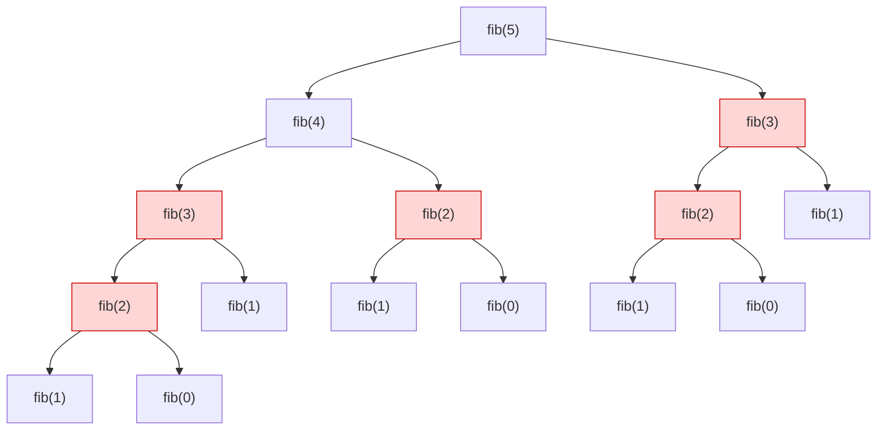
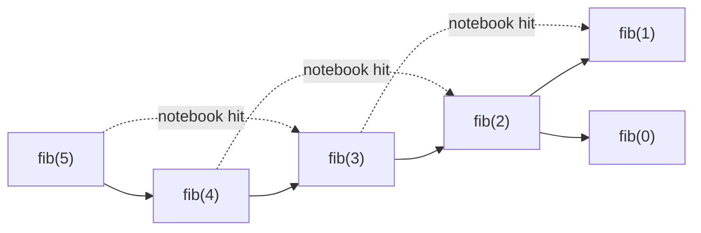
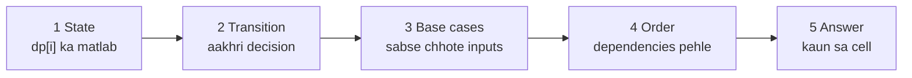
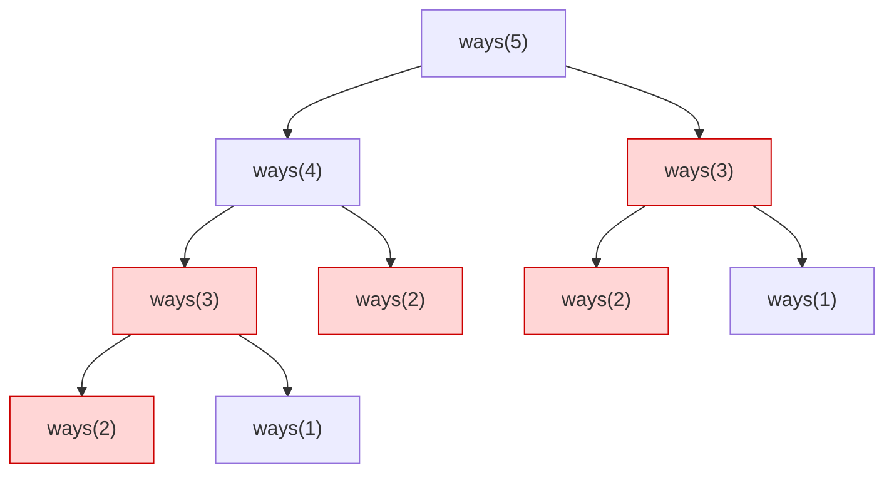

# Chapter 20 · Dynamic Programming I: The Framework & 1D DP

> Ek kaagaz pe `1+1+1+1+1+1+1+1` likho aur dost se poocho kitna hua. "Aath." Ab end mein ek aur `+1` likh do. "Nau," woh turant bolega. Usne dobara nahi gina: usne 8 **yaad** rakha. Kaam dobara na karne ka ye chhota sa pal hi poora dynamic programming hai. Baaki sab ye seekhna hai ki kab tum kaam dobara karne wale ho, aur kya likh ke rakhna hai.

**Is chapter mein tum seekhoge:**
- DP asal mein kya hai: **overlapping subproblems** + **optimal substructure**, bina kisi jaadu ke
- Har DP solution ke chaar roop, **ek hi problem** pe: plain recursion → memoization → tabulation → space-optimised
- **5-step framework** (state, transition, base case, order, answer) jo "kuch samajh nahi aa raha" ko solution mein badal deta hai
- **State kaise dhoondein** (sabse mushkil hissa), ek repeatable recipe ke saath
- Recursion trees kaise banayein taaki overlapping kaam *dikhe*
- 12+ classic 1D problems: Fibonacci, Climbing Stairs, Min Cost Climbing Stairs, House Robber I & II, Decode Ways, Coin Change I & II (aur loop order answer kyun badal deta hai), Word Break, LIS O(n²) aur O(n log n) mein, Maximum Product Subarray, Jump Game II, Perfect Squares
- **Counting DP vs optimisation DP**, aur unke base cases alag kyun hote hain

**Isse pehle padho:** [Recursion](../part-1-python/12-recursion.md) · [Big-O](01-big-o-complexity.md) · [Hashing Patterns](05-hashing.md) · [Recursion & Backtracking](09-backtracking.md) · [Binary Search](08-binary-search.md) (fast LIS ke liye)

---

## 🧠 The Big Idea · Asli Baat

Ye raha Fibonacci sequence: har number apne pichhle do numbers ka sum hai.

```text
F(0)=0  F(1)=1  F(2)=1  F(3)=2  F(4)=3  F(5)=5  F(6)=8 ...
```

Seedha recursive code hai `fib(n) = fib(n-1) + fib(n-2)`. Chalo dekhte hain `fib(5)` ke liye ye asal mein karta kya hai. Har box ek function call hai:



Laal boxes dekho. `fib(3)` **do baar** compute hua. `fib(2)` **teen baar**. Tree ka poora right half left mein pehle se ho chuke kaam ki carbon copy hai. `fib(50)` ke liye tree mein lagbhag 40 arab (40 billion) boxes hote hain, jabki alag sawaal sirf **51** hain (`fib(0)` se `fib(50)`). Hum wahi 51 sawaal arabon baar solve kar rahe hain.

Iska ilaaj hai ek notebook. `fib(k)` compute karne se pehle notebook dekho. Answer wahan hai toh use karo. Nahi hai toh ek baar compute karo aur likh lo. Ab tree ek seedhi line ban jaata hai:



Yahi hai **dynamic programming (DP)**: *har alag subproblem ek hi baar solve karo, answer store karo, dobara use karo.* Ye exponential time ko polynomial time bana deta hai.

> 🇮🇳 **Desi Analogy:** Board exam ki **rough sheet** socho. Question 3(a) mein tumne nikaala ki triangle ka area 24 hai. Question 3(b) bolta hai "us triangle ka area use karke height nikaalo". Koi samajhdaar student area dobara calculate nahi karta; woh rough sheet pe dekh leta hai: 24. Rough sheet = **memo/notebook**. "Triangle ka area" = ek **subproblem**. Area dobara chahiye hona = **overlapping subproblem**. Aur sheet pe dekh lena = **cache hit**. Jo student har baar sab kuch scratch se nikaalta hai, uska time khatam ho jaata hai: wahi plain recursion hai.

> 💡 **The one-sentence definition:** DP = recursion + ek notebook. Agar tum aisa recursive solution likh sakte ho jisme same calls repeat hoti hain, toh tum use DP bana sakte ho.

Do conditions kisi problem ko DP-friendly banati hain:

| Ingredient | Seedha matlab | Fibonacci example |
|---|---|---|
| **Overlapping subproblems** | Wahi chhota sawaal baar baar poocha jaata hai | `fib(3)` ki zaroorat `fib(5)` aur `fib(4)` dono ko hai |
| **Optimal substructure** | Bade sawaal ka best answer chhote sawaalon ke best answers se banta hai | `fib(5)` seedha `fib(4)` aur `fib(3)` se banta hai |

Agar overlap nahi hai (jaise merge sort, jiske halves kabhi repeat nahi hote), toh notebook se koi fayda nahi: woh plain divide and conquer hai. Agar optimal substructure nahi hai (jaise "graph mein longest *simple* path", jahan kisi beech ke node tak ka best path un nodes ko use kar sakta hai jo tumhe baad mein chahiye), toh DP galat answers deta hai.

> 💡 **Itna daraavna naam kyun?** Richard Bellman ne 1950s mein "dynamic programming" naam rakha, kuch had tak isliye kyunki ye funding committees ko impressive lagta tha. Yahan "programming" ka matlab hai "table bharna", jaise TV programme ka schedule, code likhna nahi. Naam se daro mat.

---

## 🔨 Building It Up · Zero Se Shuru

### 1. Feel the pain: counting calls in naive recursion

Chalo naapte hain plain recursion kitna kaam barbaad karta hai.

```python
calls = 0

def fib(n):
    global calls
    calls += 1
    if n < 2:
        return n
    return fib(n - 1) + fib(n - 2)

for n in (10, 20, 25):
    calls = 0
    value = fib(n)
    print(f"fib({n}) = {value:>6}   calls = {calls}")
```

```text
fib(10) =     55   calls = 177
fib(20) =   6765   calls = 21891
fib(25) =  75025   calls = 242785
```

Kya hua: `n` mein har +5 se kaam lagbhag 11 guna ho jaata hai. Calls ki ginti φⁿ ki tarah badhti hai jahan φ ≈ 1.618 (golden ratio). Yaani **O(1.618ⁿ)**, exponential. `fib(50)` mein ghante lag jaayenge. `fib(100)` suraj se zyada jiyega.

Ab ek notebook (dictionary) ke saath:

```python
calls = 0
memo = {}

def fib(n):
    global calls
    calls += 1
    if n < 2:
        return n
    if n in memo:                 # pehle solve ho chuka? dobara use karo
        return memo[n]
    memo[n] = fib(n - 1) + fib(n - 2)
    return memo[n]

print(fib(25), "calls =", calls)
calls = 0
memo.clear()
print(fib(90), "calls =", calls)
```

```text
75025 calls = 49
2880067194370816120 calls = 179
```

Kya hua: 242,785 calls ban gayi 49. Aur `fib(90)`, jo naive tareeke se impossible tha, sirf 179 calls leta hai. Har `fib(k)` ek baar *compute* hota hai aur zyada se zyada ek baar aur *lookup* hota hai, toh total lagbhag 2n calls: **O(n)**.

(Ye 2n kahan se? `fib(k)` jab pehli baar compute hota hai, woh `fib(k-1)` aur `fib(k-2)` ko call karta hai. `fib(k-1)` ki call asli kaam karti hai, aur jab tak woh lautti hai, `fib(k-2)` notebook mein aa chuka hota hai, toh doosri call turant lookup pe khatam. Har level pe ek asli call, ek lookup call.)

### 2. Our running example: House Robber

Fibonacci asli decisions dikhane ke liye bahut simple hai, toh agle paanch sections ke liye hum ek hi problem lenge aur use DP ke chaaron roopon se guzarte dekhenge.

**House Robber:** ghar ek line mein khade hain, `nums[i]` ghar i mein rakha paisa hai. Tum do **adjacent** ghar nahi loot sakte (alarms jude hue hain). Zyada se zyada kitna paisa le sakte ho?

```text
nums = [2, 7, 9, 3, 1]
best = 2 + 9 + 1 = 12   (houses 0, 2, 4)
```

> 🇮🇳 **Desi Analogy:** Shaadi ke season mein ek caterer ke paas lagatar dino ki bookings ke offers hain: din 1 pe ₹2 lakh, din 2 pe ₹7 lakh, aur aage. Lekin uska staff back-to-back do din kaam nahi kar sakta. Kaun se din le ki kamaai maximum ho? Din = ghar, booking ka paisa = `nums[i]`, "lagatar do din nahi" = "adjacent ghar nahi". Aur caterer ka sochne ka tareeka bhi DP wala hai: "aakhri din ki booking lun ya chhodun? Lun toh usse pichhla din band; chhodun toh pichhle din tak ka best hi mera best."

Greedy ideas fail hote hain. "Sabse bada ghar pehle lo" 9 uthata hai, phir 7 ya 3 nahi le sakta, phir 2 aur 1 leta hai: 12. Yahan theek hai, lekin `[5, 9, 5]` try karo: greedy 9 leta hai aur ruk jaata hai (9), jabki 5 + 5 = 10 better hai. "Har doosra ghar lo" `[10, 1, 1, 10]` pe fail hota hai (alternate ghar lene se max 11 milta hai, jabki best 20 hai, ghar 0 aur 3 leke). Humein choices ko theek se consider karna padega.

### 3. Form 1: Plain recursion (the brute force that thinks clearly)

**Aakhri ghar** ke baare mein socho. Ya toh tum use lootoge ya nahi.

- Aakhri ghar **skip** kiya → answer hai uske pehle ke saare gharon se jo best kar sakte ho.
- Aakhri ghar **loota** → uska paisa mila, lekin uska padosi off-limits hai, toh *do* ghar peeche tak ka best add karo.

Define karo `best(i)` = **pehle i gharon** (ghar `0 .. i-1`) se maximum paisa. Toh:

```text
best(0) = 0                              (no houses, no money)
best(1) = nums[0]                        (one house: rob it)
best(i) = max( best(i-1),                (skip house i-1)
               best(i-2) + nums[i-1] )   (rob house i-1)
```

Dhyaan do indexing pe: `best(i)` "pehle i ghar" ki baat karta hai, toh unme aakhri ghar index `i-1` pe hai. Isliye formula mein `nums[i-1]` hai. Ye "size i" wala convention shuru mein ajeeb lagta hai, lekin `best(0)` = "koi ghar nahi" ko ekdum saaf base case bana deta hai.

```python
calls = 0

def rob(nums):
    def best(i):
        global calls
        calls += 1
        if i == 0:
            return 0
        if i == 1:
            return nums[0]
        return max(best(i - 1), best(i - 2) + nums[i - 1])
    return best(len(nums))

print(rob([2, 7, 9, 3, 1]), "calls =", calls)
calls = 0
print(rob(list(range(1, 26))), "calls =", calls)
```

```text
12 calls = 15
169 calls = 242785
```

Kya hua: recursion *sahi* hai, aur upar wali English argument jaisi hi padhti hai. Lekin sirf 25 gharon ke liye ye `best` ko 242,785 baar call karta hai: Fibonacci jaisa hi dhamaka, kyunki `best(i)` bhi `best(i-1)` aur `best(i-2)` ko call karta hai, bilkul `fib` ki tarah. (Number bhi exactly same hai: 242,785, kyunki dono ka recursion tree ek hi shape ka hai.)

> 💡 **Ye step kabhi skip mat karna.** Asli sochna recursion mein hi hota hai. Baad ka har roop isi ka mechanical transformation hai. Agar recursion nahi likh sakte, toh DP bhi nahi likh sakte.

### 4. Form 2: Memoization (top-down DP)

**Memoization** = recursion + answers ka ek cache. Wahi code, bas do lines zyada. Python humein ready-made notebook deta hai: `functools.cache` (ek unlimited `lru_cache`) har alag argument ke liye return value yaad rakhta hai.

```python
from functools import cache

calls = 0

def rob(nums):
    @cache
    def best(i):
        global calls
        calls += 1
        if i == 0:
            return 0
        if i == 1:
            return nums[0]
        return max(best(i - 1), best(i - 2) + nums[i - 1])
    return best(len(nums))

print(rob([2, 7, 9, 3, 1]), "calls =", calls)
calls = 0
print(rob(list(range(1, 26))), "calls =", calls)
```

```text
12 calls = 6
169 calls = 26
```

Kya hua: `calls` ab sirf asli computations ginta hai (cache hits function body mein ghuste hi nahi). 26 alag states (`best(0)` se `best(25)`) mein se har ek ek baar compute hua. **O(n) time, O(n) space** (cache plus recursion stack).

Yahi cheez ek explicit dictionary ke saath, jo tum interview mein likhoge agar dikhana chahte ho ki tum samajhte ho `@cache` karta kya hai:

```python
def rob(nums):
    memo = {}

    def best(i):
        if i == 0:
            return 0
        if i == 1:
            return nums[0]
        if i not in memo:
            memo[i] = max(best(i - 1), best(i - 2) + nums[i - 1])
        return memo[i]

    return best(len(nums))

print(rob([2, 7, 9, 3, 1]), rob([5, 9, 5]), rob([10, 1, 1, 10]))
```

```text
12 10 20
```

Ise **top-down** isliye kehte hain kyunki tum bade sawaal (`best(n)`) se shuru karte ho aur recursion chhote sawaalon tak *neeche* khodta hai.

### 5. Form 3: Tabulation (bottom-up DP)

Bhara hua memo dekho: ye bas ek list hai jiska entry `i` `best(i)` rakhta hai. Toh us list ko seedha ek loop se kyun na bharein, **sabse chhote se shuru karke**? Tab har value jo humein chahiye, zaroorat ke waqt pehle se wahan hogi. Recursion ki zaroorat hi nahi.

> 🇮🇳 **Desi Analogy:** Kirana dukaan ka **khata**. Lala ji har din ke end mein running total likhte hain: "aaj tak ka udhaar = kal tak ka udhaar + aaj ka saamaan". Mahine ke end mein total chahiye toh poore mahine ki parchiyan dobara nahi jodte; aakhri line padh lete hain. Khata = `dp` list, har line = ek `dp[i]`, "kal ki line + aaj" = transition, aur line by line upar se neeche bharna = **bottom-up order**. Jab bhi koi line likhte ho, usse pehle wali line pehle se likhi hui hoti hai.

```python
def rob(nums):
    n = len(nums)
    if n == 0:
        return 0
    dp = [0] * (n + 1)          # dp[i] = pehle i gharon se best paisa
    dp[0] = 0
    dp[1] = nums[0]
    for i in range(2, n + 1):
        dp[i] = max(dp[i - 1], dp[i - 2] + nums[i - 1])
    print("dp table:", dp)
    return dp[n]

print(rob([2, 7, 9, 3, 1]))
```

```text
dp table: [0, 2, 7, 11, 11, 12]
12
```

**DP table trace** `nums = [2, 7, 9, 3, 1]` ke liye:

| i | ghar i-1 | skip: dp[i-1] | rob: dp[i-2] + nums[i-1] | dp[i] |
|---|---|---|---|---|
| 0 | - | - | - | 0 (base) |
| 1 | 2 | - | - | 2 (base) |
| 2 | 7 | 2 | 0 + 7 = 7 | **7** |
| 3 | 9 | 7 | 2 + 9 = 11 | **11** |
| 4 | 3 | 11 | 7 + 3 = 10 | **11** |
| 5 | 1 | 11 | 11 + 1 = 12 | **12** |

Kya hua: `dp` list hi notebook hai, left se right bhari gayi. Ye **bottom-up** hai: base cases se shuru karo aur answer tak *upar* banao. Loop ke andar recurrence line recursive wali se *bilkul same* hai, bas `best(...)` ki jagah `dp[...]`.

> 🤔 **Mann mein sawaal:** `dp` ka size `n + 1` kyun? `n` gharon ke liye `n` size kaafi nahi?
>
> **Jawab:** Kyunki humari state "pehle i ghar" hai, aur i ki values 0 se n tak jaati hain: woh n + 1 values hain. `dp[0]` "koi ghar nahi" wala case hai, jo base case ko natural bana deta hai (0 ghar = 0 paisa). Bina iske tumhe "pehla ghar" ko special case karna padta. Ek extra slot, aadhe edge cases khatam.

### 6. Form 4: Space optimisation

Loop dekho: `dp[i]` sirf `dp[i-1]` aur `dp[i-2]` padhta hai. Usse purana sab bekaar bojh hai. Sirf do variables rakho aur unhe aage khiskaate jao.

```python
def rob(nums):
    prev2, prev1 = 0, 0          # dp[i-2], dp[i-1]
    for money in nums:
        prev2, prev1 = prev1, max(prev1, prev2 + money)
    return prev1

print(rob([2, 7, 9, 3, 1]), rob([5, 9, 5]), rob([10, 1, 1, 10]), rob([]))
```

```text
12 10 20 0
```

Kya hua: **O(n) time, O(1) space**. Dono ko 0 se shuru karne se khaali list aur ek ghar wala case free mein handle ho jaata hai (`max(0, 0 + nums[0])`). Tuple assignment dono variables ek saath update karta hai, toh `prev2` ko *purana* `prev1` milta hai.

`[2, 7, 9, 3, 1]` pe variables kaise khiskte hain:

| money | prev2 (naya) | prev1 (naya) |
|---|---|---|
| start | 0 | 0 |
| 2 | 0 | max(0, 0+2) = 2 |
| 7 | 2 | max(2, 0+7) = 7 |
| 9 | 7 | max(7, 2+9) = 11 |
| 3 | 11 | max(11, 7+3) = 11 |
| 1 | 11 | max(11, 11+1) = 12 |

Bilkul upar wali dp table, bas ek waqt pe sirf do khaane.

### 7. The four forms side by side

| Form | Code ka shape | Time | Extra space | Kab use karein |
|---|---|---|---|---|
| Plain recursion | `f(i)` calls `f(i-1)`, `f(i-2)` | O(2ⁿ)-ish | O(n) stack | Sirf *sochne* ke liye. Kabhi submit mat karo. |
| Memoization (top-down) | recursion + `@cache` | O(states × work) | O(states) + stack | Likhne mein sabse fast; badhiya jab bahut saari states ki kabhi zaroorat hi nahi padti |
| Tabulation (bottom-up) | loop `dp[]` bharta hai | O(states × work) | O(states) | Recursion limit nahi; space-optimise karna aasaan |
| Space-optimised | loop + kuch variables | same | O(1) ya ek row | Jab dp[i] sirf ek fixed doori tak peeche dekhta hai |

> 🤔 **Mann mein sawaal:** Memoization aur tabulation dono O(n) hain. Toh interview mein kaunsa likhun?
>
> **Jawab:** **Memoization se shuru karo.** Recursion tumne pehle hi soch li hai, bas `@cache` lagao, aur bugs ka chance sabse kam. Tabulation tab likho jab (1) interviewer maange, (2) n itna bada ho ki recursion depth crash kar de (Python mein ~1000 default limit), ya (3) space optimise karni ho. Dono ka answer same hota hai; farak sirf fill karne ke order aur constant factors ka hai.

> 💡 **The interview move:** recursion bol ke batao, use memoization se code karo (fast aur safe), phir bolo "this can be converted to bottom-up and the space reduced to O(1) because each state only depends on the previous two." Wahi ek sentence serious points dilata hai.

### 8. The 5-step framework

Har DP problem, sabse aasaan se sabse daraavne tak, in paanch khaali jagahon ko bhar ke solve hoti hai. Coding se *pehle* inhe likh lo.

| Step | Khud se poocho | House Robber |
|---|---|---|
| **1. State** | `dp[i]` ka *matlab* kya hai, ek English sentence mein? | `dp[i]` = pehle `i` gharon se max paisa |
| **2. Transition** | `dp[i]` chhoti states se kaise banta hai? (**Aakhri decision** ke baare mein socho.) | `dp[i] = max(dp[i-1], dp[i-2] + nums[i-1])` |
| **3. Base cases** | Kaun si states bina transition ke seedhe answer hoti hain? | `dp[0] = 0`, `dp[1] = nums[0]` |
| **4. Order** | States kis order mein bharein taaki dependencies ready hon? | `i` 2 se n tak |
| **5. Answer** | Kaun si state (ya states ka combination) final answer hai? | `dp[n]` |



90% struggle do steps mein hota hai: **state** aur **transition**. Baaki teen unse lagbhag apne aap nikal aate hain.

> ⚠️ Agar tum ek simple English sentence mein nahi bol sakte ki `dp[i]` ka matlab kya hai, toh ruk jao. Code mat karo. DP ka har bug dhundhli state definition se aata hai.

### 9. How to find the state (the recipe)

State hai **past ke baare mein un facts ka set jo baaki decisions optimally lene ke liye chahiye**. Bina kisi "inspiration" ke ise dhoondne ka tareeka:

1. **Brute-force recursion likho** jo ek baar mein ek decision leti hai (lo/chhodo, kaun sa coin, kahan kaatna hai).
2. **Parameters ki list banao** jo calls ke beech badalte hain. Wahi parameters state *hain*.
3. **Unhe chhota karo.** Agar koi parameter bada hai (chune hue items ki list, poora path), toh poocho: "baaki decide karne ke liye *kam se kam* kya yaad rakhna zaroori hai?" Aksar woh ek index, bacha hua amount, ya aakhri chuni hui cheez hoti hai.
4. **States gino.** Agar alag parameter combinations ki ginti polynomial hai (jaise n, ya n × amount), toh DP chalega.

Ise apply karte hain:

| Problem | Past ki naive "yaad" | Asal mein kya chahiye | State |
|---|---|---|---|
| House Robber | kaun kaun se ghar loote | kitne ghar consider ho chuke | `i` |
| Climbing Stairs | exact kaun se steps liye | kis seedhi pe khade ho | `i` |
| Coin Change | kaun se coins use kiye | kitna amount bacha hai | `amount` |
| Longest Increasing Subsequence | ab tak ka poora subsequence | **aakhri** chuna element (agle se compare karne ke liye) | aakhri element ka index |
| Word Break | ab tak string ko kaise toda | jo hissa toda nahi, woh kahan se shuru hota hai | `i` |

House Robber pe dhyaan do: "kaun se ghar loote" ek set hai, 2ⁿ possibilities. Lekin aage decide karne ke liye tumhe poora set nahi chahiye; sirf ye ki kitne ghar dekh chuke ho (aur transition khud adjacent wali condition sambhal leta hai). 2ⁿ se n. Yahi "shrink" step ka jaadu hai.

**Do shapes lagbhag har 1D state ko cover karte hain:**

- **Prefix / suffix shape:** `dp[i]` = pehle `i` items ka answer (ya item `i` se end tak ka). House Robber, Decode Ways, Word Break isse chalte hain.
- **"Ending exactly at i" shape:** `dp[i]` = woh best answer jo **index `i` pe khatam hona hi chahiye**. Tab use hota hai jab answer ek contiguous ya chained piece ho (LIS, Maximum Subarray, Max Product). Tab final answer `max(dp)` hota hai, `dp[n-1]` nahi.
- (Ek teesra, **value shape**: `dp[x]` = kisi target value `x` ka answer, jaise paise ka amount. Coin Change, Perfect Squares.)

### 10. Seeing overlap: drawing recursion trees

DP uthane se pehle tumhe *khud ko prove* kar paana chahiye ki overlap hai. Chhote input ka recursion tree banao aur repeated labels dhoondo.

**Climbing Stairs:** tum ek baar mein 1 ya 2 steps chadh sakte ho. Step `n` tak pahunchne ke kitne alag tareeke hain? Aakhri move ya toh 1-step tha (`n-1` se) ya 2-step (`n-2` se), toh `ways(n) = ways(n-1) + ways(n-2)`. `n = 5` ka tree:



`ways(3)` do baar aata hai, `ways(2)` teen baar. Overlap confirmed: memoize karo.

**Tree ko jaldi kaise padhein:**
- **Labels** = states. *Alag* labels ki ginti tumhari DP table ka size hai.
- **Branching factor** = har state pe kitni choices = per state kaam.
- **DP time ≈ (alag labels) × (branching factor).** Yahan: n labels × 2 = O(n).
- Agar koi label kabhi repeat nahi hota (jaise saare permutations banana, jahan har node ka "used set" unique hai), toh memoization kaam nahi aayega: woh backtracking ka ilaaka hai ([Chapter 09](09-backtracking.md)).

### 11. Climbing Stairs and Min Cost Climbing Stairs

Climbing Stairs costume pehna hua Fibonacci hai. Bottom-up, space-optimised:

```python
def climb_stairs(n):
    if n <= 2:
        return n
    one_back, two_back = 2, 1        # ways(2), ways(1)
    for _ in range(3, n + 1):
        one_back, two_back = one_back + two_back, one_back
    return one_back

print([climb_stairs(n) for n in range(1, 8)], climb_stairs(45))
```

```text
[1, 2, 3, 5, 8, 13, 21] 1836311903
```

`ways(3) = 3` khud gin ke dekho: 1+1+1, 1+2, 2+1. Order matter karta hai (pehle 1 phir 2, ya pehle 2 phir 1, alag tareeke hain), isliye 3.

**Min Cost Climbing Stairs:** `cost[i]` woh hai jo tum seedhi i pe *pair rakhne* pe dete ho. Tum seedhi 0 ya 1 se shuru kar sakte ho, aur top tak pahunchna hai (aakhri seedhi se ek aage). Total cost minimise karo.

5 steps:
1. **State:** `dp[i]` = position i pe *khade hone* ka minimum cost (`cost[i]` dene se pehle), jahan position `n` top hai.
2. **Transition:** tum i-1 se aaye (`cost[i-1]` diya) ya i-2 se (`cost[i-2]` diya): `dp[i] = min(dp[i-1] + cost[i-1], dp[i-2] + cost[i-2])`.
3. **Base:** `dp[0] = dp[1] = 0` (wahan free mein shuru kar sakte ho).
4. **Order:** i 2 se n tak.
5. **Answer:** `dp[n]`.

```python
def min_cost_climbing_stairs(cost):
    n = len(cost)
    dp = [0] * (n + 1)
    for i in range(2, n + 1):
        dp[i] = min(dp[i - 1] + cost[i - 1], dp[i - 2] + cost[i - 2])
    return dp[n]

print(min_cost_climbing_stairs([10, 15, 20]))
print(min_cost_climbing_stairs([1, 100, 1, 1, 1, 100, 1, 1, 100, 1]))
```

```text
15
6
```

Kya hua: `[10, 15, 20]` ke liye best hai seedhi 1 se shuru karo, 15 do, aur do step kood ke top pe. Table: `dp = [0, 0, 10, 15]`. `dp[2] = min(0 + 15, 0 + 10) = 10`, `dp[3] = min(10 + 20, 0 + 15) = 15`. Dekho kaise state ko *precisely define* karne se ("i pe khade hone ka cost, i ka paisa dene se pehle") base case ekdum obvious ho gaya.

### 12. House Robber II: the circular street

Ab ghar ek **circle** mein hain: pehla aur aakhri padosi hain. Dono nahi loot sakte.

**Idea:** cases se circle todo. Ya toh ghar 0 *nahi* loota gaya (line `nums[1:]` solve karo) ya aakhri ghar *nahi* loota gaya (`nums[:-1]` solve karo). Har valid plan kam se kam ek case mein aata hai. House Robber I dobara use karo.

Kyun "har valid plan kam se kam ek case mein"? Valid plan pehla aur aakhri dono nahi le sakta. Toh ya pehla nahi liya (case 1 mein aata hai), ya aakhri nahi liya (case 2 mein aata hai). Dono hi nahi liye toh dono cases mein. Koi plan chhoot nahi sakta, aur koi invalid plan (dono liye) kisi case mein ghus nahi sakta.

```python
def rob_line(nums):
    prev2 = prev1 = 0
    for money in nums:
        prev2, prev1 = prev1, max(prev1, prev2 + money)
    return prev1

def rob_circle(nums):
    if len(nums) == 1:
        return nums[0]
    return max(rob_line(nums[1:]), rob_line(nums[:-1]))

print(rob_circle([2, 3, 2]), rob_circle([1, 2, 3, 1]), rob_circle([1, 2, 3]), rob_circle([7]))
```

```text
3 4 3 7
```

Kya hua: ek trick jo tum baar baar use karoge: **jab koi constraint simple structure tod de, toh aise cases mein todo jinme se har ek ka structure simple ho.** Single-house check zaroori hai, kyunki warna dono slices khaali hote aur answer 0 aata, 7 nahi.

### 13. Decode Ways

Letters encode hote hain `A=1, B=2, ..., Z=26` se. Digits ki ek string di hai, use kitne tareeke se decode kar sakte ho? `"226"` → `"BZ"` (2 26), `"VF"` (22 6), `"BBF"` (2 2 6) → 3 tareeke. Zeros tricky hain: `"06"` decode nahi ho sakta (koi letter `0` ya `06` nahi hai).

5 steps:
1. **State:** `dp[i]` = pehle `i` characters decode karne ke tareekon ki ginti.
2. **Transition (aakhri decision):** aakhri letter ne ya toh **ek digit** use kiya (`s[i-1]`, valid agar `'0'` nahi hai) ya **do digits** (`s[i-2:i]`, valid agar 10 aur 26 ke beech hai). Har valid option ke tareeke jodo.
3. **Base:** `dp[0] = 1`. Khaali string ki exactly ek decoding hai: khaali decoding. (Ye "kuch na karne ka 1 tareeka" wala base case har counting DP ka dil hai.)
4. **Order:** i 1 se n tak.
5. **Answer:** `dp[n]`.

> 🤔 **Mann mein sawaal:** Khaali string ko decode karne ka "1 tareeka"? Kuch decode hi nahi kiya, toh 0 hona chahiye na?
>
> **Jawab:** Socho `dp[0]` kahan use hota hai: `"26"` ke liye `dp[2]` mein "do digit wala aakhri letter" option `dp[0]` jodta hai. Matlab "26 = Z, aur uske pehle jo bacha (kuch nahi) use decode karne ke tareeke". "Z" ek valid decoding hai, toh ye option 1 contribute karna chahiye. Agar `dp[0] = 0` hota, toh har woh decoding jo string ke bilkul shuru se shuru hoti hai, 0 gini jaati, aur poora answer 0 ho jaata. "Kuch na karna" ek valid (khaali) plan hai, aur aise plans ki ginti 1 hai. Jaise khaali thaali ka ek hi tareeka hai: kuch mat rakho.

```python
def num_decodings(s):
    n = len(s)
    dp = [0] * (n + 1)
    dp[0] = 1
    for i in range(1, n + 1):
        if s[i - 1] != "0":                       # aakhri letter ek digit ka hai
            dp[i] += dp[i - 1]
        if i >= 2 and 10 <= int(s[i - 2:i]) <= 26:  # aakhri letter do digit ka hai
            dp[i] += dp[i - 2]
    return dp[n]

for s in ["12", "226", "06", "11106", "2101"]:
    print(s, num_decodings(s))
```

```text
12 2
226 3
06 0
11106 2
2101 1
```

**`"226"` ka trace:**

| i | prefix | ek digit `s[i-1]` | do digits `s[i-2:i]` | dp[i] |
|---|---|---|---|---|
| 0 | "" | - | - | 1 (base) |
| 1 | "2" | '2' ok → +dp[0]=1 | - | 1 |
| 2 | "22" | '2' ok → +dp[1]=1 | "22" ok → +dp[0]=1 | 2 |
| 3 | "226" | '6' ok → +dp[2]=2 | "26" ok → +dp[1]=1 | 3 |

Kya hua: `10 <= int(...)` apne aap `0` se shuru hone wale do-digit chunks jaise `"06"` ko reject kar deta hai (`int("06")` = 6, jo 10 se kam hai). Dhyaan do `dp[i]` sirf `dp[i-1]` aur `dp[i-2]` pe depend karta hai, toh ye bhi O(1) space tak optimise hota hai.

`"2101"` = 1 kyun? "2 10 1" hi akela valid hai. "21 0 1" mein akela "0" decode nahi hota, aur "21 01" mein "01" bhi nahi.

### 14. Coin Change (minimum coins): the "value" state

Coin denominations diye hain (har ek ki unlimited supply) aur ek `amount`. Amount banane ke liye **sabse kam coins** return karo, ya -1 agar impossible.

Greedy ("jo sabse bada coin fit ho woh lo") fail hota hai: coins `[1, 3, 4]`, amount 6. Greedy: 4 + 1 + 1 = 3 coins. Best: 3 + 3 = 2 coins.

1. **State:** `dp[x]` = exactly amount `x` banane ke liye sabse kam coins.
2. **Transition (aakhri decision):** aakhri coin koi coin `c` tha. Usse pehle tumne `x - c` optimally banaya. Toh `dp[x] = 1 + min(dp[x - c])`, saare coins `c <= x` pe.
3. **Base:** `dp[0] = 0`. Unreachable amounts infinity se shuru hote hain.
4. **Order:** x 1 se amount tak (har `dp[x]` ko chhote amounts chahiye).
5. **Answer:** `dp[amount]`, ya -1 agar woh abhi bhi infinity hai.

```python
def coin_change(coins, amount):
    INF = float("inf")
    dp = [0] + [INF] * amount
    for x in range(1, amount + 1):
        for c in coins:
            if c <= x and dp[x - c] + 1 < dp[x]:
                dp[x] = dp[x - c] + 1
    return dp[amount] if dp[amount] != INF else -1

print(coin_change([1, 2, 5], 11), coin_change([1, 3, 4], 6), coin_change([2], 3), coin_change([1], 0))
```

```text
3 2 -1 0
```

**DP table** coins `[1, 2, 5]`, amount 11 ke liye:

| x | 0 | 1 | 2 | 3 | 4 | 5 | 6 | 7 | 8 | 9 | 10 | 11 |
|---|---|---|---|---|---|---|---|---|---|---|---|---|
| dp[x] | 0 | 1 | 1 | 2 | 2 | 1 | 2 | 2 | 3 | 3 | 2 | 3 |

Ek cell check karo, `dp[11]`: aakhri coin 1 → `dp[10]+1 = 3`; aakhri coin 2 → `dp[9]+1 = 4`; aakhri coin 5 → `dp[6]+1 = 3`. Minimum 3 (5 + 5 + 1). Time **O(amount × coins)**, space O(amount).

`coin_change([2], 3)` = -1 kyun? Sirf 2 ke coins se odd amount ban hi nahi sakta: `dp[1]` infinity, toh `dp[3] = dp[1] + 1` bhi infinity. `inf + 1` Python mein `inf` hi rehta hai, toh koi special case nahi chahiye.

### 15. Coin Change II (number of ways): why loop order matters

Wahi coins, lekin ab **gino** ki kitne alag *combinations* amount banate hain. `coins = [1, 2, 5]`, `amount = 5` → 4 tareeke: `5`, `2+2+1`, `2+1+1+1`, `1+1+1+1+1`.

Ab woh twist jo sabko confuse karta hai. Ye do programs *sirf is baat mein alag hain ki kaun sa loop bahar hai*:

```python
def ways_coins_outside(coins, amount):
    dp = [1] + [0] * amount          # 0 banane ka 1 tareeka: koi coin mat lo
    for c in coins:                  # OUTER: coins
        for x in range(c, amount + 1):
            dp[x] += dp[x - c]
    return dp[amount]

def ways_amount_outside(coins, amount):
    dp = [1] + [0] * amount
    for x in range(1, amount + 1):   # OUTER: amounts
        for c in coins:
            if c <= x:
                dp[x] += dp[x - c]
    return dp[amount]

print(ways_coins_outside([1, 2, 5], 5), ways_amount_outside([1, 2, 5], 5))
```

```text
4 9
```

Same coins, same amount, alag answers. Sahi kaun hai? **Dono**, alag sawaalon ke liye:

- **Coins bahar → combinations** (order matter nahi karta: `1+2` aur `2+1` same hain). Answer 4. Ye hai **Coin Change II**.
- **Amount bahar → permutations** (order matter karta hai: `1+2` aur `2+1` alag sequences hain). Answer 9. Ye hai **Combination Sum IV** (naam bura rakha gaya hai, ye sequences ginta hai).

> 🇮🇳 **Desi Analogy:** Cricket team chunna vs batting order banana. **Team** (playing XI) mein sirf ye matter karta hai *kaun* khel raha hai: "Rohit aur Virat" = "Virat aur Rohit", ek hi team. Ye **combination** hai. **Batting order** mein "Rohit pehle, Virat baad mein" aur "Virat pehle, Rohit baad mein" do alag orders hain. Ye **permutation/arrangement** hai. Coins bahar wala loop selector ki tarah kaam karta hai jo pehle saare 1s ka faisla kar leta hai, phir 2s ka, phir 5s ka (team chunna). Amount bahar wala loop har position pe poochta hai "yahan kaun aayega?" (batting order banana). Isliye 5 ke liye 4 teams lekin 9 batting orders.

**Kyun?** Coins bahar hon toh hum *koi bhi* 2 allow hone se pehle saare 1s use kar chuke hote hain. Toh har combination exactly ek canonical order mein banta hai: "saare 1s, phir saare 2s, phir saare 5s". `2+1` kabhi ban hi nahi sakta, kyunki jab hum coin 2 process kar rahe hain, uske baad coin 1 kabhi dobara add nahi hota. Amount bahar ho toh har amount pe hum *har* coin ko aakhri coin maan ke try karte hain, toh `...+1` phir `+2` aur `...+2` phir `+1` dono gine jaate hain.

**Trace (coins bahar)** coins `[1, 2, 5]`, amount 5 ke liye:

| process hone ke baad | dp[0] | dp[1] | dp[2] | dp[3] | dp[4] | dp[5] | matlab |
|---|---|---|---|---|---|---|---|
| start | 1 | 0 | 0 | 0 | 0 | 0 | sirf "kuch mat lo" |
| coin 1 | 1 | 1 | 1 | 1 | 1 | 1 | sirf 1s use karke |
| coin 2 | 1 | 1 | 2 | 2 | 3 | 3 | 1s aur 2s use karke |
| coin 5 | 1 | 1 | 2 | 2 | 3 | **4** | 1s, 2s, 5s use karke |

Row "coin 2" mein `dp[4] = 3`: `1+1+1+1`, `2+1+1`, `2+2`. Har ek ek hi baar likha gaya, ek hi order mein.

Amount bahar wale 9 kaun se hain? 5 = `5`; `1+2+2`, `2+1+2`, `2+2+1` (3 orders); `1+1+1+2` ke 4 orders (2 chaar jagah mein se kahin bhi); aur `1+1+1+1+1`. Total 1 + 3 + 4 + 1 = 9.

> 💡 **Memory hook:** "**C**oins outside = **C**ombinations. **A**mount outside = **A**rrangements."

### 16. Word Break

Ek string `s` aur words ki dictionary di hai. Kya `s` ko dictionary words ki sequence mein toda ja sakta hai? `"leetcode"`, `["leet", "code"]` → True.

1. **State:** `dp[i]` = True agar pehle `i` characters `s[:i]` words mein toot sakte hain.
2. **Transition (aakhri decision = aakhri word):** `dp[i]` True hai agar koi `j < i` aisa ho jisme `dp[j]` True ho aur `s[j:i]` dictionary word ho.
3. **Base:** `dp[0] = True` (khaali prefix: zero words, valid).
4. **Order:** i 1 se n tak.
5. **Answer:** `dp[n]`.

```python
def word_break(s, word_dict):
    words = set(word_dict)
    max_len = max(map(len, words), default=0)
    n = len(s)
    dp = [False] * (n + 1)
    dp[0] = True
    for i in range(1, n + 1):
        for j in range(max(0, i - max_len), i):   # aakhri word max_len se lamba nahi ho sakta
            if dp[j] and s[j:i] in words:
                dp[i] = True
                break
    return dp[n]

print(word_break("leetcode", ["leet", "code"]))
print(word_break("applepenapple", ["apple", "pen"]))
print(word_break("catsandog", ["cats", "dog", "sand", "and", "cat"]))
```

```text
True
True
False
```

Kya hua: ye ek **feasibility DP** hai (options ko `+` ya `min` ki jagah "or" se jodo). `j` ko aakhri `max_len` positions tak limit karne se O(n²) substring checks O(n × L) ban jaate hain, jahan L sabse lamba word hai (har check slicing aur hashing ke liye bhi O(L) leta hai). `"catsandog"` ke liye `dp` True hota hai 3 ("cat"), 4 ("cats"), 7 ("cats|and" ya "cat|sand") pe, lekin dictionary mein koi bhi word exactly 9 pe khatam nahi hota. Position 7 ke baad "og" bacha, jo word nahi; aur "dog" ke liye position 6 pe True chahiye tha, jo nahi hai.

Visual: `dp` for `"catsandog"`:

| i | 0 | 1 | 2 | 3 | 4 | 5 | 6 | 7 | 8 | 9 |
|---|---|---|---|---|---|---|---|---|---|---|
| dp[i] | T | F | F | T | T | F | F | T | F | **F** |

### 17. Longest Increasing Subsequence (LIS), O(n²)

Ek array diya hai, sabse lambe **strictly increasing subsequence** ki length nikaalo (elements order mein, lekin zaroori nahi ki adjacent hon). `[10, 9, 2, 5, 3, 7, 101, 18]` → 4 (jaise `2, 3, 7, 18`).

Yahan prefix state "pehle i elements mein best" kaam nahi karti, kyunki kisi subsequence ko aage badhane ke liye tumhe uska **aakhri element** pata hona chahiye. Toh hum "ending at i" shape use karte hain.

Kyun prefix state fail hoti hai, ek example se: "pehle 4 elements `[10, 9, 2, 5]` mein LIS length 2 hai". Ab agla element 3 aaya. Kya woh LIS ko 3 bana dega? Agar woh LIS `2, 5` hai toh nahi (3 < 5). Lekin agar koi aur length-2 LIS ho jo 3 se chhote pe khatam ho, toh haan. Sirf "length 2" jaanne se ye decide nahi hota. Aakhri element jaanna padega.

1. **State:** `dp[i]` = us longest increasing subsequence ki length jo **exactly index i pe khatam hota hai**.
2. **Transition:** `nums[i]` se pehle wala element koi `nums[j]` hai jahan `j < i` aur `nums[j] < nums[i]`: `dp[i] = 1 + max(dp[j])` un saare j pe (ya 1 agar koi nahi).
3. **Base:** har `dp[i]` 1 se shuru hota hai (element akela).
4. **Order:** i left se right.
5. **Answer:** `max(dp)`: LIS kahin bhi khatam ho sakta hai.

Hum ek **parent** array se asli subsequence bhi wapas banayenge: `parent[i]` yaad rakhta hai ki kaun se `j` ne best value di. Kisi bhi DP mein *solution khud* (sirf uska size nahi) aise hi recover karte hain.

```python
def lis(nums):
    n = len(nums)
    dp = [1] * n
    parent = [-1] * n
    for i in range(n):
        for j in range(i):
            if nums[j] < nums[i] and dp[j] + 1 > dp[i]:
                dp[i] = dp[j] + 1
                parent[i] = j
    end = max(range(n), key=lambda k: dp[k])
    seq = []
    while end != -1:              # parent pointers pe peeche chalo
        seq.append(nums[end])
        end = parent[end]
    return dp, seq[::-1]

dp, seq = lis([10, 9, 2, 5, 3, 7, 101, 18])
print("dp :", dp)
print("LIS:", seq, "length", len(seq))
```

```text
dp : [1, 1, 1, 2, 2, 3, 4, 4]
LIS: [2, 5, 7, 101] length 4
```

`dp` ko padho: `dp[5] = 3` (element 7) kyunki 7 se pehle `2, 5` ya `2, 3` aa sakte hain, length 2 + 1. `dp[6] = 4` (element 101): `2, 5, 7, 101`. `max(range(n), key=...)` pehla index deta hai jahan `dp` max hai (6, yaani 101), isliye output `[2, 5, 7, 101]` aaya, `[2, 3, 7, 18]` nahi. Dono length 4 ke hain; dono sahi.

Time **O(n²)**, space O(n).

### 18. LIS in O(n log n): the patience trick

Socho taash ke patte piles mein baant rahe ho. Har naya patta **sabse left wali us pile pe jaata hai jiska top patta ≥ usse ho**; agar aisi koi pile nahi, toh right mein nayi pile shuru karo. Piles ki ginti LIS length ke barabar hoti hai. Code mein hum sirf har pile ka top ek list `tails` mein rakhte hain:

> `tails[k]` = ab tak dekhe gaye length `k + 1` ke kisi increasing subsequence ka **sabse chhota possible aakhri element**.

Chhota tail accha hai: use aage badhana aasaan hai. Har number `x` ke liye binary search se ([Chapter 08](08-binary-search.md)) pehla tail `>= x` dhoondo aur use `x` se replace karo. Agar `x` saare tails se bada hai, toh append karo (humein ek lamba subsequence mil gaya).

Chhota tail accha kyun? Do length-2 subsequences hain: `2, 5` aur `2, 3`. Agla number 4 aaye toh `2, 3` ko badha ke `2, 3, 4` bana sakte ho, `2, 5` ko nahi. Toh har length ke liye sirf sabse chhota tail yaad rakhna kaafi hai; baaki sab usse bure hain.

```python
from bisect import bisect_left

def lis_length(nums):
    tails = []
    for x in nums:
        k = bisect_left(tails, x)     # pehla tail >= x
        if k == len(tails):
            tails.append(x)           # x sabse lamba subsequence badhata hai
        else:
            tails[k] = x              # x length k+1 ke liye chhota tail hai
        print(f"x={x:>3}  tails={tails}")
    return len(tails)

print("LIS length:", lis_length([10, 9, 2, 5, 3, 7, 101, 18]))
```

```text
x= 10  tails=[10]
x=  9  tails=[9]
x=  2  tails=[2]
x=  5  tails=[2, 5]
x=  3  tails=[2, 3]
x=  7  tails=[2, 3, 7]
x=101  tails=[2, 3, 7, 101]
x= 18  tails=[2, 3, 7, 18]
LIS length: 4
```

Kya hua: `tails` hamesha sorted rehta hai (proof Under the Hood mein), isliye binary search chalta hai, aur **O(n log n)** milta hai. Dhyaan do: `tails` general mein ek asli subsequence **nahi** hai (jaise `[2, 3, 7, 18]` yahan sanyog se valid hai, lekin `[3, 4, 1]` pe tails end mein `[1, 4]` hota hai, jo order mein subsequence nahi hai). Sirf iski *length* meaningful hai.

> 🤔 **Mann mein sawaal:** Agar `tails` asli subsequence nahi hai, toh uski length sahi answer kaise deti hai?
>
> **Jawab:** Kyunki `tails[k]` ka matlab hai "length k+1 ka **koi** subsequence exist karta hai jo is value pe khatam hota hai". `[3, 4, 1]` mein `tails = [1, 4]`: `tails[0] = 1` bolta hai "length 1 ka subsequence 1 pe khatam" (`[1]`), aur `tails[1] = 4` bolta hai "length 2 ka subsequence 4 pe khatam" (`[3, 4]`). Dono alag subsequences ki baat kar rahe hain, ek ki nahi. Lekin length 2 ka koi subsequence exist karta hai, length 3 ka nahi, toh LIS = 2 = `len(tails)`. Replace karne se kabhi koi length "khoti" nahi, sirf us length ka tail behtar hota hai.

> ⚠️ `bisect_left` **strictly** increasing deta hai. **Non-decreasing** subsequences ke liye (equal values allowed), `bisect_right` use karo.

### 19. Maximum Product Subarray: carrying two states

Sabse bade product wala contiguous subarray dhoondo. `[2, 3, -2, 4]` → 6 (`[2, 3]`).

Sums ke liye (Maximum Subarray / Kadane's algorithm), state hai "i pe khatam hone wale subarray ka best sum": `cur = max(x, cur + x)`. Products ke liye negatives ise bigaad dete hain: ek bahut bada **negative** product doosre negative se multiply hoke bahut bada **positive** ban jaata hai. Toh i-1 pe khatam hone wala sabse chhota product i pe sabse bada ban sakta hai.

1. **State:** har index pe do values: `hi[i]` = i pe khatam hone wale subarray ka max product, `lo[i]` = i pe khatam hone wale subarray ka min product.
2. **Transition:** i pe khatam hone wala subarray ya toh akela `[x]` hai, ya i-1 pe khatam hone wale ko aage badhata hai: `hi = max(x, hi*x, lo*x)`, `lo = min(x, hi*x, lo*x)` (*purane* hi aur lo use karke).
3. **Base:** `hi = lo = nums[0]`.
4. **Order:** left se right.
5. **Answer:** saare `hi` values ka max.

```python
def max_product(nums):
    hi = lo = best = nums[0]
    for x in nums[1:]:
        candidates = (x, hi * x, lo * x)
        hi, lo = max(candidates), min(candidates)
        best = max(best, hi)
    return best

print(max_product([2, 3, -2, 4]), max_product([-2, 0, -1]), max_product([-2, 3, -4]))
```

```text
6 0 24
```

**`[-2, 3, -4]` ka trace:**

| x | candidates (x, hi·x, lo·x) | hi | lo | best |
|---|---|---|---|---|
| -2 | start | -2 | -2 | -2 |
| 3 | (3, -6, -6) | 3 | -6 | 3 |
| -4 | (-4, -12, 24) | 24 | -12 | **24** |

Kya hua: "sabse bura" product `-6` sabse accha `24` ban gaya. Seekh: **jab ek number future decide karne ke liye kaafi nahi, toh state mein aur numbers jodo.** Yahi idea [Chapter 21](21-dp-2d-advanced.md) ke stock problems ko power karta hai.

`candidates` tuple pehle banana kyun zaroori hai? Kyunki `hi` aur `lo` dono ko *purani* values se nikalna hai. Agar pehle `hi = ...` update kar dete aur phir `lo = min(x, hi * x, ...)` likhte, toh `lo` naye `hi` se banta: galat.

### 20. Jump Game II (DP version)

`nums[i]` index i se maximum jump length hai. Index 0 se shuru karke, aakhri index tak pahunchne ke minimum jumps nikaalo (pahunchna guaranteed hai).

1. **State:** `dp[i]` = index i tak pahunchne ke sabse kam jumps.
2. **Transition:** tum i mein kisi j < i se kude jahan `j + nums[j] >= i`: `dp[i] = 1 + min(dp[j])`.
3. **Base:** `dp[0] = 0`.
4. **Order:** left se right.
5. **Answer:** `dp[n-1]`.

```python
def jump_dp(nums):
    n = len(nums)
    INF = float("inf")
    dp = [0] + [INF] * (n - 1)
    for i in range(1, n):
        for j in range(i):
            if j + nums[j] >= i:
                dp[i] = min(dp[i], dp[j] + 1)
    return dp[n - 1]

print(jump_dp([2, 3, 1, 1, 4]), jump_dp([2, 3, 0, 1, 4]), jump_dp([1, 1, 1, 1]))
```

```text
2 2 3
```

Pehla example: index 0 → 1 (1 jump), index 1 se 3 tak kood sakte ho, toh seedha 4 (2 jumps). `dp = [0, 1, 1, 2, 2]`.

Ye O(n²) hai. Sahi hai, lekin is problem ka ek special structure hai (reachable positions hamesha ek contiguous range banati hain) jo O(n) **greedy** solution allow karta hai. Woh hum [Chapter 22](22-greedy-intervals.md) mein karenge. DP hamesha ek safe pehla answer hai; kabhi kabhi greedy fast doosra answer hota hai.

### 21. Perfect Squares: Coin Change in disguise

Sabse kam perfect squares (1, 4, 9, 16, ...) dhoondo jinka sum `n` ho. `12 = 4 + 4 + 4` → 3. `13 = 4 + 9` → 2.

Pehchana? Squares coins hain, `n` amount hai. Same state, same transition.

```python
def num_squares(n):
    squares = [k * k for k in range(1, int(n ** 0.5) + 1)]
    dp = [0] + [float("inf")] * n
    for x in range(1, n + 1):
        for sq in squares:
            if sq > x:
                break
            dp[x] = min(dp[x], dp[x - sq] + 1)
    return dp[n]

print(num_squares(12), num_squares(13), num_squares(1), num_squares(43))
```

```text
3 2 1 3
```

Time **O(n √n)**. (Bonus: Lagrange ka ek theorem kehta hai ki har number zyada se zyada 4 squares ka sum hai, toh answer hamesha 1 se 4 ke beech hota hai.) `43 = 25 + 9 + 9`: 3. Dhyaan do greedy (sabse bada square pehle) yahan bhi fail hota hai: 12 ke liye greedy 9 + 1 + 1 + 1 = 4 squares leta, jabki 4 + 4 + 4 = 3.

`break` kyun? `squares` badhte order mein hai, toh jaise hi ek square x se bada hua, aage ke saare bhi bade honge.

### 22. Counting DP vs optimisation DP

Ab tak tumne DP ke teen "flavours" dekhe. Framework same hai, lekin farak hai options ko **kaise jodte ho** aur **khaali case ki keemat kya hai**:

| | Counting DP | Optimisation DP | Feasibility DP |
|---|---|---|---|
| Sawaal | "Kitne tareeke?" | "Min / max kya hai?" | "Kya possible hai?" |
| Options ko jodo | `+` se | `min` / `max` se | `or` se |
| "Kuch possible nahi" ki value | `0` | `+inf` (min ke liye) / `-inf` (max ke liye) | `False` |
| Typical base case | `dp[0] = 1` (kuch na karne ka ek tareeka) | `dp[0] = 0` (kuch na karne ka koi cost nahi) | `dp[0] = True` |
| Examples | Climbing Stairs, Decode Ways, Coin Change II | Coin Change, House Robber, LIS, Perfect Squares | Word Break, Jump Game I |
| Extra khatra | **double counting** (har tareeka exactly ek baar ginna chahiye) | "impossible" sentinel bhoolna (-1 vs inf) | koi nahi, ye sabse naram hai |

> ⚠️ Optimisation DP maaf kar deta hai: same option do baar consider karne se `min` nahi badalta. Counting DP maaf nahi karta: agar do transition paths same arrangement tak le jaate hain, toh tum use do baar ginte ho. Isi wajah se Coin Change II ko coins-outside loop order chahiye.

---

## 🔬 Under the Hood · Andar Ki Kahani

### Why DP is correct: it's just induction

Har DP correctness proof ka shape same hota hai, aur ise jaanna tumhe apni recurrences pe bharosa karne mein madad karta hai.

- **Base:** base cases definition se sahi hain (zero gharon se `dp[0] = 0` paisa).
- **Step:** maan lo `j < i` wale har `dp[j]` sahi hain. Transition **har possible aakhri decision** ko dekhta hai (ghar i-1 loota ya nahi). Har decision ke liye, baaki solution khud optimal hona chahiye (agar nahi hota, toh usme ek behtar solution daal do aur total behtar ho jaata, contradiction: yahi *optimal substructure* hai). Toh saare aakhri decisions mein se best lene se `dp[i]` ka asli optimum milta hai.

Toh do cheezein galat ho sakti hain: (1) transition **koi possible aakhri decision miss** kar de, ya (2) subproblems **independent na hon** (sub-solution mein kuch chunna baaki ko aise restrict kare jo state capture nahi karti). (2) ko theek karne ke liye state mein information jodo (jaise Maximum Product mein `lo`).

Ye wahi induction hai jo school mein padha tha: "agar n ke liye sach hai toh n+1 ke liye bhi". DP table bharna = induction ko left se right chalana.

### Complexity: count states, multiply by work

> **Time = (states ki ginti) × (per state kaam). Space = states ki ginti (jo tum rakhte ho).**

| Problem | States | Per state kaam | Time | Space (optimised) |
|---|---|---|---|---|
| Fibonacci / Stairs / House Robber | n | O(1) | O(n) | O(1) |
| Decode Ways | n | O(1) | O(n) | O(1) |
| Coin Change I/II | amount | O(#coins) | O(amount × coins) | O(amount) |
| Word Break | n | O(L) checks, har ek O(L) | O(n × L²) | O(n) |
| LIS (DP) | n | O(n) | O(n²) | O(n) |
| LIS (tails) | n | O(log n) | O(n log n) | O(n) |
| Perfect Squares | n | O(√n) | O(n√n) | O(n) |

Dhyaan do Coin Change ka O(amount × coins) **pseudo-polynomial** hai: ye `amount` ki *value* pe depend karta hai, input ki length pe nahi. `amount = 10⁹` ho toh table bahut badi hai; tab koi aur idea chahiye. (Input mein `amount` sirf ~10 digits ka number hai, lekin table 10⁹ khaanon ki. Isliye "pseudo".)

### Top-down vs bottom-up, honestly

| | Memoization (top-down) | Tabulation (bottom-up) |
|---|---|---|
| Likhna | Sabse aasaan: recursion pe `@cache` lagao | Fill order sochna padta hai |
| Kaun si states compute hoti hain | Sirf jo sach mein reachable hain | Saari, unused bhi |
| Python mein speed | Slow constant (function calls, args hashing) | Fast (plain list indexing) |
| Recursion limit | Python ki default limit 1000 frames: gehri states crash | Recursion nahi, limit nahi |
| Space optimisation | Mushkil | Natural (sirf zaroori rows rakho) |

Recursion limit practice mein kaat-ti hai:

```py
from functools import cache

@cache
def stairs(n):
    return n if n <= 2 else stairs(n - 1) + stairs(n - 2)

stairs(5000)   # RecursionError: maximum recursion depth exceeded
```

Tum ise `sys.setrecursionlimit(10**6)` se badha sakte ho, lekin bahut gehri recursion phir bhi interpreter crash kar sakti hai (C stack overflow ho jaata hai). Interviews mein jahan `n` 10⁴ ya usse zyada ho, bottom-up prefer karo. Ek useful trick hai cache ko badhte order mein "warm up" karna (`for k in range(n): stairs(k)`), taaki har call sirf ek level recurse kare.

(Warm-up kaise kaam karta hai: `stairs(k)` call karte waqt `stairs(k-1)` aur `stairs(k-2)` pehle se cache mein hain, toh recursion ek hi level jaati hai aur turant laut aati hai. Stack kabhi gehra nahi hota.)

### What `@cache` actually does

`functools.cache` tumhare function ko ek dictionary mein wrap karta hai jiski key arguments hain (tuple ki tarah). Toh:
- Arguments **hashable** hone chahiye: ints, strings, tuples. List argument `TypeError: unhashable type: 'list'` deta hai. Indexes pass karo, slices nahi.
- Cache tab tak zinda rehta hai jab tak function object. Agar memoized function module level pe define kiya aur alag inputs (alag `nums`) ke liye call kiya, toh purane answers naye input ke liye **galat** hain. Use solving function ke *andar* define karo (jaise humne kiya), ya `best.cache_clear()` call karo.

> 🤔 **Mann mein sawaal:** Andar define karne se cache har baar naya kaise ho jaata hai?
>
> **Jawab:** Har baar `rob(nums)` call hota hai, Python `def best` line dobara chalata hai aur ek **naya function object** banata hai, aur `@cache` us naye function ke liye ek naya khaali dictionary banata hai. Purana function (aur uska cache) `rob` khatam hote hi garbage ban jaata hai. Toh har input ko fresh notebook milti hai.

### Why the LIS `tails` array stays sorted

Claim: `tails[0] < tails[1] < ... < tails[k]`. Maan lo `tails[k] >= tails[k+1]`. `tails[k+1]` pe khatam hone wala length k+2 ka increasing subsequence, ek position pehle, `tails[k+1]` se chhota ek element rakhta hai jo length k+1 ka increasing subsequence khatam karta hai. Toh length k+1 ka sabse chhota tail `tails[k+1] <= tails[k]` se kam hai, jo is baat ko kaat-ta hai ki `tails[k]` sabse chhota hai. Kyunki ye sorted hai, "pehla tail ≥ x" ek binary search hai, aur use x se replace karna sorted order banaye rakhta hai (x apne pehle wale tail se bada hai aur jise replace kar raha hai usse bada nahi).

Example se: `tails = [2, 3, 7]` aur maan lo kisi tarah `tails[1]` 8 hota (> `tails[2] = 7`). Length 3 ka subsequence 7 pe khatam hota hai, jaise `2, 3, 7`. Uska pehle wala hissa `2, 3` length 2 ka subsequence hai jo 3 pe khatam hota hai, aur 3 < 8. Toh length 2 ka sabse chhota tail 8 ho hi nahi sakta. Contradiction.

---

## 🧩 Pattern Decoder · Pattern Pakdo

### Signals: when to reach for DP

| Problem mein dikhe... | Socho |
|---|---|
| "number of ways", "how many distinct ways" | Counting DP |
| "minimum / maximum / longest / shortest / fewest" + har step pe choices | Optimisation DP |
| "is it possible to...", "can you reach / form / split" | Feasibility DP (ya greedy / BFS agar structure allow kare) |
| Ek brute force jo saare subsets / sequences try karta hai, n ≤ ~5000 ya amount ≤ ~10⁴ ke saath | Brute force ko memoize karo |
| "can't pick adjacent", "cooldown", "at most k" | Constraint ko state mein rakh ke DP |
| Greedy ka counterexample 1 minute mein mil jaaye | DP |
| Tumne recursion likhi aur same arguments repeat hote hain | DP, turant |
| "subsequence" (contiguous nahi) | DP (LIS / LCS family) |
| "all possible combinations, list them" | DP **nahi**: sab output karne hain, backtracking use karo ([Chapter 09](09-backtracking.md)) |

### The worksheet (fill it in before coding)

```text
STATE:       dp[i] = ______________________________ (one English sentence)
TRANSITION:  dp[i] = combine over last decisions of ( ________ )
BASE:        dp[__] = ____                  (empty case: 0 / 1 / True / inf)
ORDER:       i goes from ____ to ____       (dependencies first)
ANSWER:      dp[__]  or  max(dp)  or  ...
COMPLEXITY:  #states × work per state = ______
```

Ye worksheet interview ki whiteboard pe pehle 2 minute mein bhar do. Interviewer ko tumhari soch dikhti hai, aur tumhe code likhte waqt confusion nahi hota.

### Template A: Top-down (memoized recursion)

```py
from functools import cache

def solve(nums):
    n = len(nums)

    @cache
    def f(i):                       # f(i) = i se shuru/khatam hone wale subproblem ka answer
        if i == BASE:               # base case(s)
            return BASE_VALUE
        best = IDENTITY             # counting ke liye 0, min ke liye inf, max ke liye -inf
        for choice in choices(i):   # har possible "aakhri" (ya "agla") decision
            best = COMBINE(best, cost(choice) + f(smaller_state(i, choice)))
        return best

    return f(n)
```

### Template B: Bottom-up (tabulation)

```py
def solve(nums):
    n = len(nums)
    dp = [IDENTITY] * (n + 1)
    dp[0] = BASE_VALUE
    for i in range(1, n + 1):           # order: dependencies chhote indexes hain
        for choice in choices(i):
            dp[i] = COMBINE(dp[i], cost(choice) + dp[smaller_state(i, choice)])
    return dp[n]
```

### Template C: Space-optimised (fixed look-back)

```py
def solve(nums):
    prev2, prev1 = BASE_2, BASE_1        # dp[i-2], dp[i-1]
    for x in nums:
        prev2, prev1 = prev1, COMBINE(prev1, prev2 + x)
    return prev1
```

### Variation 1: Take or skip (adjacent constraint)

**Shape:** har item pe, ya toh use lo (aur uske padosiyon ke paar kood jao) ya skip karo.
**Examples:** House Robber, Delete and Earn, Maximum sum of non-adjacent elements.
**Transition:** `dp[i] = max(dp[i-1], dp[i-2] + value[i])`. Sections 3 se 6 mein cover hua.

### Variation 2: Ways to reach (counting paths on a line)

**Shape:** moves ki woh sequences gino jo exactly target pe land karein.
**Examples:** Climbing Stairs, Decode Ways, Combination Sum IV.
**Transition:** `dp[i] = sum(dp[i - step] for step in allowed_steps)`, `dp[0] = 1` ke saath.

### Variation 3: Unbounded items summing to a target ("value state")

**Shape:** items ko kitni bhi baar reuse karke ek amount tak pahuncho.
**Examples:** Coin Change (min), Coin Change II (count combinations), Perfect Squares.
**Key decision:** counting ke liye, *items bahar* = combinations, *amount bahar* = permutations.

### Variation 4: "Ending exactly at i"

**Shape:** answer ek chain ya contiguous piece hai; use aage badhane ke liye pata hona chahiye ki woh kahan khatam hota hai.
**Examples:** LIS, Maximum Subarray (Kadane), Maximum Product Subarray, Longest String Chain.
**Answer:** `max(dp)`, kabhi sirf `dp[n-1]` nahi.

**Maximum Subarray** ke liye Kadane's algorithm sabse simple member hai, aur ye DP *hi* hai: `cur` = yahan khatam hone wale subarray ka best sum.

```python
def max_subarray(nums):
    cur = best = nums[0]
    for x in nums[1:]:
        cur = max(x, cur + x)     # x se naya shuru karo, ya x se pehle khatam hone wali run badhao
        best = max(best, cur)
    return best

print(max_subarray([-2, 1, -3, 4, -1, 2, 1, -5, 4]), max_subarray([-3, -1, -2]))
```

```text
6 -1
```

Pehle example mein best subarray `[4, -1, 2, 1]` = 6 hai. Doosre mein saare negative hain; best hai sabse kam negative akela element, -1. (Isliye `cur` aur `best` `nums[0]` se shuru hote hain, 0 se nahi: 0 se shuru karte toh galat answer 0 aata.)

### Variation 5: Partition the prefix ("where was the last cut?")

**Shape:** array/string ko pieces mein todo; har piece ki ek value hai; saari splittings pe optimise ya count karo.
**Transition:** `dp[i] = combine over j < i of ( dp[j] ⊕ value(piece j..i-1) )`.
**Examples:** Word Break, Palindrome Partitioning II (Chapter 21), **Partition Array for Maximum Sum**.

**Partition Array for Maximum Sum:** `arr` ko zyada se zyada `k` length ke contiguous pieces mein todo; piece ka har element us piece ka maximum ban jaata hai. Total maximise karo. `arr = [1, 15, 7, 9, 2, 5, 10]`, `k = 3` → 84 (`[15,15,15,9,10,10,10]`).

**Idea:** `dp[i]` = pehle i elements ka best total. Aakhri piece `arr[j:i]` hai jahan `i - j <= k`; woh `max(arr[j:i]) × (i - j)` contribute karta hai. Aakhri piece ko left ki taraf badhate jao aur uska max track karte jao.

```python
def max_sum_after_partitioning(arr, k):
    n = len(arr)
    dp = [0] * (n + 1)
    for i in range(1, n + 1):
        piece_max = 0
        for size in range(1, min(k, i) + 1):      # aakhri piece = arr[i-size : i]
            piece_max = max(piece_max, arr[i - size])
            dp[i] = max(dp[i], dp[i - size] + piece_max * size)
    return dp[n]

print(max_sum_after_partitioning([1, 15, 7, 9, 2, 5, 10], 3))
print(max_sum_after_partitioning([1, 4, 1, 5, 7, 3, 6, 1, 9, 9, 3], 4))
```

```text
84
83
```

Pehle example ki split: `[1, 15, 7]` → 15 × 3 = 45, `[9]` → 9, `[2, 5, 10]` → 10 × 3 = 30. Total 45 + 9 + 30 = 84. Time **O(n × k)**, space O(n).

### Variation 6: Minimum steps to reach

**Shape:** kisi position/value tak pahunchne ke sabse kam moves.
**Examples:** Jump Game II, Coin Change, Perfect Squares, Minimum steps to reduce n to 1.
**Transition:** `dp[i] = 1 + min(dp[prev])` un positions pe jo i tak move kar sakti hain. (Jab har move ka cost 1 ho aur state space ek graph ho, toh [Chapter 16](16-graphs-bfs-dfs.md) ka BFS bhi utna hi valid nazariya hai.)

### Full dry run: Decode Ways on "11106"

| i | prefix | ek digit | do digits | dp[i] |
|---|---|---|---|---|
| 0 | "" | - | - | 1 |
| 1 | "1" | '1' → +dp[0]=1 | - | 1 |
| 2 | "11" | '1' → +dp[1]=1 | "11" → +dp[0]=1 | 2 |
| 3 | "111" | '1' → +dp[2]=2 | "11" → +dp[1]=1 | 3 |
| 4 | "1110" | '0' ✗ | "10" → +dp[2]=2 | 2 |
| 5 | "11106" | '6' → +dp[4]=2 | "06" ✗ | **2** |

Position 4 pe `'0'` pair `"10"` ko *zabardasti* banwata hai, toh `dp[3]` ke tareeke aage nahi jaate. Do decodings hain `1 1 10 6` (AAJF) aur `11 10 6` (KJF).

### When NOT to use DP

- **Har solution list karna hai** (saare subsets, saare permutations, saare palindrome partitions): output khud exponential hai. Backtracking use karo. (DP unhe *gin* phir bhi sakta hai.)
- **Koi overlap nahi**: recursion tree mein koi repeated state nahi (merge sort, binary search). Memoization sirf overhead jodta hai.
- **Greedy choice provably safe hai** (activity selection, Jump Game, interval scheduling): greedy simple aur fast hai. [Chapter 22](22-greedy-intervals.md) dekho.
- **State bahut badi hai**: agar state ko chune hue items ka poora set chahiye aur n = 50, toh 2⁵⁰ states. Ya toh chhoti state dhoondo, ya (n ≤ ~20 ke liye) [Chapter 21](21-dp-2d-advanced.md) ka bitmask DP use karo.
- **General graph pe positive weights ke saath shortest paths**: woh Dijkstra hai ([Chapter 17](17-graphs-advanced.md)), jo order ke liye priority queue wala ek tarah ka DP hi hai.

---

## ⚠️ Traps & Common Mistakes · Yahan Sab Phisalte Hain

1. **Dhundhli state.** "dp[i] i ka answer hai" koi definition nahi hai. Bolo "dp[i] pehle i gharon se max paisa hai." Zyada tar galat transitions aisi state se aate hain jiska code ki do alag lines mein do alag matlab hota hai.

2. **Counting ke liye galat base case.** Amount 0 banane ke tareeke **1** hain (kuch mat chuno), 0 nahi. `dp[0] = 0` ke saath har count 0 ho jaata hai.

```py
dp = [0] * (amount + 1)        # ❌ dp[0] = 0: kabhi kuch gina hi nahi jaata
dp = [1] + [0] * amount        # ✅ zero banane ka ek tareeka
```

3. **Coin counting mein loop order mix karna.** Coins bahar = combinations (Coin Change II). Amount bahar = permutations (Combination Sum IV). Jaano sawaal kaunsa maang raha hai.

4. **"Impossible" value bhool jaana.** Min-DP mein `float("inf")` se initialise karo, 0 se nahi (0 "free" jaisa lagta hai), aur agar problem bole toh end mein `-1` mein convert karo.

5. **Mutable default argument ko memo banana.** Ye *alag inputs* wali calls ke beech zinda rehta hai.

```py
def climb(n, memo={}):          # ❌ wahi dict har call share karti hai, hamesha ke liye
    ...

def climb(n, memo=None):        # ✅ har top-level call ke liye fresh memo
    if memo is None:
        memo = {}
```

Yahi bug module-level `@cache` function ke saath hota hai jo global `nums` padhta hai: pichhle test case ke answers agle mein leak ho jaate hain.

6. **`@cache` function ko lists pass karna.** Lists hashable nahi hain, toh `TypeError` milta hai. Ek index (`i`) pass karo ya tuple mein convert karo.

7. **`dp` index aur array index mein off-by-one.** `n + 1` size ke `dp` ke saath, `dp[i]` pehle `i` elements ki baat karta hai, toh "current" element `nums[i - 1]` hai. Ye mapping ek comment mein likh do.

8. **Galat update order ke saath space optimisation.**

```py
prev1 = max(prev1, prev2 + x)   # ❌ prev1 overwrite ho gaya...
prev2 = prev1                   #    ...toh prev2 ko NAYI value milti hai

prev2, prev1 = prev1, max(prev1, prev2 + x)   # ✅ dono purani values se compute hote hain
```

9. **"Ending at i" state ke liye `dp[n-1]` return karna.** LIS / Kadane mein best subsequence kahin bhi khatam ho sakta hai: `max(dp)` return karo. (LIS example mein `dp[-1] = 4` sanyog se sahi hai, lekin `[1, 2, 3, 0]` pe `dp[-1] = 1` aayega jabki answer 3 hai.)

10. **Max Product: sirf max track karna.** Negative × negative positive hota hai. `lo` bhi track karo, aur naya `hi` aur `lo` **purane** pair se compute karo.

11. **LIS `bisect_right` vs `bisect_left`.** Strictly increasing ke liye `bisect_left` chahiye. `bisect_right` chupchaap equal values ko increasing gin leta hai.

---

## 💡 Tips & Tricks · Pro Wale Moves

- **Aakhri step ke baare mein socho.** "Aakhri ghar / coin / word / jump kya tha?" lagbhag kisi bhi problem ko transition mein badal deta hai. "Aakhri" kaam na kare toh "pehla" try karo.
- **Interviews mein top-down se shuru karo.** Memoized recursion sabse jaldi likha jaane wala sahi code hai. Bottom-up mein tabhi convert karo jab maanga jaaye ya recursion depth ka risk ho.
- **Constraints mein hints dhoondo.** n ≤ 20 → bitmask ya backtracking. n ≤ 1000 → O(n²) DP theek hai. n ≤ 10⁵ → O(n) ya O(n log n) chahiye (jaise tails wala LIS). amount ≤ 10⁴ → value-indexed table theek hai.
- **4 se 6 element ke input ke liye table banao** aur haath se bharo. Haath se bhara answer sahi hai, toh code bhi sahi hoga.
- **Min problems ke liye "impossible" value `float("inf")` rakho**; `inf + 1` bhi `inf` hai, toh special cases nahi chahiye.
- **`dp = [0] * (n + 1)`** (size n+1, index 0 khaali case) zyada tar edge cases hata deta hai.
- **Atak jao toh ek dimension jodo.** Agar per index ek number future decide karne ke liye kaafi nahi, toh do store karo (max aur min, held aur not held). Ye seedha Chapter 21 mein le jaata hai.
- **Asli solution recover karna:** `dp` ke saath ek `parent` / `choice` array rakho aur answer se peeche chalo.
- **Combination Sum IV, Decode Ways, Climbing Stairs** sab "count sequences" DP hain: ek dekh liya, toh sab dekh liye.

---

## 🎯 Interview Questions · Interview Mein Yahi Poochenge

### 1. Climbing Stairs 🔥🔥🔥

Tum 1 ya 2 steps chadh sakte ho. Step n tak pahunchne ke kitne alag tareeke?

<details><summary>Answer dekho 👀</summary>

Aakhri move ya toh 1-step tha (n-1 se) ya 2-step (n-2 se), aur tareekon ke ye do sets overlap nahi karte, toh `ways(n) = ways(n-1) + ways(n-2)`, `ways(1) = 1`, `ways(2) = 2` ke saath. Sirf aakhri do values chahiye.

```python
def climb_stairs(n):
    a, b = 1, 1          # ways(0), ways(1)
    for _ in range(n - 1):
        a, b = b, a + b
    return b

print(climb_stairs(2), climb_stairs(3), climb_stairs(10))
```

```text
2 3 89
```

Time **O(n)**, space **O(1)**. Follow-up "steps of size 1, 3 or 5": `ways(n) = ways(n-1) + ways(n-3) + ways(n-5)`.

(Yahan `ways(0) = 1` se shuru kiya: zameen pe khade rehne ka ek tareeka. Ye wahi counting base case hai.)

> 🗣️ **Interview mein aise bolo:** "The last move is either a 1-step from n − 1 or a 2-step from n − 2, and those two groups of paths don't overlap, so ways(n) = ways(n − 1) + ways(n − 2). That's the Fibonacci recurrence with ways(0) = 1 and ways(1) = 1. Since each value only needs the previous two, I keep two variables: O(n) time and O(1) space."

</details>

### 2. House Robber 🔥🔥🔥

Non-adjacent gharon se max paisa.

<details><summary>Answer dekho 👀</summary>

`dp[i] = max(dp[i-1], dp[i-2] + nums[i-1])`: aakhri ghar skip karo, ya use looto aur do peeche jao. Do variables tak space-optimised (poora safar sections 3 se 6 mein dekho).

```python
def rob(nums):
    prev2 = prev1 = 0
    for money in nums:
        prev2, prev1 = prev1, max(prev1, prev2 + money)
    return prev1

print(rob([1, 2, 3, 1]), rob([2, 7, 9, 3, 1]))
```

```text
4 12
```

Time **O(n)**, space **O(1)**.

> 🗣️ **Interview mein aise bolo:** "For each house I decide on the last one: either skip it and keep the best of the houses before it, or rob it and add its money to the best from two houses back. So dp[i] = max(dp[i − 1], dp[i − 2] + nums[i − 1]). A greedy choice fails on inputs like [5, 9, 5], which is why I need the DP. Each state only looks two back, so it's O(n) time and O(1) space with two variables."

</details>

### 3. House Robber II 🔥🔥

Ghar ek circle banate hain.

<details><summary>Answer dekho 👀</summary>

Pehla aur aakhri dono nahi loote ja sakte, toh answer "pehla hata do" aur "aakhri hata do" mein se behtar hai, dono ko line ki tarah solve karke.

```python
def rob_circle(nums):
    def line(arr):
        prev2 = prev1 = 0
        for money in arr:
            prev2, prev1 = prev1, max(prev1, prev2 + money)
        return prev1
    if len(nums) == 1:
        return nums[0]
    return max(line(nums[1:]), line(nums[:-1]))

print(rob_circle([2, 3, 2]), rob_circle([1, 2, 3, 1]))
```

```text
3 4
```

Time **O(n)**, slices ke liye space O(n) (index ranges pass karo toh O(1)).

</details>

### 4. Coin Change 🔥🔥🔥

`amount` banane ke liye sabse kam coins, ya -1.

<details><summary>Answer dekho 👀</summary>

`dp[x] = 1 + min(dp[x - c])` coins c ≤ x pe, `dp[0] = 0`, baaki infinity se shuru. Greedy fail hota hai (coins [1,3,4], amount 6), aur yahi sabse pehle bolna hai.

```python
def coin_change(coins, amount):
    dp = [0] + [float("inf")] * amount
    for x in range(1, amount + 1):
        for c in coins:
            if c <= x:
                dp[x] = min(dp[x], dp[x - c] + 1)
    return -1 if dp[amount] == float("inf") else dp[amount]

print(coin_change([1, 2, 5], 11), coin_change([2], 3), coin_change([186, 419, 83, 408], 6249))
```

```text
3 -1 20
```

Time **O(amount × coins)**, space O(amount). Doosra nazariya: amounts pe BFS, jahan har edge ek coin hai.

> 🗣️ **Interview mein aise bolo:** "Greedy doesn't work here, for example coins [1, 3, 4] with amount 6, where greedy uses three coins but 3 + 3 uses two. So I use a DP over amounts: dp[x] is the fewest coins to make exactly x, and the last coin c gives dp[x] = 1 + min over coins of dp[x − c], with dp[0] = 0 and everything else starting at infinity. If dp[amount] is still infinity I return −1. It's O(amount × number of coins) time and O(amount) space."

</details>

### 5. Coin Change II 🔥🔥🔥

Woh coin combinations gino jo `amount` banate hain.

<details><summary>Answer dekho 👀</summary>

Counting DP jisme coins **bahar wale** loop mein hain, taaki har combination ek fixed coin order mein bane (trace aur proof ke liye section 15 dekho).

```python
def change(amount, coins):
    dp = [1] + [0] * amount
    for c in coins:
        for x in range(c, amount + 1):
            dp[x] += dp[x - c]
    return dp[amount]

print(change(5, [1, 2, 5]), change(3, [2]), change(10, [10]))
```

```text
4 0 1
```

Time **O(amount × coins)**, space O(amount). Interviewers ko poochna pasand hai "what if you swap the loops?" Answer: tab tum ordered sequences ginoge (Combination Sum IV).

> 🗣️ **Interview mein aise bolo:** "This is a counting DP where dp[x] is the number of combinations that make x, with dp[0] = 1 for the empty combination. I put the coins in the outer loop, so all uses of one coin are added before the next coin is considered; that builds every combination in a single canonical order and avoids counting 1 + 2 and 2 + 1 separately. If I swapped the loops I'd be counting ordered sequences instead, which is Combination Sum IV. It's O(amount × coins) time and O(amount) space."

</details>

### 6. Combination Sum IV 🔥🔥

`nums` ke numbers (reuse allowed) ki woh ordered sequences gino jinka sum `target` ho.

<details><summary>Answer dekho 👀</summary>

Coin Change II jaisa hi, lekin **amount** wala loop bahar: har total pe, har number aakhri ho sakta hai.

```python
def combination_sum4(nums, target):
    dp = [1] + [0] * target
    for t in range(1, target + 1):
        for x in nums:
            if x <= t:
                dp[t] += dp[t - x]
    return dp[target]

print(combination_sum4([1, 2, 3], 4), combination_sum4([9], 3))
```

```text
7 0
```

Time **O(target × n)**, space O(target). Follow-up "negative numbers allowed?" Tab infinite sequences ho jaati hain (`+1 -1 +1 -1 ...`), toh length pe cap lagana padega.

</details>

### 7. Decode Ways 🔥🔥🔥

A=1..Z=26 ke saath ek digit string ki decodings gino.

<details><summary>Answer dekho 👀</summary>

`dp[i]` = pehle i chars ke tareeke. Agar aakhri digit '0' nahi toh `dp[i-1]` jodo; agar aakhri do digits 10..26 banate hain toh `dp[i-2]` jodo. Space-optimised:

```python
def num_decodings(s):
    prev2, prev1 = 1, 1                 # dp[i-2], dp[i-1]; dp[0] = 1
    for i in range(1, len(s) + 1):
        cur = 0
        if s[i - 1] != "0":
            cur += prev1
        if i >= 2 and 10 <= int(s[i - 2:i]) <= 26:
            cur += prev2
        prev2, prev1 = prev1, cur
    return prev1

print(num_decodings("226"), num_decodings("06"), num_decodings("10"), num_decodings("27"))
```

```text
3 0 1 1
```

Time **O(n)**, space **O(1)**. Saare traps zeros mein hain: "0", "06", "100" (=0, kyunki "00" decode nahi hota). "27" = 1 kyunki 27 > 26, toh sirf "2 7".

> 🗣️ **Interview mein aise bolo:** "Let dp[i] be the number of ways to decode the first i characters, with dp[0] = 1 for the empty prefix. The last letter uses either one digit, valid if it isn't '0', which adds dp[i − 1], or two digits, valid if they form a number from 10 to 26, which adds dp[i − 2]. Zeros are the main edge case, and the 10-to-26 check rejects things like '06' automatically. Only two previous values are needed, so it's O(n) time and O(1) space."

</details>

### 8. Word Break 🔥🔥🔥

Kya `s` ko dictionary words mein toda ja sakta hai?

<details><summary>Answer dekho 👀</summary>

`dp[i]` = kya pehle i chars toot sakte hain. `dp[i] = any(dp[j] and s[j:i] in words)`. Variety ke liye top-down version:

```python
from functools import cache

def word_break(s, word_dict):
    words = set(word_dict)

    @cache
    def can(start):                      # kya s[start:] toot sakta hai?
        if start == len(s):
            return True
        return any(s[start:end] in words and can(end)
                   for end in range(start + 1, len(s) + 1))

    return can(0)

print(word_break("applepenapple", ["apple", "pen"]), word_break("catsandog", ["cats", "dog", "sand", "and", "cat"]))
```

```text
True False
```

Worst case time **O(n² × L)** (n starts, n ends, har slice L tak lambi), space O(n). Optimise karo sirf sabse lambe word tak ki lengths try karke, ya har start se ek Trie ([Chapter 19](19-tries.md)) walk karke.

Dhyaan do `and` ka order: `s[start:end] in words and can(end)`. Pehle sasta check (kya ye piece word hai?), aur sirf tab mehenga recursive call. Short-circuit se bekaar recursion bachti hai.

> 🗣️ **Interview mein aise bolo:** "I define can(start) as whether the suffix from start can be segmented, and memoize it. From each start I try every end where s[start:end] is a dictionary word and recurse on end; the empty suffix is true. There are only n distinct starts, so memoization stops the exponential blow-up: it's O(n² · L) in the worst case, and I can cut it down by only trying lengths up to the longest word or by walking a trie from each start."

</details>

### 9. Longest Increasing Subsequence 🔥🔥🔥

<details><summary>Answer dekho 👀</summary>

Pehle O(n²) DP do (`dp[i]` = i pe khatam hone wala LIS), phir `tails` array aur binary search se O(n log n) tak improve karo.

```python
from bisect import bisect_left

def length_of_lis(nums):
    tails = []
    for x in nums:
        k = bisect_left(tails, x)
        if k == len(tails):
            tails.append(x)
        else:
            tails[k] = x
    return len(tails)

print(length_of_lis([10, 9, 2, 5, 3, 7, 101, 18]), length_of_lis([0, 1, 0, 3, 2, 3]), length_of_lis([7, 7, 7, 7]))
```

```text
4 4 1
```

Time **O(n log n)**, space O(n). Samjhane ke liye ready raho ki tails sorted *kyun* hai aur ye asli subsequence nahi hai. (`[7, 7, 7, 7]` = 1 kyunki strictly increasing chahiye: `bisect_left` har 7 ko pehle 7 pe hi replace karta hai.)

> 🗣️ **Interview mein aise bolo:** "The straightforward DP is dp[i] = the longest increasing subsequence ending at i, which is 1 + max dp[j] over earlier smaller elements, giving O(n²). To get O(n log n), I keep tails[k], the smallest possible last value of an increasing subsequence of length k + 1. That array is always sorted, so for each number I binary-search the first tail that's greater or equal and replace it, or append if it's larger than all of them. The length of tails is the answer, though tails itself isn't necessarily a real subsequence."

</details>

### 10. Maximum Product Subarray 🔥🔥🔥

<details><summary>Answer dekho 👀</summary>

Har index pe khatam hone wala max aur min product dono track karo, kyunki negative number unhe aapas mein badal deta hai.

```python
def max_product(nums):
    hi = lo = best = nums[0]
    for x in nums[1:]:
        if x < 0:
            hi, lo = lo, hi          # negative max aur min ko palat deta hai
        hi = max(x, hi * x)
        lo = min(x, lo * x)
        best = max(best, hi)
    return best

print(max_product([2, 3, -2, 4]), max_product([-2, 0, -1]), max_product([-2, 3, -4]))
```

```text
6 0 24
```

Time **O(n)**, space **O(1)**. Ye version teen candidates ka max/min lene ki jagah pehle swap karta hai; dono standard hain.

Swap kyun kaam karta hai? Negative x se multiply karne pe sabse bada product sabse chhota ban jaata hai aur sabse chhota sabse bada. Toh multiply karne se pehle hi `hi` aur `lo` ki jagah badal do; phir `hi * x` apne aap naya maximum candidate hai.

> 🗣️ **Interview mein aise bolo:** "Unlike sums, a very negative product can become the maximum after multiplying by another negative, so one running value isn't enough. I track both the maximum and the minimum product of a subarray ending at each index, computed from the previous pair together with starting fresh at the current element; when the element is negative I swap them first. The answer is the best maximum seen, in O(n) time and O(1) space."

</details>

### 11. Maximum Subarray 🔥🔥🔥

<details><summary>Answer dekho 👀</summary>

Kadane's algorithm: `cur` = yahan khatam hone wale subarray ka best sum = `max(x, cur + x)`. Agar ab tak ki run negative hai, toh woh sirf nuksaan karti hai, isliye naya shuru karo.

```python
def max_sub_array(nums):
    cur = best = nums[0]
    for x in nums[1:]:
        cur = max(x, cur + x)
        best = max(best, cur)
    return best

print(max_sub_array([-2, 1, -3, 4, -1, 2, 1, -5, 4]), max_sub_array([5, 4, -1, 7, 8]))
```

```text
6 23
```

Time **O(n)**, space **O(1)**. Mention karo ki ye "ending at i" DP hai jisme array ek variable mein collapse ho gaya.

> 🗣️ **Interview mein aise bolo:** "This is Kadane's algorithm, which is really an 'ending at i' DP: cur is the best sum of a subarray that ends at the current index, and it's either the current element alone or the current element added to the previous run, whichever is larger. A negative running sum can only hurt, so we drop it and start fresh. The answer is the maximum cur seen, in O(n) time and O(1) space, and initialising from nums[0] handles all-negative arrays."

</details>

### 12. Jump Game II 🔥🔥

Aakhri index tak pahunchne ke minimum jumps.

<details><summary>Answer dekho 👀</summary>

DP: `dp[i] = 1 + min(dp[j])` un j ke liye jo i tak pahunch sakte hain, O(n²). Optimal answer levels wala greedy/BFS hai: k jumps mein pahunchne wale saare indexes ek range banate hain; agli range us range se sabse door pahunch tak khatam hoti hai.

```python
def jump(nums):
    jumps = 0
    cur_end = farthest = 0
    for i in range(len(nums) - 1):
        farthest = max(farthest, i + nums[i])
        if i == cur_end:          # current jump count ki range khatam ho gayi
            jumps += 1
            cur_end = farthest
    return jumps

print(jump([2, 3, 1, 1, 4]), jump([2, 3, 0, 1, 4]), jump([0]))
```

```text
2 2 0
```

Time **O(n)**, space O(1). Greedy ka proof [Chapter 22](22-greedy-intervals.md) mein hai.

Socho levels jaise: level 0 = {0}. Level 1 = index 0 se jahan tak pahunch sakte ho = {1, 2}. Level 2 = level 1 ke kisi bhi index se jo naya pahunch mein aaye = {3, 4}. Aakhri index level 2 mein, toh 2 jumps. Loop `len(nums) - 1` tak hi chalta hai kyunki aakhri index pe pahunch ke aur jump nahi chahiye.

</details>

### 13. Perfect Squares 🔥🔥

<details><summary>Answer dekho 👀</summary>

Unbounded "coin change" jahan coins 1, 4, 9, ... hain. `dp[x] = 1 + min(dp[x - k²])`.

```python
def num_squares(n):
    dp = [0] + [n] * n               # n baar 1 hamesha kaam karta hai, toh n ek safe upper bound hai
    for x in range(1, n + 1):
        k = 1
        while k * k <= x:
            dp[x] = min(dp[x], dp[x - k * k] + 1)
            k += 1
    return dp[n]

print(num_squares(12), num_squares(13), num_squares(7))
```

```text
3 2 4
```

Time **O(n√n)**, space O(n). n se 0 tak BFS bhi kaam karta hai aur aksar jaldi ruk jaata hai. (`7 = 4 + 1 + 1 + 1`: 4 squares chahiye, Lagrange ki upper limit.)

</details>

### 14. Min Cost Climbing Stairs 🔥🔥

<details><summary>Answer dekho 👀</summary>

`dp[i]` = position i pe khade hone ka sabse sasta tareeka; `dp[i] = min(dp[i-1] + cost[i-1], dp[i-2] + cost[i-2])`, `dp[0] = dp[1] = 0` ke saath.

```python
def min_cost_climbing_stairs(cost):
    a = b = 0                        # dp[i-2], dp[i-1]
    for i in range(2, len(cost) + 1):
        a, b = b, min(b + cost[i - 1], a + cost[i - 2])
    return b

print(min_cost_climbing_stairs([10, 15, 20]), min_cost_climbing_stairs([1, 100, 1, 1, 1, 100, 1, 1, 100, 1]))
```

```text
15 6
```

Time **O(n)**, space **O(1)**.

</details>

---

## 🏋️ Practice · Ab Tumhari Baari

**🟢 1. N-th Tribonacci number.** `T0 = 0, T1 = 1, T2 = 1`, `Tn = Tn-1 + Tn-2 + Tn-3`. `T25` return karo.

<details><summary>Solution dekho 👀</summary>

Teen rolling variables.

```python
def tribonacci(n):
    if n == 0:
        return 0
    a, b, c = 0, 1, 1
    for _ in range(n - 2):
        a, b, c = b, c, a + b + c
    return c if n >= 2 else b

print(tribonacci(4), tribonacci(25))
```

```text
4 1389537
```

Check: T3 = 0 + 1 + 1 = 2, T4 = 1 + 1 + 2 = 4. Loop `n - 2` baar chalta hai kyunki shuru mein c pehle se T2 hai. n = 1 pe loop chalta hi nahi (`range(-1)` khaali), aur `b` = 1 = T1 return hota hai.

</details>

**🟢 2. Ways to climb with steps 1, 3 or 5.** Step 10 tak kitne tareeke?

<details><summary>Solution dekho 👀</summary>

Counting DP: `dp[i] = dp[i-1] + dp[i-3] + dp[i-5]`, `dp[0] = 1`.

```python
def ways(n, steps=(1, 3, 5)):
    dp = [1] + [0] * n
    for i in range(1, n + 1):
        dp[i] = sum(dp[i - s] for s in steps if s <= i)
    return dp[n]

print([ways(i) for i in range(8)], ways(10))
```

```text
[1, 1, 1, 2, 3, 5, 8, 12] 47
```

Aage haath se: dp[8] = 12 + 5 + 2 = 19, dp[9] = 19 + 8 + 3 = 30, dp[10] = 30 + 12 + 5 = 47.

</details>

**🟡 3. Delete and Earn.** Value `x` chunne pe `x` points milte hain lekin har `x - 1` aur `x + 1` delete ho jaata hai. `[2, 2, 3, 3, 3, 4]` → 9. Hint: ye House Robber hai.

<details><summary>Solution dekho 👀</summary>

Har value ke points jodo: `points[v] = v × count(v)`. Value v lene se uske "padosi" v-1 aur v+1 band ho jaate hain: bilkul `points[0..max]` pe House Robber.

```python
from collections import Counter

def delete_and_earn(nums):
    count = Counter(nums)
    prev2 = prev1 = 0
    for v in range(max(nums) + 1):
        prev2, prev1 = prev1, max(prev1, prev2 + v * count[v])
    return prev1

print(delete_and_earn([3, 4, 2]), delete_and_earn([2, 2, 3, 3, 3, 4]))
```

```text
6 9
```

**O(n + max value)** time. Doosra example: points = {2: 4, 3: 9, 4: 4}. 3 lo (9), toh 2 aur 4 band. Ya 2 aur 4 lo (8). Best 9. Ek baar value chuni toh uske saare copies le lo, kyunki baaki copies ka padosi pehle hi delete ho chuka: isliye `v × count`.

</details>

**🟡 4. Integer Break.** `n ≥ 2` ko kam se kam do positive integers mein todo aur unka product maximise karo. `10 = 3 + 3 + 4` → 36.

<details><summary>Solution dekho 👀</summary>

`dp[i]` = i ka best product (≥ 2 parts mein toda hua). Aakhri part `j` hai; baaki `i - j` ya toh poora rakha jaaye ya aur toda jaaye: `dp[i] = max(j × (i-j), j × dp[i-j])`.

```python
def integer_break(n):
    dp = [0] * (n + 1)
    for i in range(2, n + 1):
        for j in range(1, i):
            dp[i] = max(dp[i], j * (i - j), j * dp[i - j])
    return dp[n]

print(integer_break(2), integer_break(10), integer_break(20))
```

```text
1 36 1458
```

(Math shortcut: jitne ho sake utne 3s use karo. 20 = 3×6 + 2, toh 3⁶ × 2 = 1458.)

`j × (i-j)` alag se kyun? Kyunki `dp[i-j]` "kam se kam do parts" maangta hai. Kabhi kabhi `i - j` ko na todna hi behtar hai: jaise 3 ko todo toh best 1 × 2 = 2, lekin poora 3 rakho toh 3. Dono options compare karne padte hain.

</details>

**🟡 5. Longest String Chain.** Word A, B ka predecessor hai agar A mein ek letter insert karne se B ban jaaye. Sabse lambi chain dhoondo. `["a","b","ba","bca","bda","bdca"]` → 4.

<details><summary>Solution dekho 👀</summary>

Length se sorted words pe "ending at" DP: `dp[w] = 1 + max(dp[w se ek letter hataake])`.

```python
def longest_str_chain(words):
    dp = {}
    for w in sorted(words, key=len):
        dp[w] = 1 + max((dp.get(w[:i] + w[i + 1:], 0) for i in range(len(w))), default=0)
    return max(dp.values())

print(longest_str_chain(["a", "b", "ba", "bca", "bda", "bdca"]))
print(longest_str_chain(["xbc", "pcxbcf", "xb", "cxbc", "pcxbc"]))
```

```text
4
5
```

**O(n × L²)** time. Pehle example ki chain: "a" → "ba" → "bda" → "bdca". Ulti direction mein sochna trick hai: "ek letter insert karo" check karna mushkil hai, lekin "ek letter hatao" ke sirf L options hain. Aur length se sort karne se har chhota word pehle process ho jaata hai, toh `dp.get` ke time pe uska answer ready hai.

</details>

**🔴 6. Russian Doll Envelopes.** Envelope (w, h) doosre mein fit hota hai agar dono strictly chhote hon. Max nesting? `[[5,4],[6,4],[6,7],[2,3]]` → 3.

<details><summary>Solution dekho 👀</summary>

Width ascending se sort karo aur equal widths ke liye **height descending**; phir answer heights ka LIS hai. Descending tie-break same width ke do envelopes ko dono chune jaane se rokta hai (unki heights ghatti hongi, toh LIS dono nahi le sakta).

```python
from bisect import bisect_left

def max_envelopes(envelopes):
    envelopes.sort(key=lambda e: (e[0], -e[1]))
    tails = []
    for _, h in envelopes:
        k = bisect_left(tails, h)
        if k == len(tails):
            tails.append(h)
        else:
            tails[k] = h
    return len(tails)

print(max_envelopes([[5, 4], [6, 4], [6, 7], [2, 3]]), max_envelopes([[1, 1], [1, 1], [1, 1]]))
```

```text
3 1
```

**O(n log n)**. Sorted order: `[2,3], [5,4], [6,7], [6,4]`. Heights: 3, 4, 7, 4. LIS = 3, 4, 7 → `[2,3] → [5,4] → [6,7]`. Agar width tie pe height **ascending** sort karte, toh LIS same width ke do envelopes ko ek ke andar ek maan sakta. Jaise `[[1,1],[1,2]]`: heights 1, 2, LIS 2, jabki sahi answer 1 hai (width barabar hai, fit nahi hota). Descending order mein heights 2, 1 aati hain, LIS 1. Ye bug jad se khatam.

</details>

**🔴 7. Number of Longest Increasing Subsequences.** `[1, 3, 5, 4, 7]` → 2 (`1,3,5,7` aur `1,3,4,7`).

<details><summary>Solution dekho 👀</summary>

Do arrays rakho: `length[i]` (i pe khatam hone wala LIS) aur `count[i]` (us length ke kitne LIS i pe khatam hote hain). Jab `j` lambi length de, count *replace* karo; jab tie ho, *jodo*. Optimisation DP ke upar ek counting DP ki parat.

```python
def find_number_of_lis(nums):
    n = len(nums)
    length = [1] * n
    count = [1] * n
    for i in range(n):
        for j in range(i):
            if nums[j] < nums[i]:
                if length[j] + 1 > length[i]:
                    length[i] = length[j] + 1
                    count[i] = count[j]
                elif length[j] + 1 == length[i]:
                    count[i] += count[j]
    best = max(length)
    return sum(c for l, c in zip(length, count) if l == best)

print(find_number_of_lis([1, 3, 5, 4, 7]), find_number_of_lis([2, 2, 2, 2, 2]))
```

```text
2 5
```

**O(n²)**. Pehle example mein element 7 pe: element 5 (`length` 3) aur element 4 (`length` 3) dono 7 ko length 4 dete hain, toh `count` jud ke 1 + 1 = 2. Doosre mein koi increasing pair nahi, har element akela length-1 LIS hai: 5.

</details>

---

## 🧠 Never-Forget Summary · Kabhi Mat Bhoolna

- **DP = recursion + ek notebook.** Har alag subproblem ek baar solve karo, store karo, dobara use karo.
- Isko chahiye **overlapping subproblems** (recursion tree mein repeats) aur **optimal substructure** (best answer best sub-answers se banta hai).
- Har DP ke chaar roop hain: **recursion → memoization → tabulation → space-optimised**. Sochna pehle mein hota hai; baaki mechanical hai.
- **5 steps:** state, transition, base, order, answer. Agar state ek sentence mein nahi bol sakte, code mat karo.
- **State dhoondo** brute-force recursion likh ke aur uske badalte parameters ko zaroori minimum tak chhota karke.
- **Transition = aakhri decision ke baare mein socho** (aakhri ghar, aakhri coin, aakhri word, aakhri element).
- **Time = states × per state kaam.** Recursion tree banao: alag labels = states.
- **Counting** `+` aur `dp[0] = 1` use karta hai; **optimisation** min/max aur `inf`; **feasibility** `or` aur `True`.
- **Coins bahar = combinations; amount bahar = arrangements.**
- "Ending at i" states (LIS, Kadane, Max Product) ka answer `max(dp)` hai.
- Jab ek number kaafi na ho, **state mein jodo** (max *aur* min).
- LIS: O(n²) DP, ya `tails` + `bisect_left` se O(n log n).

**Memory hook: "S-T-B-O-A: Smart Thieves Break Open Alarms"**
- **S**tate, **T**ransition, **B**ase, **O**rder, **A**nswer. (Aur House Robber wala chor tumhe yaad dilata hai ki tumne pehla DP kaun sa master kiya tha.)

**Second hook: "Last step, smaller problem."** Poocho aakhri move kya tha; jo bacha woh usi problem ki chhoti copy hai.

**🪝 Yaad rakhne ka jugaad:** *"Aakhri kadam socho, chhota sawaal pakdo; jo ek baar nikla, use khaate mein likh do."* Pehli line = transition (aakhri decision → chhota subproblem), doosri line = memo/khata. Aur coin loops ke liye cricket yaad rakho: **"Coins bahar = team chuno (combination), Amount bahar = batting order banao (arrangement)."** Counting ka base case: **"khaali thaali ka bhi ek tareeka hai"**, isliye `dp[0] = 1`.

**Ek picture:**

| Pattern | State | Transition | Base | Examples |
|---|---|---|---|---|
| Take or skip | `dp[i]` pehle i items | `max(dp[i-1], dp[i-2] + v)` | `dp[0]=0` | House Robber I/II, Delete and Earn |
| Ways to reach | `dp[i]` i tak ke tareeke | `sum(dp[i-s])` | `dp[0]=1` | Stairs, Decode Ways, Comb. Sum IV |
| Value / unbounded | `dp[x]` amount x ke liye | `1 + min(dp[x-c])` ya `+= dp[x-c]` | `dp[0]=0` / `1` | Coin Change I/II, Perfect Squares |
| Ending at i | `dp[i]` i pe khatam | `1 + max(dp[j])`, valid j | sab 1 | LIS, Kadane, Max Product |
| Last cut | `dp[i]` pehle i chars | j pe: `dp[j]` ⊕ piece(j, i) | `dp[0]` | Word Break, Partition for Max Sum |
| Min steps | `dp[i]` i tak steps | `1 + min(dp[j])` | `dp[0]=0` | Jump Game II |

> **Agar sirf ek cheez yaad rakhni hai:** DP jaadu nahi hai. Woh imaandaar recursion likho jo har *aakhri* decision try karti hai, repeated calls notice karo, aur answers likh ke rakh lo. Baaki sab hisaab-kitaab hai.

---
**Aage:** [Chapter 21 · Dynamic Programming II: 2D, Knapsack, Strings & Beyond](21-dp-2d-advanced.md)  ·  **Wapas** [Contents](../README.md)
