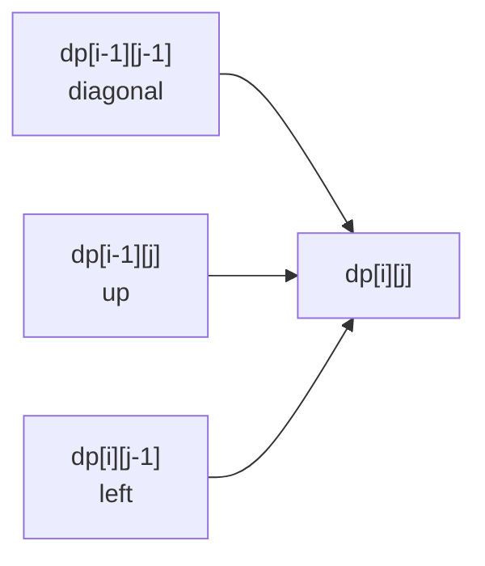
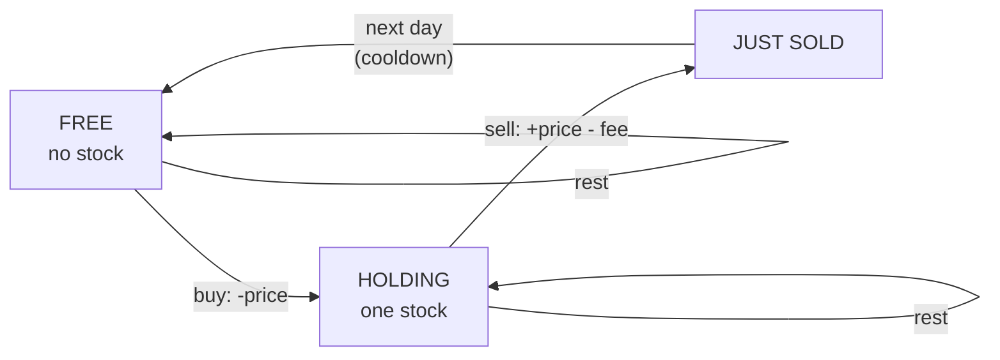

# Chapter 21 · Dynamic Programming II: 2D, Knapsack, Strings & Beyond

> Chapter 20 mein har sawaal ek hi tarah ka tha: "pehli *i* cheezon ka answer kya hai?" Lekin ek chor ke paas backpack hai, toh use do cheezein yaad rakhni padti hain: kaun se items wo dekh chuka hai **aur** bag mein kitni jagah bachi hai. Do strings ho toh do positions chahiye. Grid ho toh row aur column dono chahiye. Jis pal ek number se "tum kahan ho" describe nahi hota, usi pal DP mein ek doosra dimension aa jaata hai. Achhi khabar ye hai ki 5-step framework bilkul nahi badalta. Bas table thoda chauda ho jaata hai.

**Is chapter mein tum seekhoge:**
- Kaise pehchano ki DP ko **do (ya zyada) indexes** chahiye, aur 2D table ko sahi order mein kaise bharo
- **Grid DP**: Unique Paths I & II, Minimum Path Sum, aur Dungeon Game ko *ulta* (backwards) kyun solve karna padta hai
- **Knapsack family** ka poora decode: 0/1 knapsack (2D → 1D, aur loop ulta *kyun* chalta hai), unbounded knapsack, Subset Sum, Partition Equal Subset Sum, Target Sum, Last Stone Weight II
- **Two-string DP**: LCS, Edit Distance, Longest Common Substring, Distinct Subsequences, Interleaving String, Regex & Wildcard Matching
- **Palindrome DP**, **interval DP** (Burst Balloons, Matrix Chain Multiplication)
- Saare **6 stock problems** ek hi state-machine framework se
- **DP on trees**, **bitmask DP** (TSP, Shortest Path Visiting All Nodes, Partition to K Equal Subsets) aur **digit DP** ka ek chhota sa taste
- Ek **pattern identification table** jo problem ki wording ko sahi DP family se map karti hai

**Isse pehle padho:** [Dynamic Programming I](20-dp-1d.md) (zaroori hai: pehle wahi padho) · [Binary Trees](13-binary-trees.md) · [Graphs I: BFS, DFS & Grids](16-graphs-bfs-dfs.md) · [Recursion & Backtracking](09-backtracking.md)

---

## 🧠 The Big Idea · Asli Baat

1D DP boxes ki ek line hai. Har box apne left wale boxes se bharta hai. 2D DP boxes ka ek **grid** hai. Har box apne upar wale, left wale, ya diagonal upar-left wale box se bharta hai. Bas, itna hi.

Computer science ki sabse famous 2D table dekho: `"abcde"` aur `"ace"` ka **Longest Common Subsequence**. Cell `(i, j)` ye sawaal answer karta hai: "pehle word ke pehle `i` letters aur doosre word ke pehle `j` letters ka LCS kitna hai?"

```text
          ""   a   c   e
     ""    0   0   0   0
     a     0   1   1   1
     b     0   1   1   1
     c     0   1   2   2
     d     0   1   2   2
     e     0   1   2   3   <- answer
```

Har cell zyada se zyada teen padosiyon ko dekhta hai:



Toh agar tum table ko **row by row, left to right** bharo, toh jis bhi padosi ki zaroorat hai wo pehle se ready milega. Ye ek picture grids, knapsack, aur lagbhag har two-string problem ko cover kar leti hai.

> 🇮🇳 **Desi Analogy:** Railway reservation chart socho. Rows mein coaches hain, columns mein seat numbers. Agar TC ka rule ho ki "kisi seat ka status bharne ke liye upar wali row ka aur isi row ki pichhli seat ka status chahiye", toh TC chart ko upar se neeche, aur har row mein left se right bharega. Jab wo kisi seat pe pahunchta hai, uske dono "source" pehle se likhe hote hain. 2D DP mein bhi yahi hai: **cell = seat**, **"reads from" = upar/left/diagonal**, aur **fill order = TC ka chart bharne ka order**.

> 💡 **DP 2D kab banti hai?** Jab honest brute-force recursion mein **do parameters ho jo ek doosre se independently badalte hain**: (row, col), (item, capacity), (string A mein position, string B mein position), (left end, right end), (day, stock pakda hai ya nahi?). State bas badalne wale parameters ki list hai, bilkul Chapter 20 ki tarah.

> 🤔 **Mann mein sawaal:** "Independently badalte hain" ka matlab kya? Har problem mein do variables toh hote hi hain.
>
> **Jawab:** Matlab ye ki ek ko jaanne se doosra fix nahi hota. Knapsack mein "item 3 tak dekha" se ye pata nahi chalta ki bag mein kitni jagah bachi hai: wo depend karta hai ki pehle kaun se items uthaye. Isliye dono chahiye. Lekin Interleaving String (section 15) mein s3 ki position hamesha `i + j` hoti hai, toh wo teesra dimension nahi banta. Test simple hai: **kya ek variable baaki variables se calculate ho sakta hai?** Haan → drop karo. Nahi → wo state mein jayega.

Is chapter ka doosra bada idea: kai "alag" dikhne wale problems asal mein **ek hi DP hain jisne costume pehna hai**. Partition Equal Subset Sum, Target Sum aur Last Stone Weight II, teeno knapsack hain. Edit Distance, Distinct Subsequences aur Regex Matching, teeno "do strings mein do pointers" hain. Chhe stock problems ek hi state machine hain. Families seekho, phir costume ke aar-paar dekhna seekho.

---

## 🔨 Building It Up · Zero Se Shuru

### 1. Unique Paths: tumhari pehli grid DP

Ek robot `m × n` grid ke top-left mein baitha hai. Wo sirf **right** ya **down** ja sakta hai. Bottom-right tak kitne alag-alag paths hain?

**5 steps:**
1. **State:** `dp[r][c]` = start se cell (r, c) tak kitne paths hain.
2. **Transition (aakhri move):** tum ya toh upar se aaye ya left se: `dp[r][c] = dp[r-1][c] + dp[r][c-1]`.
3. **Base:** poori pehli row aur poora pehla column 1 hai (sirf ek tareeka: edge ke saath seedha chalte jao).
4. **Order:** row by row, left to right.
5. **Answer:** `dp[m-1][n-1]`.

```python
def unique_paths(m, n):
    dp = [[1] * n for _ in range(m)]          # first row/col already 1
    for r in range(1, m):
        for c in range(1, n):
            dp[r][c] = dp[r - 1][c] + dp[r][c - 1]
    for row in dp:
        print(row)
    return dp[m - 1][n - 1]

print("paths:", unique_paths(3, 4))
```

```text
[1, 1, 1, 1]
[1, 2, 3, 4]
[1, 3, 6, 10]
paths: 10
```

Ek cell padh ke dekho: `dp[2][3] = 10`. Upar wala `dp[1][3] = 4` hai, left wala `dp[2][2] = 6` hai. 4 + 6 = 10. Har path aakhri step mein ya toh upar se aaya ya left se, aur ye do groups kabhi overlap nahi karte. Isliye seedha **add** karte hain.

**Space optimisation:** row r ko sirf row r-1 chahiye. Aur ek row ke andar, `dp[c-1]` already naya value hai jabki `dp[c]` abhi bhi purana (upar wala) value hai. Toh **ek hi row** kaafi hai: `row[c] += row[c-1]`.

```python
def unique_paths(m, n):
    row = [1] * n
    for _ in range(1, m):
        for c in range(1, n):
            row[c] += row[c - 1]     # old row[c] = from above, row[c-1] = from left
    return row[-1]

print(unique_paths(3, 7), unique_paths(3, 2), unique_paths(1, 1))
```

```text
28 3 1
```

Kya hua yahan: O(m × n) time, O(n) space. (Ek math wala answer bhi hai: tumhe `m-1` baar down aur `n-1` baar right jaana hai, kisi bhi order mein. Toh answer `C(m+n-2, m-1)` hai: total `m+n-2` moves mein se kaunse `m-1` "down" honge, bas ye choose karna hai. nCr ke liye [Chapter 23](23-bits-math.md) dekho.)

> 🤔 **Mann mein sawaal:** `row[c] += row[c - 1]` mein ek hi list ko overwrite kar rahe hain. Purana data kho nahi jaata?
>
> **Jawab:** Wahi toh trick hai. `row[c]` ko update karne se *just pehle* uske andar pichhli row ka value hai, yaani "upar se aane wale paths". Aur `row[c - 1]` is loop mein already update ho chuka hai, yaani "left se aane wale paths" (current row). Formula ko exactly yahi do cheezein chahiye. Jo purana value overwrite ho raha hai (`row[c]` ka purana) uski zaroorat ab kabhi nahi padegi. Isliye kuch nahi khota.

### 2. Unique Paths II: obstacles

Wahi robot, lekin kuch cells blocked hain (`1`). Blocked cell se **0** paths guzarte hain. Bas itna sa change hai. Lekin ab pehli row aur pehla column automatically 1 nahi hain (ek patthar uske baad ki saari cells block kar deta hai), isliye hum general rule ko hi unhe handle karne dete hain.

```python
def unique_paths_with_obstacles(grid):
    n = len(grid[0])
    row = [0] * n
    row[0] = 1                              # one way to stand at the start (if it's free)
    for r in range(len(grid)):
        for c in range(n):
            if grid[r][c] == 1:
                row[c] = 0                  # rock: no path ends here
            elif c > 0:
                row[c] += row[c - 1]
    return row[-1]

print(unique_paths_with_obstacles([[0, 0, 0], [0, 1, 0], [0, 0, 0]]))
print(unique_paths_with_obstacles([[0, 1], [0, 0]]))
print(unique_paths_with_obstacles([[1, 0]]))
```

```text
2
1
0
```

Kya hua yahan: `row[0] = 1` seed karke aur har cell pe (row 0 aur column 0 bhi shaamil) normal rule chalane se, edges pe pade patthar apne aap handle ho jaate hain. Jaise teesre test `[[1, 0]]` mein start hi blocked hai: `row[0]` turant 0 ban jaata hai, aur 0 aage propagate hota hai.

### 3. Minimum Path Sum: grid pe optimisation

Har cell ka ek cost hai. Top-left se bottom-right tak right ya down chalo, aur total minimise karo.

`dp[r][c] = grid[r][c] + min(dp[r-1][c], dp[r][c-1])`, aur edges pe sirf ek hi option hota hai.

```python
def min_path_sum(grid):
    m, n = len(grid), len(grid[0])
    dp = [[0] * n for _ in range(m)]
    for r in range(m):
        for c in range(n):
            if r == 0 and c == 0:
                dp[r][c] = grid[0][0]
            elif r == 0:
                dp[r][c] = dp[r][c - 1] + grid[r][c]
            elif c == 0:
                dp[r][c] = dp[r - 1][c] + grid[r][c]
            else:
                dp[r][c] = min(dp[r - 1][c], dp[r][c - 1]) + grid[r][c]
    for row in dp:
        print(row)
    return dp[-1][-1]

print("min sum:", min_path_sum([[1, 3, 1], [1, 5, 1], [4, 2, 1]]))
```

```text
[1, 4, 5]
[2, 7, 6]
[6, 8, 7]
min sum: 7
```

Path hai 1 → 3 → 1 → 1 → 1. Table ko 7 se ulta follow karo: 7 wala cell 6 (upar) aur 8 (left) mein se chhote wale se aaya, yaani 6 se. Phir 6 wala cell 5 (upar) aur 7 (left) mein se 5 se aaya, aur aise hi aage. Kisi bhi grid path ko **reconstruct** karne ka yahi tareeka hai.

### 4. Dungeon Game: jab ulta chalna hi padta hai

Ek knight top-left se shuru karta hai aur use bottom-right mein princess tak pahunchna hai, sirf right ya down chalke. Har cell health badhata hai (potions, positive) ya ghatata hai (demons, negative). Agar health kabhi bhi 0 ya usse neeche gayi, knight mar jaata hai. **Minimum starting health** kitni chahiye?

```text
-2  -3   3
-5 -10   1
10  30  -5
```

**Forward DP kyun fail hoti hai:** aage chalte hue har cell ko *do* cheezein yaad rakhni padengi: current health **aur** ab tak ki sabse kam health. Ek path jiski current health zyada hai lekin pehle ek khatarnak dip aaya tha, wo us path se jeet bhi sakta hai aur haar bhi sakta hai jiski health kam hai lekin dip nahi aaya. Ye depend karta hai ki aage kya aane wala hai. Ek cell mein ek number kaafi nahi hai.

**Sawaal palat do:** princess se ulta solve karo. Define karo:
1. **State:** `need[r][c]` = cell (r, c) mein **ghuste waqt** kam se kam kitni health honi chahiye taaki end tak zinda raho.
2. **Transition:** is cell ke baad tum right ya down jaoge; jo kam maangta hai wo chuno. Ghuste waqt tumhe `min(need_right, need_down) - dungeon[r][c]` chahiye, lekin kabhi 1 se kam nahi (zinda toh rehna hai): `need[r][c] = max(1, min(need[r+1][c], need[r][c+1]) - dungeon[r][c])`.
3. **Base:** princess pe, `need = max(1, 1 - dungeon[last][last])`.
4. **Order:** bottom-right se top-left tak.
5. **Answer:** `need[0][0]`.

```python
def calculate_minimum_hp(dungeon):
    m, n = len(dungeon), len(dungeon[0])
    INF = float("inf")
    need = [[INF] * (n + 1) for _ in range(m + 1)]   # extra row/col of INF as walls
    need[m][n - 1] = need[m - 1][n] = 1              # "after" the princess you need 1
    for r in range(m - 1, -1, -1):
        for c in range(n - 1, -1, -1):
            after = min(need[r + 1][c], need[r][c + 1])
            need[r][c] = max(1, after - dungeon[r][c])
    for row in need[:m]:
        print(row[:n])
    return need[0][0]

print("start with:", calculate_minimum_hp([[-2, -3, 3], [-5, -10, 1], [10, 30, -5]]))
```

```text
[7, 5, 2]
[6, 11, 5]
[1, 1, 6]
start with: 7
```

Kya hua yahan: ulta chalne pe "yahan se aage mujhe kitna chahiye" ek single number hai, toh state ekdum saaf hai. `max(1, ...)` sabse important hai: ek bada potion tumhe 0 health ke saath ghusne nahi deta.

Ek cell verify karo: bottom-left cell (value 10). Uske right wale ko 1 chahiye (neeche wall hai, INF). Toh `max(1, 1 - 10) = max(1, -9) = 1`. Matlab us cell mein 1 health leke bhi ghuso toh chalega, kyunki potion turant +10 de dega. Lekin `-9` nahi likh sakte, kyunki ghuste waqt tum zinda hone chahiye.

> 🇮🇳 **Desi Analogy:** Mumbai se Delhi road trip pe nikalna hai aur raste mein kuch toll plazas hain (paise kat-te hain) aur kuch jagah dost paise de dete hain. Sawaal: "ghar se kam se kam kitna cash leke niklun ki raste mein kabhi zero na ho?" Aage se socho toh har shehar pe "abhi kitna hai" aur "ab tak sabse kam kitna tha" dono yaad rakhna padega. Lekin Delhi se ulta socho: "Jaipur mein ghuste waqt kitna chahiye taaki Delhi tak pahunch jaun?" Ye ek hi number hai. Phir usse "Udaipur mein ghuste waqt kitna chahiye" nikal lo. **Har shehar = cell**, **toll/dost = negative/positive value**, **"ghuste waqt kitna chahiye" = `need[r][c]`**, aur "jeb kabhi khaali nahi" = `max(1, ...)`.

> 💡 **Rule of thumb:** agar forward state ko "ab tak ka sabse bura point" yaad rakhna pad raha hai, toh DP ko **ulta** chala ke dekho, taaki future ek hi number mein summarise ho jaaye.

### 5. The 0/1 Knapsack: saare subset DPs ki maa

Tumhare paas items hain, har item ka ek **weight** aur ek **value** hai, aur ek bag hai jo zyada se zyada `W` weight utha sakta hai. Har item **sirf ek baar** liya ja sakta hai (yahi "0/1" hai: lo ya chhodo). Total value maximise karo.

```text
weights = [1, 3, 4, 5]
values  = [1, 4, 5, 7]
W = 7   ->  best = 9 (items of weight 3 and 4)
```

Value/weight ratio wala greedy fail hota hai: ratios hain 1, 1.33, 1.25, 1.4. Greedy pehle weight 5 uthayega (value 7), phir weight 1 (value 1): total 8. Lekin 3 + 4 se 9 milta hai. Greedy ne sabse "efficient" item utha liya aur bag mein 1 unit ki jagah bachi jo bekaar gayi.

> 🇮🇳 **Desi Analogy:** Diwali sale mein tumhare paas ₹7000 ka budget hai aur har gadget sirf ek piece mein available hai. Har gadget ka price (= **weight**) aur tumhare liye uski "khushi" (= **value**) alag hai. Budget = **capacity W**. Har gadget pe sirf do options: lo ya chhodo (= **0/1**). "Sabse value-for-money wala pehle uthao" wala greedy budget mein awkward paisa bacha deta hai. DP har budget amount (0 se 7000) ke liye best khushi yaad rakhta hai, isliye kabhi galat combination pe atakta nahi.

**5 steps:**
1. **State:** `dp[i][c]` = sirf **pehle i items** use karke, capacity **c** ke saath best value. Do badalne wale parameters → 2D.
2. **Transition (item i-1 ke baare mein decision):**
   - chhod do: `dp[i-1][c]`
   - le lo (agar fit hota hai): `values[i-1] + dp[i-1][c - weights[i-1]]`. Dhyaan do, doosre term mein bhi **i-1** hai: ek baar le liya, toh item khatam.
   - `dp[i][c] = max(skip, take)`.
3. **Base:** `dp[0][c] = 0` (koi item nahi, koi value nahi).
4. **Order:** i 1 se n tak; c kisi bhi order mein (row i sirf row i-1 padhti hai).
5. **Answer:** `dp[n][W]`.

```python
def knapsack_2d(weights, values, W):
    n = len(weights)
    dp = [[0] * (W + 1) for _ in range(n + 1)]
    for i in range(1, n + 1):
        w, v = weights[i - 1], values[i - 1]
        for c in range(W + 1):
            dp[i][c] = dp[i - 1][c]                        # skip item i-1
            if w <= c:
                dp[i][c] = max(dp[i][c], v + dp[i - 1][c - w])   # take it
    for i, row in enumerate(dp):
        print(f"items<{i}:", row)
    return dp[n][W]

print("best:", knapsack_2d([1, 3, 4, 5], [1, 4, 5, 7], 7))
```

```text
items<0: [0, 0, 0, 0, 0, 0, 0, 0]
items<1: [0, 1, 1, 1, 1, 1, 1, 1]
items<2: [0, 1, 1, 4, 5, 5, 5, 5]
items<3: [0, 1, 1, 4, 5, 6, 6, 9]
items<4: [0, 1, 1, 4, 5, 7, 8, 9]
best: 9
```

Ek cell padho: row `items<3`, capacity 7 (item 2 ka weight 4, value 5). Chhodo → `dp[2][7] = 5`. Lo → `5 + dp[2][3] = 5 + 4 = 9`. Max 9.

### 6. Knapsack 1D mein, aur loop **ulta** kyun chalta hai

Row i sirf row i-1 padhti hai. Toh ek hi row rakho aur usi ko in-place overwrite karo. Lekin kis direction mein?

`dp[c]` ko `dp[c - w]` ka **purana** (row i-1 wala) value chahiye, jo uske **left** mein hai. Agar hum left to right chale, toh `c` tak pahunchte-pahunchte `dp[c - w]` row i ke value se overwrite ho chuka hoga, jo shayad *is item ko already include kar chuka hai*. Hum item do baar le lenge!

**Right to left** chalo, toh left wali cells jab hum padhte hain tab tak row i-1 ki hi hoti hain. Har item zyada se zyada ek baar use hota hai. Ek item (weight 2, value 3) aur capacity 6 ke saath bug hote hue dekho:

```python
def knapsack_forward_bug(weights, values, W):
    dp = [0] * (W + 1)
    for w, v in zip(weights, values):
        for c in range(w, W + 1):                 # LEFT -> RIGHT  (wrong for 0/1)
            dp[c] = max(dp[c], v + dp[c - w])
    return dp

def knapsack_01(weights, values, W):
    dp = [0] * (W + 1)
    for w, v in zip(weights, values):
        for c in range(W, w - 1, -1):             # RIGHT -> LEFT  (each item once)
            dp[c] = max(dp[c], v + dp[c - w])
    return dp

print("forward :", knapsack_forward_bug([2], [3], 6))
print("backward:", knapsack_01([2], [3], 6))
print("example :", knapsack_01([1, 3, 4, 5], [1, 4, 5, 7], 7)[-1])
```

```text
forward : [0, 0, 3, 3, 6, 6, 9]
backward: [0, 0, 3, 3, 3, 3, 3]
example : 9
```

Kya hua yahan: forward chalte hue `dp[4]` ne *naya* `dp[2] = 3` padha aur item phir se jod diya (6), phir `dp[6]` ne teesri baar joda (9). Hamare paas toh ek hi item hai! Backward chalte hue `dp[6]` ne `dp[4]` ko update hone se *pehle* padha (abhi 0 tha), toh item ek hi baar gina gaya.

Step-by-step forward bug, capacity by capacity (item: w=2, v=3):

| c | `dp[c-2]` jo padha | naya `dp[c]` | matlab |
|---|---|---|---|
| 2 | `dp[0] = 0` | 3 | item ek baar |
| 3 | `dp[1] = 0` | 3 | item ek baar |
| 4 | `dp[2] = 3` (**abhi abhi update hua**) | 6 | item do baar! |
| 6 | `dp[4] = 6` (update ho chuka) | 9 | item teen baar! |

> 💡 **Memory hook:** "**Backwards = once. Forwards = forever.**" Ulta capacity loop = 0/1 knapsack; seedha loop items ko repeat hone deta hai, jo exactly unbounded knapsack hai.

> 🤔 **Mann mein sawaal:** 2D version mein toh c kisi bhi order mein chal sakta tha. 1D mein achanak order kyun matter karne laga?
>
> **Jawab:** 2D mein row i-1 aur row i alag-alag lists thi, toh row i likhne se row i-1 kabhi kharab nahi hoti thi. 1D mein dono rows **ek hi list** mein rehti hain: kuch cells naye (row i) hain, kuch purane (row i-1). Order decide karta hai ki padhte waqt kaunsa wala milega. Ulta chalne se jo cells hum padhte hain (`c - w`, jo left mein hai) wo abhi tak purane hi hain.

### 7. Unbounded Knapsack: wahi code, loop seedha

Har item **kitni bhi baar** liya ja sakta hai. Ab "forward bug" hi feature ban jaata hai: already updated `dp[c - w]` padhne ka matlab hai "ye item shayad pehle se andar hai, ek aur le lo".

2D view: `dp[i][c] = max(dp[i-1][c], v + dp[i][c - w])`. Take wale branch mein `dp[i]` (wahi row) dekho: item i-1 lene ke baad bhi tum use phir se le sakte ho.

```python
def knapsack_unbounded(weights, values, W):
    dp = [0] * (W + 1)
    for w, v in zip(weights, values):
        for c in range(w, W + 1):                 # forward: reuse allowed
            dp[c] = max(dp[c], v + dp[c - w])
    return dp[W]

def knapsack_01(weights, values, W):
    dp = [0] * (W + 1)
    for w, v in zip(weights, values):
        for c in range(W, w - 1, -1):
            dp[c] = max(dp[c], v + dp[c - w])
    return dp[W]

wts, vals = [1, 3, 4, 5], [1, 4, 5, 7]
print("0/1 knapsack, W=10      :", knapsack_01(wts, vals, 10))
print("unbounded knapsack, W=10:", knapsack_unbounded(wts, vals, 10))
```

```text
0/1 knapsack, W=10      : 13
unbounded knapsack, W=10: 14
```

0/1: weights 1 + 4 + 5 → 1 + 5 + 7 = 13. Unbounded: weight 5 do baar → 14. Unbounded knapsack se tum pehle mil chuke ho: Chapter 20 ka **Coin Change** unbounded knapsack hi hai, bas "max value" ki jagah "min count".

| Variant | Har item | 1D capacity loop | 2D "take" kya padhta hai | Famous problems |
|---|---|---|---|---|
| 0/1 knapsack | zyada se zyada ek baar | **backward** | pichhli row `dp[i-1][c-w]` | Partition Equal Subset Sum, Target Sum, Last Stone Weight II, Ones and Zeroes |
| Unbounded knapsack | kitni bhi baar | **forward** | wahi row `dp[i][c-w]` | Coin Change I & II, Perfect Squares, Rod Cutting |

### 8. Subset Sum aur Partition Equal Subset Sum

**Subset Sum:** kya `nums` ka koi subset hai jiska sum exactly `target` ho? Ye 0/1 knapsack hai jahan humein sirf feasibility chahiye: `dp[s]` = ab tak dekhe items ka koi subset sum s bana sakta hai ya nahi.

**Partition Equal Subset Sum:** kya array ko do parts mein baant sakte ho jinke sums barabar ho? Agar total odd hai, toh nahi. Warna sawaal ye hai: "kya koi subset hai jiska sum total / 2 ho?" (baaki bacha hissa apne aap doosra half ban jaata hai).

```python
def can_partition(nums):
    total = sum(nums)
    if total % 2:
        return False
    target = total // 2
    dp = [True] + [False] * target        # dp[s]: can we make sum s?
    for x in nums:
        for s in range(target, x - 1, -1):    # backwards: each number used once
            dp[s] = dp[s] or dp[s - x]
        if dp[target]:
            return True
    return dp[target]

print(can_partition([1, 5, 11, 5]), can_partition([1, 2, 3, 5]), can_partition([2, 2]))
```

```text
True False True
```

`[1, 5, 11, 5]` ka **trace**, target 11 (✓ = reachable sum):

| number ke baad | reachable sums |
|---|---|
| start | {0} |
| 1 | {0, 1} |
| 5 | {0, 1, 5, 6} |
| 11 | {0, 1, 5, 6, 11} → target reached ✓ |

Har naya number x purane set ke har sum mein x jod ke naye sums banata hai (jo target se chhote ya barabar ho). Time O(n × target), space O(target). Ek mast Python trick: reachable set ko ek bade integer ke bits ki tarah represent karo, `bits |= bits << x`. Ye wahi DP hai, bas CPU ek baar mein 64 sums handle kar leta hai.

### 9. Target Sum: algebra wali trick

`nums` ke har number ke aage `+` ya `-` lagao taaki expression `target` ke barabar ho. Kitne tareeke hain, gino. `nums = [1, 1, 1, 1, 1]`, `target = 3` → 5.

Seedhi DP ka state hai (index, running sum). Wo kaam karti hai, lekin usme negative sums aate hain. Elegant raasta algebra hai. Numbers ko do groups mein baanto: plus group P aur minus group N.

```text
sum(P) - sum(N) = target
sum(P) + sum(N) = total
---------------------------- add the two lines
2 × sum(P) = target + total   →   sum(P) = (target + total) / 2
```

Toh sawaal ban jaata hai: **kitne subsets ka sum `(target + total) / 2` hai?** Ye counting wala 0/1 knapsack hai. Agar `target + total` odd hai ya `abs(target) > total`, toh answer 0 hai.

Ek example se check karo: `[1, 1, 1, 1, 1]`, target 3. Total = 5, toh `sum(P) = (3 + 5) / 2 = 4`. Matlab chaar 1's plus group mein jayenge aur ek minus mein: `4 - 1 = 3`. Paanch 1's mein se kaunsa minus mein jayega, iske 5 choices hain. Answer 5.

```python
def find_target_sum_ways(nums, target):
    total = sum(nums)
    if abs(target) > total or (target + total) % 2:
        return 0
    goal = (target + total) // 2
    dp = [1] + [0] * goal                 # dp[s]: number of subsets with sum s
    for x in nums:
        for s in range(goal, x - 1, -1):
            dp[s] += dp[s - x]
    return dp[goal]

print(find_target_sum_ways([1, 1, 1, 1, 1], 3), find_target_sum_ways([1], 1), find_target_sum_ways([1, 0], 1))
```

```text
5 1 2
```

Kya hua yahan: `[1, 0]` ka answer 2 hai kyunki `+1+0` aur `+1-0` alag expressions hain. Zeros sahi handle hote hain kyunki `x = 0` ke liye loop `s = 0` tak jaata hai aur `dp[0]` double ho jaata hai. (Common bug hai `range(goal, x, -1)` likhna, jo is case ko skip kar deta hai.)

> 🤔 **Mann mein sawaal:** `abs(target) > total` wala check kyun? Odd wala check toh samajh aaya.
>
> **Jawab:** Agar saare numbers ko `+` bhi kar do, tab bhi maximum `total` hi banega. Aur saare `-` kar do toh minimum `-total`. Toh `target` agar is range ke bahar hai, toh koi tareeka hai hi nahi. Ye check na karo toh `goal` negative aa sakta hai, aur `[1] + [0] * goal` jaisi list ka koi matlab nahi bachta (galat answer aata hai).

### 10. Last Stone Weight II: trench coat pehna hua knapsack

Stones ko pairs mein todo: do stones x ≤ y milke ek stone y - x ban jaate hain. Aakhri stone ka sabse chhota possible weight kya hai (ya 0)?

Insight: kisi bhi order mein todo, final weight hamesha `(group A ka sum) - (group B ka sum)` jaisa hoga, jahan har stone ya toh group A mein hai ya B mein. (Har smash ek stone ko "plus" side pe aur ek ko "minus" side pe daal deta hai.) Toh: stones ko do groups mein baanto jinke sums jitne paas ho sake utne. `s ≤ total // 2` wala sabse bada reachable subset sum dhundo; answer `total - 2s` hai.

`total - 2s` kyun? Ek group ka sum s hai, toh doosre ka `total - s`. Difference = `(total - s) - s = total - 2s`. s ko half ke jitna paas laaoge, difference utna chhota.

```python
def last_stone_weight_ii(stones):
    total = sum(stones)
    half = total // 2
    dp = [True] + [False] * half
    for x in stones:
        for s in range(half, x - 1, -1):
            dp[s] = dp[s] or dp[s - x]
    best = max(s for s in range(half + 1) if dp[s])
    return total - 2 * best

print(last_stone_weight_ii([2, 7, 4, 1, 8, 1]), last_stone_weight_ii([31, 26, 33, 21, 40]))
```

```text
1 5
```

> 💡 **Knapsack disguise detector:** "do groups mein baanto", "+ ya - assign karo", "sum/size limit wala subset chuno", "har item zyada se zyada ek baar" → **sums** pe 0/1 knapsack.

### 11. Longest Common Subsequence (LCS): two-string template

**Subsequence** order maintain karta hai lekin characters skip kar sakta hai. `"abcde"` aur `"ace"` ka LCS `"ace"` hai (length 3).

**Two-string state:** `dp[i][j]` = **a ke pehle i chars** aur **b ke pehle j chars** ka answer. **Aakhri characters** `a[i-1]` aur `b[j-1]` ke baare mein socho:

- Agar dono barabar hain, toh unhe ek saath match kar sakte ho: `dp[i][j] = dp[i-1][j-1] + 1`.
- Agar nahi, toh kam se kam inme se ek LCS mein nahi hai. Ek ko drop karo: `dp[i][j] = max(dp[i-1][j], dp[i][j-1])`.
- **Base:** `dp[0][j] = dp[i][0] = 0` (khaali string ke saath kuch common nahi ho sakta).

> 🇮🇳 **Desi Analogy:** Do dost apni-apni Mumbai local ki station list compare kar rahe hain. Ek fast local mein hai, doosra slow local mein. Dono lists mein kuch stations common hain, order same hai, beech mein kuch stations skip hote hain. "Dono trains order maintain karke kitne stations pe common rukti hain?" Yahi LCS hai. Dono lists ka aakhri station dekho: same hai? Toh wo common hai, +1, aur dono lists se hata do (**diagonal**). Alag hai? Toh kisi ek ka aakhri station hata ke dekho, jo better ho wo lo (**max of up, left**).

```python
def lcs(a, b):
    m, n = len(a), len(b)
    dp = [[0] * (n + 1) for _ in range(m + 1)]
    for i in range(1, m + 1):
        for j in range(1, n + 1):
            if a[i - 1] == b[j - 1]:
                dp[i][j] = dp[i - 1][j - 1] + 1
            else:
                dp[i][j] = max(dp[i - 1][j], dp[i][j - 1])
    # walk back from the corner to rebuild the subsequence
    i, j, out = m, n, []
    while i > 0 and j > 0:
        if a[i - 1] == b[j - 1]:
            out.append(a[i - 1]); i -= 1; j -= 1
        elif dp[i - 1][j] >= dp[i][j - 1]:
            i -= 1
        else:
            j -= 1
    return dp[m][n], "".join(reversed(out))

print(lcs("abcde", "ace"))
print(lcs("AGGTAB", "GXTXAYB"))
print(lcs("abc", "def"))
```

```text
(3, 'ace')
(4, 'GTAB')
(0, '')
```

`"abcde"` / `"ace"` ki poori table Big Idea mein hai. Diagonal steps (`+1`) exactly wahan hote hain jahan letters match karte hain; walk-back unhi ko follow karta hai. Time aur space O(m × n); sirf length chahiye toh do rows rakho → O(min(m, n)) space.

**"Ek drop karo" kaafi kyun hai:** agar `a[i-1] != b[j-1]`, toh ye dono *ek saath* aakhri matched pair nahi ho sakte. Toh ya toh `a[i-1]` use nahi hua (answer `dp[i-1][j]`) ya `b[j-1]` use nahi hua (`dp[i][j-1]`). Dono mein jo better ho wo le lo. Har two-string DP yahi argument hai, bas rules alag hote hain.

### 12. Edit Distance

`word1` ko `word2` mein badalne ke liye minimum kitne single-character **insert**, **delete**, ya **replace** operations chahiye. `"horse"` → `"ros"` = 3 (h→r replace, r delete, e delete).

1. **State:** `dp[i][j]` = `word1[:i]` ko `word2[:j]` banane ke edits.
2. **Transition (aakhri characters):**
   - barabar → koi edit nahi chahiye: `dp[i-1][j-1]`
   - warna `1 + min(` **replace** `dp[i-1][j-1]`, word1 se **delete** `dp[i-1][j]`, word1 mein **insert** `dp[i][j-1]` `)`
3. **Base:** `dp[i][0] = i` (sab delete karo), `dp[0][j] = j` (sab insert karo).
4. **Order:** row by row.
5. **Answer:** `dp[m][n]`.

```python
def min_distance(word1, word2):
    m, n = len(word1), len(word2)
    dp = [[0] * (n + 1) for _ in range(m + 1)]
    for i in range(m + 1):
        dp[i][0] = i
    for j in range(n + 1):
        dp[0][j] = j
    for i in range(1, m + 1):
        for j in range(1, n + 1):
            if word1[i - 1] == word2[j - 1]:
                dp[i][j] = dp[i - 1][j - 1]
            else:
                dp[i][j] = 1 + min(dp[i - 1][j - 1],   # replace
                                   dp[i - 1][j],       # delete word1[i-1]
                                   dp[i][j - 1])       # insert word2[j-1]
    print("      " + "  ".join(" " + word2))
    for i in range(m + 1):
        label = " " if i == 0 else word1[i - 1]
        print(f"  {label}  " + "  ".join(str(x) for x in dp[i]))
    return dp[m][n]

print("distance:", min_distance("horse", "ros"))
```

```text
         r  o  s
     0  1  2  3
  h  1  1  2  3
  o  2  2  1  2
  r  3  2  2  2
  s  4  3  3  2
  e  5  4  4  3
distance: 3
```

Kya hua yahan: bottom-right cell 3 hai. `dp[2][2] = 1` dekho ("ho" → "ro"): o's match karte hain, toh ye `dp[1][1] = 1` copy kar leta hai (h → r, ek replace). "Delete" wala move **neeche** jaata hai, "insert" **right** jaata hai, "replace/match" **diagonal** jaata hai.

> 💡 **Yahi teen moves kyun?** Saare edits ke baad word1 ke aakhri character ko dekho. Ya toh wo edit hoke `word2[j-1]` bana (replace), ya phenk diya gaya (delete), ya `word2[j-1]` bilkul naya banaya gaya (insert). Teen cases, teen padosi.

> 🤔 **Mann mein sawaal:** "Insert" ke liye `dp[i][j-1]` kyun? Insert toh word1 mein ho raha hai, toh `i` badalna chahiye na?
>
> **Jawab:** Socho tumne word1 ke end mein `word2[j-1]` insert kar diya. Wo naya character word2 ke aakhri character se match ho gaya, toh word2 ka wo character "settle" ho gaya. Bacha kaam: poore `word1[:i]` (iska koi char abhi use nahi hua) ko `word2[:j-1]` banana. Wahi `dp[i][j-1]` hai. Insert word1 ko lamba karta hai, lekin bacha hua **sawaal** word2 ki taraf se chhota hota hai.

### 13. Longest Common Substring (contiguous!)

**Substring** contiguous hona chahiye. LCS ki ek line badlo: agar aakhri characters alag hain, toh *yahan khatam hone wale* common substring ki length **0** hai (chain toot gayi), aur answer corner nahi, balki **saari cells ka max** hai.

```python
def longest_common_substring(a, b):
    m, n = len(a), len(b)
    dp = [[0] * (n + 1) for _ in range(m + 1)]
    best, end = 0, 0
    for i in range(1, m + 1):
        for j in range(1, n + 1):
            if a[i - 1] == b[j - 1]:
                dp[i][j] = dp[i - 1][j - 1] + 1
                if dp[i][j] > best:
                    best, end = dp[i][j], i
            # else: dp[i][j] stays 0 -> the streak is broken
    return best, a[end - best:end]

print(longest_common_substring("abcdxyz", "xyzabcd"))
print(longest_common_substring("zxabcdezy", "yzabcdezx"))
```

```text
(4, 'abcd')
(6, 'abcdez')
```

| | LCS (subsequence) | Longest Common Substring |
|---|---|---|
| State | a ke pehle i, b ke pehle j | a[i-1] aur b[j-1] pe **khatam hone wala** substring |
| Mismatch | `max(up, left)` | `0` |
| Answer | `dp[m][n]` | saari cells ka `max` |

Ye Chapter 20 ka "ending at" idea hai, 2D mein lagaya hua. Cricket se socho: LCS "poori series mein total kitne fifties" jaisa hai (beech ke flop matches se count reset nahi hota). Substring "lagatar kitne matches mein fifty" wala streak hai: ek match mein flop hue toh counter seedha 0.

### 14. Distinct Subsequences

`t` kitne distinct tareekon se `s` ke subsequence ki tarah aata hai? `s = "rabbbit"`, `t = "rabbit"` → 3 (teen b's mein se kaunsa skip karna hai).

1. **State:** `dp[i][j]` = `t[:j]` kitne tareekon se `s[:i]` ka subsequence hai.
2. **Transition:** `s` ka aakhri char ya toh use nahi hua (`dp[i-1][j]`) ya, agar `s[i-1] == t[j-1]`, toh `t` ke aakhri char ko match karne mein use hua (`dp[i-1][j-1]`). Dono ko jodo (counting hai!).
3. **Base:** `dp[i][0] = 1` (khaali `t` kisi bhi cheez mein ek baar aata hai), `dp[0][j>0] = 0`.
4. **Answer:** `dp[m][n]`.

Ek row use karke, `j` ko **ulta** chalate hue (0/1 knapsack wali hi wajah: humein pichhli row ka `dp[j-1]` chahiye):

```python
def num_distinct(s, t):
    n = len(t)
    dp = [1] + [0] * n                     # dp[j] for the current prefix of s
    for ch in s:
        for j in range(n, 0, -1):          # backwards: read old dp[j-1]
            if ch == t[j - 1]:
                dp[j] += dp[j - 1]
    return dp[n]

print(num_distinct("rabbbit", "rabbit"), num_distinct("babgbag", "bag"), num_distinct("abc", "abcd"))
```

```text
3 5 0
```

Time O(m × n), space O(n).

### 15. Interleaving String

Kya `s3`, `s1` aur `s2` ko interleave karke bana hai (har ek ka andar ka order maintain karke)? `s1 = "aabcc"`, `s2 = "dbbca"`, `s3 = "aadbbcbcac"` → True.

1. **State:** `dp[i][j]` = kya `s3[:i+j]` ko `s1[:i]` aur `s2[:j]` se bana sakte hain. (Teesra index nahi chahiye: s3 mein position hamesha `i + j` hoti hai.)
2. **Transition:** `s3[:i+j]` ka aakhri char ya toh s1 se aaya (`dp[i-1][j]` aur `s1[i-1] == s3[i+j-1]`) ya s2 se (`dp[i][j-1]` aur `s2[j-1] == s3[i+j-1]`).
3. **Base:** `dp[0][0] = True`.

```python
def is_interleave(s1, s2, s3):
    m, n = len(s1), len(s2)
    if m + n != len(s3):
        return False
    dp = [[False] * (n + 1) for _ in range(m + 1)]
    dp[0][0] = True
    for i in range(m + 1):
        for j in range(n + 1):
            if i > 0 and dp[i - 1][j] and s1[i - 1] == s3[i + j - 1]:
                dp[i][j] = True
            if j > 0 and dp[i][j - 1] and s2[j - 1] == s3[i + j - 1]:
                dp[i][j] = True
    return dp[m][n]

print(is_interleave("aabcc", "dbbca", "aadbbcbcac"))
print(is_interleave("aabcc", "dbbca", "aadbbbaccc"))
print(is_interleave("", "", ""))
```

```text
True
False
True
```

> 🇮🇳 **Desi Analogy:** Shaadi ke buffet mein do queues ek hi counter pe merge ho rahi hain: ladke wale aur ladki wale. Har queue ke andar ka order fix hai (koi line nahi todta), lekin counter pe kabhi is queue se banda aata hai, kabhi us se. Counter pe jo final sequence bani (**s3**), kya wo in do queues (**s1**, **s2**) se ban sakti thi? `i` = ladke walon mein se kitne aa chuke, `j` = ladki walon mein se kitne. Counter pe kitne log aaye, wo toh `i + j` hai hi, isliye teesra number nahi chahiye.

> 💡 **State compression insight:** jab bhi ek index baaki indexes se poori tarah determine ho jaaye (`k = i + j`), use drop kar do. Kam dimensions = chhoti table.

### 16. Regular Expression Matching aur Wildcard Matching

Ye dikhte darawne hain, lekin ye bas special characters wali two-string DP hain.

**Regex Matching:** `.` kisi bhi ek char se match karta hai; `x*` matlab **pichhle element x ki zero ya zyada copies**. Pattern ko **poori** string se match karna hai.

Top-down sabse clear hai. `match(i, j)` = kya `s[i:]` aur `p[j:]` match karte hain?

- Agar pattern khatam ho gaya, toh string bhi khatam honi chahiye.
- `first` = kya `s[i]` aur `p[j]` match karte hain (barabar ya `.`)?
- Agar `p[j+1] == '*'`: ya toh **zero** copies use karo (`x*` skip karo: `match(i, j+2)`), ya **ek aur** copy use karo (`first` aur `match(i+1, j)`: `x*` pe hi ruko kyunki wo aur kha sakta hai).
- Warna: `first` aur `match(i+1, j+1)`.

```python
from functools import cache

def is_match_regex(s, p):
    @cache
    def match(i, j):
        if j == len(p):
            return i == len(s)
        first = i < len(s) and p[j] in (s[i], ".")
        if j + 1 < len(p) and p[j + 1] == "*":
            return match(i, j + 2) or (first and match(i + 1, j))
        return first and match(i + 1, j + 1)
    return match(0, 0)

tests = [("aa", "a"), ("aa", "a*"), ("ab", ".*"), ("aab", "c*a*b"), ("mississippi", "mis*is*p*.")]
for s, p in tests:
    print(f"{s!r:14} {p!r:14} {is_match_regex(s, p)}")
```

```text
'aa'           'a'            False
'aa'           'a*'           True
'ab'           '.*'           True
'aab'          'c*a*b'        True
'mississippi'  'mis*is*p*.'   False
```

Ek chhota trace: `"aab"` vs `"c*a*b"`. `c*` pe: `s[0] = 'a'` c se match nahi karta, toh zero copies lo, `j` do aage. `a*` pe: 'a' match hua, ek aur copy lo (i aage, j wahi). Doosra 'a' bhi kha liya. 'b' pe `a*` match nahi karta, toh zero copies, `j` aage. Ab `b` vs `b`, match. Dono khatam: True.

**Wildcard Matching:** `?` kisi bhi ek char se match karta hai; `*` **koi bhi sequence** (khaali bhi) se match karta hai, akela hi. Is baar bottom-up, `dp[i][j]` = kya `s[:i]` aur `p[:j]` match karte hain:

- `p[j-1] == '*'`: star khaali se match karta hai (`dp[i][j-1]`) **ya** wo `s[i-1]` ko nigal jaata hai aur available rehta hai (`dp[i-1][j]`).
- `p[j-1] == '?'` ya `s[i-1]` ke barabar: `dp[i-1][j-1]`.
- **Base:** `dp[0][0] = True`; `dp[0][j]` tabhi True hai jab tak pattern sirf stars hai.

```python
def is_match_wildcard(s, p):
    m, n = len(s), len(p)
    dp = [[False] * (n + 1) for _ in range(m + 1)]
    dp[0][0] = True
    for j in range(1, n + 1):
        dp[0][j] = dp[0][j - 1] and p[j - 1] == "*"
    for i in range(1, m + 1):
        for j in range(1, n + 1):
            if p[j - 1] == "*":
                dp[i][j] = dp[i][j - 1] or dp[i - 1][j]
            elif p[j - 1] == "?" or p[j - 1] == s[i - 1]:
                dp[i][j] = dp[i - 1][j - 1]
    return dp[m][n]

tests = [("aa", "a"), ("aa", "*"), ("cb", "?a"), ("adceb", "*a*b"), ("acdcb", "a*c?b")]
for s, p in tests:
    print(f"{s!r:8} {p!r:8} {is_match_wildcard(s, p)}")
```

```text
'aa'     'a'      False
'aa'     '*'      True
'cb'     '?a'     False
'adceb'  '*a*b'   True
'acdcb'  'a*c?b'  False
```

| | Regex `*` | Wildcard `*` |
|---|---|---|
| Matlab | **pichhle** char ki zero ya zyada copies | koi bhi sequence, akela |
| "zero" option | do pattern chars skip (`j+2`) | ek pattern char skip |
| "ek aur" option | sirf tab jab `s[i]` pichhle char se match kare | hamesha |

> 🤔 **Mann mein sawaal:** Regex mein `*` akela kyun nahi chalta? `"a*"` mein star ka apna kya matlab hai?
>
> **Jawab:** Regex mein `*` ka apna koi matlab nahi hai. Wo ek **suffix** hai jo apne se pehle wale character pe lagta hai. `a*` ko ek hi unit samjho: "kitne bhi a". Isliye code `p[j]` ko process karne se *pehle* `p[j+1]` check karta hai. Wildcard mein `*` khud ek poora unit hai: "kuch bhi". Ye farq na samjha toh dono problems mix ho jaate hain.

### 17. Palindrome DP: substring, subsequence, partitioning

Palindromes humein ek naye tarah ka state dete hain: **ek hi string ka (left end, right end)**.

**Longest Palindromic Substring.** `is_pal[i][j]` = kya `s[i..j]` palindrome hai. Hai, agar dono ends match karte hain aur andar wala `s[i+1..j-1]` palindrome hai (ya uski length ≤ 1 hai). Andar wala ek **chhota** interval hai, toh table ko **badhti length** ke order mein bharo. Practice mein simple O(1)-space approach hai **expand around centre**: har palindrome ka ek centre hota hai (ek char, ya do chars ke beech ka gap), toh saare 2n - 1 centres try karo aur bahar ki taraf failao.

(2n - 1 kyun? n characters khud centre ban sakte hain (odd length palindromes, jaise "aba"), aur n - 1 gaps centre ban sakte hain (even length, jaise "abba"). n + (n - 1) = 2n - 1.)

```python
def longest_palindrome_dp(s):
    n = len(s)
    is_pal = [[False] * n for _ in range(n)]
    start, best = 0, 1
    for length in range(1, n + 1):                 # shorter intervals first
        for i in range(n - length + 1):
            j = i + length - 1
            if s[i] == s[j] and (length <= 2 or is_pal[i + 1][j - 1]):
                is_pal[i][j] = True
                if length > best:
                    start, best = i, length
    return s[start:start + best]

def longest_palindrome_expand(s):
    def grow(lo, hi):
        while lo >= 0 and hi < len(s) and s[lo] == s[hi]:
            lo -= 1
            hi += 1
        return lo + 1, hi                         # s[lo+1:hi] is the palindrome
    best = (0, 0)
    for c in range(len(s)):
        for lo, hi in (grow(c, c), grow(c, c + 1)):   # odd centre, even centre
            if hi - lo > best[1] - best[0]:
                best = (lo, hi)
    return s[best[0]:best[1]]

for s in ["babad", "cbbd", "forgeeksskeegfor"]:
    print(s, longest_palindrome_dp(s), longest_palindrome_expand(s))
```

```text
babad bab bab
cbbd bb bb
forgeeksskeegfor geeksskeeg geeksskeeg
```

Dono O(n²) time hain; DP O(n²) space leti hai, expand-around-centre O(1). (Ek O(n) algorithm, Manacher's, [Chapter 24](24-advanced-structures.md) mein hai.)

**Longest Palindromic Subsequence.** `dp[i][j]` = `s[i..j]` ke andar sabse lambe palindromic subsequence ki length:
- ends barabar: `dp[i+1][j-1] + 2`
- warna: `max(dp[i+1][j], dp[i][j-1])` (ek end drop karo)
- base: `dp[i][i] = 1`.

`i` ko right se left bharo (taaki `dp[i+1][...]` ready ho) aur `j` ko left se right.

```python
def longest_palindrome_subseq(s):
    n = len(s)
    dp = [[0] * n for _ in range(n)]
    for i in range(n - 1, -1, -1):
        dp[i][i] = 1
        for j in range(i + 1, n):
            if s[i] == s[j]:
                dp[i][j] = dp[i + 1][j - 1] + 2
            else:
                dp[i][j] = max(dp[i + 1][j], dp[i][j - 1])
    return dp[0][n - 1]

print(longest_palindrome_subseq("bbbab"), longest_palindrome_subseq("cbbd"), longest_palindrome_subseq("character"))
```

```text
4 2 5
```

(Shortcut fact: `s` ka LPS, `s` aur `reversed(s)` ke LCS ke barabar hota hai.)

**Palindrome Partitioning II.** `s` ko aise pieces mein kaato ki saare palindromes ho, aur cuts kam se kam ho. `"aab"` → 1 (`"aa" | "b"`). Ye Chapter 20 ki "last cut" DP hai, ek `is_pal` table ke upar:

`cuts[i]` = `s[:i]` ke liye min cuts = `min(cuts[j] + 1)`, un saare `j` pe jahan `s[j:i]` palindrome hai. `cuts[0] = -1` set karne se, agar poori string hi palindrome hai toh uska cost `-1 + 1 = 0` cuts aata hai.

```python
def min_cut(s):
    n = len(s)
    is_pal = [[False] * n for _ in range(n)]
    for i in range(n - 1, -1, -1):
        for j in range(i, n):
            if s[i] == s[j] and (j - i <= 2 or is_pal[i + 1][j - 1]):
                is_pal[i][j] = True
    cuts = [-1] + [0] * n
    for i in range(1, n + 1):
        cuts[i] = min(cuts[j] + 1 for j in range(i) if is_pal[j][i - 1])
    return cuts[n]

print(min_cut("aab"), min_cut("a"), min_cut("ab"), min_cut("abccbc"))
```

```text
1 0 1 2
```

O(n²) time aur space. (`"abccbc"` → `"a" | "bccb" | "c"`.)

### 18. Interval DP: Burst Balloons aur Matrix Chain Multiplication

**Interval DP** un problems ke liye hai jahan ek sequence pe tum baar-baar cheezon ko **merge ya remove** karte ho, aur ek step ka cost us *pal* ke padosiyon pe depend karta hai. State: `dp[l][r]` = sub-range l..r ka best answer. **Badhti length** ke order mein bharo. Transition: andar har split point `k` try karo.

**Burst Balloons.** Balloon i phodne pe `nums[left] × nums[i] × nums[right]` coins milte hain, jahan left/right uske *current* padosi hain (padosi na ho toh use 1 maano). Coins maximise karo. `[3, 1, 5, 8]` → 167.

Trap: agar tum range mein **pehla** balloon chuno jo phootega, toh uske padosi badal jaate hain aur dono sides aapas mein ulajh jaati hain. Iski jagah open interval (l, r) mein **aakhri** balloon `k` chuno jo phootega. Jab k sabse aakhir mein phoot-ta hai, (l, r) ke baaki saare balloons ja chuke hote hain, toh uske padosi exactly `l` aur `r` hain. Ab dono sides (l, k) aur (k, r) independent hain. Poori trick yahi hai.

> 🇮🇳 **Desi Analogy:** Joint family ka WhatsApp group socho jahan log ek-ek karke group chhod rahe hain, aur har baar koi chhodta hai toh "drama points" milte hain jo us waqt uske dono taraf baithe logon pe depend karte hain. Agar tum socho "pehle kaun niklega", toh uske baad baaki logon ke padosi badal jaate hain aur hisaab ulajh jaata hai. Ulta socho: "is range mein **sabse aakhir mein** kaun niklega (k)?" Jab wo nikal raha hoga, beech ke sab pehle hi ja chuke honge, toh uske padosi pakke taur pe range ke boundary wale (l aur r) honge. Aur k ke left wale log aur right wale log ek doosre ko kabhi "dekhte" hi nahi, kyunki k beech mein deewar bana baitha hai. **Balloon = member**, **coins = drama points**, **last to burst = last to leave**.

```python
def max_coins(nums):
    a = [1] + nums + [1]                       # padding: virtual balloons worth 1
    n = len(a)
    dp = [[0] * n for _ in range(n)]           # dp[l][r]: best for balloons strictly between l and r
    for length in range(2, n):                 # distance between l and r
        for l in range(n - length):
            r = l + length
            for k in range(l + 1, r):          # k is the LAST balloon burst in (l, r)
                dp[l][r] = max(dp[l][r], dp[l][k] + a[l] * a[k] * a[r] + dp[k][r])
    return dp[0][n - 1]

print(max_coins([3, 1, 5, 8]), max_coins([1, 5]))
```

```text
167 10
```

O(n³) time, O(n²) space.

> 🤔 **Mann mein sawaal:** Code mein `length` 2 se kyun shuru hota hai, 1 se kyun nahi?
>
> **Jawab:** `dp[l][r]` *open* interval hai: l aur r ke **beech** ke balloons, l aur r khud nahi. Agar `r = l + 1`, toh beech mein koi balloon hai hi nahi, answer 0 (jo table mein already hai). Pehla interesting case `r = l + 2` hai jisme beech mein ek balloon hai. Isliye "distance" 2 se shuru.

**Matrix Chain Multiplication.** Ek `p × q` matrix ko `q × r` matrix se multiply karne mein `p × q × r` scalar multiplications lagte hain. Matrices ki ek chain di hai, brackets kahan lagao ki total minimum ho. Matrix i ka shape `dims[i] × dims[i+1]` hai.

`dp[i][j]` = matrices i..j ko multiply karne ka min cost. Har split `k` try karo: `(i..k)(k+1..j)`, cost `dp[i][k] + dp[k+1][j] + dims[i] × dims[k+1] × dims[j+1]`.

(Last term kahan se aaya? Left part `(i..k)` multiply hoke ek `dims[i] × dims[k+1]` matrix banta hai. Right part `(k+1..j)` ek `dims[k+1] × dims[j+1]` matrix banta hai. In dono ko aakhir mein multiply karne ka cost `dims[i] × dims[k+1] × dims[j+1]` hai.)

```python
def matrix_chain(dims):
    n = len(dims) - 1                          # number of matrices
    dp = [[0] * n for _ in range(n)]
    for length in range(2, n + 1):
        for i in range(n - length + 1):
            j = i + length - 1
            dp[i][j] = min(dp[i][k] + dp[k + 1][j] + dims[i] * dims[k + 1] * dims[j + 1]
                           for k in range(i, j))
    return dp[0][n - 1]

print(matrix_chain([10, 30, 5, 60]), matrix_chain([40, 20, 30, 10, 30]))
```

```text
4500 26000
```

`[10, 30, 5, 60]`: `(AB)C` ka cost `10·30·5 + 10·5·60 = 1500 + 3000 = 4500`; `A(BC)` ka cost `30·5·60 + 10·30·60 = 27000`. Brackets bahut farq daalte hain!

### 19. Stock problems: chhe problems, ek state machine

"Best Time to Buy and Sell Stock" ke chhe famous problems hain. Zyada log chhe solutions ratte hain. Iski jagah inhe **ek** machine ki tarah dekho: har din tum ek state mein ho, aur ek action lete ho.



**State:** `(day i, kitne transactions bache k, stock pakda hai?)`. **Value:** day i se aage ka best profit.

- Free: `max(rest → f(i+1, k, free), buy → -price[i] + f(i+1, k-1, holding))` (ek buy ek transaction kha jaata hai)
- Holding: `max(rest → f(i+1, k, holding), sell → price[i] - fee + f(i+1+cooldown, k, free))`

> 🇮🇳 **Desi Analogy:** Ek sabzi wala socho jo mandi se tamatar khareedta aur bechta hai, aur uske paas ek hi tokri hai (ek baar mein ek hi "stock"). Har subah wo ek state mein hota hai: **tokri khaali** (FREE) ya **tokri bhari** (HOLDING). Khaali hai toh ya aaj khareedo (cash ghata) ya aaram karo. Bhari hai toh ya aaj becho (cash badha, mandi wala commission kaate toh wo **fee**) ya ruko. Kuch mandiyon mein rule hai ki bechne ke agle din khareed nahi sakte (**cooldown**). Kuch mein licence sirf k baar khareedne ka hai (**k transactions**). Chhe problems = chhe alag mandi ke rules, lekin sabzi wale ka dimaag ek hi state machine pe chalta hai.

Chhe problems bas teen knobs ki chhe settings hain:

| Problem | k (transactions) | cooldown | fee |
|---|---|---|---|
| I: ek transaction | 1 | 0 | 0 |
| II: unlimited | ∞ | 0 | 0 |
| III: zyada se zyada do | 2 | 0 | 0 |
| IV: zyada se zyada k | k | 0 | 0 |
| with Cooldown | ∞ | 1 | 0 |
| with Transaction Fee | ∞ | 0 | fee |

Ek function chhe ke chhe solve karta hai:

```python
from functools import cache

def max_profit(prices, k=None, cooldown=0, fee=0):
    n = len(prices)
    if k is None:
        k = n // 2 + 1                # "unlimited": you can't do more than n/2 useful trades

    @cache
    def f(i, left, holding):
        if i >= n:
            return 0
        rest = f(i + 1, left, holding)
        if holding:
            sell = prices[i] - fee + f(i + 1 + cooldown, left, False)
            return max(rest, sell)
        if left == 0:
            return rest
        buy = -prices[i] + f(i + 1, left - 1, True)
        return max(rest, buy)

    return f(0, k, False)

print("I   :", max_profit([7, 1, 5, 3, 6, 4], k=1))
print("II  :", max_profit([7, 1, 5, 3, 6, 4]))
print("III :", max_profit([3, 3, 5, 0, 0, 3, 1, 4], k=2))
print("IV  :", max_profit([3, 2, 6, 5, 0, 3], k=2))
print("cool:", max_profit([1, 2, 3, 0, 2], cooldown=1))
print("fee :", max_profit([1, 3, 2, 8, 4, 9], fee=2))
```

```text
I   : 5
II  : 7
III : 6
IV  : 7
cool: 3
fee : 8
```

Kya hua yahan: ek recurrence, chhe answers. State machine view se O(1)-space bottom-up versions bhi milte hain; har ek bas kuch variables hain jo track karte hain "agar aaj main state X mein hoon toh best profit kya hai":

```python
def stock_i(prices):                   # one transaction
    best_buy, profit = float("-inf"), 0
    for p in prices:
        best_buy = max(best_buy, -p)           # cheapest buy so far (as negative cash)
        profit = max(profit, best_buy + p)
    return profit

def stock_ii(prices):                  # unlimited
    free, hold = 0, float("-inf")
    for p in prices:
        free, hold = max(free, hold + p), max(hold, free - p)
    return free

def stock_iii(prices):                 # at most two
    b1 = b2 = float("-inf")
    s1 = s2 = 0
    for p in prices:
        b1 = max(b1, -p)               # after 1st buy
        s1 = max(s1, b1 + p)           # after 1st sell
        b2 = max(b2, s1 - p)           # after 2nd buy
        s2 = max(s2, b2 + p)           # after 2nd sell
    return s2

def stock_iv(k, prices):               # at most k
    buy = [float("-inf")] * (k + 1)
    sell = [0] * (k + 1)
    for p in prices:
        for t in range(1, k + 1):
            buy[t] = max(buy[t], sell[t - 1] - p)
            sell[t] = max(sell[t], buy[t] + p)
    return sell[k]

def stock_cooldown(prices):
    free, hold, cooling = 0, float("-inf"), 0
    for p in prices:
        free, hold, cooling = max(free, cooling), max(hold, free - p), hold + p
    return max(free, cooling)

def stock_fee(prices, fee):
    free, hold = 0, float("-inf")
    for p in prices:
        free, hold = max(free, hold + p - fee), max(hold, free - p)
    return free

print(stock_i([7, 1, 5, 3, 6, 4]), stock_ii([7, 1, 5, 3, 6, 4]), stock_iii([3, 3, 5, 0, 0, 3, 1, 4]),
      stock_iv(2, [3, 2, 6, 5, 0, 3]), stock_cooldown([1, 2, 3, 0, 2]), stock_fee([1, 3, 2, 8, 4, 9], 2))
```

```text
5 7 6 7 3 8
```

`stock_cooldown([1, 2, 3, 0, 2])` ka **trace** (har din ke end ke values; `cooling` = "aaj becha"):

| day | price | free | hold | cooling |
|---|---|---|---|---|
| start | - | 0 | -inf | 0 |
| 0 | 1 | 0 | -1 | -inf |
| 1 | 2 | 0 | -1 | 1 |
| 2 | 3 | 1 | -1 | 2 |
| 3 | 0 | 2 | 1 | -1 |
| 4 | 2 | 2 | 1 | 3 |

Answer `max(2, 3) = 3`: 1 pe khareedo, 2 pe becho, cooldown karo, 0 pe khareedo, 2 pe becho.

Day 3 ki row dhyaan se padho: `hold = max(-1, free_kal - 0) = max(-1, 1) = 1`. Yahan `free_kal = 1` hai (day 2 ka free), na ki day 2 ka `cooling = 2`. Matlab day 2 pe becha (cooling) toh day 3 pe khareed nahi sakte, sirf day 2 tak jo "free" tha wahi khareed sakta hai. Cooldown exactly isi tarah enforce hota hai.

### 20. DP on trees

Tree pe natural order **post-order** hai: pehle dono children solve karo, phir parent pe combine karo ([Chapter 13](13-binary-trees.md)). Har node answers ka ek chhota tuple return karta hai ("state"), aur parent unhe combine karta hai. Table ki zaroorat nahi: recursion *hi* table hai, aur har node ek baar visit hota hai.

**House Robber III.** Ghar ek binary tree banate hain; tum ek node aur uske direct child dono ko nahi loot sakte. Har node **do** numbers return karta hai: `(agar ye node looto toh best, agar na looto toh best)`.

- ye node looto: `node.val + (children jo loote nahi gaye)`
- na looto: har child independently apna better option chunta hai.

```python
class TreeNode:
    def __init__(self, val, left=None, right=None):
        self.val, self.left, self.right = val, left, right

def build(values):
    """Build a tree from a level-order list (None = missing child)."""
    if not values:
        return None
    nodes = [None if v is None else TreeNode(v) for v in values]
    kids = iter(nodes[1:])
    for node in nodes:
        if node:
            node.left = next(kids, None)
            node.right = next(kids, None)
    return nodes[0]

def rob_tree(root):
    def dfs(node):
        if not node:
            return 0, 0                              # (rob, skip)
        l_rob, l_skip = dfs(node.left)
        r_rob, r_skip = dfs(node.right)
        rob = node.val + l_skip + r_skip
        skip = max(l_rob, l_skip) + max(r_rob, r_skip)
        return rob, skip
    return max(dfs(root))

print(rob_tree(build([3, 2, 3, None, 3, None, 1])), rob_tree(build([3, 4, 5, 1, 3, None, 1])))
```

```text
7 9
```

> 🇮🇳 **Desi Analogy:** Company ki Diwali party ka org chart socho. Rule: agar manager aa raha hai toh uski direct reportees nahi aayengi (awkward ho jaata hai). Har manager apni team se do numbers maangta hai: "agar tum aaye toh tumhari team se max kitne log" aur "agar tum nahi aaye toh max kitne". Neeche se upar ye do-do numbers chadhte hain, aur CEO pe final answer ban jaata hai. **Manager = node**, **(aaya, nahi aaya) = (rob, skip)**, **neeche se upar = post-order**.

**Diameter-style DP: Binary Tree Maximum Path Sum.** Path ek node pe mud (bend) sakta hai. Har node return karta hai "yahan se shuru hone wala best **neeche jaane wala** path" (ek branch, parent use kar sakta hai), jabki ek global `best` record karta hai "yahan **mudne wala** best path" (dono branches, parent use nahi kar sakta). Ye "ek cheez return karo, doosri record karo" wala shape Diameter of Binary Tree, Longest Univalue Path, aur Max Path Sum teeno solve karta hai.

```python
class TreeNode:
    def __init__(self, val, left=None, right=None):
        self.val, self.left, self.right = val, left, right

def build(values):
    if not values:
        return None
    nodes = [None if v is None else TreeNode(v) for v in values]
    kids = iter(nodes[1:])
    for node in nodes:
        if node:
            node.left = next(kids, None)
            node.right = next(kids, None)
    return nodes[0]

def max_path_sum(root):
    best = float("-inf")
    def down(node):
        nonlocal best
        if not node:
            return 0
        left = max(down(node.left), 0)           # a negative branch is better dropped
        right = max(down(node.right), 0)
        best = max(best, node.val + left + right)    # path bending at this node
        return node.val + max(left, right)           # parent may extend one branch only
    down(root)
    return best

def diameter(root):
    best = 0
    def height(node):
        nonlocal best
        if not node:
            return 0
        l, r = height(node.left), height(node.right)
        best = max(best, l + r)                      # edges through this node
        return 1 + max(l, r)
    height(root)
    return best

print(max_path_sum(build([-10, 9, 20, None, None, 15, 7])), max_path_sum(build([1, 2, 3])))
print(diameter(build([1, 2, 3, 4, 5])))
```

```text
42 6
3
```

Time O(n), recursion ke liye space O(height).

Pehla example: `[-10, 9, 20, None, None, 15, 7]`. Node 20 pe: left 15, right 7, toh mudne wala path `20 + 15 + 7 = 42`, best = 42. Parent (-10) ko 20 sirf ek branch deta hai: `20 + 15 = 35`. -10 pe mudne wala path `-10 + 9 + 35 = 34`, jo 42 se kam hai. Answer 42.

### 21. Bitmask DP: jab state ek set ho

Kuch problems ko yaad rakhna padta hai ki **kaunse items use ho chuke**, aur order sirf us set ke through matter karta hai. Agar n ≤ ~20 hai, toh set ko ek integer **mask** ki tarah encode karo: bit i 1 hai agar item i use ho chuka. 2ⁿ masks hote hain (n = 20 ke liye lagbhag das lakh). (Bit tricks [Chapter 23](23-bits-math.md) mein poori tarah samjhaye gaye hain; yahan tumhe bas `mask & (1 << i)` chahiye bit i test karne ke liye aur `mask | (1 << i)` use set karne ke liye.)

Chhota example: 4 cities, mask `0b1011` = 11. Bits right se padho: bit 0 = 1, bit 1 = 1, bit 2 = 0, bit 3 = 1. Matlab cities {0, 1, 3} visit ho chuki hain, city 2 baaki hai.

**Travelling Salesman (Held-Karp).** City 0 se shuru karke aur wahin khatam karke har city exactly ek baar visit karo, distance minimum. Brute force (n-1)! orders try karta hai. DP state: `dp[mask][j]` = sabse chhota path jo 0 se shuru hota hai, exactly `mask` wali cities visit karta hai, aur `j` pe khatam hota hai. Transition: ek unvisited city `nxt` tak extend karo.

```python
def tsp(dist):
    n = len(dist)
    INF = float("inf")
    full = (1 << n) - 1
    dp = [[INF] * n for _ in range(1 << n)]
    dp[1][0] = 0                                    # visited {0}, standing at 0
    for mask in range(1 << n):
        for j in range(n):
            if dp[mask][j] == INF or not mask & (1 << j):
                continue
            for nxt in range(n):
                if mask & (1 << nxt):
                    continue                        # already visited
                new_mask = mask | (1 << nxt)
                cand = dp[mask][j] + dist[j][nxt]
                if cand < dp[new_mask][nxt]:
                    dp[new_mask][nxt] = cand
    return min(dp[full][j] + dist[j][0] for j in range(1, n))

dist = [[0, 10, 15, 20],
        [10, 0, 35, 25],
        [15, 35, 0, 30],
        [20, 25, 30, 0]]
print(tsp(dist))
```

```text
80
```

O(n!) ki jagah O(2ⁿ × n²) time. n = 15 ke liye, ye lagbhag 70 lakh steps hai, versus 87 billion orders. (Route: 0 → 1 → 3 → 2 → 0 = 10 + 25 + 30 + 15.)

> 🤔 **Mann mein sawaal:** TSP mein path ka *order* matter karta hai. Toh sirf "kaunsi cities visit hui" (mask) yaad rakhna kaafi kaise hai?
>
> **Jawab:** Aage ka kaam sirf do cheezon pe depend karta hai: **kaunsi cities bachi hain** (mask se pata) aur **abhi kahan khade ho** (`j`). Example: 0 → 1 → 3 → 2 aur 0 → 3 → 1 → 2, dono ne {0, 1, 2, 3} visit kiya aur dono 2 pe khade hain. Aage ka raasta dono ke liye bilkul same hoga, toh in dono mein se jo chhota hai, sirf wahi kabhi kaam aayega. Lamba wala kabhi jeet hi nahi sakta. Isliye har `(mask, j)` ke liye ek number kaafi hai. Yahi DP ka "optimal substructure" hai.

**Shortest Path Visiting All Nodes.** Ek unweighted graph mein sabse chhota walk dhundo jo har node visit kare (nodes dobara visit kar sakte ho aur kahin se bhi shuru kar sakte ho). Har edge ka cost 1 hai, toh **BFS** use karo ([Chapter 16](16-graphs-bfs-dfs.md)) jahan BFS ka ek "node" pair hai `(current node, visited nodes ka mask)`. Har node se ek saath shuru karo.

```python
from collections import deque

def shortest_path_length(graph):
    n = len(graph)
    full = (1 << n) - 1
    queue = deque((v, 1 << v, 0) for v in range(n))
    seen = {(v, 1 << v) for v in range(n)}
    while queue:
        node, mask, dist = queue.popleft()
        if mask == full:
            return dist
        for nxt in graph[node]:
            state = (nxt, mask | (1 << nxt))
            if state not in seen:
                seen.add(state)
                queue.append((nxt, state[1], dist + 1))
    return 0

print(shortest_path_length([[1, 2, 3], [0], [0], [0]]))
print(shortest_path_length([[1], [0, 2, 4], [1, 3, 4], [2], [1, 2]]))
```

```text
4
4
```

Worst case mein O(2ⁿ × n²). Sabak: **"DP state" aur "BFS node" ek hi idea hain**. Jab saare transitions ka cost 1 ho, BFS free mein DP ko sahi order mein bhar deta hai.

**Partition to K Equal Sum Subsets.** Kya `nums` ko k groups mein baant sakte ho jinke sums barabar ho? `dp[mask]` = `mask` wale numbers rakhne ke baad (buckets ek-ek karke bharte hue), current bucket kitni bhari hai (ya -1 agar ye mask reachable nahi).

```python
def can_partition_k_subsets(nums, k):
    total = sum(nums)
    if total % k:
        return False
    side = total // k
    if max(nums) > side:
        return False
    n = len(nums)
    dp = [-1] * (1 << n)
    dp[0] = 0
    for mask in range(1 << n):
        if dp[mask] == -1:
            continue
        for i in range(n):
            if not mask & (1 << i) and dp[mask] + nums[i] <= side:
                nxt = mask | (1 << i)
                if dp[nxt] == -1:
                    dp[nxt] = (dp[mask] + nums[i]) % side    # bucket full -> start a new one at 0
    return dp[(1 << n) - 1] == 0

print(can_partition_k_subsets([4, 3, 2, 3, 5, 2, 1], 4), can_partition_k_subsets([1, 2, 3, 4], 3))
```

```text
True False
```

O(2ⁿ × n). Ye kaam karta hai kyunki bharne ka order matter nahi karta: jo bhi mask reachable hai, wo hamesha same "current bucket fill" pe pahunchta hai (`sum(mask) % side`).

### 22. Digit DP (ek chhota taste)

"0 se N tak ke integers gino jinme property P hai", jahan N 10¹⁸ tak ho sakta hai: loop chalana possible hi nahi. Iski jagah number ko left se **digit by digit** banao, is state ke saath:

- `pos`: hum kaunsa digit chun rahe hain,
- ab tak chune digits ka koi summary (yahan, unka sum),
- `tight`: kya hum abhi tak N ke prefix ke barabar hain? Agar haan, toh agla digit is position pe N ke digit se bada nahi ho sakta.

Example: [0, N] mein wo integers gino jinke digits ka sum S hai. Hum ise brute force se check karte hain.

> 🇮🇳 **Desi Analogy:** Car ka odometer socho jo 2024 tak hi ja sakta hai. Tum digit by digit number set kar rahe ho. Pehla digit 2 rakha (N ke barabar), toh tum "tight" ho: doosra digit 0 se zyada nahi ho sakta. Agar pehla digit 1 rakha, toh tum N se already chhote ho, ab baaki digits 0-9 kuch bhi rakh lo, koi limit nahi (**tight = False**). Bas yahi ek flag poore digit DP ko sambhalta hai.

```python
from functools import cache

def count_digit_sum(N, S):
    digits = list(map(int, str(N)))

    @cache
    def f(pos, total, tight):
        if total > S:
            return 0
        if pos == len(digits):
            return 1 if total == S else 0
        limit = digits[pos] if tight else 9
        return sum(f(pos + 1, total + d, tight and d == limit) for d in range(limit + 1))

    return f(0, 0, True)

def brute(N, S):
    return sum(1 for x in range(N + 1) if sum(map(int, str(x))) == S)

for N, S in [(100, 5), (2024, 10), (99999, 20)]:
    print(N, S, count_digit_sum(N, S), brute(N, S))
print(count_digit_sum(10 ** 18, 50))
```

```text
100 5 6 6
2024 10 120 120
99999 20 5631 5631
1264175877686580
```

States: lagbhag 19 positions × 51 possible sums (S ke baad hum ruk jaate hain) × 2 tight values, har ek mein 10 choices. N = 10¹⁸ ke liye bhi turant. Yahi digit DP ki taakat hai. Classic problems: Count Numbers with Unique Digits, Numbers At Most N Given Digit Set, Number of Digit One, Non-negative Integers without Consecutive Ones.

---

## 🔬 Under the Hood · Andar Ki Kahani

### Fill order ek dependency graph hai

Har DP table chupke se ek **directed acyclic graph** hai: cells nodes hain, aur "cell X cell Y ko padhta hai" ek edge hai. Koi bhi valid fill order us graph ka ek **topological order** hai ([Chapter 17](17-graphs-advanced.md)). Isiliye family ke hisaab se order badalta hai:

| Family | Cell kya padhta hai | Valid order |
|---|---|---|
| Grid / two-string | up, left, up-left | row by row, left to right |
| Dungeon (backwards) | down, right | neeche se upar, right to left |
| Palindrome / interval | andar wale, chhote ranges | badhti length se, ya i descending + j ascending |
| 0/1 knapsack 1D | purana `dp[c-w]` (left mein) | items bahar, capacity **descending** |
| Bitmask | ek bit kam wale masks (hamesha numerically chhote) | mask ascending |
| Tree | children | post-order DFS |

Memoization ye order apne aap dhundh leta hai (recursion naturally dependencies ko pehle visit karta hai). Isiliye anjaan DP likhne ka sabse safe tareeka top-down hai.

Bitmask wali row ka ek chhota proof: agar `nxt` wala bit mask mein nahi hai, toh `mask | (1 << nxt)` = `mask + 2^nxt`, jo hamesha `mask` se bada hai. Toh har transition chhote mask se bade mask ki taraf jaata hai, aur `range(1 << n)` ascending chalane se har mask apne saare "sources" ke baad hi aata hai.

### Reverse knapsack loop sahi kyun hai (precise argument)

1D array mein item i ke pass ke dauraan, jis pal hum `dp[c]` compute karte hain, index **> c** wali cells mein row i ke values hain aur index **≤ c** wali cells mein abhi bhi row i-1 ke values hain (hum neeche ki taraf ja rahe hain). Transition `dp[c]` aur `dp[c - w]` padhta hai, dono ≤ c, toh dono row i-1 ke values hain: exactly 2D recurrence `max(dp[i-1][c], v + dp[i-1][c-w])`. Upar ki taraf chalo toh ulta ho jaata hai: `dp[c-w]` mein already row i hai, jo `v + dp[i][c-w]` deta hai, yaani **unbounded** recurrence. Same code, do matlab, sirf ek loop direction se decide.

### Pseudo-polynomial time aur NP-hardness

Knapsack aur Subset Sum **NP-hard** hain: koi known algorithm input ke *bits ki ginti* mein polynomial nahi hai. Hamari O(n × W) DP ko **pseudo-polynomial** kehte hain: ye W ki *value* mein polynomial hai. W = 10⁴ ho toh turant; W = 10¹⁵ ho toh table ban hi nahi sakti. Jab interviewer bade weights de lekin n ≤ 40 ho, toh expected answer **meet in the middle** hai (items ko 20-20 ke do halves mein baanto, har half ke 2²⁰ sums enumerate karo, sort karo aur two-pointer lagao), DP nahi.

Pseudo-polynomial ko aise samjho: W likhne mein sirf log₂(W) bits lagte hain. W = 10¹⁵ sirf ~50 bits ka number hai, lekin table mein 10¹⁵ cells chahiye. Input chhota, kaam exponential. Isiliye ye "sach mein" polynomial nahi hai.

### Har family ki complexity

| Family | States | Har state ka kaam | Time | Space (optimised) |
|---|---|---|---|---|
| Grid m × n | mn | O(1) | O(mn) | O(n) |
| 0/1 ya unbounded knapsack | n × W | O(1) | O(nW) | O(W) |
| Two strings m, n | mn | O(1) | O(mn) | O(min(m, n)) |
| Palindromes / interval (split) | n² | O(1) / O(n) | O(n²) / O(n³) | O(n²) |
| Stock with k | n × k × 2 | O(1) | O(nk) | O(k) |
| Tree | n nodes | O(1) | O(n) | O(height) |
| Bitmask (TSP) | 2ⁿ × n | O(n) | O(2ⁿ n²) | O(2ⁿ n) |
| Digit DP | digits × summary × 2 | O(10) | tiny | tiny |

Formula yaad rakho: **Time = (states ki ginti) × (har state pe kaam)**. Upar ki har row bas yahi multiplication hai.

### 2D tables ke liye Python memory

Ints ki list of lists: har row ek list object hai jo int objects ke pointers rakhti hai (chhote ints -5..256 shared hote hain). 5000 × 5000 table matlab 2.5 crore pointers ≈ 200 MB. Isiliye ek ya do rows tak reduce karna sirf khoobsurti nahi hai: bade inputs pe ye pass hone aur Memory Limit Exceeded ka farq hai.

---

## 🧩 Pattern Decoder · Pattern Pakdo

### Signals: kaunsi DP family?

| Problem mein dikhe... | Family | State |
|---|---|---|
| grid, robot, right/down move, paths, min cost path | Grid DP | `dp[r][c]` |
| "zinda rehne ke liye kam se kam X chahiye", path ka minimum matter karta hai | Grid DP **backwards** | `need[r][c]` |
| weight/cost wale items, capacity/budget, har ek ek baar | 0/1 knapsack | `dp[i][cap]` → `dp[cap]` (reverse loop) |
| "unlimited supply", "reuse allowed", coins | Unbounded knapsack | `dp[cap]` (forward loop) |
| "do groups mein baanto", "+ / − assign karo", "equal sum" | Subset-sum knapsack | `dp[sum]` |
| do strings: "common", "transform", "match", "interleave", "subsequence of" | Two-string DP | prefixes pe `dp[i][j]` |
| "palindrome" + substring / subsequence | Palindrome (ek string pe interval) | `s[i..j]` pe `dp[i][j]` |
| "burst", "merge stones", "cut", "bracket", cost padosiyon pe depend | Interval DP | `dp[l][r]`, split k, length se |
| buy/sell, cooldown, zyada se zyada k baar, fee | State-machine DP | `(day, k, holding)` |
| tree + "parent aur child dono nahi le sakte", "max path" | Tree DP | DFS se return hua tuple |
| n ≤ 20, "sab visit karo", "har ek ko ek se assign karo", chhote set ke permutations | Bitmask DP | `dp[mask][last]` |
| "N tak ke numbers gino jinme digit property ho", N 10¹⁸ tak | Digit DP | `(pos, summary, tight)` |

### Template: Grid DP

```py
dp = [[0] * n for _ in range(m)]
for r in range(m):
    for c in range(n):
        if r == 0 and c == 0: dp[r][c] = START
        else:
            from_up   = dp[r-1][c] if r > 0 else IDENTITY
            from_left = dp[r][c-1] if c > 0 else IDENTITY
            dp[r][c] = COMBINE(from_up, from_left) ⊕ grid[r][c]
answer = dp[m-1][n-1]
```

### Template: 0/1 aur unbounded knapsack (1D)

```py
dp = [BASE_AT_0] + [IDENTITY] * W
for weight, value in items:
    for cap in range(W, weight - 1, -1):          # 0/1: backwards
    # for cap in range(weight, W + 1):            # unbounded: forwards
        dp[cap] = COMBINE(dp[cap], dp[cap - weight] ⊕ value)
answer = dp[W]
```

`COMBINE`/`⊕`/`IDENTITY` bharo: max value (`max`, `+`, `0`), feasibility (`or`, value ignore karo, `False` aur `dp[0]=True`), counting (`+`, value ignore karo, `0` aur `dp[0]=1`), min count (`min`, `+1`, `inf` aur `dp[0]=0`).

### Template: Two-string DP

```py
dp = [[0] * (n + 1) for _ in range(m + 1)]
# base row/col: what does an empty prefix mean? (0 for LCS, i/j for edit distance, 1 for counting)
for i in range(1, m + 1):
    for j in range(1, n + 1):
        if a[i-1] == b[j-1]:
            dp[i][j] = MATCH_RULE(dp[i-1][j-1])
        else:
            dp[i][j] = MISMATCH_RULE(dp[i-1][j], dp[i][j-1], dp[i-1][j-1])
answer = dp[m][n]
```

### Template: Interval DP

```py
dp = [[0] * n for _ in range(n)]
for length in range(2, n + 1):                 # shorter intervals first
    for l in range(n - length + 1):
        r = l + length - 1
        dp[l][r] = BEST(dp[l][k] ⊕ dp[k+1][r] ⊕ cost(l, k, r) for k in range(l, r))
answer = dp[0][n-1]
```

### Template: State machine

```py
states = {s: INITIAL[s] for s in STATES}       # e.g. free=0, hold=-inf
for x in sequence:
    states = {s: best over (prev_state --action--> s) of states[prev_state] + gain(action, x)
              for s in STATES}                  # compute all from OLD values
answer = best of the accepting states
```

### Template: Tree DP

```py
def dfs(node):
    if not node:
        return EMPTY_TUPLE
    left, right = dfs(node.left), dfs(node.right)
    # maybe update a global answer using BOTH children (bend here)
    return COMBINE(node.val, left, right)    # what the parent can use (one branch / per-state)
```

### Template: Bitmask DP

```py
dp = [[INF] * n for _ in range(1 << n)]
dp[START_MASK][START] = 0
for mask in range(1 << n):
    for last in range(n):
        if dp[mask][last] == INF: continue
        for nxt in range(n):
            if mask & (1 << nxt): continue
            new = mask | (1 << nxt)
            dp[new][nxt] = min(dp[new][nxt], dp[mask][last] + cost(last, nxt))
```

### DP Pattern Identification Table (Chapters 20 + 21)

| Problem | Family | State | Transition (sketch) | Time |
|---|---|---|---|---|
| Climbing Stairs | 1D ways | `i` | `dp[i-1]+dp[i-2]` | O(n) |
| House Robber I/II | 1D take/skip | `i` | `max(dp[i-1], dp[i-2]+v)` | O(n) |
| Decode Ways | 1D ways | `i` | 1-digit + 2-digit | O(n) |
| Coin Change / II | unbounded knapsack | amount | `min(dp[x-c]+1)` / `+= dp[x-c]` | O(A·C) |
| Word Break | last cut | `i` | `dp[j] and s[j:i] in words` | O(n·L²) |
| LIS | ending at i | `i` | `1+max(dp[j])` / tails | O(n log n) |
| Max Product Subarray | ending at i, 2 values | `i` | hi/lo | O(n) |
| Unique Paths / Min Path Sum | grid | `(r,c)` | up + left | O(mn) |
| Dungeon Game | grid backwards | `(r,c)` | `max(1, min(down,right)-cell)` | O(mn) |
| 0/1 Knapsack | knapsack | `(i,cap)` → `cap` | reverse loop | O(nW) |
| Partition Equal Subset Sum | subset sum | `sum` | `dp[s] or dp[s-x]` | O(n·S) |
| Target Sum | subset count | `sum` | algebra → `(T+S)/2` | O(n·S) |
| Last Stone Weight II | subset sum | `sum` | S/2 ke sabse paas | O(n·S) |
| LCS | two strings | `(i,j)` | match diag+1 / max(up,left) | O(mn) |
| Edit Distance | two strings | `(i,j)` | 1+min(3 neighbours) | O(mn) |
| Distinct Subsequences | two strings, count | `(i,j)` | skip + match | O(mn) |
| Interleaving String | two strings | `(i,j)` | s1 ya s2 se | O(mn) |
| Regex / Wildcard | two strings | `(i,j)` | star: zero ya one-more | O(mn) |
| Longest Palindromic Subseq. | ek string pe interval | `(i,j)` | ends equal +2 / ek drop | O(n²) |
| Palindrome Partitioning II | last cut + is_pal | `i` | `min(cuts[j]+1)` | O(n²) |
| Burst Balloons / Matrix Chain | interval | `(l,r)` | last/split k | O(n³) |
| Stock I-IV, cooldown, fee | state machine | `(day,k,hold)` | buy/sell/rest | O(nk) |
| House Robber III / Max Path Sum | tree | node → tuple | post-order combine | O(n) |
| TSP / Visit All Nodes | bitmask | `(mask,last)` | ek unvisited jodo | O(2ⁿn²) |
| N tak ke numbers with property | digit | `(pos,summary,tight)` | har digit try karo | O(D·S·10) |

### In DPs ko kab use NAHI karna

- **Weights/targets bahut bade hain** (10⁹+) lekin n chhota hai (≤ 40) → meet in the middle, knapsack nahi.
- **n bada hai (≥ 25) aur state ek set hai** → bitmask DP phat jaati hai (2²⁵ × 25 bahut zyada hai). Smarter state, greedy, ya graph algorithm dhundo.
- **Fractional items allowed hain** → value/weight ratio wala greedy optimal hai ([Chapter 22](22-greedy-intervals.md)). Sirf 0/1 version ko DP chahiye.
- **Do strings, lekin sirf exact substring search chahiye** → KMP / Rabin-Karp ([Chapter 24](24-advanced-structures.md)), O(n + m).
- **Grid jisme chaaron directions mein move ho sakta hai** → cycles aa jaate hain, toh table ka koi valid fill order hi nahi. BFS / Dijkstra use karo ([Chapters 16](16-graphs-bfs-dfs.md) aur [17](17-graphs-advanced.md)).
- **Interval problems jinka simple greedy rule hai** (merging intervals, non-overlapping intervals) → sort + greedy, Chapter 22.

---

## ⚠️ Traps & Common Mistakes · Yahan Sab Phisalte Hain

1. **`*` se 2D list banana.** Har row *ek hi* list object ban jaati hai.

```py
dp = [[0] * n] * m                    # ❌ m references to ONE row: writing dp[0][0] changes every row
dp = [[0] * n for _ in range(m)]      # ✅ m independent rows
```

Ye bug isliye khatarnak hai kyunki koi error nahi aata. `[[0] * n] * m` ek row banata hai aur uske m *references* copy karta hai, yaani ek hi kaagaz ki m photocopies nahi, balki ek hi kaagaz ko m baar point karna. Ek jagah likho, sab jagah dikhega.

2. **0/1 knapsack mein forward loop.** Items chupchaap reuse hote hain aur answers bade aate hain. Backwards = once.

3. **Unbounded knapsack / Coin Change mein backward loop.** Tab har coin sirf ek baar use ho paata hai. Forwards = forever.

4. **Dungeon Game ko forward solve karna.** Forward state ko "current health" aur "ab tak ka minimum" dono chahiye. Ulta chalo.

5. **Target Sum: impossible cases bhoolna.** Agar `target + total` odd hai ya `|target| > total`, toh `goal` compute karne se pehle hi 0 return karo (warna `goal` negative ya fractional ho sakta hai).

6. **LCS vs Longest Common Substring mein confusion.** Subsequence → mismatch pe `max(up, left)`, answer corner mein. Substring → mismatch pe 0 reset, answer max cell hai.

7. **Two-string DPs mein galat base row.** Edit distance ko `dp[i][0] = i`, `dp[0][j] = j` chahiye, zeros nahi. Distinct Subsequences ko `dp[i][0] = 1` chahiye. Khud se poochho: "jab ek string khaali hai toh answer kya hai?"

8. **Regex: `*` ko akela samajhna.** Regex mein `*` apne se pehle wale character ka hai. `p[j]` process karne se *pehle* hamesha `p[j+1] == '*'` check karo.

9. **Interval DP galat order mein bharna.** `for l in range(n): for r in range(l, n)` `dp[l+1][...]` ko compute hone se pehle padh leta hai. Pehle **length** pe loop karo (ya `l` descending).

10. **Burst Balloons: pehla balloon chunna jo phootega.** Tab subproblems independent nahi rehte. Range mein **aakhri** balloon chuno.

11. **Stock DP: states ko galat order mein in-place update karna.** Agar `hold` usi din ke *naye* `free` se update hua, toh tum ek hi din mein do baar khareed-bech sakte ho. Tuple assignment use karo (sab purane values se), jab tak tumne ye prove na kar liya ho ki order se farq nahi padta (jaise `stock_iii` mein, jahan same-day buy-then-sell sirf 0 jodta hai).

12. **Bits ke saath operator precedence.** Arithmetic shifts se zyada tight bind karta hai, toh `1 << n - 1` ka matlab `1 << (n - 1)` hai (ek single bit), full mask `(1 << n) - 1` **nahi**. Har bit expression pe bracket lagao: `full = (1 << n) - 1`, `if mask & (1 << i):`. Brackets ka koi kharcha nahi aur debugging ka ek ghanta bach jaata hai.

---

## 💡 Tips & Tricks · Pro Wale Moves

- **Dimensions ka naam zor se bolo:** "dp[i][j] A ke pehle i letters aur B ke pehle j letters ka edit distance hai". Agar nahi bol pa rahe, toh state galat hai.
- **Table ko pad karo**, khaali prefix ke liye ek extra row/column (`m + 1` by `n + 1`). Isse zyadatar edge cases gayab ho jaate hain.
- **Two-string DP: hamesha aakhri characters dekho.** Barabar → diagonal. Barabar nahi → unme se ek ko drop ya transform karne ke har tareeke try karo.
- **Space optimise tabhi karo jab code chal jaaye.** Do rows (`prev`, `cur`) safe version hai; ek row mein loop direction pe dhyaan dena padta hai.
- **Knapsack detector:** "har ek zyada se zyada ek baar" + "capacity/target" → reverse loop. "Unlimited" → forward loop.
- **Interval DP detector:** kisi action ka cost is pe depend karta hai ki *abhi* padosi kaun hai. Socho "**aakhir** mein kaun hota hai?"
- **Jab forward state ko history chahiye, ulta chalo** (Dungeon Game) ya **ek dimension jodo** (stock ka `holding`).
- **Darawne problems mein pehle memoize karo** (regex, stock IV, digit DP). State ko arguments bana ke `@cache` lagana galat hona mushkil hai.
- **n ≤ 20 bitmask DP ka zordaar hint hai.** n ≤ 500 O(n³) interval DP ka hint hai. n, m ≤ 1000 O(nm) two-string DP ka hint hai.
- **Walk back karke reconstruct karo**, answer cell se shuru karke, us padosi ko chuno jisne value banayi.

---

## 🎯 Interview Questions · Interview Mein Yahi Poochenge

### 1. Unique Paths 🔥🔥🔥

<details><summary>Answer dekho 👀</summary>

`dp[r][c] = dp[r-1][c] + dp[r][c-1]`, edges 1 hain. Ek row ka space. Combinatorics wala answer C(m+n-2, m-1) bhi mention karo.

```python
from math import comb

def unique_paths(m, n):
    row = [1] * n
    for _ in range(m - 1):
        for c in range(1, n):
            row[c] += row[c - 1]
    return row[-1]

print(unique_paths(3, 7), comb(3 + 7 - 2, 3 - 1))
```

```text
28 28
```

Time O(mn), space O(n).

> 🗣️ **Interview mein aise bolo:** "Every path's last move comes either from above or from the left, so the number of paths to a cell is the sum of those two cells, with the first row and column all ones. I only need the previous row, so I keep a single array and do row[c] += row[c-1]. That's O(m·n) time and O(n) space, and as a bonus the closed form is C(m+n-2, m-1)."

</details>

### 2. Minimum Path Sum 🔥🔥

<details><summary>Answer dekho 👀</summary>

`min` ke saath grid DP. Grid pe hi in-place ho sakta hai (agar input modify karna allowed ho) ya ek row ke saath.

```python
def min_path_sum(grid):
    n = len(grid[0])
    row = [float("inf")] * n
    row[0] = 0
    for r in range(len(grid)):
        row[0] += grid[r][0]
        for c in range(1, n):
            row[c] = min(row[c], row[c - 1]) + grid[r][c]
    return row[-1]

print(min_path_sum([[1, 3, 1], [1, 5, 1], [4, 2, 1]]), min_path_sum([[1, 2, 3], [4, 5, 6]]))
```

```text
7 12
```

Time O(mn), space O(n). Trick dekho: `row` ko `inf` se shuru kiya aur `row[0] = 0`, toh pehli row mein "upar" wala option apne aap `inf` hai aur kabhi chuna nahi jaata.

</details>

### 3. Longest Common Subsequence 🔥🔥🔥

<details><summary>Answer dekho 👀</summary>

Two-string DP: match → diagonal + 1; mismatch → max(up, left). Do rows ka space.

```python
def longest_common_subsequence(a, b):
    prev = [0] * (len(b) + 1)
    for ch in a:
        cur = [0]
        for j, ch2 in enumerate(b, 1):
            cur.append(prev[j - 1] + 1 if ch == ch2 else max(prev[j], cur[j - 1]))
        prev = cur
    return prev[-1]

print(longest_common_subsequence("abcde", "ace"), longest_common_subsequence("abc", "def"))
```

```text
3 0
```

Time O(mn), space O(n). Follow-ups: LCS print karo (full table pe walk back), Shortest Common Supersequence (length `m + n - LCS`).

> 🗣️ **Interview mein aise bolo:** "I define dp[i][j] as the LCS of the first i characters of a and the first j characters of b. If the last characters match, I extend the diagonal by one; otherwise one of them isn't in the LCS, so I take the max of dropping either. It's O(m·n) time, and since each row only depends on the previous one, O(n) space."

</details>

### 4. Edit Distance 🔥🔥🔥

<details><summary>Answer dekho 👀</summary>

`dp[i][j]` = prefixes ke edits. Aakhri chars barabar → `dp[i-1][j-1]`; warna `1 + min(replace, delete, insert)`. Base row/col 0..n aur 0..m hain. Two-row version:

```python
def min_distance(a, b):
    prev = list(range(len(b) + 1))
    for i in range(1, len(a) + 1):
        cur = [i] + [0] * len(b)
        for j in range(1, len(b) + 1):
            if a[i - 1] == b[j - 1]:
                cur[j] = prev[j - 1]
            else:
                cur[j] = 1 + min(prev[j - 1], prev[j], cur[j - 1])
        prev = cur
    return prev[-1]

print(min_distance("horse", "ros"), min_distance("intention", "execution"))
```

```text
3 5
```

Time O(mn), space O(n). Spell checkers aur `diff` jaise tools ke peeche yahi algorithm hai (Levenshtein distance).

> 🗣️ **Interview mein aise bolo:** "dp[i][j] is the minimum edits to turn the first i characters of word1 into the first j of word2. If the last characters are equal, it's dp[i-1][j-1]; otherwise it's one plus the minimum of replace (diagonal), delete (up) and insert (left). The base cases are i deletions or j insertions against an empty string. That's O(m·n) time and O(n) space with two rows."

</details>

### 5. Partition Equal Subset Sum 🔥🔥🔥

<details><summary>Answer dekho 👀</summary>

Odd total → False. Warna reverse loop ke saath `total // 2` tak 0/1 subset-sum. Bitset version ek mast bonus hai:

```python
def can_partition(nums):
    total = sum(nums)
    if total % 2:
        return False
    bits = 1                         # bit s is set if sum s is reachable
    for x in nums:
        bits |= bits << x
    return bool(bits >> (total // 2) & 1)

print(can_partition([1, 5, 11, 5]), can_partition([1, 2, 3, 5]))
```

```text
True False
```

Bitsets ke saath time O(n × total / 64) (list DP ke saath O(n × total)), space O(total).

Bitset kaise kaam karta hai: `bits` ka bit s on hai matlab sum s ban sakta hai. `bits << x` har reachable sum mein x jod deta hai (sab bits x jagah left khisak jaate hain). `|=` purane aur naye sums ko mila deta hai. Ye wahi "lo ya chhodo" hai, ek hi line mein.

> 🗣️ **Interview mein aise bolo:** "If the total is odd, it's impossible. Otherwise I need a subset summing to total/2, which is 0/1 knapsack on sums: dp[s] is true if some subset reaches s, and I iterate s backwards so each number is used once. That's O(n·total) time and O(total) space, and in Python I can speed it up with a big-integer bitset, bits |= bits << x."

</details>

### 6. Target Sum 🔥🔥

<details><summary>Answer dekho 👀</summary>

Algebra: `sum(P) = (target + total) / 2`; us sum wale subsets gino (0/1 counting knapsack, reverse loop). Pehle parity aur `|target| <= total` check karo. Poori derivation section 9 mein hai.

```python
def find_target_sum_ways(nums, target):
    total = sum(nums)
    if abs(target) > total or (target + total) % 2:
        return 0
    goal = (target + total) // 2
    dp = [1] + [0] * goal
    for x in nums:
        for s in range(goal, x - 1, -1):
            dp[s] += dp[s - x]
    return dp[goal]

print(find_target_sum_ways([1, 1, 1, 1, 1], 3), find_target_sum_ways([1, 2, 1], 0))
```

```text
5 2
```

Time O(n × goal), space O(goal).

</details>

### 7. Longest Palindromic Substring 🔥🔥🔥

<details><summary>Answer dekho 👀</summary>

2n - 1 centres mein se har ek ke around expand karo: O(n²) time, O(1) space. (DP table version bhi O(n²) hai lekin O(n²) space; Manacher O(n) hai.)

```python
def longest_palindrome(s):
    start, end = 0, 0
    for c in range(len(s)):
        for lo, hi in ((c, c), (c, c + 1)):
            while lo >= 0 and hi < len(s) and s[lo] == s[hi]:
                lo -= 1
                hi += 1
            if hi - lo - 1 > end - start:
                start, end = lo + 1, hi
    return s[start:end]

print(longest_palindrome("babad"), longest_palindrome("cbbd"), longest_palindrome("a"))
```

```text
bab bb a
```

> 🗣️ **Interview mein aise bolo:** "Every palindrome has a centre, either a character or the gap between two characters, so there are 2n−1 centres. For each one I expand outwards while the ends match and keep the longest window. That's O(n²) time and O(1) space; a DP table gives the same time with O(n²) space, and Manacher's algorithm does it in O(n) if needed."

</details>

### 8. Palindromic Substrings (count) 🔥🔥

<details><summary>Answer dekho 👀</summary>

Wahi expansion, lekin har successful step ko gino: har ek ek distinct palindromic substring hai (position ke hisaab se).

```python
def count_substrings(s):
    count = 0
    for c in range(len(s)):
        for lo, hi in ((c, c), (c, c + 1)):
            while lo >= 0 and hi < len(s) and s[lo] == s[hi]:
                count += 1
                lo -= 1
                hi += 1
    return count

print(count_substrings("abc"), count_substrings("aaa"))
```

```text
3 6
```

Time O(n²), space O(1). `"aaa"` ke 6: teen "a", do "aa", ek "aaa".

</details>

### 9. Best Time to Buy and Sell Stock with Cooldown 🔥🔥

<details><summary>Answer dekho 👀</summary>

Teen states: `free` (khareed sakte ho), `hold`, `cooling` (aaj becha). Transitions: `free ← max(free, cooling)`, `hold ← max(hold, free - p)`, `cooling ← hold + p`, sab kal ke values se.

```python
def max_profit_cooldown(prices):
    free, hold, cooling = 0, float("-inf"), 0
    for p in prices:
        free, hold, cooling = max(free, cooling), max(hold, free - p), hold + p
    return max(free, cooling)

print(max_profit_cooldown([1, 2, 3, 0, 2]), max_profit_cooldown([1]))
```

```text
3 0
```

Time O(n), space O(1). Section 19 ke state machine diagram ki tarah explain karo; interviewers ko ye bahut pasand aata hai.

</details>

### 10. Best Time to Buy and Sell Stock III / IV 🔥🔥

<details><summary>Answer dekho 👀</summary>

`buy[t]` = t-th buy ke baad best cash, `sell[t]` = t-th sell ke baad best cash. Har din: `buy[t] = max(buy[t], sell[t-1] - p)`, `sell[t] = max(sell[t], buy[t] + p)`. III matlab k = 2. Agar `k >= n // 2`, toh ye unlimited wala problem hai (har upar wale step ko jod do).

```python
def max_profit_k(k, prices):
    if k >= len(prices) // 2:
        return sum(max(0, b - a) for a, b in zip(prices, prices[1:]))
    buy = [float("-inf")] * (k + 1)
    sell = [0] * (k + 1)
    for p in prices:
        for t in range(1, k + 1):
            buy[t] = max(buy[t], sell[t - 1] - p)
            sell[t] = max(sell[t], buy[t] + p)
    return sell[k]

print(max_profit_k(2, [3, 3, 5, 0, 0, 3, 1, 4]), max_profit_k(2, [3, 2, 6, 5, 0, 3]), max_profit_k(1, [7, 6, 4, 3, 1]))
```

```text
6 7 0
```

Time O(nk), space O(k).

`k >= n // 2` wala shortcut kyun? n dinon mein ek useful trade ko kam se kam 2 din chahiye (ek khareedne, ek bechne). Toh n // 2 se zyada trades ho hi nahi sakte. Itne allowed ho toh limit ka koi matlab nahi, aur seedha har upar wale step ka profit jod lo.

</details>

### 11. Burst Balloons 🔥🔥

<details><summary>Answer dekho 👀</summary>

Interval DP jisme (l, r) mein **aakhri** phootne wala balloon split hai. 1s se pad karo. Code aur "aakhri kyun" wala argument section 18 mein hai. Top-down version:

```python
from functools import cache

def max_coins(nums):
    a = [1] + nums + [1]

    @cache
    def best(l, r):                       # balloons strictly between l and r
        return max((best(l, k) + a[l] * a[k] * a[r] + best(k, r) for k in range(l + 1, r)), default=0)

    return best(0, len(a) - 1)

print(max_coins([3, 1, 5, 8]))
```

```text
167
```

Time O(n³), space O(n²).

</details>

### 12. Regular Expression Matching 🔥🔥

<details><summary>Answer dekho 👀</summary>

Suffixes pe two-string DP `match(i, j)`. Agar `p[j+1] == '*'`: `x*` skip karo (`j+2`) ya match ho toh ek char kha lo (`i+1`, `j` pe hi raho). Warna ek char match karo.

```python
from functools import cache

def is_match(s, p):
    @cache
    def match(i, j):
        if j == len(p):
            return i == len(s)
        first = i < len(s) and p[j] in (s[i], ".")
        if j + 1 < len(p) and p[j + 1] == "*":
            return match(i, j + 2) or (first and match(i + 1, j))
        return first and match(i + 1, j + 1)
    return match(0, 0)

print(is_match("aab", "c*a*b"), is_match("mississippi", "mis*is*p*."), is_match("ab", ".*c"))
```

```text
True False False
```

Time O(mn), space O(mn).

</details>

### 13. House Robber III 🔥🔥

<details><summary>Answer dekho 👀</summary>

Tree DP: har node `(rob_it, skip_it)` return karta hai. `rob = val + left.skip + right.skip`; `skip = max(left) + max(right)`. Poora program section 20 mein hai. Time O(n), space O(height). Interviewer ke liye key line: "a greedy level-by-level approach fails because the best choice can mix levels; returning two values per node captures both possibilities."

Matlab: "alternate levels looto" wala greedy fail hota hai, kyunki best answer kabhi-kabhi ek hi level se kuch ghar aur doosre level se kuch ghar leta hai. Do values return karne se har node pe dono possibilities zinda rehti hain.

</details>

### 14. Interleaving String 🔥🔥

<details><summary>Answer dekho 👀</summary>

`dp[i][j]`: kya `s1[:i]` aur `s2[:j]` milke `s3[:i+j]` bana sakte hain. One-row version:

```python
def is_interleave(s1, s2, s3):
    m, n = len(s1), len(s2)
    if m + n != len(s3):
        return False
    dp = [False] * (n + 1)
    for i in range(m + 1):
        for j in range(n + 1):
            if i == 0 and j == 0:
                dp[j] = True
            else:
                from_s1 = i > 0 and dp[j] and s1[i - 1] == s3[i + j - 1]
                from_s2 = j > 0 and dp[j - 1] and s2[j - 1] == s3[i + j - 1]
                dp[j] = from_s1 or from_s2
    return dp[n]

print(is_interleave("aabcc", "dbbca", "aadbbcbcac"), is_interleave("aabcc", "dbbca", "aadbbbaccc"))
```

```text
True False
```

Time O(mn), space O(n).

</details>

### 15. Shortest Path Visiting All Nodes 🔥

<details><summary>Answer dekho 👀</summary>

States `(node, visited_mask)` pe multi-source BFS; jab pehli baar kisi state ka mask full ho, uski distance hi answer hai. Real problem mein n ≤ 12 hai, toh 2¹² × 12 states bahut kam hain. Code section 21 mein hai. Time O(2ⁿ × n²), space O(2ⁿ × n).

</details>

---

## 🏋️ Practice · Ab Tumhari Baari

**🟢 1. Triangle.** Ek triangle ke top se bottom tak minimum path sum dhundo, har step pe neeche wali row ke adjacent number pe jaate hue. `[[2],[3,4],[6,5,7],[4,1,8,3]]` → 11.

<details><summary>Solution dekho 👀</summary>

**Bottom-up** jao: har cell apni value plus apne do children mein se chhote wala ban jaata hai. Top hi answer hai; koi edge case nahi.

```python
def minimum_total(triangle):
    row = triangle[-1][:]
    for r in range(len(triangle) - 2, -1, -1):
        for c in range(r + 1):
            row[c] = triangle[r][c] + min(row[c], row[c + 1])
    return row[0]

print(minimum_total([[2], [3, 4], [6, 5, 7], [4, 1, 8, 3]]))
```

```text
11
```

Path: 2 → 3 → 5 → 1 = 11.

</details>

**🟢 2. Delete Operation for Two Strings.** Dono strings ko barabar banane ke liye minimum deletions (kisi bhi string se). `"sea"`, `"eat"` → 2.

<details><summary>Solution dekho 👀</summary>

Jo bachta hai wo ek common subsequence hai; sabse lamba wala rakho. Answer = `m + n - 2 × LCS`.

```python
def min_deletions(a, b):
    prev = [0] * (len(b) + 1)
    for ch in a:
        cur = [0]
        for j, ch2 in enumerate(b, 1):
            cur.append(prev[j - 1] + 1 if ch == ch2 else max(prev[j], cur[j - 1]))
        prev = cur
    return len(a) + len(b) - 2 * prev[-1]

print(min_deletions("sea", "eat"), min_deletions("leetcode", "etco"))
```

```text
2 4
```

</details>

**🟡 3. Maximal Square.** Ek 0/1 matrix mein 1s ke sabse bade square ka area dhundo.

<details><summary>Solution dekho 👀</summary>

`dp[r][c]` = sabse bade square ki side jiska **bottom-right corner** (r, c) hai = `1 + min(up, left, diagonal)` agar cell 1 hai. (Square un teen squares mein se sabse chhote se limited hai jinke saath wo overlap karta hai.)

```python
def maximal_square(matrix):
    m, n = len(matrix), len(matrix[0])
    dp = [[0] * (n + 1) for _ in range(m + 1)]
    side = 0
    for r in range(1, m + 1):
        for c in range(1, n + 1):
            if matrix[r - 1][c - 1] == "1":
                dp[r][c] = 1 + min(dp[r - 1][c], dp[r][c - 1], dp[r - 1][c - 1])
                side = max(side, dp[r][c])
    return side * side

grid = [["1", "0", "1", "0", "0"],
        ["1", "0", "1", "1", "1"],
        ["1", "1", "1", "1", "1"],
        ["1", "0", "0", "1", "0"]]
print(maximal_square(grid))
```

```text
4
```

</details>

**🟡 4. Ones and Zeroes.** Binary strings di hain, sabse bada subset dhundo jisme total mein zyada se zyada `m` zeros aur `n` ones ho. `["10","0001","111001","1","0"]`, m=5, n=3 → 4.

<details><summary>Solution dekho 👀</summary>

**Do-dimensional capacity** (zeros, ones) wala 0/1 knapsack. Dono capacity loops ulte chalte hain.

```python
def find_max_form(strs, m, n):
    dp = [[0] * (n + 1) for _ in range(m + 1)]
    for s in strs:
        zeros, ones = s.count("0"), s.count("1")
        for z in range(m, zeros - 1, -1):
            for o in range(n, ones - 1, -1):
                dp[z][o] = max(dp[z][o], 1 + dp[z - zeros][o - ones])
    return dp[m][n]

print(find_max_form(["10", "0001", "111001", "1", "0"], 5, 3), find_max_form(["10", "0", "1"], 1, 1))
```

```text
4 2
```

</details>

**🟡 5. Coin Change II as a 2D table.** Coin Change II ko `dp[i][x]` = pehle i coins use karke tareeke, ke saath dobara likho, aur coins `[1, 2, 5]`, amount 5 ke liye table print karo.

<details><summary>Solution dekho 👀</summary>

`dp[i][x] = dp[i-1][x] + dp[i][x - coin]` (is coin ko bilkul chhod do, ya ek baar aur use karo: wahi row). 2D mein dekhne se samajh aata hai ki 1D version forward loop kyun hai.

```python
def change_2d(amount, coins):
    n = len(coins)
    dp = [[0] * (amount + 1) for _ in range(n + 1)]
    for i in range(n + 1):
        dp[i][0] = 1
    for i in range(1, n + 1):
        c = coins[i - 1]
        for x in range(1, amount + 1):
            dp[i][x] = dp[i - 1][x] + (dp[i][x - c] if x >= c else 0)
    for row in dp:
        print(row)
    return dp[n][amount]

print("ways:", change_2d(5, [1, 2, 5]))
```

```text
[1, 0, 0, 0, 0, 0]
[1, 1, 1, 1, 1, 1]
[1, 1, 2, 2, 3, 3]
[1, 1, 2, 2, 3, 4]
ways: 4
```

</details>

**🔴 6. Minimum Cost to Cut a Stick.** Length `n` ki ek stick ko di hui positions pe kaatna hai; har cut ka cost us piece ki length hai jo kaata ja raha hai. Total minimise karo. `n = 7`, `cuts = [1, 3, 4, 5]` → 16.

<details><summary>Solution dekho 👀</summary>

Sorted cut positions pe interval DP, ends 0 aur n jod ke. `dp[i][j]` = positions `p[i]` aur `p[j]` ke strictly beech ke saare cuts karne ka min cost; us piece mein har cut `k` ko **pehla** cut maan ke try karo (uska cost `p[j] - p[i]` hai, aur phir dono sides independent hain).

```python
from functools import cache

def min_cost(n, cuts):
    p = [0] + sorted(cuts) + [n]

    @cache
    def best(i, j):
        if j - i < 2:
            return 0
        return p[j] - p[i] + min(best(i, k) + best(k, j) for k in range(i + 1, j))

    return best(0, len(p) - 1)

print(min_cost(7, [1, 3, 4, 5]), min_cost(9, [5, 6, 1, 4, 2]))
```

```text
16 22
```

O(c³) jahan c cuts ki ginti hai. (Yahan "pehla cut" kaam karta hai, Burst Balloons ke ulat, kyunki cut ka cost sirf current piece ke ends pe depend karta hai, jo interval se fix hain.)

</details>

**🔴 7. Number of Digit One.** 0 se n tak ke saare integers mein digit `1` kitni baar aata hai, gino. `n = 13` → 6 (1, 10, 11, 12, 13 mein chhe 1s hain).

<details><summary>Solution dekho 👀</summary>

Digit DP jahan state carry karta hai ki ab tak kitne 1s rakhe; end pe wahi count return karo (saare numbers pe sum ho jaata hai).

```python
from functools import cache

def count_digit_one(n):
    digits = list(map(int, str(n)))

    @cache
    def f(pos, ones, tight):
        if pos == len(digits):
            return ones
        limit = digits[pos] if tight else 9
        return sum(f(pos + 1, ones + (d == 1), tight and d == limit) for d in range(limit + 1))

    return f(0, 0, True)

print(count_digit_one(13), count_digit_one(0), count_digit_one(1000))
print(sum(str(x).count("1") for x in range(1001)))      # brute-force check
```

```text
6 0 301
301
```

</details>

---

## 🧠 Never-Forget Summary · Kabhi Mat Bhoolna

- DP 2D tab banti hai jab **do parameters independently badalte hain**: (row, col), (item, capacity), (A mein i, B mein j), (left, right), (day, holding).
- Fill order = "reads from" arrows ka ek topological order. Confuse ho toh **memoize** karo aur recursion ko order dhundne do.
- **Grid DP:** up + left se. Agar forward state ko history chahiye (Dungeon), toh **ulta** chalo.
- **0/1 knapsack:** reverse capacity loop (**backwards = once**). **Unbounded:** forward loop (**forwards = forever**).
- Partition / Target Sum / Last Stone Weight II **subset sum ke costume** hain: algebra se "sum S tak pahuncho" mein badlo.
- **Two strings:** **aakhri characters** dekho: barabar → diagonal; warna ek ko drop ya edit karo. Base row = "ek string khaali".
- LCS mismatch pe `max` use karta hai; **common substring** 0 pe reset hota hai aur max cell leta hai.
- **Palindromes & intervals:** `dp[l][r]`, **length** se bharo. Burst Balloons: **aakhri** phootne wala chuno.
- **Stocks:** ek state machine `(day, bache transactions, holding)`; chhe problems knob settings hain.
- **Trees:** post-order, chhota tuple return karo; "yahan mudo" wale answers global mein record karo.
- **Bitmask:** n ≤ 20, state `(mask, last)`. **Digit DP:** `(pos, summary, tight)`.

**Memory hook: "GKS-PIST-TBD"** (ise "Go Kill Some PISTachios, To Be Done" padho)
- **G**rid, **K**napsack, **S**trings
- **P**alindromes, **I**ntervals, **S**tocks (state machines), **T**rees
- **B**itmask, **D**igits

**🪝 Yaad rakhne ka jugaad:** "**Ulta chale toh ek baar, seedha chale toh baar-baar.**" (Knapsack loop.) Aur poori family ke liye ek scene socho: ek **robot** (Grid) **thaila** (Knapsack) leke **do chitthiyan** (Strings) padhta hai, unme **"malayalam"** (Palindrome) likha hai, wo **gubbaare** (Interval) phodta hai, **share bazaar** (Stocks) mein paisa lagata hai, **family tree** (Trees) pe chadhta hai, **light switches** (Bitmask) on-off karta hai, aur aakhir mein **odometer** (Digits) dekhta hai. Ek kahani, nau families.

**Ek picture:**

| Family | State | Kya dekho | Order | Signature line |
|---|---|---|---|---|
| Grid | `(r, c)` | up, left | row-major | `dp[r][c] = f(dp[r-1][c], dp[r][c-1])` |
| Knapsack 0/1 | `cap` | `dp[cap - w]` (purana) | cap **descending** | `dp[c] = max(dp[c], v + dp[c-w])` |
| Unbounded | `cap` | `dp[cap - w]` (naya) | cap ascending | wahi line, forward |
| Two strings | `(i, j)` prefixes | aakhri chars | row-major | barabar → diag; warna padosiyon ka min/max |
| Interval | `(l, r)` | split / aakhri k | length se | `best(dp[l][k] ⊕ dp[k][r] ⊕ cost)` |
| State machine | `(i, state)` | kal ke states | din se | `hold = max(hold, free - p)` |
| Tree | node → tuple | children | post-order | `rob = val + skips` |
| Bitmask | `(mask, last)` | mask minus ek bit | mask ascending | `dp[mask | 1<<nxt][nxt] = min(...)` |

> **Agar sirf ek cheez yaad rakho:** yahan ki har DP bas itna hai: "**aakhri** decision dekho, aur bacha hua kaam usi sawaal ki ek chhoti copy ho". 2D mein naya sirf itna hai ki bacha hua kaam ek ki jagah do numbers se describe hota hai.

---
**Aage:** [Chapter 22 · Greedy Algorithms & Intervals](22-greedy-intervals.md)  ·  **Wapas** [Contents](../README.md)
