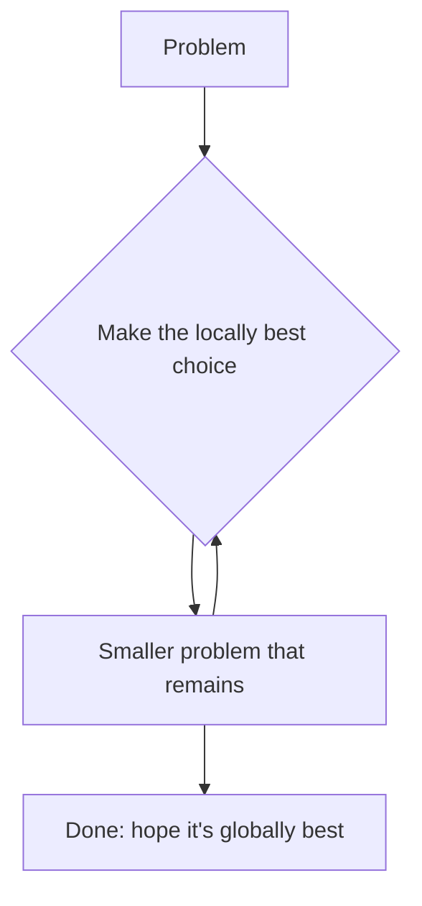
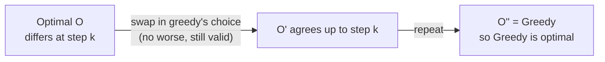
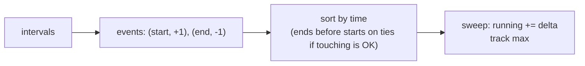
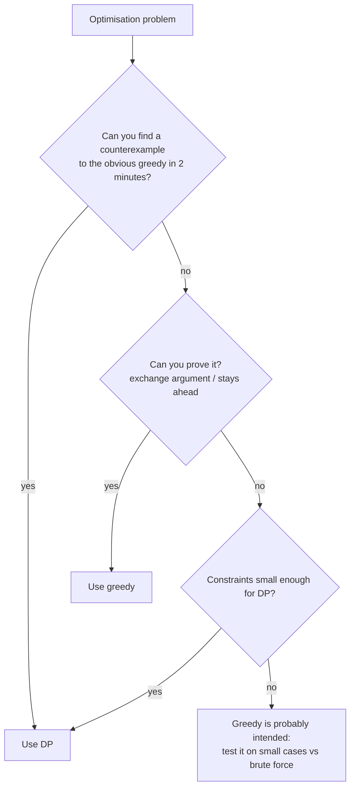

# Chapter 22 · Greedy Algorithms & Intervals

> Ek dukaandaar ko tumhe ₹38 lautane hain. Bina soche wo tumhe ek ₹20, ek ₹10, ek ₹5, ek ₹2 aur ek ₹1 thama deti hai. Har baar sabse bada note pehle, aur kabhi dobara nahi sochti. Paanch note, aur ye sabse kam possible bhi nikle. Yahi hai **greedy algorithm**: abhi jo sabse achha dikh raha hai wo utha lo aur kabhi peeche mud ke mat dekho. Kabhi-kabhi ye kamaal ka hota hai. Kabhi-kabhi ye ek trap hai. Ye chapter tumhe sikhata hai ki kab kaunsa hai, aur use *prove* kaise karte hain.

**Is chapter mein tum seekhoge:**
- Greedy algorithm kya hai, aur wo do properties jo use sahi banati hain
- **Exchange argument** aur **"greedy stays ahead"**: wo do proofs jo "sahi lag raha hai" ko "sahi hai" mein badal dete hain
- Greedy kab **fail** hota hai, aise concrete counterexamples ke saath jo tum interview mein turant bana sako
- Interval toolkit: activity selection, non-overlapping intervals, merge, insert, meeting rooms I & II, minimum arrows
- Classic greedy problems: Jump Game I & II, Gas Station, Candy, Task Scheduler, Partition Labels, Assign Cookies, fractional knapsack, Huffman coding
- "Ek saath kitni cheezein overlap kar rahi hain?" ke liye **sweep-line** technique
- Ek decision guide: greedy ya DP?

**Isse pehle padho:** [Sorting Algorithms](07-sorting.md) · [Heaps & Priority Queues](15-heaps.md) · [Dynamic Programming I](20-dp-1d.md) · [Dynamic Programming II](21-dp-2d-advanced.md) · [Two Pointers](03-two-pointers.md)

---

## 🧠 The Big Idea · Asli Baat

DP (Chapters 20 aur 21) bahut careful hai: har step pe wo **har** choice try karta hai aur best rakhta hai. Greedy bindaas hai: har step pe wo **ek** choice karta hai, jo abhi sabse achhi dikh rahi hai, aur hamesha ke liye us pe tik jaata hai.



Greedy fast hai (aksar bas ek sort plus ek pass: O(n log n)) aur code chhota hota hai. Pakad us shabd "hope" mein hai. Greedy tabhi sahi hai jab do cheezein sach ho:

| Property | Seedha matlab |
|---|---|
| **Greedy choice property** | Koi na koi optimal solution greedy choice se *hi shuru hota hai*. Toh us choice pe commit karne se best answer ka darwaza kabhi band nahi hota. |
| **Optimal substructure** | Greedy choice ke baad jo bacha hai wo usi problem ki ek chhoti copy hai, aur uska optimal solution plus greedy choice milke overall optimal hai. |

DP ko sirf doosri property chahiye. Greedy ko dono chahiye. Isiliye greedy fast hai (wo explore nahi karta) aur isiliye risky bhi hai (agar pehli property galat hai, toh wo poore confidence se galat answer deta hai).

> 🇮🇳 **Desi Analogy:** IRCTC Tatkal booking socho. 10 baje window khulti hai aur tum pehli dikhne wali train ki pehli available seat pe click kar dete ho, bina saari trains compare kiye. Ye **greedy** hai: tez, aur aksar kaam kar jaata hai. Lekin kabhi-kabhi baad mein pata chalta hai ki doosri train mein seedha confirmed lower berth thi, aur tumne jo pakda wo RAC tha. DP wala dost har train, har class compare karta, lekin tab tak seats khatam. **Greedy choice property** ka matlab hai: "pehli available seat pakadna kabhi best option ko block nahi karta". Ye guarantee ho, tabhi greedy pe bharosa karo.

**Dukaandaar wala example alag coins ke saath fail hota hai.** Maan lo kisi desh mein coins 1, 3 aur 4 hain, aur tumhe 6 dene hain:

```text
Greedy:  4 + 1 + 1  = 3 coins
Best  :  3 + 3      = 2 coins
```

Pehle 4 uthane se best answer ka darwaza band ho gaya. Indian/US denominations ke saath greedy sanyog se optimal hai (aise coin systems ko *canonical* kehte hain), lekin ye un khaas coins ki property hai, koi kudrat ka niyam nahi. Kisi bhi random coins ke liye tumhe Chapter 20 ka Coin Change DP chahiye.

> 💡 **Mindset:** greedy ek *idea* hai jise *prove* karna padta hai. Interview mein apna greedy rule bolo, phir bolo ki ye best answer *kyun* miss nahi kar sakta (aksar ek-do sentences mein). Agar nahi bol pa rahe, toh ek chhota counterexample try karo. Mil gaya, toh DP pe switch karo.

> 🤔 **Mann mein sawaal:** Agar greedy ke liye proof chahiye hi, toh har baar DP hi kyun na likh doon? Wo toh hamesha sahi hai.
>
> **Jawab:** Speed aur constraints ki wajah se. Activity selection ki seedhi DP har activity ke liye pichhli compatible activities dekhti hai (O(n²), ya binary search ke saath O(n log n) aur zyada code), jabki greedy bas sort + ek scan hai. Jump Game II ki DP O(n²) hai, greedy O(n). Jab n = 10⁵ ho toh O(n²) TLE kha jaata hai. Aur kai greedy problems (Gas Station, Candy) ki seedhi DP banana hi mushkil hai. Toh rule simple hai: greedy dikhe toh pehle use todne ki koshish karo; na toote aur proof ek line ka ho, toh greedy hi best hai.

---

## 🔨 Building It Up · Zero Se Shuru

### 1. Pehla greedy: Assign Cookies

Har bachcha i us cookie se khush hota hai jiska size kam se kam `g[i]` ho (uska greed). Har cookie j ka size `s[j]` hai. Har bachche ko zyada se zyada ek cookie milti hai. Khush bachchon ki ginti maximise karo.

**Greedy rule:** dono ko sort karo. Har cookie ko, chhoti se shuru karke, us sabse kam greedy bachche ko do jise wo khush kar sake. Doosre shabdon mein: sabse kam greedy bachche se shuru karke har bachche ko wo sabse chhoti cookie do jo kaam kar jaaye.

```python
def find_content_children(greed, sizes):
    greed, sizes = sorted(greed), sorted(sizes)
    child = 0
    for cookie in sizes:
        if child < len(greed) and cookie >= greed[child]:
            child += 1                 # this cookie satisfies the least greedy child left
    return child

print(find_content_children([1, 2, 3], [1, 1]), find_content_children([1, 2], [1, 2, 3]))
```

```text
1 2
```

**Ye sahi kyun hai (chhota sa exchange argument):** koi bhi optimal assignment lo. Agar sabse kam greedy bachche ko sabse chhoti usable cookie nahi mili, toh swap karo: use sabse chhoti usable cookie do, aur uski purani cookie use do jiske paas chhoti wali thi (agar kisi ke paas thi). Purani cookie kam se kam utni hi badi hai, toh wo doosra bachcha bhi khush hi rahega. Ginti kabhi nahi ghatti. Toh koi optimal answer greedy ke pehle move se agree karta hai, aur yahi argument dohrane se, har move se.

> 🇮🇳 **Desi Analogy:** Shaadi mein mithai ke dabbe baant rahe ho. Chhote bachche ek chhote dabbe se khush, bade cousins ko bada dabba chahiye. Samajhdar mausi kya karti hai? Chhote dabbe pehle sabse kam demand wale bachchon ko deti hai, aur bade dabbe unke liye bachati hai jinhe sach mein bada chahiye. Agar wo chhote bachche ko bada dabba de de, toh baad mein bada cousin khaali haath reh sakta hai. **Dabba = cookie**, **demand = greed**, aur "chhota dabba chhoti demand ko" = sorted greedy.

### 2. Exchange argument (ye proof tum sabse zyada use karoge)

Recipe, step by step. Is chapter ki lagbhag har problem pe tum ise lagta hua dekhoge.

1. Maano **G** greedy solution hai aur **O** koi bhi optimal solution.
2. **Pehli jagah** dhundo jahan dono alag hain: greedy ne `g` chuna, optimal ne `o`.
3. Dikhao ki O ke andar `o` ki jagah `g` **exchange** kar sakte ho bina O ko bura banaye (abhi bhi valid, abhi bhi utna hi achha ya behtar).
4. Ab O ek aur step tak G se agree karta hai. Dohrao jab tak O = G na ho jaaye. Kyunki O kabhi bura nahi hua, **G bhi optimal hai**.



Doosra proof style, **greedy stays ahead**, ye dikhata hai ki har step ke baad greedy ka partial solution *kisi bhi* doosre solution ke partial solution jitna achha hai (kisi yardstick se naapo, jaise "main kitna door pahunch sakta hoon" ya "mera aakhri chuna interval kab khatam hota hai"). Agar greedy kabhi peeche nahi hai, toh wo finish line pe haar nahi sakta. Jump Game yahi use karta hai.

Cricket se socho: agar har over ke baad tumhari team ka score doosri team ke us over ke score se kam nahi hai, toh 20 overs ke baad bhi tum peeche nahi ho sakte. Yahi "stays ahead" hai.

### 3. Jab greedy fail hota hai: counterexamples haath mein rakho

Galat greedy ko maarne ka sabse tez tareeka ek chhota sa counterexample hai. Ye ratne layak hain:

| Problem | Lalchane wala greedy | Counterexample | Sahi tool |
|---|---|---|---|
| Coin Change (koi bhi coins) | sabse bada coin pehle | coins {1, 3, 4}, amount 6: greedy 3 coins, best 2 | DP (Ch. 20) |
| 0/1 Knapsack | best value/weight ratio pehle | W=7, items (w5, v7), (w3, v4), (w4, v5), (w1, v1): greedy 8, best 9 | DP (Ch. 21) |
| House Robber | sabse bada ghar pehle | [5, 9, 5]: greedy 9, best 10 | DP (Ch. 20) |
| Activity selection | sabse chhoti activity pehle | (1,5), (4,7), (6,10): greedy (4,7) chunta hai → 1, best 2 | earliest **finish** pehle |
| Activity selection | earliest start pehle | (1,10), (2,3), (4,5): greedy (1,10) chunta hai → 1, best 2 | earliest **finish** pehle |
| Graph mein longest path | hamesha sabse bhaari edge lo | lagbhag koi bhi graph | DAGs pe DP / general mein NP-hard |
| Triangle min path | chhote child pe jao | `[[1],[2,3],[9,9,1]]`: greedy 1+2+9 = 12, best 1+3+1 = 5 | DP |

```python
def greedy_coins(coins, amount):
    count = 0
    for c in sorted(coins, reverse=True):
        count += amount // c
        amount %= c
    return count if amount == 0 else -1

def dp_coins(coins, amount):
    dp = [0] + [float("inf")] * amount
    for x in range(1, amount + 1):
        dp[x] = min((dp[x - c] + 1 for c in coins if c <= x), default=float("inf"))
    return dp[amount]

print("Indian coins, 38:", greedy_coins([1, 2, 5, 10, 20], 38), dp_coins([1, 2, 5, 10, 20], 38))
print("coins 1,3,4, 6  :", greedy_coins([1, 3, 4], 6), dp_coins([1, 3, 4], 6))
```

```text
Indian coins, 38: 5 5
coins 1,3,4, 6  : 3 2
```

Kya hua yahan: canonical coins pe greedy aur DP agree karte hain; {1, 3, 4} pe greedy haar jaata hai. Same algorithm, alag input, alag faisla. Isiliye greedy ko proof chahiye.

### 4. Activity Selection: interval greedy ki maa

Tumhare paas activities hain jinke start aur finish times hain. Ek baar mein ek hi attend kar sakte ho. Zyada se zyada attend karo. (Intervals ko half-open samjho: ek jo 4 pe khatam hota hai aur doosra jo 4 pe shuru hota hai, clash nahi karte.)

**Greedy rule: hamesha wo activity chuno jo sabse pehle khatam hoti hai**, un activities mein se jo tumhari pichhli chuni hui activity ke khatam hone ke baad shuru hoti hain.

**Earliest finish hi kyun? (exchange argument)** Maano `g` wo activity hai jiska finish time sabse pehle hai. Koi bhi optimal schedule O lo aur uski pehli activity `o`. Kyunki `g`, `o` se pehle (ya saath) khatam hoti hai, `o` ki jagah `g` rakhne se O ki doosri activity ke saath clash nahi ban sakta (doosri activity `o` ke khatam hone ke baad shuru hoti hai, toh `g` ke khatam hone ke baad bhi). Ginti same rehti hai. Toh koi optimal schedule `g` se shuru hota hai. `g` se clash karne wali saari activities hata do aur baaki pe dohrao.

Intuition: jaldi khatam karna future ke liye **sabse zyada jagah chhodta hai**.

> 🇮🇳 **Desi Analogy:** College fest mein ek hi auditorium hai aur bahut saare events book karne hain. Smart coordinator kya karta hai? Jo event sabse **jaldi khatam** hota hai, wo pehle confirm karta hai, kyunki hall jaldi khaali hoga aur aage zyada events fit honge. Jo event sabse pehle *shuru* hota hai wo lena galat ho sakta hai: wo 9 baje se raat 9 baje tak hall gher le, toh baaki din barbaad. **Event = interval**, **hall = ek resource**, **"jaldi khatam pehle" = sort by end**.

```python
def max_activities(intervals):
    chosen = []
    last_end = float("-inf")
    for start, end in sorted(intervals, key=lambda x: x[1]):   # by finish time
        if start >= last_end:          # doesn't clash with the last chosen one
            chosen.append((start, end))
            last_end = end
    return chosen

acts = [(1, 4), (3, 5), (0, 6), (5, 7), (3, 9), (5, 9), (6, 10), (8, 11), (8, 12), (2, 14), (12, 16)]
print(max_activities(acts))
```

```text
[(1, 4), (5, 7), (8, 11), (12, 16)]
```

**Dry run** (end time se sorted):

| activity | start ≥ last_end? | action | last_end |
|---|---|---|---|
| (1, 4) | 1 ≥ -inf ✓ | lo | 4 |
| (3, 5) | 3 ≥ 4 ✗ | chhodo | 4 |
| (0, 6) | 0 ≥ 4 ✗ | chhodo | 4 |
| (5, 7) | 5 ≥ 4 ✓ | lo | 7 |
| (3, 9) | ✗ | chhodo | 7 |
| (5, 9) | ✗ | chhodo | 7 |
| (6, 10) | ✗ | chhodo | 7 |
| (8, 11) | 8 ≥ 7 ✓ | lo | 11 |
| (8, 12) | ✗ | chhodo | 11 |
| (2, 14) | ✗ | chhodo | 11 |
| (12, 16) | 12 ≥ 11 ✓ | lo | 16 |

Sort ke liye O(n log n) time, scan ke liye O(n).

### 5. Non-overlapping Intervals

Intervals diye hain. **Kam se kam kitne hatao** ki baaki overlap na kare? Chhoona (`[1,2]` aur `[2,3]`) chalta hai.

Ye activity selection ka aaina hai: zyada se zyada non-overlapping intervals rakho; baaki hata do. **Hataye gaye = total − rakhe gaye.**

```python
def erase_overlap_intervals(intervals):
    kept = 0
    last_end = float("-inf")
    for start, end in sorted(intervals, key=lambda x: x[1]):
        if start >= last_end:
            kept += 1
            last_end = end
    return len(intervals) - kept

print(erase_overlap_intervals([[1, 2], [2, 3], [3, 4], [1, 3]]),
      erase_overlap_intervals([[1, 2], [1, 2], [1, 2]]),
      erase_overlap_intervals([[1, 2], [2, 3]]))
```

```text
1 2 0
```

### 6. Merge Intervals

Saare overlapping intervals merge karo. `[[1,3],[2,6],[8,10],[15,18]]` → `[[1,6],[8,10],[15,18]]`.

**Rule:** **start** se sort karo. Aage badho; agar current interval pichhle merged interval ke khatam hone se pehle (ya exactly tab) shuru hota hai, toh dono overlap karte hain: pichhle wale ka end badha do. Warna ek naya merged interval shuru karo.

Yahan start se sort kyun (end se kyun nahi)? Start se sort karne ke baad, jo bhi interval current group se overlap karta hai wo uske *theek baad* aana chahiye: beech mein aisa kuch nahi ho sakta jo pehle shuru hota ho. Toh pichhle merged interval se ek comparison kaafi hai.

```python
def merge(intervals):
    merged = []
    for start, end in sorted(intervals):            # sorts by start, then end
        if merged and start <= merged[-1][1]:       # overlaps (or touches) the last one
            merged[-1][1] = max(merged[-1][1], end) # extend; max handles nesting
        else:
            merged.append([start, end])
    return merged

print(merge([[1, 3], [2, 6], [8, 10], [15, 18]]))
print(merge([[1, 4], [4, 5]]))
print(merge([[1, 10], [2, 3], [4, 5]]))
```

```text
[[1, 6], [8, 10], [15, 18]]
[[1, 5]]
[[1, 10]]
```

Kya hua yahan: **nested** intervals ke liye `max` zaroori hai: `[1, 10]` ke andar `[2, 3]` hai, toh end ko 3 tak chhota nahi hona chahiye.

| Sawaal | Kis se sort karo | Kyun |
|---|---|---|
| Merge / union / cover | **start** | start order mein padosi hi sirf possible overlaps hain |
| Zyada se zyada non-overlapping rakho / kam se kam hatao / arrows | **end** | jaldi khatam karna sabse zyada jagah chhodta hai (exchange argument) |

> 🤔 **Mann mein sawaal:** Kabhi start se sort, kabhi end se. Main kaise yaad rakhun kab kya?
>
> **Jawab:** Khud se poochho: "Kya main intervals ko **jod** raha hoon ya **chun** raha hoon?" Jodna (merge, union, total covered length) → **start** se, kyunki tumhe padosiyon ko line se dekhna hai. Chunna (max kitne fit honge, kitne hatao, kitne arrows) → **end** se, kyunki tumhe future ke liye jagah bachani hai. Summary ka hook bhi yahi hai: "End to keep, Start to merge."

### 7. Insert Interval

List pehle se sorted aur non-overlapping hai. Ek naya interval insert karo aur zaroorat ho toh merge karo, O(n) mein.

Teen phases: naye interval ke shuru hone se **pehle** khatam hone wale sab copy karo; jo usse **overlap** karte hain unhe ek mein merge karo; jo uske khatam hone ke **baad** shuru hote hain unhe copy karo.

```python
def insert(intervals, new):
    result = []
    i, n = 0, len(intervals)
    start, end = new
    while i < n and intervals[i][1] < start:        # entirely to the left
        result.append(intervals[i])
        i += 1
    while i < n and intervals[i][0] <= end:         # overlapping: absorb into new
        start = min(start, intervals[i][0])
        end = max(end, intervals[i][1])
        i += 1
    result.append([start, end])
    result.extend(intervals[i:])                    # entirely to the right
    return result

print(insert([[1, 3], [6, 9]], [2, 5]))
print(insert([[1, 2], [3, 5], [6, 7], [8, 10], [12, 16]], [4, 8]))
print(insert([], [5, 7]))
```

```text
[[1, 5], [6, 9]]
[[1, 2], [3, 10], [12, 16]]
[[5, 7]]
```

### 8. Meeting Rooms I

Kya ek insaan saari meetings attend kar sakta hai? Sirf tab jab koi do overlap na kare. Start se sort karo aur har padosi pair check karo.

```python
def can_attend_meetings(intervals):
    intervals = sorted(intervals)
    for (s1, e1), (s2, e2) in zip(intervals, intervals[1:]):
        if s2 < e1:                  # next starts before the previous ends
            return False
    return True

print(can_attend_meetings([[0, 30], [5, 10], [15, 20]]), can_attend_meetings([[7, 10], [2, 4]]))
```

```text
False True
```

### 9. Meeting Rooms II: kitne rooms?

Kam se kam kitne rooms chahiye taaki saari meetings ho sakein? Ye **ek hi pal mein chal rahi meetings ki maximum ginti** ke barabar hai.

**Method A: end times ka min-heap** ([Chapter 15](15-heaps.md)). Meetings ko start time ke order mein process karo. Heap use ho rahe rooms ke end times rakhta hai. Agar sabse jaldi khaali hone wala room is meeting ke shuru hone tak free ho chuka hai, toh use reuse karo (pop); phir is meeting ka end push karo. Heap ka size hi rooms ki ginti hai.

> 🇮🇳 **Desi Analogy:** Railway station pe platforms allot karne wala station master socho. Trains arrival time ke order mein aa rahi hain. Uske paas ek register hai jisme har busy platform ke saamne likha hai "ye kab khaali hoga". Nayi train aayi toh wo sirf ek cheez dekhta hai: **sabse jaldi khaali hone wala platform** (heap ka top). Wo free ho gaya hai? Toh wahi de do. Nahi? Toh naya platform kholo. Din ke end mein jitne platforms khule, wahi answer hai. **Platform = room**, **register = min-heap**, **"sabse jaldi khaali" = `ends[0]`**.

```python
import heapq

def min_meeting_rooms(intervals):
    ends = []                                # end times of rooms in use
    for start, end in sorted(intervals):
        if ends and ends[0] <= start:        # earliest room is free again
            heapq.heappop(ends)
        heapq.heappush(ends, end)
    return len(ends)

print(min_meeting_rooms([[0, 30], [5, 10], [15, 20]]), min_meeting_rooms([[7, 10], [2, 4]]),
      min_meeting_rooms([[1, 5], [2, 6], [3, 7], [5, 8]]))
```

```text
2 1 3
```

**Method B: chronological sweep** (do sorted lists). Saare starts aur saare ends ko alag-alag sort karo. Time ke saath chalo: har start ko ek room chahiye; har end ek room khaali karta hai. Code `ends[j] <= s` check karta hai, toh jo meeting 5 pe khatam hoti hai wo apna room us meeting ke liye khaali kar deti hai jo 5 pe shuru hoti hai.

```python
def min_meeting_rooms_sweep(intervals):
    starts = sorted(s for s, _ in intervals)
    ends = sorted(e for _, e in intervals)
    rooms = best = 0
    j = 0
    for s in starts:
        while j < len(ends) and ends[j] <= s:   # free every room that ended by time s
            rooms -= 1
            j += 1
        rooms += 1
        best = max(best, rooms)
    return best

print(min_meeting_rooms_sweep([[0, 30], [5, 10], [15, 20]]), min_meeting_rooms_sweep([[1, 5], [2, 6], [3, 7], [5, 8]]))
```

```text
2 3
```

Dono O(n log n) hain. Method B **sweep line** idea hai, jise hum section 18 mein generalise karenge.

### 10. Minimum Number of Arrows to Burst Balloons

Balloons x-axis pe intervals hain. x pe chalaya gaya arrow har us balloon ko phod deta hai jiske liye `start <= x <= end` (chhoona bhi ginta hai). Minimum kitne arrows?

**Rule:** **end** se sort karo. Pehle balloon ke end pe arrow chalao (jitna right ho sake, phir bhi use lage: isse sabse zyada doosre balloons lagte hain). Wo arrow jitne balloons ko lagta hai sab skip karo; jo pehla balloon miss hota hai, use agla arrow *uske* end pe milta hai.

```python
def find_min_arrow_shots(points):
    arrows = 0
    arrow_x = float("-inf")
    for start, end in sorted(points, key=lambda p: p[1]):
        if start > arrow_x:              # this balloon wasn't hit by the last arrow
            arrows += 1
            arrow_x = end                # shoot at its right edge
    return arrows

print(find_min_arrow_shots([[10, 16], [2, 8], [1, 6], [7, 12]]),
      find_min_arrow_shots([[1, 2], [3, 4], [5, 6], [7, 8]]),
      find_min_arrow_shots([[1, 2], [2, 3], [3, 4], [4, 5]]))
```

```text
2 4 2
```

Ye phir se activity selection hai: arrows ki ginti pairwise-disjoint balloons ki maximum ginti ke barabar hai. `start > arrow_x` (strict) dekho, kyunki chhoone wale balloons ek arrow share karte hain. Non-overlapping Intervals mein humne `>=` use kiya tha kyunki wahan chhoone wale intervals overlap *nahi* karte. **Hamesha statement mein check karo ki "overlap" ka matlab kya hai.**

### 11. Jump Game I & II: greedy stays ahead

**Jump Game I:** `nums[i]` index i se maximum jump hai. Kya tum aakhri index tak pahunch sakte ho?

**Rule:** `farthest` track karo, yaani ab tak pahunchne layak sabse door ka index. i ko left se right chalao; agar kabhi aise `i > farthest` pe khade ho, toh tum phans gaye.

```python
def can_jump(nums):
    farthest = 0
    for i, step in enumerate(nums):
        if i > farthest:                   # this index is unreachable
            return False
        farthest = max(farthest, i + step)
    return True

print(can_jump([2, 3, 1, 1, 4]), can_jump([3, 2, 1, 0, 4]), can_jump([0]))
```

```text
True False True
```

**Ye kaam kyun karta hai:** reachable indexes ka set hamesha ek contiguous block `[0, farthest]` hota hai (agar tum i tak pahunch sakte ho, toh raste mein uske pehle ke sab tak bhi pahunch sakte ho). Toh ek number sab kuch describe kar deta hai.

Doosre example `[3, 2, 1, 0, 4]` mein: index 0 se farthest 3, index 1 se 3, index 2 se 3, index 3 se `3 + 0 = 3`. Har raasta index 3 pe hi atak jaata hai (wahan 0 hai). Index 4 pe `4 > 3`, phans gaye: False.

**Jump Game II:** minimum kitne jumps. Chapter 20 ne O(n²) DP kiya tha. Greedy **levels ke hisaab se BFS** hai: `k` jumps se pahunchne wale saare indexes ek range `[level_start, level_end]` banate hain. Agli range us sabse door ke index pe khatam hoti hai jo current range ke kisi bhi index se pahunch sake.

> 🇮🇳 **Desi Analogy:** Mumbai local mein Churchgate se Virar jaana hai, aur har station se ek "max kitne stations aage tak" wali train milti hai. Pehli train (jump 1) tumhe jahan tak le ja sakti hai, wo saare stations "level 1" hain. Ab level 1 ke har station pe dekho ki wahan se agli train kitna door tak le jaati hai; un sab ka maximum "level 2" ki boundary hai. Tumhe pata karne ki zaroorat hi nahi ki *exactly* kis station pe utre, bas boundary badhte raho. **Station = index**, **train ki range = nums[i]**, **level = jumps ki ginti**, **`level_end` = is level ki aakhri boundary**.

```python
def jump(nums):
    jumps = 0
    level_end = 0          # last index reachable with `jumps` jumps
    farthest = 0
    for i in range(len(nums) - 1):          # no need to jump from the last index
        farthest = max(farthest, i + nums[i])
        if i == level_end:                  # finished scanning this level
            jumps += 1
            level_end = farthest
    return jumps

print(jump([2, 3, 1, 1, 4]), jump([2, 3, 0, 1, 4]), jump([1]))
```

```text
2 2 0
```

`[2, 3, 1, 1, 4]` ka **trace**:

| i | nums[i] | farthest | i == level_end? | jumps | level_end |
|---|---|---|---|---|---|
| start | | 0 | | 0 | 0 |
| 0 | 2 | 2 | haan → jump | 1 | 2 |
| 1 | 3 | 4 | nahi | 1 | 2 |
| 2 | 1 | 4 | haan → jump | 2 | 4 |
| 3 | 1 | 4 | nahi | 2 | 4 |

**Greedy stays ahead:** k jumps ke baad, `level_end` wo sabse door ka index hai jahan *koi bhi* strategy k jumps mein pahunch sakti hai (induction se proof: k+1 jumps mein jo bhi reachable hai wo k jumps ke andar wale kisi index se aata hai, aur humne un sab ka max liya). Toh pehla k jiske liye `level_end >= n-1` ho, wahi optimal hai. O(n) time, O(1) space.

> 🤔 **Mann mein sawaal:** Jump Game II mein `i == level_end` pe jump kyun gina? Jump toh level ke *shuru* mein hota hai na?
>
> **Jawab:** `jumps` ko "ab tak kitne jumps commit kiye" samjho. Jab `i == level_end` hota hai, matlab current level ke saare indexes scan ho gaye aur ab humein pata hai ki agla level `farthest` tak jaata hai. Aage badhne ke liye ek jump lena hi padega, toh ab gin lo aur boundary `farthest` pe set karo. Loop `len(nums) - 1` tak isliye hai ki agar boundary aakhri index pe ya uske aage pahunch gayi, toh aakhri index pe khade hoke ek aur jump ginne ki zaroorat nahi.

### 12. Gas Station

Ek circle pe stations hain: station i pe `gas[i]` fuel milta hai, aur station i+1 tak jaane mein `cost[i]` fuel lagta hai. Khaali tank se shuru karo. Wo start index return karo jahan se poora chakkar laga sako, ya -1. (Agar answer exist karta hai toh wo unique hai.)

Do greedy facts:

1. **Agar `sum(gas) >= sum(cost)`, toh solution exist karta hai**; warna impossible hai.
2. **Agar tum s se shuru karte ho aur pehli baar j+1 tak pahunchne mein fuel khatam hota hai, toh s aur j ke beech ka koi bhi station start nahi ho sakta.** Kyun? `(s, j]` ke har station k pe tum ≥ 0 tank ke saath pahunche. k pe fresh shuru karna matlab k pe 0 ke saath pahunchna, jo behtar nahi hai. Tum phir j+1 pe hi fass jaoge. Toh start ko seedha j+1 pe le jao.

```python
def can_complete_circuit(gas, cost):
    if sum(gas) < sum(cost):
        return -1
    start, tank = 0, 0
    for i in range(len(gas)):
        tank += gas[i] - cost[i]
        if tank < 0:            # can't reach i+1 from `start`, nor from anything in between
            start = i + 1
            tank = 0
    return start

print(can_complete_circuit([1, 2, 3, 4, 5], [3, 4, 5, 1, 2]), can_complete_circuit([2, 3, 4], [3, 4, 3]))
```

```text
3 -1
```

gas `[1,2,3,4,5]`, cost `[3,4,5,1,2]` ka **trace** (net = `[-2,-2,-2,3,3]`):

| i | net | tank | action | start |
|---|---|---|---|---|
| 0 | -2 | -2 | khaali → 1 pe restart | 1 |
| 1 | -2 | -2 | khaali → 2 pe restart | 2 |
| 2 | -2 | -2 | khaali → 3 pe restart | 3 |
| 3 | +3 | 3 | ok | 3 |
| 4 | +3 | 6 | ok | 3 |

Total 0 ≥ 0 hai, toh start 3 chakkar poora karta hai. O(n) time, O(1) space.

Ek doubt aata hai: humne sirf index 3 se end tak check kiya, wrap-around (0, 1, 2 dobara) check nahi kiya. Wo fact 1 ki wajah se safe hai: 3 se end tak tank 6 bacha, aur 0..2 ka total -6 hai. Overall total ≥ 0 hai, toh jo surplus 3 se end tak jama hua wo shuru ke deficit ko cover kar deta hai.

> 🇮🇳 **Desi Analogy:** Ek circular bus route hai, har stop pe kuch diesel milta hai aur agle stop tak kuch lagta hai. Driver ek stop se nikla aur beech mein diesel khatam. Ab wo sochta hai "chalo, beech ke kisi stop se shuru karta hoon". Lekin un stops pe toh wo pehle hi kuch extra diesel leke pahuncha tha, phir bhi fail hua. Khaali tank se wahan se shuru karega toh aur jaldi fail hoga. Toh seedha **fail hone wale stop ke agle stop** se try karo. **Stop = station**, **diesel = gas**, **"beech wale bekaar" = fact 2**.

### 13. Candy: do passes

Bachche ek line mein khade hain, har ek ki rating hai. Har ek ko kam se kam ek candy milti hai; jis bachche ki rating **kisi padosi se zyada** hai, use us padosi se zyada candy milni chahiye. Total candy minimise karo.

Ek pass dono padosiyon ko nahi dekh sakta. Toh **do greedy passes** karo, har ek ek side ko enforce karta hai:
- Left to right: agar `rating[i] > rating[i-1]`, toh `left[i] = left[i-1] + 1`, warna 1.
- Right to left: agar `rating[i] > rating[i+1]`, toh `right[i] = right[i+1] + 1`, warna 1.
- Har bachche ko dono sides satisfy karne ke liye `max(left[i], right[i])` chahiye, aur ye wo minimum bhi hai jo dono satisfy karta hai.

```python
def candy(ratings):
    n = len(ratings)
    left = [1] * n
    for i in range(1, n):
        if ratings[i] > ratings[i - 1]:
            left[i] = left[i - 1] + 1
    right = [1] * n
    for i in range(n - 2, -1, -1):
        if ratings[i] > ratings[i + 1]:
            right[i] = right[i + 1] + 1
    return sum(max(a, b) for a, b in zip(left, right))

print(candy([1, 0, 2]), candy([1, 2, 2]), candy([1, 3, 4, 5, 2]))
```

```text
5 4 11
```

`[1, 3, 4, 5, 2]` ke liye: left = `[1,2,3,4,1]`, right = `[1,1,1,2,1]`, max = `[1,2,3,4,1]`, sum 11. O(n) time, O(n) space.

> 💡 **Two-pass greedy** ek pattern hai: jab constraint dono padosiyon pe ho, toh left wale constraints ek sweep mein satisfy karo, right wale doosre mein, aur combine karo. (Trapping Rain Water aur Product of Array Except Self ka shape bhi yahi hai.)

### 14. Task Scheduler

CPU tasks letters hain; ek jaise tasks ke beech kam se kam `n` time units chahiye. Har unit mein ek task chalta hai ya CPU idle rehta hai. Minimum total time kitna?

**Sabse frequent task ke baare mein socho.** Maano A `max_count` baar aata hai. A's ke beech kam se kam `n+1` ka faasla chahiye, jisse `n + 1` length ke `max_count - 1` "frames" bante hain, plus ek aakhri adhoora frame:

```text
n = 2, tasks = AAABBB
A B _ | A B _ | A B
frame   frame   last row: every task that ties for the max count
```

Length = `(max_count - 1) × (n + 1) + (un tasks ki ginti jinka count == max_count)`. Baaki tasks idle slots bharte hain. Agar itne zyada tasks hain ki idle ki zaroorat hi nahi, toh answer bas `len(tasks)` hai. Toh:

```python
from collections import Counter

def least_interval(tasks, n):
    counts = Counter(tasks).values()
    max_count = max(counts)
    num_max = sum(1 for c in counts if c == max_count)
    return max(len(tasks), (max_count - 1) * (n + 1) + num_max)

print(least_interval(list("AAABBB"), 2), least_interval(list("AAABBB"), 0),
      least_interval(list("AAAAAABCDEFG"), 2))
```

```text
8 6 16
```

O(n) time (counting), O(1) space (26 letters). Heap simulation bhi chalta hai (hamesha sabse frequent available task chalao), lekin interviewers ko formula pasand aata hai.

Teesra example `"AAAAAABCDEFG"`, n = 2: A 6 baar hai. Frames: `(6 - 1) × 3 + 1 = 16`. Total tasks 12 hain, toh `max(12, 16) = 16`. Matlab 4 idle slots bachenge, kyunki baaki 6 letters 10 khaali jagahon mein se sirf 6 bhar paate hain.

### 15. Partition Labels

Ek string ko zyada se zyada parts mein todo taaki har letter zyada se zyada ek part mein aaye. Parts ke sizes return karo. `"ababcbacadefegdehijhklij"` → `[9, 7, 8]`.

**Rule:** har letter ka **last index** record karo. String pe chalo, aur jo bhi letter dikhe, current part ka end us letter ki aakhri occurrence tak badha do. Jab `i` us end tak pahunche, toh is part ka koi bhi letter aage nahi aata: kaat do.

```python
def partition_labels(s):
    last = {ch: i for i, ch in enumerate(s)}
    sizes = []
    start = end = 0
    for i, ch in enumerate(s):
        end = max(end, last[ch])      # this part must reach ch's last occurrence
        if i == end:                  # everything inside closes here: cut
            sizes.append(end - start + 1)
            start = i + 1
    return sizes

print(partition_labels("ababcbacadefegdehijhklij"), partition_labels("eccbbbbdec"))
```

```text
[9, 7, 8] [10]
```

Ye costume pehna hua merge intervals hai: har letter ek interval `[first, last]` hai; parts merged groups hain.

### 16. Fractional Knapsack: jahan greedy *sach mein* kaam karta hai

0/1 knapsack (Chapter 21) jaisa hi, lekin items ke **fractions** le sakte ho (sone ki dhool, sone ki eent nahi). Ab **value per weight** wala greedy optimal hai: sabse keemti cheez se pehle bharo.

**Exchange argument:** agar kisi optimal solution mein kam-ratio wale item ka kuch weight hai jabki zyada-ratio wala item poora nahi liya gaya, toh barabar weight swap kar do. Value badhti hai (ya barabar rehti hai). Toh optimum items ko ratio ke order mein leta hai.

```python
def fractional_knapsack(values, weights, capacity):
    items = sorted(zip(values, weights), key=lambda vw: vw[0] / vw[1], reverse=True)
    total = 0.0
    for value, weight in items:
        if capacity == 0:
            break
        take = min(weight, capacity)
        total += value * take / weight
        capacity -= take
    return total

print(fractional_knapsack([60, 100, 120], [10, 20, 30], 50))
```

```text
240.0
```

(60 + 100 + 120 ka do-tihaai.) 0/1 ke liye ye fail kyun hota hai? Kyunki tum "ek item ka do-tihaai" nahi le sakte: proof wale swap ko divisibility chahiye. Bas yahi ek detail O(n log n) greedy aur ek NP-hard problem ka farq hai.

> 🇮🇳 **Desi Analogy:** Kirana store mein ek bori mein 50 kg jagah hai. Fractional wala case: tumhare paas khula kaju, badaam aur chawal hai, jitna chaho tol ke le lo. Sabse mehenga per kg (kaju) pehle bharo, phir badaam, phir bachi jagah chawal se. Ye greedy perfect hai. 0/1 wala case: ab sab sealed packets hain, khol nahi sakte. Ab "sabse mehenga per kg pehle" bori mein awkward khaali jagah chhod sakta hai, aur tumhe DP chahiye. **Khula maal = fraction allowed**, **sealed packet = 0/1**.

### 17. Huffman Coding (idea)

Text compress karne ke liye, frequent characters ko **chhote** bit codes do aur rare characters ko lambe. Codes **prefix-free** hone chahiye (koi code kisi doosre ki shuruaat na ho) taaki decoding mein confusion na ho. Huffman ka greedy aisa optimal code banata hai:

1. Har character ko frequency ke key ke saath ek min-heap mein daalo.
2. Baar-baar **do sabse kam frequent** nikalo, unhe ek node mein merge karo jiski frequency unka sum hai, aur wapas push karo.
3. Jab ek node bache, wo ek binary tree ka root hai. Left edges `0` hain, right edges `1`; har character ka code uska root-to-leaf path hai.

**Greedy kyun kaam karta hai (sketch):** kisi optimal tree mein do sabse rare characters sabse gehre level pe siblings hote hain (agar koi rare character upar hota, toh use kisi gehre, zyada frequent character se swap karne se total bits nahi badhte: exchange argument). Unhe merge karne se problem n-1 symbols wali ban jaati hai.

Prefix-free kyun zaroori hai? Maano a = `0` aur b = `01`. Ab `01` padha toh ye "b" hai ya "a phir kuch"? Confusion. Tree ke leaves pe characters rakhne se koi code kisi doosre ka prefix nahi ho sakta, kyunki ek leaf ke neeche kuch hota hi nahi.

```python
import heapq
from itertools import count

def huffman_codes(freq):
    tie = count()                      # tie-breaker so heap never compares the trees
    heap = [(f, next(tie), ch) for ch, f in freq.items()]
    heapq.heapify(heap)
    while len(heap) > 1:
        f1, _, left = heapq.heappop(heap)
        f2, _, right = heapq.heappop(heap)
        heapq.heappush(heap, (f1 + f2, next(tie), (left, right)))
    codes = {}
    def walk(node, path):
        if isinstance(node, str):
            codes[node] = path or "0"
        else:
            walk(node[0], path + "0")
            walk(node[1], path + "1")
    walk(heap[0][2], "")
    return codes

freq = {"a": 5, "b": 9, "c": 12, "d": 13, "e": 16, "f": 45}
codes = huffman_codes(freq)
for ch in sorted(codes):
    print(ch, freq[ch], codes[ch])
print("total bits:", sum(freq[ch] * len(codes[ch]) for ch in freq), "vs fixed 3-bit:", 3 * sum(freq.values()))
```

```text
a 5 1100
b 9 1101
c 12 100
d 13 101
e 16 111
f 45 0
total bits: 224 vs fixed 3-bit: 300
```

Kya hua yahan: `f` (text ka 45%) ko 1-bit code mila. Total size 300 se 224 bits pe aa gaya (25% chhota). Yahi idea, do sabse saste merge karna, **Minimum Cost to Connect Sticks** bhi solve karta hai. Time O(n log n).

### 18. Sweep line: ek saath kitne overlap?

Kai interval sawaal asal mein ye hain: "kisi bhi pal maximum (ya total) overlap kitna hai?" **Sweep line** har interval ko do **events** mein badalta hai: start pe `+1`, end pe `-1`. Events ko time se sort karo aur left se right sweep karo, ek running count rakhte hue.



> 🇮🇳 **Desi Analogy:** Metro station ka turnstile counter socho. Har entry pe `+1`, har exit pe `-1`. Din bhar ke saare entry/exit events time ke order mein lagao aur running total rakho. Kisi bhi pal platform pe kitne log hain, wo running total hai, aur din ka peak uska maximum. Ab tie wala sawaal: 9:00 baje ek banda nikla aur ek ghusa. Pehle exit gino ya entry? Wahi **tie-break rule** hai, aur problem statement decide karta hai.

**Car Pooling:** ek car jisme `capacity` seats hain, east ki taraf chalti hai. `trips[i] = [passengers, from, to]`. Kya wo sabko le ja sakti hai? `to` pe passengers pehle utarte hain, phir wahan naye chadhte hain.

```python
def car_pooling(trips, capacity):
    events = []
    for passengers, start, end in trips:
        events.append((start, passengers))
        events.append((end, -passengers))
    events.sort()                         # at equal time, negative (drop-off) sorts first
    load = 0
    for _, delta in events:
        load += delta
        if load > capacity:
            return False
    return True

print(car_pooling([[2, 1, 5], [3, 3, 7]], 4), car_pooling([[2, 1, 5], [3, 3, 7]], 5),
      car_pooling([[2, 1, 5], [3, 5, 7]], 3))
```

```text
False True True
```

Kya hua yahan: tuples `(time, delta)` sort karne se same time pe `-passengers`, `+passengers` se pehle aata hai, jo "pehle utaaro phir chadhao" ko encode karta hai. **Tie-break rule hi sweep line ki poori baariki hai.** Agar chhoone wale intervals ko overlap ginna *chahiye*, toh `+1` ko `-1` se pehle sort karo.

Jab coordinates chhote integers ho, toh sorting skip karke **difference array** use kar sakte ho ([Chapter 06](06-prefix-sums.md)): `diff[start] += p`, `diff[end] -= p`, phir ek prefix sum har point pe load de deta hai. O(n + range).

### 19. Greedy ya DP? Ek decision guide



| Clue | Greedy ki taraf | DP ki taraf |
|---|---|---|
| Items tod sakte ho (fractions) | ✓ | |
| Har item all-or-nothing hai (0/1) | | ✓ |
| Intervals, deadlines, "maximum non-overlapping" | ✓ (end se sort) | |
| "Kitne tareeke" | | ✓ (greedy kabhi count nahi karta) |
| Abhi ki choice complex tareeke se baaki choices ko badalti hai | | ✓ |
| Ek saaf "best agla move" jiska ek line ka swap proof ho | ✓ | |
| n 10⁵ se 10⁶ tak aur sirf O(n²) DP dikh rahi hai | ✓ (shayad greedy hi intended hai) | |
| Coin systems, arbitrary weights/values | | ✓ |

> 💡 Competitive programmers ki ek practical trick: jab doubt ho, greedy **aur** ek brute force (ya DP) dono likho, kuch sau chhote random inputs pe dono chalao, aur compare karo. Agar hamesha agree karte hain, toh greedy bahut zyada chance hai ki sahi hai. Phir socho ki kyun.

---

## 🔬 Under the Hood · Andar Ki Kahani

### Do proof styles, aamne-saamne

| | Exchange argument | Greedy stays ahead |
|---|---|---|
| Claim | Koi bhi optimal solution bina bura hue greedy wale mein badla ja sakta hai | Har step ke baad greedy kisi bhi doosre solution jitna achha hai (kisi measure se) |
| Measure | Total objective | Partial progress ka metric: "aakhri chune interval ka end", "farthest reachable index" |
| Kahan use hota hai | Activity selection, cookies, fractional knapsack, Huffman, Two City Scheduling | Jump Game I/II, activity selection (alt.), Dijkstra |

Dono costume pehne hue induction hain, bilkul [Chapter 20](20-dp-1d.md) ke DP correctness proof ki tarah.

### Greedy DP ka ek special case kyun hai

DP compute karta hai `best(state) = best over all choices c of combine(c, best(next_state))`. Greedy compute karta hai `best(state) = combine(g, best(next_state_after_g))`, **ek** pehle se tay choice g ke liye. Greedy choice property kehti hai ki saare c pe max hamesha g pe hi milta hai, toh baaki branches faltu ka bojh hain. Isiliye greedy itna fast hai: wo DP ke state graph mein saare raaston ki jagah sirf **ek** raasta explore karta hai.

### Matroids (curious logon ke liye ek paragraph)

Ek gehri theory hai jo *exactly* batati hai ki "weight se sort karo aur jo fit ho le lo" **har** choice of weights ke liye kab optimal hai: valid sets ka structure ek **matroid** hona chahiye (mote taur pe: valid sets ke subsets bhi valid hain, aur ek chhote valid set ko hamesha ek bade valid set ke kisi element se badhaya ja sakta hai). Kruskal ka MST ([Chapter 17](17-graphs-advanced.md)) famous example hai: graph ke forests ek matroid banate hain. Interview mein matroids nahi poochhe jaayenge, lekin ye jaan ke sukoon milta hai ki greedy ki safalta tukka nahi hai.

### Complexity

Yahan lagbhag har greedy **sort + ek linear scan** hai: O(n log n) time, sorting dominate karti hai, aur O(1) se O(n) extra space. Heap-based greedies (Meeting Rooms II, Huffman, IPO) O(n log n) hain kyunki n elements mein se har ek ek baar push aur pop hota hai, O(log n) mein. Bina sort wale pure scans (Jump Game, Gas Station, Candy, Partition Labels) O(n) hain.

Python ka `sort` **stable** hai (Timsort, [Chapter 07](07-sorting.md)), jo tab matter karta hai jab tum ek key se sort karte ho aur ties todne ke liye original order pe bharosa karte ho. Jab ties correctness ke liye matter karte hain (jaise sweep-line events), tie-break ko key mein **explicit** banao, stability pe galti se bharosa mat karo.

---

## 🧩 Pattern Decoder · Pattern Pakdo

### Signals: kab greedy / intervals uthana hai

| Problem mein dikhe... | Socho |
|---|---|
| intervals + "maximum kitne overlap nahi karte", "minimum kitne hatao" | **end** se sort, lo agar `start >= last_end` |
| intervals + "merge", "union", "total covered length" | **start** se sort, pichhle ko extend karo |
| "ek saath minimum rooms / platforms / resources" | end times ka heap, ya sweep line |
| "saare intervals ko hit karne ke minimum arrows / points" | end se sort, end pe shoot karo |
| "kya end tak pahunch sakte ho?", "kam se kam jumps" | farthest-reach greedy / BFS levels |
| circular route + fuel/cost | Gas Station (total ≥ 0 + start reset) |
| dono padosiyon wale constraints (ratings, heights) | do passes |
| "ek jaise tasks ke beech n ka cooldown" | sabse frequent gino; frames |
| "max parts mein todo taaki har X ek hi part mein aaye" | last-occurrence greedy |
| chhote ko chhote se / bade ko chhote se pair karo | sort + two pointers ([Chapter 03](03-two-pointers.md)) |
| baar-baar do sabse chhote/bade ko combine karo | heap (Huffman, connect sticks, last stone weight) |
| "fractional", "kuch hissa le sakte ho" | ratio greedy |
| "har step pe best available project/station chuno" | heap greedy (IPO, refueling stops) |

### Template A: Interval scheduling (max non-overlapping rakho)

```py
def max_non_overlapping(intervals):
    count, last_end = 0, float("-inf")
    for start, end in sorted(intervals, key=lambda x: x[1]):   # by END
        if start >= last_end:          # use > if touching counts as overlap
            count += 1
            last_end = end
    return count            # removals = len(intervals) - count; arrows: same idea with '>'
```

### Template B: Merge (start se sort)

```py
def merge_all(intervals):
    out = []
    for start, end in sorted(intervals):                     # by START
        if out and start <= out[-1][1]:                       # overlaps last group
            out[-1][1] = max(out[-1][1], end)
        else:
            out.append([start, end])
    return out
```

### Template C: Sweep line (max simultaneous)

```py
def max_overlap(intervals):
    events = []
    for start, end in intervals:
        events.append((start, +1))
        events.append((end, -1))
    events.sort()                         # (t, -1) before (t, +1): end frees before start uses
    cur = best = 0
    for _, delta in events:
        cur += delta
        best = max(best, cur)
    return best
```

### Template D: Heap greedy (order mein process karo, best available rakho)

```py
import heapq
def heap_greedy(items):
    items.sort(key=ORDER_KEY)            # e.g. by start time, by required capital
    heap = []
    for item in items:
        while heap and CAN_RELEASE(heap[0], item):
            heapq.heappop(heap)
        heapq.heappush(heap, KEY(item))
    return ANSWER_FROM(heap)
```

### Variation: Interval List Intersections (do sorted lists pe two pointers)

**Problem:** disjoint sorted intervals ki do lists; unke intersections return karo.

**Idea:** `a` aur `b` ka overlap `[max(starts), min(ends)]` hai agar khaali nahi hai. Phir jo interval **pehle khatam hota hai** use aage badhao (wo doosri list mein aage kisi se overlap nahi kar sakta).

```python
def interval_intersection(first, second):
    i = j = 0
    out = []
    while i < len(first) and j < len(second):
        lo = max(first[i][0], second[j][0])
        hi = min(first[i][1], second[j][1])
        if lo <= hi:
            out.append([lo, hi])
        if first[i][1] < second[j][1]:
            i += 1
        else:
            j += 1
    return out

print(interval_intersection([[0, 2], [5, 10], [13, 23], [24, 25]], [[1, 5], [8, 12], [15, 24], [25, 26]]))
```

```text
[[1, 2], [5, 5], [8, 10], [15, 23], [24, 24], [25, 25]]
```

O(m + n).

### Variation: Two City Scheduling (difference se sort)

**Problem:** 2n log; `costs[i] = [costA, costB]`. Har city mein exactly n bhejo, total cost minimise karo.

**Idea:** default mein sab A jaate hain; person i ko B bhejne se bill `costB - costA` se badalta hai. Jinke differences **sabse negative** hain un n logon ko B bhejo. (Exchange argument: agar bade difference wala B gaya aur chhote wala A, toh dono ko swap karne se paisa bachta hai.)

```python
def two_city_sched_cost(costs):
    costs = sorted(costs, key=lambda c: c[0] - c[1])     # most "prefer A" first
    n = len(costs) // 2
    return sum(c[0] for c in costs[:n]) + sum(c[1] for c in costs[n:])

print(two_city_sched_cost([[10, 20], [30, 200], [400, 50], [30, 20]]))
```

```text
110
```

Example check: differences `costA - costB` hain -10, -170, 350, 10. Sort: [30,200] (-170), [10,20] (-10), [30,20] (10), [400,50] (350). Pehle do A: 30 + 10 = 40. Baaki do B: 20 + 50 = 70. Total 110.

### Variation: Minimum Platforms (do sorted arrays ke saath sweep)

**Problem:** trains ke arrival aur departure times; kitne platforms chahiye? (Jo train usi minute aati hai jab doosri jaati hai, use apna platform chahiye: jaane wali train abhi wahin khadi hai.)

```python
def min_platforms(arrivals, departures):
    arr, dep = sorted(arrivals), sorted(departures)
    i = j = cur = best = 0
    while i < len(arr):
        if arr[i] <= dep[j]:          # arrival first (tie: still occupied)
            cur += 1
            i += 1
            best = max(best, cur)
        else:
            cur -= 1
            j += 1
    return best

print(min_platforms([900, 940, 950, 1100, 1500, 1800], [910, 1200, 1120, 1130, 1900, 2000]))
```

```text
3
```

Meeting Rooms II se compare karo, jahan 10 pe khatam hone wali meeting 10 pe shuru hone wali meeting ke liye room khaali kar deti hai. Same algorithm, ulta tie-break. **Har baar statement mein tie rule padho.**

### Dry run: `[[1,3],[8,10],[2,6],[15,18],[9,12]]` pe Merge Intervals

Sorted: `[1,3], [2,6], [8,10], [9,12], [15,18]`.

| interval | pichhla merged | overlap? (start ≤ last end) | baad mein merged list |
|---|---|---|---|
| [1,3] | - | - | [[1,3]] |
| [2,6] | [1,3] | 2 ≤ 3 ✓ → end = max(3,6) | [[1,6]] |
| [8,10] | [1,6] | 8 ≤ 6 ✗ | [[1,6],[8,10]] |
| [9,12] | [8,10] | 9 ≤ 10 ✓ → end = 12 | [[1,6],[8,12]] |
| [15,18] | [8,12] | ✗ | [[1,6],[8,12],[15,18]] |

### Greedy kab use NAHI karna

- **Counting** ("kitne tareeke"): greedy ek answer deta hai, count nahi. DP.
- **Weights/values ke saath 0/1 choices** (knapsack, subset sum): DP.
- **Arbitrary coin systems:** DP.
- **Tumhe counterexample mil gaya.** Greedy ko special cases se patch mat karo: ye sign hai ki problem ko DP chahiye.
- **Abhi ki choice future choices ke *structure* ko non-monotonic tareeke se badalti hai** (Burst Balloons, House Robber): DP.

---

## ⚠️ Traps & Common Mistakes · Yahan Sab Phisalte Hain

1. **Galat key se sort karna.** Max non-overlapping / min removals / arrows → **end** se sort. Merge / insert / meeting rooms → **start** se sort. Activity selection ke liye start se sort karne pe galat answers aate hain:

```py
sorted(intervals)                              # ❌ for activity selection: (1,10) blocks (2,3),(4,5)
sorted(intervals, key=lambda x: x[1])          # ✅ earliest finish first
```

2. **Chhoone wale intervals.** `[1,2]` aur `[2,3]`: arrows ke liye overlapping (`<=`), Non-overlapping Intervals aur Meeting Rooms ke liye overlapping nahi. `>` vs `>=` soch samajh ke use karo, aur ek chhoone wala pair test karo.

3. **Nested intervals merge karte waqt `max` bhoolna.** `merged[-1][1] = end` `[1,10] + [2,3]` ko `[1,3]` bana deta hai.

```py
merged[-1][1] = end                            # ❌ shrinks on nested intervals
merged[-1][1] = max(merged[-1][1], end)        # ✅
```

4. **Iterate karte hue input ko mutate karna** (jis list pe loop chal raha hai usi se merged intervals delete karna). Nayi list banao.

5. **Bina proof ke greedy.** "Sabse bada uthao" sahi lagta hai aur aksar galat hota hai. Hamesha {1, 3, 4} style counterexamples try karo.

6. **Gas Station: `i + 1` ki jagah `i` pe restart karna.** Station i wo hai jahan se tum nikal nahi paaye; agla candidate i + 1 hai.

7. **Ek pass mein Candy.** Ek sweep mein dono padosi satisfy nahi ho sakte; descending runs ko right-to-left pass chahiye.

8. **Task Scheduler: `max(len(tasks), ...)` bhoolna.** Bahut saare alag tasks ho toh idle ki zaroorat nahi, aur formula kam answer deta hai.

9. **Sweep-line tie order.** Same time pe `(time, +1)` aur `(time, -1)`: problem statement se decide karo kaun pehle aayega. Tuples default mein `-1` ko pehle sort karte hain.

10. **Aise payloads wale tuples ka heap jo compare nahi ho sakte.** Ties pe `heapq` doosra element compare karta hai. Agar wo tree node ya dict hai, toh Python `TypeError` deta hai. Tie-breaker ke liye ek counter daalo (jaise Huffman mein).

11. **Jump Game II ka loop bound.** `len(nums)` nahi, `len(nums) - 1` tak loop karo: agar tum aakhri index pe khade ho, toh ek aur jump ki zaroorat nahi.

---

## 💡 Tips & Tricks · Pro Wale Moves

- **Rule bolo, phir swap bolo.** "I'll sort by end time. If an optimal schedule starts with a later-ending interval, swapping in the earliest-ending one keeps it valid." Do sentences = ek proof.
- **Pehle sort, phir socho.** Lagbhag har greedy sort se shuru hota hai; poochho "*kis cheez* se sort karne pe agli choice obvious ho jaati hai?"
- **Intervals: number line pe draw karo.** Paanch second ki drawing zyadatar off-by-one tie issues pakad leti hai.
- **Shuruaati `last_end` ke liye `float("-inf")` use karo** taaki pehla interval hamesha liya jaaye, negative coordinates ke saath bhi.
- **"Sab kuch cover/hit karne ke liye minimum X"** aksar **"maximum disjoint cheezein"** ke barabar hota hai (arrows ↔ disjoint balloons). Duality ek zabardast shortcut hai.
- **Heap = "ab tak ka best available".** Jab options time ke saath *available hote hain* (capital se, position se), unhe heap mein push karo aur choose karte waqt best pop karo.
- Left/right padosi wale constraints ke liye **do passes**.
- **Time ho toh greedy ko brute force ke against test karo**, random chhote inputs pe; strong competitive programmers aise hi validate karte hain.
- Python helpers: multi-key ke liye `sorted(..., key=lambda x: (x[1], x[0]))`, min-heap ke liye `heapq` (max ke liye negate karo), padosi pairs ke liye `itertools.pairwise(lst)` (3.10+).

---

## 🎯 Interview Questions · Interview Mein Yahi Poochenge

### 1. Merge Intervals 🔥🔥🔥

<details><summary>Answer dekho 👀</summary>

Start se sort karo; jab tak agla interval pichhle merged interval ke end pe ya usse pehle shuru hota hai, use extend karo (nesting ke liye `max`).

```python
def merge(intervals):
    out = []
    for s, e in sorted(intervals):
        if out and s <= out[-1][1]:
            out[-1][1] = max(out[-1][1], e)
        else:
            out.append([s, e])
    return out

print(merge([[1, 3], [2, 6], [8, 10], [15, 18]]), merge([[1, 4], [0, 4]]))
```

```text
[[1, 6], [8, 10], [15, 18]] [[0, 4]]
```

Time O(n log n), output ke liye space O(n).

> 🗣️ **Interview mein aise bolo:** "I sort the intervals by start time, so any interval that overlaps the current group must come right after it. I walk through once: if the next start is at most the last merged end, I extend that end with a max to handle nested intervals; otherwise I start a new group. It's O(n log n) for the sort and O(n) for the output."

</details>

### 2. Insert Interval 🔥🔥🔥

<details><summary>Answer dekho 👀</summary>

Input sorted hai, toh dobara sort nahi: left part copy karo, overlaps ko absorb karo, right part copy karo. Code section 7 mein hai. Time O(n), space O(n). Interviewers check karte hain ki tum dobara sort *nahi* karte (wo O(n log n) ho jaata) aur bilkul shuru ya end mein insertion handle karte ho.

```python
def insert(intervals, new):
    left = [iv for iv in intervals if iv[1] < new[0]]
    right = [iv for iv in intervals if iv[0] > new[1]]
    middle = [iv for iv in intervals if not (iv[1] < new[0] or iv[0] > new[1])]
    if middle:
        new = [min(new[0], middle[0][0]), max(new[1], middle[-1][1])]
    return left + [new] + right

print(insert([[1, 2], [3, 5], [6, 7], [8, 10], [12, 16]], [4, 8]), insert([[3, 5]], [1, 2]))
```

```text
[[1, 2], [3, 10], [12, 16]] [[1, 2], [3, 5]]
```

Ye three-list version bhi O(n) hai aur bahut readable hai.

> 🗣️ **Interview mein aise bolo:** "The list is already sorted and disjoint, so I don't re-sort. I copy every interval that ends before the new one starts, merge every interval that overlaps it by taking the min start and max end, and then copy the rest. That's a single O(n) pass, and it naturally handles inserting at the very beginning or the very end."

</details>

### 3. Non-overlapping Intervals 🔥🔥🔥

<details><summary>Answer dekho 👀</summary>

Zyada se zyada non-overlapping intervals rakho (end se sort, lo agar `start >= last_end`); answer = n − kept. Exchange argument: sabse pehle khatam hone wala interval kisi bhi optimal solution ke pehle interval ki jagah le sakta hai.

```python
def erase_overlap_intervals(intervals):
    kept, last_end = 0, float("-inf")
    for s, e in sorted(intervals, key=lambda x: x[1]):
        if s >= last_end:
            kept += 1
            last_end = e
    return len(intervals) - kept

print(erase_overlap_intervals([[1, 2], [2, 3], [3, 4], [1, 3]]))
```

```text
1
```

Time O(n log n), sorting ke alawa space O(1).

> 🗣️ **Interview mein aise bolo:** "Minimising removals is the same as maximising the intervals I keep, which is activity selection. I sort by end time and keep an interval whenever it starts at or after the last kept end. By an exchange argument the earliest-finishing interval can always start an optimal solution, so the answer is n minus the kept count, in O(n log n)."

</details>

### 4. Meeting Rooms II 🔥🔥🔥

<details><summary>Answer dekho 👀</summary>

End times ka min-heap, meetings ko start ke order mein process karo; jo room sabse jaldi khaali hota hai, agar wo free hai toh use reuse karo. End mein heap ka size = rooms. (Ya do-sorted-arrays wala sweep.)

```python
import heapq

def min_meeting_rooms(intervals):
    ends = []
    for s, e in sorted(intervals):
        if ends and ends[0] <= s:
            heapq.heapreplace(ends, e)       # pop + push in one step
        else:
            heapq.heappush(ends, e)
    return len(ends)

print(min_meeting_rooms([[0, 30], [5, 10], [15, 20]]), min_meeting_rooms([[1, 10], [2, 7], [3, 19], [8, 12], [10, 20], [11, 30]]))
```

```text
2 4
```

Time O(n log n), space O(n).

> 🗣️ **Interview mein aise bolo:** "The number of rooms equals the maximum number of meetings overlapping at any moment. I process meetings by start time and keep a min-heap of end times for rooms in use; if the earliest-ending room is free by the current start, I reuse it, otherwise I open a new one. The heap's final size is the answer, in O(n log n) time and O(n) space."

</details>

### 5. Minimum Number of Arrows to Burst Balloons 🔥🔥

<details><summary>Answer dekho 👀</summary>

End se sort karo; pehle na phoote balloon ke end pe shoot karo; `start <= arrow` wale saare balloons skip karo. Chhoona hit ginta hai, toh naye arrow ki condition `start > arrow` hai.

```python
def find_min_arrow_shots(points):
    arrows, x = 0, float("-inf")
    for s, e in sorted(points, key=lambda p: p[1]):
        if s > x:
            arrows += 1
            x = e
    return arrows

print(find_min_arrow_shots([[10, 16], [2, 8], [1, 6], [7, 12]]))
```

```text
2
```

Time O(n log n), space O(1).

</details>

### 6. Jump Game 🔥🔥🔥

<details><summary>Answer dekho 👀</summary>

Farthest reachable index track karo; agar current index usse aage hai toh fail. Reachable indexes hamesha ek prefix banate hain, toh ek number kaafi hai. Ek mast alternative ulta chalta hai: jab bhi koi index "goal" tak pahunch sake, goal ko left khiska do.

```python
def can_jump(nums):
    goal = len(nums) - 1
    for i in range(len(nums) - 2, -1, -1):
        if i + nums[i] >= goal:
            goal = i                 # reaching i is now enough
    return goal == 0

print(can_jump([2, 3, 1, 1, 4]), can_jump([3, 2, 1, 0, 4]))
```

```text
True False
```

Time O(n), space O(1).

> 🗣️ **Interview mein aise bolo:** "The reachable indexes always form a prefix, so I only track the farthest index I can reach. I scan left to right; if I'm ever standing beyond that farthest point I return false, otherwise I update it with i plus nums[i]. Equivalently, I can walk backwards moving a goal pointer left. Either way it's O(n) time and O(1) space."

</details>

### 7. Jump Game II 🔥🔥🔥

<details><summary>Answer dekho 👀</summary>

Levels ke hisaab se BFS: `level_end` wo sabse door ka index hai jo current jumps mein reachable hai; jab `i` us tak pahunche, ek jump lo aur `farthest` tak extend karo. Greedy stays ahead: koi bhi strategy same jumps mein aur door nahi pahunchti. Code aur trace section 11 mein hai.

```python
def jump(nums):
    jumps = level_end = farthest = 0
    for i in range(len(nums) - 1):
        farthest = max(farthest, i + nums[i])
        if i == level_end:
            jumps += 1
            level_end = farthest
    return jumps

print(jump([2, 3, 1, 1, 4]))
```

```text
2
```

Time O(n), space O(1).

> 🗣️ **Interview mein aise bolo:** "I treat it as a BFS where each level is the range of indexes reachable with k jumps. While scanning the current level I track the farthest index reachable from it; when I reach the level's end, I take one more jump and set the new boundary to that farthest. Greedy stays ahead because no strategy can reach further with the same number of jumps, so it's O(n) time and O(1) space."

</details>

### 8. Gas Station 🔥🔥🔥

<details><summary>Answer dekho 👀</summary>

Agar total gas < total cost → -1. Warna scan karo; jab bhi i pe tank negative ho, `[start, i]` mein koi start kaam nahi karta, toh `start = i + 1` set karo aur tank reset karo. Code aur trace section 12 mein hai.

```python
def can_complete_circuit(gas, cost):
    total = tank = start = 0
    for i, (g, c) in enumerate(zip(gas, cost)):
        total += g - c
        tank += g - c
        if tank < 0:
            start, tank = i + 1, 0
    return start if total >= 0 else -1

print(can_complete_circuit([1, 2, 3, 4, 5], [3, 4, 5, 1, 2]), can_complete_circuit([5, 1, 2, 3, 4], [4, 4, 1, 5, 1]))
```

```text
3 4
```

Time O(n), space O(1).

> 🗣️ **Interview mein aise bolo:** "If total gas is less than total cost, no start works. Otherwise I scan once with a running tank; whenever it goes negative at station i, no station between the current start and i can work, because each was reached with a non-negative tank, so I move the start to i plus one and reset. The total being non-negative guarantees that final start completes the circle, in O(n) time and O(1) space."

</details>

### 9. Candy 🔥🔥

<details><summary>Answer dekho 👀</summary>

Do passes: left-to-right left padosi ko enforce karta hai, right-to-left right padosi ko; har bachcha max leta hai. Ek hi array se bhi ho sakta hai:

```python
def candy(ratings):
    n = len(ratings)
    c = [1] * n
    for i in range(1, n):
        if ratings[i] > ratings[i - 1]:
            c[i] = c[i - 1] + 1
    for i in range(n - 2, -1, -1):
        if ratings[i] > ratings[i + 1]:
            c[i] = max(c[i], c[i + 1] + 1)
    return sum(c)

print(candy([1, 0, 2]), candy([1, 2, 2]), candy([1, 2, 87, 87, 87, 2, 1]))
```

```text
5 4 13
```

Time O(n), space O(n). (Ek O(1)-space slope-counting version bhi hai lekin shayad hi kabhi expected hota hai.)

</details>

### 10. Task Scheduler 🔥🔥

<details><summary>Answer dekho 👀</summary>

Sabse frequent task se frames: `(max_count - 1) × (n + 1) + num_max`, lekin kabhi `len(tasks)` se kam nahi. Frame drawing se explain karo (section 14).

```python
from collections import Counter

def least_interval(tasks, n):
    counts = Counter(tasks)
    max_count = max(counts.values())
    num_max = list(counts.values()).count(max_count)
    return max(len(tasks), (max_count - 1) * (n + 1) + num_max)

print(least_interval(["A", "A", "A", "B", "B", "B"], 2), least_interval(["A", "C", "A", "B", "D", "B"], 1))
```

```text
8 6
```

Time O(n), space O(1).

</details>

### 11. Partition Labels 🔥🔥

<details><summary>Answer dekho 👀</summary>

Har char ka last index; jo bhi char dikhe, current part ka end uski last occurrence tak badhao; `i == end` pe kaato.

```python
def partition_labels(s):
    last = {c: i for i, c in enumerate(s)}
    out, start, end = [], 0, 0
    for i, c in enumerate(s):
        end = max(end, last[c])
        if i == end:
            out.append(i - start + 1)
            start = i + 1
    return out

print(partition_labels("ababcbacadefegdehijhklij"))
```

```text
[9, 7, 8]
```

Time O(n), space O(1) (alphabet size).

</details>

### 12. Two City Scheduling 🔥

<details><summary>Answer dekho 👀</summary>

`costA - costB` se sort karo; pehla half A jaata hai, baaki B. Differences pe exchange argument (Pattern Decoder dekho). Time O(n log n), space O(1).

```python
def two_city_sched_cost(costs):
    costs = sorted(costs, key=lambda c: c[0] - c[1])
    half = len(costs) // 2
    return sum(a for a, _ in costs[:half]) + sum(b for _, b in costs[half:])

print(two_city_sched_cost([[259, 770], [448, 54], [926, 667], [184, 139], [840, 118], [577, 469]]))
```

```text
1859
```

</details>

### 13. Interval List Intersections 🔥🔥

<details><summary>Answer dekho 👀</summary>

Two pointers: `[max(starts), min(ends)]` intersect karo, phir jo interval pehle khatam hota hai use aage badhao. Code Pattern Decoder mein hai. Time O(m + n), output ke alawa space O(1).

</details>

---

## 🏋️ Practice · Ab Tumhari Baari

**🟢 1. Lemonade Change.** Lemonade $5 ki hai. Customers order mein $5, $10 ya $20 se pay karte hain. Tum bina change ke shuru karte ho. Kya tum sabko sahi change de sakte ho?

<details><summary>Solution dekho 👀</summary>

Greedy: $20 ke liye, $5 × 3 ki jagah $10 + $5 dena prefer karo, kyunki $5 ke note zyada flexible hain (wo $10 aur $20 dono ka change de sakte hain).

```python
def lemonade_change(bills):
    fives = tens = 0
    for b in bills:
        if b == 5:
            fives += 1
        elif b == 10:
            if not fives:
                return False
            fives -= 1
            tens += 1
        else:
            if tens and fives:
                tens -= 1
                fives -= 1
            elif fives >= 3:
                fives -= 3
            else:
                return False
    return True

print(lemonade_change([5, 5, 5, 10, 20]), lemonade_change([5, 5, 10, 10, 20]))
```

```text
True False
```

</details>

**🟢 2. Maximum Units on a Truck.** `boxTypes[i] = [count, units_per_box]`; truck `truck_size` boxes le ja sakta hai. Units maximise karo.

<details><summary>Solution dekho 👀</summary>

Fractional-knapsack style (ek type ke andar boxes identical hain): sabse zyada units wale boxes pehle lo.

```python
def maximum_units(box_types, truck_size):
    total = 0
    for count, units in sorted(box_types, key=lambda b: -b[1]):
        take = min(count, truck_size)
        total += take * units
        truck_size -= take
        if truck_size == 0:
            break
    return total

print(maximum_units([[1, 3], [2, 2], [3, 1]], 4), maximum_units([[5, 10], [2, 5], [4, 7], [3, 9]], 10))
```

```text
8 91
```

</details>

**🟡 3. Intervals se cover hui total length.** Ek line pe intervals diye hain (overlap ho sakte hain), total covered length return karo. `[[1,3],[2,5],[7,8]]` → 5.

<details><summary>Solution dekho 👀</summary>

Merge karo (start se sort), phir merged intervals ki lengths jodo. Ya sweep: jab bhi active count positive ho, events ke beech ka gap jodo.

```python
def covered_length(intervals):
    total = 0
    cur_start = cur_end = None
    for s, e in sorted(intervals):
        if cur_end is None or s > cur_end:
            if cur_end is not None:
                total += cur_end - cur_start
            cur_start, cur_end = s, e
        else:
            cur_end = max(cur_end, e)
    if cur_end is not None:
        total += cur_end - cur_start
    return total

print(covered_length([[1, 3], [2, 5], [7, 8]]), covered_length([]))
```

```text
5 0
```

</details>

**🟡 4. Queue Reconstruction by Height.** Log `[h, k]`: height h, aur exactly k log aage hain jo kam se kam utne lambe hain. Queue reconstruct karo.

<details><summary>Solution dekho 👀</summary>

Height **descending** se sort karo (ties: k ascending), phir har insaan ko index k pe insert karo. Jab tum kisi ko insert karte ho, toh pehle se rakhe sab kam se kam utne lambe hain, toh index k bilkul sahi hai; baad mein insert hone wale chhote log lambe logon ke counts pe asar nahi daalte.

```python
def reconstruct_queue(people):
    queue = []
    for h, k in sorted(people, key=lambda p: (-p[0], p[1])):
        queue.insert(k, [h, k])
    return queue

print(reconstruct_queue([[7, 0], [4, 4], [7, 1], [5, 0], [6, 1], [5, 2]]))
```

```text
[[5, 0], [7, 0], [5, 2], [6, 1], [4, 4], [7, 1]]
```

List inserts ki wajah se O(n²); n ≤ 2000 ke liye theek hai.

</details>

**🟡 5. Difference array ke saath Car Pooling.** Section 18 jaisa hi, lekin stops `[0, 1000]` mein integers hain. Bina sort kiye solve karo.

<details><summary>Solution dekho 👀</summary>

```python
from itertools import accumulate

def car_pooling(trips, capacity):
    diff = [0] * 1001
    for p, start, end in trips:
        diff[start] += p
        diff[end] -= p              # drop-off at `end` frees the seats there
    return all(load <= capacity for load in accumulate(diff))

print(car_pooling([[2, 1, 5], [3, 3, 7]], 4), car_pooling([[2, 1, 5], [3, 3, 7]], 5))
```

```text
False True
```

O(n + range). Ye [Chapter 06](06-prefix-sums.md) ka prefix-sum idea hai.

</details>

**🔴 6. IPO.** Tum capital `w` se shuru karte ho aur zyada se zyada `k` projects khatam kar sakte ho. Project i shuru karne ke liye `capital[i]` chahiye aur khatam hone pe ye tumhare capital mein `profits[i]` jodta hai. Final capital maximise karo.

<details><summary>Solution dekho 👀</summary>

Heap greedy: projects ko required capital se sort karo. Har pick se pehle, jo bhi project ab afford kar sakte ho use **profits ke max-heap** mein push karo; sabse profitable lo. Sabse zyada profit wala affordable project lena safe hai kyunki ye sirf badhata hai ki aage tum kya afford kar sakte ho (exchange argument).

```python
import heapq

def find_maximized_capital(k, w, profits, capital):
    projects = sorted(zip(capital, profits))
    available = []                         # max-heap via negative profits
    i = 0
    for _ in range(k):
        while i < len(projects) and projects[i][0] <= w:
            heapq.heappush(available, -projects[i][1])
            i += 1
        if not available:
            break
        w -= heapq.heappop(available)
    return w

print(find_maximized_capital(2, 0, [1, 2, 3], [0, 1, 1]), find_maximized_capital(3, 0, [1, 2, 3], [0, 1, 2]))
```

```text
4 6
```

O(n log n).

</details>

**🔴 7. Minimum Number of Refueling Stops.** Ek car `start_fuel` ke saath shuru hoti hai aur use `target` tak pahunchna hai. Stations `[position, fuel]` position se sorted hain. Sabse kam stops return karo, ya -1.

<details><summary>Solution dekho 👀</summary>

Jitna door ja sakte ho chalo; jitne stations paar kiye unka fuel ek max-heap mein yaad rakho. Jab agle point tak na pahunch sako, toh paar kiye gaye sabse bade station pe **pichhli taareekh se** refuel karo (jaise tum wahan ruke the). Greedy stays ahead: k stops ke baad, tum k stops mein sabse door possible point tak pahunch chuke ho.

```python
import heapq

def min_refuel_stops(target, start_fuel, stations):
    heap = []                     # fuel of passed stations (negated)
    fuel, stops, i = start_fuel, 0, 0
    while fuel < target:
        while i < len(stations) and stations[i][0] <= fuel:
            heapq.heappush(heap, -stations[i][1])
            i += 1
        if not heap:
            return -1
        fuel -= heapq.heappop(heap)   # refuel at the best station already passed
        stops += 1
    return stops

print(min_refuel_stops(100, 10, [[10, 60], [20, 30], [30, 30], [60, 40]]), min_refuel_stops(100, 1, [[10, 100]]),
      min_refuel_stops(1, 1, []))
```

```text
2 -1 0
```

Yahan `fuel` ka matlab hai "sabse door reachable position", jo isliye kaam karta hai kyunki car 0 se shuru hoti hai. O(n log n).

</details>

---

## 🧠 Never-Forget Summary · Kabhi Mat Bhoolna

- **Greedy = locally best option chuno aur kabhi peeche mud ke mat dekho.** Fast (sort + scan), lekin **prove** karna padta hai.
- Sahi tab hai jab **greedy choice property** (koi optimal solution greedy choice se shuru hota hai) aur **optimal substructure** dono hold karein.
- **Proof tools:** **exchange argument** (greedy ki choice ko optimal solution mein swap karo, bura nahi hota) aur **greedy stays ahead** (greedy ki progress kabhi peeche nahi hoti).
- **Bure greedies ko counterexamples se maaro:** 6 ke liye coins {1,3,4}; shortest-first aur earliest-start activity selection.
- Zyada se zyada non-overlapping rakhne ke liye **end se sort** (activity selection, removals, arrows). Merge / insert / rooms schedule karne ke liye **start se sort**.
- **Rooms / platforms / max overlap:** end times ka heap, ya +1/−1 events ke saath **sweep line**. **Tie-break rules correctness decide karte hain.**
- **Jump Game:** farthest reach. **Jump Game II:** BFS levels. **Gas Station:** total ≥ 0, fail hone ke baad restart. **Candy:** do passes. **Task Scheduler:** sabse frequent task ke frames. **Partition Labels:** last occurrence.
- **Fractional knapsack** greedy hai; **0/1 knapsack** DP hai. **Huffman:** baar-baar do sabse chhote merge karo.
- Counting, all-or-nothing items, ya mila hua counterexample → **DP**.

**Memory hook: "End to keep, Start to merge, Sweep to count."**

**Second hook: "Greedy is a promise. The exchange argument is the receipt."**

**🪝 Yaad rakhne ka jugaad:** "**Rakhna hai toh End, Jodna hai toh Start, Ginna hai toh Sweep.**" Aur greedy ke liye dukaan wala dialogue yaad rakho: "**Bhaiya, bill dikhao!**" Greedy ek dukaandaar hai jo kehta hai "best maal hai, le lo". Tum tab tak paise mat do jab tak wo **bill** (exchange argument) na dikhaye. Bill nahi hai, ya ek chhota counterexample bill phaad deta hai? Toh DP wali doosri dukaan chalo.

**Ek picture:**

| Problem | Sort / structure | Greedy rule | Proof |
|---|---|---|---|
| Activity selection / Non-overlapping | end se | lo agar `start >= last_end` | exchange |
| Min arrows | end se | naya arrow agar `start > arrow` | exchange |
| Merge / Insert | start se | pichhle ko `max` se extend karo | order mein padosi |
| Meeting Rooms II | start se + heap | sabse pehle free hone wala room reuse | max overlap = rooms |
| Sweep line | events (t, ±1) | running sum | counting |
| Jump Game I/II | kuch nahi | farthest reach / levels | stays ahead |
| Gas Station | kuch nahi | deficit ke baad start reset | ≥ 0 ke saath pahunche |
| Candy | kuch nahi | do passes, max lo | har side minimal |
| Task Scheduler | counts | max task ke frames | lower bound achieve hua |
| Partition Labels | last index | `i == end` pe kaato | intervals merge |
| Fractional knapsack | value/weight se | sabse keemti pehle | exchange |
| Huffman | min-heap | do sabse chhote merge | exchange (siblings) |

> **Agar sirf ek cheez yaad rakho:** greedy pe bharosa karne se pehle use ek chhote example se todne ki koshish karo. Agar na toote aur tum swap argument ek sentence mein bol sako, toh ship kar do. Warna, wo DP hai.

---
**Aage:** [Chapter 23 · Bit Manipulation & Math](23-bits-math.md)  ·  **Wapas** [Contents](../README.md)
