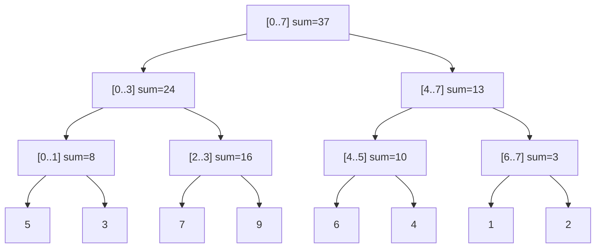
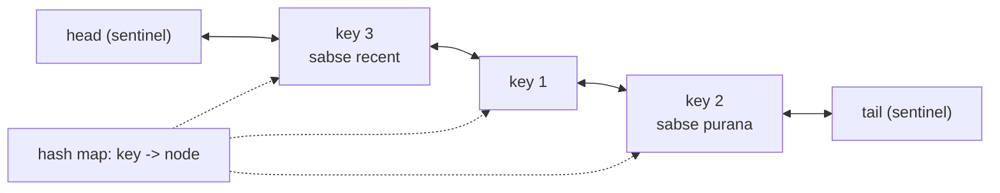

# Chapter 24 · Advanced: Segment Trees, Fenwick Trees & String Algorithms

> Cricket scoreboard pe total runs dikhte hain. Simple hai: ek running sum rakho, har ball pe jodte jao. Ab socho, third umpire over 12 ki ball 37 review karta hai aur ek four ko six bana deta hai. Saath mein commentator har kuch second mein poochta hai, "over 5 se over 15 ke beech kitne runs bane?" Prefix sums har correction pe toot jaate hain, aur har baar zero se dobara jodna bahut slow hai. Ye chapter tumhe aise structures deta hai jo **dono** kaam, yaani updates aur range questions, **O(log n)** mein sambhaal lete hain. Saath mein string-search algorithms bhi, jo bhoose ke dher mein sui dhoondh lete hain, aur kabhi ek step peeche nahi jaate.

**Is chapter mein tum seekhoge:**
- **Segment trees**: build, range query, point update, range sum aur range min, aur range updates ke liye **lazy propagation** ka idea
- **Fenwick trees (Binary Indexed Trees)**: `lowbit` wala trick, updates ke saath prefix sums, aur **Count of Smaller Numbers After Self**
- **Sparse tables**: static arrays pe O(1) range-minimum queries
- String algorithms: **KMP** (prefix function, poore trace ke saath decode kiya hua), **Rabin-Karp** rolling hash, **Z-algorithm**, aur **Manacher** ka overview
- **LRU cache** aur **LFU cache** ko O(1) operations ke saath design karna
- **Skip list** kya hai aur databases isse kyun use karte hain
- **Interviews mein ye sach mein kab poochte hain** (aur kab nahi)

**Isse pehle padho:** [Prefix Sums & Difference Arrays](06-prefix-sums.md) · [Binary Trees](13-binary-trees.md) · [Bit Manipulation & Math](23-bits-math.md) · [Linked Lists](10-linked-lists.md) · [Hashing Patterns](05-hashing.md) · [Arrays & Strings Fundamentals](02-arrays-strings.md)

---

## 🧠 The Big Idea · Asli Baat

Tumhare paas ek array hai, aur do tarah ke operations hain. Dono mix hokar, baar baar aate hain:

- **update(i, value)**: ek element badlo
- **query(l, r)**: `nums[l..r]` ka sum (ya min, ya max) kya hai?

Do obvious structures hain. Dono ek kaam mein zabardast hain aur doosre mein bekaar:

| Structure | update | range query | Kyun |
|---|---|---|---|
| Plain array | O(1) | O(n) | har baar poori range jodni padti hai |
| Prefix sums ([Chapter 06](06-prefix-sums.md)) | O(n) | O(1) | i ke baad ka har prefix dobara banana padta hai |
| **Segment tree / Fenwick tree** | **O(log n)** | **O(log n)** | chaalaki se chune hue blocks ke sums store karo |

Trick ye hai: **blocks** ke sums pehle se calculate karke rakho, aur blocks aise organise karo ki koi bhi range sirf **O(log n)** blocks se ban jaaye, aur koi bhi ek element sirf **O(log n)** blocks ka hissa ho. Segment tree aise blocks use karta hai jo har level pe aadhe hote jaate hain:



Ye tree `nums = [5, 3, 7, 9, 6, 4, 1, 2]` ka hai. `sum(nums[2..6])` chahiye? `[2..3]` (16) + `[4..5]` (10) + `[6]` (1) = 27 jodo. Paanch elements ki jagah sirf teen blocks. `nums[5]` update karna hai? Leaf theek karo, phir uske upar ke 3 blocks. Dono kaam **O(log n)**.

> 🇮🇳 **Desi Analogy:** School ka result socho. Har student ke marks ek **leaf** hain. Har section (8A, 8B) ka total ek **internal node** hai, har class (8th) ka total uske upar, aur poore school ka total **root** pe. Principal poochti hain "8A se 9B tak ka total?" Toh tum har student ke marks nahi jodte. Tum seedha section aur class ke ready-made totals utha lete ho. Aur agar re-checking mein ek student ke marks badle, toh sirf uska section total, class total aur school total update hota hai. Bas ek seedhi line upar tak, yaani **log n** kaam. Yahi segment tree hai.

Chapter ka doosra half **strings** ke baare mein hai. Length n ke text mein length m ka pattern naive tareeke se dhoondhoge toh **O(n × m)** lagta hai. Kyun? Kyunki mismatch hote hi tum pattern ko ek step khiskaate ho aur zero se compare karna shuru kar dete ho. KMP, Z aur Rabin-Karp ye kaam **O(n + m)** mein karte hain, kyunki ye **yaad rakhte hain ki ab tak kya match ho chuka hai**. Wahi DP wali soch: jo kaam ek baar ho gaya, use dobara mat karo.

> 💡 **Seedhi baat:** ye "advanced" topics hain. Zyada tar companies ke zyada tar interviews mein inki zaroorat nahi padegi. Exceptions hain LRU Cache aur KMP jaisi soch. Lekin jab problem bole "ranges ko 10⁵ baar update aur query karo", tab inke alawa kuch kaam nahi karta. Last section tumhe bilkul saaf batata hai ki kahan time lagana hai.

---

## 🔨 Building It Up · Zero Se Shuru

### 1. The problem, and why the simple fixes fail

Pehle dekho ki simple tareeke kahan fail hote hain:

```python
nums = [5, 3, 7, 9, 6, 4, 1, 2]

# Option 1: plain array -> query O(n) hai
print(sum(nums[2:7]))

# Option 2: prefix sums -> query O(1), lekin ek update = O(n) prefixes dobara banao
prefix = [0]
for x in nums:
    prefix.append(prefix[-1] + x)
print(prefix[7] - prefix[2])

nums[5] = 10                     # ek update aaya...
prefix = [0]                     # ...aur poora rebuild karna pada
for x in nums:
    prefix.append(prefix[-1] + x)
print(prefix[7] - prefix[2])
```

```text
27
27
33
```

Ek update aaya, aur poora prefix array dobara banana pada. Ab socho n = 10⁵ hai aur 10⁵ mixed operations hain. Dono options mein lagbhag 10⁵ × 10⁵ = **10¹⁰** steps lagenge. Python ek second mein mushkil se 10⁷ simple steps karta hai, toh ye ghanton ka kaam hai. Hume dono operations ke liye **O(log n)** chahiye.

### 2. Segment tree: the structure

**Segment tree** ek binary tree hai jisme:
- har **leaf** array ka ek element rakhta hai,
- har **internal node** apne do children ka combined value rakhta hai (sum, min, max, ...), matlab wo array ke ek **contiguous segment** (lagataar wala tukda) ka summary hai,
- root poore array ka summary hai.

Isse hum ek plain list mein store karte hain, bilkul heap ki tarah ([Chapter 15](15-heaps.md)): node 1 root hai, aur node `i` ke children `2i` aur `2i + 1` hain. Size `4n` ki list hamesha kaafi hoti hai (kyun, ye Under the Hood mein dekhenge).

Teen operations hain, teeno `(node, l, r)` pe recursive hain. Iska matlab: "ye node `nums[l..r]` ko cover karta hai".

- **build**: leaf hai → element copy karo; warna dono halves build karo aur combine karo.
- **update(i, value)**: neeche i wale leaf tak jao (`i <= mid` ho toh left jao), use set karo, phir wapas upar aate hue raaste ke har node ko dobara combine karo.
- **query(ql, qr)**: har node pe teen cases:
  - node ka segment `[ql, qr]` se **poora bahar** hai → kuch contribute nahi karta (sum ke liye 0 return karo),
  - **poora andar** hai → node ki stored value return karo (aur neeche mat jao!),
  - **thoda overlap** (partial) hai → dono children se poocho aur combine karo.

```python
class SegmentTree:
    def __init__(self, nums):
        self.n = len(nums)
        self.tree = [0] * (4 * self.n)
        self._build(nums, 1, 0, self.n - 1)

    def _build(self, nums, node, l, r):
        if l == r:
            self.tree[node] = nums[l]
            return
        mid = (l + r) // 2
        self._build(nums, 2 * node, l, mid)
        self._build(nums, 2 * node + 1, mid + 1, r)
        self.tree[node] = self.tree[2 * node] + self.tree[2 * node + 1]

    def update(self, i, value, node=1, l=0, r=None):
        if r is None:
            r = self.n - 1
        if l == r:
            self.tree[node] = value
            return
        mid = (l + r) // 2
        if i <= mid:
            self.update(i, value, 2 * node, l, mid)
        else:
            self.update(i, value, 2 * node + 1, mid + 1, r)
        self.tree[node] = self.tree[2 * node] + self.tree[2 * node + 1]

    def query(self, ql, qr, node=1, l=0, r=None):
        if r is None:
            r = self.n - 1
        if qr < l or r < ql:              # poora bahar
            return 0
        if ql <= l and r <= qr:           # poora andar
            return self.tree[node]
        mid = (l + r) // 2                # thoda overlap: dono taraf poocho
        return (self.query(ql, qr, 2 * node, l, mid) +
                self.query(ql, qr, 2 * node + 1, mid + 1, r))

st = SegmentTree([5, 3, 7, 9, 6, 4, 1, 2])
print(st.query(2, 6), st.query(0, 7), st.query(4, 4))
st.update(5, 10)
print(st.query(2, 6), st.query(0, 7))
```

```text
27 37 6
33 43
```

Big Idea wale tree pe `query(2, 6)` ka **trace**:

| node covers | [2, 6] se relation | action | returns |
|---|---|---|---|
| [0..7] | partial | split | 16 + 11 = 27 |
| [0..3] | partial | split | 0 + 16 = 16 |
| [0..1] | outside | ruk jao | 0 |
| [2..3] | inside | stored value lo | 16 |
| [4..7] | partial | split | 10 + 1 = 11 |
| [4..5] | inside | stored value lo | 10 |
| [6..7] | partial | split | 1 + 0 = 1 |
| [6] | inside | stored value lo | 1 |
| [7] | outside | ruk jao | 0 |

Sirf 9 nodes visit hue. Aur array kitna bhi bada ho jaaye, ye **O(log n)** hi rehta hai.

> 🤔 **Mann mein sawaal:** "Inside" case mein neeche kyun nahi jaate? Children ka sum bhi toh wahi hai?
>
> **Jawab:** Bilkul wahi hai, isiliye neeche jaana waste hai. Node ne apne poore segment ka sum pehle se store kar rakha hai. Agar tum "inside" pe bhi neeche jaate rehte, toh har leaf tak pahunch jaate aur query wapas **O(n)** ho jaati. Poori speed isi ek line se aati hai: "poora andar hai? stored value lo aur wapas aao."

### 3. Range minimum (or max, gcd, ...): change two things

Segment tree kisi bhi **associative** combine function ke saath chalta hai, yaani grouping se fark nahi padta: `combine(combine(a, b), c) == combine(a, b, c)`. Sum se min pe switch karna hai? Bas do cheezein badlo:
1. **combine** (`+` → `min`),
2. "outside" ke liye return hone wali **identity** (`0` → `+inf`).

Identity matlab wo value jo combine mein kuch nahi badalti: `x + 0 = x`, aur `min(x, inf) = x`.

Neeche ek compact **iterative** version hai (bottom-up, size 2n), jo combine function ko parameter ki tarah leta hai. Leaves `tree[n .. 2n-1]` pe rehte hain; node i ka parent `i // 2` hai.

```python
class SegTree:
    def __init__(self, nums, combine, identity):
        self.n = len(nums)
        self.combine, self.identity = combine, identity
        self.tree = [identity] * self.n + list(nums)
        for i in range(self.n - 1, 0, -1):
            self.tree[i] = combine(self.tree[2 * i], self.tree[2 * i + 1])

    def update(self, i, value):
        i += self.n
        self.tree[i] = value
        while i > 1:
            i //= 2
            self.tree[i] = self.combine(self.tree[2 * i], self.tree[2 * i + 1])

    def query(self, l, r):                  # l..r dono shaamil
        res_left = res_right = self.identity
        l += self.n
        r += self.n + 1
        while l < r:
            if l & 1:                       # l right child hai: use le lo, aage badho
                res_left = self.combine(res_left, self.tree[l])
                l += 1
            if r & 1:                       # r-1 left child boundary hai: use le lo
                r -= 1
                res_right = self.combine(self.tree[r], res_right)
            l //= 2
            r //= 2
        return self.combine(res_left, res_right)

nums = [5, 3, 7, 9, 6, 4, 1, 2]
sums = SegTree(nums, lambda a, b: a + b, 0)
mins = SegTree(nums, min, float("inf"))
print(sums.query(2, 6), mins.query(0, 3), mins.query(4, 7))
mins.update(6, 50)
print(mins.query(4, 7))
```

```text
27 3 1
2
```

Kya hua yahan: iterative version range ke dono kinaaron se root ki taraf chadhta hai. Jab bhi koi boundary "akela" child hota hai (yaani uska sibling range ke bahar hai), toh wo poora node utha leta hai. Ye chhota aur fast hai, lekin recursive version ko extend karna (lazy propagation) aur interview mein samjhaana zyada aasaan hai. **Pehle recursive wala seekho.**

### 4. Lazy propagation (the concept, with code)

Ab update ek **range** pe hai: "`[2, 6]` ke har element mein 5 jodo". Har leaf alag se update karoge toh **O(n log n)** lagega. Iska ilaaj hai **lazy** banna:

> Jab koi update kisi node ke poore segment ko cover karta hai, toh us node ka sum update karo (`value × segment length` jodo), `lazy` array mein ek **note** likh do ("mere children ko abhi +5 milna baaki hai"), aur **ruk jao**. Sirf tab, jab baad mein koi operation us node ke *andar* jaana chahe, tab note ko children tak **push** karo.

Ye us manager jaisa hai jise order milta hai "tumhari team mein sabko ₹500 bonus". Wo bas team ka total update kar deta hai, aur individual members ko tabhi batata hai jab koi sach mein unke baare mein poochta hai.

> 🇮🇳 **Desi Analogy:** Joint family ka WhatsApp group socho. Dadaji ne announce kiya: "Is Diwali sab bachchon ko ₹500 extra." Papa (internal node) apni family ka total budget turant ₹500 × bachche badha dete hain, aur diary mein likh lete hain "bachchon ko +500 dena baaki". Har bachche ko alag se tab tak nahi batate jab tak koi bachcha khud aake na pooche "mera kitna hua?". Wo diary wala note hi `lazy[node]` hai, aur bachche ke poochne pe note neeche pass karna hi `_push` hai.

```python
class LazySegmentTree:
    """Range add, range sum."""
    def __init__(self, nums):
        self.n = len(nums)
        self.tree = [0] * (4 * self.n)
        self.lazy = [0] * (4 * self.n)
        self._build(nums, 1, 0, self.n - 1)

    def _build(self, nums, node, l, r):
        if l == r:
            self.tree[node] = nums[l]
            return
        mid = (l + r) // 2
        self._build(nums, 2 * node, l, mid)
        self._build(nums, 2 * node + 1, mid + 1, r)
        self.tree[node] = self.tree[2 * node] + self.tree[2 * node + 1]

    def _apply(self, node, l, r, value):
        self.tree[node] += value * (r - l + 1)     # poore segment ko +value mila
        self.lazy[node] += value                   # yaad rakho: children ko ye abhi dena baaki hai

    def _push(self, node, l, r):
        if self.lazy[node]:
            mid = (l + r) // 2
            self._apply(2 * node, l, mid, self.lazy[node])
            self._apply(2 * node + 1, mid + 1, r, self.lazy[node])
            self.lazy[node] = 0

    def range_add(self, ql, qr, value, node=1, l=0, r=None):
        if r is None:
            r = self.n - 1
        if qr < l or r < ql:
            return
        if ql <= l and r <= qr:
            self._apply(node, l, r, value)          # poora covered: yahin ruko (lazy!)
            return
        self._push(node, l, r)                      # andar ja rahe ho: pehle purane notes deliver karo
        mid = (l + r) // 2
        self.range_add(ql, qr, value, 2 * node, l, mid)
        self.range_add(ql, qr, value, 2 * node + 1, mid + 1, r)
        self.tree[node] = self.tree[2 * node] + self.tree[2 * node + 1]

    def query(self, ql, qr, node=1, l=0, r=None):
        if r is None:
            r = self.n - 1
        if qr < l or r < ql:
            return 0
        if ql <= l and r <= qr:
            return self.tree[node]
        self._push(node, l, r)
        mid = (l + r) // 2
        return self.query(ql, qr, 2 * node, l, mid) + self.query(ql, qr, 2 * node + 1, mid + 1, r)

lst = LazySegmentTree([5, 3, 7, 9, 6, 4, 1, 2])
lst.range_add(2, 6, 5)                     # paanch elements, har ek ko +5
print(lst.query(0, 7), lst.query(2, 6), lst.query(6, 7))
lst.range_add(0, 7, -1)
print(lst.query(0, 7), lst.query(3, 3))
```

```text
62 52 8
54 13
```

Dono operations **O(log n)**. Yahi pattern "range assign", "range add ke saath range min" waghera pe bhi chalta hai. Tumhe bas do cheezein pata honi chahiye: ek pending note node ke summary ko kaise badalta hai, aur do notes aapas mein kaise combine hote hain.

> 🤔 **Mann mein sawaal:** `_push` ko query mein bhi kyun call kiya? Query toh kuch badalti nahi.
>
> **Jawab:** Query kuch nahi badalti, lekin wo children ki values **padhti** hai. Agar parent ke paas "+5 baaki hai" ka note pada hai aur tum bina push kiye children pe gaye, toh children purani (galat) value batayenge. Rule simple hai: **kisi node ke andar jaane se pehle, uske notes deliver karo**, chahe update ho ya query.

### 5. Fenwick tree (Binary Indexed Tree): the lowbit magic

**Fenwick tree** (ya **BIT**) updates ke saath prefix sums **O(log n)** mein deta hai, sirf **size n + 1 ka ek array** aur lagbhag das lines ke code se. Ye segment tree se chhota aur fast hai, lekin kam tarah ki queries sambhaalta hai: sums aur doosre invertible operations (jinhe "undo" kar sako, jaise + ka ulta −). General range min ye nahi kar sakta.

**Idea:** 1-based indexes use karo. Entry `tree[i]` array ke ek block ka sum rakhti hai jo **i pe khatam hota hai** aur jiski length hai **`lowbit(i) = i & -i`**, yaani i ka sabse neeche wala set bit ([Chapter 23](23-bits-math.md) se).

| i | binary | lowbit(i) | tree[i] kiska sum rakhta hai |
|---|---|---|---|
| 1 | 0001 | 1 | a[1] |
| 2 | 0010 | 2 | a[1..2] |
| 3 | 0011 | 1 | a[3] |
| 4 | 0100 | 4 | a[1..4] |
| 5 | 0101 | 1 | a[5] |
| 6 | 0110 | 2 | a[5..6] |
| 7 | 0111 | 1 | a[7] |
| 8 | 1000 | 8 | a[1..8] |

Pattern dekho: odd index (last bit 1) sirf apna element rakhta hai. Jitne zyada trailing zeros, utna lamba block.

**i tak ka prefix sum:** `tree[i]` lo (ye `(i - lowbit(i), i]` cover karta hai), phir `i - lowbit(i)` pe jump karo, aur 0 aane tak repeat karo. Har jump sabse neeche wala set bit hata deta hai, toh zyada se zyada log n jumps. Example: `prefix(7)` = `tree[7]` (a[7]) + `tree[6]` (a[5..6]) + `tree[4]` (a[1..4]). Indexes 7 → 6 → 4 → 0, yaani `111 → 110 → 100 → 0`.

**i pe update:** har wo block jo i ko **contain** karta hai, badalna padega. Wo hain `i`, phir `i + lowbit(i)`, aur aise hi n tak. Example: position 5 update karne se `tree[5]`, `tree[6]`, `tree[8]` badalte hain: `0101 → 0110 → 1000`.

> 🇮🇳 **Desi Analogy:** Kirana store ki khata book socho, jahan dukaandaar ne smart tareeke se "partial totals" likh rakhe hain. Kuch pages pe sirf ek din ka hisaab hai, kuch pe 2 din ka, kuch pe 4 din ka, ek pe poore 8 din ka. "Pehle 7 din ka total?" Toh wo teen pages uthata hai: din 7 wala, din 5-6 wala, din 1-4 wala. Teen jod, kaam khatam. Agar din 5 ki entry galat thi, toh sirf un pages ko sudhaarna hai jinke block mein din 5 aata hai: din 5, din 5-6, din 1-8. **Query mein lowbit ghatao (peeche jao), update mein lowbit jodo (aage jao).**

```python
class Fenwick:
    def __init__(self, n):
        self.n = n
        self.tree = [0] * (n + 1)             # index 0 use nahi hota

    def add(self, i, delta):                  # caller ke liye i 0-based hai
        i += 1
        while i <= self.n:
            self.tree[i] += delta
            i += i & -i                       # agle block pe chadho jo i ko contain karta hai

    def prefix(self, i):                      # pehle i elements ka sum: a[0..i-1]
        total = 0
        while i > 0:
            total += self.tree[i]
            i -= i & -i                       # jo block abhi use kiya, use hatao
        return total

    def range_sum(self, l, r):                # dono ends shaamil, 0-based
        return self.prefix(r + 1) - self.prefix(l)

nums = [5, 3, 7, 9, 6, 4, 1, 2]
bit = Fenwick(len(nums))
for i, x in enumerate(nums):
    bit.add(i, x)
print(bit.tree)
print(bit.range_sum(2, 6), bit.prefix(8))
bit.add(5, 10 - nums[5])                      # point update: nums[5] = 10 set karo
print(bit.range_sum(2, 6))
```

```text
[0, 5, 8, 7, 24, 6, 10, 1, 37]
27 37
33
```

Printed `tree` ko table se milao: `tree[4] = 5+3+7+9 = 24`, `tree[6] = 6+4 = 10`, `tree[8] = 37`. ✓

`prefix(7)` ka **dry run** (pehle 7 elements ka sum):

| i (binary) | tree[i] covers | add | total | next i = i − lowbit(i) |
|---|---|---|---|---|
| 7 (111) | a[7] | 1 | 1 | 6 |
| 6 (110) | a[5..6] | 10 | 11 | 4 |
| 4 (100) | a[1..4] | 24 | 35 | 0 → ruk jao |

35 = 5+3+7+9+6+4+1. ✓ (Ye positions 1-based hain; hamare 0-based array mein ye `nums[0..6]` hai.)

> 🤔 **Mann mein sawaal:** Fenwick ko 1-based hi kyun rakhna? 0 se shuru kar lo na.
>
> **Jawab:** Kyunki `lowbit(0) = 0 & -0 = 0` hai. Index 0 pe `i += i & -i` kabhi aage badhega hi nahi, loop hamesha chalta rahega. Aur 0 ka koi "lowest set bit" hota hi nahi, toh block ka matlab hi nahi banta. Isliye bahar se 0-based index lo, aur andar ghuste hi `i += 1` kar do. `tree[0]` khaali pada rehta hai.

### 6. Count of Smaller Numbers After Self (the classic BIT problem)

Har `nums[i]` ke liye gino ki uske **right side** mein kitne elements usse chhote hain. `[5, 2, 6, 1]` → `[2, 1, 1, 0]`.

**Idea:** **right se** chalo. Ek Fenwick tree rakho jo bataye "ab tak har value kitni baar dekhi". `nums[i]` ka answer hai: ab tak dekhi gayi values mein se kitni `nums[i]` se **chhoti** hain. Ye ek prefix sum hai! Phir `nums[i]` ko tree mein add kar do. Values bahut badi ya negative ho sakti hain, isliye pehle unhe ranks 0..k-1 pe map karo. Ise **coordinate compression** kehte hain: value ki jagah uski sorted position use karo, kyunki chhota-bada ka order wahi rehta hai.

```python
class Fenwick:
    def __init__(self, n):
        self.n, self.tree = n, [0] * (n + 1)
    def add(self, i, delta=1):
        i += 1
        while i <= self.n:
            self.tree[i] += delta
            i += i & -i
    def prefix(self, i):
        total = 0
        while i > 0:
            total += self.tree[i]
            i -= i & -i
        return total

def count_smaller(nums):
    rank = {v: r for r, v in enumerate(sorted(set(nums)))}   # coordinate compression (value -> rank)
    bit = Fenwick(len(rank))
    result = []
    for x in reversed(nums):
        result.append(bit.prefix(rank[x]))     # dekhi hui kitni values ka rank < rank[x] hai
        bit.add(rank[x])
    return result[::-1]

print(count_smaller([5, 2, 6, 1]), count_smaller([-1, -1]), count_smaller([2, 0, 1, 7, -10**9, 3]))
```

```text
[2, 1, 1, 0] [0, 0] [3, 1, 1, 2, 0, 0]
```

**O(n log n)**. Yahi technique **inversions** bhi ginti hai (aise pairs i < j jahan `nums[i] > nums[j]`): bas saare answers jod do. ([Chapter 07](07-sorting.md) ka merge sort bhi dono problems solve karta hai.)

### 7. Sparse table: O(1) range minimum on a static array

Agar array **kabhi nahi badalta** aur tumhe bahut saari range-min queries chahiye, toh tum O(log n) ko bhi hara sakte ho. Har start i aur har power of two `2^k` ke liye `nums[i : i + 2^k]` ka min pehle se calculate karo:

`st[k][i] = min(st[k-1][i], st[k-1][i + 2^(k-1)])` (length `2^(k-1)` ke do halves).

`min(nums[l..r])` ka answer: `k` lo, sabse badi power jahan `2^k <= length`. Do blocks `[l, l + 2^k)` aur `(r - 2^k, r]` aapas mein **overlap** karte hain, lekin milke bilkul `[l, r]` cover karte hain. `min` ko farak nahi padta ki ek element do baar gina gaya (wo **idempotent** hai: `min(x, x) = x`), isliye answer dono blocks ka min hai. **O(1)!**

Example: `[2, 5]` ki length 4 hai, toh k = 2, aur dono blocks ek hi `[2..5]` hain. `[0, 6]` ki length 7 hai, toh k = 2 (4 ≤ 7), blocks `[0..3]` aur `[3..6]`: index 3 do baar aaya, par min pe koi asar nahi.

```python
class SparseTable:
    def __init__(self, nums):
        n = len(nums)
        self.st = [list(nums)]
        k = 1
        while (1 << k) <= n:
            prev = self.st[-1]
            half = 1 << (k - 1)
            self.st.append([min(prev[i], prev[i + half]) for i in range(n - (1 << k) + 1)])
            k += 1

    def query(self, l, r):                     # dono ends shaamil
        k = (r - l + 1).bit_length() - 1       # sabse bada k jahan 2^k <= length
        return min(self.st[k][l], self.st[k][r - (1 << k) + 1])

table = SparseTable([5, 3, 7, 9, 6, 4, 1, 2])
for row in table.st:
    print(row)
print(table.query(0, 3), table.query(2, 5), table.query(4, 7), table.query(3, 3))
```

```text
[5, 3, 7, 9, 6, 4, 1, 2]
[3, 3, 7, 6, 4, 1, 1]
[3, 3, 4, 1, 1]
[1]
3 4 1 9
```

Build O(n log n) time aur space, query O(1). **Updates nahi.** Aur ye sirf idempotent operations ke liye chalta hai (min, max, gcd, AND, OR). **Sum** mein overlap double-count kar dega; static sums ke liye prefix sums use karo.

| Structure | Build | Query | Update | Supports |
|---|---|---|---|---|
| Prefix sums | O(n) | O(1) | O(n) | sums (static) |
| Sparse table | O(n log n) | **O(1)** | ✗ | min/max/gcd (static) |
| Fenwick tree | O(n log n) ya O(n) | O(log n) | O(log n) | prefix sums, counts |
| Segment tree | O(n) | O(log n) | O(log n) | kuch bhi associative, lazy ke saath range updates |

### 8. String matching: why naive search is slow

`text` mein `pattern` pehli baar kis index pe aata hai, ye dhoondhna hai. Naive tareeka har start try karta hai aur character by character compare karta hai:

```python
def naive_search(text, pattern):
    n, m = len(text), len(pattern)
    comparisons = 0
    for start in range(n - m + 1):
        k = 0
        while k < m:
            comparisons += 1
            if text[start + k] != pattern[k]:
                break
            k += 1
        if k == m:
            return start, comparisons
    return -1, comparisons

print(naive_search("aaaaaaaaaaaaaaaaaaab", "aaaab"))
print("hello".find("ll"), "aaaaaaaaaaaaaaaaaaab".find("aaaab"))   # asli code mein built-in use karo
```

```text
(15, 80)
2 15
```

Kya hua yahan: 16 starts mein se har ek pe naive search ne chaar `a` match kiye aur phir `b` pe fail ho gaya. Yaani jo characters wo pehle padh chuka tha, unhe baar baar padhta raha. Worst case **O(n × m)**. Asli Python code mein `str.find` / `in` use karo (ye highly optimised C hai), lekin interviewers chahte hain ki tumhe in tools ke peeche ke linear-time algorithms pata hon.

### 9. KMP: the prefix function, decoded

**Knuth-Morris-Pratt (KMP)** text mein kabhi peeche nahi jaata. Mismatch ke baad wo poochta hai: "pattern ka jo hissa main pehle hi match kar chuka hoon, usme se kitna *ab bhi* kaam ka hai?"

Iska answer **prefix function** se aata hai (ise `lps` array bhi kehte hain, "longest proper prefix which is also a suffix"):

> `lps[i]` = `pattern[0..i]` ka sabse lamba **proper** prefix jo `pattern[0..i]` ka **suffix bhi** hai. ("Proper" = poori string nahi.)

Example, pattern `"aabaaab"`:

| i | pattern[0..i] | sabse lamba prefix jo suffix bhi hai | lps[i] |
|---|---|---|---|
| 0 | a | (koi nahi; poori string allowed nahi) | 0 |
| 1 | aa | "a" | 1 |
| 2 | aab | koi nahi | 0 |
| 3 | aaba | "a" | 1 |
| 4 | aabaa | "aa" | 2 |
| 5 | aabaaa | "aa" | 2 |
| 6 | aabaaab | "aab" | 3 |

> 🤔 **Mann mein sawaal:** "Proper" wali shart kyun? Poori string toh hamesha apna prefix bhi hai aur suffix bhi.
>
> **Jawab:** Exactly isiliye. Agar poori string allowed hoti, toh har `lps[i]` bas `i + 1` hota, jo kuch nahi batata. Aur fallback mein `j = lps[j-1]` kabhi chhota hi nahi hota, toh loop aage hi nahi badhta. "Proper" ka matlab hai: "mujhe khud se *chhota* koi overlap batao", taaki mismatch pe pattern sach mein aage khiske.

**Ye kaam kaise aata hai:** maan lo humne text ke saath `pattern[0..j-1]` match kar liya, aur phir mismatch aaya. Jo match hua uske aakhri `lps[j-1]` characters pattern ke pehle `lps[j-1]` characters ke barabar *bhi* hain. Toh hum pattern ko itna khiska sakte hain ki uska prefix us suffix ke theek upar baith jaaye, aur **`j = lps[j-1]` se continue karo**, text ko dobara padhe bina.

> 🇮🇳 **Desi Analogy:** Antakshari mein tum ek specific gaane ki line "la la la lo" ka intezaar kar rahe ho, aur saamne wala gaa raha hai "la la la la lo". Tumne "la la la" suna, chautha word "lo" ki jagah "la" aaya. Naive dost sab bhool ke zero se sunna shuru karta hai. Smart dost sochta hai: "Abhi jo suna, uske aakhri 'la la' mere pattern ke pehle 'la la' bhi hain, wahan se aage dekhta hoon." Ab wahi chautha "la" pattern ke teesre "la" se match ho gaya, aur agla word "lo" bhi match: mil gaya! Usne gaana kabhi *rewind* nahi kiya, bas yaad rakha ki ab tak suna hua kitna hissa abhi bhi kaam ka hai. Wo "kitna kaam ka" wala number hi `lps` hai, aur gaana kabhi rewind na hona hi "text pointer peeche nahi jaata" hai.

**lps calculate karna** bhi wahi idea pattern pe hi lagata hai. `j` current matched prefix ki length hai:
- agar `pattern[i] == pattern[j]`: extend karo, `j += 1`, `lps[i] = j`.
- warna agar `j > 0`: fall back karo `j = lps[j-1]` aur phir try karo (ye **while** hai, if nahi).
- warna: `lps[i] = 0`.

```python
def build_lps(pattern):
    lps = [0] * len(pattern)
    j = 0                                   # abhi ke prefix-suffix match ki length
    for i in range(1, len(pattern)):
        while j > 0 and pattern[i] != pattern[j]:
            print(f"  i={i}: '{pattern[i]}' != '{pattern[j]}' -> fall back j = lps[{j - 1}] = {lps[j - 1]}")
            j = lps[j - 1]
        if pattern[i] == pattern[j]:
            j += 1
        lps[i] = j
        print(f"i={i} char='{pattern[i]}' lps[{i}]={j}")
    return lps

print(build_lps("aabaaab"))
```

```text
i=1 char='a' lps[1]=1
  i=2: 'b' != 'a' -> fall back j = lps[0] = 0
i=2 char='b' lps[2]=0
i=3 char='a' lps[3]=1
i=4 char='a' lps[4]=2
  i=5: 'a' != 'b' -> fall back j = lps[1] = 1
i=5 char='a' lps[5]=2
i=6 char='b' lps[6]=3
[0, 1, 0, 1, 2, 2, 3]
```

i = 5 dekho: humne `"aa"` match kiya tha (j = 2) aur hume `'b'` chahiye tha, par `'a'` mila. `lps[1] = 1` pe fall back kiya ("aa" ke end wala "a" ek prefix bhi hai), phir `pattern[1] = 'a'` ko `'a'` se compare kiya: match! Toh `lps[5] = 2`.

**Searching** bhi wahi loop hai, bas pattern ki jagah text pe chalta hai:

```python
def build_lps(pattern):
    lps = [0] * len(pattern)
    j = 0
    for i in range(1, len(pattern)):
        while j > 0 and pattern[i] != pattern[j]:
            j = lps[j - 1]
        if pattern[i] == pattern[j]:
            j += 1
        lps[i] = j
    return lps

def kmp_search(text, pattern):
    """Return every start index where pattern occurs in text."""
    if not pattern:
        return [0]
    lps = build_lps(pattern)
    matches, j = [], 0                   # j = pattern ke kitne chars match ho chuke
    for i, ch in enumerate(text):
        while j > 0 and ch != pattern[j]:
            j = lps[j - 1]               # matched hissa reuse karo; text index kabhi peeche nahi jaata
        if ch == pattern[j]:
            j += 1
        if j == len(pattern):
            matches.append(i - j + 1)
            j = lps[j - 1]               # overlapping matches ke liye chalte raho
    return matches

print(kmp_search("aabaacaabaaab", "aabaaab"))
print(kmp_search("abababab", "abab"))
print(kmp_search("aaaaaaaaaaaaaaaaaaab", "aaaab"))
```

```text
[6]
[0, 2, 4]
[15]
```

Time **O(n + m)**: lps banane mein O(m), search mein O(n) (proof Under the Hood mein). Space O(m).

> 💡 **lps array apne aap mein bhi kaam ka hai.** `lps[-1]` sabse lamba prefix deta hai jo suffix bhi hai (Longest Happy Prefix). Agar `n % (n - lps[-1]) == 0` aur `lps[-1] > 0`, toh string apne pehle `n - lps[-1]` characters ka repetition hai (Repeated Substring Pattern). Ise `s + "#" + reversed(s)` pe chalao toh sabse lamba palindromic prefix milta hai (Shortest Palindrome).

### 10. Rabin-Karp: compare fingerprints, not strings

**Rabin-Karp** length m ki har window ko ek number (ek **hash**) mein badal deta hai aur numbers compare karta hai. Jaadu hai **rolling hash** mein: window ko ek step khiskaane pe hash ko zero se calculate nahi karte, **O(1)** mein update kar dete hain.

String ko base B (maan lo 131) mein ek number samjho, ek bade prime M ke modulo:

```text
hash("abc") = (a·B² + b·B + c) mod M
slide to "bcd":  remove a·B², multiply by B, add d
hash("bcd") = ((hash("abc") - a·B²)·B + d) mod M
```

Ye bilkul decimal jaisa hai. 1234 se 2345 banana ho: aage ka 1000 hatao (234), 10 se multiply karo (2340), 5 jodo (2345). Teen chhote steps, poora number dobara likhne ki zaroorat nahi.

Kabhi kabhi do alag strings ka hash same aa sakta hai (ise **collision** kehte hain), isliye jab hashes match karein, toh direct comparison se **verify** karo.

> 🇮🇳 **Desi Analogy:** Railway reservation chart pe PNR number socho. Har passenger ka naam, umar, berth compare karne ki jagah TTE bas number milata hai, jo fast hai. Ab maan lo numbers sirf 4 digit ke hote: kabhi kabhi do passengers ka same number aa jaata (collision). Toh samajhdaar TTE number match hone pe ek baar ID card (actual substring) bhi dekh leta hai. **Number alag? Pakka alag insaan. Number same? Shayad same, verify karo.**

```python
def rabin_karp(text, pattern, base=131, mod=1_000_000_007):
    n, m = len(text), len(pattern)
    if m > n:
        return []
    high = pow(base, m - 1, mod)               # sabse left char ka weight: B^(m-1)
    p_hash = t_hash = 0
    for i in range(m):
        p_hash = (p_hash * base + ord(pattern[i])) % mod
        t_hash = (t_hash * base + ord(text[i])) % mod
    matches = []
    for start in range(n - m + 1):
        if t_hash == p_hash and text[start:start + m] == pattern:   # hash match hua toh verify karo
            matches.append(start)
        if start + m < n:                       # roll: text[start] hatao, text[start+m] jodo
            t_hash = (t_hash - ord(text[start]) * high) % mod
            t_hash = (t_hash * base + ord(text[start + m])) % mod
    return matches

print(rabin_karp("abracadabra", "abra"), rabin_karp("aaaaa", "aa"), rabin_karp("abc", "d"))
```

```text
[0, 7] [0, 1, 2, 3] []
```

Expected **O(n + m)**; worst case O(n × m) agar har window collide kare (accha prime ho toh practically kabhi nahi). Rabin-Karp ki asli superpower hai **bahut saare** substrings ek saath compare karna: "length L ka koi repeated substring dhoondho" ban jaata hai "saari window hashes ek set mein daalo" (Longest Duplicate Substring, Repeated DNA Sequences).

### 11. The Z-algorithm

String s ka **Z-array**: `z[i]` = i se shuru hone wale us sabse lambe substring ki length jo s ke **prefix** se match karta hai (`z[0]` ko convention se 0 ya n maana jaata hai).

```text
s = a a b x a a b
z = 0 1 0 0 3 1 0
              ^ "aab" at index 4 matches the prefix "aab"
```

**Search karne ke liye:** `pattern + "$" + text` pe Z nikaalo (`$` aisa character ho jo dono mein na aata ho). Jis position pe `z[i] == len(pattern)` ho, wahan match hai. `$` ek deewar ka kaam karta hai: koi bhi match `$` ko cross nahi kar sakta, isliye z value kabhi pattern ki length se zyada nahi hogi.

**Linear kaise hai:** ek window `[l, r)` rakho, yaani ab tak ka sabse right tak jaane wala segment jo prefix se match karta hai. Window ke andar naye i ke liye, `s[i..r)` asal mein `s[i-l..r-l)` ki copy hai, isliye `z[i]` kam se kam `min(r - i, z[i - l])` hai, free mein. Sirf r ke aage direct comparison se extend karo. r sirf right hi jaata hai, toh total kaam **O(n)**.

```python
def z_function(s):
    n = len(s)
    z = [0] * n
    l = r = 0                                # s[l:r] match karta hai s[0:r-l] se
    for i in range(1, n):
        if i < r:
            z[i] = min(r - i, z[i - l])      # window se jo pata hai, wo reuse karo
        while i + z[i] < n and s[z[i]] == s[i + z[i]]:
            z[i] += 1                        # direct comparison se aage badhao
        if i + z[i] > r:
            l, r = i, i + z[i]
    return z

def z_search(text, pattern):
    combined = pattern + "$" + text
    m = len(pattern)
    return [i - m - 1 for i, v in enumerate(z_function(combined)) if v == m]

print(z_function("aabxaab"))
print(z_search("abracadabra", "abra"), z_search("aabaacaabaaab", "aabaaab"))
```

```text
[0, 1, 0, 0, 3, 1, 0]
[0, 7] [6]
```

KMP aur Z same problems **O(n + m)** mein solve karte hain. Bahut logon ko Z *yaad rakhna* aasaan lagta hai, aur KMP ko *adapt karna* (streaming text, automata).

### 12. Manacher's algorithm (overview)

Longest Palindromic Substring expand-around-centre se **O(n²)** hai ([Chapter 21](21-dp-2d-advanced.md)). **Manacher** ise **O(n)** mein karta hai, Z wale "window reuse karo" idea se hi:

1. Characters ke beech `#` daalo (`"aba"` → `"#a#b#a#"`), taaki har palindrome odd length ka ho aur uska ek hi centre ho. (Warna "abba" jaise even palindromes ka centre do letters ke beech hota, jo handle karna messy hai.)
2. `p[i]` = i pe centred sabse lambe palindrome ka radius.
3. Wo palindrome `[centre - radius, centre + radius]` yaad rakho jo sabse door right tak pahunchta hai. Uske andar ke kisi i ke liye, **mirror** position `2·centre - i` pehle hi calculate ho chuki hai, aur symmetry se `p[i] >= min(p[mirror], right_edge - i)`. Phir expand karke dekho. Right edge sirf right jaata hai → **O(n)**.

```python
def manacher(s):
    t = "#" + "#".join(s) + "#"
    n = len(t)
    p = [0] * n
    centre = right = 0
    for i in range(n):
        if i < right:
            p[i] = min(right - i, p[2 * centre - i])     # mirror wala trick
        while i - p[i] - 1 >= 0 and i + p[i] + 1 < n and t[i - p[i] - 1] == t[i + p[i] + 1]:
            p[i] += 1
        if i + p[i] > right:
            centre, right = i, i + p[i]
    best = max(range(n), key=lambda i: p[i])
    start = (best - p[best]) // 2                        # original string pe wapas map karo
    return s[start:start + p[best]]

print(manacher("babad"), manacher("cbbd"), manacher("forgeeksskeegfor"), manacher("a"))
```

```text
bab bb geeksskeeg a
```

Interviews mein expand-around-centre almost hamesha kaafi hai. Bas itna pata ho ki Manacher exist karta hai, wo O(n) hai, aur mirror idea ek sentence mein bol sako.

### 13. LRU Cache: hash map + doubly linked list

**LRU (Least Recently Used) cache** zyada se zyada `capacity` items rakhta hai. `get(key)` value return karta hai (ya -1) aur us key ko "abhi abhi use hua" mark karta hai. `put(key, value)` insert ya update karta hai; agar cache full hai, toh wo **least recently used** key ko **evict** (bahar) karta hai. Dono operations **O(1)** hone chahiye. Ye interviews ke sabse zyada pooche jaane wale design questions mein se ek hai, aur asli caches (browser caches, Redis ka approximate LRU, CPU caches) bilkul aise hi sochte hain. Caching pe aur baat [Part 3, Chapter 04](../part-3-system-design/04-caching-cdn.md) mein.

> 🇮🇳 **Desi Analogy:** Tumhara WhatsApp chat list dekho. Jis chat mein abhi message aaya ya tumne kholi, wo **sabse upar** aa jaati hai. Ab socho phone mein sirf 50 chats rakhne ki jagah hai. 51vi nayi chat aayi, toh **sabse neeche wali** (jisse sabse lambe time se baat nahi hui) delete. Kisi chat ko naam se turant kholne ke liye search (yaani **hash map**), aur upar-neeche ka order (yaani **doubly linked list**). Kisi chat ko beech se utha ke upar rakhna aur neeche wali ko hatana, dono ek jhatke mein, yaani **O(1)**.

**Design:**
- ek **hash map** key → node, O(1) lookup ke liye;
- ek **doubly linked list**, recency ke order mein (sabse recent aage), taaki move-to-front aur remove-from-back O(1) ho. Doubly linked isliye, kyunki beech se node hataane ke liye uska `prev` pointer chahiye ([Chapter 10](10-linked-lists.md)).
- **sentinel** head aur tail nodes (nakli, khaali guard nodes), taaki `None` wale edge cases hi na rahein.



```python
class Node:
    def __init__(self, key=0, val=0):
        self.key, self.val = key, val
        self.prev = self.next = None

class LRUCache:
    def __init__(self, capacity):
        self.capacity = capacity
        self.map = {}
        self.head, self.tail = Node(), Node()        # sentinels (nakli guard nodes)
        self.head.next, self.tail.prev = self.tail, self.head

    def _remove(self, node):
        node.prev.next, node.next.prev = node.next, node.prev

    def _add_front(self, node):
        node.prev, node.next = self.head, self.head.next
        self.head.next.prev = node
        self.head.next = node

    def get(self, key):
        if key not in self.map:
            return -1
        node = self.map[key]
        self._remove(node)                           # ise sabse recent mark karo
        self._add_front(node)
        return node.val

    def put(self, key, val):
        if key in self.map:
            self._remove(self.map[key])
        node = Node(key, val)
        self.map[key] = node
        self._add_front(node)
        if len(self.map) > self.capacity:
            lru = self.tail.prev                     # least recently used (sabse purana)
            self._remove(lru)
            del self.map[lru.key]                    # isiliye node apni key bhi rakhta hai

cache = LRUCache(2)
cache.put(1, 1)
cache.put(2, 2)
print(cache.get(1))       # ab 1 sabse recent hai
cache.put(3, 3)           # 2 bahar
print(cache.get(2))
cache.put(4, 4)           # 1 bahar
print(cache.get(1), cache.get(3), cache.get(4))
```

```text
1
-1
-1 3 4
```

> 🤔 **Mann mein sawaal:** Singly linked list se kaam kyun nahi chalega? Aur sentinels ka itna drama kyun?
>
> **Jawab:** `get` pe node list ke *beech* mein ho sakta hai. Use hataane ke liye uske pichhle node ka `next` badalna padta hai. Singly list mein pichla node dhoondhne ke liye shuru se walk karna padega, yaani O(n). Doubly list mein `node.prev` seedha haath mein hai, toh O(1). Aur sentinels ki wajah se har asli node ke dono taraf hamesha koi na koi node hota hai, chahe list khaali ho. Isliye `_remove` aur `_add_front` mein ek bhi `if node is None` nahi likhna padta, aur bugs aadhe ho jaate hain.

Python mein `collections.OrderedDict` andar se ek hash map + doubly linked list hi hai, isliye production-quality LRU bas kuch lines ka hai. Interview mein iska zikr karo, lekin upar wala version banane ke liye ready raho: interviewer wahi test kar raha hai.

```python
from collections import OrderedDict

class LRUCache:
    def __init__(self, capacity):
        self.capacity = capacity
        self.data = OrderedDict()

    def get(self, key):
        if key not in self.data:
            return -1
        self.data.move_to_end(key)            # sabse recent end mein
        return self.data[key]

    def put(self, key, val):
        self.data[key] = val
        self.data.move_to_end(key)
        if len(self.data) > self.capacity:
            self.data.popitem(last=False)     # sabse purana (front wala) nikaalo

cache = LRUCache(2)
cache.put(1, 1); cache.put(2, 2); cache.get(1); cache.put(3, 3)
print(list(cache.data.items()))
```

```text
[(1, 1), (3, 3)]
```

### 14. LFU Cache: evict the least *frequently* used

**LFU cache** us key ko evict karta hai jo **sabse kam baar use** hui; tie ho toh unme se least recently used. Phir bhi har operation **O(1)**.

**Design:**
- `key → (value, freq)`
- `freq → OrderedDict of keys`, us frequency wali keys recency order mein (yaani har frequency ki apni ek LRU list)
- `min_freq`: abhi present sabse chhoti frequency, taaki eviction ko pata ho ki kis bucket se nikaalna hai.

Har access pe key ko bucket `f` se bucket `f + 1` mein le jao. Agar bucket `min_freq` khaali ho gaya, toh `min_freq` ek badh jaata hai. **Nayi** key ki frequency hamesha 1 hoti hai, isliye insert ke baad `min_freq = 1`.

> 🇮🇳 **Desi Analogy:** Cricket team selection socho. Har player ka "kitne match khele" count hai (frequency). Selectors ne players ko alag alag dabbon mein rakha hai: 1 match wale, 2 match wale, 3 match wale. Squad full hai aur naya player aana hai, toh kisko drop karoge? **Sabse kam match wale dabbe** (`min_freq`) se, aur us dabbe mein bhi jo sabse pehle aaya tha (LRU). Naya player hamesha "1 match" wale dabbe mein aata hai, isliye uske baad `min_freq` 1 ho jaata hai.

```python
from collections import OrderedDict, defaultdict

class LFUCache:
    def __init__(self, capacity):
        self.capacity = capacity
        self.key_info = {}                          # key -> [value, freq]
        self.buckets = defaultdict(OrderedDict)     # freq -> keys, LRU order mein
        self.min_freq = 0

    def _touch(self, key):
        value, freq = self.key_info[key]
        del self.buckets[freq][key]
        if not self.buckets[freq]:
            del self.buckets[freq]
            if self.min_freq == freq:
                self.min_freq += 1
        self.buckets[freq + 1][key] = None
        self.key_info[key][1] = freq + 1

    def get(self, key):
        if key not in self.key_info:
            return -1
        self._touch(key)
        return self.key_info[key][0]

    def put(self, key, value):
        if self.capacity == 0:
            return
        if key in self.key_info:
            self.key_info[key][0] = value
            self._touch(key)
            return
        if len(self.key_info) >= self.capacity:
            evict, _ = self.buckets[self.min_freq].popitem(last=False)   # pehle LFU, phir LRU
            if not self.buckets[self.min_freq]:
                del self.buckets[self.min_freq]
            del self.key_info[evict]
        self.key_info[key] = [value, 1]
        self.buckets[1][key] = None
        self.min_freq = 1

lfu = LFUCache(2)
lfu.put(1, 1); lfu.put(2, 2)
print(lfu.get(1))          # key 1 ki freq 2
lfu.put(3, 3)              # key 2 bahar (freq 1)
print(lfu.get(2), lfu.get(3))
lfu.put(4, 4)              # keys 1 aur 3 dono ki freq 2; key 1 zyada purani -> bahar
print(lfu.get(1), lfu.get(3), lfu.get(4))
```

```text
1
-1 3
-1 3 4
```

| | LRU | LFU |
|---|---|---|
| Evicts | least recently used | least frequently used (tie: least recent) |
| Structure | map + ek recency list | map + **har frequency ki** ek recency list + `min_freq` |
| Kab accha | jo abhi use hua wahi phir use hoga (zyada tar workloads) | kuch items lambe time tak popular rehte hain |
| Kamzori | ek bada scan poora cache flush kar deta hai | purane popular items atke rehte hain ("cache pollution") |

### 15. Skip lists (overview)

Sorted linked list mein search O(n) hai: node by node chalna padta hai. **Skip list** isme **express lanes** jodti hai: har node 1/2 probability se level 1 pe bhi promote hota hai, 1/4 probability se level 2 pe, aur aise hi aage. Search sabse upar wali lane se shuru hoti hai, tab tak right chalti hai jab tak agli key chhoti hai, phir ek lane neeche utarti hai. Jaise metro ki express line lo, aur last kuch stations ke liye local line.

> 🇮🇳 **Desi Analogy:** Mumbai local. Churchgate se Borivali jaana hai toh pehle **fast train** pakdo, jo sirf bade stations pe rukti hai (upar wali lane). Jab dekho ki agla fast stop tumhare station se aage nikal jaayega, utar ke **slow train** pakdo (neeche wali lane), jo har station pe rukti hai. Kaunsa station fast train ka stop banega, ye skip list mein coin toss se decide hota hai, isliye average mein har upar wali lane mein aadhe stations hote hain.

```text
level 3: head ------------------------------> 50 -------------------> None
level 2: head ----------> 20 ---------------> 50 ---------> 80 -----> None
level 1: head --> 10 ---> 20 ---> 30 -------> 50 --> 60 --> 80 -----> None
level 0: head --> 10 ---> 20 ---> 30 --> 40 -> 50 --> 60 --> 80 -> 90 None
```

Search, insert aur delete expected **O(log n)**, aur koi rotations ya rebalancing nahi (balanced BSTs ke ulta). Yahi simplicity wajah hai ki **Redis** sorted sets ke liye skip lists use karta hai, aur LevelDB/RocksDB apni in-memory tables ke liye.

```python
import random

class SkipNode:
    def __init__(self, val, level):
        self.val = val
        self.next = [None] * (level + 1)

class Skiplist:
    MAX_LEVEL = 16

    def __init__(self, seed=0):
        self.head = SkipNode(float("-inf"), self.MAX_LEVEL)
        self.level = 0
        self.rng = random.Random(seed)            # seed diya taaki output har baar same aaye

    def _random_level(self):
        lvl = 0
        while lvl < self.MAX_LEVEL and self.rng.random() < 0.5:
            lvl += 1
        return lvl

    def search(self, target):
        node = self.head
        for lvl in range(self.level, -1, -1):        # pehle express lanes
            while node.next[lvl] and node.next[lvl].val < target:
                node = node.next[lvl]
        node = node.next[0]
        return node is not None and node.val == target

    def add(self, num):
        update = [self.head] * (self.MAX_LEVEL + 1)  # har level pe num se pehle ka aakhri node
        node = self.head
        for lvl in range(self.level, -1, -1):
            while node.next[lvl] and node.next[lvl].val < num:
                node = node.next[lvl]
            update[lvl] = node
        lvl = self._random_level()
        self.level = max(self.level, lvl)
        new = SkipNode(num, lvl)
        for i in range(lvl + 1):                     # apni har lane mein jod do
            new.next[i] = update[i].next[i]
            update[i].next[i] = new

    def erase(self, num):
        update = [None] * (self.MAX_LEVEL + 1)
        node = self.head
        for lvl in range(self.level, -1, -1):
            while node.next[lvl] and node.next[lvl].val < num:
                node = node.next[lvl]
            update[lvl] = node
        target = node.next[0]
        if not target or target.val != num:
            return False
        for i in range(len(target.next)):
            if update[i].next[i] is target:
                update[i].next[i] = target.next[i]
        return True

sl = Skiplist()
for x in [30, 10, 50, 20, 40]:
    sl.add(x)
print(sl.search(20), sl.search(25))
print(sl.erase(20), sl.erase(25), sl.search(20))
```

```text
True False
True False False
```

Interview mein ise implement karna kam hi padega (practice chahiye toh LeetCode pe "Design Skiplist" hai). System design ke liye kaam ki baat ye hai ki ye *kya* hai aur Redis ise *kyun* use karta hai.

### 16. When interviews actually ask these

Strategic raho. Neeche ek seedha map hai ki typical software-engineering interviews mein (competitive programming nahi) har topic kitni baar aata hai:

| Topic | Kitni baar | Aam taur pe kya expect karte hain |
|---|---|---|
| **LRU Cache** | 🔥🔥🔥 bahut common | map + doubly linked list ke saath poora O(1) implementation |
| LFU Cache | 🔥🔥 kuch companies mein | bucket design; time ho toh code |
| KMP / prefix function | 🔥🔥 | Find First Occurrence, Shortest Palindrome, Repeated Substring Pattern; lps samjhaana |
| Rabin-Karp / rolling hash | 🔥🔥 | Repeated DNA Sequences, Longest Duplicate Substring (binary search ke saath) |
| Fenwick tree | 🔥 | Count of Smaller Numbers After Self, Range Sum Query - Mutable |
| Segment tree | 🔥 | Range Sum Query - Mutable; top companies ke harder rounds; lazy ka code kam hi |
| Z-algorithm | rare | koi bhi linear string matching: KMP zyada common ask hai |
| Sparse table | rare | mostly competitive programming |
| Manacher | rare | bas pata ho ki exist karta hai; expand-around-centre chal jaata hai |
| Skip list | rare (coding) / 🔥 (system design baatcheet) | idea, aur Redis ise kyun use karta hai |

> 💡 **Preparation ka priority order:** LRU Cache → KMP lps → rolling hash → Fenwick tree → segment tree → baaki sab. Time kam hai toh pehle teen sabse zyada return dete hain.

---

## 🔬 Under the Hood · Andar Ki Kahani

### Why a segment tree query is O(log n)

Claim: tree ke har level pe query zyada se zyada **4** nodes visit karti hai, aur zyada se zyada **2** mein recurse karti hai. Wajah: jo nodes `[ql, qr]` se *partially* overlap karte hain, unme do boundaries ql ya qr mein se ek honi hi chahiye (jo node dono ke beech hai wo poora andar hai; jo kisi ko touch nahi karta wo poora bahar). Toh har level pe zyada se zyada do partial nodes, har ek ke do children: har level pe ≤ 4 visits, aur log n levels, total **O(log n)**. Updates har level pe bilkul ek node touch karte hain: **O(log n)**.

### Why 4n space

Tree ki height `h = ceil(log₂ n)` hai, toh heap numbering mein sabse bada index `2^(h+1)` se chhota hai. Kyunki `2^h < 2n` (ceil ki wajah se `2^h` zyada se zyada n ka lagbhag double hai), wo `4n` se chhota hai. (Jab n power of two ho, toh `2n` kaafi hai; iterative 2n version kisi bhi n ke liye chalta hai kyunki use perfectly shaped tree ki zaroorat nahi.)

Ek example: n = 5. `h = ceil(log₂ 5) = 3`, toh index `2^4 = 16` se chhota rahega, aur `4n = 20`. Safe.

> 🤔 **Mann mein sawaal:** n leaves hain toh tree mein lagbhag 2n nodes hue. Phir `2n` ki list kyun kaafi nahi?
>
> **Jawab:** Nodes toh lagbhag 2n hi hain, lekin **index numbering** mein gaps aa jaate hain. Jab n power of two nahi hota, tree ek taraf zyada gehra hota hai, aur heap numbering (`2i`, `2i + 1`) un khaali jagahon ke bhi number "reserve" kar leti hai. Isliye sabse bada index 2n se aage nikal sakta hai. `4n` wo safe upper bound hai jo hamesha kaam karta hai.

### Why Fenwick jumps work

`i - lowbit(i)` sabse neeche wala set bit hata deta hai, toh `prefix(i)` zyada se zyada popcount(i) ≤ log n entries visit karta hai. Aur jo blocks `(i - lowbit(i), i]` wo collect karta hai, wo **disjoint aur adjacent** hain (na overlap, na gap), aur milke bilkul `[1, i]` cover karte hain. `i + lowbit(i)` i se bada sabse chhota index hai jiska block i ko contain karta hai (lowest bit jodne se carry agle bit position mein jaata hai, aur aisa block banta hai jo kam se kam double lamba hai aur i ke baad khatam hota hai). Isliye updates bilkul unhi blocks ko visit karte hain jo i ko contain karte hain, wo bhi zyada se zyada log n.

### Why KMP is O(n + m): amortised analysis

Search loop mein `i` n baar aage badhta hai. `j` har `i` pe zyada se zyada 1 badhta hai (har iteration mein ek `j += 1`), toh **total mila ke** j zyada se zyada n baar badhta hai. Har fallback `j = lps[j-1]` j ko strictly **ghatata** hai, aur j kabhi 0 se neeche nahi jaata. Jitna badhaya usse zyada ghata nahi sakte, isliye poore run mein total fallbacks zyada se zyada n. Total kaam: **O(n)**. Yahi argument lps banane ke liye O(m) deta hai. Ye "potential" argument hi tarika hai ye prove karne ka ki `for` ke andar `while` wala koi bhi algorithm linear hai.

> 🇮🇳 **Desi Analogy:** Ek seedhi pe khade ho. Har second tum zyada se zyada ek step **upar** chadh sakte ho (`j += 1`), aur kabhi bhi kitne bhi steps **neeche** kood sakte ho (fallback). Lekin zameen (0) se neeche nahi ja sakte. n seconds mein tum total n steps se zyada upar chadhe hi nahi, toh total neeche koodna bhi n se zyada nahi ho sakta. Andar wala `while` dikhne mein dara deta hai, par poore safar ka hisaab sirf **2n** hai.

### Rabin-Karp's collision probability

Random-ish base aur 10⁹ ke aas paas ke prime modulus M ke saath, do alag windows ke collide hone ki probability lagbhag 1/M hai. n windows pe expected false alarms lagbhag n/M, yaani na ke barabar. Lekin adversarial inputs (jaise competitive-programming sites pe, jahan tumhara base/mod sabko pata hai) jaan boojh ke collisions karwa sakte hain; jahan ye matter kare wahan **do moduli** (double hashing) ya random base use karo. Python ke big ints ke saath chhote patterns pe modulus skip bhi kar sakte ho, lekin tab hash length ke saath badhta jaata hai aur "O(1) roll" O(1) nahi rehta.

### LRU/LFU: why O(1)

Har operation constant number of dictionary operations hai (average O(1), [Chapter 09 · Dictionaries](../part-1-python/09-dictionaries.md)) plus doubly linked list mein constant number of pointer changes. Na scanning, na sorting. LFU ka sirf ek subtle hissa hai `min_freq`: ye sirf tab 1 badhta hai jab touch ke dauraan uska bucket khaali ho, aur insert pe wapas 1 ho jaata hai, isliye ise kabhi search karne ki zaroorat nahi padti.

Ek baat aur: touch ke baad key bucket `f + 1` mein pahunch jaati hai. Toh agar bucket `f` (jo `min_freq` tha) khaali hua, toh naya minimum pakka `f + 1` hai, kyunki wahi key wahan baithi hai. Isliye "+1" hamesha sahi hai.

---

## 🧩 Pattern Decoder · Pattern Pakdo

### Signals

| Problem mein ye dikhe... | Socho |
|---|---|
| "update element" + "sum/min/max of range", bahut baar | Segment tree (ya sums ke liye Fenwick) |
| "add value to a range" + "query range" | Lazy segment tree, ya difference array ke saath Fenwick |
| "count elements smaller/greater to the right/left", "inversions" | Fenwick tree + coordinate compression |
| bahut saari range-min queries, updates **nahi** | Sparse table (static sums ke liye prefix sums) |
| "find pattern in text", "first occurrence" | KMP / Z (practice mein `str.find`) |
| "longest prefix which is also suffix", "repeated substring pattern", "shortest palindrome by adding in front" | KMP ka lps array |
| "repeated substring of length L", "longest duplicate substring", "compare many substrings" | Rolling hash (+ length pe binary search) |
| "longest palindromic substring" with n ≤ 10⁶ | Manacher (n ≤ 1000: expand around centre) |
| "design a cache with capacity", "evict least recently used" | Hash map + doubly linked list (LRU) |
| "evict least frequently used" | LFU: freq buckets + `min_freq` |
| "sorted structure with fast insert/delete", "Redis sorted set" | Skip list / balanced BST (Python mein `sortedcontainers`) |

### Template: Segment tree (recursive, any associative op)

```py
def query(node, l, r, ql, qr):
    if qr < l or r < ql:           return IDENTITY           # outside
    if ql <= l and r <= qr:        return tree[node]         # inside
    push(node, l, r)                                         # sirf lazy version mein
    mid = (l + r) // 2
    return COMBINE(query(2*node, l, mid, ql, qr), query(2*node+1, mid+1, r, ql, qr))

def update(node, l, r, i, value):
    if l == r: tree[node] = value; return
    mid = (l + r) // 2
    if i <= mid: update(2*node, l, mid, i, value)
    else:        update(2*node+1, mid+1, r, i, value)
    tree[node] = COMBINE(tree[2*node], tree[2*node+1])
```

### Template: Fenwick tree

```py
tree = [0] * (n + 1)
def add(i, delta):          # i 1-based hai
    while i <= n:
        tree[i] += delta
        i += i & -i
def prefix(i):              # a[1..i] ka sum
    s = 0
    while i > 0:
        s += tree[i]
        i -= i & -i
    return s
```

### Template: KMP prefix function

```py
def lps_of(p):
    lps, j = [0] * len(p), 0
    for i in range(1, len(p)):
        while j and p[i] != p[j]:
            j = lps[j - 1]
        if p[i] == p[j]:
            j += 1
        lps[i] = j
    return lps
```

### Template: Rolling hash of all windows of length L

```py
def window_hashes(s, L, B=131, M=(1 << 61) - 1):
    h, high = 0, pow(B, L - 1, M)
    for i, ch in enumerate(s):
        if i >= L:
            h = (h - ord(s[i - L]) * high) % M      # window se nikalne wala char hatao
        h = (h * B + ord(ch)) % M                   # aane wala char jodo
        if i >= L - 1:
            yield i - L + 1, h
```

### Variation: Range Sum Query - Mutable (Fenwick in a class)

**Problem:** `NumArray(nums)`, `update(index, val)`, `sumRange(left, right)`.
**Idea:** deltas nikaalne ke liye nums ki ek copy rakho; prefix sums ke liye Fenwick. Build **O(n)** mein karo: har node ki value uske parent ko ek baar push kar do. (n baar `add` call karoge toh O(n log n) lagega; ye trick usse tez hai.)

```python
class NumArray:
    def __init__(self, nums):
        self.n = len(nums)
        self.nums = list(nums)
        self.tree = [0] + list(nums)
        for i in range(1, self.n + 1):                 # O(n) build
            parent = i + (i & -i)
            if parent <= self.n:
                self.tree[parent] += self.tree[i]

    def update(self, index, val):
        delta, self.nums[index] = val - self.nums[index], val
        i = index + 1
        while i <= self.n:
            self.tree[i] += delta
            i += i & -i

    def _prefix(self, i):
        s = 0
        while i:
            s += self.tree[i]
            i -= i & -i
        return s

    def sum_range(self, left, right):
        return self._prefix(right + 1) - self._prefix(left)

arr = NumArray([1, 3, 5])
print(arr.sum_range(0, 2))
arr.update(1, 2)
print(arr.sum_range(0, 2))
```

```text
9
8
```

### Variation: Shortest Palindrome (KMP on s + "#" + reverse)

**Problem:** s ke **aage** kam se kam characters jodo taaki wo palindrome ban jaaye.
**Idea:** s ka sabse lamba palindromic **prefix** dhoondho; baaki hisse ko reverse karke aage laga do. Sabse lamba palindromic prefix = s ka sabse lamba prefix jo `reversed(s)` ka suffix bhi ho = `s + "#" + reversed(s)` ka `lps[-1]` (`#` matches ko beech mein cross karne se rokta hai).

Example: `"aacecaaa"`. Sabse lamba palindromic prefix `"aacecaa"` (length 7) hai. Bacha `"a"`, uska reverse `"a"` aage lagao: `"aaacecaaa"`.

```python
def shortest_palindrome(s):
    combined = s + "#" + s[::-1]
    lps, j = [0] * len(combined), 0
    for i in range(1, len(combined)):
        while j and combined[i] != combined[j]:
            j = lps[j - 1]
        if combined[i] == combined[j]:
            j += 1
        lps[i] = j
    keep = lps[-1]                         # sabse lambe palindromic prefix ki length
    return s[keep:][::-1] + s

print(shortest_palindrome("aacecaaa"), shortest_palindrome("abcd"), repr(shortest_palindrome("")))
```

```text
aaacecaaa dcbabcd ''
```

O(n).

### Variation: Longest Duplicate Substring (binary search + rolling hash)

**Problem:** sabse lamba substring jo kam se kam do baar aata ho. `"banana"` → `"ana"`.
**Idea:** agar length L ka duplicate hai, toh length L - 1 ka bhi hai (ek char hata do), toh answer **monotonic** hai: L pe binary search karo ([Chapter 08](08-binary-search.md)). Fixed L ke liye har window ka rolling hash ek dict mein daalo; repeat mila matlab duplicate (collisions ko rule out karne ke liye verify karo).

```python
def longest_dup_substring(s):
    B, M = 131, (1 << 61) - 1

    def find(L):
        if L == 0:
            return ""
        h, high, seen = 0, pow(B, L - 1, M), {}
        for i, ch in enumerate(s):
            if i >= L:
                h = (h - ord(s[i - L]) * high) % M
            h = (h * B + ord(ch)) % M
            if i >= L - 1:
                start = i - L + 1
                for prev in seen.get(h, []):
                    if s[prev:prev + L] == s[start:start + L]:
                        return s[start:start + L]
                seen.setdefault(h, []).append(start)
        return None

    lo, hi, best = 1, len(s) - 1, ""
    while lo <= hi:
        mid = (lo + hi) // 2
        found = find(mid)
        if found:
            best, lo = found, mid + 1
        else:
            hi = mid - 1
    return best

print(repr(longest_dup_substring("banana")), repr(longest_dup_substring("abcd")), repr(longest_dup_substring("aaaaa")))
```

```text
'ana' '' 'aaaa'
```

O(n log n) expected.

### Dry run: Fenwick `add(3, +5)` (1-based index 3, n = 8)

| i (binary) | tree[i] covers | action | next i = i + lowbit(i) |
|---|---|---|---|
| 3 (0011) | a[3] | += 5 | 4 |
| 4 (0100) | a[1..4] | += 5 | 8 |
| 8 (1000) | a[1..8] | += 5 | 16 > 8 → ruk jao |

Bilkul wahi teen blocks jo position 3 ko contain karte hain.

### When NOT to use these

- **Updates nahi hain?** Prefix sums (sum) ya sparse table (min/max) simple bhi hain aur fast bhi.
- **Sirf thodi si queries?** Plain loop theek hai. 10 queries ke liye segment tree mat banao.
- **Python mein single pattern search:** `text.find(pattern)` ya `pattern in text` optimised C hai, kisi bhi haath se likhe KMP se fast. KMP tab implement karo jab poocha jaaye, ya jab tumhe khud lps chahiye.
- **Updates ke saath range min:** sparse tables update nahi ho sakti; segment tree use karo. Fenwick bhi general range min nahi kar sakta.
- **Inserts/deletes ke saath order statistics (k-th smallest)** chahiye aur interviewer ki koi shart nahi: balanced BST ya `sortedcontainers.SortedList` values pe segment tree se simple hai.
- **TTL / bytes mein size / distributed nodes wala cache:** ye system design problem hai (Part 3), sirf LRU nahi.

---

## ⚠️ Traps & Common Mistakes · Yahan Sab Phisalte Hain

1. **Fenwick mein index 0.** `i = 0` ke saath `i += i & -i` hamesha chalta rahega (`0 & -0 = 0`), infinite loop. Fenwick **1-based** hai: hamesha `i + 1` se convert karo.

```py
def add(i, delta):
    while i <= n:            # ❌ agar i == 0, toh i kabhi nahi badlega: infinite loop
        tree[i] += delta
        i += i & -i

def add(i, delta):
    i += 1                   # ✅ pehle 0-based ko 1-based mein badlo
    while i <= n:
        tree[i] += delta
        i += i & -i
```

2. **Segment tree ka array chhota pad gaya.** `2n` sirf iterative version ke liye kaafi hai; recursive heap-numbered version ko **4n** chahiye.

3. **"Outside" ke liye galat identity.** **Min** query mein 0 return kiya toh har range ka minimum 0 (ya usse kam) aayega. Min → `inf`, max → `-inf`, gcd → 0, product → 1.

4. **Children mein jaane se pehle lazy notes push karna bhool gaye** (update aur query dono mein). Results chupchaap pending updates miss kar denge, aur koi error bhi nahi aayega.

5. **Sums ke liye sparse table.** Do overlapping blocks double-count karte hain. Sirf idempotent operations (min, max, gcd, and, or) chalte hain.

6. **KMP: fallback ke liye `while` ki jagah `if`.** Ek fallback kaafi nahi bhi ho sakta; tab tak fall back karte raho jab tak match na mile ya `j == 0` na ho jaaye.

7. **KMP: full match ke baad `j = lps[j-1]` bhool gaye.** Isse overlapping occurrences miss ho jaate hain (ya pattern ke end ke bahar index chala jaata hai).

8. **Rabin-Karp bina verify kiye.** Hash match ka matlab hai "shayad barabar", "barabar" nahi. Asli substrings compare karo (ya double hashing use karo aur jaan boojh ke chhota sa risk lo).

9. **Subtraction ke baad negative hash**, un languages mein jahan `%` negative de sakta hai. Python mein positive modulus ke saath `%` hamesha non-negative hai, lekin Java/C++ mein `% M` se pehle M jodo.

10. **LRU: `get` pe key ko move nahi kiya.** Padhna bhi ek "use" hai. Aur: existing key pe `put` ho toh value update **aur** front pe move, dono karo.

11. **LRU: nodes mein key store nahi ki.** Tail node evict karte waqt use map se bhi delete karna hai, jiske liye key chahiye. Key node mein rakho.

12. **LFU: insert pe `min_freq = 1` reset karna bhool gaye**, ya `get` ke dauraan bucket khaali hone pe `min_freq` nahi badhaya.

---

## 💡 Tips & Tricks · Pro Wale Moves

- **Pehle Fenwick, phir segment tree.** Agar query prefix mein todi ja sakne wala sum ya count hai, toh Fenwick chhota hai aur usme bugs kam aate hain.
- **Coordinate compression** (`rank = {v: i for i, v in enumerate(sorted(set(nums)))}`) se value-indexed Fenwick/segment trees huge ya negative values pe bhi chal jaate hain.
- **Range add + point query** Fenwick se: l pe `+v` aur r+1 pe `-v` add karo (difference array), phir point value ek prefix sum hai.
- **Range add + range sum** Fenwick se: do BITs (Practice 🔴 7 dekho). Ya seedha lazy segment tree.
- **lps ko code se nahi, matlab se yaad rakho:** "jo match kiya, usme se kitna rakh sakta hoon?"
- **Separator trick use karo** (`pattern + "#" + text`), Z aur KMP dono ke liye, taaki "text ke andar match" ban jaaye "prefix-function values equal to m".
- **Mersenne prime** `(1 << 61) - 1` ke saath rolling hash mein collisions lagbhag namumkin ho jaate hain, aur Python ke big ints multiplication sambhaal lete hain.
- **Interview mein LRU:** diagram se shuru karo (map + sentinels wali DLL), phir pehle `_remove` aur `_add_front` helpers likho. Baaki sab teen lines ka kaam hai.
- **Trade-off zor se bolo:** "OrderedDict gives me this in five lines; I'll implement the linked list to show the mechanics."

---

## 🎯 Interview Questions · Interview Mein Yahi Poochenge

### 1. LRU Cache 🔥🔥🔥

<details><summary>Answer dekho 👀</summary>

Hash map key → node, plus recency order mein ek doubly linked list, sentinel head aur tail ke saath. `get`: dhoondho, front pe le jao. `put`: front pe insert/update karo; capacity se zyada ho gaya toh tail se pehle wala node hatao aur uski key map se delete karo. Poora code section 13 mein hai. Saare operations **O(1)** time; **O(capacity)** space.

Ye follow-ups ke liye ready raho:
- *Thread safety?* Operations ko lock se guard karo (ya key hash ke hisaab se cache ko shards mein baanto).
- *TTL expiry?* Har node mein expiry timestamp rakho; `get` pe check karo, aur expired items ko lazily ya background sweep se evict karo.
- *Doubly linked list kyun?* Kisi bhi node ko O(1) mein hataane ke liye uska predecessor chahiye.

> 🗣️ **Interview mein aise bolo:** "I'll combine a hash map from key to node with a doubly linked list ordered by recency, using sentinel head and tail nodes. Get looks up the node and moves it to the front; put inserts at the front and, if over capacity, removes the node just before the tail and deletes its key from the map. Every step is a dictionary lookup or a constant number of pointer changes, so both operations are O(1), with O(capacity) space."

</details>

### 2. LFU Cache 🔥🔥

<details><summary>Answer dekho 👀</summary>

`key → [value, freq]`, `freq → OrderedDict` (keys recency order mein), aur `min_freq`. Access pe key agle bucket mein jaati hai (agar uska bucket khaali hua toh `min_freq` badhao); full hone pe insert `buckets[min_freq].popitem(last=False)` se evict karta hai, phir `min_freq = 1` set karta hai. Poora code section 14 mein. Har operation **O(1)**.

> 🗣️ **Interview mein aise bolo:** "I keep a map from key to value and frequency, and a map from each frequency to an ordered dict of keys in recency order, plus the current minimum frequency. On every access I move the key from bucket f to f plus one, bumping min_freq if that bucket empties. On a full insert I evict the oldest key in the min_freq bucket and reset min_freq to one, so everything stays O(1)."

</details>

### 3. Find the Index of the First Occurrence in a String 🔥🔥🔥

<details><summary>Answer dekho 👀</summary>

Asli code mein `haystack.find(needle)`. Interview KMP (O(n + m)) chahta hai, ya kam se kam naive O(nm) ek saaf explanation ke saath.

```python
def str_str(haystack, needle):
    if not needle:
        return 0
    lps, j = [0] * len(needle), 0
    for i in range(1, len(needle)):
        while j and needle[i] != needle[j]:
            j = lps[j - 1]
        if needle[i] == needle[j]:
            j += 1
        lps[i] = j
    j = 0
    for i, ch in enumerate(haystack):
        while j and ch != needle[j]:
            j = lps[j - 1]
        if ch == needle[j]:
            j += 1
        if j == len(needle):
            return i - j + 1
    return -1

print(str_str("sadbutsad", "sad"), str_str("leetcode", "leeto"), str_str("mississippi", "issip"))
```

```text
0 -1 4
```

**O(n + m)** time, **O(m)** space.

> 🗣️ **Interview mein aise bolo:** "The naive approach restarts after every mismatch, which is O(n times m). With KMP I first build the lps array, the longest proper prefix of the pattern that is also a suffix. On a mismatch I fall back to j equals lps of j minus one instead of moving the text pointer back, so the text is scanned once: O(n plus m) time and O(m) space."

</details>

### 4. Repeated Substring Pattern 🔥🔥

Kya s kisi substring ko repeat karke banaya ja sakta hai? `"abab"` → True, `"aba"` → False.

<details><summary>Answer dekho 👀</summary>

Do famous answers:
- **Doubling trick:** s ek repetition hai iff s `(s + s)[1:-1]` mein milta hai. (Periodic string ko uske period se rotate karo toh wahi string wapas milti hai.)
- **lps:** `L = lps[-1]` lo; s periodic hai iff `L > 0` aur `n % (n - L) == 0`; period `n - L` hai.

Kyun? "abcabcabc" mein lps[-1] = 6 hai, yaani pehle 6 = aakhri 6. Toh string apne aap ko 3 (= 9 − 6) se khiskaane pe match karti hai. Agar 9 ko 3 poora divide karta hai, toh "abc" teen baar repeat hua hai.

```python
def repeated_substring_pattern(s):
    lps, j = [0] * len(s), 0
    for i in range(1, len(s)):
        while j and s[i] != s[j]:
            j = lps[j - 1]
        if s[i] == s[j]:
            j += 1
        lps[i] = j
    L, n = lps[-1], len(s)
    return L > 0 and n % (n - L) == 0

print(repeated_substring_pattern("abab"), repeated_substring_pattern("aba"),
      repeated_substring_pattern("abcabcabcabc"), "aba" in ("aba" + "aba")[1:-1])
```

```text
True False True False
```

O(n).

> 🗣️ **Interview mein aise bolo:** "A string is periodic exactly when it matches itself shifted by its period. I compute the KMP lps array; if the last value L is positive and n is divisible by n minus L, the string is that prefix repeated. That's O(n). An elegant alternative is checking whether s occurs in s plus s with the first and last characters removed."

</details>

### 5. Shortest Palindrome 🔥🔥

<details><summary>Answer dekho 👀</summary>

`s + "#" + reversed(s)` ke `lps` se sabse lamba palindromic prefix nikaalo; bache hue suffix ka reverse aage laga do. Code Pattern Decoder mein hai. **O(n)** time aur space. Brute-force O(n²) (har prefix check karo ki palindrome hai ya nahi) se shuru karke batana accha starting point hai.

</details>

### 6. Longest Happy Prefix 🔥🔥

Sabse lamba prefix jo suffix bhi ho (poori string chhod ke). `"level"` → `"l"`, `"ababab"` → `"abab"`.

<details><summary>Answer dekho 👀</summary>

Ye literally `lps[-1]` hi hai.

```python
def longest_prefix(s):
    lps, j = [0] * len(s), 0
    for i in range(1, len(s)):
        while j and s[i] != s[j]:
            j = lps[j - 1]
        if s[i] == s[j]:
            j += 1
        lps[i] = j
    return s[:lps[-1]]

print(repr(longest_prefix("level")), repr(longest_prefix("ababab")), repr(longest_prefix("abc")))
```

```text
'l' 'abab' ''
```

O(n). Rolling-hash solution (har length ke liye prefix aur suffix ke hashes compare karo) bhi chalta hai.

</details>

### 7. Repeated DNA Sequences 🔥🔥

DNA string mein wo saare 10-letter substrings jo ek se zyada baar aate hain.

<details><summary>Answer dekho 👀</summary>

Length 10 ki window slide karo; dekhi hui windows track karo. Strings ka set bhi theek hai (O(10n)); rolling-hash version har base ko 2 bits mein encode karta hai, toh ek window ek 20-bit integer ban jaati hai jo O(1) mein update hota hai.

```python
def find_repeated_dna_sequences(s):
    code = {"A": 0, "C": 1, "G": 2, "T": 3}
    L, mask = 10, (1 << 20) - 1
    h, seen, repeated = 0, set(), set()
    for i, ch in enumerate(s):
        h = ((h << 2) | code[ch]) & mask           # rolling: 2 bits andar khiskao, 20 rakho
        if i >= L - 1:
            if h in seen:
                repeated.add(s[i - L + 1:i + 1])
            seen.add(h)
    return sorted(repeated)

print(find_repeated_dna_sequences("AAAAACCCCCAAAAACCCCCCAAAAAGGGTTT"))
print(find_repeated_dna_sequences("AAAAAAAAAAAAA"))
```

```text
['AAAAACCCCC', 'CCCCCAAAAA']
['AAAAAAAAAA']
```

**O(n)** time. Yahan collisions hain hi nahi: 2 bits × 10 letters ek exact encoding hai (har window ka apna unique number).

</details>

### 8. Range Sum Query - Mutable 🔥🔥

<details><summary>Answer dekho 👀</summary>

Fenwick tree (ya segment tree): update **O(log n)**, sumRange **O(log n)**. Code Pattern Decoder mein hai (`NumArray`). Batao ki prefix sums kyun fail hote hain (O(n) updates), aur sqrt decomposition (√n size ke blocks) ek simple O(√n) alternative kyun hai.

</details>

### 9. Count of Smaller Numbers After Self 🔥🔥

<details><summary>Answer dekho 👀</summary>

Right se chalo; compressed ranks pe ek Fenwick tree ginta hai ki dekhi hui values mein kitni chhoti hain (prefix sum), phir current value insert karo. **O(n log n)**. Code section 6 mein. Alternative: merge sort, jo ginta hai ki right half ke kitne elements har left element ke aage se kood ke nikle.

</details>

### 10. Longest Duplicate Substring 🔥

<details><summary>Answer dekho 👀</summary>

Length pe binary search (monotonic: length L ka duplicate hai toh L - 1 ka bhi hai), har length ko dict mein rolling hashes se check karo aur matches verify karo. **O(n log n)** expected. Code Pattern Decoder mein. (Optimal lekin bhaari alternative hai suffix array ya suffix automaton.)

</details>

### 11. Range Minimum Query (static) 🔥

Na badalne wale array pe bahut saari `min(nums[l..r])` queries ka answer do.

<details><summary>Answer dekho 👀</summary>

Sparse table: **O(n log n)** build, do overlapping power-of-two blocks se **O(1)** query (chalta hai kyunki `min` idempotent hai). Agar updates bhi aa jaayein, toh `min` aur identity `inf` ke saath segment tree pe switch karo.

```python
def build_sparse(nums):
    st = [nums[:]]
    k = 1
    while (1 << k) <= len(nums):
        prev, half = st[-1], 1 << (k - 1)
        st.append([min(prev[i], prev[i + half]) for i in range(len(nums) - (1 << k) + 1)])
        k += 1
    return st

def rmq(st, l, r):
    k = (r - l + 1).bit_length() - 1
    return min(st[k][l], st[k][r - (1 << k) + 1])

st = build_sparse([2, 7, 1, 8, 2, 8, 1, 8])
print([rmq(st, l, r) for l, r in [(0, 1), (1, 3), (3, 5), (0, 7), (7, 7)]])
```

```text
[2, 1, 2, 1, 8]
```

</details>

### 12. Design Skiplist 🔥

<details><summary>Answer dekho 👀</summary>

Multi-level sorted linked lists; har node ko random height milti hai (coin flips). Search sabse upar wali lane se neeche utarti hai; insert/erase har level pe target se pehle wala aakhri node record karte hain aur splice karte hain. Har operation expected **O(log n)**, expected space O(n). Code section 15 mein. Zikr karo: koi rebalancing nahi (AVL/red-black trees ke ulta), concurrent banana aasaan, aur Redis sorted sets aur LSM-tree memtables mein use hota hai.

</details>

---

## 🏋️ Practice · Ab Tumhari Baari

**🟢 1. Find all occurrences with the Z-function.** `"abababa"` mein `"aba"` jis jis index pe aata hai, sab print karo (overlaps allowed).

<details><summary>Solution dekho 👀</summary>

```python
def z_function(s):
    n, z, l, r = len(s), [0] * len(s), 0, 0
    for i in range(1, n):
        if i < r:
            z[i] = min(r - i, z[i - l])
        while i + z[i] < n and s[z[i]] == s[i + z[i]]:
            z[i] += 1
        if i + z[i] > r:
            l, r = i, i + z[i]
    return z

pattern, text = "aba", "abababa"
z = z_function(pattern + "$" + text)
print([i - len(pattern) - 1 for i, v in enumerate(z) if v == len(pattern)])
```

```text
[0, 2, 4]
```

</details>

**🟢 2. Build the lps array for `"abcabcab"` by hand, then check with code.**

<details><summary>Solution dekho 👀</summary>

Haath se: a=0, b=0, c=0, a=1, b=2, c=3, a=4, b=5. (Index 3 se string apne hi shuruaat ko repeat karti hai, isliye lps bas ginti badhata jaata hai.)

```python
def lps_of(p):
    lps, j = [0] * len(p), 0
    for i in range(1, len(p)):
        while j and p[i] != p[j]:
            j = lps[j - 1]
        if p[i] == p[j]:
            j += 1
        lps[i] = j
    return lps

print(lps_of("abcabcab"))
```

```text
[0, 0, 0, 1, 2, 3, 4, 5]
```

</details>

**🟡 3. Count inversions with a Fenwick tree.** `[8, 4, 2, 1]` mein 6 inversions hain; `[3, 1, 2]` mein 2.

<details><summary>Solution dekho 👀</summary>

Left se chalo; har x ke liye, pehle aaye elements mein kitne x se **bade** hain = `seen_so_far - (seen mein se ≤ x wale)`.

```python
def count_inversions(nums):
    rank = {v: i + 1 for i, v in enumerate(sorted(set(nums)))}   # 1-based ranks
    n = len(rank)
    tree = [0] * (n + 1)
    inversions = 0
    for seen, x in enumerate(nums):
        i, not_greater = rank[x], 0
        while i > 0:                       # <= x wali values ka prefix count
            not_greater += tree[i]
            i -= i & -i
        inversions += seen - not_greater
        i = rank[x]
        while i <= n:
            tree[i] += 1
            i += i & -i
    return inversions

print(count_inversions([8, 4, 2, 1]), count_inversions([3, 1, 2]), count_inversions([1, 2, 3]))
```

```text
6 2 0
```

</details>

**🟡 4. Segment tree for range maximum.** `update(i, v)` aur max return karne wala `query(l, r)` support karo.

<details><summary>Solution dekho 👀</summary>

Sum tree jaisa hi structure, bas `max` aur identity `-inf`.

```python
class MaxSegTree:
    def __init__(self, nums):
        self.n = len(nums)
        self.t = [float("-inf")] * self.n + list(nums)
        for i in range(self.n - 1, 0, -1):
            self.t[i] = max(self.t[2 * i], self.t[2 * i + 1])

    def update(self, i, v):
        i += self.n
        self.t[i] = v
        while i > 1:
            i //= 2
            self.t[i] = max(self.t[2 * i], self.t[2 * i + 1])

    def query(self, l, r):
        res = float("-inf")
        l, r = l + self.n, r + self.n + 1
        while l < r:
            if l & 1:
                res = max(res, self.t[l]); l += 1
            if r & 1:
                r -= 1; res = max(res, self.t[r])
            l //= 2; r //= 2
        return res

mt = MaxSegTree([1, 3, 5, 7, 9, 11])
print(mt.query(1, 3), mt.query(0, 5))
mt.update(3, 100)
print(mt.query(1, 3), mt.query(4, 5))
```

```text
7 11
100 11
```

</details>

**🟡 5. Rolling-hash palindrome check.** s ke forward aur backward rolling hashes se, O(n) preprocessing ke baad har query "kya `s[l..r]` palindrome hai?" ka answer O(1) mein do.

<details><summary>Solution dekho 👀</summary>

s ke aur reversed(s) ke prefix hashes. `s[l..r]` ka reverse hai `rev[n-1-r .. n-1-l]`; palindrome mein dono ke hashes barabar honge.

```python
B, M = 131, (1 << 61) - 1

def prefix_hashes(s):
    h, pw = [0] * (len(s) + 1), [1] * (len(s) + 1)
    for i, ch in enumerate(s):
        h[i + 1] = (h[i] * B + ord(ch)) % M
        pw[i + 1] = pw[i] * B % M
    return h, pw

def sub_hash(h, pw, l, r):                 # s[l..r] ka hash, dono ends shaamil
    return (h[r + 1] - h[l] * pw[r - l + 1]) % M

s = "abacabad"
n = len(s)
fh, pw = prefix_hashes(s)
rh, _ = prefix_hashes(s[::-1])

def is_pal(l, r):
    return sub_hash(fh, pw, l, r) == sub_hash(rh, pw, n - 1 - r, n - 1 - l)

print([is_pal(l, r) for l, r in [(0, 2), (0, 6), (1, 3), (2, 4), (5, 7)]])
```

```text
[True, True, False, True, False]
```

</details>

**🔴 6. LRU Cache with TTL.** LRU ko aise extend karo ki har `put(key, val, now, ttl)` `now + ttl` pe expire ho; `get(key, now)` expired keys ke liye -1 return kare (aur unhe hata de).

<details><summary>Solution dekho 👀</summary>

OrderedDict mein `(value, expires_at)` store karo; `get` pe expiry check karo. Expired items lazily hataaye jaate hain, Redis bhi yahi karta hai (plus ek periodic sampler).

```python
from collections import OrderedDict

class TTLCache:
    def __init__(self, capacity):
        self.capacity = capacity
        self.data = OrderedDict()             # key -> (value, expires_at)

    def get(self, key, now):
        if key not in self.data:
            return -1
        value, expires = self.data[key]
        if now >= expires:
            del self.data[key]                # lazy expiry (padhne pe hi check)
            return -1
        self.data.move_to_end(key)
        return value

    def put(self, key, value, now, ttl):
        self.data[key] = (value, now + ttl)
        self.data.move_to_end(key)
        if len(self.data) > self.capacity:
            self.data.popitem(last=False)

c = TTLCache(2)
c.put("a", 1, now=0, ttl=10)
c.put("b", 2, now=1, ttl=3)
print(c.get("a", now=2), c.get("b", now=3), c.get("b", now=4))
c.put("c", 3, now=5, ttl=10)
print(c.get("a", now=6), c.get("c", now=6), len(c.data))
```

```text
1 2 -1
1 3 2
```

</details>

**🔴 7. Range add + range sum with two Fenwick trees.**

<details><summary>Solution dekho 👀</summary>

Ek difference array d lo (jahan `a[i] = d[1] + ... + d[i]`). Toh x tak a ka prefix sum hai `(x+1)·Σd[i] − Σ(i·d[i])`, i ≤ x pe. Ek BIT `d[i]` ke liye rakho aur ek `i·d[i]` ke liye. `[l, r]` pe `v` ka range add = `d[l] += v`, `d[r+1] -= v`.

Formula kahan se aaya? `a[1] + ... + a[x]` mein `d[i]` kitni baar aata hai? Har `a[j]` (j ≥ i) mein ek baar, yaani `x − i + 1` baar. Toh sum = `Σ d[i]·(x + 1 − i)` = `(x+1)·Σd[i] − Σ(i·d[i])`. Bas yahi do BITs hain.

```python
class RangeBIT:
    def __init__(self, n):
        self.n = n
        self.b1 = [0] * (n + 2)
        self.b2 = [0] * (n + 2)

    def _add(self, tree, i, v):
        while i <= self.n + 1:
            tree[i] += v
            i += i & -i

    def _sum(self, tree, i):
        s = 0
        while i > 0:
            s += tree[i]
            i -= i & -i
        return s

    def range_add(self, l, r, v):            # 0-based, dono ends shaamil
        l, r = l + 1, r + 1
        self._add(self.b1, l, v);       self._add(self.b1, r + 1, -v)
        self._add(self.b2, l, v * l);   self._add(self.b2, r + 1, -v * (r + 1))

    def prefix(self, x):                     # a[1..x] ka sum, 1-based
        return (x + 1) * self._sum(self.b1, x) - self._sum(self.b2, x)

    def range_sum(self, l, r):               # 0-based, dono ends shaamil
        return self.prefix(r + 1) - self.prefix(l)

rb = RangeBIT(8)
for i, x in enumerate([5, 3, 7, 9, 6, 4, 1, 2]):
    rb.range_add(i, i, x)
rb.range_add(2, 6, 5)
print(rb.range_sum(0, 7), rb.range_sum(2, 6), rb.range_sum(6, 7))
```

```text
62 52 8
```

Section 4 ke lazy segment tree jaise hi answers, bas do chhote arrays se.

</details>

---

## 🧠 Never-Forget Summary · Kabhi Mat Bhoolna

- **Updates + range queries** → **blocks** ke sums store karo, taaki har range O(log n) blocks ki ho aur har element O(log n) blocks mein ho.
- **Segment tree:** node = ek segment ka summary; query ke cases **outside / inside / partial**; koi bhi associative op; identity matter karti hai (0, inf, -inf). Size 4n (recursive) ya 2n (iterative).
- **Lazy propagation:** poora covered → node update karo + note chhodo; andar jaane se pehle notes **push** karo.
- **Fenwick:** 1-based; `tree[i]` i pe khatam hone wale `lowbit(i) = i & -i` elements cover karta hai; query lowbit **ghatati** hai, update lowbit **jodta** hai.
- **Count smaller / inversions** → Fenwick + coordinate compression, sahi direction mein chalte hue.
- **Sparse table:** static, idempotent ops (min/max/gcd), do overlapping blocks se O(1) query.
- **KMP:** `lps[i]` = `p[0..i]` ka sabse lamba proper prefix jo suffix bhi hai; mismatch pe `j = lps[j-1]` (while!); text pointer kabhi peeche nahi jaata; O(n + m).
- **Rabin-Karp:** rolling hash `(h − out·B^(m−1))·B + in (mod M)`; match pe verify; "length L ke bahut saare substrings" ke liye zabardast.
- **Z-algorithm:** `z[i]` = prefix ke saath match length; `pattern + "$" + text` pe search. **Manacher:** mirror trick se O(n) palindromes.
- **LRU:** map + doubly linked list (+ sentinels), O(1). **LFU:** har frequency ka bucket + `min_freq`.
- **Skip list:** probabilistic express lanes, expected O(log n), Redis use karta hai.

**Memory hook: "Segments Split, Fenwick Flips bits, KMP Keeps its Matches."**
- Segment trees ranges ko halves mein **split** karte hain.
- Fenwick trees jump karne ke liye lowest bit **flip** karte hain (`i ± (i & -i)`).
- KMP matched prefix (lps) **keep** karta hai, zero se shuru nahi karta.

**Caches ke liye doosra hook: "LRU = Line (ek list). LFU = Ladder (har frequency ki ek list)."**

**🪝 Yaad rakhne ka jugaad:** "**Segment baante, Fenwick kaate, KMP na laute, LRU purana phenke.**" Segment tree range ko aadha-aadha *baant*ta hai. Fenwick lowest bit *kaat*ta hai (`i -= i & -i`). KMP text mein kabhi peeche nahi *lautta*. LRU sabse purana item *phenk*ta hai. Aur Fenwick ki direction ke liye: "**Poochho toh peeche, badlo toh aage**": query mein lowbit ghatao, update mein lowbit jodo.

**Ek picture:**

| Need | Tool | Build | Query | Update |
|---|---|---|---|---|
| static range sum | prefix sums | O(n) | O(1) | O(n) |
| static range min | sparse table | O(n log n) | O(1) | ✗ |
| prefix/range sum + point update | Fenwick | O(n) | O(log n) | O(log n) |
| any associative range query + updates | segment tree | O(n) | O(log n) | O(log n) |
| range update + range query | lazy segment tree / 2 BITs | O(n) | O(log n) | O(log n) |
| pattern search | KMP / Z | O(m) | O(n) | - |
| many substring comparisons | rolling hash | O(n) | O(1) | - |
| longest palindrome | Manacher | - | O(n) | - |
| cache, evict least recent | LRU (map + DLL) | - | O(1) | O(1) |
| cache, evict least frequent | LFU (buckets + min_freq) | - | O(1) | O(1) |

> **Agar sirf ek baat yaad rakhni hai:** saare advanced structures ka ek hi wada hai: **sahi summaries pehle se calculate karo taaki kaam kabhi dobara na karna pade.** Chahe wo array ke blocks hon (segment/Fenwick), ab tak match hua hissa ho (KMP/Z), ya recency ka order ho (LRU). LRU aur KMP ka lps ekdum ratt lo; baaki itna jaano ki zaroorat padne pe pehchaan sako.

---
**Aage:** [Part 3 · Chapter 01 · What System Design Is & How the Internet Works](../part-3-system-design/01-foundations-internet.md)  ·  **Wapas** [Contents](../README.md)
