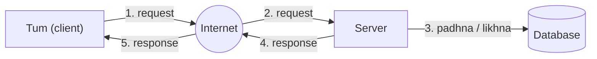
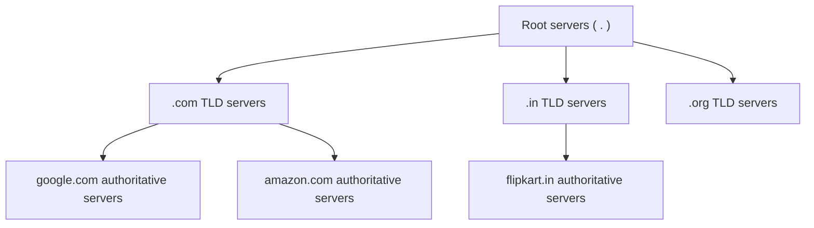
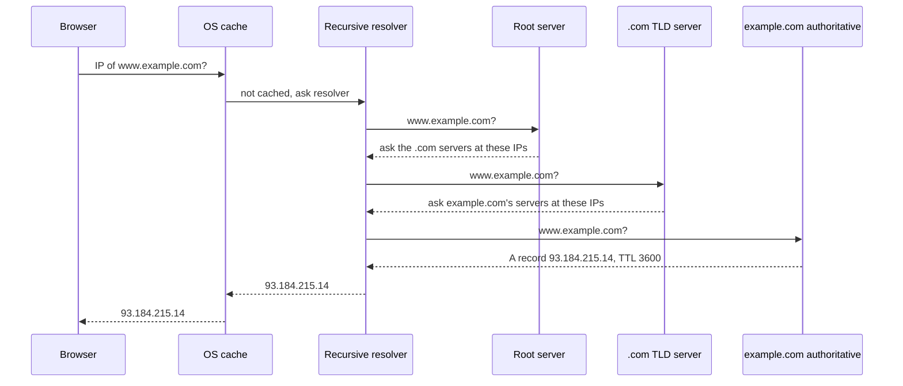
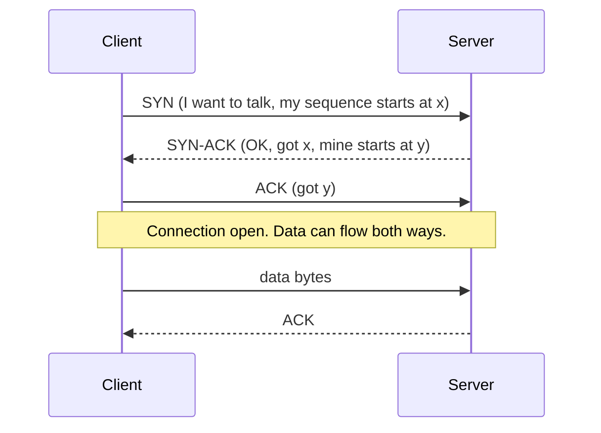
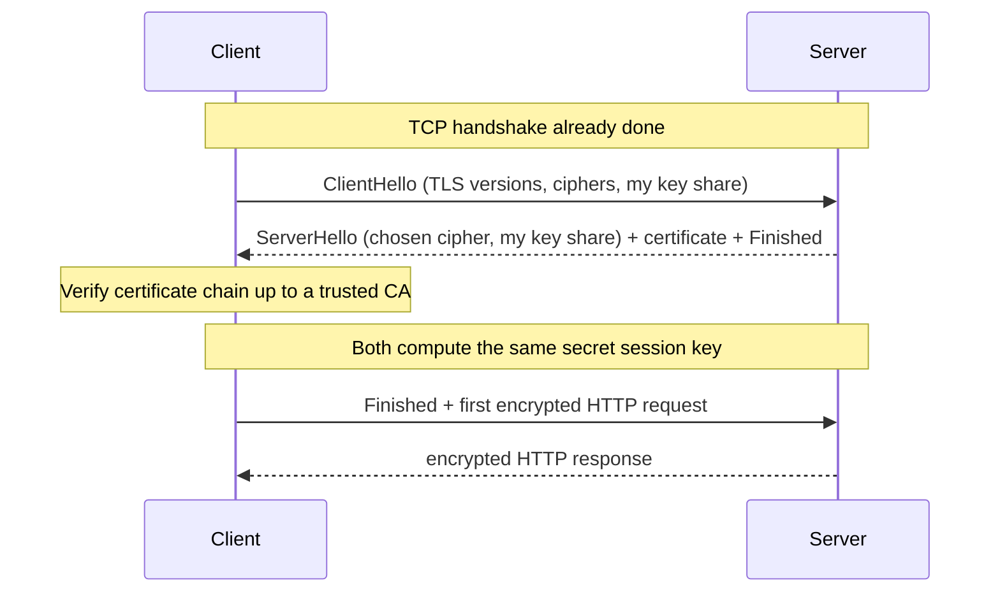
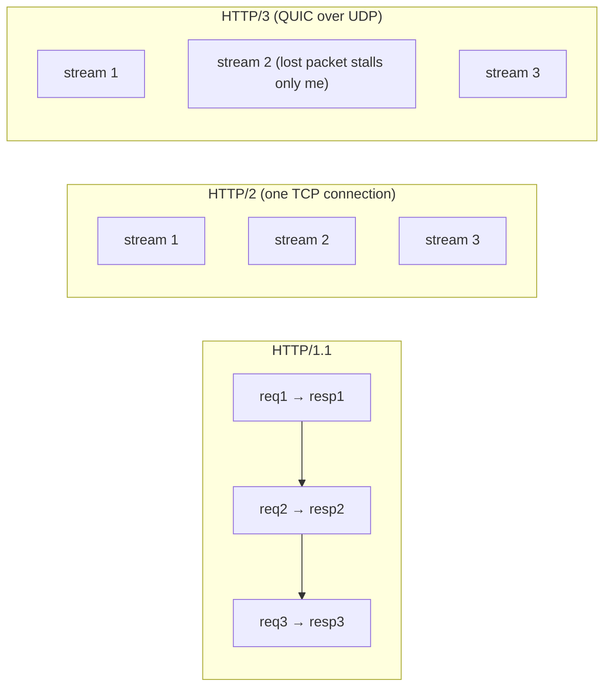
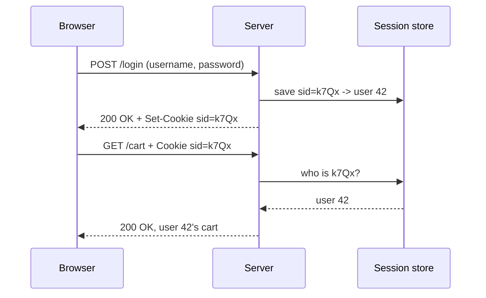
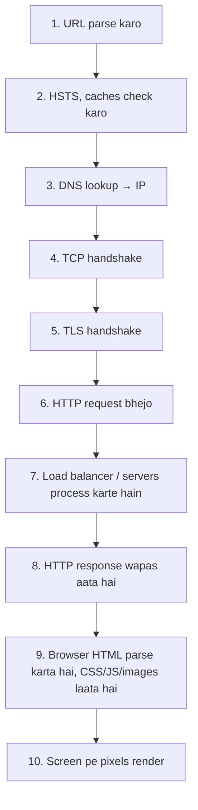
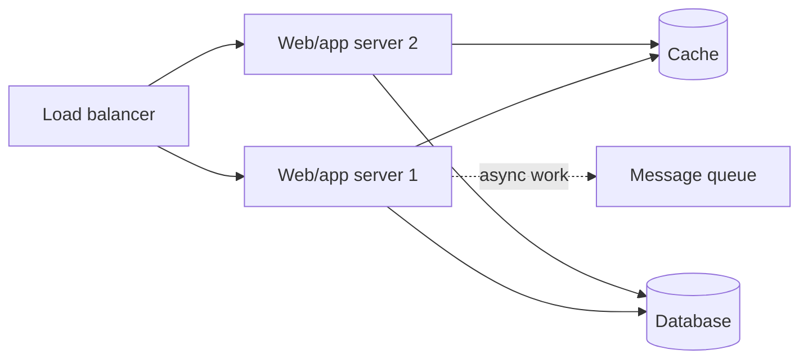
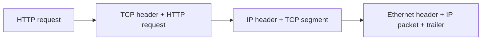

# Chapter 01 · What System Design Is & How the Internet Works

> Tumne food app pe "Order" dabaya. Aadhe second baad 8 km door ek restaurant mein tumhara ticket print hota hai, ek rider ka phone buzz karta hai, aur tumhari screen pe aata hai "Preparing your food". Darjanon machines, jinhe tum kabhi nahi dekhoge, ne abhi ekdum perfect teamwork kiya. **System design** usi teamwork ko plan karne ki kala hai. Aur iski shuruaat hoti hai ye samajhne se ki do computers aapas mein baat karte kaise hain.

**Is chapter mein tum seekhoge:**
- "System design" ka matlab kya hai, aur fresher se upar ke har level ke interviews mein ye kyun poocha jaata hai
- Client-server model, IP addresses, ports, aur "connection" asal mein hota kya hai
- DNS resolution step by step, TCP vs UDP, TLS handshake, aur HTTP/1.1 vs 2 vs 3
- HTTP request aur response ki anatomy, status codes, cookies aur sessions
- URL type karke Enter dabane se lekar page dikhne tak ka poora safar
- Latency numbers jo har engineer ko pata hone chahiye, aur unhe use kaise karein
- Functional vs non-functional requirements aur 8 key qualities, availability ke "nines" samet

**Isse pehle padho:** System design se kuch nahi! Tumhe bas Python ([Part 1](../part-1-python/01-getting-started.md)) aata ho, aur dictionaries ([Dictionaries & Hashing](../part-1-python/09-dictionaries.md)) aur Big-O ([Big-O](../part-2-dsa/01-big-o-complexity.md)) se comfortable ho.

---

## 🧠 The Big Idea · Asli Baat

DSA mein tumne **ek machine pe ek program** ko fast banaya. System design mein tum **bahut saari machines pe bahut saare programs** ko saath mein kaam karwaate ho, **ek saath bahut saare users** ke liye. Aur ye sab tab, jab machines crash ho rahi hain, network messages gira raha hai, aur traffic achaanak 10× ho jaata hai.

Ghar pe khaana banane aur ek restaurant chain chalane ka farak socho:

| Ghar ka khaana (DSA) | Restaurant chain (System design) |
|---|---|
| Ek cook, ek kitchen | Saikdon cooks, kai kitchens |
| "Meri recipe efficient hai?" | "Head chef bimaar pad gaya toh? Raat 8 baje 500 log aa gaye toh?" |
| Napo: ek dish mein kitna time | Napo: ghante mein kitni dishes, wait time, kitni baar band rehna pada |
| Galti = jala hua dinner | Galti = hazaaron naraz customers |

Sabse basic picture, jis pe baaki har chapter khada hai, ye hai:



Ek **client** (tumhara phone, browser, ya koi aur program) kuch maangta hai. Ek **server** (kahin kisi computer pe chal raha program) kaam karta hai, aksar ek **database** ki madad se jo data yaad rakhta hai, aur jawab wapas bhejta hai. System design ki har cheez (load balancers, caches, queues, shards) bas ek tareeka hai is picture ko millions of users ke saamne zinda rakhne ka.

> 🇮🇳 **Desi Analogy:** Chai tapri socho. Tum (client) bolte ho "ek cutting". Chaiwala (server) order sunta hai, bartan aur doodh ka stock (database) dekhta hai, chai banata hai, aur glass tumhe pakda deta hai (response). Ab socho station ke bahar subah 8 baje 500 log ek saath khade hain. Ek chaiwala kaafi nahi, doodh khatam ho sakta hai, aur ek bartan jal gaya toh dukaan band. **Inhi problems ko engineering ki bhasha mein solve karna system design hai.**

> 💡 **Core insight:** ek system bas kuch boxes hain jo network se jude hain. Network slow hai, unreliable hai, aur limited hai. System design ka zyada tar kaam **arrows** ke baare mein hai, boxes ke baare mein nahi.

---

## 🔨 Building It Up · Zero Se Shuru

### 1. What system design is, and why interviews ask it

**System design** ka matlab hai ye decide karna ki ek software system ko *kaunse components* chahiye, wo *aapas mein kaise baat karenge*, aur *data kaise flow aur store hoga*, taaki system apni requirements (features, speed, uptime, cost) poori kare.

System design interview aam taur pe aisa sunai deta hai: *"Design a URL shortener"*, *"Design WhatsApp"*, *"Design a rate limiter"*. Tumhe 45–60 minute milte hain, ek whiteboard, aur koi ek "sahi" answer nahi hota.

Companies ye kyun poochti hain:

1. **Asli job zyada tar yahi hai.** Sorting function likhna kabhi kabhi hota hai. "Ye cache mein jaaye ya queue mein?" jaisa decision har hafte hota hai.
2. **Ye judgment test karta hai, ratta nahi.** Har jagah trade-offs hain: fast vs sasta, simple vs zyada scalable. Interviewer sunna chahta hai ki *tum unke baare mein kaise sochte ho*.
3. **Ye seniority dikhata hai.** Junior poochta hai "ise code kaise karun?". Senior poochta hai "10× traffic pe jab ye tootega tab kya hoga?".

Interviewer kya dhoondhta hai, isi order mein:

- Kuch bhi draw karne se pehle tum **requirements clear** karte ho.
- Tum **scale estimate** karte ho (users, requests per second, storage). Ye hum [Chapter 11](11-estimation-framework.md) mein seekhenge.
- Pehle ek **simple, chalta hua design** banate ho, phir use behtar karte ho.
- **Trade-offs ka naam lete ho** ("I chose X; the cost is Y").
- **Bottlenecks aur single points of failure** dhoondh ke theek karte ho.

Ye chapter tumhe vocabulary deta hai. Iske bina aage ka har chapter bas shor lagega.

### 2. Client and server: two programs, one conversation

**Server** koi special type ka computer nahi hai. Ye bas ek program hai jo requests ka **intezaar** karta hai aur unka jawab deta hai. **Client** wo program hai jo baatcheet **shuru** karta hai. Tumhara laptop ek hi time pe dono ho sakta hai.

Neeche pure Python mein ek chhota sa client-server conversation hai, bina asli network ke. Yahan "network" bas ek function call hai, lekin shape bilkul asli cheez jaisi hai.

```python
def server(request):
    """A server: takes a request, returns a response. That's all it is."""
    menu = {"/": "Welcome!", "/menu": "Dosa, Idli, Vada"}
    if request in menu:
        return 200, menu[request]
    return 404, "Not found"

def client(path):
    status, body = server(path)          # asli life mein ye call internet paar karti hai
    print(f"GET {path} -> {status} {body}")

client("/")
client("/menu")
client("/pizza")
```

```text
GET / -> 200 Welcome!
GET /menu -> 200 Dosa, Idli, Vada
GET /pizza -> 404 Not found
```

Kya hua yahan: client ek **request** (ek path) bhejta hai, server use dhoondhta hai aur ek **response** wapas karta hai, jisme hota hai ek **status code** (200 = OK, 404 = nahi mila) aur ek **body**. Asli web servers bilkul yahi karte hain, bas request bytes ki shakal mein wires aur radio waves pe travel karti hai.

### 3. IP addresses and ports: the street address and the flat number

Chitthi bhejne ke liye address chahiye. Internet pe computers ka bhi address hota hai: **IP address** (Internet Protocol address).

- **IPv4** aisa dikhta hai: `142.250.183.14`. Chaar numbers, har ek 0 se 255 tak, yaani 32 bits, lagbhag 4.3 billion addresses. Ye duniya ke devices se kam hain!
- **IPv6** aisa dikhta hai: `2404:6800:4009:82a::200e`. 128 bits, itne ki ret ke har daane ko bhi kai addresses mil jaayein.
- **Private IPs** jaise `192.168.1.5` ya `10.0.0.7` sirf tumhare ghar ya office ke network ke andar kaam karte hain. Tumhara router **NAT** (Network Address Translation) use karke ek public IP ko tumhare saare devices mein share karta hai. Jaise ek building ka ek hi street address ho, aur ek receptionist jo dak sahi flat tak pahuncha de.

Lekin ek computer pe bahut saare programs chalte hain. Message sahi program tak kaise pahunche? **Port** se: 0 se 65535 tak ka ek number jo us machine pe ek program ko pehchaanta hai.

| Analogy | Networking |
|---|---|
| Building ka street address | IP address |
| Building ke andar flat number | Port |
| Poora address: "Flat 443, 142 MG Road" | `142.250.183.14:443` |

> 🇮🇳 **Desi Analogy:** Housing society socho. Society ka address (IP) courier wale ko society ke gate tak laata hai. Flat number (port) batata hai ki andar kis ghar mein jaana hai: flat 443 mein "HTTPS wale Sharma ji", flat 22 mein "SSH wale Verma ji". Aur society ka **watchman** NAT hai: bahar ki duniya ko sirf society ka ek address dikhta hai, aur andar ke 50 flats ke parcels wo khud sahi ghar tak pahunchaata hai.

Ye well-known ports tum hamesha dekhoge:

| Port | Kaun use karta hai |
|---|---|
| 80 | HTTP (web, unencrypted) |
| 443 | HTTPS (web, encrypted) |
| 22 | SSH (remote login) |
| 53 | DNS |
| 5432 | PostgreSQL |
| 3306 | MySQL |
| 6379 | Redis |

Ek **connection** chaar cheezon se pehchaana jaata hai: client IP, client port, server IP, server port. Tumhara browser apni taraf ke liye ek random bada "ephemeral" (temporary) port chun leta hai (jaise 54321). Isi wajah se port 443 pe baitha ek server ek saath hazaaron alag connections sambhaal sakta hai: har connection ka client IP/port pair alag hai.

> 🤔 **Mann mein sawaal:** Server ka port toh 443 hi hai, sab log usi pe aa rahe hain. Toh server confuse kyun nahi hota ki kaunsa jawab kise bhejna hai?
>
> **Jawab:** Kyunki connection sirf "443" se nahi pehchaana jaata, poore chaar cheezon ke combination se pehchaana jaata hai. Tumhara phone `(49.36.1.7, 54321) ↔ (142.250.183.14, 443)` hai, tumhare dost ka `(49.36.9.2, 60001) ↔ (142.250.183.14, 443)`. Server side same hai, client side alag, isliye har baatcheet alag line pe chalti hai.

### 4. DNS: the internet's phone book

Insaan `google.com` yaad rakhte hain. Computers ko `142.250.183.14` chahiye. **Domain Name System (DNS)** naamon ko IPs mein translate karta hai. Ye tumhare phone ke contacts app jaisa hai: tum "Mummy" pe tap karte ho, phone number dial karta hai.

DNS koi ek bada server nahi hai. Ye ek **hierarchy** hai, jo right se left padhi jaati hai:



- **Root servers** jaante hain ki har top-level domain kaun sambhaalta hai. 13 root server *names* hain (a.root-servers.net se m.root-servers.net tak), aur har naam ke peeche duniya bhar mein bahut saari machines hain.
- **TLD servers** (Top-Level Domain: `.com`, `.in`, `.org`) jaante hain ki unke neeche ke har domain ka incharge kaun hai.
- **Authoritative servers** domain ke asli records rakhte hain, jo uske owner ne set kiye hain.

Tumhare aur in sabke beech baitha hai ek **recursive resolver**. Ise aam taur pe tumhara internet provider chalata hai, ya koi public resolver jaise Google ka `8.8.8.8` ya Cloudflare ka `1.1.1.1`. Ye tumhare liye saari bhaag-daud karta hai.

> 🇮🇳 **Desi Analogy:** Tumhe kisi "Ramesh Kumar, Andheri, Mumbai" ka phone number chahiye, aur tum apne jugaadu dost (recursive resolver) ko bolte ho "bas number la de". Dost pehle Delhi ke head office (root) se poochta hai: "Mumbai ka hisaab kaun rakhta hai?" Wo bolte hain "Mumbai office (TLD) se poocho." Mumbai office bolta hai "Andheri ke ward office (authoritative) se poocho." Ward office ke register mein asli number likha hai. Dost tumhe number deta hai aur apni diary mein bhi likh leta hai, "ek ghante tak valid" (TTL). Agli baar koi Ramesh ka number maange, toh dost diary se seedha bata deta hai.

Kuch bhi cached na ho, toh `www.example.com` ka poora resolution:



Do tarah ke sawaal dekho:

- **Recursive query**: "mujhe final answer la ke do" (browser → resolver). Saara kaam resolver ko karna padta hai.
- **Iterative query**: "tumhe jo pata hai wo batao" (resolver → root → TLD → authoritative). Har server bas agle ka pata batata hai.

**Caching DNS ko fast banati hai.** Har answer ke saath ek **TTL** aata hai (time to live, seconds mein). Browser, operating system aur resolver, sab TTL khatam hone tak answers cache karte hain. Isi wajah se zyada tar lookups ~0 ms (browser cache) ya kuch ms (resolver cache) lete hain, aur sirf cold lookup hi poora tree walk karta hai.

Common **DNS record types**:

| Record | Kya map karta hai | Example |
|---|---|---|
| A | name → IPv4 | `example.com → 93.184.215.14` |
| AAAA | name → IPv6 | `example.com → 2606:2800::1` |
| CNAME | name → doosra name (alias) | `www.shop.com → shop.cdn-provider.net` |
| MX | domain → mail server | `gmail.com → gmail-smtp-in.l.google.com` |
| NS | domain → uske authoritative name servers | `example.com → a.iana-servers.net` |
| TXT | name → koi bhi text (verification, email security) | `"v=spf1 include:..."` |

Neeche cache aur TTLs ke saath ek recursive resolver ka chhota simulation hai. "Servers" yahan dictionaries hain.

```python
ROOT = {"com": "tld-com", "in": "tld-in"}
SERVERS = {
    "tld-com": {"example.com": "auth-example"},
    "tld-in": {"shop.in": "auth-shop"},
    "auth-example": {"www.example.com": ("93.184.215.14", 300)},
    "auth-shop": {"www.shop.in": ("203.0.113.9", 60)},
}

class Resolver:
    def __init__(self):
        self.cache = {}                        # name -> (ip, expires_at), yaani kab tak valid

    def resolve(self, name, now):
        if name in self.cache and self.cache[name][1] > now:
            print(f"  t={now}: {name} cache HIT")
            return self.cache[name][0]
        hops = []
        tld = name.rsplit(".", 1)[1]           # "www.example.com" -> "com" (aakhri tukda = TLD)
        tld_server = ROOT[tld]; hops.append("root")
        domain = ".".join(name.split(".")[-2:])   # aakhri do tukde: "example.com"
        auth = SERVERS[tld_server][domain]; hops.append(tld_server)
        ip, ttl = SERVERS[auth][name]; hops.append(auth)
        self.cache[name] = (ip, now + ttl)
        print(f"  t={now}: {name} cache MISS, asked {' -> '.join(hops)}")
        return ip

r = Resolver()
print(r.resolve("www.example.com", now=0))
print(r.resolve("www.example.com", now=100))   # TTL 300 ke andar
print(r.resolve("www.example.com", now=400))   # TTL khatam
print(r.resolve("www.shop.in", now=400))
```

```text
  t=0: www.example.com cache MISS, asked root -> tld-com -> auth-example
93.184.215.14
  t=100: www.example.com cache HIT
93.184.215.14
  t=400: www.example.com cache MISS, asked root -> tld-com -> auth-example
93.184.215.14
  t=400: www.shop.in cache MISS, asked root -> tld-in -> auth-shop
203.0.113.9
```

Kya hua yahan: pehle lookup ne root → TLD → authoritative walk kiya aur result 300 seconds ke liye cache kar liya. Doosra lookup turant ho gaya. TTL expire hone ke baad resolver ko dobara tree walk karna pada. Ek bilkul naya naam (`www.shop.in`) hamesha miss se shuru hota hai.

> 💡 **System design mein TTL kyun matter karta hai:** chhota TTL (60 s) traffic ko naye servers pe jaldi shift karne deta hai (failover mein kaam ka). Lamba TTL (1 din) matlab kam lookups, lekin changes dheere failte hain. Servers migrate karne ho toh move se *ek din pehle* TTL kam kar do.

### 5. TCP vs UDP: registered post vs postcards

IP pata chal gaya, ab data deliver karne ka tareeka chahiye. Data chhote tukdon mein travel karta hai jinhe **packets** kehte hain (aam taur pe har ek ~1,500 bytes tak). Packets kho sakte hain, duplicate ho sakte hain, ya ulte order mein pahunch sakte hain. Do transport protocols ise alag alag tareeke se sambhaalte hain.

**TCP (Transmission Control Protocol)** tracking wali registered post jaisa hai:

- **Pehle connection.** Data bhejne se pehle client aur server ek **three-way handshake** karte hain.
- **Reliable.** Har byte ka acknowledgement aata hai. Khoye hue packets dobara bheje jaate hain.
- **Ordered.** Bytes usi order mein pahunchte hain jisme bheje gaye, chahe packets alag raaston se aaye hon.
- **Flow aur congestion control.** Agar receiver ya network overload hai toh ye speed kam kar deta hai.



Handshake mein koi bhi data move hone se pehle **ek round trip** lagta hai (RTT, round-trip time: jaana aur wapas aana). Agar server 100 ms door hai, toh ye 100 ms ka bas intezaar hai. Isiliye connections ko reuse karna itna zaroori hai.

**UDP (User Datagram Protocol)** postcards phenkne jaisa hai:

- **Na connection, na handshake.** Bas bhej do.
- **Koi guarantee nahi.** Packets kho sakte hain ya ulte order mein aa sakte hain. Koi dobara nahi bhejta.
- **Bahut kam overhead, kam latency.**

| | TCP | UDP |
|---|---|---|
| Connection | Haan (handshake) | Nahi |
| Delivery | Guaranteed, khoya data dobara bhejta hai | Best effort |
| Order | Bana rehta hai | Nahi rehta |
| Speed / overhead | Zyada overhead | Minimal |
| Kahan use hota hai | Web (HTTP/1.1, HTTP/2), email, file transfer, databases | Video calls, online games, live streaming, DNS, QUIC (HTTP/3) |

**Rule of thumb:** agar late packet bekaar hai (2 second purana video frame, game mein player ki purani position), toh UDP. Agar har byte matter karta hai (bank transfer, web page), toh TCP.

> 🇮🇳 **Desi Analogy:** TCP ek **registered post with AD card** hai: dakiya receiver se sign karwa ke receipt wapas laata hai, aur chitthi kho jaaye toh dobara bheji jaati hai. UDP **live cricket commentary** jaisa hai: ek ball ki commentary miss ho gayi toh commentator rewind karke dobara nahi sunaata, agli ball pe chala jaata hai. Kyunki 2 minute purani ball ka live update kisi kaam ka nahi. Bank ka paisa = registered post. Video call = live commentary.

Chalo simulate karte hain ki TCP ki guarantees tumhe kya deti hain. Packets shuffle hoke aate hain aur ek kho jaata hai; TCP jaisa logic unhe order mein lagata hai aur missing wala dobara maangta hai.

```python
import random

random.seed(7)
message = "HELLO WORLD!"
packets = list(enumerate(message))          # (sequence number, byte) ke pairs
random.shuffle(packets)                     # network ne packets ulte-pulte kar diye
lost = packets.pop(3)                       # ...aur ek kho bhi diya

udp_view = "".join(ch for _, ch in packets)
print("UDP receiver sees:", repr(udp_view))

received = dict(packets)                    # TCP packets ko sequence number se rakhta hai
missing = [i for i in range(len(message)) if i not in received]
print("TCP notices missing seq:", missing)
for seq in missing:
    received[seq] = message[seq]            # sender dobara bhejta hai
print("TCP receiver sees:", repr("".join(received[i] for i in range(len(message)))))
```

```text
UDP receiver sees: 'O!LROLEHWL '
TCP notices missing seq: [10]
TCP receiver sees: 'HELLO WORLD!'
```

Kya hua yahan: UDP receiver ko 11 ulte-pulte characters mile (`D` kho gaya aur kisi ko pata bhi nahi chala). TCP ke sequence numbers ki wajah se wo bytes ko wapas order mein laga paaya aur gap pakad liya, phir sender ne dobara bheja. UDP bas jo pahuncha wo pakda deta hai.

### 6. TLS: the secret handshake behind the padlock

Plain HTTP sab kuch padhne layak text mein bhejta hai. Usi café Wi-Fi pe baitha koi bhi tumhara password padh sakta hai. **TLS** (Transport Layer Security; iska purana naam SSL tha) teen cheezein jodta hai:

1. **Encryption**: chupke se sunne wale ko bas gibberish dikhta hai.
2. **Authentication**: tumhe pakka pata hota hai ki tum sach mein `yourbank.com` se baat kar rahe ho, kisi nakli se nahi. Server ye ek **certificate** se prove karta hai, jo ek trusted **Certificate Authority (CA)** ne sign kiya hai. Jaise passport pe us sarkar ka thappa jise tumhara browser maanta hai.
3. **Integrity**: raaste mein koi data badle toh pakda jaayega.

**HTTPS** bas HTTP hai jo TLS connection ke andar chal raha hai, port 443 pe.

TLS 1.3 handshake, utne level pe jitna interviews expect karte hain:



Asli trick hai **key exchange** (Diffie-Hellman): dono sides public "key shares" bhejte hain, aur har side doosre ka share apne secret ke saath mix karke **same session key** bana leta hai, bina wo key kabhi network pe bheje. Uske baad sab kuch session key ke saath fast **symmetric encryption** use karta hai.

> 🇮🇳 **Desi Analogy:** Rangon wala classic example: tum aur dost dono ek common rang (maan lo peela) pe agree karte ho, sabke saamne. Tum chupke se apna secret laal milaate ho, dost apna secret neela. Dono apna mix ek doosre ko bhejte ho (ye public "key share" hai). Ab tum dost ke mix mein apna laal milao, dost tumhare mix mein apna neela. **Dono ke paas same final rang** (peela + laal + neela) aa gaya, lekin raaste mein kisi ne wo final rang dekha hi nahi, aur mixed rang se secret rang alag karna lagbhag namumkin hai. Yahi Diffie-Hellman hai.

Cost: TLS 1.3 **ek round trip** jodta hai (TLS 1.2 mein do lagte the). Toh ek naya HTTPS connection request ke pehle byte se pehle 1 RTT TCP ke liye + 1 RTT TLS ke liye leta hai. 100 ms ke link pe ye 200 ms sirf handshakes mein. Ye yaad rakhna; isi wajah se connection reuse, CDNs (users ke paas wale servers) aur HTTP/3 matter karte hain.

### 7. HTTP: the language of the web

**HTTP** (HyperText Transfer Protocol) ek simple, text-based request/response protocol hai. Client ek **request** bhejta hai; server ek **response** lautata hai. Har request **stateless** hai: server pichhli requests ko apne aap yaad nahi rakhta (ise hum section 10 mein cookies se theek karenge).

**Request ki anatomy:**

```text
POST /api/orders HTTP/1.1                    <- request line: method, path, version
Host: food.example.com                       <- headers: key: value
Content-Type: application/json
Authorization: Bearer eyJhbGciOi...
Cookie: session_id=abc123
Content-Length: 41
                                             <- blank line ends the headers
{"restaurant_id": 42, "items": [7, 9, 9]}    <- body (optional)
```

Line by line: pehli line mein method (`POST`), path (`/api/orders`) aur version. Phir `key: value` wale headers. Phir ek **khaali line**, jo headers ka khatam hona batati hai. Phir body (optional).

**Response ki anatomy:**

```text
HTTP/1.1 201 Created                         <- status line: version, code, reason
Content-Type: application/json
Location: /api/orders/9001
Cache-Control: no-store
Set-Cookie: last_order=9001; HttpOnly; Secure

{"order_id": 9001, "status": "PLACED", "eta_minutes": 35}
```

Common **methods** (inhe verbs bhi kehte hain):

| Method | Matlab | Safe? (kuch nahi badalta) | Idempotent? (repeat = same effect) |
|---|---|---|---|
| GET | Resource padho | Haan | Haan |
| POST | Banao / koi action karo | Nahi | Nahi |
| PUT | Resource poora replace karo | Nahi | Haan |
| PATCH | Thoda sa update | Nahi | Guarantee nahi |
| DELETE | Hatao | Nahi | Haan |
| HEAD | GET jaisa, lekin sirf headers | Haan | Haan |
| OPTIONS | Yahan kya allowed hai? (CORS mein use hota hai) | Haan | Haan |

**Idempotent** ka matlab hai: do baar karo ya ek baar, effect same. Order 9001 ko do baar delete karo, phir bhi wo bas deleted hi hai. "Create order" do baar POST karo, toh *do* orders ban jaate hain. Safe retries ke liye ye bahut zaroori hai ([Chapter 07](07-apis-communication.md) mein gehraai se).

> 🇮🇳 **Desi Analogy:** Lift ka button idempotent hai: "5" dabao, ek baar ya das baar, lift 5th floor pe hi jaayegi. Lekin UPI pe "₹500 bhejo" idempotent nahi hai: network atak gaya aur tumne ghabra ke dobara bheja, toh ₹1000 kat sakte hain. Isiliye payment apps andar ek unique transaction ID rakhte hain, taaki dobara aayi same request ko pehchaan ke ignore kar sakein.

Request bas text hi hai, toh use parse karna ek mazedaar Python exercise hai:

```python
raw = (
    "POST /api/orders HTTP/1.1\r\n"
    "Host: food.example.com\r\n"
    "Content-Type: application/json\r\n"
    "Content-Length: 27\r\n"
    "\r\n"
    '{"restaurant_id": 42, "x": 1}'
)

def parse_request(text):
    head, body = text.split("\r\n\r\n", 1)        # khaali line head aur body ko alag karti hai
    lines = head.split("\r\n")
    method, path, version = lines[0].split(" ")
    headers = {}
    for line in lines[1:]:
        key, value = line.split(":", 1)
        headers[key.strip().lower()] = value.strip()   # header names case-insensitive hote hain
    return method, path, version, headers, body

method, path, version, headers, body = parse_request(raw)
print(method, path, version)
print(headers)
print(body)
```

```text
POST /api/orders HTTP/1.1
{'host': 'food.example.com', 'content-type': 'application/json', 'content-length': '27'}
{"restaurant_id": 42, "x": 1}
```

Kya hua yahan: HTTP/1.1 literally `\r\n` (carriage return + newline) se alag ki gayi text lines hain. Ek khaali line headers ka end mark karti hai. Asli servers bhi yahi karte hain, bas zyada fast aur bahut zyada checks ke saath.

**Ye headers pehchaanne aane chahiye:**

| Header | Direction | Kaam |
|---|---|---|
| `Host` | request | Kaunsi website (ek IP pe kai sites host ho sakti hain) |
| `Content-Type` | both | Body ka format (`application/json`, `text/html`) |
| `Authorization` | request | Credentials, jaise ek token |
| `Cookie` / `Set-Cookie` | request / response | Chhota data jo browser store karke wapas bhejta hai |
| `Cache-Control` | response | Response kitni der cache ho sakta hai ([Chapter 04](04-caching-cdn.md)) |
| `ETag` / `If-None-Match` | response / request | Version tag, taaki na badla data dobara download na ho |
| `Location` | response | Bana hua ya shift hua resource kahan hai |
| `User-Agent` | request | Kaunsa client call kar raha hai |
| `Accept-Encoding` / `Content-Encoding` | both | Compression, jaise gzip ya br |

### 8. Status codes: the server's facial expression

Status codes paanch families mein aate hain. Pehle families seekho; individual codes apne aap samajh aa jaate hain.

| Range | Matlab | Mood |
|---|---|---|
| 1xx | Informational ("chalte raho") | 🤔 |
| 2xx | Success | 😀 |
| 3xx | Redirection ("kahin aur dekho") | 👉 |
| 4xx | **Client** error ("galti tumhari") | 🙅 |
| 5xx | **Server** error ("galti hamari") | 🔥 |

Jo ekdum ratte hone chahiye:

| Code | Name | Kab |
|---|---|---|
| 200 | OK | Normal success |
| 201 | Created | POST ne kuch banaya (`Location` header ke saath) |
| 204 | No Content | Success, lautane ko kuch nahi (aksar DELETE) |
| 301 | Moved Permanently | URL hamesha ke liye badal gaya (browsers aur search engines yaad rakhte hain) |
| 302 | Found | Temporary redirect |
| 304 | Not Modified | "Tumhari cached copy abhi bhi theek hai" |
| 400 | Bad Request | Galat ya tooti-phooti input |
| 401 | Unauthorized | Logged in nahi / galat credentials (asal matlab "unauthenticated") |
| 403 | Forbidden | Logged in ho, lekin permission nahi |
| 404 | Not Found | Aisa koi resource nahi |
| 409 | Conflict | Current state se takraav (jaise duplicate username) |
| 429 | Too Many Requests | Rate limited ([Chapter 07](07-apis-communication.md)) |
| 500 | Internal Server Error | Server pe bug ya crash |
| 502 | Bad Gateway | Proxy ko peeche wale server se bekaar jawab mila |
| 503 | Service Unavailable | Overloaded, ya maintenance ke liye band |
| 504 | Gateway Timeout | Proxy ne peeche wale server ka bahut der intezaar kiya |

> 🤔 **Mann mein sawaal:** 401 ka naam "Unauthorized" hai, toh 403 "Forbidden" se alag kaise? Dono ka matlab "mana hai" hi toh hai?
>
> **Jawab:** Naam confusing hai, matlab saaf hai. **401 = "tum kaun ho?"** Tumne login hi nahi kiya, ya token galat hai. Login karke dobara try karo, kaam ho sakta hai. **403 = "pata hai tum kaun ho, phir bhi nahi."** Jaise office mein tumhara ID card valid hai (authenticated), lekin server room mein tumhari entry allowed nahi (authorization nahi). Dobara try karne se kuch nahi badlega.

Design mein family kyun matter karti hai? **Retries.** 5xx ya timeout dobara try karne pe chal sakta hai. 4xx nahi chalega: request hi galat hai.

```python
def should_retry(status):
    """Retry on server-side trouble and rate limiting, never on client mistakes."""
    if status == 429:
        return True              # ruko (Retry-After maano) aur retry karo
    return 500 <= status <= 599  # server errors temporary ho sakte hain

for code in [200, 400, 404, 429, 500, 503]:
    print(code, "retry" if should_retry(code) else "don't retry")
```

```text
200 don't retry
400 don't retry
404 don't retry
429 retry
500 retry
503 retry
```

### 9. HTTP/1.1 vs HTTP/2 vs HTTP/3

HTTP ka vikaas isliye hua taaki kam round trips barbaad hon. Ek modern web page ko darjanon files chahiye (HTML, CSS, JS, images), toh wo connections kaise share karti hain, ye matter karta hai.

**HTTP/1.0:** har request ke liye ek TCP connection. Kholo, request, response, band karo. Bahut barbaadi (har baar handshake).

**HTTP/1.1 (1997):**
- **Keep-alive**: ek TCP connection ko kai requests ke liye reuse karo, ek ke baad ek.
- Lekin ek connection pe responses **order mein** aate hain. Response 1 slow hai toh responses 2 aur 3 uske peeche intezaar karte hain. Ise **head-of-line (HOL) blocking** kehte hain, jaise akele billing counter pe ek slow customer.
- Browsers iska jugaad karte hain: har domain ke liye ~6 parallel connections khol lete hain.

> 🇮🇳 **Desi Analogy:** D-Mart ka ek hi billing counter. Aage wale uncle ka coupon scan nahi ho raha, aur tumhare haath mein sirf ek Maggi hai. Phir bhi tum unke peeche khade ho. Ye HTTP/1.1 ka **HOL blocking** hai. Browser ka "6 connections" wala jugaad matlab 6 counters khol dena. HTTP/2 aisa hai jaise ek hi counter pe cashier sabke items thode thode karke interleave karke scan kare, taaki koi ek slow customer sabko na roke.

**HTTP/2 (2015):**
- Text ki jagah **binary framing**.
- **Multiplexing**: bahut saari requests aur responses **ek** TCP connection pe independent **streams** ki tarah *interleave* hoke chalti hain. HTTP-level HOL blocking khatam.
- **Header compression (HPACK)**: baar baar aane wale headers (cookies, user agent) poore dobara nahi bheje jaate.
- Phir bhi TCP pe hai, toh agar **ek packet** khoya, toh TCP use dobara bhejne tak *saare* streams ko rok deta hai. HOL blocking bas neeche TCP layer mein khisak gaya.

**HTTP/3 (2022):**
- **QUIC** pe chalta hai, jo **UDP** pe bana protocol hai aur reliability *har stream ke liye alag* implement karta hai. Khoya packet sirf apne stream ko rokta hai.
- **TLS 1.3 andar hi built in hai**: connection + encryption setup **1 RTT** mein, aur jis server se pehle baat ho chuki ho uske saath resume karne pe **0-RTT**.
- **Connection migration**: tumhara phone Wi-Fi se 4G pe switch kare toh bhi connection zinda rehta hai (connections ek ID se pehchaane jaate hain, IP+port se nahi).



| | HTTP/1.1 | HTTP/2 | HTTP/3 |
|---|---|---|---|
| Transport | TCP | TCP | QUIC over UDP |
| Format | Text | Binary frames | Binary frames |
| Requests per connection | Ek baar mein ek | Kai, multiplexed | Kai, multiplexed |
| Head-of-line blocking | HTTP level aur TCP level | Sirf TCP level | Streams ke beech khatam |
| Header compression | Nahi | HPACK | QPACK |
| Handshake (naya connection) | TCP 1 RTT + TLS 1–2 RTT | 1.1 jaisa hi | Total 1 RTT (resume pe 0-RTT) |

Chalo 50 ms RTT link pe ek connection se 6 files load karne ke round trips gino, transfer time ignore karke:

```python
RTT_MS = 50
FILES = 6

def http11_one_connection():
    handshakes = 1 + 1            # TCP + TLS 1.3, dono 1-1 RTT
    return (handshakes + FILES) * RTT_MS   # requests ek ke baad ek jaati hain

def http2():
    handshakes = 1 + 1
    return (handshakes + 1) * RTT_MS       # saari 6 requests ek round trip mein multiplexed

def http3(resumed=False):
    handshakes = 0 if resumed else 1       # QUIC transport + TLS ko mila deta hai
    return (handshakes + 1) * RTT_MS

print("HTTP/1.1, 1 connection :", http11_one_connection(), "ms")
print("HTTP/2                 :", http2(), "ms")
print("HTTP/3 (new)           :", http3(), "ms")
print("HTTP/3 (0-RTT resume)  :", http3(resumed=True), "ms")
```

```text
HTTP/1.1, 1 connection : 400 ms
HTTP/2                 : 150 ms
HTTP/3 (new)           : 100 ms
HTTP/3 (0-RTT resume)  : 50 ms
```

Kya hua yahan: wahi 6 files 400 ms ya 50 ms leti hain, sirf is baat pe depend karke ki round trips kaise use hue. Slow mobile network pe yahi "snappy" aur "laggy" ka farak hai. **Round trips hi latency ki currency hain.**

### 10. Cookies and sessions: giving a stateless protocol a memory

HTTP **stateless** hai: server ke liye har request ek ajnabi hai. Lekin Amazon pe tum clicks ke beech logged in rehte ho. Kaise?

**Cookies.** Server ek `Set-Cookie` header bhejta hai; browser use store karta hai aur us site ki har agli request pe `Cookie` header ki tarah chipka deta hai. Cloakroom token socho: coat do, token #47 lo, aur coat wapas lene ke liye token dikhao.

**Sessions.** Aam pattern ye hai ki cookie mein sirf ek random, guess na ho sakne wala **session ID** hota hai. Asli data ("user 42 logged in hai, cart mein 3 items hain") server pe ek **session store** mein rehta hai.

> 🇮🇳 **Desi Analogy:** Mandir ka **chappal stand**. Tum chappal dete ho, bhaiya tumhe ek token deta hai, "47". Token pe tumhari chappal ki koi detail nahi likhi, bas ek number hai (session ID). Asli chappal stand ke andar rack pe hai (session store). Darshan ke baad token dikhao, chappal wapas. Kisi ne nakli token "999" banaya? Rack pe 999 pe kuch nahi milega. Aur agar mandir mein do chappal stand hain aur tum doosre pe token dikhao, toh wahan tumhari chappal nahi milegi. Yahi baat aage "do servers" wali warning mein aayegi.



```python
import secrets
import random

random.seed(1)

class WebServer:
    def __init__(self):
        self.sessions = {}                              # session_id -> user ka data
        self.users = {"asha": "pass123"}

    def login(self, username, password):
        if self.users.get(username) != password:
            return 401, {}, "bad credentials"
        sid = "".join(random.choice("abcdefghjkmnpqrstuvwxyz23456789") for _ in range(8))
        self.sessions[sid] = {"user": username, "cart": []}
        return 200, {"Set-Cookie": f"sid={sid}; HttpOnly; Secure"}, "welcome"

    def add_to_cart(self, cookie, item):
        sid = cookie.removeprefix("sid=")
        session = self.sessions.get(sid)
        if session is None:
            return 401, "please log in"
        session["cart"].append(item)
        return 200, f"{session['user']}'s cart: {session['cart']}"

server = WebServer()
status, headers, body = server.login("asha", "pass123")
print(status, body, headers)
cookie = headers["Set-Cookie"].split(";")[0]          # browser "sid=..." store kar leta hai
print(server.add_to_cart(cookie, "masala dosa"))
print(server.add_to_cart(cookie, "filter coffee"))
print(server.add_to_cart("sid=forged", "free stuff"))
print("real apps use secrets.token_urlsafe():", len(secrets.token_urlsafe(16)) > 0)
```

```text
200 welcome {'Set-Cookie': 'sid=ev643cjd; HttpOnly; Secure'}
(200, "asha's cart: ['masala dosa']")
(200, "asha's cart: ['masala dosa', 'filter coffee']")
(401, 'please log in')
real apps use secrets.token_urlsafe(): True
```

Kya hua yahan: server ne ek session banaya, browser ko sirf ek ID di, aur har request pe wo ID dhoondhi. Nakli ID ko kuch nahi mila. Humne `random` ko seed kiya taaki output har baar same aaye; **asli systems mein `secrets` hi use karna zaroori hai**, jo cryptographically unpredictable hai.

> 🤔 **Mann mein sawaal:** Seedha cookie mein hi "user=asha" likh do na. Session store ka jhanjhat kyun?
>
> **Jawab:** Cookie browser ke paas rehti hai, aur browser user ke control mein hai. Agar cookie mein "user=asha" likha hai, toh koi bhi use edit karke "user=admin" kar dega aur server maan lega. Random session ID ko guess karna lagbhag namumkin hai, aur asli data server ke paas safe hai. (Doosra raasta hai JWT jaise **signed** tokens, jinhe edit karo toh signature toot jaata hai. Wo [Chapter 07](07-apis-communication.md) mein hai.)

Zaroori cookie attributes:

| Attribute | Effect |
|---|---|
| `HttpOnly` | JavaScript ise padh nahi sakta (XSS attacks se cookie churaane ke khilaaf bachaav) |
| `Secure` | Sirf HTTPS pe bheji jaati hai |
| `SameSite=Lax/Strict` | Zyada tar cross-site requests pe nahi bheji jaati (CSRF attacks se bachaav) |
| `Max-Age` / `Expires` | Kab marti hai; iske bina ye "session cookie" hai jo browser band hone pe delete ho jaati hai |
| `Domain` / `Path` | Kaunse URLs ko ye milti hai |

> ⚠️ Sessions ko **ek server ki memory mein** rakhna usi pal toot jaata hai jab tumhare paas do servers ho jaate hain: jo request server B pe pahunchi, use server A pe bana session nahi milega. Ise theek karna [Chapter 02](02-scalability-load-balancing.md) ka key topic hai. Alternative, yaani **JWT jaise tokens** jo data khud saath le ke chalte hain, [Chapter 07](07-apis-communication.md) mein hai.

### 11. What happens when you type a URL and press Enter

Ye ab tak ke sabse famous interview questions mein se ek hai. Chalo `https://www.example.com/products?id=7` ke liye har tukda jodte hain.



**Step 1: URL parse karo.** Browser ise tod deta hai:

```text
https://www.example.com:443/products?id=7#reviews
\___/   \_____________/ \_/\_______/ \__/ \_____/
scheme       host       port  path   query fragment
```

**Fragment** (`#reviews`) kabhi server ko nahi bheja jaata; ye sirf browser ke liye hai (page ke kis hisse pe scroll karna hai). Agar tumne kuch aisa type kiya jo URL hai hi nahi, toh browser use search maan leta hai.

**Step 2: Quick checks.** Kya `example.com` **HSTS** list pe hai (un sites ki list jinhe hamesha HTTPS hi use karna hai)? Kya page browser ke HTTP cache mein hai aur abhi fresh hai? Agar haan, toh network ki zaroorat hi nahi.

**Step 3: DNS.** Browser cache → OS cache (aur `hosts` file) → recursive resolver → root → TLD → authoritative (section 4). Result: ek IP address, aksar tumhare paas ke kisi **CDN** edge server ka ([Chapter 04](04-caching-cdn.md)) ya kisi **load balancer** ka ([Chapter 02](02-scalability-load-balancing.md)).

**Step 4: TCP handshake.** Port 443 pe us IP ke saath SYN, SYN-ACK, ACK. Ek RTT.

**Step 5: TLS handshake.** ClientHello, ServerHello + certificate, key exchange, certificate verification. TLS 1.3 ke saath ek RTT. (HTTP/3 mein steps 4 aur 5 ek hi QUIC handshake mein mil jaate hain.)

**Step 6: HTTP request bhejo.** `GET /products?id=7`, headers ke saath: `Host`, cookies, `Accept-Encoding`, waghera.

**Step 7: Server side.** System design yahin rehta hai:



Load balancer ek healthy server chunta hai. Server authentication check karta hai (cookie), product 7 ko **cache** mein dhoondhta hai, miss hone pe **database** pe jaata hai, shayad ek "analytics event" **queue** mein daal deta hai ([Chapter 08](08-queues-events.md)), aur response banata hai.

**Step 8: Response wapas aata hai.** Status `200 OK`, headers jaise `Content-Type: text/html` aur `Cache-Control`, aur ek compressed body.

**Step 9: Browser HTML parse karta hai.** Ye **DOM** banata hai (page ke elements ka ek tree), `<link>`, `<script>` aur `` tags dhoondhta hai, aur unhe bhi laata hai, connection reuse karte hue (HTTP/2 multiplexing). Bahut saari files CDN se aati hain. JavaScript aur API calls bhi kar sakta hai.

**Step 10: Render.** CSS parse hoke **CSSOM** banti hai, DOM ke saath milke render tree banta hai, phir **layout** (har box kahan jaayega?) aur **paint** (pixels). Tumhe page dikhta hai.

Acche connection pe total: aksar kuch sau milliseconds. Part 3 ka har chapter step 7 ke kisi hisse ko fast ya mazboot banata hai.

> 🇮🇳 **Desi Analogy:** Swiggy order ka poora safar isse match karta hai. Restaurant ka naam yaad hai, address nahi: app use location mein badalti hai (**DNS**). Rider aur restaurant ka connection banta hai, "haan order mila" (**TCP handshake**). OTP se pakka hota hai ki sahi rider hai (**TLS certificate**). Order slip jaati hai (**HTTP request**). Kitchen mein manager order kisi free chef ko deta hai (**load balancer**), ready items pehle se rakhe hain toh turant (**cache**), warna fresh banta hai (**database**). Parcel wapas aata hai (**response**), aur tum dabba khol ke thali sajaate ho (**render**).

### 12. Latency numbers every engineer should know

Agar tum sochte ho ki network call aur memory read ka kharcha ek jaisa hai, toh accha design nahi bana sakte. Ye approximate numbers (Jeff Dean aur Peter Norvig ne popular kiye; exact values hardware ke hisaab se badalti hain, lekin **ratios** hi asli cheez hain) yaad karne layak hain:

| Operation | Approx. time | Insaani scale (agar 1 ns = 1 s) |
|---|---|---|
| L1 cache reference | 0.5 ns | aadha second |
| Branch mispredict | 5 ns | 5 seconds |
| L2 cache reference | 7 ns | 7 seconds |
| Mutex lock/unlock | 25 ns | 25 seconds |
| Main memory (RAM) reference | 100 ns | 2 minute se kam |
| Compress 1 KB (fast compressor) | ~2 µs | ~33 minutes |
| Send 1 KB over 1 Gbps network | 10 µs | ~3 hours |
| Random read from SSD (4 KB) | ~100 µs | ~1 din |
| Read 1 MB sequentially from RAM | ~250 µs | ~3 din |
| Round trip within same datacenter | 500 µs | ~6 din |
| Read 1 MB sequentially from SSD | ~1 ms | ~12 din |
| Disk (HDD) seek | 10 ms | ~4 mahine |
| Read 1 MB sequentially from HDD | ~20 ms | ~8 mahine |
| Packet round trip California ↔ Netherlands | 150 ms | ~5 saal |

(1 ms = 1,000 µs = 1,000,000 ns.)

> 🇮🇳 **Desi Analogy:** Rasoi mein khaana bana rahe ho. **RAM** = masaledaani jo stove ke bagal mein hai, haath badhao aur mil gaya. **SSD** = kitchen ki upar wali almari, stool lagao, dhoondho. **Same datacenter round trip** = padosi aunty se cheeni maangne jaana. **Cross-continent round trip** = cheeni ke liye doosre sheher wale mama ke ghar se courier mangwana. Koi bhi samajhdaar cook har chammach namak ke liye mama ko courier nahi bhejega. Yahi caching aur CDNs ka poora logic hai.

Is table mein chhupe lessons:

1. **Memory SSD se ~1,000× aur HDD seek se ~100,000× fast hai.** Isiliye caches ([Chapter 04](04-caching-cdn.md)) exist karte hain.
2. **Cross-continent round trip datacenter round trip se ~300× slow hai.** Isiliye CDNs aur multi-region deployments exist karte hain.
3. **Sequential reads random reads ko harate hain.** Isiliye databases logs aur LSM trees use karte hain ([Chapter 03](03-databases.md)).
4. **Datacenter ke andar network fast hai lekin free nahi.** 0.5 ms ki 100 sequential calls = 50 ms. Unhe batch karo.

Chalo in numbers se 100 user profiles fetch karne ke teen tareeke compare karte hain:

```python
NS = 1
US = 1_000 * NS
MS = 1_000 * US

RAM_READ = 100 * NS
SSD_RANDOM_READ = 100 * US
DC_ROUND_TRIP = 500 * US

def fmt(ns):
    return f"{ns / MS:.3f} ms"

profiles = 100
from_local_ram = profiles * RAM_READ
db_one_call_each = profiles * (DC_ROUND_TRIP + SSD_RANDOM_READ)
db_one_batched_call = DC_ROUND_TRIP + profiles * SSD_RANDOM_READ

print("local in-memory cache     :", fmt(from_local_ram))
print("100 separate DB calls     :", fmt(db_one_call_each))
print("1 batched DB call         :", fmt(db_one_batched_call))
```

```text
local in-memory cache     : 0.010 ms
100 separate DB calls     : 60.000 ms
1 batched DB call         : 10.500 ms
```

Kya hua yahan: wahi kaam 0.01 ms se 60 ms tak le sakta hai. Batching ne 99 round trips hata diye; caching ne network aur disk dono hata diye. Is tarah ki back-of-envelope reasoning bilkul wahi hai jo interviewers sunna chahte hain.

Hisaab khud karke dekho: 100 alag calls = 100 × (0.5 ms + 0.1 ms) = 60 ms. Ek batched call = 0.5 ms (ek round trip) + 100 × 0.1 ms = 10.5 ms. RAM = 100 × 100 ns = 0.01 ms.

### 13. Requirements: functional vs non-functional

Har design **requirements** se shuru hota hai. Inhe skip karna interview ki #1 galti hai.

**Functional requirements** batate hain ki system **kya** karta hai: uske features.

- "Users can post a photo with a caption."
- "Users can follow other users."
- "Users see a feed of photos from people they follow."

**Non-functional requirements (NFRs)** batate hain ki wo kaam **kitna accha** karta hai: uski qualities.

- "The feed loads in under 200 ms for 99% of requests."
- "The service is available 99.99% of the time."
- "Uploaded photos are never lost."
- "Must handle 10 million daily active users."

Ek accha test: agar ise hataane se user **kya** kar sakta hai wo badal jaata hai, toh functional hai. Agar **kitna fast, kitna reliable, kitna safe** badalta hai, toh non-functional hai.

| Functional | Non-functional |
|---|---|
| Send a message | Delivered within 1 second |
| Shorten a URL | Redirect in under 50 ms; links never expire wrongly |
| Upload a video | Videos are durable; upload works on slow 3G |
| Search products | Results in under 300 ms; handles 50k searches/second |

> 🇮🇳 **Desi Analogy:** IRCTC socho. Functional: "ticket book ho sake", "PNR status dikhe", "cancel ho sake". Non-functional: "Tatkal ke 10 baje wale rush mein bhi site na gire", "payment kat gaya toh ticket pakka bane ya paisa wapas aaye", "booking 3 second mein confirm ho". Features toh dono IRCTC ke paas 2005 mein bhi the. **Farak non-functional requirements ne banaya.**

> 💡 Interview mein pehle 3–5 minute 3–5 functional aur 3–5 non-functional requirements list karne mein lagao. Phir **batao ki tum kinke liye optimise kar rahe ho**. "This is a read-heavy system where availability matters more than strong consistency" ek aisa sentence hai jo poora design badal deta hai.

### 14. The key qualities, defined precisely

Ye shabd aksar dheele-dhaale tareeke se use hote hain. Inhe precisely use karo, aur tum aise engineer lagoge jisne asli systems chalaaye hain.

**Scalability**: bina redesign kiye, resources jod ke **zyada load** sambhaalne ki kshamta. Load matlab zyada users, zyada data, ya zyada requests per second. ([Chapter 02](02-scalability-load-balancing.md))

**Availability**: time ka wo hissa jab system **up hai aur jawab de raha hai**. "Nines" mein naapa jaata hai (neeche dekho). System available ho sakta hai lekin purana (stale) data de raha ho.

**Reliability**: system hissa fail hone pe bhi lagataar **sahi kaam karta hai**. Available = "jawab deta hai"; reliable = "*sahi* jawab deta hai". Jo server hamesha up hai lekin 1% orders gira deta hai, wo available hai par reliable nahi.

**Latency**: **ek request** ko shuru se khatam hone tak lagne wala time. Aam taur pe percentiles mein bataya jaata hai: **p50** (median), **p95**, **p99** (99% requests isse fast hain). Averages dard chhupaate hain; p99 dikhata hai.

**Throughput**: system **per unit time** kitni requests (ya bytes) sambhaalta hai, jaise 20,000 requests/second (RPS ya QPS, queries per second).

Latency vs throughput, analogy se: highway ki **latency** hai ek car ko A se B jaane mein kitna time lagta hai. Uska **throughput** hai ek ghante mein kitni cars guzarti hain. Lanes badhane se throughput badhta hai, lekin koi car fast nahi hoti.

**Consistency**: har reader **latest write** dekhta hai (ya kam se kam data ka ek well-defined version). Alag systems alag levels ka wada karte hain. ([Chapter 06](06-cap-consistency.md))

**Durability**: jab system ne ek baar "saved" bol diya, toh data crashes, bijli jaane, aur disk kharab hone ke baad bhi **bacha rehta hai**. Disk pe likh ke aur kai machines pe replicate karke milta hai. ([Chapter 05](05-replication-sharding.md))

**Maintainability**: engineers system ko kitni aasaani se **samajh, badal aur chala** sakte hain. Simple designs, acchi monitoring ([Chapter 09](09-microservices-reliability.md)), saaf boundaries. Aksar sabse underrated quality.

> 🤔 **Mann mein sawaal:** Availability aur reliability toh ek hi baat lagti hai. Up hai matlab theek hai na?
>
> **Jawab:** Nahi. ATM socho. **Available** = ATM chalu hai, screen on hai, card leta hai. **Reliable** = jo ₹2000 maange, wahi ₹2000 nikle, aur account se bhi utne hi kate. Ek ATM jo 24×7 chalu hai lekin kabhi kabhi paisa kaat ke note nahi deta, wo 100% available hai, par reliable bilkul nahi. Interview mein ye farak bolna seniority dikhata hai.

Neeche response times ke ek sample se percentile latency nikaali gayi hai, taaki tum dekho ki averages jhooth kyun bolte hain:

```python
import random

random.seed(42)
# 1000 requests: zyada tar fast, kuch slow raaste pe (jaise cache miss + disk read)
latencies = [random.randint(20, 60) for _ in range(980)] + \
            [random.randint(800, 1500) for _ in range(20)]
latencies.sort()

def percentile(sorted_values, p):
    index = max(0, int(round(p / 100 * len(sorted_values))) - 1)   # nearest-rank method
    return sorted_values[index]

avg = sum(latencies) / len(latencies)
print(f"average: {avg:.0f} ms")
for p in (50, 95, 99, 99.9):
    print(f"p{p}: {percentile(latencies, p)} ms")
```

```text
average: 62 ms
p50: 40 ms
p95: 59 ms
p99: 1094 ms
p99.9: 1423 ms
```

Kya hua yahan: average theek-thaak dikhta hai, p50 aur p95 zabardast dikhte hain, lekin p99 batata hai ki 100 mein se 1 user ek second se zyada intezaar karta hai. Agar ek page 50 backend calls karta hai, toh lagbhag 10 mein se 4 page loads kam se kam ek slow call se takraayenge (1 − 0.99⁵⁰ ≈ 0.39). Isiliye badi companies targets **p99** pe set karti hain, averages pe nahi.

Wo 0.39 kahan se aaya? Ek call ke fast hone ka chance 0.99 hai. 50 calls *sab* fast hon, iska chance 0.99 × 0.99 × ... (50 baar) = 0.99⁵⁰ ≈ 0.61. Toh kam se kam ek slow hone ka chance 1 − 0.61 = 0.39.

### 15. Availability and the "nines"

**Availability = uptime / (uptime + downtime)**, aam taur pe saal ya mahine ke hisaab se. Log ise nines gin ke batate hain:

```python
MINUTES_PER_YEAR = 365 * 24 * 60
MINUTES_PER_MONTH = MINUTES_PER_YEAR / 12

def describe(minutes):
    if minutes >= 24 * 60:
        return f"{minutes / (24 * 60):.2f} days"
    if minutes >= 60:
        return f"{minutes / 60:.2f} hours"
    if minutes >= 1:
        return f"{minutes:.2f} minutes"
    return f"{minutes * 60:.2f} seconds"

print(f"{'availability':<14}{'downtime/year':<18}{'downtime/month'}")
for pct in ["90", "99", "99.9", "99.95", "99.99", "99.999"]:
    down_fraction = (100 - float(pct)) / 100
    year = describe(MINUTES_PER_YEAR * down_fraction)
    month = describe(MINUTES_PER_MONTH * down_fraction)
    print(f"{pct + '%':<14}{year:<18}{month}")
```

```text
availability  downtime/year     downtime/month
90%           36.50 days        3.04 days
99%           3.65 days         7.30 hours
99.9%         8.76 hours        43.80 minutes
99.95%        4.38 hours        21.90 minutes
99.99%        52.56 minutes     4.38 minutes
99.999%       5.26 minutes      26.28 seconds
```

"Nines" table shabdon mein:

| Nines | Availability | Downtime per year | Kahan typical hai |
|---|---|---|---|
| Two | 99% | ~3.65 din | Internal tools |
| Three | 99.9% | ~8.76 ghante | Bahut saari web apps |
| Four | 99.99% | ~52.6 minutes | Payments, bade consumer apps |
| Five | 99.999% | ~5.26 minutes | Telecom, critical infrastructure |

Har extra nine matlab **10× kam downtime**, aur aam taur pe cost aur mehnat 10× se bhi kahin zyada.

**Series aur parallel mein availability.** Agar request ko component A *aur* B dono se guzarna hai, toh dono up hone chahiye:

- **Series:** `A_total = A1 × A2`. Do 99.9% components series mein: 0.999 × 0.999 ≈ 99.8%. Chains *aur kharab* hoti hain.
- **Parallel (redundant):** system tabhi down hai jab *saari* copies down hon: `A_total = 1 − (1 − A1) × (1 − A2)`. Do 99% servers parallel mein: 1 − 0.01 × 0.01 = 99.99%. Redundancy *behtar* banati hai.

> 🇮🇳 **Desi Analogy:** **Series** = Mumbai se Pune by road, jahan beech mein ek hi pul hai. Highway khula ho, pul khula ho, toll naka khula ho, *teeno* chahiye, toh pahunchne ka chance teeno se kam hai. **Parallel** = Mumbai se Pune jaane ke do alag raaste: Expressway aur purana highway. Tum tabhi atkoge jab *dono* band hon. Ek band hone ka chance 1% hai, toh dono ek saath band hone ka 0.01%. Yahi redundancy ki taakat hai.

```python
def series(*parts):
    total = 1.0
    for a in parts:
        total *= a
    return total

def parallel(*parts):
    all_down = 1.0
    for a in parts:
        all_down *= (1 - a)
    return 1 - all_down

lb, app, db = 0.9999, 0.999, 0.999
print(f"LB -> app -> DB in series         : {series(lb, app, db):.4%}")
two_apps = parallel(app, app)
two_dbs = parallel(db, db)
print(f"LB -> 2 apps -> 2 DBs (redundant) : {series(lb, two_apps, two_dbs):.4%}")
print(f"two 99% servers in parallel       : {parallel(0.99, 0.99):.4%}")
```

```text
LB -> app -> DB in series         : 99.7901%
LB -> 2 apps -> 2 DBs (redundant) : 99.9898%
two 99% servers in parallel       : 99.9900%
```

Kya hua yahan: teen acche components ko chain karne se total unme se kisi bhi akele se kharab ho gaya. App aur DB tiers ko double karne se poora system lagbhag four nines pe aa gaya, aur ab ye mainly akele load balancer se limited hai. Yahi "single points of failure hatao" ke peeche ka maths hai, jo [Chapter 02](02-scalability-load-balancing.md) ka dil hai. (Ye simple model maanta hai ki failures independent hain; asal mein ek hi rack ke do servers saath mein fail ho sakte hain, isiliye copies ko alag zones mein failaate hain.)

**SLI, SLO, SLA** (ye tum baar baar sunoge):

- **SLI** (Service Level *Indicator*): ek naapa hua number. "99.95% of requests succeeded this month."
- **SLO** (Service Level *Objective*): ek internal target. "We aim for 99.9% success."
- **SLA** (Service Level *Agreement*): customers se ek wada, **penalties ke saath**. "If we fall below 99.9%, you get a 10% credit."

Yaad rakhne ka tareeka: **I**ndicator = jo *hua* (speedometer), **O**bjective = jo hum *chahte* hain (khud ka target), **A**greement = jo hamne *likh ke diya* (contract, tootega toh jurmana).

---

## 🔬 Under the Hood · Andar Ki Kahani

### The layers: how one HTTP request becomes electrical signals

Networking **layers** mein organise hai. Har layer ek problem solve karti hai aur apne neeche wali pe bharosa karti hai. Simplified **TCP/IP model**:

| Layer | Kaam | Examples | Analogy |
|---|---|---|---|
| Application | Data ka *matlab* kya hai | HTTP, DNS, SMTP, gRPC | Chitthi ka content |
| Transport | Program-to-program delivery, reliability | TCP, UDP, QUIC | Registered post vs postcard |
| Network (Internet) | Networks ke paar machine-to-machine routing | IP | Dak vibhaag ka routing system |
| Link | Ek physical link pe ek hop | Ethernet, Wi-Fi | Do post offices ke beech chalne wali van |

Purana **OSI model** 7 layers ka hai (Presentation aur Session jodta hai, aur Link ko Data Link aur Physical mein tod deta hai). Interviewers OSI numbers ko shorthand ki tarah use karte hain: "**L4** load balancer" matlab transport level (IPs aur ports dekhta hai), "**L7** load balancer" matlab application level (HTTP paths aur headers dekhta hai). Ye tumhe [Chapter 02](02-scalability-load-balancing.md) mein chahiye hoga.

**Encapsulation**: har layer upar wali layer ke data ko apne header mein lapet deti hai, jaise lifafe ke andar lifafa:



Raaste ke routers sirf bahar ke lifafe (Link, IP) kholte hain, ye decide karne ke liye ki aage kahan bhejna hai. Sirf aakhri server saare lifafe kholta hai.

> 🇮🇳 **Desi Analogy:** Mumbai ke **dabbawalas**. Ghar pe tiffin (HTTP data) ek kapde mein bandhta hai jispe colour code likha hai: kis office, kis floor (TCP/port jaisa). Phir tiffins ek bade crate mein station tak jaate hain, jahan crate pe sirf station code dekha jaata hai (IP routing). Train (Link layer) crate ko ek station se agle tak le jaati hai. Beech ke dabbawale andar ka khaana nahi kholte, bas bahar ka code dekh ke aage badha dete hain. Sirf office wala babu tiffin khol ke khaana khaata hai.

### Why TCP slows down at the start

TCP ko nahi pata ki network kitna fast hai, isliye wo saavdhaani se ek chhoti **congestion window** se shuru karta hai (kitna bina-acknowledge-hua data ek saath raaste mein ho sakta hai) aur jab tak sab theek chal raha hai, har round trip pe ise lagbhag **double** karta hai (**slow start**). Loss dikhte hi wo window kam kar deta hai. Nateeja: ek bilkul naya connection turant poori bandwidth use nahi kar sakta, isliye page ke pehle kuch sau KB mein kai round trips lagte hain. **Connections reuse** karne (keep-alive, connection pools) ki ek aur wajah, naye kholne ki jagah.

### Why the certificate check works

Server ke certificate mein uski public key aur domain name hota hai, jo ek CA ne **sign** kiya hai. CA ka certificate ek root CA ne sign kiya hai, jiska certificate tumhare OS ya browser mein pehle se installed hai. Tumhara browser signatures ki chain ko ek trusted root tak check karta hai, domain name match hota hai ya nahi dekhta hai, aur expire toh nahi hua ye dekhta hai. Attacker CA ki private key ke bina signature forge nahi kar sakta, isliye wo site ki nakal nahi kar sakta.

> 🤔 **Mann mein sawaal:** Attacker bhi toh apna certificate bana ke bhej sakta hai. Browser use kaise pakdega?
>
> **Jawab:** Certificate banana aasaan hai, lekin us pe kisi **trusted CA ka sign** lena mushkil hai. CA tabhi `yourbank.com` ka certificate sign karta hai jab tum prove karo ki domain sach mein tumhara hai. Attacker ka self-made certificate chain mein kisi trusted root tak nahi pahunchta, toh browser bada laal warning dikha deta hai. Aur agar wo kisi CA se apne *khud ke* domain (`evil.com`) ka certificate le aaye, toh domain name match nahi karega.

### Why DNS uses UDP (mostly)

DNS ka sawaal aur jawab aam taur pe ek ek chhote packet mein fit ho jaate hain. TCP handshake ek poora extra round trip jod deta (intezaar double) aur kai extra packets bhi. Isliye DNS port 53 pe UDP use karta hai, aur agar reply kho jaaye toh client bas dobara pooch leta hai. Bade responses (aur servers ke beech zone transfers) TCP pe chale jaate hain.

### Where latency really comes from

Ek request ki total latency = **propagation** (fiber mein roshni ki speed, ~200,000 km/s, yaani ek taraf har 1,000 km pe ~5 ms) + **transmission** (bits ko wire pe dhakelna: size ÷ bandwidth) + **queuing** (router aur server buffers mein intezaar) + **processing** (tumhara code, database). Propagation mein tum physics ko nahi hara sakte, isliye servers ko **paas** le jaate ho (CDNs, regions). Baaki ko caching, behtar code aur kam intezaar se theek karte ho.

Ek example: Mumbai se Virginia lagbhag 13,000 km hai. Sirf propagation ek taraf ~65 ms, aane-jaane mein ~130 ms, aur asli raaste seedhe nahi hote, isliye RTT ~200 ms ho jaata hai. Duniya ka koi bhi code isse kam nahi kar sakta. Server ko Mumbai le aao, ye 5 ms ho jaata hai.

---

## 🧩 Pattern Decoder · Pattern Pakdo

System design chapters ke liye ye section **decision guides** ka set hai: agar tumhe X chahiye, toh Y chuno, kyunki Z.

### Decision guide: transport and protocol

| Agar tumhe chahiye... | Chuno | Kyunki |
|---|---|---|
| Har byte, order mein (web pages, APIs, payments) | TCP (HTTP/1.1 ya HTTP/2) | Reliable aur ordered |
| Sabse kam latency jahan late data bekaar hai (voice, video calls, games) | UDP (aksar custom logic ke saath, jaise WebRTC) | Na re-sends, na HOL blocking |
| Loss wale mobile networks pe fast web | HTTP/3 (QUIC) | Har stream ki alag loss recovery, 0/1-RTT setup, connection migration |
| Ek domain se bahut saari chhoti files | HTTP/2 ya HTTP/3 | Ek connection pe multiplexing |
| Public internet pe kisi bhi cheez ke liye encryption | TLS (HTTPS) | Confidentiality, integrity, server authentication |

### Decision guide: DNS TTL

| Situation | TTL | Kyun |
|---|---|---|
| Stable record, kam hi badalta hai | Ghanton se ek din tak | Kam lookups, users ke liye fast |
| Fast failover / migrations ki zaroorat pad sakti hai | 30–300 seconds | Changes jaldi failte hain |
| Migration plan kar rahe ho | Ek din pehle TTL kam karo, move karo, phir badha do | Purane lambe TTLs ka pehle expire hona zaroori hai |

### Decision guide: which quality are you optimising?

| Requirements mein signal | Main quality | Typical design moves |
|---|---|---|
| "millions of users", "traffic spikes" | Scalability | Stateless servers, load balancers, sharding |
| "must always be up", "global users" | Availability | Redundancy, multiple zones/regions, failover |
| "never lose an order/payment" | Durability, reliability | Replication, write-ahead logs, backups, idempotent retries |
| "feels instant", "real-time" | Latency | Caching, CDNs, kam round trips, async work |
| "analytics", "logs", "ingest firehose" | Throughput | Batching, queues, append-only storage |
| "balance must be exact", "no double booking" | Consistency | Transactions, single leader, consensus |

### Trade-off table: the fundamental tensions

| Tumhe milta hai... | ...aur aam taur pe keemat chukaate ho | Example |
|---|---|---|
| Kam latency (caching) | Staleness (consistency) | Like counts jo kuch second peeche chalte hain |
| Zyada availability (replicas) | Consistency ya cost | Failures ke dauraan replicas purana data de sakte hain |
| Strong consistency | Latency, availability | Kai replicas ke confirm karne ka intezaar |
| Zyada throughput (batching) | Har item ki latency | Har 5 second mein emails bulk mein bhejna |
| Zyada nines | Paisa aur complexity | Multi-region active-active setups |

### The requirements template (use this in every interview)

```text
Functional (what):
  1. ...
  2. ...
  3. ...
Non-functional (how well):
  - Scale: DAU, requests/sec (read vs write ratio), data size
  - Latency target: p99 < ___ ms for ___
  - Availability target: ___ nines
  - Consistency need: strong for ___, eventual OK for ___
  - Durability: can we ever lose ___?
Out of scope: ...
```

### When NOT to over-engineer

- 50 employees ke internal tool ko five nines, multiple regions ya sharding ki zaroorat nahi. Ek server aur ek backup bilkul theek answer hai, agar tum *wajah batao*.
- Jis cheez ko har byte chahiye uske neeche UDP mat lagao, jab tak tum reliability khud dobara banane ke liye ready na ho.
- "Safe rehne ke liye" har jagah strong consistency ka wada mat karo. Uski keemat latency aur availability mein chukani padti hai ([Chapter 06](06-cap-consistency.md)).

---

## ⚠️ Traps & Common Mistakes · Yahan Sab Phisalte Hain

1. **Requirements se pehle boxes aur arrows mein kood jaana.** Tum galat system ko bahut khoobsurti se design kar doge. Hamesha pehle clarify karo.
2. **Availability aur reliability ko mix karna.** "Wo up tha" ka matlab "wo sahi tha" nahi hai.
3. **Average latency quote karna.** Averages slow tail ko chhupa dete hain. p95/p99 use karo.
4. **Latency aur throughput mein confuse hona.** Zyada servers throughput badhate hain; ek request ko fast nahi banate.
5. **401 ko "forbidden" samajhna.** 401 = authenticated nahi (tum kaun ho?). 403 = authenticated, lekin allowed nahi.
6. **Non-idempotent requests ko aankh band karke retry karna.** Timeout hue `POST /payments` ko retry kiya toh do baar paisa kat sakta hai. Idempotency keys use karo ([Chapter 07](07-apis-communication.md)).
7. **Migrations ke dauraan DNS caching bhool jaana.** 24 h TTL wala record badla, toh kuch users ek din tak purane IP pe jaate rahenge.
8. **Ye bolna ki "HTTP/2 ne head-of-line blocking hata diya."** HTTP layer pe hataya; TCP-level HOL blocking abhi bhi hai. HTTP/3 use theek karta hai.
9. **Sessions ek server ki memory mein rakhna** aur phir doosra server jod dena. Users randomly logout hone lagte hain.
10. **Ye maan lena ki components independently fail hote hain.** Ek hi power supply pe lage do "redundant" servers saath mein marte hain.
11. **Predictable session IDs use karna.** Sequential ya `random`-based IDs guess ho sakti hain:

```py
# ❌ guess ho sakta hai: attacker sid=1001, 1002, ... try kar sakta hai
session_id = str(next_id)
next_id += 1

# ✅ guess nahi ho sakta, cryptographically random
import secrets
session_id = secrets.token_urlsafe(32)
```

---

## 💡 Tips & Tricks · Pro Wale Moves

- Exact nanoseconds nahi, **ratios** yaad karo: RAM ≈ 100 ns, SSD ≈ 100 µs, same-datacenter round trip ≈ 0.5 ms, cross-continent ≈ 100–150 ms.
- **Har nine = 10× kam downtime.** 99.9% ≈ 8.8 h/saal, 99.99% ≈ 53 min/saal. Baaki khud nikaal lo.
- Jab bhi koi bole "ise fast karo", **round trips gino**. Ek RTT hatana aksar kisi bhi code optimisation se zyada faayda deta hai.
- Requirements numbers mein bolo: "fast" nahi, "p99 under 200 ms".
- URL wale sawaal mein **har step ka naam aur ek detail** bolo (DNS caching + TTL, TCP 3-way handshake, TLS cert check, LB, cache, DB, rendering). Pehle breadth, phir jahan interviewer ishaara kare wahan gehraai.
- Apne laptop pe `curl -v https://example.com` chalao aur DNS, TLS aur HTTP headers live *dekho*. `dig example.com` (ya `nslookup`) DNS records aur TTLs dikhata hai.
- Series availability multiply hoti hai; parallel mein **downtime** fractions multiply hote hain. Do lines ka maths, bahut bada insight.

---

## 🎯 Interview Questions · Interview Mein Yahi Poochenge

### 1. What happens when you type a URL into the browser and press Enter? 🔥🔥🔥

<details><summary>Answer dekho 👀</summary>

1. **URL parse karo**: scheme, host, port, path, query. HSTS (HTTPS force karna) aur browser cache check karo.
2. **DNS resolution:** browser cache → OS cache/hosts file → recursive resolver → root → TLD → authoritative server, jo ek IP lautata hai (aksar CDN ya load balancer ka). Answers apne TTL ke hisaab se cache hote hain.
3. **TCP handshake** (SYN, SYN-ACK, ACK) port 443 pe: ek round trip.
4. **TLS handshake:** ClientHello/ServerHello, server certificate trusted CAs se verify hota hai, key exchange se ek shared session key banti hai. TLS 1.3 mein ek RTT. (HTTP/3 steps 3–4 ko QUIC/UDP pe mila deta hai.)
5. **HTTP request** method, path, headers (Host, Cookie, Accept-Encoding) ke saath bheji jaati hai.
6. **Server side:** load balancer → app server → cookie/token se authenticate → cache lookup → miss pe database → response banao; shayad async kaam queue mein daalo.
7. **HTTP response:** status code, headers (Content-Type, Cache-Control, Set-Cookie), compressed body.
8. **Browser** HTML ko DOM mein parse karta hai, CSS/JS/images laata hai (aksar CDN se, HTTP/2 pe multiplexed), CSSOM banata hai, JS chalata hai, layout aur paint karta hai.

Tip: ye poora dhaancha 60 second mein do, phir kisi bhi step pe gehraai mein jaane ki offer karo.

> 🗣️ **Interview mein aise bolo:** "First the browser parses the URL and checks HSTS and its cache. Then DNS resolves the hostname through the browser, OS and recursive resolver, which walks root, TLD and authoritative servers, with every answer cached by TTL. Next come the TCP handshake and the TLS 1.3 handshake, one round trip each, and the browser sends the HTTP request. A load balancer routes it to an app server that checks the session, reads from cache or the database, and returns a response, which the browser parses into the DOM and CSSOM, fetches sub-resources for, and finally lays out and paints. I'm happy to go deeper into any of these steps."

</details>

### 2. Explain TCP vs UDP. When would you use each? 🔥🔥🔥

<details><summary>Answer dekho 👀</summary>

**TCP** connection-oriented hai (3-way handshake), reliable hai (acknowledgements aur retransmission), ordered hai (sequence numbers), aur isme flow aur congestion control hai. Keemat: handshake ki latency, aur packets khone pe head-of-line blocking.

**UDP** connectionless, best-effort, unordered hai, chhote headers aur bina handshake ke.

TCP tab use karo jab har byte matter kare: web pages aur APIs (HTTP/1.1, HTTP/2), databases, file transfer, email. UDP tab use karo jab samay pe pahunchna poora pahunchne se zyada zaroori ho: voice/video calls, live streams, multiplayer games, DNS lookups, aur QUIC (HTTP/3) ke base ke roop mein, jo UDP ke upar har stream ke liye reliability dobara banata hai.

> 🗣️ **Interview mein aise bolo:** "TCP is connection-oriented, reliable and ordered: it uses a three-way handshake, sequence numbers, acknowledgements and retransmission, plus flow and congestion control. UDP is connectionless and best-effort, with no handshake and no ordering, so it has very low overhead. I'd use TCP when every byte matters, like APIs, payments and databases, and UDP when late data is useless, like video calls, games and DNS. QUIC, the basis of HTTP/3, builds per-stream reliability on top of UDP to get the best of both."

</details>

### 3. How does DNS work? 🔥🔥🔥

<details><summary>Answer dekho 👀</summary>

DNS naamon ko records se map karta hai (IPv4 ke liye A, IPv6 ke liye AAAA, CNAME aliases, MX mail, NS name servers, TXT). Ye ek distributed hierarchy hai: **root** servers **TLD** servers (.com, .in) ki taraf ishaara karte hain, jo domain ke **authoritative** servers ki taraf ishaara karte hain, aur wahi asli records rakhte hain.

Client ek **recursive resolver** (ISP, 8.8.8.8, 1.1.1.1) se final answer maangta hai. Resolver **iterative** queries karta hai: root → TLD → authoritative. Har answer ke saath ek **TTL** aata hai, aur browser, OS aur resolver use cache karte hain, isliye zyada tar lookups cache se bahar jaate hi nahi. DNS mostly UDP port 53 pe chalta hai kyunki messages chhote hote hain.

Design ke liye matlab: TTL control karta hai ki tum kitni jaldi failover ya migrate kar sakte ho; DNS load distribution aur geo-routing bhi kar sakta hai ([Chapter 02](02-scalability-load-balancing.md)).

> 🗣️ **Interview mein aise bolo:** "DNS is a distributed, hierarchical directory that maps names to records like A, AAAA and CNAME. The client asks a recursive resolver for the final answer, and the resolver iteratively queries a root server, then the TLD server, then the domain's authoritative server. Every answer carries a TTL and is cached by the browser, the OS and the resolver, so most lookups are served from cache over UDP port 53. In design terms, TTL controls how quickly you can fail over or migrate, and DNS can also do geo-routing."

</details>

### 4. What's the difference between HTTP/1.1, HTTP/2 and HTTP/3? 🔥🔥

<details><summary>Answer dekho 👀</summary>

- **HTTP/1.1:** text protocol, keep-alive connections, lekin har connection pe ek baar mein ek request, toh responses line mein lagte hain (HTTP-level head-of-line blocking). Browsers jugaad ke liye har host ke ~6 connections kholte hain.
- **HTTP/2:** binary framing, ek TCP connection pe bahut saare streams ki **multiplexing**, header compression (HPACK), stream prioritisation. HTTP-level HOL blocking hata deta hai, lekin ek khoya TCP packet ab bhi saare streams rok deta hai.
- **HTTP/3:** UDP ke upar **QUIC** pe chalta hai. Loss sirf apne stream ko affect karta hai, TLS 1.3 built in hai (1-RTT setup, 0-RTT resumption), aur connection IDs ki wajah se connections network badalne (Wi-Fi se mobile) pe bhi bache rehte hain.

</details>

### 5. How does HTTPS / TLS keep my data safe? 🔥🔥

<details><summary>Answer dekho 👀</summary>

TLS deta hai **confidentiality** (encryption), **integrity** (chhed-chhaad pakdi jaati hai), aur **authentication** (tum asli server se baat kar rahe ho).

Handshake (TLS 1.3): client ClientHello bhejta hai, supported ciphers aur ek key share ke saath; server apna key share, apna **certificate**, aur Finished message lautata hai. Client certificate chain ko ek trusted root CA tak verify karta hai aur hostname check karta hai. Dono sides key shares ko combine karke (Diffie-Hellman) same **session key** nikaalte hain, use kabhi bheje bina. Phir saara traffic fast symmetric encryption use karta hai. TLS 1.3 ko 1 round trip chahiye (TLS 1.2 ko 2 chahiye the), aur ye 0-RTT resumption support karta hai.

</details>

### 6. HTTP is stateless. How do websites keep you logged in? 🔥🔥🔥

<details><summary>Answer dekho 👀</summary>

Login ke baad server ek **session** banata hai (server-side store kiya data, jaise Redis mein), jiski key ek random, guess na ho sakne wali **session ID** hoti hai, aur use `Set-Cookie` header mein lautata hai. Browser use har request pe `Cookie` header mein wapas bhejta hai; server use dhoondh ke user ko pehchaanta hai.

Ise secure karo `HttpOnly` (JS padh nahi sakta), `Secure` (sirf HTTPS), `SameSite` (CSRF protection) aur ek expiry ke saath.

Alternative: **stateless tokens** (jaise JWT) jo signed user claims saath le ke chalte hain, taaki server ko lookup na karna pade, lekin revoke karna mushkil ho jaata hai. Multiple servers ke saath, server-side sessions ek **shared store** mein rehne chahiye, kisi ek server ki memory mein nahi.

> 🗣️ **Interview mein aise bolo:** "After login, the server creates a session in a shared store like Redis, keyed by a random, unguessable session ID, and sends that ID in a Set-Cookie header. The browser returns it in the Cookie header on every request, and the server looks it up to identify the user. I'd mark the cookie HttpOnly, Secure and SameSite and give it an expiry. The alternative is a signed stateless token like a JWT, which avoids the lookup but makes revocation harder."

</details>

### 7. What is the difference between latency and throughput? 🔥🔥

<details><summary>Answer dekho 👀</summary>

**Latency** ek operation ka time hai (jaise 120 ms per request), jo percentiles (p50, p99) mein bataya jaata hai. **Throughput** per unit time operations hai (jaise 10,000 requests/second).

Ye jude hue hain lekin independent hain: servers jodne se throughput badhta hai lekin ek request ki latency kam nahi hoti; batching se throughput badhta hai lekin har item ki latency badh jaati hai. Highway analogy: latency ek car ka travel time hai, throughput ek ghante mein kitni cars. Interviewers ko ye sunna accha lagta hai: "we optimise p99 latency for user-facing reads, and throughput for the background pipeline."

</details>

### 8. What do availability "nines" mean? How do you reach four nines? 🔥🔥

<details><summary>Answer dekho 👀</summary>

99.9% ≈ 8.76 h downtime/saal, 99.99% ≈ 52.6 min/saal, 99.999% ≈ 5.26 min/saal. Har nine = 10× kam downtime.

**Series** mein components ki availabilities multiply hoti hain (chain apne hisson se kamzor hoti hai); parallel mein **redundant** components tabhi fail hote hain jab sab fail hon: 1 − Π(1 − Aᵢ). Toh four nines tak pahunchte ho single points of failure hata ke: redundant load balancers ke peeche kai stateless app servers, automatic failover wale replicated databases, kai availability zones mein deployment, health checks, plus safe deployments (canary, jaldi rollback), kyunki bahut saare outages hardware se nahi, kharab changes se aate hain.

> 🗣️ **Interview mein aise bolo:** "Each extra nine is ten times less downtime: three nines is about 8.8 hours a year, four nines about 53 minutes. Availabilities multiply in series, so every hop in a chain hurts, while redundant components in parallel fail only if all copies fail. To reach four nines I'd remove single points of failure: redundant load balancers, multiple stateless app servers across availability zones, a replicated database with automatic failover, and health checks. I'd also invest in safe deployments like canaries and fast rollback, because many outages are caused by bad changes."

</details>

### 9. What are functional and non-functional requirements? Give examples for a chat app. 🔥🔥

<details><summary>Answer dekho 👀</summary>

**Functional** = features: 1:1 messages bhejna, group chats, delivery/read receipts, online status, message history.

**Non-functional** = qualities: message p99 < 500 ms mein deliver ho; 99.99% availability; acknowledge hone ke baad messages kabhi na khoyein (durability); ek conversation ke andar ordering; 100 M daily users support; end-to-end encryption.

Shuru mein dono clear karne se architecture decide hoti hai: jaise real-time delivery tumhe WebSockets ki taraf le jaati hai; durability replicated storage ki taraf; per-conversation ordering conversation ID se partitioning ki taraf.

</details>

### 10. What's the difference between 401 and 403? 502, 503 and 504? 🔥

<details><summary>Answer dekho 👀</summary>

- **401 Unauthorized**: tum authenticated nahi ho (credentials missing/invalid). Login karo aur retry karo.
- **403 Forbidden**: tum authenticated ho lekin permission nahi hai. Retry karne se kuch nahi hoga.
- **502 Bad Gateway**: proxy/load balancer ko upstream server se invalid response mila (jaise wo response ke beech mein crash ho gaya).
- **503 Service Unavailable**: server overloaded hai ya maintenance mein; aksar `Retry-After` ke saath aata hai.
- **504 Gateway Timeout**: proxy ne upstream ka bahut der intezaar kiya.

5xx (aur 429) ko backoff ke saath retry kiya ja sakta hai; 4xx ko aam taur pe nahi.

</details>

### 11. Why does reusing connections matter so much? 🔥

<details><summary>Answer dekho 👀</summary>

Ek naya HTTPS connection kisi bhi request se pehle 1 RTT TCP ke liye + 1 RTT TLS 1.3 ke liye leta hai, aur TCP **slow start** uski shuruaati bandwidth limit karta hai. 100 ms RTT link pe ye 200 ms ka shuddh overhead hai. Keep-alive, HTTP/2 multiplexing, aur connection pools (app servers aur databases ke beech) ye keemat ek baar chukaate hain aur use bahut saari requests mein baant dete hain. HTTP/3 combined aur 0-RTT handshakes se ise aur chhota kar deta hai.

</details>

### 12. Which latency numbers should every engineer know, and how do you use them? 🔥🔥

<details><summary>Answer dekho 👀</summary>

Lagbhag: L1 cache 0.5 ns, RAM 100 ns, SSD random read ~100 µs, datacenter round trip ~0.5 ms, HDD seek ~10 ms, cross-continent round trip ~150 ms. Inse reasoning karo: RAM SSD se ~1,000× fast hai, toh hot data cache karo; cross-region calls local call ka ~300× hain, toh baatooni calls ek region ke andar rakho aur users ko paas ke edges se serve karo; sequential I/O random I/O ko harata hai, toh append-only logs use karo; N sequential network calls = N round trips, toh batch ya parallel karo.

</details>

---

## 🏋️ Practice · Ab Tumhari Baari

**🟢 1. Requirements drill.** bit.ly jaise URL shortener ke liye 4 functional aur 4 non-functional requirements likho.

<details><summary>Solution dekho 👀</summary>

Functional: (1) lambe URL ke liye short link banana; (2) short link kholne pe lambe URL pe redirect; (3) optional custom alias; (4) optional expiry date; (bonus) click analytics.

Non-functional: (1) redirect latency p99 < 50 ms; (2) high availability, redirects ke liye 99.99% (toota hua redirect doosre logon ki websites tod deta hai); (3) durability: bana hua link kabhi khona nahi chahiye; (4) scale: read-heavy, jaise 100:1 redirects vs creations; short codes itne unpredictable hon ki log private links ko gin-gin ke enumerate na kar sakein. Yahi system [Chapter 12](12-case-studies-1.md) mein design kiya gaya hai.

</details>

**🟢 2. Nines math.** Tumhara SLA 99.95% monthly availability hai. 30 din ke mahine mein ye kitne minute downtime allow karta hai?

<details><summary>Solution dekho 👀</summary>

```python
minutes = 30 * 24 * 60
print(f"{minutes * (1 - 0.9995):.1f} minutes")
```

```text
21.6 minutes
```

Haath se: 30 × 24 × 60 = 43,200 minutes. Uska 0.05% = 43,200 × 0.0005 = 21.6 minutes.

</details>

**🟡 3. Series and parallel.** Ek request CDN (99.99%), ek load balancer (99.99%), app servers, aur ek database (99.95%) se guzarti hai. Har app server 99.9% hai. Poore path ko kam se kam 99.9% tak pahunchane ke liye kitne app servers parallel mein chahiye? Asli bottleneck kya hai?

<details><summary>Solution dekho 👀</summary>

```python
def parallel(a, n):
    return 1 - (1 - a) ** n

cdn, lb, db, app = 0.9999, 0.9999, 0.9995, 0.999
for n in range(1, 4):
    total = cdn * lb * parallel(app, n) * db
    print(n, f"{total:.5%}")
```

```text
1 99.83008%
2 99.92991%
3 99.93001%
```

Do app servers se 99.93% aa jaata hai. Uske baad app servers jodne se mushkil se faayda hota hai: ab **akela database** (99.95%) sabse kamzor kadi hai. Ise ek replica aur automatic failover se theek karo ([Chapter 05](05-replication-sharding.md)).

</details>

**🟡 4. Round-trip budget.** Mumbai ka ek user Virginia ke server se baat karta hai (RTT ≈ 200 ms). Naye connection pe TLS 1.3 ke upar HTTP/2 use karke, response ka pehla byte aane mein kitna time lagega (server time ignore karo)? Kaunse do changes ise sabse zyada kaatenge?

<details><summary>Solution dekho 👀</summary>

TCP handshake (1 RTT) + TLS 1.3 (1 RTT) + request/response (1 RTT) = 3 × 200 = **600 ms**.

Sabse bade faayde: (1) **server ko paas laao**: CDN edge ya India mein ek region RTT ko shayad 20–30 ms tak kaat deta hai, toh total ~75 ms; TLS edge pe terminate ho sakta hai. (2) **HTTP/3 (QUIC)** transport aur TLS handshakes ko mila deta hai (naye connection ke liye total 2 RTT, 0-RTT resumption ke saath 1 RTT). Connection reuse baad ki requests se handshake ki keemat poori tarah hata deta hai.

</details>

**🟡 5. DNS simulator extension.** Section 4 ke resolver ko aise extend karo ki resolver ye bhi cache kare ki **kaunsa authoritative server** ek domain ko sambhaalta hai. Usi domain ke kisi *doosre* naam ka second lookup root aur TLD ko skip kar de.

<details><summary>Solution dekho 👀</summary>

```python
ROOT = {"com": "tld-com"}
SERVERS = {
    "tld-com": {"example.com": "auth-example"},
    "auth-example": {"www.example.com": ("93.184.215.14", 300),
                     "api.example.com": ("93.184.215.20", 300)},
}

class Resolver:
    def __init__(self):
        self.answers = {}        # name -> (ip, expires)
        self.delegations = {}    # domain -> uska authoritative server

    def resolve(self, name, now):
        if name in self.answers and self.answers[name][1] > now:
            return self.answers[name][0], ["cache"]
        domain = ".".join(name.split(".")[-2:])
        hops = []
        if domain not in self.delegations:
            tld = ROOT[name.rsplit(".", 1)[1]]
            hops += ["root", tld]
            self.delegations[domain] = SERVERS[tld][domain]
        auth = self.delegations[domain]
        hops.append(auth)
        ip, ttl = SERVERS[auth][name]
        self.answers[name] = (ip, now + ttl)
        return ip, hops

r = Resolver()
print(r.resolve("www.example.com", 0))
print(r.resolve("api.example.com", 1))
print(r.resolve("www.example.com", 2))
```

```text
('93.184.215.14', ['root', 'tld-com', 'auth-example'])
('93.184.215.20', ['auth-example'])
('93.184.215.14', ['cache'])
```

(Asli resolvers NS delegation records ke TTLs ka bhi dhyaan rakhte hain; chhota rakhne ke liye humne wo skip kiya.)

</details>

**🟡 6. Percentiles.** Latencies `[12, 15, 11, 300, 14, 13, 16, 12, 15, 900]` ms di hain. Average, p50 aur p90 (nearest-rank) nikaalo. Product manager ko kaunsa number bataoge, aur kyun?

<details><summary>Solution dekho 👀</summary>

```python
import math

lat = sorted([12, 15, 11, 300, 14, 13, 16, 12, 15, 900])

def nearest_rank(values, p):
    return values[math.ceil(p / 100 * len(values)) - 1]

print("avg", sum(lat) / len(lat))
print("p50", nearest_rank(lat, 50))
print("p90", nearest_rank(lat, 90))
```

```text
avg 130.8
p50 14
p90 300
```

Average (131 ms) kisi ko describe nahi karta: zyada tar users ~14 ms dekhte hain, aur 10 mein se 1 300 ms ya usse zyada dekhta hai. p50 *aur* p90/p99 report karo, aur tail ki jaanch karo.

</details>

**🔴 7. Design reasoning.** Ek video-calling app abhi saara media TCP pe chalata hai, aur users bure networks pe "pehle freeze, phir fast-forward" ki shikayat karte hain. Wajah samjhao aur fix propose karo.

<details><summary>Solution dekho 👀</summary>

TCP in-order delivery ki guarantee deta hai: jab ek packet khota hai, toh uske baad ka har packet receive buffer mein tab tak intezaar karta hai jab tak khoya hua dobara na aa jaaye (head-of-line blocking). Video ek round trip ya zyada ke liye freeze hota hai, phir jama hua backlog jaldi jaldi chalta hai ("fast-forward"). Real-time media ke liye 300 ms late frame bekaar hai.

Fix: media **UDP** pe bhejo (practice mein WebRTC/RTP se), kabhi kabhi ka loss accept karo, aur jitter buffers, forward error correction, aur loss badhne pe bitrate kam karne jaisi techniques use karo. **Signalling** (call setup, chat messages) ko TCP/WebSocket jaise reliable channel pe hi rakho, kyunki wo bytes pahunchne zaroori hain.

> 🗣️ **Interview mein aise bolo:** "The freeze is TCP head-of-line blocking: one lost packet holds back every later packet until it's retransmitted, and then the backlog plays out quickly. For real-time media, a late frame is worthless, so I'd move media to UDP via WebRTC and RTP, use a jitter buffer and forward error correction, and adapt the bitrate to the loss rate. Call setup and chat stay on a reliable channel like a WebSocket over TCP."

</details>

**🔴 8. Explain-it-like-a-senior.** Tumhari service ka p50 40 ms hai lekin p99 2 seconds. Chaar likely wajahein batao aur har ek ko kaise confirm karoge.

<details><summary>Solution dekho 👀</summary>

1. **Cache misses** jo database ya disk tak gir jaate hain: logs/metrics mein hits vs misses ki latency compare karo.
2. Kuch hosts pe **garbage collection pauses ya CPU saturation**: per-host latency aur GC/CPU graphs dekho; kya slow requests kuch hi machines pe jama hain?
3. Kuch inputs ke liye **slow queries** (missing index, bade table scans): database ka slow-query log, query plans ([Chapter 03](03-databases.md)).
4. **Fan-out amplification**: jo request bahut saare backends ko call karti hai wo sabse slow wale jitni slow hoti hai; distributed tracing ([Chapter 09](09-microservices-reliability.md)) dikhata hai kaunsa span haavi hai.

Aur bhi: naye connections jo handshakes ki keemat chukaate hain (pooling nahi), lock contention, noisy neighbours, retries ka dher. Tareeka same hai: slow requests ko host, endpoint, input aur dependency ke hisaab se kaato, jab tak pattern dikh na jaaye.

</details>

---

## 🧠 Never-Forget Summary · Kabhi Mat Bhoolna

- System design = components chunna aur ye ki wo kaise baat karenge, taaki system **functional** (kya) aur **non-functional** (kitna accha) requirements poori kare.
- Client poochta hai, server jawab deta hai. IP = building, port = flat. Ek connection = (client IP, client port, server IP, server port).
- **DNS**: recursive resolver root → TLD → authoritative walk karta hai; answers **TTL** tak cache hote hain.
- **TCP** = reliable, ordered, handshake (1 RTT). **UDP** = fast, koi guarantee nahi. **QUIC** = UDP pe har stream ki reliability.
- **TLS** = encryption + integrity + certificates se authentication; TLS 1.3 1 RTT jodta hai.
- **HTTP/1.1** ek baar mein ek, **HTTP/2** TCP pe multiplexed, **HTTP/3** QUIC pe multiplexed.
- Status families: 2xx ok, 3xx kahin aur jao, 4xx tumhari galti, 5xx hamari galti. 5xx/429 retry karo, 4xx nahi.
- Cookies session ID le ke chalti hain; session data server-side rehta hai (kai servers ho jaayein toh shared store mein).
- Latency ratios: RAM 100 ns, SSD 100 µs, datacenter RTT 0.5 ms, cross-continent 150 ms. **Round trips hi latency ki currency hain.**
- Averages nahi, **percentiles** (p99) use karo.
- Har nine = 10× kam downtime. **Series mein availability multiply hoti hai; parallel mein downtime multiply hota hai.**

**Memory hooks:**
- DNS ke liye **"Root, TLD, Auth, then Cache it all"**.
- TCP ke liye **"SYN, SYN-ACK, ACK: hello, hello back, great"**.
- 8 qualities ke liye **"SLARD-TCM"**: **S**calability, **L**atency, **A**vailability, **R**eliability, **D**urability, **T**hroughput, **C**onsistency, **M**aintainability.
- **"Three nines, eight hours. Four nines, under an hour. Five nines, five minutes."**

**🪝 Yaad rakhne ka jugaad:**
- **TCP handshake = phone call:** "Hello?" (SYN) → "Haan hello, bolo?" (SYN-ACK) → "Haan, sun!" (ACK). Teen line ke baad hi asli baat shuru hoti hai.
- **Status codes = "2 mein khushi, 3 se aage jao, 4 tumhari galti, 5 hamari galti."**
- **Nines ka jugaad: "Teen nau, aath ghante. Chaar nau, ek ghanta bhi nahi. Paanch nau, chai ka ek cup (5 minute)."**
- **8 qualities ke liye "SLARD-TCM" ko ek sentence bana lo: "Sab Log Apni Rozana Diary mein Time, Calories, Mood likhein."** Har bade akshar se ek quality: S-L-A-R-D, T-C-M.

**Ek picture:**

| Request ka step | Protocol | Cost | Kaunsa chapter ise optimise karta hai |
|---|---|---|---|
| Server dhoondho | DNS (UDP) | cached pe 0 ms, cold pe ~darjanon ms | 02 (GeoDNS) |
| Connect karo | TCP / QUIC | 1 RTT | 07 (protocols) |
| Secure karo | TLS 1.3 | +1 RTT (QUIC resume ke saath 0) | 04 (CDN edge termination) |
| Poocho aur jawab do | HTTP | 1 RTT + server time | 02, 03, 04, 05 |
| Failures jhelo | redundancy | paisa | 02, 05, 06, 09 |

> **Agar sirf ek baat yaad rakhni hai:** network slow aur unreliable hai, isliye accha design round trips kam karta hai, data ko paas rakhta hai, aur maan ke chalta hai ki koi bhi box kabhi bhi fail ho sakta hai.

---
**Aage:** [Chapter 02 · Scalability & Load Balancing](02-scalability-load-balancing.md)  ·  **Wapas** [Contents](../README.md)
