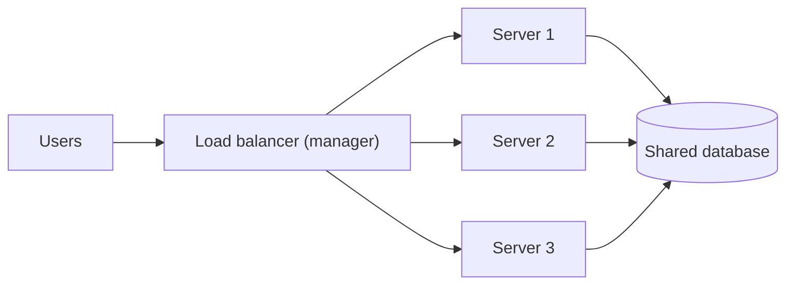
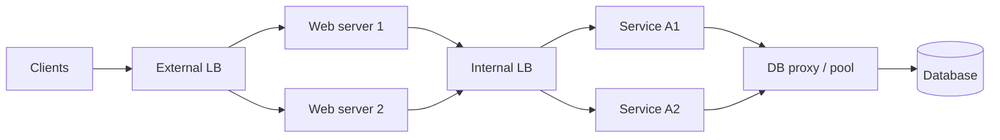
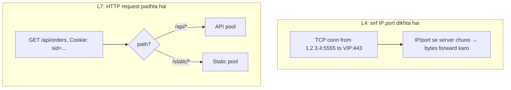
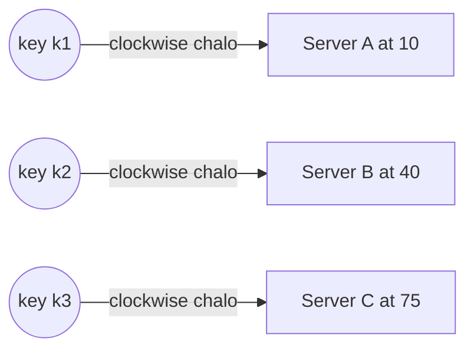
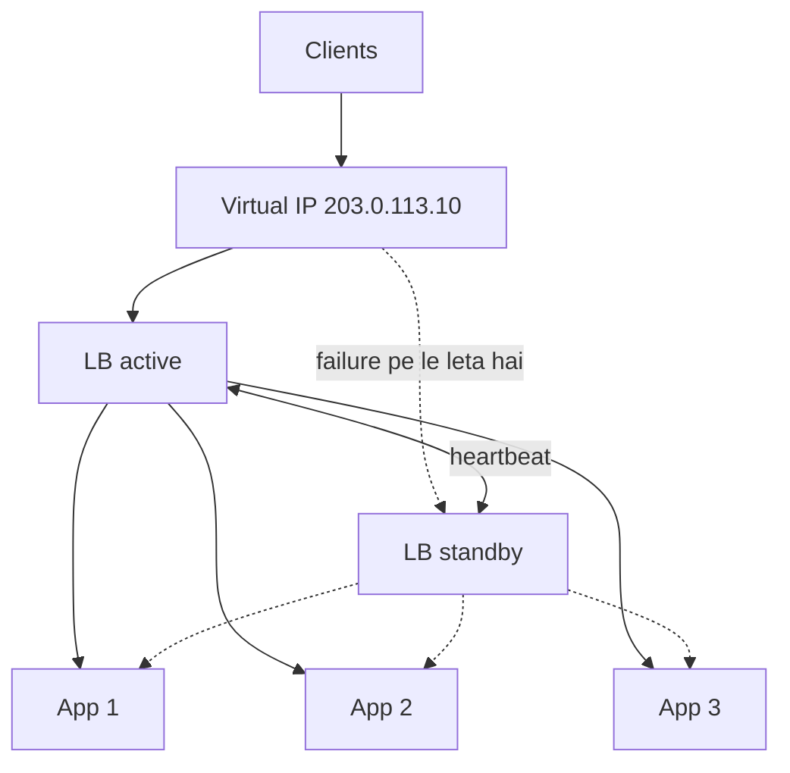
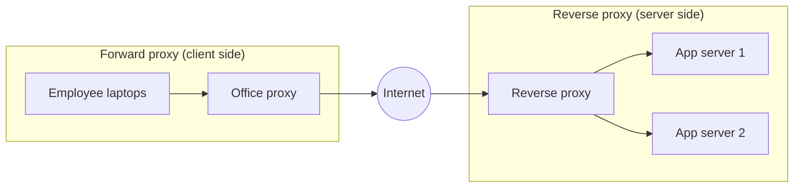
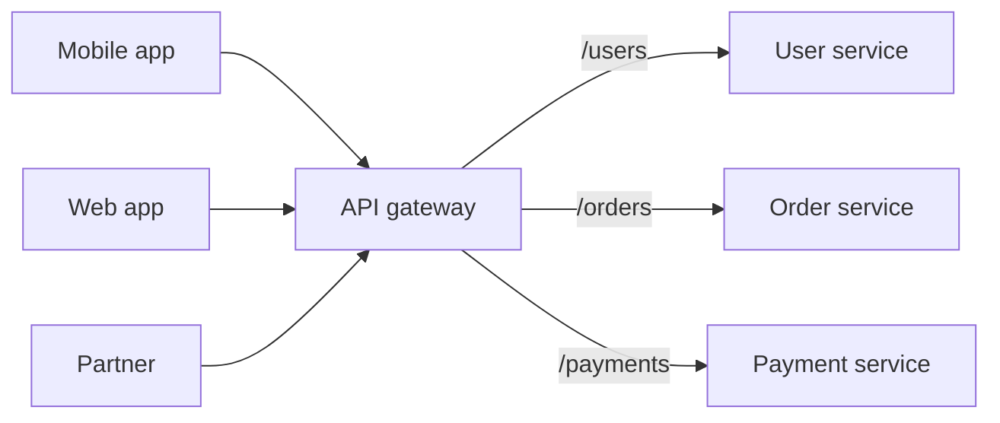
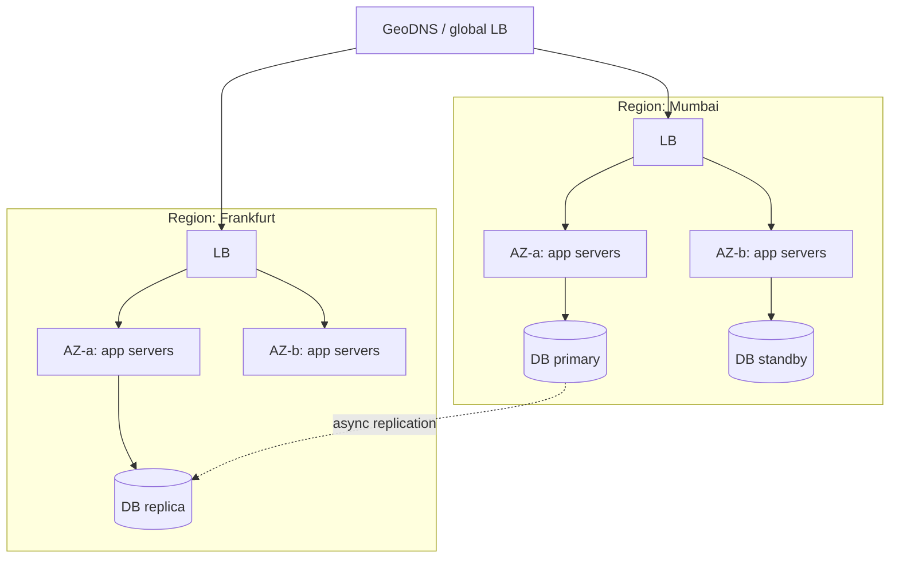
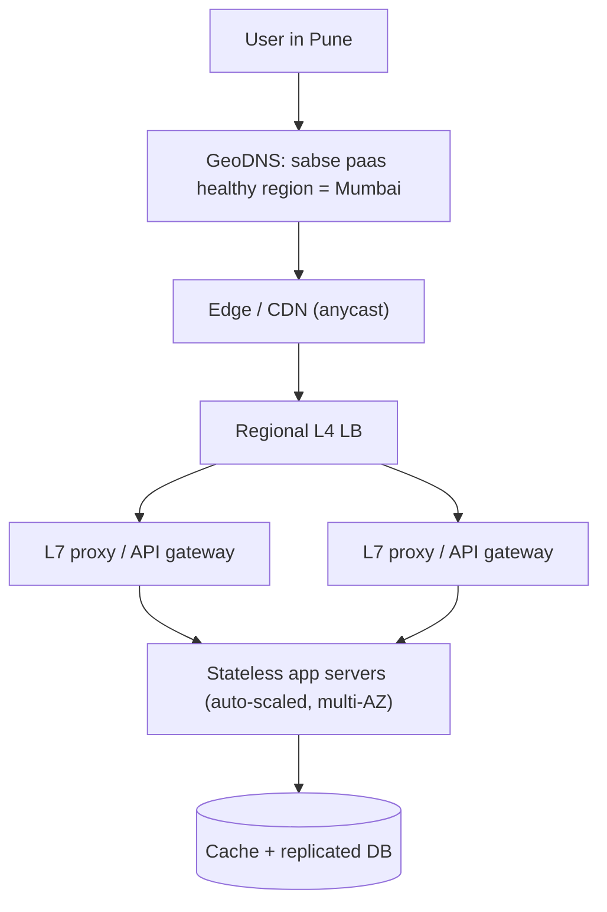
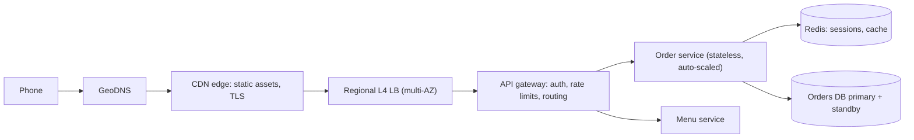

# Chapter 02 · Scalability & Load Balancing

> Ek normal Tuesday ko tumhara app 200 requests per second serve karta hai. Phir ek cricket star tumhara link tweet kar deta hai, aur ek minute ke andar 20,000 requests per second aane lagti hain. Ek server pighal jaata hai. Das servers hote toh sab theek rehta, *bas agar* koi cheez traffic ko un sab mein baant paati. Wo cheez hai **load balancer**, aur ye chapter isi baare mein hai ki bina pighle kaise bada hua jaaye.

**Is chapter mein tum seekhoge:**
- Vertical vs horizontal scaling, aur industry horizontal pe hi daav kyun lagaati hai
- Stateless vs stateful services, aur jab bahut saare servers hon toh sessions kahan rakhein
- Load balancers: L4 vs L7, aur algorithms (round robin, weighted, least connections, IP hash, consistent hashing), runnable simulations ke saath
- Health checks, LB redundancy, aur single points of failure kaise hatayein
- Reverse proxy vs forward proxy vs API gateway
- Auto-scaling, multi-AZ aur multi-region designs, DNS load balancing aur GeoDNS

**Isse pehle padho:** [Chapter 01 · What System Design Is & How the Internet Works](01-foundations-internet.md)

---

## 🧠 The Big Idea · Asli Baat

Socho ek famous dosa stall hai, aur usme sirf ek cook hai. Line lambi hoti ja rahi hai. Tumhare paas do raaste hain:

1. **Cook ko tez bana do**: bada tawa le aao, tez wala spatula, ya ek aisa cook jiske chaar haath hon. Ye hai **vertical scaling** (scale *up*). Ye tab tak chalta hai jab tak isse bada tawa duniya mein milta hai. Aur agar wo ek cook beemar pad gaya, toh stall band.
2. **Aur cooks rakh lo**, sabke paas bilkul same tawa, aur aage ek manager khada kar do jo har customer ko kisi free cook ke paas bhej de. Ye hai **horizontal scaling** (scale *out*), aur wo manager hai **load balancer**.



Bas ek catch hai. Horizontal scaling tabhi smoothly chalta hai jab **koi bhi cook kisi bhi customer ko serve kar sake**. Agar sirf cook #2 ko yaad hai ki tumhara aadha order kya tha, toh tumhe hamesha cook #2 ke paas hi jaana padega. Software ki language mein, servers ko **stateless** hona chahiye: do requests ke beech wo kisi user ki koi yaad apne paas nahi rakhte. Saari yaad shared jagahon pe jaati hai (database, cache, session store).

> 🇮🇳 **Desi Analogy:** Bank ka token system socho. Tum token lete ho, aur jo bhi counter free hota hai, display pe tumhara number aata hai aur tum wahan chale jaate ho. Ye kaam isliye chalta hai kyunki tumhara khata kisi cashier ki diary mein nahi, bank ke **central system** mein hai. Counter 3 wala cashier bhi tumhara balance dekh sakta hai, counter 5 wala bhi. Yahan **token machine = load balancer**, **counters = stateless servers**, **central core-banking system = shared database**. Ek cashier chhutti pe gaya? Koi farak nahi, baaki counters chalte rehte hain. Ab socho agar har cashier apni personal diary mein tumhara hisaab likhta. Tab tumhe hamesha usi ek cashier ke paas jaana padta. Wahi hai **stateful** server ki problem.

> 💡 **The core insight:** scalability aati hai *identical, interchangeable, stateless* workers se, jinke aage ek traffic director khada ho. Workers ko stateless bana do, phir tum unhe Lego bricks ki tarah jod bhi sakte ho, nikaal bhi sakte ho.

---

## 🔨 Building It Up · Zero Se Shuru

### 1. What "scalable" actually means · "Scalable" ka asli matlab

Ek system **scalable** tab hai jab tum zyada load sirf resources badha ke handle kar sako, aur wo bhi **lagbhag usi proportion mein**: servers double karo, throughput bhi lagbhag double ho jaaye, bina poora design badle.

"Load" ko **load parameters** se describe karte hain: requests per second, kitne users ek saath online hain (concurrent users), read/write ratio, data ka size, har user ke kitne followers hain. Ek design jo ek parameter pe scale karta hai, wo doosre pe fail ho sakta hai. Ek chat app 10 lakh (1 million) users ko aaraam se handle kar le, lekin ek group chat jisme 1,00,000 members hon, uspe atak jaaye. Ye bilkul possible hai.

> 🤔 **Mann mein sawaal:** Scalable aur fast toh ek hi baat hai na? Mera app fast hai, matlab scalable hai?
>
> **Jawab:** Nahi. **Fast** (performance) ka matlab hai *ek* request kitni jaldi poori hoti hai. **Scalable** ka matlab hai jab requests 10 guna ho jaayein, tab bhi system resources jod ke chal sake. Ek app 10 users ke liye 50 ms mein reply de sakta hai aur 10,000 users pe gir sakta hai. Wo fast hai, scalable nahi. Ulta bhi ho sakta hai: thoda slow lekin linearly badhne wala system.

Do warning signs ki tumhara design scale nahi karega:

- Servers jodna kaam karna band kar deta hai, kyunki sab **ek hi shared cheez** ka wait kar rahe hain (ek database, ek lock, ek leader). Isko kehte hain **bottleneck** (botal ki patli gardan: botal kitni bhi badi ho, paani utna hi niklega jitna gardan se nikal sake).
- Cost load se bahut tez badhti hai (10× traffic ke liye 100× paisa lag raha hai).

### 2. Vertical scaling (scale up)

Bada machine khareed lo: zyada CPU cores, zyada RAM, tez disks.

**Pros:**
- Code mein zero changes. Tumhare app ko pata bhi nahi chalta ki wo naye ghar mein shift ho gaya.
- Koi distributed-systems problems nahi (parts ke beech network nahi, consistency ka sir-dard nahi).
- Shuru mein databases ke liye badhiya: ek bada primary database hairaan karne wali had tak chal jaata hai.

**Cons:**
- **Hard ceiling.** Sabse bade cloud machines mein kuch sau cores aur kuch terabytes RAM hoti hai. Usse aage nahi ja sakte.
- **Cost linear se tez badhti hai** top end pe: sabse bade machines per core premium charge karte hain.
- **Single point of failure.** Ek machine, ek failure, poora outage.
- Upgrade karne ka matlab aksar **downtime** hota hai (bade machine mein reboot karna padta hai).

### 3. Horizontal scaling (scale out)

Same size ke aur machines jodo aur kaam unke beech baant do.

**Pros:**
- **Practically unlimited**: 11th server jodo, 101st jodo.
- **Fault tolerant**: ek server mara, baaki serve karte rehte hain.
- **Elastic**: shaam 7 baje servers jodo, raat 3 baje hata do (auto-scaling, section 18).
- Commodity hardware (aam, sasta hardware) sasta hota hai.

**Cons:**
- **Load balancer** chahiye.
- Servers ko **stateless** hona padega (ya phir smart routing chahiye).
- Shared pieces (database, cache) agla bottleneck ban jaate hain. Yahi problem Chapters [03](03-databases.md)–[06](06-cap-consistency.md) solve karte hain.
- Zyada moving parts: deployments, monitoring, network failures.

Chalo ek simple simulation se dono ko compare karte hain. Har server ek fixed number of requests per second (RPS) handle karta hai. Hum dekhenge total capacity kitni hai, aur ek machine fail hone pe kya hota hai.

```python
def capacity(servers):
    return sum(servers)

big_box = [12_000]                 # vertical: ek bahut bada machine
fleet = [1_500] * 8                # horizontal: aath chhote machines

for name, servers in [("vertical", big_box), ("horizontal", fleet)]:
    total = capacity(servers)
    after_failure = capacity(servers[1:])       # ek machine mar gaya
    print(f"{name:<10} capacity={total:>6} rps  after 1 failure={after_failure:>6} rps "
          f"({after_failure / total:.0%} left)")
```

```text
vertical   capacity= 12000 rps  after 1 failure=     0 rps (0% left)
horizontal capacity= 12000 rps  after 1 failure= 10500 rps (88% left)
```

Kya hua yahan: total capacity dono ki same hai. Lekin ek machine girne pe vertical setup ka **poora outage** ho gaya, aur fleet mein sirf **12.5% ka dip** aaya (8 mein se 1 gaya = 1/8 = 12.5%). Yahi farak hai jiski wajah se lagbhag har bada system apne **stateless tiers ko horizontally** scale karta hai.

| | Vertical (up) | Horizontal (out) |
|---|---|---|
| Kaise | Bada machine | Zyada machines |
| Code changes | Koi nahi | Stateless hona padega, LB chahiye |
| Limit | Hardware ki ceiling | Practically koi nahi (bottleneck kahin aur shift hota hai) |
| Failure | Poora outage | Capacity ka sirf ek hissa jaata hai |
| Cost curve | Top pe bahut steep | Lagbhag linear |
| Kiske liye accha | Early-stage DBs, quick fixes | Web/app servers, caches, zyadatar bade systems |

> 💡 Real systems **dono** karte hain: pehle scale up karo jab tak wo mehenga ya risky na ho jaaye, phir scale out. Interviewers ko ye sunna bahut pasand hai: "I'd start with a single bigger DB, then add read replicas and shard only when needed."

### 4. Stateless vs stateful services

Ek service **stateless** hai agar har request apne saath wo sab lekar aati hai jo usse handle karne ke liye chahiye, ya zaroori data ek shared external store mein rehta hai. Koi bhi server koi bhi request handle kar sakta hai.

Ek service **stateful** hai agar wo apni memory ya disk mein aisa data rakhti hai jis pe aage ki requests depend karti hain: local dict mein logged-in sessions, RAM mein shopping cart, ek khula hua game room, local disk pe uploaded files.

Pehle galat (stateful) tareeka dekho. Do servers hain, aur LB round robin se requests baant raha hai:

```python
class StatefulServer:
    """Keeps carts in its own memory. Breaks when there is more than one server."""
    def __init__(self, name):
        self.name = name
        self.carts = {}

    def add(self, user, item):
        self.carts.setdefault(user, []).append(item)

    def view(self, user):
        return self.carts.get(user, [])

servers = [StatefulServer("A"), StatefulServer("B")]
requests = [("add", "riya", "phone"), ("add", "riya", "case"), ("view", "riya", None)]

for i, (action, user, item) in enumerate(requests):
    server = servers[i % 2]                      # A aur B ke beech round robin
    if action == "add":
        server.add(user, item)
        print(f"server {server.name}: added {item}")
    else:
        print(f"server {server.name}: riya's cart = {server.view(user)}")
```

```text
server A: added phone
server B: added case
server A: riya's cart = ['phone']
```

Kya hua yahan: Riya ne do items daale, lekin cart mein sirf ek dikh raha hai. Request 1 (phone) A pe gayi, request 2 (case) B pe gayi, aur request 3 (view) wapas A pe aayi. A ko case ke baare mein kuch pata hi nahi. Har server ko sirf wahi yaad hai jo *usne* dekha. Ab stateless version dekho, jahan carts ek shared store mein rehte hain (Redis jaisa kuch socho, [Chapter 04](04-caching-cdn.md)):

```python
class SharedStore:
    """Stands in for Redis or a database that every server talks to."""
    def __init__(self):
        self.data = {}

class StatelessServer:
    def __init__(self, name, store):
        self.name = name
        self.store = store                       # yahan koi user data nahi rakha jaata

    def add(self, user, item):
        self.store.data.setdefault(user, []).append(item)

    def view(self, user):
        return self.store.data.get(user, [])

store = SharedStore()
servers = [StatelessServer("A", store), StatelessServer("B", store)]
requests = [("add", "riya", "phone"), ("add", "riya", "case"), ("view", "riya", None)]

for i, (action, user, item) in enumerate(requests):
    server = servers[i % 2]
    if action == "add":
        server.add(user, item)
        print(f"server {server.name}: added {item}")
    else:
        print(f"server {server.name}: riya's cart = {server.view(user)}")
```

```text
server A: added phone
server B: added case
server A: riya's cart = ['phone', 'case']
```

Kya hua yahan: servers interchangeable ban gaye. Ab tum server B ko maar do, server C jod do, ya sab kuch restart kar do, Riya ka cart bacha rahega. **State gaayab nahi hua; wo shift ho gaya**, ek aisi jagah jo use sambhaalne ke liye hi bani hai.

> 🤔 **Mann mein sawaal:** Stateless matlab app mein koi data hi nahi hota? Phir user ka cart, login sab kahan gaya?
>
> **Jawab:** Data poora hai, bas **app server ke andar nahi** hai. "Stateless" sirf app server ke baare mein bolte hain: uski apni memory mein kisi user ka aisa data nahi jo agli request ke liye zaroori ho. Cart Redis mein hai, orders database mein, photos object storage mein. System ke level pe state hai hi; humne usse ek chhoti, specialised jagah pe band kar diya.

> 💡 Kuch cheezein nature se hi stateful hoti hain: databases, caches, WebSocket connections, game rooms. Trick ye hai ki state ko kuch specialised components mein **isolate** kar do aur baaki sab stateless rakho.

### 5. Where to keep sessions: four options · Sessions kahan rakhein: chaar options

Logged-in sessions state ka sabse classic example hain. Options ye hain:

| Option | Kaise | Pros | Cons |
|---|---|---|---|
| **Sticky sessions** | LB ek user ko hamesha same server pe bhejta hai (cookie ya IP hash se) | Code change nahi | Load uneven; server mara → uske users logout; scale down karna mushkil |
| **Shared session store** | Sessions Redis/Memcached mein; servers wahan se lookup karte hain | Servers sach mein stateless; fast (~1 ms) | Ek aur component chalana padega aur usse highly available rakhna padega |
| **Database sessions** | Sessions ek DB table mein | Durable, simple | Slow; DB pe extra load |
| **Client-side tokens** (signed cookie / JWT) | Session data sign karke client ke paas hi rakha jaata hai | Koi lookup hi nahi; scale karna trivial | Expiry se pehle revoke karna mushkil; size limits; kabhi secrets nahi rakhne ([Chapter 07](07-apis-communication.md)) |

> 🇮🇳 **Desi Analogy:** Ye chaar options cinema ticket ke chaar tareekon jaise hain. **Sticky session** = "sirf Ramesh bhaiya ko pata hai tumhari seat kaunsi hai", toh har baar Ramesh bhaiya ke counter pe hi jaana padega; wo chhutti pe gaye toh tum atke. **Redis session store** = theatre ka central computer: koi bhi usher booking ID daal ke seat dekh leta hai. **Database sessions** = wahi central record, lekin ek bade register mein: pakka hai, par dhoondhne mein thoda time lagta hai. **JWT** = tumhare haath mein printed ticket jispe theatre ki **mohar (signature)** lagi hai: usher bas mohar check karta hai, kisi computer se poochna hi nahi padta. Lekin agar ticket cancel karna ho, toh jo ticket tumhari jeb mein hai usse wapas lena mushkil hai. Yahi JWT ka "revoke karna mushkil" wala problem hai.

**Default interview answer:** "Stateless app servers, sessions in a replicated Redis, or signed tokens if we want to avoid the lookup." Sticky sessions ek kaam-chalau jugaad (stop-gap) hain, design nahi.

### 6. Load balancers: what they do · Load balancer karta kya hai

Ek **load balancer (LB)** clients aur servers ke ek pool ke beech baithta hai (is pool ko **backend pool** ya **upstream** kehte hain). Ye:

1. Requests ko healthy servers ke beech **distribute** karta hai.
2. Health checks se **failures detect** karta hai, aur mare hue servers ko traffic bhejna band kar deta hai.
3. Servers ko **chhupa** deta hai: clients ko sirf ek address dikhta hai (ek **virtual IP**), isliye tum servers ko aaraam se jod, hata aur badal sakte ho.
4. Aksar **TLS terminate** karta hai (HTTPS ko ek hi baar decrypt kar deta hai, taaki app servers ko na karna pade), responses compress karta hai, aur `X-Forwarded-For` jaise headers jodta hai (asli client ka IP, kyunki server ko ab LB ka IP dikhta hai).

Ek typical system mein load balancers kahan-kahan dikhte hain:



Dhyaan do: LB sirf internet ke saamne nahi hota. Services ke beech bhi (internal LB) aur database ke aage bhi (DB proxy / connection pool) yahi kaam hota hai.

Ye **hardware** appliances ho sakte hain (purane, mehenge), **software** (NGINX, HAProxy, Envoy), ya **managed cloud** services (AWS ELB/ALB/NLB, Google Cloud Load Balancing).

### 7. L4 vs L7 load balancing

[Chapter 01](01-foundations-internet.md) ke layers yaad karo: L4 transport layer hai (TCP/UDP), L7 application layer hai (HTTP).

**Layer 4 LB** sirf IPs aur ports dekhta hai. Ye poore TCP connections (ya UDP packets) ko aage forward karta hai, unka content padhe bina.

- Bahut fast, kam CPU, lakhon connections handle kar leta hai.
- Protocol-agnostic: databases, game servers, TCP/UDP pe chalne wala kuch bhi.
- URL se route nahi kar sakta, cookies nahi padh sakta, ek single HTTP request ko retry nahi kar sakta.

**Layer 7 LB** HTTP samajhta hai. Ye method, path, headers, cookies padhta hai.

- **Content-based routing**: `/api/*` ko API servers pe, `/images/*` ko image servers pe, `Host: admin.site.com` ko admin pool pe.
- TLS terminate kar sakta hai, headers rewrite kar sakta hai, compress, cache, A/B splits ("5% users ko new version pe bhejo"), rate limit, aur failed request ko kisi doosre server pe retry kar sakta hai.
- Har request pe zyada CPU; padhne ke liye pehle decrypt karna padta hai.

> 🇮🇳 **Desi Analogy:** **L4 LB** society ka gate wala guard hai jo sirf gaadi ka number plate aur flat number dekhta hai ("B-wing ki gaadi hai, B gate se jaane do"). Andar kya saamaan hai, usse matlab nahi. Isliye ekdum tez. **L7 LB** Dabbawala jaisa hai jo har dabbe pe likha code *padhta* hai: "ye Andheri station, ye Nariman Point, 3rd floor". Content padhta hai, toh smart routing kar paata hai, lekin har dabbe pe thoda zyada time lagta hai.



| | L4 | L7 |
|---|---|---|
| Kya dikhta hai | IPs, ports, TCP/UDP | Poora HTTP: path, headers, cookies |
| Speed | Tez, sasta | Har request pe slow |
| Routing | Connection ke hisaab se | Content ke hisaab se (path, host, header) |
| TLS | Usually aage pass kar deta hai | Usually terminate karta hai |
| Features | Simple forwarding | Retries, rewrites, A/B, auth checks, caching |
| Examples | AWS NLB, LVS, HAProxy (TCP mode) | NGINX, Envoy, AWS ALB, HAProxy (HTTP mode) |

Ek common setup: **aage L4 LB**, jo connections ko **L7 proxies** ki fleet mein baant deta hai, aur phir wo L7 proxies content dekh ke route karte hain. Dono ki taakat ek saath: L4 ki raw speed, L7 ki samajh.

> 🤔 **Mann mein sawaal:** L7 itna smart hai, toh L4 use hi kyun karein? Har jagah L7 laga do na.
>
> **Jawab:** Smartness free nahi hai. L7 ko har request ka TLS decrypt karna padta hai aur HTTP parse karna padta hai, ye CPU khata hai. Aur kai traffic HTTP hota hi nahi: database connections, game servers, MQTT. Wahan L7 kuch padh hi nahi sakta. Isliye bahut bade scale pe sabse aage sasta, tez L4 rakhte hain, aur uske peeche L7 jahan smartness chahiye.


### 8. Algorithm 1: Round robin

Request 1 server A ko, 2 B ko, 3 C ko, 4 phir se A ko, aur aise hi chalta rahe. Bilkul taash ke patte baantne jaisa: ek tumhe, ek usse, ek usse, phir wapas tumhe.

```python
from itertools import cycle

class RoundRobin:
    def __init__(self, servers):
        self._ring = cycle(servers)

    def pick(self):
        return next(self._ring)

lb = RoundRobin(["A", "B", "C"])
print([lb.pick() for _ in range(7)])
```

```text
['A', 'B', 'C', 'A', 'B', 'C', 'A']
```

`itertools.cycle` ek list ko infinite loop mein ghumata rehta hai, isliye `next()` har baar agla server de deta hai.

**Kab accha:** servers identical hon aur requests ka kharcha lagbhag same ho. **Kab bura:** servers alag-alag size ke hon, ya kuch requests heavy hon (ek report jo 5 s leti hai) aur kuch light (5 ms ka lookup). Kyunki round robin ye dekhta hi nahi ki server kitna busy hai. Wo bas line mein agla naam bolta hai.

### 9. Algorithm 2: Weighted round robin

Bade servers ko bada hissa do. Agar A ka weight 5 hai aur B aur C ka weight 1, toh har 7 requests mein se 5 A ko milengi. Ek naive (seedha-saadha) version bhejega A, A, A, A, A, B, C (bursty: A pe ek saath paanch ka dhakka). **Smooth weighted round robin** algorithm, jo NGINX use karta hai, inhe phaila deta hai:

```python
class SmoothWeightedRoundRobin:
    """NGINX-style: each pick, every server gains its weight; the leader is chosen
    and pays back the total. Bigger weights win more often but never in long bursts."""
    def __init__(self, weights):
        self.weights = weights
        self.current = {name: 0 for name in weights}
        self.total = sum(weights.values())

    def pick(self):
        for name, w in self.weights.items():
            self.current[name] += w
        best = max(self.current, key=self.current.get)
        self.current[best] -= self.total
        return best

lb = SmoothWeightedRoundRobin({"A": 5, "B": 1, "C": 1})
print("".join(lb.pick() for _ in range(14)))
```

```text
AABACAAAABACAA
```

Algorithm ko haath se chala ke dekho, tab samajh pakki hogi. Total weight = 7. Har pick pe: (1) har server ke `current` mein uska weight jodo, (2) jiska `current` sabse bada, wo jeeta, (3) jeetne wala total (7) wapas "chuka" deta hai.

| Pick | Weight jodne ke baad (A, B, C) | Winner | 7 ghataane ke baad (A, B, C) |
|---|---|---|---|
| 1 | 5, 1, 1 | A | -2, 1, 1 |
| 2 | 3, 2, 2 | A | -4, 2, 2 |
| 3 | 1, 3, 3 | B | 1, -4, 3 |
| 4 | 6, -3, 4 | A | -1, -3, 4 |
| 5 | 4, -2, 5 | C | 4, -2, -2 |
| 6 | 9, -1, -1 | A | 2, -1, -1 |
| 7 | 7, 0, 0 | A | 0, 0, 0 |

7 picks ke baad sab wapas 0 pe aa gaye, aur pattern `AABACAA` repeat hota hai. (Pick 3 pe B aur C dono 3 pe tied the; `max()` pehle wala, yaani B, chunta hai.)

Kya hua yahan: 7 picks mein A ko 5 mile, B ko 1, C ko 1. Lekin A ki baariyan B aur C ke beech mein ghuli-mili hain, lagaatar paanch nahi. Weights tab use karo jab servers ki capacity alag ho, ya jab traffic ko **dheere-dheere naye version pe shift** karna ho (naye ko weight 1, purane ko 9).

### 10. Algorithm 3: Least connections

Har request us server ko bhejo jiske paas abhi is waqt **sabse kam active connections** hain. Agar requests ki duration bahut alag-alag hai, toh ye apne aap adjust ho jaata hai: slow server pe connections jama hote jaate hain, toh usse nayi requests kam milti hain.

> 🇮🇳 **Desi Analogy:** Toll plaza pe tum kaunsi line chunte ho? Jo **sabse chhoti** dikhe. Tum ye nahi sochte ki "pichli gaadi lane 2 mein gayi thi, toh main lane 3 mein jaata hoon" (wo round robin hoga). Agar lane 2 mein ek truck ka FASTag kaam nahi kar raha aur wahan 8 gaadiyan atki hain, toh round robin phir bhi wahan gaadiyan bhejta rahega. **Least connections** wo samajhdaar driver hai jo dekh ke sabse chhoti line pakadta hai. Yahan **lanes = servers**, **line mein khadi gaadiyan = active connections**.

Chalo heavy aur light requests ka simulation karte hain aur round robin ko least connections se compare karte hain:

```python
import heapq
import random

def simulate(policy, n_servers=4, n_requests=3000, seed=11):
    rng = random.Random(seed)
    active = [[] for _ in range(n_servers)]     # har server ke liye: finish times ka heap
    rr_next = 0
    peak = 0
    for t in range(n_requests):                 # har time unit pe ek request aati hai
        for heap in active:                     # jo requests khatam ho gayi, unhe hatao
            while heap and heap[0] <= t:
                heapq.heappop(heap)
        duration = 40 if rng.random() < 0.1 else 2   # 10% requests heavy hain
        if policy == "round_robin":
            s = rr_next
            rr_next = (rr_next + 1) % n_servers
        else:                                   # least connections
            s = min(range(n_servers), key=lambda i: len(active[i]))
        heapq.heappush(active[s], t + duration)
        peak = max(peak, max(len(h) for h in active))
    return peak

print("round robin       peak connections on one server:", simulate("round_robin"))
print("least connections peak connections on one server:", simulate("least_conn"))
```

```text
round robin       peak connections on one server: 6
least connections peak connections on one server: 3
```

Code ko line by line samjho: har server ka ek **heap** hai jisme uski chal rahi requests ke *finish times* hain. Heap ka size = us server ke active connections. Har time tick pe pehle khatam ho chuki requests nikaalte hain, phir nayi request ki duration decide karte hain (10% chance 40 units ki heavy request, warna 2 units ki light), phir policy ke hisaab se server chunte hain. `peak` yaad rakhta hai ki kisi bhi ek server pe kabhi bhi sabse zyada kitne connections the.

Kya hua yahan: round robin aankh band karke ek aise server ko kaam deta raha jo pehle se kai heavy requests mein phansa tha, isliye uski queue spike kar gayi (6). Least connections ne dekha ki wahan dher lag raha hai aur naya kaam doosri jagah bhej diya, toh sabse bure server ka load kam raha (3). Jab request costs alag-alag hon, tab **least connections** (aur uska cousin **least response time**) ek strong default hai.

Bahut bade scale pe ek sasta aur popular trick hai **power of two choices**: **do** random servers uthao aur request unme se kam busy wale ko bhej do. Isse least connections ka zyadatar fayda mil jaata hai, aur LB ko poore fleet ka perfect global view rakhne ki zaroorat nahi padti.

### 11. Algorithm 4: IP hash (and why plain hashing hurts)

Client ke IP ka hash nikaalo aur servers ki ginti (N) se modulo lo: `server = hash(ip) % N`. Same client hamesha same server pe pahunchta hai. **Sticky sessions** ya cache locality (same user ka data same server ke cache mein garam rahe) paane ka ye simple tareeka hai.

Problem: jab **N badalta hai**, toh lagbhag har client shift ho jaata hai.

```python
import hashlib

def stable_hash(key):
    # Python ka built-in hash() strings ke liye har process mein random hota hai, isliye md5 use karo
    return int(hashlib.md5(key.encode()).hexdigest(), 16)

clients = [f"10.0.0.{i}" for i in range(1, 1001)]

def assign(n_servers):
    return {c: stable_hash(c) % n_servers for c in clients}

before = assign(4)
after = assign(5)                      # humne ek server joda
moved = sum(before[c] != after[c] for c in clients)
print(f"clients that moved when going 4 -> 5 servers: {moved / len(clients):.0%}")
```

```text
clients that moved when going 4 -> 5 servers: 82%
```

Kya hua yahan: sirf ek server jodne se lagbhag 80% clients idhar-udhar ho gaye. Agar wo servers sessions ya cached data rakh rahe the, toh 80% users ka wo sab chala gaya. Mathematically, ek key apne server pe tabhi tikti hai jab `h % 4 == h % 5` ho, aur aisa lagbhag 5 mein se 1 key ke saath hota hai.

Ye "5 mein se 1" kahan se aaya? `h % 4` aur `h % 5` dono ka pattern har 20 numbers (4 × 5) pe repeat hota hai. 0 se 19 tak check karo: dono barabar sirf h = 0, 1, 2, 3 pe hain (kyunki h < 4 ho toh dono modulo h hi dete hain, aur baaki kisi h pe dono match nahi karte). 20 mein se 4 = **1/5**. Baaki 80% move.

### 12. Algorithm 5: Consistent hashing (preview)

**Consistent hashing** is reshuffle ko theek karta hai. Ek ghadi ka dial socho (ek "ring") jispe hash values likhi hain. Har server ka naam hash karke usse ring pe ek position pe rakh do. Kisi key ko place karna ho toh usse hash karke ring pe rakho, aur **clockwise** (ghadi ki sui ki disha mein) chalo jab tak pehla server na mile.



Jab ek server add hota hai, wo sirf **ek padosi** se keys leta hai: almost saari keys ki jagah sirf lagbhag 1/N keys move hoti hain.

> 🇮🇳 **Desi Analogy:** Ek gol (circular) road ke kinare chai ki tapriyan hain. Har ghar ke log **clockwise chal ke jo pehli tapri mile**, wahan chai peete hain. Ab ek nayi tapri khul gayi. Kaun apni tapri badlega? Sirf wo ghar jo nayi tapri aur usse pichli tapri ke beech mein hain. Baaki poore shehar ki aadat waisi ki waisi. Yahan **gol road = hash ring**, **tapri = server**, **ghar = key**. Ab `hash % N` wala tareeka socho: wo aisa hai jaise nagar nigam har nayi tapri khulne pe **poore shehar ko naye sire se tapriyan allot** kar de. Sabki aadat toot gayi!

```python
import bisect
import hashlib

def h(key):
    return int(hashlib.md5(key.encode()).hexdigest(), 16) % 1_000_000

class HashRing:
    def __init__(self, servers, vnodes=100):
        self.ring = []                               # (position, server) ki sorted list
        for s in servers:
            for v in range(vnodes):                  # har server ke kai points = barabar spread
                self.ring.append((h(f"{s}#{v}"), s))
        self.ring.sort()
        self.positions = [p for p, _ in self.ring]

    def pick(self, key):
        i = bisect.bisect(self.positions, h(key)) % len(self.ring)   # ring ke end se wapas start pe
        return self.ring[i][1]

clients = [f"10.0.0.{i}" for i in range(1, 1001)]
before = HashRing(["s0", "s1", "s2", "s3"])
after = HashRing(["s0", "s1", "s2", "s3", "s4"])
moved = sum(before.pick(c) != after.pick(c) for c in clients)
print(f"clients that moved when going 4 -> 5 servers: {moved / len(clients):.0%}")
```

```text
clients that moved when going 4 -> 5 servers: 19%
```

Code mein kya ho raha hai: `bisect.bisect` sorted positions mein binary search karke bataata hai ki key ki position ke **just baad** kaunsa point hai, yaani "clockwise chalne pe pehla server". Agar key ring ke end ke paas hai aur aage koi point nahi, toh `% len(self.ring)` usse wapas index 0 pe le aata hai, jaise ghadi 12 ke baad 1 pe aati hai.

Kya hua yahan: sirf lagbhag 1/5 clients move hue, ekdum utna hi hissa jitna naye server ka banta hai (5 servers mein se ek). Har server ke "100 points" wala trick **virtual nodes** kehlata hai. Agar ek server ka ring pe sirf ek point ho, toh gaps bade-chhote hote hain aur kisi server ko bahut zyada keys mil jaati hain. 100 points se har server ka hissa barabar ke kareeb aa jaata hai. [Chapter 05](05-replication-sharding.md) consistent hashing ko poora build karta hai aur databases ki sharding ke liye use karta hai. Load balancers mein ye tab use hota hai jab **affinity matter karti hai**: same user ya same cache key ko same server pe route karna (jaise caching proxies, WebSocket servers).

> 🤔 **Mann mein sawaal:** 82% vs 19%... par 19% bhi toh move hue. Consistent hashing mein zero kyun nahi?
>
> **Jawab:** Zero ho hi nahi sakta, aur hona bhi nahi chahiye. Naya server aaya hai toh usse apna kaam chahiye. 5 servers mein barabar baantna hai, toh naye server ko lagbhag 1/5 keys milni hi chahiye. Wahi 19-20% move hue. Consistent hashing ki khoobi ye hai ki **sirf utni hi keys move hoti hain jitni zaroori hain**. `hash % N` mein lagbhag 60% extra keys bina wajah ghoom gayi thi.

### 13. Algorithm summary

| Algorithm | Idea | Kiske liye best | Kamzori |
|---|---|---|---|
| Round robin | Baari-baari | Identical servers, ek jaisi requests | Load aur server size ignore karta hai |
| Weighted RR | Weight ke proportion mein baariyan | Alag size ke servers, gradual rollouts | Phir bhi live load ignore karta hai |
| Least connections | Sabse kam active connections | Alag-alag duration ki requests, long-lived connections | Connection tracking chahiye |
| Least response time | Haal mein sabse tez responses | Mixed hardware, latency-sensitive | Measurements chahiye; herd ho sakta hai (sab ek "tez" server pe toot padte hain) |
| Random / power of two choices | Random, ya 2 random mein se behtar | Bahut badi fleets, kai LBs | Chhote scale pe plain random uneven hota hai |
| IP hash | `hash(ip) % N` | Simple stickiness | N badle toh reshuffle; NAT kai users ko ek IP pe daal deta hai |
| Consistent hashing | Hash ring | Cache affinity, sharded state | Zyada complex; balance ke liye vnodes chahiye |

### 14. Health checks

Load balancer ko pata hona chahiye ki kaunse servers zinda hain. Checks do tarah ke hote hain:

- **Active health checks**: har kuch seconds pe LB `GET /health` jaisa ek endpoint call karta hai. Agar ye lagaatar N baar fail ho (maan lo 3), toh server **unhealthy** mark hota hai aur rotation se hata diya jaata hai. M baar lagaatar success (maan lo 2) ke baad wapas jod diya jaata hai. Ye thresholds **flapping** rokte hain (server ka baar-baar andar-bahar hona).
- **Passive health checks**: LB asli traffic dekhta rehta hai. Kisi server se bahut zyada errors ya timeouts aa rahe hain → usse kuch der ke liye bahar kar do.

`/health` ko check kya karna chahiye?

- **Liveness**: "kya process chal raha hai?" Agar program jawab de paa raha hai toh 200 return karo.
- **Readiness**: "kya main abhi traffic serve kar sakta hoon?" DB connection pool up hai, caches garam (warm) hain, config load ho gaya?

> 🇮🇳 **Desi Analogy:** Cricket team ka physio socho. **Liveness** = "khiladi saans le raha hai, hosh mein hai?" **Readiness** = "kya ye aaj batting ke liye fit hai? Pad pehne hain, warm-up ho gaya?" Aur **threshold** ka matlab: ek baar kisi ne cheenk diya toh usse team se bahar nahi karte. Lagaatar teen match mein fail ho, tab drop karte hain. Aur wapas lene ke liye bhi do acchi nets sessions chahiye. Isse team selection mein "aaj andar, kal bahar, parso andar" wala drama (flapping) nahi hota.

> ⚠️ Health check ko *har* dependency ki gehri jaanch mat karne do. Agar database ek second ke liye atka, toh har app server ka health check ek saath fail hoga, LB sabko hata dega, aur ek chhoti si hichki poora outage ban jaayegi.

```python
class HealthChecker:
    def __init__(self, servers, fail_threshold=3, pass_threshold=2):
        self.state = {s: {"healthy": True, "fails": 0, "passes": 0} for s in servers}
        self.fail_threshold = fail_threshold
        self.pass_threshold = pass_threshold

    def record(self, server, ok):
        st = self.state[server]
        if ok:
            st["fails"] = 0
            st["passes"] += 1
            if not st["healthy"] and st["passes"] >= self.pass_threshold:
                st["healthy"] = True
                print(f"  {server} back IN rotation")
        else:
            st["passes"] = 0
            st["fails"] += 1
            if st["healthy"] and st["fails"] >= self.fail_threshold:
                st["healthy"] = False
                print(f"  {server} taken OUT of rotation")

    def healthy(self):
        return [s for s, st in self.state.items() if st["healthy"]]

hc = HealthChecker(["A", "B", "C"])
# B lagaatar 3 checks fail karta hai, phir theek ho jaata hai
timeline = [("B", False), ("B", True), ("B", False), ("B", False), ("B", False),
            ("B", True), ("B", True)]
for tick, (server, ok) in enumerate(timeline):
    print(f"tick {tick}: {server} check {'ok' if ok else 'FAILED'}")
    hc.record(server, ok)
    print(f"  healthy pool: {hc.healthy()}")
```

```text
tick 0: B check FAILED
  healthy pool: ['A', 'B', 'C']
tick 1: B check ok
  healthy pool: ['A', 'B', 'C']
tick 2: B check FAILED
  healthy pool: ['A', 'B', 'C']
tick 3: B check FAILED
  healthy pool: ['A', 'B', 'C']
tick 4: B check FAILED
  B taken OUT of rotation
  healthy pool: ['A', 'C']
tick 5: B check ok
  healthy pool: ['A', 'C']
tick 6: B check ok
  B back IN rotation
  healthy pool: ['A', 'B', 'C']
```

Kya hua yahan: tick 0 pe ek random failure se B nahi hata (tick 1 pe count reset ho gaya, kyunki success aate hi `fails = 0`). Lekin teen failures *lagaatar* (tick 2, 3, 4) se hat gaya. Phir do lagaatar passes (tick 5, 6) ne usse wapas la diya. Asli LBs aise hi overreact karne se bachte hain. Key word hai **"in a row" (lagaatar)**: beech mein ek bhi opposite result counter ko zero kar deta hai.

**Connection draining**: jab tum kisi server ko jaan-boojh ke hata rahe ho (deploys, scale-in), toh LB **nayi** requests bhejna band kar deta hai lekin jo requests **beech mein chal rahi hain** (in-flight) unhe poora hone deta hai (jaise 30 s tak). Users ko kabhi beech mein kati hui request nahi dikhti. Jaise dukaan band karte waqt shutter aadha gira dete hain: naye customer andar nahi aate, par jo andar hain unka bill poora hota hai.

### 15. Single points of failure and LB redundancy

**Single point of failure (SPOF)** koi bhi aisa component hai jiske girne se poora system gir jaaye. Humne app servers ko toh redundant bana diya... lekin ab **load balancer** khud SPOF ban gaya! Saara traffic usi ek darwaze se aa raha hai.

Fixes:

- **Active-passive pair**: do LBs ek **floating virtual IP** share karte hain. Dono aapas mein heartbeats bhejte hain (jaise VRRP/keepalived se: "main zinda hoon, main zinda hoon"). Agar active wala jawab dena band kar de, toh passive wala kuch hi seconds mein virtual IP apne naam kar leta hai.
- **Active-active**: kai LBs saath mein traffic serve karte hain, DNS multiple IPs return karta hai, ya **anycast** jaisi network-level tricks se (kai machines same IP announce karti hain; network tumhe sabse paas wale tak pahuncha deta hai).
- **Managed cloud LBs** andar se pehle hi kai machines aur zones mein redundant hote hain.

> 🇮🇳 **Desi Analogy:** Ghar ka inverter socho. Bijli (active LB) chal rahi hai toh sab uspe chalta hai, inverter (passive LB) chupchaap standby pe baitha hai aur line pe nazar rakhta hai (heartbeat). Bijli gayi, toh kuch hi pal mein inverter le leta hai. Pankha (client) ko pata bhi nahi chalta ki supply kahan se aa rahi hai, kyunki socket (virtual IP) wahi hai.



**SPOFs ka shikaar karna** ek standard interview move hai. Apne diagram ka har box ek-ek karke dekho aur poocho, "agar ye mar gaya toh?":

| Component | SPOF fix |
|---|---|
| Load balancer | Active-passive pair ya managed multi-AZ LB |
| App servers | Zones mein ≥2 instances, LB ke peeche |
| Database | Replicas + automatic failover ([Chapter 05](05-replication-sharding.md)) |
| Cache | Replicated cache cluster; app ko cache outage jhelna aana chahiye |
| DNS provider | Anycast wala provider use karo; kuch companies do providers use karti hain |
| Poora datacenter | Multi-AZ; sabse bade risks ke liye multi-region |
| Ek engineer jise sab pata hai | Documentation aur runbooks (haan, sach mein) |

### 16. Reverse proxy vs forward proxy

**Proxy** ek beech ka aadmi (middleman) hai jo requests aage bhejta hai. Asli sawaal ye hai: wo kiski taraf se kaam kar raha hai?

**Forward proxy**: **clients** ki taraf se kaam karta hai. Server ko proxy dikhta hai, tum nahi. Uses: company ka internet filter, office ke liye caching, client ki pehchaan chhupana (VPN jaisa), geo-blocks se bachna.

**Reverse proxy**: **servers** ki taraf se kaam karta hai. Client ko proxy dikhta hai, servers nahi. Uses: load balancing, TLS termination, caching, compression, andar ke servers chhupana, static files serve karna, slow clients ke against request buffering.

> 🇮🇳 **Desi Analogy:** **Forward proxy** tumhara travel agent hai. Tum agent ko bolte ho, agent IRCTC se ticket book karta hai. IRCTC ko agent dikhta hai, tum nahi. Wo **tumhari** (client ki) taraf hai. **Reverse proxy** ek bade restaurant ka reception hai. Tum reception pe order dete ho, andar kitne chefs hain, kaun kya bana raha hai, tumhe kabhi nahi dikhta. Wo **restaurant ki** (server ki) taraf hai. Trick yaad rakhne ki: middleman jiske liye kaam karta hai, usi ko chhupata hai.



| | Forward proxy | Reverse proxy |
|---|---|---|
| Kiska representative | Clients | Servers |
| Configure kaun karta hai | Client side (browser/OS/network) | Server ka owner |
| Kisko chhupata hai | Clients ko servers se | Servers ko clients se |
| Typical uses | Filtering, anonymity, egress control (bahar jaane wale traffic pe control) | LB, TLS, caching, security |
| Examples | Squid, corporate proxies | NGINX, HAProxy, Envoy, Cloudflare |

Load balancer ek tarah ka reverse proxy hi hai jiska main kaam traffic baantna hai. Ek L7 load balancer aur ek reverse proxy aksar ek hi software hote hain.

### 17. API gateway

Jab system kai services mein toot jaata hai (user service, order service, payment service), toh clients ko un sab ke baare mein pata hona zaroori nahi hona chahiye. **API gateway** ek reverse proxy hai jo APIs ke liye specialised hai: saari services ke liye **ek main darwaza (one front door)**.



Typical zimmedaariyan:

- Requests ko sahi service tak **routing** (path, version, header ke hisaab se)
- **Authentication** (tokens ek hi baar, edge pe validate karo)
- **Rate limiting** aur har client ke quotas ([Chapter 07](07-apis-communication.md), [Chapter 12](12-case-studies-1.md))
- **TLS termination**, request/response transformation, protocol translation (bahar REST, andar gRPC)
- **Aggregation**: client ki ek call kai services tak fan out hoti hai aur results merge karke ek jawab jaata hai
- **Observability**: har API call ki logging, metrics, tracing

> 🇮🇳 **Desi Analogy:** Office building ki **reception desk** socho. Har visitor ko pata nahi hona chahiye ki HR 4th floor pe hai aur Accounts 7th pe. Reception pe ID check hoti hai (**authentication**), visitor pass milta hai, "aaj ek company se 50 se zyada log nahi" (**rate limiting**), register mein entry (**observability**), aur phir sahi floor pe bheja jaata hai (**routing**). Lekin reception pe agar koi salary calculate karne baith jaaye (business logic), toh line building ke bahar tak lag jaayegi.

| | Load balancer | Reverse proxy | API gateway |
|---|---|---|---|
| Main kaam | Traffic baantna | Servers ke aage khada hona (LB, TLS, cache) | APIs manage karna (auth, limits, routing) |
| Kiske baare mein jaanta hai | Servers aur unki health | HTTP | API consumers, keys, versions |
| Example | AWS NLB/ALB | NGINX | Kong, AWS API Gateway, Apigee |

> ⚠️ API gateway *har* request ke raaste mein hai: usse highly available rakho aur usme bhaari business logic mat daalo, warna wo bottleneck ban jaayega aur bhes badla hua monolith (a monolith in disguise) bhi.

### 18. Auto-scaling

Traffic ghante ke hisaab se, din ke hisaab se aur events ke hisaab se badalta hai. Hamesha peak ke liye servers chalao toh paisa barbaad; average ke liye chalao toh peak pe pighal jaoge. **Auto-scaling** servers ko apne aap jodta aur hataata hai.

Types:

- **Reactive (target tracking)**: "average CPU 60% ke aas-paas rakho". Upar gaya → servers jodo; neeche gaya → hatao.
- **Scheduled**: "shaam 6 baje 40 servers kar do" (tumhe pata hai dinner rush aane wala hai).
- **Predictive**: purane patterns se forecast karo aur pehle se scale kar lo.

Key settings: **min** aur **max** instance counts (safety ke liye ek floor, cost ke liye ek ceiling), ek **cooldown** (scale karne ke baad thoda ruko, phir agla decision lo, taaki naye servers ka asar dikh sake), aur ek **warm-up time** (naye servers ko boot hone aur caches garam karne mein time lagta hai).

> 🇮🇳 **Desi Analogy:** Swiggy/Zomato ka delivery fleet socho. **Scheduled scaling** = "har roz 8 baje dinner rush aata hai, toh 7:30 se zyada riders online bula lo". **Reactive** = "orders achanak badh gaye, surge incentive on karo, riders khud aa jaayenge". **Cooldown** = incentive on karne ke baad 10 minute ruko aur dekho kitne riders aaye, turant phir se mat badhao. **Warm-up** = rider ne app on kiya, par restaurant tak pahunchne mein time lagta hai. Isliye IPL final ki raat ka rush agar achanak aaye, toh pehle 15 minute orders late hi honge. Auto-scaling instant nahi hai.

```python
import math

def autoscale(traffic, rps_per_server=500, target_util=0.6,
              min_servers=2, max_servers=20, cooldown=2):
    servers = min_servers
    last_change = -cooldown
    for minute, rps in enumerate(traffic):
        desired = math.ceil(rps / (rps_per_server * target_util))
        desired = max(min_servers, min(max_servers, desired))
        if desired != servers and minute - last_change >= cooldown:
            servers, last_change = desired, minute
            action = "scale"
        else:
            action = "hold"
        util = rps / (servers * rps_per_server)
        flag = "  <-- overloaded!" if util > 1 else ""
        print(f"min {minute}: {rps:>5} rps  servers={servers:>2}  util={util:.0%}  {action}{flag}")

autoscale([400, 900, 3000, 6000, 6200, 5000, 1500, 600])
```

```text
min 0:   400 rps  servers= 2  util=40%  hold
min 1:   900 rps  servers= 3  util=60%  scale
min 2:  3000 rps  servers= 3  util=200%  hold  <-- overloaded!
min 3:  6000 rps  servers=20  util=60%  scale
min 4:  6200 rps  servers=20  util=62%  hold
min 5:  5000 rps  servers=17  util=59%  scale
min 6:  1500 rps  servers=17  util=18%  hold
min 7:   600 rps  servers= 2  util=60%  scale
```

Formula samjho: har server 500 RPS max le sakta hai, lekin hum usse sirf 60% (yaani 300 RPS) pe chalana chahte hain. Toh `desired = ceil(rps / 300)`. Minute 1 pe 900/300 = 3 servers. Minute 2 pe 3000/300 = 10 chahiye the, lekin last change minute 1 pe hua tha aur cooldown 2 minute ka hai (2 − 1 = 1 < 2), toh "hold". Minute 3 pe 6000/300 = 20, aur ab cooldown poora, toh scale.

Kya hua yahan: minute 2 pe traffic teen guna ho gaya, lekin cooldown ne scaling rok di aur fleet ek minute ke liye overloaded raha (200% util). Real world ka sabak yahi hai: **auto-scaling instant nahi hai**. Headroom rakho (60% target), jaane-pehchaane peaks ke liye scheduled scaling use karo, aur achanak spikes ke liye rate limiting aur queues ([Chapter 08](08-queues-events.md)) se khud ko bachao.

> 🤔 **Mann mein sawaal:** Cooldown hata hi do na. Minute 2 pe hi turant scale ho jaata, overload hi nahi hota.
>
> **Jawab:** Cooldown hataoge toh system **oscillate** karne lagega (jhoolne lagega). Naye servers ko boot aur warm-up mein time lagta hai, aur metrics bhi kuch der ke average hote hain. Bina cooldown ke controller dekhega "CPU abhi bhi high hai" (kyunki naye servers abhi ready nahi), aur aur servers jod dega. Phir sab ready hote hi CPU gir jaayega aur wo dher saare hata dega. Bina cooldown ke tum ye upar-neeche ka jhoola banate ho. Overload ka sahi ilaaj headroom, queues aur scheduled scaling hai, cooldown hatana nahi.

> 💡 Sirf **stateless** tiers hi itni aasani se scale in aur out hote hain. Databases ko scale karna kahin zyada mushkil hai, isiliye Chapters 03–06 likhe gaye hain.

### 19. Availability zones and regions

Cloud providers duniya ko **regions** mein baantte hain (jaise Mumbai, Singapore, Virginia), aur har region ko kai **availability zones (AZs)** mein: alag-alag datacenters jinki power, cooling aur networking independent hai, kuch kilometre door, aur tez, low-latency links se jude hue (lagbhag 1–2 ms).

**Multi-AZ** (production ka standard):
- App servers kam se kam 2–3 AZs mein chalao, ek aise LB ke peeche jo sab AZs pe phaila ho.
- Database primary ek AZ mein, synchronous ya near-synchronous standby doosre mein.
- Poore datacenter ke girne (aag, power cut) ko jhel jaata hai, bahut kam ya zero data loss ke saath.

**Multi-region** (sabse bade scale ya sabse strict uptime ke liye):
- Poora region gir jaaye tab bhi chalta hai, aur global users ko low latency deta hai.
- Bahut zyada mushkil: cross-region round trips 50–250 ms ke hote hain, toh regions ke beech synchronous replication slow hai. Data consistency asli mushkil problem ban jaati hai ([Chapter 06](06-cap-consistency.md)).

> 🇮🇳 **Desi Analogy:** Ek bank ki Mumbai mein teen branches hain, Andheri, Dadar aur Thane mein (teen **AZs**, ek hi **region** Mumbai). Teeno ka data aapas mein turant sync hota hai kyunki paas-paas hain. Andheri branch mein aag lagi? Dadar aur Thane chalte rahenge. Lekin agar poore Mumbai mein baadh aa jaaye (region failure)? Tab Chennai mein ek backup office chahiye. Wo door hai, toh data wahan thoda der se pahunchta hai. Yahi multi-region ki mushkil hai.

Do styles:

- **Active-passive (disaster recovery)**: ek region serve karta hai; doosra replicated data aur spare capacity rakh ke ready baitha hai. Simple hai, lekin failover mein minutes lagte hain, aur standby ko sach mein kaam karna chahiye (test karo!).
- **Active-active**: saare regions live traffic serve karte hain. Best latency aur availability, lekin tumhe kai jagah writes handle karne padte hain (conflicts, [Chapter 05](05-replication-sharding.md)).



Disaster recovery ke do terms jo pata hone chahiye:

- **RTO** (Recovery Time Objective): hum kitni der down reh sakte hain? "15 minute ke andar wapas."
- **RPO** (Recovery Point Objective): hum kitna data kho sakte hain? "Zyada se zyada 5 seconds ke writes." Async cross-region replication ka matlab hai RPO > 0.

Yaad rakhne ka shortcut: RT**O** mein **T** = **Time** (kitni der band), RP**O** mein **P** = **Point** (kis point tak ka data bacha). Agar phone kho jaaye: naya phone set up karne mein kitna time lagega = RTO; aakhri backup kab hua tha, uske baad ki photos gayi = RPO.

### 20. DNS-based load balancing and GeoDNS

Request tumhare LB tak pahunche, usse pehle hi **DNS** traffic baant sakta hai:

- **Round-robin DNS**: kai A records return karo (`203.0.113.10`, `203.0.113.11`, ...) aur unka order ghumate raho. Clients usually pehla wala lete hain. Sasta aur simple, lekin DNS caching ki wajah se tum jaldi react nahi kar sakte (clients ek mare hue IP ko TTL khatam hone tak use karte rehte hain), aur ye server ka load bhi nahi dekh sakta.
- **Health-checked DNS**: managed DNS (jaise Route 53, Cloudflare) un IPs ko return karna band kar deta hai jo health checks fail kar rahe hain.
- **Weighted DNS**: region A 90% time return karo, region B 10% time (dheere-dheere migration ke liye).
- **GeoDNS / latency-based routing**: **user kahan hai** uske hisaab se alag IP return karo (resolver ki location se, ya client subnet ke hint se). India ke users ko Mumbai region milta hai; Germany ke users ko Frankfurt. Latency kam, aur legal reasons se data desh ke andar bhi reh sakta hai.
- **Failover DNS**: jab tak primary region healthy hai uska IP do, warna backup region ka.

```python
REGIONS = {
    "mumbai":    {"ip": "203.0.113.10", "healthy": True},
    "singapore": {"ip": "203.0.113.20", "healthy": True},
    "frankfurt": {"ip": "203.0.113.30", "healthy": True},
}
NEAREST = {                      # har user location ke liye preference order
    "IN": ["mumbai", "singapore", "frankfurt"],
    "SG": ["singapore", "mumbai", "frankfurt"],
    "DE": ["frankfurt", "mumbai", "singapore"],
}

def geodns(country):
    for region in NEAREST[country]:
        if REGIONS[region]["healthy"]:
            return region, REGIONS[region]["ip"]
    return None, None

for c in ["IN", "SG", "DE"]:
    print(c, "->", geodns(c))

REGIONS["mumbai"]["healthy"] = False          # Mumbai region ka outage
print("Mumbai down!")
print("IN", "->", geodns("IN"))
```

```text
IN -> ('mumbai', '203.0.113.10')
SG -> ('singapore', '203.0.113.20')
DE -> ('frankfurt', '203.0.113.30')
Mumbai down!
IN -> ('singapore', '203.0.113.20')
```

Kya hua yahan: har user ko sabse paas wala healthy region mila, aur Indian users automatically Singapore pe fail over ho gaye. Asal duniya mein failover utna hi tez hota hai jitna DNS TTL allow kare (TTL = kitni der tak resolver aur client purana jawab cache karke rakhenge). Isliye GeoDNS records chhote TTLs use karte hain (30–60 s).

**Anycast** doosra tareeka hai jo CDNs aur bade DNS providers use karte hain: *same* IP kai locations se announce kiya jaata hai, aur internet routing (BGP) tumhe apne aap sabse paas wale tak bhej deti hai. Koi DNS ki jugaad nahi chahiye, aur failover network layer pe hi ho jaata hai.

> 🤔 **Mann mein sawaal:** Ek hi IP do jagah kaise ho sakta hai? IP toh ek ghar ka address hai na?
>
> **Jawab:** Normally haan. Lekin anycast mein kai datacenters internet ke routers ko bolte hain "ye IP mere paas hai". Har router apne paas wala sabse chhota raasta chun leta hai. Jaise "nearest Aadhaar Seva Kendra" ek naam hai par shehar mein kai hain: tum jahan ho, wahan wala sabse paas wala milta hai. Ek kendra band hua toh raasta apne aap agle wale tak jaata hai. Isliye `1.1.1.1` Delhi mein bhi kaam karta hai aur London mein bhi, alag-alag machines se.

Global traffic ki poori layered picture:



---

## 🔬 Under the Hood · Andar Ki Kahani

### How an L4 load balancer forwards packets · L4 LB packets kaise aage bhejta hai

Ek L4 LB ek **connection table** rakhta hai: `(client IP, client port, VIP, VIP port) → chosen backend`. TCP connection ka pehla packet (SYN) aate hi backend chuna jaata hai; us connection ka har agla packet table mein dekh ke usi backend pe jaata hai. Ye table na ho toh ek connection ke packets alag-alag servers pe bikhar jaayenge aur TCP toot jaayega (kyunki TCP connection do machines ke beech ka ek "rishta" hai, teesri machine ko uske beech ke packets ka koi context nahi).

Forwarding modes:

- **NAT mode**: LB destination IP ko backend ke IP se badal deta hai, aur responses LB se hi wapas aate hain (jo unhe wapas badal deta hai).
- **Direct Server Return (DSR)**: LB request aage bhejta hai, lekin backend **seedha** client ko reply karta hai. Responses (jo usually requests se kahin bade hote hain, jaise ek chhoti si "video do" request aur MBs ka video) LB ko skip kar dete hain, toh ek LB bahut zyada traffic sambhaal leta hai.
- **Tunnelling/encapsulation**: packet ko ek aur packet mein lapet ke (wrap karke) backend ko bheja jaata hai, jo usse khol leta hai.

### How an L7 load balancer works · L7 LB andar se kaise kaam karta hai

L7 LB ek poora **proxy** hai: ye client ka TCP (aur TLS) connection terminate karta hai, HTTP request padhta hai, ek backend chunta hai, aur request ko ek **alag connection** pe bhejta hai jo usne backend ke saath pehle se khula rakha hai (ek connection pool). Do alag connections hone ki wajah se ye:

- Failed request ko doosre server pe retry kar sakta hai
- Slow clients ko buffer kar sakta hai (2G pe dheere-dheere upload karta hua phone ek app server ko atka ke nahi rakhta; LB poori request jama karke ek jhatke mein app server ko de deta hai)
- Kai client requests ko kuch hi backend connections pe multiplex kar sakta hai

Iski keemat CPU hai: har request ke liye TLS decryption aur HTTP parsing.

### Why least connections beats round robin with variable work · Kaam alag-alag ho toh least connections kyun jeetta hai

Supermarket ki queues socho. Round robin hai "customer 1 till 1 pe, customer 2 till 2 pe...", chahe till 2 pe koi poori bhari trolley ke saath khada ho. Least connections hai "sabse chhoti line mein lag jao". Queueing theory dikhati hai ki jab jobs ke size bahut alag-alag hon, toh sabse chhoti line join karne se waiting time dramatically kam hota hai. **Power of two choices** ka result ek mashhoor surprise hai: sirf *do* random queues check karke chhoti wali chunne se, ek random queue chunne ke comparison mein, sabse lambi queue ki length mein **exponential improvement** aata hai. (Lagbhag: n servers pe random choice se sabse busy server pe extra load **log n / log log n** ke order ka hota hai, do choices se sirf **log log n** ke order ka. log n ko log log n bana dena exponential jaisa jump hai.)

### Why `hash % N` reshuffles almost everything · `hash % N` sab kuch kyun hila deta hai

N = 4 ke saath key `h` jaati hai `h % 4` pe. N = 5 ke saath `h % 5` pe. Ek random h ke liye ye dono sirf... lagbhag 1/5 time match karte hain (general mein lagbhag 1/(N+1)). Toh ~80% keys move ho jaati hain. Consistent hashing sawaal hi badal deta hai: "kaunsa bucket number?" ki jagah "ring pe agla server kaun hai?". Aur naya server jodne se wo sirf apne padosi se ring ka ek tukda chheenta hai.

General formula kyun 1/(N+1)? `h % N` aur `h % (N+1)` ka pattern har N(N+1) numbers pe repeat hota hai, aur us range mein dono sirf h = 0, 1, ..., N−1 pe barabar hote hain. Toh N / (N(N+1)) = **1/(N+1)**. Matlab servers jitne zyada, utna bura: 99 → 100 servers jaane pe 99% keys move!

### Why auto-scaling lags · Auto-scaling late kyun hota hai

Scaling ka loop ye hai: metrics measure karo (aksar 1–5 minute ka average) → decide karo → instances launch karo (boot hone mein 30 s se kai minute) → health checks pass karo → warm up (JIT, caches, connection pools). Ye sab milke kai minute ho sakta hai. Usse tez aane wala spike **headroom**, **queues** ya **load shedding** se hi jhela ja sakta hai (load shedding = jaan-boojh ke kuch requests ko 503/429 ke saath mana kar dena, taaki baaki successful ho sakein).

---

## 🧩 Pattern Decoder · Pattern Pakdo

### Decision guide: scaling

| Agar tumhe dikhe... | Ye karo | Kyunki |
|---|---|---|
| Early stage, modest traffic, single DB | Pehle scale up karo | Sabse simple; koi distributed complexity nahi |
| Web/app tier ko zyada capacity chahiye | Stateless servers ko LB ke peeche scale out karo | Linear capacity, fault tolerant |
| Servers user ka state memory mein rakhte hain | State ko Redis/DB mein le jao ya signed tokens use karo | Servers interchangeable ban jaate hain |
| Roz ke predictable peaks | Scheduled + target-tracking auto-scaling | Peak aane se pehle hi ready |
| Achanak, unpredictable spikes | Headroom + queues + rate limiting + auto-scaling | Akela auto-scaling bahut slow hai |
| Database bottleneck hai | Caching, read replicas, phir sharding (Ch. 04, 05) | DBs sirf boxes jodne se scale out nahi hote |

### Decision guide: load balancer type and algorithm

| Agar tumhe chahiye... | Ye chuno | Kyunki |
|---|---|---|
| Massive scale pe raw TCP/UDP (DBs, games, MQTT) | L4 LB | Fast, protocol-agnostic |
| Path/host se routing, TLS termination, retries | L7 LB / reverse proxy | HTTP samajhta hai |
| Ek public API ke peeche kai services, auth & quotas ke saath | API gateway | Central API policy |
| Identical servers, ek jaisi requests | Round robin | Simple, fair |
| Alag size ke servers, canary releases | Weighted round robin | Proportional hisse |
| Lambi ya alag-alag requests, WebSockets | Least connections | Live load ke hisaab se adapt karta hai |
| Same user/key ko same server pe jaana hai (cache affinity) | Consistent hashing | Stable mapping, kam se kam reshuffle |
| Global users, low latency, regional failover | GeoDNS / anycast + regional LBs | Sabse paas wale healthy region pe route |

### Trade-off table: session storage

| Zaroorat | Choice | Kaunsa trade-off accept kiya |
|---|---|---|
| Quick fix, code change nahi | Sticky sessions | Uneven load, failure pe sessions gaye |
| Stateless servers, instant logout | Shared Redis session store | Ek extra component chalana aur available rakhna |
| Koi lookup nahi, huge scale | Signed tokens (JWT) | Revoke karna mushkil; token size |
| Sessions ki strong durability | Database | Slow, DB pe load |

### Trade-off table: redundancy level

| Level | Kya jhel leta hai | Cost/complexity | Typical use |
|---|---|---|---|
| Single server | Kuch nahi | Sabse kam | Prototypes, internal tools |
| Multiple servers, ek AZ | Server failure | Kam | Chhote production apps |
| Multi-AZ | Datacenter failure | Moderate | Standard production |
| Multi-region active-passive | Region failure (kuch RTO/RPO ke saath) | High | Important business systems |
| Multi-region active-active | Region failure, near-zero downtime | Sabse zyada | Global giants, payments |

### The scale-out checklist (say this in interviews) · Interview mein ye checklist bolo

1. App servers ko **stateless** banao; sessions/files bahar nikaalo.
2. Unhe **redundant LB** ke peeche rakho, **health checks** ke saath.
3. **≥2 AZs** mein phailao; headroom ke saath **auto-scale** karo.
4. Load kam karne ke liye **cache** aur **CDN** jodo ([Chapter 04](04-caching-cdn.md)).
5. **Database** scale karo: replicas, phir sharding ([Chapter 05](05-replication-sharding.md)).
6. Slow/background kaam ke liye **queues** jodo ([Chapter 08](08-queues-events.md)).
7. **Multi-region** tabhi jao jab requirements maangein.

### When NOT to scale out · Kab scale out NAHI karna

- Agar ek server tumhara load aaram se, jagah bacha ke handle kar raha hai, toh **redundancy** ke liye do servers kaafi hain. Pehle din se Google ka traffic sochke mat banao.
- Agar bottleneck database hai, toh app servers jodna usse **aur bura** banata hai (zyada connections usi ek DB pe hathoda maarte hain).

---

## ⚠️ Traps & Common Mistakes · Yahan Sab Phisalte Hain

1. **DB bottleneck ho aur tum app servers jodte jao.** Zyada servers → zyada DB connections → aur slow DB. Pehle bottleneck dhoondo.
2. **Sessions, uploads ya caches local disk/memory pe rakhna** aur phir scale out karna. Users ka data randomly gaayab hoga. Unhe shared stores mein le jao (Redis, object storage).
3. **Bhool jaana ki LB khud SPOF hai.** LB redundancy hamesha mention karo (pair ya managed service).
4. **Bahut gehre health checks.** Ek shared dependency ki hichki *har* server ko ek saath unhealthy bana deti hai → poora outage. Liveness ko shallow rakho; readiness soch samajh ke use karo.
5. **Bahut uthle (shallow) health checks.** App kahin connect nahi kar paa raha phir bhi 200 return ho raha hai, matlab LB ek toote hue server ko traffic bhejta rahega. Balance rakho.
6. **Affinity ke liye `hash(key) % N` use karna.** Har scale event lagbhag sab kuch reshuffle kar deta hai. Consistent hashing use karo.
7. **NAT ke peeche IP hash.** Ek office ya ek mobile carrier ke hazaaron users ek hi public IP share karte hain → ek server pe saare aa jaate hain. (India mein Jio/Airtel ke lakhon users CGNAT ke peeche kuch hi public IPs share karte hain. Socho kya hoga.)
8. **Ye maan lena ki auto-scaling spikes ko turant handle karega.** Isme minutes lagte hain. Headroom rakho, queues aur rate limiting use karo.
9. **Connection draining nahi.** Deploys beech mein chal rahi requests kaat dete hain aur users ko errors dikhte hain.
10. **API gateway mein business logic daalna.** Wo bottleneck aur chhupa hua monolith ban jaata hai.
11. **Processes ke beech routing ke liye Python ka built-in `hash()` use karna.** String hashes har process mein randomise hote hain, toh do LB processes aapas mein agree hi nahi karenge:

```py
# ❌ har process mein alag result (PYTHONHASHSEED randomisation)
server = hash(user_id) % n_servers

# ✅ processes aur machines ke beech stable
import hashlib
server = int(hashlib.md5(user_id.encode()).hexdigest(), 16) % n_servers
```

Python ye randomisation security ke liye karta hai (hash-flooding attacks se bachne ke liye). Isliye ek hi string ka `hash()` aaj ek number dega aur process restart hone pe doosra. Routing ko hamesha ek deterministic hash chahiye, jaise md5 ya sha1 (yahan security nahi, sirf stable spread chahiye).

---

## 💡 Tips & Tricks · Pro Wale Moves

- Interviews mein LB ko **pehle hi diagram mein** draw karo, aur bolo "it's a managed, multi-AZ LB, so not a SPOF".
- App servers ke liye default answer: **stateless, horizontally scaled, auto-scaled, multi-AZ, behind an L7 LB.**
- Default algorithm: **least connections** (ya round robin agar requests uniform hain). Jab bhi stickiness ya caches ki baat ho, **consistent hashing** mention karo.
- Canary releases ke liye **weighted routing** use karo: 1–5% traffic naye version pe bhejo aur error rates dekho.
- 30–40% **headroom** rakho: ~60% CPU target karo, 90% nahi, taaki ek spike ya ek AZ ka girna tumhe gira na de. Agar tum 3 AZs mein chal rahe ho aur ek fail ho gaya, toh baaki do ko apne normal load ka 150% uthana padega (3 ka kaam 2 pe = 3/2 = 1.5×). 60% pe chal rahe the toh ab 90% pe aa jaoge: tight, lekin zinda.
- Load ko izzat se **shed** karo: overload hone pe kuch requests ko jaldi mana kar do (503 + `Retry-After`), sab ko dheere-dheere timeout hone dene se behtar hai.
- GeoDNS TTLs chhote rakho (30–60 s) taaki regional failover jaldi ho.

---

## 🎯 Interview Questions · Interview Mein Yahi Poochenge

### 1. What's the difference between vertical and horizontal scaling? When would you use each? 🔥🔥🔥

<details><summary>Answer dekho 👀</summary>

**Vertical** = bada machine (zyada CPU/RAM). Code changes nahi, distributed complexity nahi, lekin hardware ki ceiling hai, top pe cost bahut steep hai, aur ye single point of failure hai. **Horizontal** = load balancer ke peeche zyada machines. Lagbhag unlimited, fault tolerant, elastic, sasta commodity hardware, lekin stateless services chahiye, load balancer chahiye, aur distributed concerns handle karne padte hain.

Vertical use karo quick wins ke liye aur shuru mein stateful components ke liye (ek single primary database kaafi door tak scale kar sakta hai). Horizontal use karo stateless web/app tiers ke liye, aur jab bhi fault tolerance ya bada scale chahiye. Zyadatar real systems dono karte hain.

> 🗣️ **Interview mein aise bolo:** "Vertical scaling means a bigger machine: no code changes, but there's a hardware ceiling, cost rises steeply, and it's a single point of failure. Horizontal scaling means more machines behind a load balancer: it's nearly unlimited and fault tolerant, but the services must be stateless. In practice I'd scale the database up first, and scale the stateless app tier out from day one."

</details>

### 2. What is a load balancer and why do we need one? 🔥🔥🔥

<details><summary>Answer dekho 👀</summary>

Load balancer servers ke ek pool ke aage baithta hai aur aane wali requests unke beech baantta hai. Ye deta hai: **scalability** (ek address ke peeche servers jodte jao), **availability** (health checks fail hue servers ko hata dete hain), **flexibility** (servers ko chupchaap deploy, scale aur replace karo), aur aksar **TLS termination**, compression aur routing. Ye khud bhi redundant hona chahiye (floating IP ke saath active-passive, active-active, ya managed multi-AZ service).

> 🗣️ **Interview mein aise bolo:** "A load balancer sits in front of a pool of servers and spreads requests across the healthy ones. It gives us horizontal scalability behind a single address, availability through health checks, and freedom to deploy or replace servers invisibly. I'd also make the load balancer itself redundant, for example a managed multi-AZ LB, so it isn't a single point of failure."

</details>

### 3. L4 vs L7 load balancing? 🔥🔥🔥

<details><summary>Answer dekho 👀</summary>

**L4** transport layer pe kaam karta hai: IPs aur ports dekhta hai aur TCP connections/UDP packets ko content padhe bina forward karta hai. Bahut fast, protocol-agnostic, lekin URL se route nahi kar sakta aur individual requests retry nahi kar sakta.

**L7** application layer pe kaam karta hai: connection (aur TLS) terminate karta hai, HTTP parse karta hai, aur path, host, header ya cookie se route kar sakta hai, failed requests retry kar sakta hai, canary splits, rate limit, compress aur cache kar sakta hai. Har request pe zyada CPU lagta hai.

Common pattern: raw throughput ke liye edge pe L4, smart routing ke liye uske peeche L7 proxies.

> 🗣️ **Interview mein aise bolo:** "An L4 load balancer only sees IPs and ports and forwards TCP connections without reading them, so it's very fast and works for any protocol. An L7 load balancer terminates the connection, parses HTTP, and can route by path or header, retry requests and terminate TLS, at a higher CPU cost. A common design is L4 at the edge for raw throughput, with L7 proxies behind it for smart routing."

</details>

### 4. Explain load balancing algorithms and when to use each. 🔥🔥🔥

<details><summary>Answer dekho 👀</summary>

- **Round robin:** servers ke beech baari-baari ghumao. Identical servers, uniform requests.
- **Weighted round robin:** capacity ke proportion mein. Mixed server sizes, canaries.
- **Least connections / least response time:** sabse kam busy server ko bhejo. Alag-alag request durations, long-lived connections (WebSockets).
- **Random / power of two choices:** 2 random servers chuno, kam loaded wala use karo. Kai LBs ke saath bahut bade scale pe zabardast.
- **IP hash:** client IP se stickiness, lekin servers badalne pe reshuffle hota hai aur NAT se skew hota hai.
- **Consistent hashing:** stable key→server mapping jahan changes pe sirf ~1/N keys move hoti hain. Cache affinity aur sharded state ke liye.

> 🗣️ **Interview mein aise bolo:** "Round robin is fine when servers and requests are uniform, and weighted round robin handles different server sizes or canaries. When request durations vary, I'd use least connections, or power of two choices at very large scale. If the same user or key must stick to the same server, I'd use consistent hashing rather than hash mod N, because only about 1/N of keys move when the pool changes."

</details>

### 5. What does it mean for a service to be stateless, and why does it matter? 🔥🔥🔥

<details><summary>Answer dekho 👀</summary>

Stateless service requests ke beech koi client-specific data apni memory/disk mein nahi rakhti; har request apne saath zaroori cheezein laati hai ya data ek shared store mein rehta hai (DB, Redis, object storage). Isse servers **interchangeable** ho jaate hain: koi bhi server koi bhi request handle kar sakta hai, toh tum freely load balance kar sakte ho, auto-scale in aur out kar sakte ho, servers replace karke deploy kar sakte ho, aur server crash hone pe bhi user data nahi khota. State ab bhi exist karta hai; wo bas un components mein chala gaya jo store aur replicate karne ke liye hi bane hain.

> 🗣️ **Interview mein aise bolo:** "A stateless service keeps no per-user data in its own memory between requests; that data lives in a shared store like Redis or the database. That makes every server interchangeable, so I can load balance freely, auto-scale, deploy by replacing instances and survive crashes without losing anything. The state doesn't vanish; it moves into components designed to store and replicate it."

</details>

### 6. How do you handle user sessions with multiple servers? 🔥🔥

<details><summary>Answer dekho 👀</summary>

Options: (1) **sticky sessions**: LB ek user ko ek server pe pin kar deta hai; simple lekin load uneven aur server ke saath sessions bhi mar jaate hain. (2) Redis jaisa **centralised session store**: servers stateless rehte hain, lookups ~1 ms, store ko replicated hona chahiye. (3) **Database-backed sessions**: durable lekin slow. (4) **Client-side signed tokens (JWT)**: koi lookup nahi, scale karna trivial, lekin revocation mushkil hai aur tokens short-lived hone chahiye.

Typical answer: replicated Redis mein sessions ke saath stateless servers, ya short-lived JWTs plus refresh tokens.

> 🗣️ **Interview mein aise bolo:** "I'd keep the app servers stateless and store sessions in a replicated Redis, which costs about a millisecond per lookup and allows instant logout. If I want to avoid the lookup entirely, I'd use short-lived signed JWTs with refresh tokens, accepting that revocation is harder. Sticky sessions are only a stop-gap, because load gets uneven and sessions die with the server."

</details>

### 7. How do you avoid the load balancer itself being a single point of failure? 🔥🔥

<details><summary>Answer dekho 👀</summary>

Kam se kam do chalao. **Active-passive**: do LBs heartbeats (VRRP/keepalived) se ek floating virtual IP share karte hain; active fail hua toh standby seconds mein IP le leta hai. **Active-active**: kai LBs ek saath serve karte hain, DNS ke multiple records ya anycast ke through pahunche jaate hain. Cloud mein managed LBs pehle se machines aur AZs mein distributed hote hain. Region-level failures ke liye isse regions ke beech health-checked DNS ke saath combine karo.

> 🗣️ **Interview mein aise bolo:** "I'd never run a single load balancer. Either an active-passive pair sharing a floating virtual IP over heartbeats, so the standby takes over within seconds, or several active LBs reached via DNS or anycast. In the cloud I'd use a managed multi-AZ load balancer, which is already redundant, plus health-checked DNS for region-level failures."

</details>

### 8. What is the difference between a reverse proxy, a forward proxy, a load balancer and an API gateway? 🔥🔥

<details><summary>Answer dekho 👀</summary>

- **Forward proxy**: clients ki taraf se kaam karta hai; clients ko servers se chhupata hai (corporate filtering, anonymity).
- **Reverse proxy**: servers ki taraf se kaam karta hai; servers ko clients se chhupata hai; TLS termination, caching, compression, routing karta hai.
- **Load balancer**: ek reverse proxy (ya L4 device) jiska focus healthy servers ke beech traffic baantna hai.
- **API gateway**: APIs ke liye specialised reverse proxy: authentication, rate limiting, quotas, microservices tak routing, versioning, request transformation aur aggregation.

Same software (jaise NGINX, Envoy) inme se kai roles nibha sakta hai.

</details>

### 9. How do health checks work? What can go wrong? 🔥🔥

<details><summary>Answer dekho 👀</summary>

LB har server ko periodically probe karta hai (jaise har 5 s pe `GET /health`). N lagaatar failures ke baad server hata diya jaata hai; M lagaatar successes ke baad wapas aata hai. Passive checks asli traffic ke errors bhi dekhte hain. **Liveness** (process zinda hai) ko **readiness** (abhi serve kar sakta hai) se alag rakho.

Pitfalls: checks bahut gehre (ek shared dependency ki hichki har server ko unhealthy mark kar deti hai → poora outage); bahut shallow (jo server apne DB tak nahi pahunch sakta usse bhi traffic milta rehta hai); thresholds bahut sensitive (flapping); aur hatate waqt connection draining bhool jaana.

</details>

### 10. How does auto-scaling work and what are its limits? 🔥🔥

<details><summary>Answer dekho 👀</summary>

Ek controller metrics dekhta hai (CPU, requests per server, queue length, latency) aur min/max bounds ke andar instance count adjust karta hai: target tracking ("CPU 60% pe rakho"), step policies, jaane-pehchaane peaks ke liye schedules, ya predictive models. Cooldowns oscillation rokte hain.

Limits: ye **minutes** mein react karta hai (metric windows, boot time, warm-up), isliye achanak spikes ke liye headroom, queues, rate limiting aur load shedding chahiye. Ye aasani se sirf stateless tiers ke liye kaam karta hai; databases is tarah auto-scale nahi hote. Scale-in ke liye connection draining chahiye.

> 🗣️ **Interview mein aise bolo:** "Auto-scaling watches a metric like CPU or requests per instance and adjusts the instance count between a min and a max, with cooldowns to avoid oscillation. Its limit is that it reacts in minutes, because of metric windows, boot time and warm-up. So I'd keep around 40% headroom, pre-scale on a schedule for known peaks, and use queues and load shedding for sudden spikes."

</details>

### 11. How would you make a service survive a full datacenter or region outage? 🔥🔥

<details><summary>Answer dekho 👀</summary>

**Datacenter (AZ):** app servers ko ≥2–3 AZs mein zone-spanning LB ke peeche chalao, doosre AZ mein synchronous/semi-synchronous DB standby rakho jisme automatic failover ho, aur capacity itni rakho ki bache hue AZs gaye hue AZ ka load jhel sakein.

**Region:** data ko doosre region mein replicate karo (usually async, toh RPO > 0), wahan capacity rakho (warm standby ya active-active), aur health-checked GeoDNS ya global anycast LB se route karo. RTO/RPO targets decide karo, active-active ho toh cross-region write conflicts handle karo, aur **failover ko regularly test karo**.

</details>

### 12. What is GeoDNS and how is it different from anycast? 🔥

<details><summary>Answer dekho 👀</summary>

**GeoDNS** requester ki location (usually resolver ki location) ke hisaab se alag IP addresses return karta hai, taaki users sabse paas wale ya designated region tak pahunchein. Iski limit DNS caching (TTL) aur resolver location ki accuracy hai.

**Anycast** *same* IP kai locations se announce karta hai; internet routing (BGP) packets ko topologically sabse paas wali site tak pahunchati hai. Failover routing level pe hota hai, TTLs ka wait kiye bina. CDNs aur public DNS resolvers (1.1.1.1, 8.8.8.8) anycast use karte hain.

</details>

---

## 🏋️ Practice · Ab Tumhari Baari

**🟢 1. Spot the state.** Inme se kaunsi cheezein ek web server ko stateful banati hain? (a) logged-in users ki ek in-memory dict, (b) startup pe load hui ek read-only config file, (c) `/var/uploads` mein save hue user uploads, (d) product prices ka ek in-process cache, (e) ek user ke saath WebSocket connection.

<details><summary>Solution dekho 👀</summary>

(a) **Stateful**: Redis mein le jao ya tokens use karo. (b) **Theek hai**: har server pe identical hai, per-user nahi. (c) **Stateful**: uploads ko S3 jaise object storage mein le jao ([Chapter 10](10-storage-search-ids.md)). (d) **Mostly theek**: ye cache hai, toh miss hone pe bas dobara fetch hoga, lekin alag servers thodi der ke liye alag prices dikha sakte hain; TTLs chhote rakho ya shared cache use karo. (e) **Nature se stateful**: connection ek hi server pe zinda hai. Least-connections ya consistent hashing use karo, aur "user → server" ki ek shared registry rakho taaki doosre servers messages route kar sakein ([Chapter 13](13-case-studies-2.md)).

Test karne ka simple sawaal: "Agar ye server abhi mar jaaye aur user ki agli request doosre server pe jaaye, kya kuch toot jaayega ya kho jaayega?" Haan → stateful.

</details>

**🟢 2. Weighted shares.** Servers A, B, C ke weights 3, 2, 1 hain. 600 requests mein se har ek ko kitni milengi? Smooth weighted round robin code se verify karo.

<details><summary>Solution dekho 👀</summary>

A: 300, B: 200, C: 100. (Total weight 6. A ka hissa 3/6 = aadha, B ka 2/6, C ka 1/6.)

```python
from collections import Counter

class SmoothWeightedRoundRobin:
    def __init__(self, weights):
        self.weights = weights
        self.current = {name: 0 for name in weights}
        self.total = sum(weights.values())

    def pick(self):
        for name, w in self.weights.items():
            self.current[name] += w
        best = max(self.current, key=self.current.get)
        self.current[best] -= self.total
        return best

lb = SmoothWeightedRoundRobin({"A": 3, "B": 2, "C": 1})
print(Counter(lb.pick() for _ in range(600)))
```

```text
Counter({'A': 300, 'B': 200, 'C': 100})
```

</details>

**🟡 3. Power of two choices.** "Do random servers chuno, jiske paas kam active requests hon use chuno" implement karo, aur 10 servers aur 10,000 balls (aisi requests jo kabhi khatam nahi hoti) ke liye maximum load ko plain random se compare karo. Randomness ko seed karna.

<details><summary>Solution dekho 👀</summary>

```python
import random

def max_load(choices, n_servers=10, n_requests=10_000, seed=3):
    rng = random.Random(seed)
    load = [0] * n_servers
    for _ in range(n_requests):
        candidates = [rng.randrange(n_servers) for _ in range(choices)]
        best = min(candidates, key=lambda i: load[i])
        load[best] += 1
    return max(load), min(load)

print("random        (max, min):", max_load(1))
print("two choices   (max, min):", max_load(2))
```

```text
random        (max, min): (1092, 939)
two choices   (max, min): (1001, 997)
```

Ek hi function dono kaam karta hai: `choices=1` matlab ek random server (plain random), `choices=2` matlab do random mein se jiska load kam. Ek choice ke saath sabse busy server ko 1,092 mili aur sabse shaant ko 939, average 1,000 ke aas-paas. Do choices ke saath max aur min ek-doosre se sirf kuch requests door hain. Sirf ek extra server check karne se load lagbhag perfectly balance ho jaata hai.

</details>

**🟡 4. Capacity planning with AZ failure.** Tumhe peak pe 9,000 RPS serve karna hai. Har server tumhare safe 60% target pe 500 RPS handle karta hai (toh max ~833). Tum 3 AZs mein chalte ho. Har AZ mein kitne servers rakho taaki ek poora AZ khone ke baad bhi har bacha hua server apne max ke andar ya barabar rahe?

<details><summary>Solution dekho 👀</summary>

Agar ek AZ mar gaya, toh bache hue 2 AZs ko 9,000 RPS serve karna padega. Emergency mein har server zyada se zyada ~833 RPS le sakta hai (500 / 0.6). 9,000 / 833 ≈ 10.8 → 11 servers 2 AZs mein → har AZ mein 6 (round up kiya taaki har AZ barabar ho; 11/2 = 5.5 → 6). Normal operation: 18 servers, har ek 500 RPS = 9,000 RPS, bilkul 60% target pe.

```python
import math

peak, max_per_server, azs = 9000, 500 / 0.6, 3
needed_after_loss = math.ceil(peak / max_per_server)
per_az = math.ceil(needed_after_loss / (azs - 1))
print(per_az, "servers per AZ,", per_az * azs, "total")
print(f"normal load per server: {peak / (per_az * azs):.0f} rps")
```

```text
6 servers per AZ, 18 total
normal load per server: 500 rps
```

Cross-check: ek AZ gaya toh 12 servers bache, 9,000 / 12 = 750 RPS har ek pe, jo 833 ke andar hai. Pass.

</details>

**🟡 5. Design the front door.** Ek food delivery company ke paas ek mobile app, ek website, aur restaurants ke liye ek partner API hai. Inke peeche 6 microservices hain. Phone se order service tak request ka raasta sketch karo aur har component ka kaam batao.

<details><summary>Solution dekho 👀</summary>



GeoDNS sabse paas wale healthy region tak route karta hai; CDN images/JS serve karta hai aur user ke paas hi TLS terminate karta hai; L4 LB connections ko kai AZs mein gateway instances ke beech baantta hai; API gateway tokens validate karta hai, har client pe rate limits lagata hai (partners ke liye zyada strict), aur `/orders` ko order service tak route karta hai; stateless order servers Redis aur ek replicated database use karte hain. Har box redundant hai.

</details>

**🔴 6. Least connections with slow servers.** Least-connections simulation ko extend karo: server 0 4× slow hai (uspe har request 4 guna time leti hai). Round robin vs least connections ke peak connections compare karo.

<details><summary>Solution dekho 👀</summary>

```python
import heapq
import random

def simulate(policy, slow_factor=(4, 1, 1), n_requests=3000, seed=5):
    rng = random.Random(seed)
    n = len(slow_factor)
    active = [[] for _ in range(n)]
    rr = 0
    peak = [0] * n
    for t in range(n_requests):
        for heap in active:
            while heap and heap[0] <= t:
                heapq.heappop(heap)
        base = rng.choice([4, 5, 6])
        if policy == "rr":
            s, rr = rr, (rr + 1) % n
        else:
            s = min(range(n), key=lambda i: len(active[i]))
        heapq.heappush(active[s], t + base * slow_factor[s])
        peak[s] = max(peak[s], len(active[s]))
    return peak

print("round robin peaks per server      :", simulate("rr"))
print("least connections peaks per server:", simulate("lc"))
```

```text
round robin peaks per server      : [8, 2, 2]
least connections peaks per server: [3, 3, 3]
```

Round robin slow server ko bhi barabar hissa deta hai, toh uski queue badhti jaati hai (8). Least connections usse apne aap kam requests bhejta hai, aur peaks barabar ho jaate hain. Isiliye "least connections" heterogeneous (alag-alag tarah ke) ya degraded (bimaar) servers ko izzat se sambhaal leta hai.

</details>

**🔴 7. Failover thought experiment.** Tumhara GeoDNS TTL 1 ghanta hai aur Mumbai region mar gaya. Indian users ko kya experience hoga, aur tum kaise redesign karoge?

<details><summary>Solution dekho 👀</summary>

Resolvers aur clients ne Mumbai ka IP ek ghante tak ke liye cache kar rakha hai, toh DNS update hone ke baad bhi bahut saare users 60 minute tak ek mare hue region ko hit karte rahenge (kuch galat behave karne wale clients isse bhi zyada der cache karte hain). Redesign: (1) failover records ka TTL 30–60 s kar do; (2) **anycast** ya ek **global load balancer** use karo jiska IP same rehta hai jabki wo andar hi andar fail hue regions ko bypass karke route karta hai; (3) clients ko ek secondary endpoint pe retry karna sikhao; (4) Singapore region ko garam rakho, kaafi capacity aur replicated data ke saath; (5) failover ki regularly rehearsal karo.

</details>

---

## 🧠 Never-Forget Summary · Kabhi Mat Bhoolna

- **Vertical** = bada box (simple, ceiling hai, SPOF). **Horizontal** = zyada boxes (scalable, fault tolerant, statelessness chahiye).
- **Stateless servers** scale-out ki neev hain. State Redis, databases, object storage ya signed tokens mein jaata hai.
- **Load balancers** traffic baantte hain, health checks chalate hain, aur servers chhupate hain. **L4** = fast, IP/port. **L7** = smart, HTTP samajhta hai.
- Algorithms: **round robin**, **weighted**, **least connections**, **power of two**, **IP hash**, **consistent hashing** (sirf ~1/N keys move hoti hain).
- **Health checks**: lagaatar-failure thresholds, liveness vs readiness, connection draining.
- **Koi SPOF nahi**: redundant LBs (floating IP), multiple AZs, replicated data.
- **Reverse proxy** = server ka middleman; **forward proxy** = client ka middleman; **API gateway** = API policy ka main darwaza.
- **Auto-scaling** stateless servers jodta/hataata hai lekin minutes mein react karta hai; headroom rakho.
- Datacenter failures ke liye **multi-AZ**, region failures aur global latency ke liye **multi-region**. **RTO** aur **RPO** pata hone chahiye.
- **DNS LB / GeoDNS** users ko sabse paas wale healthy region tak bhejte hain; failover ki speed TTL se bandhi hai. **Anycast** isse bachata hai.

**Memory hooks:**
- **"Up is easy, out is endless."**
- **"Cattle, not pets"**: stateless servers interchangeable cattle (gaay-bhains ka jhund) hain; individual servers ko naam dekar pet ki tarah paalo mat.
- **"Round, Weight, Least, Hash"**: LB algorithms ki chaar families.
- **"Every box twice, every zone twice."**

**🪝 Yaad rakhne ka jugaad:** **"Dosa stall ka mantra: cook ki yaaddasht nahi, register mein khata; ek manager aage, do manager ho toh tension nahi; aur stall do galiyon mein."** Matlab: *cook ki yaaddasht nahi* = stateless servers, *register mein khata* = shared Redis/DB, *manager aage* = load balancer, *do manager* = LB redundancy, *do galiyon mein* = multi-AZ. Aur algorithms ke liye bolo **"Baari, Bhaari, Khaali, Pakki"**: **Baari** = round robin (baari-baari), **Bhaari** = weighted (bhaari server ko zyada), **Khaali** = least connections (jo sabse khaali), **Pakki** = hashing (pakka wahi server).

**One picture:**

| Layer | Tool | Kya solve karta hai | Kis cheez se bacho |
|---|---|---|---|
| Global | GeoDNS / anycast | Sabse paas healthy region | TTL caching |
| Region | L4 LB (redundant) | Connections baantna, koi SPOF nahi | HTTP nahi dikhta |
| App ka edge | L7 proxy / API gateway | Routing, TLS, auth, rate limits | Bottleneck ban jaana |
| App tier | Stateless servers + auto-scaling | Throughput, elasticity | Chhupa hua local state |
| Data tier | Cache, replicas, shards | Asli bottleneck | Agle chaar chapters |

> **If you remember only one thing:** servers ko stateless aur interchangeable banao, unke aage ek redundant load balancer rakho, aur unhe zones mein phailao; uske baad scaling ki bas ek mushkil problem bachti hai: data.

---
**Aage:** [Chapter 03 · Databases: SQL, NoSQL, Indexes & Transactions](03-databases.md)  ·  **Wapas** [Contents](../README.md)
