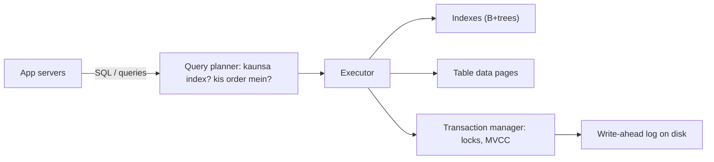
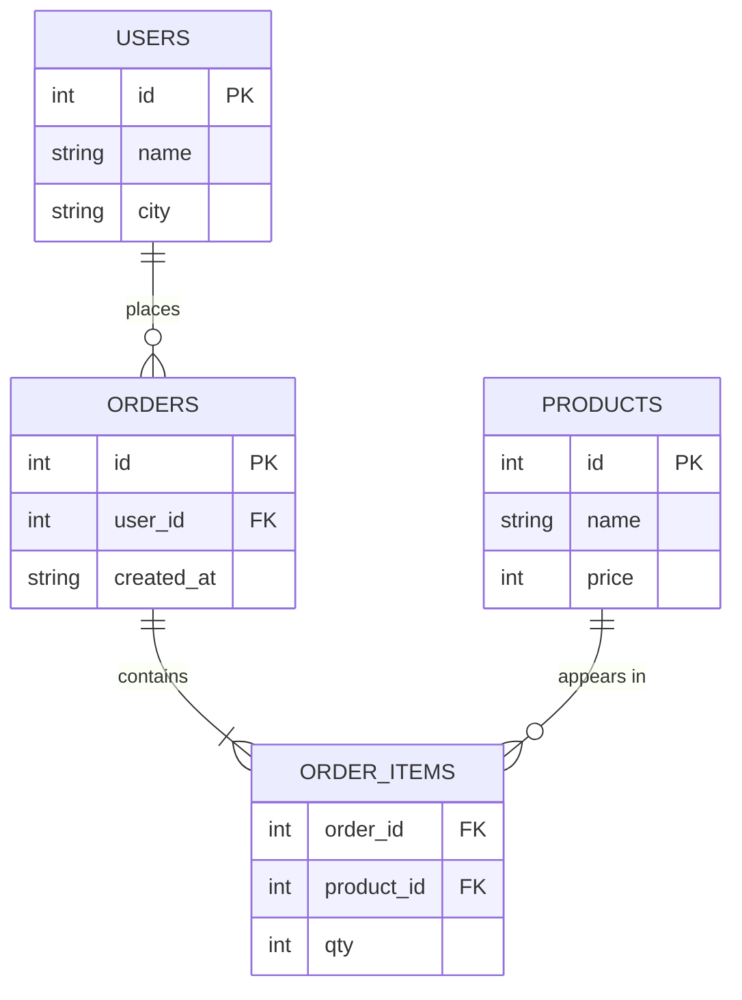
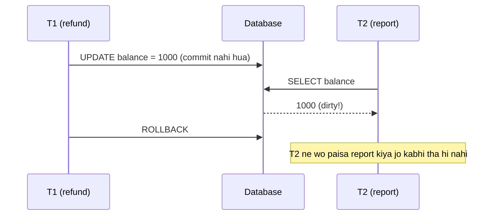
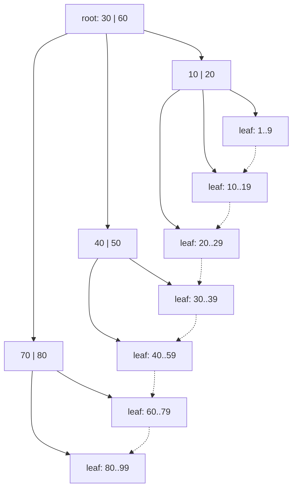
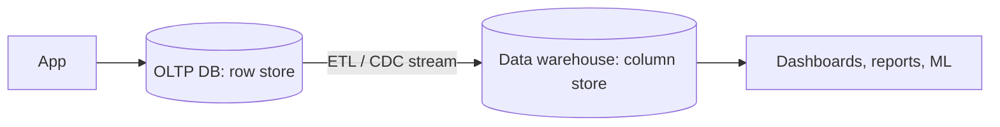
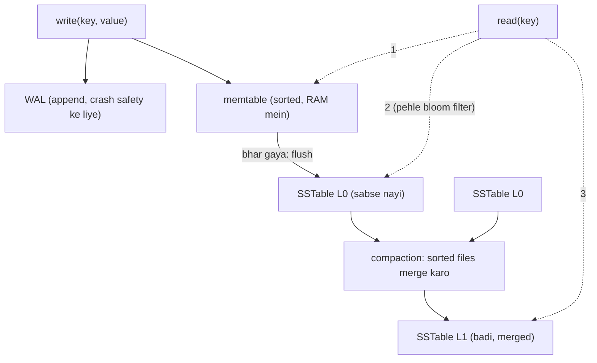

# Chapter 03 · Databases: SQL, NoSQL, Indexes & Transactions

> Sale wali raat 11:59 pm pe, do log aakhri iPhone pe ekdum same millisecond pe "Buy" click karte hain. Tumhara server fast hai, load balancer perfect hai, lekin agar database saavdhaan nahi hai, toh tumne abhi-abhi ek phone do baar bech diya. Database wo jagah hai jahan data rehta hai, aur jahan correctness jeeti ya haari jaati hai.

**Is chapter mein tum seekhoge:**
- Relational model aur wo SQL jo sach mein kaam aata hai (SELECT, JOIN, GROUP BY), Python ke built-in `sqlite3` pe live chala ke
- Normalization (1NF, 2NF, 3NF), aur kab jaan-boojh ke denormalize karna hai
- ACID, concrete examples ke saath; isolation levels, aur wo anomalies jo ye rokte hain (dirty read, non-repeatable read, phantom, lost update, write skew)
- Indexes: B-tree, B+tree, hash, composite, covering, aur query planner inhe kaise use karta hai
- NoSQL families (key-value, document, wide-column, graph, time-series, search), aur kab kaunsi chunni hai
- SQL vs NoSQL decision guide, OLTP vs OLAP, connection pooling, aur storage engines (B-tree vs LSM tree)

**Isse pehle padho:** [Chapter 01 · Foundations](01-foundations-internet.md) · [Chapter 02 · Scalability & Load Balancing](02-scalability-load-balancing.md) · DSA se helpful: [Hashing](../part-2-dsa/05-hashing.md), [Binary Search](../part-2-dsa/08-binary-search.md), [Binary Search Trees](../part-2-dsa/14-binary-search-trees.md)

---

## 🧠 The Big Idea · Asli Baat

Database ek **library hai jiska librarian bahut strict hai**.

- **Kitaabein** tumhara data hain.
- **Catalogue cards** (author ke hisaab se sorted, title ke hisaab se sorted) **indexes** hain: inse librarian bina har shelf ghoome kitaab dhoondh leta hai.
- Librarian ke **rules** ("jo kitaab pehle se issue hai, wo dobara issue nahi hogi", "kitaab wapas karna ya toh poora record hoga ya bilkul nahi") **transactions** aur **constraints** hain.
- Alag-alag libraries alag tareeke se organise karti hain: kuch strict shelves aur catalogue numbers use karti hain (**relational / SQL**), kuch mein bas label lage dabbe hote hain jinhe naam se utha lo (**key-value**), aur kuch har insaan ka poora folder ek saath rakhti hain (**document**).



Is diagram ko ek baar dhyaan se padho, poora chapter isi ka vistaar hai. App SQL bhejta hai → **query planner** decide karta hai ki kaam kaise karna hai → **executor** indexes aur table pages se data laata hai → **transaction manager** dhyaan rakhta hai ki ek saath chal rahe kaam ek-doosre ko na bigaadein → aur har change pehle **write-ahead log** mein disk pe likha jaata hai taaki crash ke baad bhi kuch na khoye.

[Chapter 02](02-scalability-load-balancing.md) yaad karo: humne app servers ko stateless banaya tha, state ko *yahan* dhakel ke. Toh ab database ko **correct** hona padega (iPhone do baar nahi bikna chahiye), **fast** hona padega (indexes), aur **durable** hona padega (commit hua order kabhi bhoolna nahi). Ye chapter in teeno ke baare mein hai, ek single machine pe. Phir [Chapter 05](05-replication-sharding.md) isse kai machines pe phailata hai.

> 🇮🇳 **Desi Analogy:** Railway ka **reservation chart** socho. **Chart = table**: har row ek passenger, columns hain PNR, naam, coach, berth. **PNR number = primary key**: har booking ka unique pehchaan. TTE ke paas coach-wise sorted chart hota hai, toh S4 ke 32 number ko dhoondhne ke liye wo poori train nahi padhta (**index**). Aur IRCTC ka sabse bada rule: ek berth, ek raat, ek hi passenger. Do log ek hi berth book nahi kar sakte, chahe dono ne ek hi second pe click kiya ho (**transaction + constraint**). Ye guarantee database deta hai, tumhara Python code nahi.

> 💡 **The core insight:** wo data model chuno jo is baat se match kare ki tum data ko *padhoge* kaise, indexes lagao taaki reads ko sab kuch scan na karna pade, aur transactions use karo taaki ek saath hone wale writes ek-doosre ko corrupt na kar sakein.

---

## 🔨 Building It Up · Zero Se Shuru

### 1. Why not just use files or a Python dict? · File ya dict kyun nahi?

Tum orders ko ek JSON file mein save kar sakte ho. Ab ye sawaal poocho:

- Do servers ek saath likhte hain. Kaun jeetega? Kya file corrupt ho jaayegi?
- Write ke beech mein bijli chali gayi. Kya file aadhi likhi reh gayi?
- 5 crore (50 million) orders mein "pichle hafte Pune se ₹500 se upar ke saare orders dhoondo". Har baar poori file padhoge?
- Paisa account A se B mein ja raha hai. A se ghataane ke baad program crash ho gaya. Paisa gaya kahan?

Ek database management system (**DBMS**) bilkul yahi problems solve karta hai: **concurrency** (ek saath kai log), **crash safety**, **fast queries**, aur **all-or-nothing changes**. Isiliye tum lagbhag kabhi apna khud ka database nahi banate.

### 2. The relational model

Ek **relational database** (PostgreSQL, MySQL, SQLite, Oracle, SQL Server) data ko **tables** mein rakhta hai (inhe **relations** bhi kehte hain):

- Table mein **columns** hote hain jinke types fixed hain (`id INTEGER`, `name TEXT`).
- Har **row** ek record hai.
- **Primary key** har row ko uniquely identify karti hai (`users.id`).
- **Foreign key** ek aisa column hai jo doosri table ki primary key ko refer karta hai (`orders.user_id → users.id`). Tables aise hi aapas mein **relate** karti hain, isiliye naam "relational".



`||--o{` ko aise padho: "ek user ke zero ya zyada orders hote hain". (`||` = exactly one, `o{` = zero ya zyada, `|{` = ek ya zyada.) Tum **SQL** (Structured Query Language) mein batate ho ki tumhe **kya** chahiye, aur database khud sochta hai ki **kaise** laana hai. Ye "kya" aur "kaise" ka alag hona hi relational model ki superpower hai.

### 3. SQL essentials, live

Python ke saath **SQLite** aata hai, ek asli relational database jo ek library ke andar hai. `":memory:"` dene pe ye poora RAM mein rehta hai, toh hum bina kisi setup ke asli SQL chala sakte hain.

```python
import sqlite3

db = sqlite3.connect(":memory:")
db.executescript("""
CREATE TABLE users (
    id    INTEGER PRIMARY KEY,
    name  TEXT NOT NULL,
    city  TEXT NOT NULL
);
CREATE TABLE orders (
    id       INTEGER PRIMARY KEY,
    user_id  INTEGER NOT NULL REFERENCES users(id),
    amount   INTEGER NOT NULL,          -- in rupees
    status   TEXT NOT NULL
);
INSERT INTO users VALUES (1, 'Asha', 'Pune'), (2, 'Ravi', 'Delhi'),
                         (3, 'Meera', 'Pune'), (4, 'Kabir', 'Goa');
INSERT INTO orders VALUES (101, 1, 450, 'DELIVERED'), (102, 1, 1200, 'DELIVERED'),
                          (103, 2, 300, 'CANCELLED'), (104, 3, 800, 'DELIVERED'),
                          (105, 2, 650, 'DELIVERED');
""")

print("1) Pune users:")
for row in db.execute("SELECT id, name FROM users WHERE city = 'Pune' ORDER BY name"):
    print("  ", row)

print("2) Orders with user names (INNER JOIN):")
for row in db.execute("""
        SELECT o.id, u.name, o.amount
        FROM orders o JOIN users u ON u.id = o.user_id
        WHERE o.status = 'DELIVERED'
        ORDER BY o.amount DESC"""):
    print("  ", row)

print("3) Every user, even with no orders (LEFT JOIN):")
for row in db.execute("""
        SELECT u.name, COUNT(o.id) AS n_orders
        FROM users u LEFT JOIN orders o ON o.user_id = u.id
        GROUP BY u.id ORDER BY u.id"""):
    print("  ", row)

print("4) Revenue per city, only cities over 1000 (GROUP BY + HAVING):")
for row in db.execute("""
        SELECT u.city, SUM(o.amount) AS revenue
        FROM orders o JOIN users u ON u.id = o.user_id
        WHERE o.status = 'DELIVERED'
        GROUP BY u.city
        HAVING SUM(o.amount) > 1000
        ORDER BY revenue DESC"""):
    print("  ", row)
```

```text
1) Pune users:
   (1, 'Asha')
   (3, 'Meera')
2) Orders with user names (INNER JOIN):
   (102, 'Asha', 1200)
   (104, 'Meera', 800)
   (105, 'Ravi', 650)
   (101, 'Asha', 450)
3) Every user, even with no orders (LEFT JOIN):
   ('Asha', 2)
   ('Ravi', 2)
   ('Meera', 1)
   ('Kabir', 0)
4) Revenue per city, only cities over 1000 (GROUP BY + HAVING):
   ('Pune', 2450)
```

Kya hua yahan, ek-ek query karke:

1. `WHERE` rows ko filter karta hai, `ORDER BY` unhe sort karta hai.
2. `JOIN ... ON` har order ko uske user se jod deta hai jahan keys match karti hain. **INNER JOIN** sirf wo rows rakhta hai jo dono taraf match karti hain. (Order 103 CANCELLED tha, isliye `WHERE` ne usse pehle hi hata diya.)
3. **LEFT JOIN** left table ki *har* row rakhta hai; jahan match nahi mila wahan `NULL` aa jaata hai. Kabir ka koi order nahi hai, phir bhi wo dikh raha hai, count 0 ke saath. (`COUNT(o.id)` sirf non-null values ginta hai. Isliye Kabir ke liye 0 aaya, 1 nahi. `COUNT(*)` likhte toh 1 aata, kyunki row toh hai, bas `NULL` se bhari.) Ravi ka count 2 hai kyunki is query mein status ka filter nahi hai, toh cancelled order bhi gina gaya.
4. `GROUP BY` rows ko groups mein samet deta hai aur tumhe aggregate karne deta hai (`SUM`, `COUNT`, `AVG`, `MIN`, `MAX`). `WHERE` grouping se **pehle** rows filter karta hai; `HAVING` grouping ke **baad** groups ko filter karta hai. Pune: 450 + 1200 + 800 = 2450 (> 1000, toh dikha). Delhi: sirf 650 delivered (< 1000, toh gaya).

SQL logically is order mein chalta hai (us order mein nahi jisme tum likhte ho):

```text
FROM / JOIN  ->  WHERE  ->  GROUP BY  ->  HAVING  ->  SELECT  ->  ORDER BY  ->  LIMIT
```

Isiliye zyadatar databases mein tum `SELECT` mein banaya alias `WHERE` ke andar use nahi kar sakte: `WHERE` pehle chalta hai, us waqt tak alias bana hi nahi.

> 🤔 **Mann mein sawaal:** `WHERE` aur `HAVING` dono filter hi toh karte hain. `HAVING SUM(o.amount) > 1000` ki jagah `WHERE SUM(o.amount) > 1000` kyun nahi likh sakte?
>
> **Jawab:** Upar wala order dekho. `WHERE` us waqt chalta hai jab abhi groups bane hi nahi, ek-ek row ka kaam ho raha hai. Ek akeli row ka "SUM" kya hoga? Koi matlab nahi. `SUM` tab bante hain jab `GROUP BY` chal chuka ho, aur uske baad sirf `HAVING` chalta hai. Seedha rule: **row pe condition → `WHERE`; group ke total pe condition → `HAVING`.**

JOIN family ek nazar mein:

| Join | Kya rakhta hai |
|---|---|
| `INNER JOIN` | Sirf wo rows jo dono taraf match karein |
| `LEFT JOIN` | Saari left rows; match na mile toh right side `NULL` |
| `RIGHT JOIN` | Saari right rows; match na mile toh left side `NULL` |
| `FULL OUTER JOIN` | Dono taraf ki saari rows |
| `CROSS JOIN` | Har combination (shayad hi kabhi ye chahiye) |

### 4. Normalization: one fact, one place · Ek baat, ek jagah

Ye raha ek lalchaane wala "sab kuch ek hi table mein" design:

```text
order_id | customer | customer_city | product  | product_price | qty
---------+----------+---------------+----------+---------------+----
101      | Asha     | Pune          | Keyboard | 1500          | 1
101      | Asha     | Pune          | Mouse    | 500           | 2
102      | Asha     | Pune          | Mouse    | 500           | 1
```

Problems (inhe **anomalies** kehte hain):

- **Update anomaly**: Asha Mumbai shift ho gayi. Ab tumhe *har* us row ko update karna padega jisme uska naam hai. Ek bhi chhoot gayi toh data khud se hi contradict karega (ek row bolegi Pune, doosri Mumbai).
- **Insert anomaly**: jab tak koi naya product order na kare, tum use add hi nahi kar sakte (order_id ke bina row banegi kaise?).
- **Delete anomaly**: order 102 delete karo, aur agar wo Mouse ka akela order tha, toh Mouse ka price hi kho gaya.

> 🇮🇳 **Desi Analogy:** Joint family ka WhatsApp group socho. Chacha ji ne naya number liya. Agar har rishtedaar ne apne phone mein alag se number save kiya hai (**denormalized copies**), toh har ek ko alag-alag update karna padega, aur Bua ji ke phone mein purana number reh hi jaayega (**update anomaly**). Agar sab ek hi **shared family contact sheet** dekhte, toh ek jagah badla aur sabke liye badal gaya. Normalization yahi hai: **ek fact, ek jagah**.

**Normalization** tables ko aise todta hai ki har fact **sirf ek baar** store ho. Normal forms ek seedhi (ladder) jaise hain:

**1NF (First Normal Form):** har column mein ek single atomic value ho, cell ke andar list nahi, repeating groups nahi.

```text
❌  order 101 | items = "Keyboard, Mouse, Mouse"
✅  one row per (order, product) pair
```

**2NF:** 1NF + har non-key column **poori** primary key pe depend kare, sirf uske ek hisse pe nahi. Upar wali table mein key `(order_id, product)` hai, lekin `product_price` sirf `product` pe depend karta hai, aur `customer` sirf `order_id` pe. Ye partial dependencies hain → inhe alag tables mein nikaal do.

**3NF:** 2NF + koi non-key column **kisi doosre non-key column** pe depend na kare (koi "transitive" dependency nahi). `customer_city` order pe nahi, `customer` pe depend karta hai (order → customer → city, ye chain hi "transitive" hai). → ise `customers` table mein le jao.

Ek yaadgaar summary (ek classic kahawat): har non-key column ko depend karna chahiye **"the key (1NF), the whole key (2NF), and nothing but the key (3NF)"** pe. Matlab: key pe, poori key pe, aur key ke alawa kisi pe nahi.

Normalized result:

```text
customers(id, name, city)
products(id, name, price)
orders(id, customer_id, created_at)
order_items(order_id, product_id, qty)
```

Ab check karo: Asha shift hui → `customers` mein sirf ek row badli. Naya product → `products` mein seedha daalo. Order 102 delete → Mouse ka price `products` mein surakshit hai. Teeno anomalies khatam.

(Iske upar bhi forms hain, BCNF, 4NF, 5NF, jo interviews mein kam hi aati hain. 3NF practical target hai.)

### 5. Denormalization: copying on purpose · Jaan-boojh ke copy karna

Normalized data saaf-suthra hota hai, lekin padhne ke liye **joins** chahiye, aur badi tables pe joins (ya machines ke beech, [Chapter 05](05-replication-sharding.md)) mehenge padte hain. **Denormalization** jaan-boojh ke redundant copies rakhta hai taaki reads fast hon:

- Har order row mein `customer_name` rakh do, taaki order history page ko join na karna pade.
- Har baar likes table pe `COUNT(*)` chalane ki jagah posts pe ek `like_count` column rakh lo.
- Ek `user_feed` table pehle se compute karke rakh lo ([Chapter 13](13-case-studies-2.md)).

Keemat: har write ko har copy update karni padti hai, aur copies sync se **bhatak** (drift) sakti hain.

```python
import sqlite3

db = sqlite3.connect(":memory:")
db.executescript("""
CREATE TABLE posts (id INTEGER PRIMARY KEY, title TEXT, like_count INTEGER DEFAULT 0);
CREATE TABLE likes (post_id INTEGER, user_id INTEGER, PRIMARY KEY (post_id, user_id));
INSERT INTO posts (id, title) VALUES (1, 'My first dosa');
""")

def like(post_id, user_id):
    with db:                                  # ek transaction: dono writes ya ek bhi nahi
        db.execute("INSERT INTO likes VALUES (?, ?)", (post_id, user_id))
        db.execute("UPDATE posts SET like_count = like_count + 1 WHERE id = ?", (post_id,))

for uid in (10, 11, 12):
    like(1, uid)

normalized = db.execute("SELECT COUNT(*) FROM likes WHERE post_id = 1").fetchone()[0]
denormalized = db.execute("SELECT like_count FROM posts WHERE id = 1").fetchone()[0]
print("count via aggregate:", normalized)
print("count via stored column:", denormalized)
```

```text
count via aggregate: 3
count via stored column: 3
```

Kya hua yahan: `like_count` column `COUNT(*)` ki ek denormalized copy hai. Isse padhna O(1) hai, rows ginne ki zaroorat nahi. Humne isse sahi rakha dono ko **ek transaction** mein update karke (`with db:` ya toh dono commit karta hai ya dono rollback). Socho agar like insert ho jaata aur count update se pehle crash ho jaata: count hamesha ek kam dikhata. Transaction ne wo raasta band kar diya.

| | Normalized | Denormalized |
|---|---|---|
| Duplication | Koi nahi | Jaan-boojh ke |
| Writes | Simple, ek jagah | Har copy update karni padegi |
| Reads | Joins chahiye | Fast, kam joins |
| Consistency risk | Kam | Copies drift ho sakti hain |
| Kiske liye best | Bahut writes wala OLTP, correctness | Read-heavy views, analytics, NoSQL |

> 💡 Thumb rule: **default mein normalize karo, aur sirf wahan denormalize karo jahan measurements dikhayein ki reads dard de rahe hain.**

### 6. Transactions and ACID, concretely

**Transaction** operations ka ek group hai jise ek unit ki tarah treat kiya jaata hai. Classic example: Asha se Ravi ko ₹100 transfer = Asha se ghataao + Ravi mein jodo. **ACID** wo vaade (promises) hain jo ek transaction karta hai:

| Letter | Promise | Concrete matlab | Bank example |
|---|---|---|---|
| **A**tomicity | Sab ya kuch nahi | Koi bhi step fail hua toh har step undo (rollback) | Kabhi "debit hua par credit nahi" nahi |
| **C**onsistency | Rules hamesha sahi | Constraints (NOT NULL, foreign keys, CHECK balance >= 0) kisi committed transaction se kabhi nahi tootte | Balance kabhi negative nahi |
| **I**solation | Ek saath chalte transactions ek-doosre se nahi takraate | Result aisa jaise wo ek ke baad ek chale hon (kitna, ye isolation level decide karta hai) | Do transfers ek saath hon toh koi update khoye nahi |
| **D**urability | Committed = hamesha ke liye | Crash aur power cut jhel leta hai (log ke through disk pe likha) | "Success" ke baad power cut usse undo nahi kar sakta |

> 🇮🇳 **Desi Analogy:** **UPI payment** se ACID samjho. Tumne dost ko ₹500 bheje. **Atomicity**: ya toh tumhare khaate se kate *aur* dost ke mein aaye, ya kuch bhi nahi. "Paise kat gaye par pahunche nahi" wali situation mein bank use **auto-reverse** karta hai, yahi rollback hai. **Consistency**: tumhare khaate mein ₹300 hain toh ₹500 ka transfer ho hi nahi sakta (balance negative nahi ho sakta). **Isolation**: tumne aur tumhari wife ne joint account se ek hi second pe ₹300-₹300 bheje, ₹500 balance pe; dono pass nahi ho sakte. **Durability**: "Payment Successful" ka green tick aa gaya, ab bank ka server crash bhi ho jaaye toh wo transaction gaayab nahi hoga.

> ⚠️ ACID wala "C" (database ke rules maanna) CAP wale "C" (saare replicas ek baat pe agree karein, [Chapter 06](06-cap-consistency.md)) jaisa **nahi** hai. Interviewers ko ye check karna bahut pasand hai ki tumhe ye farak pata hai ya nahi.

Atomicity action mein, consistency ke liye ek `CHECK` constraint ke saath:

```python
import sqlite3

db = sqlite3.connect(":memory:")
db.executescript("""
CREATE TABLE accounts (
    name    TEXT PRIMARY KEY,
    balance INTEGER NOT NULL CHECK (balance >= 0)
);
INSERT INTO accounts VALUES ('asha', 500), ('ravi', 100);
""")

def transfer(src, dst, amount):
    try:
        with db:                                         # BEGIN ... COMMIT / ROLLBACK
            db.execute("UPDATE accounts SET balance = balance + ? WHERE name = ?",
                       (amount, dst))                    # jaan-boojh ke pehle credit
            db.execute("UPDATE accounts SET balance = balance - ? WHERE name = ?",
                       (amount, src))                    # ye CHECK tod sakta hai
        print(f"transfer {amount}: committed")
    except sqlite3.IntegrityError as e:
        print(f"transfer {amount}: rolled back ({e})")

def balances():
    return dict(db.execute("SELECT name, balance FROM accounts ORDER BY name"))

transfer("asha", "ravi", 200)
print(balances())
transfer("asha", "ravi", 1000)         # asha ke paas sirf 300 bache hain
print(balances())
```

```text
transfer 200: committed
{'asha': 300, 'ravi': 300}
transfer 1000: rolled back (CHECK constraint failed: balance >= 0)
{'asha': 300, 'ravi': 300}
```

Kya hua yahan: doosre transfer mein Ravi ko ₹1000 *pehle* credit hue, phir Asha ke debit ne `CHECK` tod diya (300 − 1000 = −700). Dono statements ek hi transaction mein the, isliye database ne **credit ko bhi undo kar diya**. Ravi ko muft ka paisa nahi mila. Ye hai atomicity + consistency ek saath kaam karte hue. (Humne credit jaan-boojh ke pehle rakha tha, yahi dikhane ke liye ki pehle ho chuka step bhi wapas ho jaata hai.)

**Durability kaise kaam karti hai:** data pages badalne se pehle database change ko disk pe ek **write-ahead log (WAL)** mein append karta hai aur usse zabardasti disk tak pahunchata hai (`fsync`). `COMMIT` pe log record disk pe surakshit hota hai. Agar machine crash ho, toh restart pe database log ko **replay** karta hai: committed changes ko dobara karta hai aur uncommitted ko undo. Sequential log writes fast hote hain ([Chapter 01](01-foundations-internet.md) yaad karo: sequential, random ko harata hai).

> 🇮🇳 **Desi Analogy:** WAL kirana dukaan ki **rough khata diary** hai. Bhaiya pehle diary mein turant ek line likhte hain, "Sharma ji, 2 kg cheeni, ₹90, udhaar". Ye seedha agle khaali line pe likhna hai, isliye tez (sequential). Asli bade register mein Sharma ji ke page pe jaake entry raat ko aaraam se karte hain (**checkpoint**). Agar beech mein bhaiya ki tabiyat kharab ho gayi, toh agle din diary dekh ke register theek ho jaata hai (**replay**).

### 7. Isolation: when transactions overlap · Jab transactions takraate hain

Transactions ko strictly ek-ek karke chalana (**serial** execution) poori tarah safe hai lekin slow hai. Databases inhe **ek saath (concurrently)** chalate hain aur **isolation levels** dete hain: kamzor levels fast hain lekin kuch **anomalies** hone dete hain. Chalo in anomalies se do logon ki kahani ke through milte hain.

**Dirty read**: tumne wo data padh liya jo kisi doosre transaction ne likha hai lekin **abhi commit nahi kiya**. Agar wo rollback ho gaya, toh tumne aise data pe kaam kiya jo kabhi exist hi nahi kiya.



**Non-repeatable read**: tumne ek hi transaction mein same row do baar padhi aur **alag values** mili, kyunki beech mein kisi ne change commit kar diya.

**Phantom read**: tumne same **range query** do baar chalayi aur **rows ka set hi alag** mila, kyunki kisi ne tumhari condition se match karne wali rows insert ya delete kar di. ("Aaj raat room 7 ki kitni bookings hain?" 0... phir 1.) Naam "phantom" (bhoot) isliye kyunki ek row achanak kahin se prakat ho jaati hai.

**Lost update**: do transactions same value padhte hain, dono usse badalte hain, dono wapas likhte hain. Ek update chupchaap doosre ko overwrite kar deta hai.

**Write skew**: do transactions data ka **same set** padhte hain, har ek usi ke basis pe decision leta hai, aur har ek **alag** rows mein likhta hai. Akele mein har write theek hai; saath mein milke ek rule tod dete hain. Classic example: hospital ka rule hai ki **kam se kam ek doctor on call** rahe. Alice aur Bob dono on call hain. Dono check karte hain "kya kam se kam 2 on call hain?" (haan), aur dono ek hi pal mein off call chale jaate hain. Ab zero doctors on call hain. Kisi transaction ne doosre ki row ko chhua tak nahi, isliye simple row locks isse pakad nahi paate.

> 🤔 **Mann mein sawaal:** Non-repeatable read aur phantom read mein farak kya hai? Dono mein "doosri baar kuch alag dikha" hi toh hai.
>
> **Jawab:** Farak hai **kya badla** usme. **Non-repeatable read** mein *wahi row* ki *value* badal gayi (Asha ka balance pehle 500, phir 300). **Phantom** mein *rows ka set* badal gaya: ek nayi row aa gayi ya ek gaayab ho gayi jo tumhari `WHERE` condition se match karti hai. Isiliye row lock karne se non-repeatable read ruk jaata hai, lekin phantom nahi rukta: jo row abhi exist hi nahi karti, uspe lock kaise lagaoge? Uske liye range lock ya snapshot chahiye.

Yahan lost update aur write skew ka ek simulation hai, jisme transactions ek shared "database" pe interleaved (aage-peeche ghuse hue) steps ki tarah chalte hain:

```python
def lost_update():
    db = {"stock": 1}                        # ek hi iPhone bacha hai
    t1_read = db["stock"]                    # T1 ne 1 padha
    t2_read = db["stock"]                    # T2 ne 1 padha (T1 ke likhne se pehle)
    sold = []
    if t1_read > 0:
        db["stock"] = t1_read - 1; sold.append("T1")
    if t2_read > 0:
        db["stock"] = t2_read - 1; sold.append("T2")
    print(f"lost update: sold to {sold}, stock now {db['stock']}  <- oversold!")

def write_skew():
    on_call = {"alice": True, "bob": True}
    # dono transactions pehle ek snapshot padhte hain
    alice_sees = sum(on_call.values())
    bob_sees = sum(on_call.values())
    if alice_sees >= 2:
        on_call["alice"] = False             # Alice APNI row likhti hai
    if bob_sees >= 2:
        on_call["bob"] = False               # Bob APNI row likhta hai
    print(f"write skew: doctors on call = {sum(on_call.values())}  <- rule broken!")

def lost_update_fixed():
    db = {"stock": 1}
    sold = []
    for t in ("T1", "T2"):                   # atomic conditional update, ek baar mein ek
        # SQL: UPDATE items SET stock = stock - 1 WHERE id = ? AND stock > 0
        if db["stock"] > 0:
            db["stock"] -= 1
            sold.append(t)
    print(f"fixed: sold to {sold}, stock now {db['stock']}")

lost_update()
write_skew()
lost_update_fixed()
```

```text
lost update: sold to ['T1', 'T2'], stock now 0  <- oversold!
write skew: doctors on call = 0  <- rule broken!
fixed: sold to ['T1'], stock now 0
```

Kya hua yahan: dono toote hue cases mein har transaction ne ek aisi value se decision liya jo likhte waqt tak **baasi (stale) ho chuki thi**. Lost update mein stock "0" dikh raha hai jo sahi lagta hai, lekin phone do logon ko bik gaya! Dhokha yahi hai: final number sahi dikhta hai, business galat ho gaya. Lost update ka fix tha "check karo aur ghataao" ko **ek single atomic statement** bana dena, jise database ek row lock ke andar chalata hai. Ab check aur write ke beech koi doosra ghus hi nahi sakta.

> 🇮🇳 **Desi Analogy:** **IRCTC Tatkal** mein aakhri ek seat bachi hai. Do agents ne ek saath screen pe "Available: 1" dekha (dono ne same value padhi). Dono ne "Book" dabaya. Agar system "padho, phir alag se likho" karta, toh dono ko confirm ticket mil jaata aur ek hi berth pe do log (**lost update**). Asli system ek hi atomic step mein kehta hai "seat count 1 se 0 karo, *sirf agar* abhi bhi 1 hai". Pehle wale ko seat milti hai, doosre ko "Waiting list". Yahi `UPDATE ... WHERE stock > 0` hai.

SQL standard ke chaar standard **isolation levels** aur wo kya rokte hain:

| Isolation level | Dirty read | Non-repeatable read | Phantom | Lost update / write skew |
|---|---|---|---|---|
| Read Uncommitted | Possible | Possible | Possible | Possible |
| Read Committed | **Prevented** | Possible | Possible | Possible |
| Repeatable Read | Prevented | **Prevented** | Possible (standard ke hisaab se) | Lost update aksar prevented; write skew possible |
| Serializable | Prevented | Prevented | **Prevented** | **Prevented** |

Table ko seedhi ki tarah padho: har level upar wale level ki saari suraksha rakhta hai aur ek nayi anomaly band karta hai. Jitna upar chadhoge, utni safety, aur utni keemat (speed kam, locks ya aborts zyada).

Real-world notes (mention karna accha hai, lekin dhyaan se):

- **PostgreSQL** ka default Read Committed hai. Iska Repeatable Read **snapshot isolation** ki tarah implement hua hai (har transaction ko ek consistent snapshot dikhta hai), jo practice mein phantoms rok deta hai lekin write skew phir bhi hone deta hai. Iska Serializable level (SSI) write skew ko detect karke ek transaction ko abort kar deta hai.
- **MySQL InnoDB** ka default Repeatable Read hai, aur ye index ranges pe locks ("gap locks") laga ke kai phantoms ko rokta hai.

Fixes jo tum kisi bhi level pe use kar sakte ho:

```sql
-- 1. Read-modify-write ki jagah atomic update (lost update theek karta hai)
UPDATE products SET stock = stock - 1 WHERE id = 42 AND stock > 0;

-- 2. Pessimistic locking: jo rows padhi hain unhe commit tak lock kar do
BEGIN;
SELECT * FROM doctors WHERE shift_id = 7 AND on_call = true FOR UPDATE;
-- decide karo, phir update karo
COMMIT;

-- 3. Optimistic locking: ek version column; beech mein kisi ne badla toh fail
UPDATE products SET stock = 4, version = 8 WHERE id = 42 AND version = 7;
-- 0 rows update hui => koi aur jeet gaya; dobara padho aur retry karo

-- 4. Constraints: rule ko database se enforce karwao
ALTER TABLE bookings ADD CONSTRAINT one_booking UNIQUE (room_id, night);
```

| Technique | Kaise | Kab best |
|---|---|---|
| Atomic statement | `SET x = x - 1 WHERE x > 0` | Simple counters, stock |
| Pessimistic (`SELECT ... FOR UPDATE`) | Pehle lock, phir kaam | High contention, conflicts ki sambhavna zyada |
| Optimistic (version column / compare-and-set) | Kaam karo, phir check karo ki kuch badla toh nahi | Low contention, conflicts kam |
| Unique / check constraints | DB rule todne wale writes reject karta hai | Jo rules constraints mein likhe ja sakein |
| Serializable isolation | DB conflicts detect karke abort karta hai | Complex invariants; app ko retry karna padega |

> 🤔 **Mann mein sawaal:** Pessimistic aur optimistic locking mein se kaunsa behtar hai?
>
> **Jawab:** Depend karta hai ki takraav (conflict) kitna common hai. **Pessimistic** = "pehle taala lagao, phir kaam karo". Jab conflict ki sambhavna zyada ho (concert ki ek seat pe 1000 log) tab sahi, kyunki baar-baar retry karne se accha hai line mein khade raho. **Optimistic** = "bina taale ke kaam karo, aakhri mein check karo ki kisi ne beech mein badla toh nahi". Jab conflict rare ho (apni profile edit karna) tab sahi, kyunki 99% baar koi takraav hoga hi nahi aur taala lagane ka kharcha bach gaya.

### 8. Indexes: the catalogue cards

Index ke bina, `SELECT * FROM users WHERE email = 'x@y.com'` ko **har row** check karni padti hai: ek **full table scan**, O(n). 10 crore (100 million) users ke saath ye tabaahi hai.

**Index** ek alag data structure hai jo column values ko row locations se map karta hai, aur **sorted** (ya hashed) rakha jaata hai taaki lookups fast hon. Ye textbook ke peeche wala index hai: "Dijkstra" dhoondhne ke liye 800 pages padhne ki jagah tum index mein dekhte ho aur seedha page 412 pe kood jaate ho.

Chalo SQLite aur uske query planner ke saath speedup dekhte hain:

```python
import sqlite3
import time

db = sqlite3.connect(":memory:")
db.execute("CREATE TABLE users (id INTEGER PRIMARY KEY, email TEXT, city TEXT, age INTEGER)")
db.executemany("INSERT INTO users (email, city, age) VALUES (?, ?, ?)",
               ((f"user{i}@mail.com", ["Pune", "Delhi", "Goa", "Agra"][i % 4], 18 + i % 50)
                for i in range(100_000)))

query = "SELECT id FROM users WHERE email = 'user65432@mail.com'"

def plan(sql):
    return [row[-1] for row in db.execute("EXPLAIN QUERY PLAN " + sql)]

def timed(sql, repeat=10):
    start = time.perf_counter()
    for _ in range(repeat):
        db.execute(sql).fetchall()
    return (time.perf_counter() - start) / repeat

print("plan without index:", plan(query))
slow = timed(query)
db.execute("CREATE INDEX idx_users_email ON users(email)")
print("plan with index   :", plan(query))
fast = timed(query)
print("index is faster by more than 100x:", slow / fast > 100)
```

```text
plan without index: ['SCAN users']
plan with index   : ['SEARCH users USING COVERING INDEX idx_users_email (email=?)']
index is faster by more than 100x: True
```

Kya hua yahan: `EXPLAIN QUERY PLAN` database ki strategy dikhata hai. Index ke bina wo saari 100,000 rows **SCAN** karta hai. Index ke saath wo **SEARCH** karta hai: kuch hi steps ka tree lookup. (Ye "covering" isliye bol raha hai kyunki SQLite mein har index row id bhi store karta hai, aur humne sirf wahi maanga tha; covering indexes ke baare mein neeche aur.) Exact speedup tumhari machine pe depend karta hai, isliye hum bas check kar rahe hain ki speedup bahut bada hai.

**SCAN vs SEARCH** ye do shabd yaad kar lo. Kisi bhi slow query ki jaanch mein pehla sawaal yahi hota hai: "bade table pe SCAN toh nahi ho raha?"

### 9. B-trees and B+trees: why indexes are trees · Indexes tree kyun hote hain

DSA mein tum binary search trees se mil chuke ho ([Chapter 14](../part-2-dsa/14-binary-search-trees.md)): har node ke 2 children, height ~log₂(n). 1 billion (100 crore) keys ke liye ye ~30 levels hain, aur disk pe har level ek **alag random disk read** ho sakta hai. Har lookup pe 30 random reads bahut slow hai.

**B-tree** isse theek karta hai nodes ko **mota (fat)** banake: har node ek disk **page** hai (typically 4–16 KB) jisme **sainkdon keys** aur sainkdon child pointers hote hain. ~500 ke branching factor ke saath, ek billion keys ke liye height lagbhag log₅₀₀(10⁹) ≈ 3.3 hai, yaani **3–4 page reads**, aur upar ke levels lagbhag hamesha RAM mein cached rehte hain.

> 🇮🇳 **Desi Analogy:** India Post ka **PIN code** system socho. Pehla digit = zone (9 mein se ek), agle do = sorting district, aakhri teen = delivery post office. Har level pe ek "fat" node hai jo dikhata hai ki aage kahan jaana hai. 15 crore+ ghar, lekin dak sirf **3–4 kadam** mein sahi post office tak pahunch jaati hai. Agar har level pe sirf "left ya right" (binary) ka option hota, toh 27-28 kadam lagte. Fat nodes = kam levels = kam disk reads. Yahi B-tree ka poora jaadu hai.

**B+tree** (jo lagbhag har relational database asal mein use karta hai) B-tree ka ek variant hai jisme:

- **Internal nodes mein sirf keys hoti hain** (signposts / raaste ke board), toh ek page mein zyada aati hain → tree aur bhi chhota.
- **Saari values / row pointers leaves mein rehte hain.**
- **Leaves ek sorted chain mein linked hoti hain** → range scans (`WHERE age BETWEEN 20 AND 30`, `ORDER BY`) bas leaves ke saath-saath side mein chalte hain, tree mein baar-baar upar-neeche nahi.



Diagram ko chala ke dekho: key 45 dhoondhni hai. Root kehta hai 30 aur 60 ke beech → beech wala child (40 | 50). Wo kehta hai 40 aur 50 ke beech → "leaf: 40..59". Mil gaya, 3 kadam. Ab `age BETWEEN 20 AND 45` chahiye? 20 wali leaf tak jao, phir dotted arrows ke saath right mein chalte jao jab tak 45 cross na ho.

Ek chhota sa calculation "fat nodes" wali baat ko kabhi na bhoolne wala bana deta hai:

```python
import math

rows = 1_000_000_000
for fanout in (2, 100, 500):
    height = math.ceil(math.log(rows, fanout))
    print(f"fanout {fanout:>3}: about {height:>2} levels -> {height:>2} page reads per lookup")
```

```text
fanout   2: about 30 levels -> 30 page reads per lookup
fanout 100: about  5 levels ->  5 page reads per lookup
fanout 500: about  4 levels ->  4 page reads per lookup
```

### 10. Hash indexes

**Hash index** ek hash table hai ([Hashing](../part-2-dsa/05-hashing.md)): `hash(key) → location`. Exact key se lookup average mein O(1) hai.

Lekin hash keys ko randomly bikher deta hai, isliye ye ranges (`age > 30`), sorting (`ORDER BY`), ya prefix search (`LIKE 'ab%'`) **nahi** kar sakta. 30 aur 31 ka hash ek-doosre ke paas nahi aata, toh "30 se upar sab" ek jagah mil hi nahi sakte. Isiliye B+trees default hain. Hash indexes key-value stores mein milte hain (Redis ek giant in-memory hash table hai), kuch engines mein (Bitcask), aur PostgreSQL mein ek option ki tarah.

| | B+tree index | Hash index |
|---|---|---|
| Exact match `=` | O(log n), kuch page reads | O(1) average |
| Range `<`, `>`, `BETWEEN` | Haan (leaves pe chalo) | Nahi |
| `ORDER BY`, `MIN`, `MAX` | Haan (pehle se sorted) | Nahi |
| Prefix `LIKE 'ab%'` | Haan | Nahi |
| Typical use | Relational DBs ka default | Key-value stores, sirf equality lookups |

### 11. Composite indexes and the leftmost-prefix rule

**Composite index** kai columns ko cover karta hai, jaise `(city, age)`. Ye pehle `city` se sorted hai, phir har city ke *andar* `age` se, bilkul waise jaise phone book pehle surname se aur phir first name se sorted hoti hai.

Yahi ordering decide karti hai ki kaunsi queries isse use kar sakti hain:

| Query | `(city, age)` index use hoga? | Kyun |
|---|---|---|
| `WHERE city = 'Pune'` | ✅ | Leftmost column |
| `WHERE city = 'Pune' AND age = 25` | ✅ | Dono, sahi order mein |
| `WHERE city = 'Pune' AND age > 25` | ✅ | Pehle equality, phir range: perfect |
| `WHERE age = 25` | ❌ (zyadatar) | Pehla column skip ho gaya; jaise surname se sorted phone book mein "saare Rahul" dhoondhna (kuch DBs "skip scan" kar sakte hain agar pehle column mein bahut kam values hon) |
| `WHERE city = 'Pune' ORDER BY age` | ✅ | Pune ke andar rows pehle se age se sorted hain |

**Column order ka thumb rule:** equality wale columns pehle, phir range ya sort wala column.

> 🤔 **Mann mein sawaal:** `(city, age)` aur `(age, city)` mein kya farak? Columns toh wahi hain.
>
> **Jawab:** Bahut farak hai. Index ek sorted list hai, aur sort ka order hi sab kuch hai. `(city, age)` mein saare Pune wale ek jagah hain, unke andar age sorted. `WHERE city = 'Pune' AND age > 25` = "Pune wale hisse mein jao, 25 ke baad se padhte jao", ek hi continuous tukda. `(age, city)` mein pehle age se sorted hai: age > 25 wale saare log (har city ke) ek tukde mein hain, aur unme Pune wale bikhre hue hain. Toh database ko poora "age > 25" wala hissa padhna padega aur Pune chhaantna padega. Isiliye **equality pehle, range baad mein**.

```python
import sqlite3

db = sqlite3.connect(":memory:")
db.execute("CREATE TABLE users (id INTEGER PRIMARY KEY, email TEXT, city TEXT, age INTEGER)")
db.executemany("INSERT INTO users (email, city, age) VALUES (?, ?, ?)",
               ((f"u{i}@m.com", ["Pune", "Delhi", "Goa", "Agra"][i % 4], 18 + i % 50)
                for i in range(20_000)))
db.execute("CREATE INDEX idx_city_age ON users(city, age)")
db.execute("ANALYZE")

def plan(sql):
    return " / ".join(row[-1] for row in db.execute("EXPLAIN QUERY PLAN " + sql))

print(plan("SELECT id FROM users WHERE city = 'Pune' AND age > 60"))
print(plan("SELECT id FROM users WHERE age = 25"))
print(plan("SELECT email FROM users WHERE city = 'Goa' AND age = 30"))
```

```text
SEARCH users USING COVERING INDEX idx_city_age (city=? AND age>?)
SEARCH users USING COVERING INDEX idx_city_age (ANY(city) AND age=?)
SEARCH users USING INDEX idx_city_age (city=? AND age=?)
```

(Exact wording SQLite ke versions ke beech thoda alag ho sakta hai.)

Kya hua yahan: pehli query ne index ko poori tarah use kiya. Doosri interesting hai: index ko sirf `age` se search nahi kiya ja sakta, lekin `ANALYZE` ne SQLite ko bata diya tha ki `city` mein sirf 4 distinct values hain, toh usne ek **skip scan** kiya: `ANY(city)` ka matlab hai "har city ke liye ek chhota search: Pune with age 25, Delhi with age 25, ...". Ye trick tabhi kaam karti hai jab leading column mein bahut kam values hon; `email` jaise leading column ke saath (100,000 alag values) usse sab kuch scan karna padta. Teesri query ne matching rows dhoondhne ke liye index use kiya, lekin phir `email` laane ke liye table tak jaana pada, kyunki `email` index mein hai hi nahi. (Dhyaan do: teesri line mein "COVERING" shabd nahi hai.)

### 12. Covering indexes

**Covering index** mein **wo har column hota hai jo query ko chahiye**, toh database table ko chhue bina sirf index se jawab de deta hai (ek "index-only scan"). Isse har row pe ek random read bach jaata hai.

```sql
-- Query: SELECT email FROM users WHERE city = 'Goa' AND age = 30;
CREATE INDEX idx_city_age_email ON users(city, age, email);   -- ab ye covering hai
-- PostgreSQL ye bhi support karta hai: CREATE INDEX ... ON users(city, age) INCLUDE (email);
```

Socho textbook ke index mein sirf page number nahi, us topic ki ek line ki definition bhi likhi ho. Agar tumhe bas definition chahiye thi, toh page 412 tak jaane ki zaroorat hi nahi. Yahi covering index hai.

### 13. The cost of indexes · Index free nahi hai

Indexes muft nahi hote:

- **Writes slow ho jaate hain**: har `INSERT`/`UPDATE`/`DELETE` ko table ke **har** index ko update karna padta hai. 5 indexes = har insert pe 6 jagah likhna.
- **Storage**: har index kuch columns ki copy aur pointers hai.
- **Low selectivity** wale columns (jaise `gender` jisme 2–3 values hain, ya ek boolean) akele index karne layak aksar nahi hote: planner scan ko pasand kar sakta hai, kyunki index ke through aadhi table laane ka matlab hai dher saare random reads. Seedha shuru se aakhir tak padhna (sequential) usse sasta padta hai.

**Selectivity** = distinct values / total rows. High (emails, ids) → bahut accha index. Low → akele mein kamzor, lekin composite index ke hisse ke roop mein kaam ka.

Index kab add karein:

- Jo columns aksar `WHERE`, `JOIN ... ON`, `ORDER BY` clauses mein aate hain.
- Foreign keys (joins aur deletes inhe use karte hain).
- Unique constraints (ye waise bhi ek index bana dete hain).

### 14. Query planning basics

Jab tum SQL bhejte ho, database:

1. Usse ek tree mein **parse** karta hai.
2. **Planner/optimizer** candidate plans banata hai (scan ya index, kis order mein join, kaunsa join algorithm) aur har ek ka **cost estimate** karta hai **statistics** ke basis pe (row counts, values ka distribution, jo `ANALYZE` ikattha karta hai).
3. **Executor** sabse saste plan ko chalata hai.

Google Maps jaisa socho: tumne bataya "kahan jaana hai" (SQL), Maps ne kai raaste soche aur traffic data (statistics) dekh ke sabse tez chuna (planner), phir tum us raaste pe chale (executor). Purana traffic data hoga toh galat raasta chunega, isiliye statistics refresh karna (`ANALYZE`) zaroori hai.

Join algorithms jinme se planner chunta hai:

| Algorithm | Kaise | Kab accha |
|---|---|---|
| Nested loop | A ki har row ke liye B mein matches dhoondo (ideally B ke index se) | Ek side chhoti, doosri pe index |
| Hash join | Chhoti table pe hash table banao, badi table se usse probe karo | Badi unsorted tables, equality joins |
| Merge join | Dono ko key se sort karo (ya indexes use karo), phir merge sort ki tarah zip karo | Dono pehle se key pe sorted/indexed |

Hash join bas wahi DSA hai jo tum pehle se jaante ho:

```python
users = [(1, "Asha"), (2, "Ravi"), (3, "Meera")]
orders = [(101, 1, 450), (102, 1, 1200), (104, 3, 800), (105, 2, 650)]

def hash_join(small, large):
    table = {uid: name for uid, name in small}          # build phase: O(len(small))
    for oid, uid, amount in large:                      # probe phase: O(len(large))
        if uid in table:
            yield oid, table[uid], amount

for row in hash_join(users, orders):
    print(row)
```

```text
(101, 'Asha', 450)
(102, 'Asha', 1200)
(104, 'Meera', 800)
(105, 'Ravi', 650)
```

Kya hua yahan: index ke bina wale nested loop ka O(n × m) ki jagah O(n + m). Ye wahi "Two Sum" wala trick hai: ek side ko dict mein daalo, doosri side se dict mein dekho. Jab ye sabse sasta ho, planner isse apne aap chun leta hai.

Slow query debug kaise karein (ye loop ratt lo):

```sql
EXPLAIN ANALYZE SELECT ...;     -- PostgreSQL: asli plan + asli timings
-- Dekho: badi tables pe Seq Scan, row estimates aur actual rows mein bahut farak,
-- disk pe spill hote sorts, badi inputs pe nested loops.
-- Phir: index add/adjust karo, query rewrite karo, ya statistics refresh karo (ANALYZE).
```

Common kaaran jinki wajah se query tumhara index **use nahi karegi**: column pe ek function (`WHERE LOWER(email) = ...`, jab tak tum `LOWER(email)` pe hi index na banao), shuru mein wildcard (`LIKE '%gmail.com'`), type mismatch (text column ko number se compare karna), composite index ka leftmost column skip karna, ya low selectivity.

`LOWER(email)` wala kyun? Index `email` ki original values se sorted hai. `LOWER()` lagane ke baad wali values index mein kahin likhi hi nahi, toh database ko har row pe function chala ke dekhna padta hai. Aur `'%gmail.com'` kyun? Sorted list mein tum shuru ke letters se dhoondh sakte ho (dictionary mein "gm..." wale page pe jao), lekin "jo bhi gmail.com pe khatam ho" ke liye dictionary ka order kisi kaam ka nahi.

### 15. NoSQL: why it exists · NoSQL kyun aaya

Relational databases kamaal ke hain, lekin 2000s mein Google, Amazon aur Facebook jaisi companies limits se takraayi:

- **Scale-out writes**: ek single primary itne hi writes le sakta hai; joins aur multi-row transactions ko sainkdon machines pe phailana mushkil hai.
- **Flexible schemas**: product catalogues jahan har product ke attributes alag hain (TV ka screen size, T-shirt ka collar type).
- **Specific access patterns**: "is user ke aakhri 50 events time ke hisaab se do", "friends ke friends kaun hain?", "full-text search".

**NoSQL** ("not only SQL") databases ki ek family hai jo kuch relational features (joins, multi-row transactions, strict schemas) chhod deti hai, badle mein **aasaan horizontal scaling**, **flexible models**, ya **specialised performance** ke liye. Ab kai NoSQL databases SQL jaisi queries aur transactions bhi support karte hain, toh ye line dhundhli ho gayi hai.

> 🤔 **Mann mein sawaal:** NoSQL matlab "no schema"? Toh kuch bhi daal do, koi design nahi sochna padega?
>
> **Jawab:** Bilkul ulta. Schema gaayab nahi hota, wo database se nikal ke **tumhare code mein** chala jaata hai ("schema-on-read"). Aur NoSQL mein design *pehle* zyada sochna padta hai: Cassandra jaise stores mein tables tumhari queries ke hisaab se banti hain, aur baad mein nayi query aayi toh aksar nayi table banani padti hai. SQL mein ad-hoc query baad mein bhi likh lo, planner sambhaal lega. NoSQL "design mat karo" nahi, "**access pattern ke hisaab se design karo**" hai.

### 16. Key-value stores

Sabse simple model: ek bahut bada dictionary. `put(key, value)`, `get(key)`, `delete(key)`. Value database ke liye ek band dabba (opaque) hai: andar kya hai, usse matlab nahi.

- **Examples:** Redis, Memcached (in-memory), Amazon DynamoDB (KV se zyada bhi), etcd, RocksDB (embedded).
- **Strengths:** bahut tez O(1) lookups, key se trivially shard ho jaata hai.
- **Weaknesses:** value se query nahi ("Pune ke saare users dhoondo" ke liye ek alag index tumhe khud maintain karna padega).
- **Kiske liye:** caching ([Chapter 04](04-caching-cdn.md)), sessions, shopping carts, feature flags, rate-limit counters, leaderboards (Redis sorted sets).

```text
SET session:k7Qx '{"user": 42, "cart": [7, 9]}' EX 3600
GET session:k7Qx
```

(`EX 3600` = ye key 3600 seconds, yaani 1 ghante baad apne aap expire ho jaayegi. Sessions ke liye perfect.)

> 🇮🇳 **Desi Analogy:** Key-value store railway station ka **cloak room** hai. Tum bag dete ho, token number milta hai (**key**). Wapas aake token do, bag mil jaata hai (**value**), ekdum turant. Cloak room wale ko nahi pata bag mein kya hai (**opaque value**). Aur agar tum poochho "jitne bags mein laal saree hai, sab de do", toh wo tumhe ghoorega. Value ke andar dekh ke dhoondhna KV store ka kaam nahi.

### 17. Document stores

**Documents** store karo (JSON jaise objects) jo nested ho sakte hain aur jinka shape alag-alag ho sakta hai. Tum documents ke **andar** ke fields pe query aur index kar sakte ho.

- **Examples:** MongoDB, Couchbase, Firestore, Amazon DocumentDB.
- **Strengths:** jo objects tumhara code pehle se use karta hai unke liye natural fit; ek read mein poora aggregate mil jaata hai (ek order *uske* items ke saath); flexible schema.
- **Weaknesses:** documents ke beech joins kamzor ya manual hain; jo data kai documents mein duplicate hai use sync mein rakhna padta hai.
- **Kiske liye:** product catalogues, user profiles, content management, aise apps jahan har entity poori ki poori padhi jaati hai.

```text
{
  "_id": "order_9001",
  "user": {"id": 42, "name": "Asha"},          <- denormalized copy
  "items": [{"sku": "KB-1", "qty": 1, "price": 1500},
            {"sku": "MS-2", "qty": 2, "price": 500}],
  "status": "PLACED"
}
```

**Embed karein ya reference?** Jo data saath mein padha jaata hai aur parent ka hi hai, use embed karo (order items order ke andar). Jo data shared hai ya bina had ke badhta hai, use reference karo (ek user ke laakhon followers ek giant array mein nahi hone chahiye).

Simple test: "Kya ye child data parent ke bina koi matlab rakhta hai, aur kya iska size limited hai?" Order item order ke bina bekaar hai aur ek order mein 5-50 items hi honge → embed. Follower ka apna wajood hai aur followers 10 lakh bhi ho sakte hain → reference.

### 18. Wide-column stores

Data rows mein organise hota hai jinki ek **partition key** hoti hai jo decide karti hai ki row kis machine pe store hogi, aur ek partition ke andar rows ek **clustering key** se **sorted** hoti hain. Har row mein bahut saare columns ho sakte hain, aur alag rows ke alag columns ho sakte hain. Aise socho: ek distributed, sorted "map of maps".

- **Examples:** Apache Cassandra, ScyllaDB, HBase, Google Bigtable.
- **Strengths:** zabardast write throughput (LSM trees, section 22), linear horizontal scaling, **ek partition ke andar** fast range reads ("chat 77 ke aakhri 100 messages").
- **Weaknesses:** tumhe tables **apni queries ke hisaab se** pehle se design karni padti hain; joins nahi; jo queries partition key use nahi karti wo mehengi hain.
- **Kiske liye:** messaging history, activity feeds, IoT aur event data, bahut bade scale pe time-ordered data.

```text
Table: messages_by_chat
  partition key: chat_id        -> all messages of a chat live together
  clustering key: sent_at DESC  -> sorted newest first inside the partition

chat_id=77 | 2026-10-31 10:05 | from=asha | "on my way"
           | 2026-10-31 10:01 | from=ravi | "where are you?"
           | ...
```

> 🇮🇳 **Desi Analogy:** Post office ke **PO boxes** socho. **Partition key** = box number (chat_id): ek group ki saari chitthiyan ek hi box mein, aur box kis post office (machine) mein hai wo bhi isi number se tay. **Clustering key** = box ke andar chitthiyan date ke hisaab se lagi hain, sabse nayi upar. "Box 77 ki aakhri 100 chitthiyan" = ek box kholo, upar se 100 utha lo, ekdum tez. Lekin "jitni chitthiyan Ravi ne bheji, saare boxes mein se" = har post office ka har box kholo. Isiliye partition key ke bina query mehengi hai.

### 19. Graph databases

Data **nodes** (log, products) aur **edges** (FOLLOWS, BOUGHT, FRIEND_OF) hain, properties ke saath. Relationships pe traverse karna main operation hai, aur har hop ek direct pointer hai, join nahi.

- **Examples:** Neo4j, Amazon Neptune, JanusGraph.
- **Strengths:** multi-hop queries ("friends of friends jinhe cricket pasand hai", "shortest path", fraud rings) jinke liye SQL mein bahut saare self-joins lagte.
- **Weaknesses:** shard karna mushkil (graphs saaf-saaf nahi tootte; ek dost ek machine pe, uska dost doosri pe), tooling niche hai.
- **Kiske liye:** social graphs, recommendations, fraud detection, knowledge graphs, network topology.

```text
MATCH (me:User {name: 'Asha'})-[:FRIEND]->(f)-[:FRIEND]->(fof)
WHERE NOT (me)-[:FRIEND]->(fof) AND fof <> me
RETURN fof.name, count(*) AS mutual ORDER BY mutual DESC LIMIT 5
```

(Ye Cypher hai, Neo4j ki query language: "friends of friends suggest karo, mutual friends ke hisaab se ranked". Pattern ko arrows ki tarah padho: Asha → dost → dost ka dost. `WHERE` hataata hai unhe jo pehle se Asha ke dost hain, aur khud Asha ko. `count(*)` ginta hai ki kitne raaston se wo pahunche, yahi mutual friends hain. Ye [Graphs I](../part-2-dsa/16-graphs-bfs-dfs.md) wala BFS hai, database ke andar built-in.)

### 20. Time-series and search databases

**Time-series databases** aise data points ke liye optimised hain jin pe time ki mohar lagi hai, jo lagaatar aate rehte hain, zyadatar append hote hain, aur time ranges se query aur aggregate hote hain (pichle ghante mein har minute ka average CPU).

- **Examples:** InfluxDB, TimescaleDB (PostgreSQL pe), Prometheus (metrics ke liye).
- **Tricks:** append-only writes, lagaatar aane wali milti-julti values ka compression, automatic **downsampling** (per-second data ek hafte tak rakho, per-hour hamesha ke liye), aur retention policies.
- **Kiske liye:** metrics aur monitoring ([Chapter 09](09-microservices-reliability.md)), IoT sensors, stock ticks.

Downsampling ko cricket scorecard se samjho: live match mein har ball ka record chahiye. Ek saal baad tumhe bas har innings ka total chahiye. 10 saal baad sirf match ka result. Purana data detail kho deta hai lekin jagah bachti hai.

**Search engines** ek **inverted index** banate hain: har word ke liye un documents ki list jinme wo word hai (kitaab ke peeche wale index jaisa, lekin har word ke liye). Ye full-text search, relevance ranking, typo tolerance, filters aur facets support karte hain.

- **Examples:** Elasticsearch, OpenSearch, Apache Solr.
- **Kiske liye:** product search, log search, autocomplete. Aam taur pe ye ek **secondary** store hota hai jise primary database se data milta hai, source of truth nahi. [Chapter 10](10-storage-search-ids.md) mein detail se.

```python
from collections import defaultdict

docs = {
    1: "red cotton shirt",
    2: "blue denim jeans",
    3: "red silk saree",
    4: "cotton saree blue border",
}

index = defaultdict(set)                    # word -> doc ids ka set (posting list)
for doc_id, text in docs.items():
    for word in text.split():
        index[word].add(doc_id)

def search(query):
    words = query.split()
    result = set(index[words[0]])
    for w in words[1:]:
        result &= index[w]                  # AND: posting lists ka intersection
    return sorted(result)

print("red        ->", search("red"))
print("cotton     ->", search("cotton"))
print("blue saree ->", search("blue saree"))
```

```text
red        -> [1, 3]
cotton     -> [1, 4]
blue saree -> [4]
```

Kya hua yahan: "blue" ke liye har document scan karne ki jagah, hum seedha har word ke documents ke set pe pahunche aur unka intersection liya. "blue" → {2, 4}, "saree" → {3, 4}, dono mein common → {4}. Har search engine ka core yahi hai.

### 21. OLTP vs OLAP

Do bilkul alag tarah ke workloads:

**OLTP (Online Transaction Processing)**: app ke roz ke kaam. "Ye order place karo", "meri profile dikhao". Bahut saare chhote, fast reads aur writes, har ek kuch hi rows ko key se chhoota hai. Low latency aur transactions chahiye.

**OLAP (Online Analytical Processing)**: analysis. "3 saal ka har city ka har mahine ka total revenue". Kuch hi, lekin bahut badi queries jo laakhon rows scan karti hain par sirf kuch columns, zyadatar reads.

> 🇮🇳 **Desi Analogy:** Kirana dukaan pe **billing counter** OLTP hai: har customer ka chhota bill, turant, ek-ek item, galti ki gunjaaish nahi. Saal ke end pe **CA saab ka balance sheet** OLAP hai: poore saal ke saare bills uthao aur bas "amount" aur "mahina" wale columns ka total karo. CA saab ko ye report kal mil jaaye toh bhi chalega (freshness), lekin agar wo counter pe baith ke poore saal ke bills ginne lage, toh customers ki line ruk jaayegi. Isiliye analytics production DB pe nahi chalate.

| | OLTP | OLAP |
|---|---|---|
| Users | App ke through customers | Analysts, dashboards, data scientists |
| Query ka shape | Point lookups, chhote updates | Bade scans, aggregations |
| Rows per query | Kuch | Laakhon se arabon |
| Freshness | Real-time | Minutes se ek din peeche bhi aksar theek |
| Storage layout | **Row-oriented** (poori row saath mein) | **Column-oriented** (har column saath mein) |
| Examples | PostgreSQL, MySQL, DynamoDB | Snowflake, BigQuery, Redshift, ClickHouse |

Analytics ke liye **columnar** storage kyun jeetta hai: `SELECT AVG(amount) FROM orders` ko sirf `amount` column chahiye. Row store har row ka har column padhta hai; column store sirf ek column padhta hai, aur ek-doosre ke paas rakhi milti-julti values bahut acche se compress hoti hain (jaise "Pune, Pune, Pune, Pune..." ko "Pune × 4" likh do).

Data aam taur pe OLTP se OLAP tak ek **ETL/ELT** pipeline (Extract, Transform, Load) ya change-data-capture streams ([Chapter 08](08-queues-events.md)) ke through ek **data warehouse** mein jaata hai.



> ⚠️ Apne production OLTP primary pe kabhi bhaari analytics queries mat chalao. Ek giant scan har customer ka checkout slow kar sakta hai. Replica ya warehouse use karo.

### 22. Storage engines: B-tree vs LSM tree

SQL (ya NoSQL API) ke neeche ek **storage engine** baitha hota hai jo decide karta hai ki bytes disk pe kaise rahenge. Do dominant designs hain:

**B-tree engines** (PostgreSQL, MySQL InnoDB, SQL Server): data B+tree ke fixed-size pages mein rehta hai. Updates pages ko **wahin (in place)** badalte hain (safety ke liye saath mein WAL).

- Reads: fast aur predictable (kuch page reads).
- Writes: har write kai random pages chhoo sakta hai → **random I/O**, aur ek logical write kai physical writes ban sakta hai (**write amplification**).

**LSM-tree engines** (Log-Structured Merge tree: Cassandra, RocksDB, LevelDB, HBase, ScyllaDB): random writes ko sequential writes mein badal dete hain.

1. Write ek WAL mein jaata hai (durability ke liye) aur ek in-memory sorted structure mein, jise **memtable** kehte hain.
2. Jab memtable bhar jaata hai, toh wo disk pe ek immutable (kabhi na badalne wali) sorted file ke roop mein flush hota hai, ek **SSTable** (Sorted String Table). Sequential write: fast.
3. Reads pehle memtable dekhte hain, phir SSTables **sabse nayi se sabse purani** tak. **Bloom filters** (ek compact structure jo jawab deta hai "pakka yahan nahi hai" ya "shayad yahan hai") un files ko skip kar dete hain jinme key ho hi nahi sakti.
4. Background mein **compaction** SSTables ko merge karta hai (merge sort ke merge step jaisa), overwritten aur deleted values ko hata ke (deletes **tombstones** ke roop mein likhe jaate hain: "ye key mar chuki hai" ka nishaan).



> 🇮🇳 **Desi Analogy:** **B-tree** wo munim ji hain jo har entry seedha bade register mein us customer ke page pe jaake likhte hain: register palto, Sharma ji ka page dhoondo, likho. Padhna aasaan (sab ek jagah), likhna slow (har baar page palatna = random I/O). **LSM** wo smart munim ji hain jo din bhar ek chhoti notebook mein bas neeche-neeche likhte jaate hain (**memtable**, sequential, ekdum tez). Notebook bhari toh usse alphabetically saaf karke file mein lagaya (**SSTable**). Hafte mein ek baar saari files ko mila ke ek nayi saaf file banate hain, purani kati hui entries hata ke (**compaction**). Likhna super fast, lekin padhte waqt kabhi-kabhi 2-3 files dekhni padti hain.

Ek runnable toy LSM tree:

```python
class ToyLSM:
    def __init__(self, memtable_limit=3):
        self.memtable = {}
        self.sstables = []                    # sorted lists ki list, sabse nayi aakhri mein
        self.limit = memtable_limit

    def put(self, key, value):
        self.memtable[key] = value            # (asli engine WAL mein bhi append karta hai)
        if len(self.memtable) >= self.limit:
            self.sstables.append(sorted(self.memtable.items()))   # flush: sequential write
            self.memtable = {}

    def delete(self, key):
        self.put(key, None)                   # tombstone

    def get(self, key):
        if key in self.memtable:
            return self.memtable[key]
        for table in reversed(self.sstables): # sabse nayi pehle
            for k, v in table:                # (asli engines binary search + bloom filters use karte hain)
                if k == key:
                    return v
        return None

    def compact(self):
        merged = {}
        for table in self.sstables:           # purani se nayi: nayi values jeetti hain
            merged.update(table)
        self.sstables = [sorted((k, v) for k, v in merged.items() if v is not None)]

db = ToyLSM()
for k, v in [("a", 1), ("b", 2), ("c", 3), ("a", 10), ("d", 4), ("e", 5)]:
    db.put(k, v)
db.delete("b")
print("sstables before compaction:", db.sstables)
print("get a:", db.get("a"), "| get b:", db.get("b"))
db.put("f", 6); db.put("g", 7)               # flush karwata hai jisme tombstone bhi hai
db.compact()
print("sstables after compaction :", db.sstables)
```

```text
sstables before compaction: [[('a', 1), ('b', 2), ('c', 3)], [('a', 10), ('d', 4), ('e', 5)]]
get a: 10 | get b: None
sstables after compaction : [[('a', 10), ('c', 3), ('d', 4), ('e', 5), ('f', 6), ('g', 7)]]
```

Step by step trace: limit 3 hai. `a=1, b=2, c=3` daale → memtable bhar gaya → pehli SSTable. `a=10, d=4, e=5` → doosri SSTable. `delete("b")` → memtable mein `b=None` (tombstone), abhi flush nahi hua. `get b` ne memtable mein hi `None` dekh liya aur ruk gaya; purani SSTable ka `b=2` kabhi dekha hi nahi. Phir `f, g` daale → memtable (`b, f, g`) flush hui → teesri SSTable. Compaction ne teeno ko purani se nayi order mein merge kiya, toh `a=10` ne `a=1` ko overwrite kiya, aur `None` wale `b` ko hata diya.

Kya hua yahan: writes ne hamesha sirf sorted files append ki. Key `a` do SSTables mein thi; read ne sabse nayi wali value lautayi. Delete bas memtable mein ek tombstone tha. Compaction ne sab merge kiya, har key ki sabse nayi value rakhi, aur `b` ko physically hata diya.

| | B-tree engine | LSM-tree engine |
|---|---|---|
| Write pattern | Random, in place | Sequential appends |
| Write throughput | Accha | Zabardast |
| Read latency | Bahut predictable | Kai files check karni pad sakti hain (bloom filters madad karte hain) |
| Range scans | Excellent | Accha (files ke beech merge) |
| Space | Thoda fragmentation | Compaction tak purane versions |
| Background kaam | Thoda | Compaction (latency spikes la sakta hai) |
| Kaun use karta hai | PostgreSQL, MySQL InnoDB, SQLite | Cassandra, RocksDB, LevelDB, HBase, ScyllaDB |
| Kab chuno | Read-heavy, transactional OLTP | Write-heavy: logs, events, time-series, messaging |

### 23. Connection pooling

Database connection kholna mehenga hai: TCP handshake, shayad TLS, authentication, aur PostgreSQL pe har connection ke liye ek poora naya **server process** (har ek ke kai MB memory). Databases sainkdon connections acche se sambhaal lete hain, dasiyon hazaar nahi.

Agar 200 app servers mein se har ek 50 connections khole, toh ek database pe 10,000 connections hathoda maar rahe hain. Solution: ek **connection pool**: khule hue connections ka ek fixed set rakho aur requests ko unhe **udhaar** do, kaam ke baad wapas lo.

> 🇮🇳 **Desi Analogy:** Office ki **cab pool** socho. Har employee ke liye nayi cab book karna (naya connection kholna) mehenga hai aur gate pe jam lag jaata hai. Company 10 cabs fix rakh leti hai (**pool**). Jo pehle aaya, free cab le jaata hai, chhod ke cab wapas aa jaati hai (**release**). Agar ek saath 15 log nikle, toh 5 ko thoda **rukna** padta hai. Cabs bahut kam rakho toh line lambi; bahut zyada rakho toh gate (database) pe hi traffic jam.

```python
from collections import deque

class ConnectionPool:
    def __init__(self, size):
        self.idle = deque(f"conn-{i}" for i in range(size))
        self.created = size                  # mehenga kaam ek baar, shuru mein hi
        self.waits = 0

    def acquire(self):
        if not self.idle:
            self.waits += 1                  # asli pools yahan timeout ke saath block karte hain
            return None
        return self.idle.popleft()

    def release(self, conn):
        self.idle.append(conn)

pool = ConnectionPool(size=3)
handled = 0
for request in range(1000):                  # 1000 requests ek ke baad ek
    conn = pool.acquire()
    handled += 1                             # ...conn pe queries chalao...
    pool.release(conn)

print(f"requests handled: {handled}, connections ever opened: {pool.created}")

burst = [pool.acquire() for _ in range(5)]   # 5 requests ek hi pal mein
print("burst got:", burst, "| had to wait:", pool.waits)
```

```text
requests handled: 1000, connections ever opened: 3
burst got: ['conn-1', 'conn-2', 'conn-0', None, None] | had to wait: 2
```

Kya hua yahan: 1000 requests ne sirf 3 connections reuse kiye, toh humne connection ki keemat 1000 ki jagah 3 baar chukaayi. Burst mein pool size se zyada requests ko **wait** karna pada (asli pools mein, timeout ke saath). (Order `conn-1, conn-2, conn-0` isliye hai kyunki har release connection ko queue ke peeche daalta hai, toh 1000 rounds ke baad line ghoom chuki hai.) Pool sizing ek balance hai: bahut chhota → requests line mein lagti hain; bahut bada → database connections mein doob jaata hai.

Pools kahan rehte hain:

- **Har app process ke andar** (zyadatar ORMs aur drivers mein built-in hota hai, jaise SQLAlchemy, HikariCP).
- Database ke aage **ek alag proxy** ke roop mein (PostgreSQL ke liye **PgBouncer**, MySQL ke liye **ProxySQL**, cloud ka RDS Proxy), jo hazaaron app connections ko kuch hi asli DB connections share karne deta hai.

---

## 🔬 Under the Hood · Andar Ki Kahani

### How MVCC gives you snapshots without blocking readers · MVCC readers ko bina roke snapshot kaise deta hai

Zyadatar modern databases (PostgreSQL, MySQL InnoDB, Oracle) **MVCC (Multi-Version Concurrency Control)** use karte hain: ek update row ko overwrite nahi karta; wo ek **naya version** banata hai jis pe us transaction ki ID ka tag hota hai jisne likha. Har transaction wo versions padhta hai jo uska **snapshot** lene ke waqt committed the.

Nateeja: **readers kabhi writers ko block nahi karte aur writers kabhi readers ko block nahi karte.** Ek lambi report ek consistent snapshot padhti rehti hai jabki checkouts likhte rehte hain. Purane versions baad mein saaf kiye jaate hain (PostgreSQL ka **VACUUM**).

> 🇮🇳 **Desi Analogy:** Wikipedia ki **page history** jaisa. Koi page edit karta hai toh purana version mitaya nahi jaata, ek naya version ban jaata hai jispe time likha hai. Agar tumne 10:00 baje padhna shuru kiya, toh tum 10:00 wala version poora padhte ho, chahe 10:05 pe kisi ne edit kar diya. Na tumhe rukna pada, na editor ko. Aur bahut purane versions ko kabhi-kabhi saaf kar diya jaata hai (VACUUM).

```python
class MVCCStore:
    def __init__(self):
        self.versions = {}            # key -> (commit_ts, value) ki list
        self.clock = 0

    def commit_write(self, key, value):
        self.clock += 1
        self.versions.setdefault(key, []).append((self.clock, value))

    def snapshot(self):
        return self.clock             # reader yaad rakhta hai "duniya abhi jaisi hai"

    def read(self, key, snapshot_ts):
        visible = [v for ts, v in self.versions.get(key, []) if ts <= snapshot_ts]
        return visible[-1] if visible else None

store = MVCCStore()
store.commit_write("price", 100)
report_snapshot = store.snapshot()             # lambi report shuru
store.commit_write("price", 120)               # beech mein ek writer commit karta hai
print("report sees:", store.read("price", report_snapshot))
print("new reader sees:", store.read("price", store.snapshot()))
```

```text
report sees: 100
new reader sees: 120
```

Read Committed har **statement** pe naya snapshot leta hai; Repeatable Read / snapshot isolation poore **transaction** ke liye ek hi snapshot leta hai. Bas yahi ek farak samjhata hai ki kaun kaunsi anomalies hone deta hai. (Har statement pe naya snapshot = transaction ke beech mein doosre ke commits dikh jaate hain = non-repeatable read. Ek hi snapshot = poore transaction mein duniya jami hui = non-repeatable read nahi.)

### How write skew slips through snapshots · Write skew snapshot se kaise bach nikalta hai

Snapshot isolation mein Alice aur Bob dono ek aisa snapshot padhte hain jisme 2 doctors on call hain, aur dono **alag row** update karte hain. Unke write sets overlap nahi karte, toh database ko notice karne ke liye koi write-write conflict hai hi nahi. Serializable isolation (jaise PostgreSQL ka SSI) ye bhi track karta hai ki **har transaction ne kya padha**, aur jab read-write dependencies ek khatarnaak cycle banati hain (Alice ne wo padha jo Bob ne badla, aur Bob ne wo padha jo Alice ne badla) toh ek ko abort kar deta hai. Isiliye serializable mehenga hai: zyada tracking aur zyada aborted transactions jinhe retry karna padta hai.

### Why the WAL makes commits both safe and fast · WAL commits ko safe aur fast dono kaise banata hai

Data pages ko wahin badalne ke liye poori disk pe random writes chahiye. Uski jagah, commit pe database ek compact log record **sequentially** append karta hai aur usse `fsync` karta hai; asli pages baad mein batches mein update hote hain (**checkpoints**). Crash recovery aakhri checkpoint se log ko replay karti hai. Bonus: yahi log stream hai jo replication replicas ko bhejta hai ([Chapter 05](05-replication-sharding.md)) aur jise change-data-capture tools padhte hain. Ek hi diary ke teen kaam: crash safety, replication, aur CDC.

### Why page size and fan-out matter · Page size aur fan-out kyun matter karte hain

Disks aur SSDs blocks mein padhte hain. 8 KB padhne ki keemat lagbhag utni hi hai jitni 100 bytes padhne ki. B-trees iska fayda uthate hain: har node ko exactly ek page banake aur usme keys thoons ke: high fan-out → low height → kam I/Os. Saath hi, tree ke upar ke levels har lookup mein chhooye jaate hain, isliye wo database ke **buffer pool** (pages ka uska RAM cache) mein garam rehte hain, aur ek lookup ki asli keemat aksar sirf 1–2 disk reads hoti hai.

Jaise kirane ki dukaan pe ek baar godown jaana pade toh 1 packet laao ya poora carton, chakkar ek hi lagta hai. Toh smart dukaandaar poora carton laata hai.

---

## 🧩 Pattern Decoder · Pattern Pakdo

### Decision guide: SQL or NoSQL?

| Agar tumhe chahiye... | Ye chuno | Kyunki |
|---|---|---|
| Kai rows/tables pe transactions (payments, inventory, bookings) | Relational (PostgreSQL/MySQL) | ACID, constraints, mature |
| Complex queries, ad-hoc reporting, joins | Relational | SQL + query planner |
| Saaf, stable structure, relationships ke saath | Relational | Schema correctness enforce karta hai |
| Massive scale pe key se simple get/put, sub-ms | Key-value (Redis, DynamoDB) | O(1), trivially sharded |
| Flexible, nested, per-entity data jo poora padha jaata hai | Document (MongoDB) | Natural JSON aggregates |
| Bahut zyada write volume, har entity ka time-ordered data | Wide-column (Cassandra) | LSM writes, partition + clustering keys |
| Kai hops wali relationship queries | Graph (Neo4j) | Bina joins ke traversals |
| Metrics, sensor data, ticks | Time-series (InfluxDB, TimescaleDB) | Compression, retention, time aggregations |
| Full-text search, relevance, autocomplete | Search engine (Elasticsearch) | Inverted index |
| Bade analytical scans | Columnar warehouse (BigQuery, Snowflake) | Sirf zaroori columns padhta hai |

> 💡 **Interview default:** "I'll start with PostgreSQL because the data is relational and we need transactions. If one access pattern needs massive scale, I'll move *that* part to a store built for it." Isse **polyglot persistence** kehte hain: alag kaam ke liye alag stores.

### Trade-off table: isolation level

| Level | Kya hone deta hai | Cost | Kab use karo |
|---|---|---|---|
| Read Committed | Non-repeatable reads, phantoms, lost updates (agar read-modify-write ho), write skew | Sabse sasta | Zyadatar web requests, critical rules ke liye atomic updates/constraints ke saath |
| Repeatable Read / Snapshot | Write skew (phantoms DB pe depend) | Moderate | Reports jinhe consistent view chahiye, multi-step reads |
| Serializable | Kuch nahi | Sabse zyada: locks ya aborts + retries | Complex invariants (on-call rules, double booking) |

### Decision guide: indexing

| Query pattern | Index |
|---|---|
| `WHERE email = ?` | Single-column B-tree (unique) |
| `WHERE user_id = ? ORDER BY created_at DESC LIMIT 20` | Composite `(user_id, created_at)` |
| `WHERE status = ? AND created_at > ?` | Composite `(status, created_at)`: equality pehle, range aakhri mein |
| Query sirf kuch columns padhti hai, hot path | Covering index (wo columns jodo / `INCLUDE`) |
| `WHERE LOWER(email) = ?` | `LOWER(email)` pe expression index |
| Sirf exact key lookups, ranges nahi | Hash index (ya KV store) |
| Full-text "in words wala" | Inverted index (search engine ya DB full-text) |
| Low-selectivity column akela (`is_active`) | Shayad koi nahi, ya ek partial index (`WHERE is_active`) |

### Decision guide: storage engine

| Workload | Engine | Kyun |
|---|---|---|
| Read-heavy OLTP, predictable latency | B-tree | Kam page reads, in-place updates |
| Write-heavy (logs, events, chat, IoT) | LSM tree | Sequential writes, high ingest |
| Bahut rows pe analytics, kam columns | Columnar | Sirf zaroori columns scan, compression |

### Trade-off table: normalization

| Situation | Choose |
|---|---|
| Write-heavy, correctness-critical | Normalize (3NF) |
| Read-heavy hot path, mehenge joins ke saath | Us path ko denormalize karo (cached column, materialized view) |
| Data machines ke beech sharded | Cross-shard joins se bachne ke liye denormalize |
| Analytics | Warehouse mein star schema (ek fact table plus dimension tables, jaan-boojh ke denormalized) |

### When NOT to reach for NoSQL · Kab NoSQL ki taraf NAHI bhaagna

- "Kyunki ye scale karta hai", jabki users sirf kuch hazaar hain. Ek acchi machine pe PostgreSQL bahut traffic sambhaal leta hai, aur uske replicas aur bhi.
- Jab tumhe multi-entity transactions chahiye aur tum unhe application code mein dobara banate reh jaoge.
- Jab tumhe abhi apne query patterns pata hi nahi. Relational databases badalti queries ko maaf kar dete hain; Cassandra jaise stores nahi.

---

## ⚠️ Traps & Common Mistakes · Yahan Sab Phisalte Hain

1. **Application code mein read-modify-write** (lost update). Atomic `UPDATE ... SET x = x - 1 WHERE x > 0`, version check, ya `SELECT ... FOR UPDATE` use karo.

```py
# ❌ do requests dono stock=1 padhti hain aur dono bech deti hain
stock = db.execute("SELECT stock FROM items WHERE id = 42").fetchone()[0]
if stock > 0:
    db.execute("UPDATE items SET stock = ? WHERE id = 42", (stock - 1,))

# ✅ check aur write ek hi atomic statement hain
cur = db.execute("UPDATE items SET stock = stock - 1 WHERE id = 42 AND stock > 0")
if cur.rowcount == 0:
    raise SoldOut()
```

`rowcount == 0` ka matlab: `WHERE stock > 0` kisi row se match nahi hua, yaani stock pehle hi khatam. Yahi tumhara "sold out" signal hai, alag se padhne ki zaroorat nahi.

2. **ACID consistency ko CAP consistency samajh lena.** ACID-C = rules/constraints sahi rehte hain. CAP-C = saare replicas latest write lautate hain.
3. **Har cheez pe index.** Har index har write ko slow karta hai aur storage khata hai. Asli query patterns ke liye index karo.
4. **Composite index ka galat order.** `(created_at, user_id)` se `WHERE user_id = ? ORDER BY created_at` ko madad nahi milti. Equality columns pehle.
5. **Indexed columns pe functions** (`WHERE YEAR(created_at) = 2026`) index use hone se rokte hain. Isse range mein likho: `created_at >= '2026-01-01' AND created_at < '2027-01-01'`.
6. **String formatting se bana SQL** → SQL injection. Hamesha parameters use karo:

```py
# ❌ attacker bhejta hai name = "x'; DROP TABLE users; --"
db.execute(f"SELECT * FROM users WHERE name = '{name}'")

# ✅ parameters ko kabhi SQL ki tarah interpret nahi kiya jaata
db.execute("SELECT * FROM users WHERE name = ?", (name,))
```

Pehle wale mein attacker ka input query ka *hissa* ban jaata hai: `'x'` pe quote band hota hai, `;` ke baad uska apna command (`DROP TABLE users`) chalta hai, aur `--` baaki query ko comment bana deta hai. Parameter wale mein database input ko hamesha sirf ek *value* maanta hai, chahe usme kuch bhi likha ho.

7. **N+1 queries**: 50 orders laaye, phir har order ke user ke liye ek alag query chalayi (1 + 50 = 51 queries). JOIN ya ek `WHERE id IN (...)` query use karo.
8. **NoSQL chuna, phir har jagah joins chahiye.** Chunne se *pehle* access patterns ke hisaab se model karo.
9. **Bina had ke bade documents/arrays** (saare followers user document ke andar). Documents ki size limits hoti hain aur har update unhe poora dobara likhta hai.
10. **Production primary pe analytics.** Replica ya warehouse use karo.
11. **Har request pe naya connection, bina pooling**, ya itna bada pool ki 100 app servers × 50 connections database ko dubo dein.
12. **Har jagah `SELECT *`.** Ye covering indexes ko bekaar kar deta hai aur faltu bytes transfer karta hai.

---

## 💡 Tips & Tricks · Pro Wale Moves

- Slow queries pe sawaal aaye toh interviews mein **"EXPLAIN ANALYZE"** bolo. Isse lagta hai tumne asli kaam kiya hai.
- "X ke latest N items do" ka jawab lagbhag hamesha ek composite index `(X, created_at DESC)` hai, ya ek wide-column table jo X se partitioned aur time se clustered ho.
- B+tree height yaad rakho: **arabon rows ke liye 3–4 levels**. Isiliye bahut badi tables pe bhi indexed lookups fast hote hain.
- Distributed systems ke liye **UUIDs ya snowflake IDs** use karo (koi central counter nahi); random UUIDs inserts ko B-tree mein idhar-udhar bikher dete hain (har insert kisi random page pe), isliye time-ordered IDs pasand karo ([Chapter 10](10-storage-search-ids.md)).
- Jahan ho sake rules database mein daalo (`UNIQUE`, `CHECK`, foreign keys). Application checks race karte hain; constraints nahi.
- Low contention ke liye **optimistic locking** (profile edits), high contention ke liye **pessimistic** (seat booking).
- Transactions **chhote** rakho: locks pakde hue network calls mat karo (jaise payment API call karna). Payment gateway 30 second le gaya toh 30 second tak wo row locked rahegi aur baaki sab line mein.
- SQL execution order ka mnemonic: **"Fresh Water Gives Healthy Sweet Oranges Lately"** (FROM, WHERE, GROUP BY, HAVING, SELECT, ORDER BY, LIMIT).

---

## 🎯 Interview Questions · Interview Mein Yahi Poochenge

### 1. SQL vs NoSQL: how do you choose? 🔥🔥🔥

<details><summary>Answer dekho 👀</summary>

Shuru karo **data ka shape, access patterns, consistency ki zaroorat, aur scale** se.

**Relational** chuno jab data structured aur aapas mein juda hua ho, tumhe multi-row ACID transactions chahiye (payments, inventory, bookings), aur queries alag-alag ya ad hoc hon. Relational DBs vertically aur read replicas ke saath acche se scale karte hain, aur shard bhi ho sakte hain.

**NoSQL** chuno jab ek access pattern haavi ho aur use horizontally scale karna ho: O(1) lookups aur caching ke liye key-value; self-contained flexible entities ke liye document; har key ke time-ordered data ke huge write volume ke liye wide-column; multi-hop relationships ke liye graph; metrics ke liye time-series; full-text ke liye search engines.

Trade-offs mention karo: NoSQL aksar joins aur multi-entity transactions chhod deta hai aur query-first modelling maangta hai. Kai systems **polyglot** hote hain: orders ke liye PostgreSQL, cache ke liye Redis, search ke liye Elasticsearch, activity logs ke liye Cassandra.

> 🗣️ **Interview mein aise bolo:** "I choose based on data shape, access patterns, consistency needs and scale. If the data is relational and I need multi-row transactions, like payments or bookings, I start with PostgreSQL. If one access pattern dominates at huge scale, I pick a store built for it: Redis for key lookups, Cassandra for time-ordered writes, Elasticsearch for search. Most real systems end up polyglot."

</details>

### 2. Explain ACID with examples. 🔥🔥🔥

<details><summary>Answer dekho 👀</summary>

- **Atomicity**: ek transfer A ko debit aur B ko credit karta hai, ya dono mein se kuch nahi hota. Log aur rollback se implement hota hai.
- **Consistency**: committed transactions kabhi constraints nahi todte (balance ≥ 0, foreign keys, uniqueness).
- **Isolation**: ek saath chal rahe transactions ek-doosre ka adhoora kaam nahi dekhte; serializable isolation mein result kisi serial order jaisa hota hai. Kamzor levels speed ke liye kuch anomalies hone dete hain.
- **Durability**: ek baar commit hua toh data crash jhel jaata hai, disk pe flush hue write-ahead log ke through (aur machine khone ke case ke liye replication).

Dhyaan rahe: ACID consistency ≠ CAP consistency.

> 🗣️ **Interview mein aise bolo:** "Take a bank transfer. Atomicity means the debit and credit both happen or neither does. Consistency means constraints like a non-negative balance are never violated by a committed transaction. Isolation means concurrent transfers don't see each other's half-done work, and durability means once it's committed it survives a crash, because it's in the write-ahead log on disk. And ACID consistency is not the same as CAP consistency."

</details>

### 3. What are isolation levels and which anomalies does each prevent? 🔥🔥🔥

<details><summary>Answer dekho 👀</summary>

- **Read Uncommitted**: uncommitted data dikh sakta hai (dirty reads).
- **Read Committed**: dirty reads nahi; lekin ek row dobara padhne pe nayi value mil sakti hai (non-repeatable read) aur range queries badal sakti hain (phantoms).
- **Repeatable Read**: jo rows tumne padhi wo waisi hi rehti hain; SQL standard ke hisaab se phantoms phir bhi possible hain (kai implementations snapshots ya range locks se unhe rok deti hain).
- **Serializable**: kisi serial order ke barabar; **write skew** samet sab kuch rokta hai.

Lost updates bhi mention karo (atomic updates, `SELECT ... FOR UPDATE` ya optimistic version checks se fix), aur ye ki PostgreSQL ka Repeatable Read snapshot isolation hai, jo phir bhi write skew hone deta hai.

> 🗣️ **Interview mein aise bolo:** "Read Uncommitted allows dirty reads. Read Committed prevents those but still allows non-repeatable reads and phantoms. Repeatable Read keeps the rows I've read stable, and Serializable behaves like some serial order, preventing everything including write skew. In practice I'd note that PostgreSQL's Repeatable Read is snapshot isolation, which still permits write skew, so for invariants like 'at least one doctor on call' I'd use Serializable, row locks or a constraint."

</details>

### 4. What is write skew? Give an example and a fix. 🔥🔥

<details><summary>Answer dekho 👀</summary>

Do transactions data ka ek overlapping set padhte hain, har ek usi ke basis pe decide karta hai, aur har ek **alag** rows likhta hai; milke wo ek invariant tod dete hain. Example: "kam se kam ek doctor on call" wala rule. Alice aur Bob dono 2 ko on call dekhte hain aur dono off call ho jaate hain → 0. Ek aur: do users dono check karte hain ki ek username free hai aur dono use insert kar dete hain (agar unique constraint nahi hai), ya same room aur same time slot ki do meeting bookings.

Fixes: **Serializable** isolation (ek ko abort karta hai, app retry karta hai); `SELECT ... FOR UPDATE` se **padhi hui rows lock karo**; **conflict ko materialize karo** (jaise har time slot ki ek row jise dono ko update karna pade, taaki takraav ek hi row pe ho jaaye aur normal row lock pakad le); ya ek **constraint** (`(room, slot)` pe unique index).

</details>

### 5. How does a database index work? Why B+trees? 🔥🔥🔥

<details><summary>Answer dekho 👀</summary>

Index ek alag structure hai jo column values ko row locations se map karta hai taaki lookups ko full scan na karna pade. Relational DBs **B+trees** use karte hain: balanced, high fan-out trees jahan har node ek disk page hai jisme sainkdon keys hain, toh arabon rows ke liye bhi height 3–4 hai (kam disk reads, upar ke levels cached). Internal nodes mein sirf keys; leaves mein row pointers (ya rows) aur wo **linked** hoti hain, jisse range queries aur `ORDER BY` efficient ho jaate hain. Hash indexes O(1) equality lookups dete hain lekin ranges ya sorting nahi kar sakte.

Keemat: writes slow (har index update karna padta hai), extra storage, aur ye sirf selective queries mein madad karte hain.

> 🗣️ **Interview mein aise bolo:** "An index is a separate sorted structure that maps column values to row locations, so a lookup becomes a seek instead of a full scan. Databases use B+trees because each node is a whole disk page with hundreds of keys, so even a billion rows is only three or four levels deep, and the top levels stay cached. The leaves are linked, which makes range queries and ORDER BY cheap. The trade-off is slower writes and extra storage."

</details>

### 6. What is a composite index and the leftmost-prefix rule? What's a covering index? 🔥🔥

<details><summary>Answer dekho 👀</summary>

`(a, b, c)` pe composite index pehle a se sorted hai, phir a ke andar b se, phir c se. Ye un queries ko serve kar sakta hai jo `a`, `a and b`, `a, b and c` pe filter karti hain (aur aakhri use hue column pe ranges), lekin akele `b` ya `c` pe efficiently nahi, bilkul waise jaise surname se sorted phone book "saare Rahul" nahi dhoondh sakti. Equality columns pehle aur range/sort columns aakhri mein rakho.

**Covering index** mein wo har column hota hai jo query ko chahiye, toh database table ko visit kiye bina sirf index se jawab de deta hai (index-only scan).

</details>

### 7. Normalization vs denormalization? 🔥🔥

<details><summary>Answer dekho 👀</summary>

**Normalization** (1NF atomic values, 2NF composite key pe koi partial dependency nahi, 3NF non-key columns ke beech koi dependency nahi) har fact ek baar store karta hai, update/insert/delete anomalies rokta hai aur writes simple banata hai. Reads ko joins chahiye.

**Denormalization** jaan-boojh ke data duplicate karta hai (cached counts, embedded names, precomputed feeds) taaki hot reads fast hon aur joins se bacha jaaye, khaaskar shards ke beech; keemat hai zyada complex writes aur possible inconsistency. Default mein normalize karo; measured hot paths ko denormalize karo, copies ko transactions, triggers, ya async events se sync mein rakho.

</details>

### 8. B-tree vs LSM-tree storage engines? 🔥🔥

<details><summary>Answer dekho 👀</summary>

**B-tree** engines fixed-size pages ko wahin update karte hain (WAL ke saath): predictable fast reads aur zabardast range scans, lekin random-write I/O aur write amplification. PostgreSQL, MySQL InnoDB use karte hain.

**LSM** engines writes ko ek in-memory memtable (plus WAL) mein buffer karte hain, unhe immutable sorted SSTables ki tarah flush karte hain, aur background **compaction** mein files merge karte hain. Writes sequential aur bahut fast hain; reads ko kai files dekhni pad sakti hain (bloom filters aur compaction se kam hota hai); compaction I/O khata hai aur latency spikes la sakta hai. Cassandra, RocksDB, HBase use karte hain. Write-heavy workloads ke liye LSM chuno, read-heavy transactional ke liye B-tree.

</details>

### 9. OLTP vs OLAP? Row vs column storage? 🔥🔥

<details><summary>Answer dekho 👀</summary>

**OLTP** application ko serve karta hai: transactions ke saath key se bahut saare chhote, low-latency reads/writes; row-oriented storage poori row saath rakhta hai, jo "is order ko lao/update karo" ke liye ideal hai. **OLAP** analytics ko serve karta hai: kuch badi queries jo laakhon rows lekin kam columns scan karti hain; column-oriented storage sirf zaroori columns padhta hai aur acche se compress hota hai. Data OLTP se warehouse tak ETL/ELT ya CDC se jaata hai. OLTP primary pe analytics mat chalao.

</details>

### 10. What is connection pooling and why is it needed? 🔥🔥

<details><summary>Answer dekho 👀</summary>

DB connection kholne mein network handshakes, authentication aur server memory lagti hai (PostgreSQL har connection ke liye ek process fork karta hai), aur databases sirf limited connections acche se sambhaalte hain. Pool khule connections ka ek fixed set rakhta hai aur requests ko udhaar deta hai, toh setup ki keemat ek baar lagti hai aur total connections bounded rehte hain. Pools app mein (driver/ORM) aur/ya ek proxy ke roop mein (PgBouncer, ProxySQL, RDS Proxy) rehte hain jo kai clients ko kuch DB connections pe multiplex karta hai. Size aise rakho ki `app_instances × pool_size` utne ke andar rahe jitna DB sambhaal sake; pool se zyada requests timeout ke saath wait karti hain.

</details>

### 11. When would you use a document database vs a relational one? 🔥🔥

<details><summary>Answer dekho 👀</summary>

Document DBs un entities ke liye fit hain jo self-contained aggregates ki tarah padhi aur likhi jaati hain aur jinke attributes flexible ya alag-alag hain: product catalogues, user profiles, CMS content, event payloads. Ek read poora object bina joins ke lautata hai, aur schema har document ke saath evolve ho sakta hai.

Relational un cases mein fit hai jahan data mein bahut relationships hain, shared entities kai jagah se refer hoti hain, aur multi-entity transactions aur ad-hoc queries chahiye. Agar tum khud ko documents ko manually join karte ya baar-baar badalne wala data duplicate karte paao, toh relational behtar fit hai. Kai teams dono ka fayda lene ke liye PostgreSQL ka JSONB column use karti hain.

</details>

### 12. A query is slow. How do you investigate? 🔥🔥🔥

<details><summary>Answer dekho 👀</summary>

1. Reproduce karo aur asli plan dekhne ke liye `EXPLAIN ANALYZE` chalao: badi tables pe full scans, galat row estimates, badi inputs pe nested loops, disk pe spill hote sorts.
2. Indexes check karo: filter/join/sort columns pe index missing? Composite order galat? Function ya leading wildcard index use hone se rok raha hai? Type mismatch?
3. Statistics refresh karo (`ANALYZE`).
4. Kaam kam karo: kam columns select karo (covering index), bade OFFSET ki jagah keyset/cursor pagination use karo, N+1 patterns theek karo.
5. Locking/contention aur resource saturation (CPU, I/O, connections) check karo.
6. Agar query apne aap mein bhaari hai: results cache karo ([Chapter 04](04-caching-cdn.md)), precompute karo (materialized views/denormalization), read replica ya warehouse pe le jao.

Bade OFFSET ki baat: `OFFSET 100000 LIMIT 20` ka matlab hai database 100,020 rows padhta hai aur 100,000 phenk deta hai. Keyset pagination (`WHERE id > last_seen_id ORDER BY id LIMIT 20`) index se seedha sahi jagah kood jaata hai.

> 🗣️ **Interview mein aise bolo:** "First I'd run EXPLAIN ANALYZE to see the real plan, looking for sequential scans on big tables, bad row estimates or sorts spilling to disk. Then I'd check indexing: a missing index, the wrong composite order, or a function or leading wildcard that blocks the index. After that I'd reduce the work, with covering indexes, keyset pagination and fixing N+1 queries, and only then reach for caching, read replicas or precomputation."

</details>

### 13. How do you prevent two users booking the same seat? 🔥🔥🔥

<details><summary>Answer dekho 👀</summary>

Database se enforce karwao. Options: bookings table mein `(show_id, seat_id)` pe ek **unique constraint**, taaki doosra insert fail ho jaaye; ya ek **atomic conditional update** `UPDATE seats SET status='HELD', held_by=?, held_until=? WHERE id=? AND status='FREE'` aur row count check karo; ya transaction ke andar seat row pe `SELECT ... FOR UPDATE`. Payment ke dauraan expiry ke saath ek hold rakho (jaise 10 minute), aur payment callback ko idempotent banao (ek hi callback do baar aaye toh bhi booking ek hi bane). App code mein bina lock ke read-then-write se bacho: wahi lost-update race hai.

> 🇮🇳 **Desi Analogy:** BookMyShow pe seat select karte hi wo kuch minute ke liye tumhare naam pe "hold" ho jaati hai aur doosron ko grey dikhti hai. Payment nahi kiya toh timer khatam hote hi seat wapas free. Yahi `status='HELD', held_until=?` hai.

> 🗣️ **Interview mein aise bolo:** "I'd let the database enforce it rather than checking in application code. Either a unique constraint on show and seat so the second insert fails, or an atomic conditional update that sets the seat to HELD only where its status is FREE, and then I check the affected row count. During payment I'd hold the seat with an expiry, around ten minutes, and make the payment callback idempotent."

</details>

---

## 🏋️ Practice · Ab Tumhari Baari

**🟢 1. Write the SQL.** `users(id, name, city)` aur `orders(id, user_id, amount, status)` use karke, total delivered amount ke hisaab se top 2 customers dhoondo, unke totals ke saath.

<details><summary>Solution dekho 👀</summary>

Socho kis order mein: pehle orders ko users se jodo (`JOIN`), sirf delivered rakho (`WHERE`), har user ka group banao (`GROUP BY`), total nikaalo (`SUM`), bade se chhota sort karo (`ORDER BY ... DESC`), aur upar ke 2 lo (`LIMIT 2`).

```python
import sqlite3

db = sqlite3.connect(":memory:")
db.executescript("""
CREATE TABLE users (id INTEGER PRIMARY KEY, name TEXT, city TEXT);
CREATE TABLE orders (id INTEGER PRIMARY KEY, user_id INTEGER, amount INTEGER, status TEXT);
INSERT INTO users VALUES (1,'Asha','Pune'),(2,'Ravi','Delhi'),(3,'Meera','Pune');
INSERT INTO orders VALUES (1,1,450,'DELIVERED'),(2,1,1200,'DELIVERED'),
  (3,2,300,'CANCELLED'),(4,3,800,'DELIVERED'),(5,2,650,'DELIVERED');
""")
rows = db.execute("""
    SELECT u.name, SUM(o.amount) AS total
    FROM orders o JOIN users u ON u.id = o.user_id
    WHERE o.status = 'DELIVERED'
    GROUP BY u.id
    ORDER BY total DESC
    LIMIT 2
""").fetchall()
print(rows)
```

```text
[('Asha', 1650), ('Meera', 800)]
```

(Ravi ka delivered total sirf 650 hai, isliye wo teesre number pe aaya aur `LIMIT 2` ne use kaat diya.)

</details>

**🟢 2. Normalize it.** Is table ko 3NF tak normalize karo: `enrolments(student_id, student_name, student_hostel, course_id, course_name, instructor, grade)`, key `(student_id, course_id)` ke saath.

<details><summary>Solution dekho 👀</summary>

- `student_name`, `student_hostel` sirf `student_id` pe depend karte hain (partial dependency → 2NF violation) → `students(student_id, name, hostel)`.
- `course_name`, `instructor` sirf `course_id` pe depend karte hain → `courses(course_id, name, instructor)`.
- `grade` poori key pe depend karta hai (ek student ka ek course mein grade) → `enrolments(student_id, course_id, grade)`.

Agar instructor ke apne attributes hon (jaise office), aur instructor se office tay hota ho, toh wo ek transitive dependency hogi (course → instructor → office) → 3NF ke liye ek alag `instructors` table.

</details>

**🟡 3. Design the index.** Sabse hot query hai `SELECT id, total FROM orders WHERE customer_id = ? AND status = 'PLACED' ORDER BY created_at DESC LIMIT 10`. Ek index propose karo aur `EXPLAIN QUERY PLAN` se verify karo ki alag sort step ki zaroorat nahi.

<details><summary>Solution dekho 👀</summary>

Equality columns pehle (`customer_id`, `status`), phir sort column (`created_at`), aur `total` ko include karo taaki covering ban jaaye.

```python
import sqlite3

db = sqlite3.connect(":memory:")
db.execute("""CREATE TABLE orders (id INTEGER PRIMARY KEY, customer_id INTEGER,
              status TEXT, created_at TEXT, total INTEGER)""")
db.executemany("INSERT INTO orders (customer_id, status, created_at, total) VALUES (?,?,?,?)",
               ((i % 500, ["PLACED", "DELIVERED"][i % 2], f"2026-10-{1 + i % 28:02d}", i)
                for i in range(10_000)))
db.execute("CREATE INDEX idx_orders_hot ON orders(customer_id, status, created_at, total)")
sql = """SELECT id, total FROM orders WHERE customer_id = 7 AND status = 'PLACED'
         ORDER BY created_at DESC LIMIT 10"""
for row in db.execute("EXPLAIN QUERY PLAN " + sql):
    print(row[-1])
```

```text
SEARCH orders USING COVERING INDEX idx_orders_hot (customer_id=? AND status=?)
```

Koi "USE TEMP B-TREE FOR ORDER BY" line nahi hai: rows index se pehle se `created_at` ke hisaab se sorted nikalti hain (`DESC` ke liye database index ko bas ulta padh leta hai), aur akela index hi query ka jawab de deta hai. (`id` alag se kyun nahi daala? SQLite mein har index row id pehle se rakhta hai.)

</details>

**🟡 4. Optimistic locking.** Ek in-memory store pe `update_price(product, new_price, expected_version)` implement karo jo sirf tab successful ho jab version match kare, aur do concurrent editors dikhao jisme doosre ko retry karna pade.

<details><summary>Solution dekho 👀</summary>

```python
store = {"kb-1": {"price": 1500, "version": 1}}

def update_price(sku, new_price, expected_version):
    row = store[sku]
    if row["version"] != expected_version:      # SQL: ... WHERE id=? AND version=?
        return False
    row["price"], row["version"] = new_price, row["version"] + 1
    return True

alice_v = store["kb-1"]["version"]              # dono editors version 1 padhte hain
bob_v = store["kb-1"]["version"]
print("alice:", update_price("kb-1", 1400, alice_v))
print("bob  :", update_price("kb-1", 1600, bob_v))    # purana version -> reject
bob_v = store["kb-1"]["version"]                       # bob dobara padhta hai aur retry karta hai
print("bob retry:", update_price("kb-1", 1600, bob_v), store["kb-1"])
```

```text
alice: True
bob  : False
bob retry: True {'price': 1600, 'version': 3}
```

Alice ne version 1 → 2 kiya. Bob abhi bhi "1" lekar aaya, toh reject. Bob ne dobara padha (version 2, aur Alice ka price 1400 bhi dekha), phir 2 → 3. Kisi ka update chupchaap gaayab nahi hua: yahi lost update se bachaav hai.

</details>

**🟡 5. Pick the database.** Har ek ke liye ek database family chuno aur wajah do: (a) bank ledger; (b) roz 2 billion (200 crore) chat messages store karna, jo "ek chat ke latest 50" ki tarah padhe jaate hain; (c) "people you may know"; (d) 50,000 machines se har 10 s pe server CPU metrics; (e) ek product catalogue jahan TVs aur T-shirts ke attributes bilkul alag hain; (f) ek session store.

<details><summary>Solution dekho 👀</summary>

(a) **Relational** (ACID, constraints, auditability). (b) **Wide-column** (Cassandra/ScyllaDB): `chat_id` se partition, time se cluster; LSM write volume sambhaal leta hai. (c) **Graph DB** (ya batch mein precompute): friends-of-friends traversals. (d) **Time-series** DB: compression, downsampling, retention. (e) **Document** DB (ya PostgreSQL JSONB): har product ke flexible attributes, aur search ke liye ek search engine. (f) **Key-value** in memory (Redis), TTLs ke saath.

</details>

**🔴 6. Bloom filter for the LSM tree.** Ek simple Bloom filter implement karo (bit array + `hashlib` se k hash functions) aur dikhao ki ye kabhi false negatives nahi deta aur false positives kam hi deta hai.

<details><summary>Solution dekho 👀</summary>

```python
import hashlib

class BloomFilter:
    def __init__(self, size_bits=1000, k=3):
        self.bits = [False] * size_bits
        self.size, self.k = size_bits, k

    def _positions(self, item):
        for i in range(self.k):
            digest = hashlib.sha256(f"{i}:{item}".encode()).hexdigest()
            yield int(digest, 16) % self.size

    def add(self, item):
        for p in self._positions(item):
            self.bits[p] = True

    def might_contain(self, item):
        return all(self.bits[p] for p in self._positions(item))

bf = BloomFilter()
present = [f"key{i}" for i in range(100)]
for key in present:
    bf.add(key)

false_negatives = sum(not bf.might_contain(k) for k in present)
absent = [f"other{i}" for i in range(10_000)]
false_positives = sum(bf.might_contain(k) for k in absent)
print("false negatives:", false_negatives)
print(f"false positive rate: {false_positives / len(absent):.1%}")
```

```text
false negatives: 0
false positive rate: 1.9%
```

Jo item add hua tha, uske saare bits set hain → **koi false negative nahi**. Jo item kabhi add nahi hua, wo un bits pe gir sakta hai jo doosron ne set kiye → kabhi-kabhi false positives (yahan 1.9%; theory ke hisaab se ≈ (1 − e^(−kn/m))^k ≈ 1.7%, k=3, n=100, m=1000 ke liye). Ek LSM tree mein "pakka nahi hai" wala jawab ek SSTable ko padhna poori tarah skip kar deta hai.

`f"{i}:{item}"` wali trick: ek hi sha256 ko alag prefix (0:, 1:, 2:) dekar teen "alag" hash functions bana liye.

> 🇮🇳 **Desi Analogy:** Bloom filter society ke gate ka **visitor register** hai jisme sirf naam ke pehle teen akshar ke dabbe tick hote hain. Agar tumhare teeno dabbe tick nahi hain, toh pakka tum kabhi aaye hi nahi (no false negative). Agar teeno tick hain, toh *shayad* tum aaye the, ya teen alag logon ne milke wo dabbe tick kar diye (false positive). "Pakka nahi" bahut sasta aur bharosemand jawab hai, isiliye LSM isse files skip karne ke liye use karta hai.

</details>

**🔴 7. Fix the double booking.** `sqlite3` use karke ek `bookings` table banao aur dikhao ki constraint ke bina same `(room, night)` ke do inserts dono successful ho jaate hain, aur `UNIQUE` constraint ke saath doosra saaf-saaf fail hota hai.

<details><summary>Solution dekho 👀</summary>

```python
import sqlite3

def try_book(with_constraint):
    db = sqlite3.connect(":memory:")
    unique = ", UNIQUE (room, night)" if with_constraint else ""
    db.execute(f"CREATE TABLE bookings (guest TEXT, room INTEGER, night TEXT{unique})")
    results = []
    for guest in ("asha", "ravi"):          # dono ne pehle "room free hai?" check kiya aur haan dekha
        try:
            with db:
                db.execute("INSERT INTO bookings VALUES (?, 101, '2026-12-31')", (guest,))
            results.append(f"{guest}: booked")
        except sqlite3.IntegrityError:
            results.append(f"{guest}: rejected, already booked")
    return results

print("no constraint  :", try_book(False))
print("with UNIQUE    :", try_book(True))
```

```text
no constraint  : ['asha: booked', 'ravi: booked']
with UNIQUE    : ['asha: booked', 'ravi: rejected, already booked']
```

Constraint ek write-skew-prone "pehle check karo, phir insert karo" ko ek aise conflict mein badal deta hai jise database pakad leta hai, kisi bhi isolation level pe.

(Yahan f-string se SQL banana theek hai, kyunki `unique` humara apna fixed text hai, user ka input nahi. User ka data hamesha `?` parameters se hi jaana chahiye, jaise `guest` ja raha hai.)

</details>

---

## 🧠 Never-Forget Summary · Kabhi Mat Bhoolna

- Relational = tables, keys, SQL, joins, ACID. Chalne ka order: FROM → WHERE → GROUP BY → HAVING → SELECT → ORDER BY → LIMIT.
- Saaf writes ke liye **normalize** karo (key, whole key, nothing but the key); hot reads ke liye jaan-boojh ke **denormalize**.
- **ACID**: sab ya kuch nahi, rules sahi, koi dakhal nahi, commit hua toh hamesha ke liye (WAL).
- Anomalies: **dirty read, non-repeatable read, phantom, lost update, write skew.** Serializable sab rokta hai; kamzor levels speed ke liye safety chhodte hain.
- Races ko fix karo **atomic updates, `FOR UPDATE`, optimistic versions, constraints, serializable** se.
- **Indexes** scans ko seeks mein badalte hain. B+tree: mote pages, 3–4 levels, ranges ke liye linked leaves. Hash: sirf equality.
- **Composite** index: leftmost prefix; equality pehle, range aakhri. **Covering** = sirf index se jawab.
- Indexes write speed aur space khaate hain. **EXPLAIN** se verify karo.
- NoSQL families: **KV, document, wide-column, graph, time-series, search**, har ek ek access pattern ke liye.
- App ke liye **OLTP** row stores, analytics ke liye **OLAP** column stores.
- **B-tree** = read-friendly, in place. **LSM** = write-friendly, append + compact.
- **Connections pool karo**; databases sainkdon sambhaalte hain, dasiyon hazaar nahi.

**Memory hooks:**
- **"All Rules In Disk"**: Atomicity, Rules (Consistency), Isolation, Durability.
- **"Dirty, Non-repeatable, Phantom, Skew"** isolation ki seedhi chadhte-chadhte ek-ek karke gaayab hote hain.
- **"Phone book index"**: surname phir first name se sorted, isliye sirf first names se search nahi kar sakte.
- **"B-tree edits the book; LSM writes new pages and tidies up later."**

**🪝 Yaad rakhne ka jugaad:**
- **ACID = "Ab Chai Itni Der?"**: **A**b = **A**tomic (poori chai ya kuch nahi, aadha cup nahi milta), **C**hai = **C**onsistent (cheeni ka rule: 2 chammach se zyada nahi), **I**tni = **I**solated (mera cup alag, tumhara alag, koi ek-doosre ki chai mein ungli nahi daalta), **D**er = **D**urable (ek baar khaate mein likh diya "₹10 udhaar", toh wo mita nahi sakte).
- **Isolation ki seedhi: "Ganda, Badla, Bhoot, Tedha"**: **Ganda** = dirty read (Read Committed pe khatam), **Badla** = non-repeatable read, value badal gayi (Repeatable Read pe khatam), **Bhoot** = phantom (Serializable pe pakka khatam), **Tedha** = write skew (sirf Serializable pe khatam). Har seedhi pe ek museebat neeche chhoot jaati hai.
- **Index ka mantra: "Barabar pehle, range baad mein, function kabhi nahi."**

**One picture:**

| Zaroorat | Tool |
|---|---|
| Paisa, bookings, inventory | Relational + transactions + constraints |
| Ek column pe fast lookups | B+tree index (zaroorat ho toh composite/covering) |
| Key se get, sub-ms | Key-value (Redis/DynamoDB) |
| Flexible poore objects | Document (MongoDB) |
| Time-ordered writes ki baadh | Wide-column / LSM (Cassandra) |
| Kai hops gehre relationships | Graph (Neo4j) |
| Metrics | Time-series |
| Text search | Inverted index (Elasticsearch) |
| Analytics | Columnar warehouse |

> **If you remember only one thing:** database ko is hisaab se chuno ki tum data *padhoge* kaise, apni asli queries ke liye index lagao, aur apne invariants ki raksha database ko karne do (transactions aur constraints), apne app code ko nahi.

---
**Aage:** [Chapter 04 · Caching & CDNs](04-caching-cdn.md)  ·  **Wapas** [Contents](../README.md)
