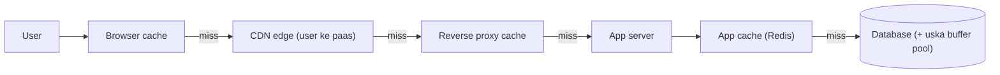
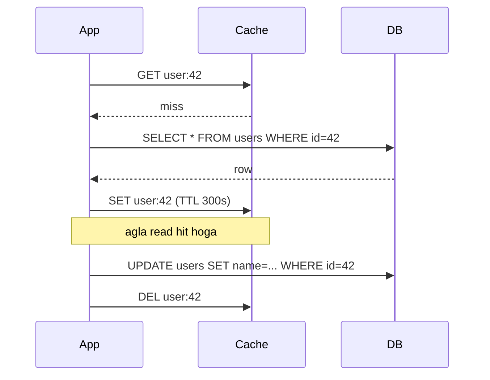
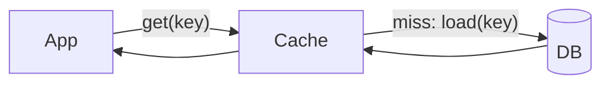
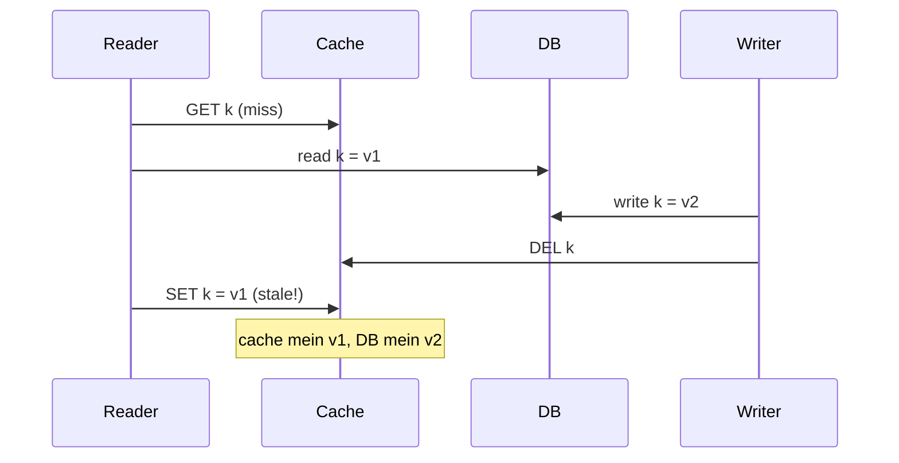
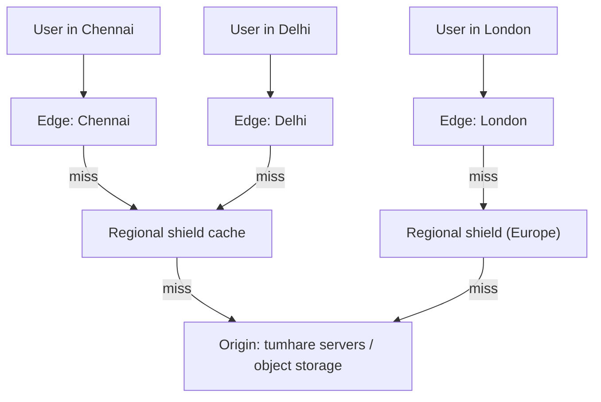

# Chapter 04 · Caching & CDNs

> Tumhari mummy har baar namak chahiye toh market nahi jaati. Kitchen mein ek chhota sa dabba rakha hota hai. Woh dabba khatam hota hai toh store room ke bade bag se bhar jaata hai, aur woh bada bag mahine mein ek baar market se bharta hai. **Woh chhota dabba hi cache hai.** Systems ko fast banane ka ye sabse powerful trick hai, aur computing ke kuch sabse gande bugs bhi yahin se paida hote hain.

**Is chapter mein tum seekhoge:**
- Caching kaam kyun karti hai (locality, skewed popularity) aur usse measure kaise karte hain (hit ratio)
- Cache layers: browser, CDN, reverse proxy, application, database
- Caching strategies: cache-aside, read-through, write-through, write-back, write-around
- Eviction policies (LRU, LFU, FIFO, TTL), chalne wale implementations ke saath
- Invalidation aur consistency ki problems, aur unke saath jeena kaise hai
- Thundering herd / cache stampede, cache penetration, cache avalanche, hot keys, aur inke fixes
- Redis vs Memcached, Redis data structures aur unke use cases, CDN push vs pull, cache keys aur TTL design

**Isse pehle padho:** [Chapter 01 · Foundations](01-foundations-internet.md) (latency numbers, HTTP headers) · [Chapter 02 · Scalability](02-scalability-load-balancing.md) · [Chapter 03 · Databases](03-databases.md) · DSA se: [Hashing](../part-2-dsa/05-hashing.md), [Linked Lists](../part-2-dsa/10-linked-lists.md), [Heaps](../part-2-dsa/15-heaps.md)

---

## 🧠 The Big Idea · Asli Baat

[Chapter 01](01-foundations-internet.md) ki latency table yaad karo: RAM ≈ 100 ns, network ke paar ek database query ≈ 1–10 ms, ek continent se doosre continent ka trip ≈ 150 ms. **Cache** ek chhota, fast store hai jo un cheezon ki **copies** rakhta hai jinhe laana ya calculate karna mehenga hai, aur unhe wahan ke **paas** rakhta hai jahan unki zaroorat hai.



Har layer pehle khud jawab dene ki koshish karti hai. Sirf **miss** hi aage jaata hai. Har **hit** do kaam karta hai: time bachata hai, **aur** apne peeche wali har cheez ko load se bachata hai.

Ye itna accha kaam kyun karta hai? Kyunki access **skewed** hota hai. Matlab data ka ek chhota hissa hi zyada tar requests le jaata hai. Aaj ka viral video, home page, top 100 products. Agar tumhare 20% items 80% reads le rahe hain, toh sirf us 20% ko cache kar do, aur zyada tar load gayab.

> 🇮🇳 **Desi Analogy:** Chai tapri wale bhaiya ko dekho. Doodh ka bada container peeche fridge mein hai (database). Lekin stove ke paas ek chhota bhagona hamesha garam rehta hai (cache). Customer aaya, "ek cutting" bola, bhagone se seedha chai. Ye **cache hit** hai. Bhagona khaali hai? Fridge tak jaao, doodh nikalo, ubaalo. Ye **cache miss** hai, slow hai. Aur bhaiya poori menu ki har cheez ready nahi rakhte. Sirf cutting chai aur bun maska, kyunki 80% customer wahi maangte hain. Yahi **skewed popularity** hai. Aur ek khatra bhi: bhagone ki chai thodi der purani ho sakti hai. Yahi **staleness** hai.

> 💡 **Core insight:** cache **freshness** aur **memory** dekar **speed** khareedta hai. Har caching decision asal mein ek hi sawaal hai: *ye data kitna purana (stale) chal sakta hai, aur jab cache galat ho ya khaali ho tab kya hoga?*

---

## 🔨 Building It Up · Zero Se Shuru

### 1. Hit ratio: the number that rules caching

- **Hit**: data cache mein mil gaya. Fast.
- **Miss**: cache mein nahi tha. Slow source tak jaana pada (aur usually result ko cache mein store bhi karte hain).
- **Hit ratio** = hits / (hits + misses).

**Average latency** bahut zyada hit ratio pe depend karti hai:

```python
CACHE_MS = 0.5     # same datacenter mein Redis
DB_MS = 10.0       # database query

for hit_ratio in (0.0, 0.5, 0.9, 0.99):
    avg = hit_ratio * CACHE_MS + (1 - hit_ratio) * (CACHE_MS + DB_MS)   # miss pe bhi pehle cache check hota hai
    db_load = 1 - hit_ratio
    print(f"hit ratio {hit_ratio:>4.0%}: avg latency {avg:5.2f} ms, DB sees {db_load:4.0%} of reads")
```

```text
hit ratio   0%: avg latency 10.50 ms, DB sees 100% of reads
hit ratio  50%: avg latency  5.50 ms, DB sees  50% of reads
hit ratio  90%: avg latency  1.50 ms, DB sees  10% of reads
hit ratio  99%: avg latency  0.60 ms, DB sees   1% of reads
```

Formula ko dhyaan se padho. Hit pe sirf cache ka time lagta hai (0.5 ms). Miss pe **dono** ka time lagta hai: pehle cache mein dekha (0.5 ms), nahi mila, phir DB gaye (10 ms). Isliye miss ka cost `CACHE_MS + DB_MS` hai, sirf `DB_MS` nahi.

Abhi kya hua: 90% se 99% hits pe jaane se database ka load **10× kam** ho gaya (10% → 1%). Isiliye teams hit ratio ke har ek percent ke liye ladti hain. Aur yahi table khatra bhi dikhata hai: agar cache achanak khaali ho jaaye, toh database pe normal se 10–100× load **turant** aa jaata hai. Ye baat yaad rakhna. Section 13 mein ye wapas aayegi.

> 🤔 **Mann mein sawaal:** 90% hit ratio toh already bahut accha hai. 99% ke liye itni mehnat kyun?
>
> **Jawab:** Kyunki DB ko hit ratio nahi dikhta, use **miss ratio** dikhta hai. 90% hits matlab 10% misses. 99% hits matlab 1% misses. Hit ratio mein sirf 9 points ka farak dikhta hai, lekin DB ke liye load **10 guna** kam ho gaya. Hamesha `1 - hit_ratio` se socho.

Ab dekhte hain ki popularity skew ki wajah se chhote caches bhi itne effective kyun hote hain. Hum requests simulate karte hain jahan item popularity **Zipf-like** distribution follow karti hai (item *k* ki request 1/k ke proportion mein aati hai, real web traffic aisa hi hota hai). Matlab item 1 sabse popular, item 2 uska aadha, item 3 ek-tihaai, aur aise hi:

```python
import random
from collections import OrderedDict

random.seed(0)
N_ITEMS = 10_000
weights = [1 / k for k in range(1, N_ITEMS + 1)]      # item 1 sabse popular hai
requests = random.choices(range(N_ITEMS), weights=weights, k=50_000)

def hit_ratio(capacity):
    cache, hits = OrderedDict(), 0
    for item in requests:
        if item in cache:
            hits += 1
            cache.move_to_end(item)
        else:
            cache[item] = True
            if len(cache) > capacity:
                cache.popitem(last=False)              # least recently used ko nikaalo
    return hits / len(requests)

for pct in (1, 5, 10, 20):
    cap = N_ITEMS * pct // 100
    print(f"cache holds {pct:>2}% of items -> hit ratio {hit_ratio(cap):.0%}")
```

```text
cache holds  1% of items -> hit ratio 39%
cache holds  5% of items -> hit ratio 58%
cache holds 10% of items -> hit ratio 67%
cache holds 20% of items -> hit ratio 76%
```

Abhi kya hua: sirf **1%** items rakhne wala cache already saari requests ka **39%** serve kar raha hai. Aur 20% items lagbhag teen-chauthai (three quarters) requests serve kar rahe hain, kyunki popular items hi traffic pe raaj karte hain. **Diminishing returns** bhi dekho: cache size har baar double karne pe faayda pehle se kam badhta hai. (Real traffic aksar isse bhi zyada skewed hota hai, toh hit ratio aur bhi upar jaata hai.) Interviews mein yahi baat "hot 20% ko cache karo" wale estimates ko justify karti hai ([Chapter 11](11-estimation-framework.md)).

### 2. What to cache

Acche candidates:

- **Read-heavy, kabhi-kabhi badalne wala data**: product details, user profiles, configuration, countries ki list.
- **Mehengi computations**: render kiya hua home page, recommendation list, ek bhaari SQL aggregation ka result.
- **Remote API results**: exchange rates, weather, kisi partner ka catalogue.
- **Session data** aur **auth tokens** ke lookups.
- **Static files**: images, CSS, JS, videos (CDNs isi kaam ke liye bane hain).

Bure candidates:

- Aisa data jo lagbhag har read pe badal jaata hai (live stock order book), jab tak thodi si staleness chal na jaaye.
- Ek hi baar padha jaane wala data (one-time report). Cache ko kabhi hit milega hi nahi.
- Bahut personalised data jiska reuse kam hai, jab tak uski computation mehengi na ho.
- Aisa data jahan **staleness khatarnak hai**: withdrawal se theek pehle account balance. Aisa data hamesha source of truth se padho.

### 3. The cache layers

**1. Browser (client) cache.** Browser HTTP headers ke hisaab se responses store karta hai. Hit pe network cost **zero**.

```text
HTTP/1.1 200 OK
Cache-Control: public, max-age=31536000, immutable
ETag: "v3-7f2a9c"
Content-Type: application/javascript
```

- `Cache-Control: max-age=N`: N seconds tak fresh hai. Us time mein browser koi request bhejta hi nahi.
- `no-cache`: store kar sakte ho, lekin har use se pehle **revalidate** karna padega. (Naam bahut confusing hai!)
- `no-store`: kabhi store mat karo (bank statements, sensitive pages).
- `private`: sirf user ka browser cache kar sakta hai, CDN jaise shared caches nahi. `public`: shared caches bhi kar sakte hain.
- `ETag` / `Last-Modified`: **revalidation** ke liye version tags. Browser poochta hai `If-None-Match: "v3-7f2a9c"`. Agar kuch nahi badla, server **`304 Not Modified`** bhejta hai, bina body ke.

> 🤔 **Mann mein sawaal:** `no-cache` ka matlab "cache mat karo" hi toh hona chahiye na?
>
> **Jawab:** Nahi, aur yahi sabse common galti hai. `no-cache` ka matlab hai "store kar lo, lekin use karne se pehle server se pooch lo ki ye abhi bhi sahi hai ya nahi". Asli "bilkul store mat karo" wala header `no-store` hai. Yaad rakhne ka tareeka: **no-store = store hi nahi**, **no-cache = bina poochhe use nahi**.

**2. CDN (Content Delivery Network).** Duniya bhar mein phaile **edge servers** ka network (inhe PoPs bhi kehte hain, points of presence) jo content ko users ke paas cache karte hain. Chennai ka user image Chennai edge se leta hai (5 ms), Virginia ke origin se nahi (220 ms). Iski detail section 17 mein hai.

**3. Reverse proxy cache.** Tumhare app ke saamne baitha NGINX, Varnish ya API gateway poore HTTP responses cache karta hai. Public pages aur aise API responses ke liye badhiya jo bahut saare users ke beech shared hain.

**4. Application cache.** Tumhara code objects ko yahan store karta hai:
- **Local in-process memory** (ek Python dict / `functools.lru_cache`): sabse fast (nanoseconds), lekin har server ki apni alag copy hoti hai (servers ke beech inconsistent) aur restart pe sab chala jaata hai.
- **Distributed cache** (Redis, Memcached): saare servers share karte hain, network pe ~0.5–1 ms, app restart ke baad bhi bacha rehta hai.

**5. Database cache.** DB khud hot pages ko RAM mein rakhta hai (**buffer pool**, [Chapter 03](03-databases.md)). Saath mein **materialized views** bhi (pehle se calculate kiye gaye query results). (MySQL ka purana "query cache" MySQL 8.0 mein hata diya gaya, kyunki har write pe use invalidate karna faayde se zyada nuksaan kar raha tha. Ye apne aap mein ek accha sabak hai.)

| Layer | Latency on hit | Shared by | Typical TTL | Invalidation control |
|---|---|---|---|---|
| Browser | 0 ms | Ek user | Seconds se ek saal | Kamzor (users ke browser ke andar tum haath nahi daal sakte) |
| CDN | ~5–30 ms | Ek region ke users | Minutes se days | Purge API, versioned URLs |
| Reverse proxy | ~1 ms | Saare users | Seconds se minutes | Purge, short TTL |
| App local memory | ~100 ns | Ek process | Seconds | Har process alag, sync karna mushkil |
| Distributed cache | ~0.5–1 ms | Saare app servers | Seconds se hours | Explicit delete, TTL |
| DB buffer pool | DB ke andar | Khud DB | Apne aap manage hota hai | Automatic |

Ek pattern dekho: layer user ke **jitni paas**, utni **fast**, lekin use invalidate karna utna hi **mushkil**. Browser sabse fast hai, lekin wahan tum kuch delete nahi kar sakte.

### 4. Strategy 1: Cache-aside (lazy loading)

Sabse common pattern. Yahan cache ko **application** khud manage karti hai:

- **Read**: pehle cache check karo. Miss hua toh DB se padho, **result cache mein daal do**, aur return karo.
- **Write**: DB mein likho, phir cache key ko **delete** (invalidate) kar do.



```python
class FakeDB:
    def __init__(self):
        self.rows = {42: {"name": "Asha", "city": "Pune"}}
        self.reads = 0

    def get(self, uid):
        self.reads += 1
        return dict(self.rows[uid])

    def update(self, uid, **fields):
        self.rows[uid].update(fields)

db = FakeDB()
cache = {}

def get_user(uid):
    key = f"user:{uid}"
    if key in cache:
        return cache[key], "hit"
    value = db.get(uid)                  # miss: source of truth se load karo
    cache[key] = value                   # ...aur cache bhar do
    return value, "miss"

def update_user(uid, **fields):
    db.update(uid, **fields)             # 1. database mein likho
    cache.pop(f"user:{uid}", None)       # 2. invalidate karo (delete, update nahi)

print(get_user(42))
print(get_user(42))
update_user(42, city="Mumbai")
print(get_user(42))
print("DB reads:", db.reads)
```

```text
({'name': 'Asha', 'city': 'Pune'}, 'miss')
({'name': 'Asha', 'city': 'Pune'}, 'hit')
({'name': 'Asha', 'city': 'Mumbai'}, 'miss')
DB reads: 2
```

Abhi kya hua: doosre read ne DB ko chhua tak nahi. Update ke baad humne key **delete** kar di, isliye agle read ne fresh data reload kiya. Teen reads hue, lekin DB tak sirf 2 gaye.

**Pros:** sirf wahi data cache hota hai jo maanga gaya; cache down ho jaaye toh bhi reads tootte nahi (bas DB tak jaate hain, dheere); simple hai. **Cons:** har key ki pehli request slow hoti hai (miss); TTL/invalidation tak data stale reh sakta hai; race conditions hoti hain (section 11).

> 💡 Write pe cache ko update karne ki jagah **delete** kyun karte hain? Do writers ek saath aaye, toh ho sakta hai DB ek order mein update ho aur cache doosre order mein. Cache hamesha ke liye galat value pakad ke baith jaayega. Delete karna simple hai: agla read sach ko reload kar lega. Aur ek bonus: aisi cache value calculate karne ki mehnat bach jaati hai jise shayad koi padhega hi nahi.

> 🇮🇳 **Desi Analogy:** Kirana store ka khata socho. Asli hisaab bade register mein hai (DB). Dukaandaar ne counter pe ek chit chipka rakhi hai: "Sharma ji: ₹450 baaki" (cache). Sharma ji ne ₹200 diye. Dukaandaar pehle **register mein** likhta hai (write DB), phir counter wali chit **phaad deta hai** (delete key). Agli baar koi Sharma ji ka hisaab pooche, toh register dekh ke nayi chit bana lega (miss → reload). Chit ko kaat-peet ke update karne mein galti ka chance hai. Phaad dena hamesha safe hai.

### 5. Strategy 2: Read-through

Cache-aside jaisa hi hai, lekin miss pe database se load **cache khud** karta hai. App sirf cache se baat karti hai. Loading ka logic kisi cache library ya provider ke andar rehta hai.



**Pros:** application code simple ho jaata hai; loading logic ek hi jagah hota hai. **Cons:** aisa cache chahiye jo loaders support kare (jaise Java mein Caffeine jaisi libraries, ya khud ki banayi caching layer); staleness ki problems wahi hain.

> 🤔 **Mann mein sawaal:** Cache-aside aur read-through mein asli farak kya hai? Dono mein miss pe DB se hi toh load hota hai.
>
> **Jawab:** Farak sirf ye hai ki **DB tak kaun jaata hai**. Cache-aside mein tumhara app code khud DB ko call karta hai aur cache bharta hai. Read-through mein app sirf `cache.get(key)` bolta hai, aur DB se laane ka kaam cache library ke andar chhupa hota hai. Behaviour same, code ki zimmedari alag.

### 6. Strategy 3: Write-through

Har write **cache aur database dono mein synchronously** jaata hai. Write tabhi successful maana jaata hai jab dono ho jaayein.

**Pros:** jo keys likhi gayi hain, unke liye cache hamesha up to date; write ke turant baad wale reads hit hote hain. **Cons:** har write ko do writes ka cost dena padta hai (write latency zyada); cache aise data se bhar jaata hai jo shayad kabhi padha hi na jaaye (isliye TTL ke saath use karo).

### 7. Strategy 4: Write-back (write-behind)

Writes **sirf cache mein** jaate hain aur turant return ho jaate hain. Cache baad mein **asynchronously** changes ko database mein flush karta hai, aksar batches mein.

**Pros:** bahut fast writes; batching aur coalescing (ek hi counter ke 10 updates DB mein sirf 1 write ban jaate hain). **Cons:** agar flush se pehle cache node mar gaya toh **data loss ka risk**; DB thodi der peeche chalta hai; zyada complex.

Kahan accha: view counters, likes, analytics events, game scores, kuch bhi jahan kuch seconds ke updates kho jaana chal jaata hai. Kahan bura: payments, orders.

> 🇮🇳 **Desi Analogy:** Cricket match mein scorer har ball pe apni notebook mein run likhta hai (cache), lekin stadium ka bada scoreboard (DB) har over ke baad ek saath update hota hai (batch flush). Chhe balls ke chhe updates, scoreboard pe sirf ek. Ye **write-back** hai, fast aur efficient. Lekin agar over ke beech mein scorer ki notebook baarish mein bheeg gayi, toh us over ke runs gaye. Yahi **data loss risk** hai. Isliye match ka view counter write-back pe chal sakta hai, bank ka paisa nahi.

### 8. Strategy 5: Write-around

Writes **seedha database mein** jaate hain, cache ko skip karke. Cache sirf reads pe bharta hai (usually cache-aside ke through).

**Pros:** cache aise data se nahi bharta jo ek baar likha jaata hai aur kabhi-kabhar padha jaata hai (jaise log entries, bulk imports). **Cons:** write ke turant baad wala read miss hota hai.

Chalo saari strategies ko ek hi workload pe side by side compare karte hain:

```python
class Backend:
    def __init__(self):
        self.data, self.writes = {}, 0

    def write(self, k, v):
        self.writes += 1
        self.data[k] = v

def run(strategy):
    db, cache, dirty = Backend(), {}, set()
    for i in range(5):                       # ek hi hot counter ke 5 updates
        if strategy == "write-through":
            cache["views"] = i; db.write("views", i)
        elif strategy == "write-back":
            cache["views"] = i; dirty.add("views")      # baad mein flush hoga
        elif strategy == "write-around":
            db.write("views", i); cache.pop("views", None)
    db_before_flush = db.data.get("views")
    if strategy == "write-back":                         # periodic flush
        for k in dirty:
            db.write(k, cache[k])
    return f"{strategy:<13} DB writes={db.writes}  DB before flush={db_before_flush}  " \
           f"cache has views? {'views' in cache}"

for s in ("write-through", "write-back", "write-around"):
    print(run(s))
```

```text
write-through DB writes=5  DB before flush=4  cache has views? True
write-back    DB writes=1  DB before flush=None  cache has views? True
write-around  DB writes=5  DB before flush=4  cache has views? False
```

Abhi kya hua: write-back ne 5 updates ko **1** DB write mein coalesce kar diya. Lekin flush hone tak DB ke paas **kuch bhi nahi** tha (`None`). Agar us waqt cache crash ho jaata, toh paanchon updates gaye. Write-through ne dono ko sync mein rakha, lekin 5 DB writes plus 5 cache writes ki keemat pe. Write-around ne cache ko saaf rakha, lekin agle read ke liye cache khaali chhod diya.

| Strategy | Read path | Write path | Consistency | Risk | Best for |
|---|---|---|---|---|---|
| Cache-aside | App cache check karta hai, miss pe DB se load | App DB mein likhta hai, key delete | TTL/invalidate tak stale | Races, cold misses | General purpose default |
| Read-through | Miss pe cache khud DB se load karta hai | (kisi write strategy ke saath jodi banti hai) | Cache-aside jaisa | Loader support chahiye | App code simple karna |
| Write-through | Haal hi mein likhe data pe hits | Cache + DB synchronously | Likhi gayi keys ke liye strong | Slow writes, cache pollution | Read-after-write heavy data |
| Write-back | Hits | Cache abhi, DB baad mein | DB peeche chalta hai | **Cache fail hua toh data loss** | Counters, high write rates |
| Write-around | Write ke baad miss | Sirf DB | Agle load pe fresh | Read-after-write misses | Ek baar likho, kabhi-kabhar padho |

### 9. Eviction policies

Caches chhote hote hain. Bhar gaye toh kuch na kuch nikaalna padega. Kya nikle, ye **eviction policy** decide karti hai.

- **LRU (Least Recently Used)**: jo item sabse lambe time se access nahi hua, use nikaalo. Assumption: jo haal hi mein use hua, uske dobara use hone ke chances zyada. Sabse common default.
- **LFU (Least Frequently Used)**: jis item ke sabse kam accesses hain, use nikaalo. Long-term favourites bach jaate hain; lekin jo item kal popular tha woh aaj bhi atka reh sakta hai (isliye real LFUs counts ko time ke saath **decay** karte hain).
- **FIFO (First In, First Out)**: jo sabse pehle daala gaya, use nikaalo, chahe kitna bhi use ho raha ho. Simple, lekin usually kharab.
- **TTL (Time To Live)**: har item ek fixed time ke baad expire ho jaata hai. Ye **freshness** ke baare mein hai, space ke baare mein nahi, aur LRU/LFU ke saath milke use hota hai.
- **Random**: koi bhi random item nikaal do. Surprisingly theek-thaak kaam karta hai aur bahut sasta hai.

> 🇮🇳 **Desi Analogy:** Phone mein WhatsApp ki storage full ho gayi. **LRU** wala kehta hai: "Jis chat ko sabse lambe time se khola nahi, uski media udaao." **LFU** wala kehta hai: "Jis chat ko total sabse kam baar khola, woh udaao, chahe kal hi khola ho." **FIFO** wala kehta hai: "Jo media sabse pehle aayi, woh udaao", aur galti se family group ki shaadi wali photos bhi chali jaati hain, jo roz dekhi jaati hain. **TTL** "disappearing messages" hai: 7 din baad apne aap gayab, storage full ho ya na ho.

**LRU** ek classic interview problem hai (*LRU Cache*, LeetCode 146): `get` aur `put` dono **O(1)** mein, **hash map + doubly linked list** se ([Linked Lists](../part-2-dsa/10-linked-lists.md)). Map kisi bhi node ko O(1) mein dhoondh deta hai. List nodes ko recency ke order mein rakhti hai, taaki move karna aur evict karna O(1) ho.

```python
class Node:
    __slots__ = ("key", "value", "prev", "next")

    def __init__(self, key=None, value=None):
        self.key, self.value = key, value
        self.prev = self.next = None

class LRUCache:
    def __init__(self, capacity):
        self.capacity = capacity
        self.map = {}
        self.head, self.tail = Node(), Node()      # sentinels: head.next = sabse recent
        self.head.next, self.tail.prev = self.tail, self.head

    def _remove(self, node):
        node.prev.next, node.next.prev = node.next, node.prev

    def _add_front(self, node):
        node.prev, node.next = self.head, self.head.next
        self.head.next.prev = node
        self.head.next = node

    def get(self, key):
        if key not in self.map:
            return None
        node = self.map[key]
        self._remove(node)
        self._add_front(node)                      # most recently used mark karo
        return node.value

    def put(self, key, value):
        if key in self.map:
            self._remove(self.map[key])
        node = Node(key, value)
        self.map[key] = node
        self._add_front(node)
        if len(self.map) > self.capacity:
            lru = self.tail.prev                   # least recently used sabse peeche hai
            self._remove(lru)
            del self.map[lru.key]
            print(f"  evicted {lru.key}")

    def order(self):
        out, node = [], self.head.next
        while node is not self.tail:
            out.append(node.key)
            node = node.next
        return out

cache = LRUCache(3)
for k in ["a", "b", "c"]:
    cache.put(k, k.upper())
print("order (recent first):", cache.order())
cache.get("a")                                     # a ko touch karo
print("after get(a):", cache.order())
cache.put("d", "D")                                # b evict hoga, sabse kam recent
print("after put(d):", cache.order())
```

```text
order (recent first): ['c', 'b', 'a']
after get(a): ['a', 'c', 'b']
  evicted b
after put(d): ['d', 'a', 'c']
```

Abhi kya hua: `get("a")` ne `a` ko aage khiska diya, isliye jab `d` aaya tab least recently used item `b` tha. Do cheezein dhyaan se dekho:

- **Sentinels** (`head` aur `tail`, khaali dummy nodes): inki wajah se list kabhi sach mein "khaali" nahi hoti, toh `_remove` aur `_add_front` mein "agar ye pehla node hai toh..." jaise special cases likhne hi nahi padte.
- Node ke andar **key bhi store** hoti hai. Kyun? Evict karte waqt hum list ke peeche se node uthaate hain, aur map se bhi use hatana hai (`del self.map[lru.key]`). Agar node ko apni key pata na ho, toh map mein use dhoondhna O(n) ho jaata.

Python mein `collections.OrderedDict` ke `move_to_end` aur `popitem(last=False)` se yahi cheez kuch lines mein mil jaati hai (humne section 1 mein use kiya tha), aur `functools.lru_cache` function results ke liye yahi karta hai.

**LFU** ko O(1) mein karne ke liye chahiye: key → frequency ka ek map, frequency → keys ka ordered set wala ek map, aur ek `min_freq` tracker (*LFU Cache*, LeetCode 460):

```python
from collections import defaultdict, OrderedDict

class LFUCache:
    def __init__(self, capacity):
        self.capacity = capacity
        self.values = {}                             # key -> value
        self.freq = {}                               # key -> kitni baar access hua
        self.buckets = defaultdict(OrderedDict)      # count -> keys (andar LRU order)
        self.min_freq = 0

    def _touch(self, key):
        f = self.freq[key]
        del self.buckets[f][key]
        if not self.buckets[f] and self.min_freq == f:
            self.min_freq += 1
        self.freq[key] = f + 1
        self.buckets[f + 1][key] = None

    def get(self, key):
        if key not in self.values:
            return None
        self._touch(key)
        return self.values[key]

    def put(self, key, value):
        if self.capacity == 0:
            return
        if key in self.values:
            self.values[key] = value
            self._touch(key)
            return
        if len(self.values) >= self.capacity:
            victim, _ = self.buckets[self.min_freq].popitem(last=False)
            del self.values[victim], self.freq[victim]
            print(f"  evicted {victim}")
        self.values[key], self.freq[key] = value, 1
        self.buckets[1][key] = None
        self.min_freq = 1

lfu = LFUCache(2)
lfu.put("home", 1); lfu.put("about", 2)
for _ in range(3):
    lfu.get("home")                                  # home ek long-term favourite hai
lfu.get("about")
lfu.put("promo", 3)                                  # about evict hoga (freq 2 < home ka 4)
print(sorted(lfu.values), lfu.freq)
```

```text
  evicted about
['home', 'promo'] {'home': 4, 'promo': 1}
```

Step by step samjho: `home` ki frequency = 1 (put) + 3 (gets) = 4. `about` ki = 1 (put) + 1 (get) = 2. `promo` aaya, cache full hai, toh `min_freq` wale bucket (frequency 2) se sabse purani key nikli: `about`. Naya item hamesha frequency 1 se shuru hota hai, isliye `min_freq = 1` reset hota hai. Har bucket ke andar `OrderedDict` hai, toh agar same frequency pe tie ho, toh faisla LRU order se hota hai.

**TTL cache** har value ke saath uska expiry time store karta hai:

```python
class TTLCache:
    def __init__(self):
        self.store = {}                      # key -> (value, expires_at)

    def set(self, key, value, ttl, now):
        self.store[key] = (value, now + ttl)

    def get(self, key, now):
        item = self.store.get(key)
        if item is None:
            return None
        value, expires_at = item
        if now >= expires_at:                # lazy expiry: access ke waqt check hota hai
            del self.store[key]
            return None
        return value

c = TTLCache()
c.set("rate:USD-INR", 83.2, ttl=60, now=0)
print(c.get("rate:USD-INR", now=30))
print(c.get("rate:USD-INR", now=61))
```

```text
83.2
None
```

(Redis bhi access pe yahi **lazy expiry** karta hai, aur saath mein ek background job chalata hai jo kuch keys sample karke expired wali delete karta rehta hai, taaki memory mari hui keys se na bhar jaaye.)

| Policy | Evicts | Strength | Weakness |
|---|---|---|---|
| LRU | Sabse lambe time se unused | Recency patterns ke liye badhiya; O(1) | Bahut saare items ka ek one-time scan poora hot set saaf kar deta hai |
| LFU | Overall sabse kam use hua | Steady favourites bach jaate hain | Decay ke bina purane popular items atke rehte hain; bookkeeping zyada |
| FIFO | Sabse pehle daala gaya | Bahut simple | Hot items ko sirf purane hone ki wajah se nikaal deta hai |
| Random | Koi bhi | Bahut sasta, koi metadata nahi | Unpredictable |
| TTL | Expired items | Staleness ki limit tay karta hai | Akele space policy nahi hai |

### 10. Invalidation: the hard part

Phil Karlton ke naam se ek famous joke chalta hai: *"There are only two hard things in computer science: cache invalidation and naming things."* Invalidation mushkil isliye hai kyunki cache ek **copy** hai, aur copies dheere-dheere asli se alag ho jaati hain (drift).

Cache ko imaandaar rakhne ke tareeke:

1. **TTL expiry**: sabse simple. Staleness kabhi TTL se zyada nahi hogi. TTL is sawaal se chuno: "kitna purana data chalega?"
2. **Write pe explicit invalidation**: data badla toh key delete karo (cache-aside). Fresh rehta hai, lekin tumhe us data se bani **har ek** key dhoondhni padegi (user object, user ka profile page, "top users" list...).
3. **Event-driven invalidation**: database ka change stream (change data capture, CDC) ya message queue pe aaya ek event saare caches mein deletes trigger karta hai ([Chapter 08](08-queues-events.md)). Isse writers ko caches ke baare mein jaanna hi nahi padta (decoupling).
4. **Versioned keys**: key mein ek version daal do (`product:42:v7`). Write hone pe version badha do. Purani entries ko koi padhta hi nahi, woh apne aap age out ho jaati hain. Static assets aise hi kaam karte hain: content badla toh `app.3f9a1c.js` ka naam badal gaya, isliye use "hamesha ke liye" cache kar sakte ho.

```python
cache = {}
versions = {"product:42": 1}

def key_for(entity):
    return f"{entity}:v{versions[entity]}"

def read(entity, load):
    k = key_for(entity)
    if k not in cache:
        cache[k] = load()
    return cache[k]

price = {"value": 999}
print(read("product:42", lambda: dict(price)))
price["value"] = 899                         # DB update hua...
versions["product:42"] += 1                  # ...aur version badh gaya: delete ki zaroorat nahi
print(read("product:42", lambda: dict(price)))
print("keys in cache:", sorted(cache))       # purana version TTL/LRU se apne aap nikal jaayega
```

```text
{'value': 999}
{'value': 899}
keys in cache: ['product:42:v1', 'product:42:v2']
```

> 🇮🇳 **Desi Analogy:** School ke notice board pe "Exam Timetable v1" laga hai. Date badli, toh peon purane kaagaz ko mitaata nahi, upar naya "Timetable v2" laga deta hai. Sab log sirf latest version padhte hain. Purana kaagaz neeche pada rehta hai jab tak safai mein nikal na jaaye (TTL/LRU). Yahi **versioned keys** hain: delete ki tension hi khatam.

### 11. Consistency problems you must know

**a) Cache-aside mein stale-set race.** Reader R ka miss hua aur usne DB se padha (purani value). R cache mein likhe, usse pehle writer W ne DB update kiya aur key delete kar di. Ab R aata hai aur **purani** value cache mein likh deta hai. Ab TTL expire hone tak cache stale rahega.



Problem ki jad samjho: W ka `DEL` **R ke `SET` se pehle** ho gaya. Delete ne ek khaali cache ko delete kiya, jo bekaar tha. Phir R ne apni purani value daal di, aur ab use hatane wala koi nahi.

Fixes: hamesha **TTL** lagao (nuksaan ki limit tay hoti hai); **delayed double delete** (write ke thodi der baad ek baar aur delete karo); Memcached-style **leases** (cache miss wale reader ko ek token deta hai; beech mein delete hua toh token invalid ho jaata hai aur late `SET` reject ho jaata hai); ya versioned writes (sirf tab set karo jab version naya ho).

**b) Write ordering.** "Pehle cache update, phir DB" mein ho sakta hai cache mein woh value baithi rahe jise DB ne reject kar diya. "Pehle DB, phir cache update" mein do concurrent writers cache mein purani value chhod sakte hain. **Pehle DB likho, phir cache delete karo**: yahi sabse safe simple rule hai.

**c) Failed invalidation.** DB write ho gaya, lekin Redis ka delete call time out ho gaya. Iska ilaaj: retries, TTLs, aur DB ke change log se event-driven invalidation.

**d) Multiple local caches.** Har app server ke in-process cache mein alag version ho sakta hai. Local TTLs chhote rakho, ya invalidations broadcast karo (Redis pub/sub).

**e) Read-your-own-writes.** User ne apna profile edit kiya, refresh kiya, aur cache se purana wala dikh gaya. Fix: write pe delete karo (taaki uska agla read miss ho), ya kuch seconds ke liye user ke apne data ke liye cache bypass karo. (Ye "read-your-writes" wala idea hum replicas ke saath [Chapter 05](05-replication-sharding.md) mein phir milenge.)

> 💡 Interview mein imaandaar jawab: "Caches are **eventually consistent** with the database. I'll use cache-aside with delete-on-write and a TTL as a safety net, and I won't cache data where staleness is unacceptable."

### 12. Thundering herd / cache stampede

Ek bahut popular key (home page, kisi celebrity ka profile) **expire** ho jaati hai. Agle hi millisecond mein 5,000 requests ek saath miss karti hain, aur paanchon hazaar same value banane ke liye database pe pahunch jaati hain. DB gir jaata hai. Ise **cache stampede** kehte hain (ek tarah ka **thundering herd**: ek resource ke liye bahut saare intezaar karne wale ek saath jaag jaate hain).

> 🇮🇳 **Desi Analogy:** IRCTC Tatkal, subah 10 baje. Lakhon log ek hi second pe "Book" dabate hain, aur server baith jaata hai. Stampede bilkul yahi hai, bas yahan sab log **ek hi cheez** maang rahe hain jo cache se abhi-abhi gayab hui. Fix ko aise socho: railway counter pe ek hi clerk chart lene andar jaata hai (**single-flight**), baaki line mein khade rehte hain. Ya jab tak naya chart nahi aata, purana chart hi board pe laga rehta hai (**stale-while-revalidate**).

Fixes:

1. **Request coalescing / single-flight / mutex**: sirf **pehla** miss value rebuild karta hai; baaki uska intezaar karte hain (ya thodi der stale value serve karte hain). Redis mein pehli request lock leti hai: `SET lock:key token NX EX 10`.
2. **Stale-while-revalidate**: purani value serve karte raho jab tak **ek** background task use refresh kar raha hai. (HTTP mein iske liye header hai: `Cache-Control: max-age=60, stale-while-revalidate=30`.)
3. **Early probabilistic refresh**: expiry paas aate hi har reader ke paas early refresh karne ka ek chhota, badhta hua chance hota hai, taaki sab ek saath miss karein usse pehle hi koi ek request refresh kar de.
4. **Kabhi expire na hone wali hot keys**, jinhe ek background job refresh karta rehta hai.

```python
import threading
import time

class Database:
    def __init__(self):
        self.queries = 0
        self.lock = threading.Lock()

    def expensive_query(self):
        with self.lock:
            self.queries += 1
        time.sleep(0.05)                       # ek slow query
        return "home page data"

def naive(db, cache, n=50):
    def handle():
        if "home" not in cache:
            cache["home"] = db.expensive_query()   # har miss DB tak jaata hai
    threads = [threading.Thread(target=handle) for _ in range(n)]
    for t in threads: t.start()
    for t in threads: t.join()

def single_flight(db, cache, n=50):
    rebuild_lock = threading.Lock()
    def handle():
        if "home" in cache:
            return
        with rebuild_lock:                     # sirf ek thread rebuild karega
            if "home" not in cache:            # lock milne ke baad dobara check karo
                cache["home"] = db.expensive_query()
    threads = [threading.Thread(target=handle) for _ in range(n)]
    for t in threads: t.start()
    for t in threads: t.join()

for strategy in (naive, single_flight):
    db = Database()
    strategy(db, cache={})
    print(f"{strategy.__name__:<14}: 50 concurrent misses -> {db.queries} DB queries")
```

```text
naive         : 50 concurrent misses -> 50 DB queries
single_flight : 50 concurrent misses -> 1 DB queries
```

Abhi kya hua: naive approach mein saare 50 threads ne khaali cache dekha aur sabne DB query kiya. Single-flight mein ek thread ne value rebuild ki, baaki 49 lock pe ruke rahe, aur jab unki baari aayi toh cache bhara hua mila (lock lene ke baad wala **double-check** zaroori hai). Distributed system mein ye lock ek process ke andar nahi, Redis mein rehta hai.

> 🤔 **Mann mein sawaal:** Lock ke andar dobara `if "home" not in cache` kyun? Bahar toh check kar hi liya tha.
>
> **Jawab:** Bahar wala check lock ke **bina** hua tha. 49 threads ne ek saath khaali cache dekha aur sab lock ki line mein lag gaye. Pehla thread value bana ke nikla. Ab doosre thread ko lock mila. Agar woh dobara check na kare, toh woh bhi DB query kar dega, phir teesra bhi... aur hum wapas 50 queries pe. Andar wala check kehta hai: "line mein khade-khade shayad kisi ne kaam kar diya ho, pehle dekh lo." Isi ko **double-checked locking** kehte hain.

### 13. Cache avalanche

Bahut saari keys **ek hi time pe** expire hoti hain, ya poora cache cluster restart ho jaata hai, aur misses ki baadh DB pe aa jaati hai. Example: tumne 9:00 baje 10 lakh (1 million) product keys warm ki, TTL = 1 hour. 10:00 baje sab ek saath expire.

Fixes:

- **TTL jitter**: randomness daalo, jaise `ttl = 3600 + random(0, 600)`, taaki expiries phail jaayein.
- Cache ke liye **high availability** (replicas, clustering), taaki ek node fail hone se cache khaali na ho.
- Naye cache pe traffic bhejne se pehle **cache warming**.
- Database ke aage **circuit breakers, rate limiting aur load shedding** ([Chapter 09](09-microservices-reliability.md)), taaki woh girne ki jagah dheere-dheere degrade ho.

```python
import random
from collections import Counter

random.seed(42)
KEYS = 10_000
BASE_TTL = 3600

no_jitter = Counter(BASE_TTL // 60 for _ in range(KEYS))
jitter = Counter((BASE_TTL + random.randint(0, 600)) // 60 for _ in range(KEYS))

print("without jitter: worst minute has", max(no_jitter.values()), "expiries")
print("with jitter   : worst minute has", max(jitter.values()), "expiries")
```

```text
without jitter: worst minute has 10000 expiries
with jitter   : worst minute has 1039 expiries
```

Abhi kya hua: jitter ke bina saari 10,000 keys ek hi minute mein expire hoti hain. 10 minute tak ke random jitter ke saath woh 11 minutes mein phail jaati hain, toh sabse bure minute mein bhi lagbhag ek-dasvaan hissa (a tenth) refreshes aate hain. Jitter window aur badi karo, toh woh aur patle phailenge.

> 🇮🇳 **Desi Analogy:** Office ke 500 log agar ek saath 1 baje lunch pe jaayein, toh canteen ki line building ke bahar tak. HR ne bola: "Lunch 1 se 1:30 ke beech kabhi bhi." Wahi 500 log, wahi canteen, lekin line ab manageable hai. **TTL jitter** yahi hai: kaam utna hi, bas ek second pe nahi.

### 14. Cache penetration

Requests aisi keys maangti hain jo DB mein **hain hi nahi** (koi bug, ya ek attacker loop mein `product:-1`, `product:999999999` maang raha hai). Har request cache miss karti hai (cache karne ko kuch hai hi nahi), DB tak jaati hai, kuch nahi milta. Cache **zero** protection deta hai.

Fixes:

- **Negative caching**: "not found" result ko bhi cache karo, short TTL ke saath (`product:999999999 → NULL, TTL 60 s`).
- Aage ek **Bloom filter**: ek compact structure jisme saari valid IDs hain. Agar woh kahe "definitely not present", toh cache ya DB ko chhue bina reject kar do ([Chapter 03](03-databases.md) ki practice mein humne ek banaya tha).
- **Input validation** aur har client pe **rate limiting**.

```python
class Service:
    def __init__(self):
        self.db = {1: "phone", 2: "laptop"}
        self.cache = {}
        self.db_hits = 0
        self.MISSING = object()                       # "pata hai ye exist nahi karta" ka sentinel

    def get(self, pid, negative_caching):
        if pid in self.cache:
            value = self.cache[pid]
            return None if value is self.MISSING else value
        self.db_hits += 1
        value = self.db.get(pid)
        if value is not None:
            self.cache[pid] = value
        elif negative_caching:
            self.cache[pid] = self.MISSING            # "nahi hai" ko yaad rakho (real life mein short TTL)
        return value

for neg in (False, True):
    s = Service()
    for _ in range(1000):
        s.get(999_999, negative_caching=neg)          # attacker ek missing id pe hathoda chala raha hai
    print(f"negative caching={neg!s:<5}: DB hits = {s.db_hits}")
```

```text
negative caching=False: DB hits = 1000
negative caching=True : DB hits = 1
```

Ek chhoti si baat code mein: `MISSING = object()` kyun, seedha `None` kyun nahi? Kyunki `cache.get(pid)` bhi key na milne pe `None` deta hai. Agar "not found" ko `None` se store karte, toh "cache mein hai hi nahi" aur "cache mein likha hai ki DB mein nahi hai" mein farak nahi kar paate. Ek unique `object()` sentinel ye confusion khatam karta hai.

| Problem | What happens | Fixes |
|---|---|---|
| **Stampede / thundering herd** | Ek hot key expire hui, bahut saare concurrent misses use rebuild karte hain | Single-flight lock, stale-while-revalidate, early refresh |
| **Avalanche** | Bahut saari keys ek saath expire / cache mar gaya | TTL jitter, HA cache, warming, DB protection |
| **Penetration** | Non-existent keys ki requests hamesha DB tak pahunchti hain | Negative caching, Bloom filter, validation, rate limits |
| **Hot key** | Ek key pe itna traffic ki ek cache node pighal jaaye | Local cache, key replication/splitting, CDN |

### 15. Hot keys

Distributed cache mein har key **ek** node pe rehti hai (consistent hashing se chuni jaati hai, [Chapter 05](05-replication-sharding.md)). Agar ek key bahut zyada hot hai (scandal ke time kisi celebrity ka profile, flash-sale wala product), toh woh ek node uska saara traffic jhelta hai aur pighal jaata hai, jabki baaki nodes khaali baithe hain.

Fixes:

- Sabse hot keys ke liye **local in-process cache** (1–5 second ka TTL bhi zyada tar reads sokh leta hai).
- **Key splitting / replication**: copies ko `product:42#0` … `product:42#9` naam se alag-alag nodes pe rakho; readers random suffix chunte hain; writers saari copies update karte hain.
- Cache node ki **read replicas**.
- Agar public data hai toh **CDN pe push kar do**.
- **Hot keys detect karo** (LFU policy ke saath Redis mein `--hotkeys` sampling hai; ya sampled access log mein keys gino).

```python
import hashlib
import random
from collections import Counter

random.seed(1)
NODES = 4

def node_for(key):
    return int(hashlib.md5(key.encode()).hexdigest(), 16) % NODES

traffic = ["celeb:profile"] * 9000 + [f"user:{i}" for i in range(1000)]
random.shuffle(traffic)

plain = Counter(node_for(k) for k in traffic)
split = Counter(node_for(f"{k}#{random.randrange(16)}") if k == "celeb:profile" else node_for(k)
                for k in traffic)

print("per-node load, no splitting:", [plain[n] for n in range(NODES)])
print("per-node load, hot key x16 :", [split[n] for n in range(NODES)])
```

```text
per-node load, no splitting: [9268, 249, 247, 236]
per-node load, hot key x16 : [2540, 2501, 1885, 3074]
```

Abhi kya hua: splitting ke bina ek node lagbhag saare 9,000 hot reads utha raha hai. Hot key ko 16 copies mein todne se (`celeb:profile#0` … `#15`, jo alag-alag nodes pe hash hoti hain) woh traffic saare nodes pe phail gaya. Keemat: ek write ko ab saari 16 copies update (ya delete) karni padti hain. (Distribution perfect barabar nahi hai, kyunki 16 copies 4 nodes pe hash se bant-ti hain aur hash thoda unequal baant sakta hai. Phir bhi 9268 vs 236 se toh kahin behtar.)

### 16. Redis vs Memcached, and Redis data structures

Dono in-memory key-value stores hain jo distributed cache ki tarah use hote hain.

| | Memcached | Redis |
|---|---|---|
| Data types | Sirf strings (blobs) | Strings, hashes, lists, sets, sorted sets, streams, bitmaps, HyperLogLog, geo |
| Threading | Multi-threaded | Command execution mainly single-threaded (I/O threads optional), isliye har command atomic |
| Persistence | Kuch nahi | Optional: RDB snapshots, AOF (append-only log) |
| Replication / HA | Built-in kuch nahi (client-side sharding) | Replicas, failover ke liye Sentinel, sharding ke liye Redis Cluster |
| Extras | Simple, fast | Pub/sub, Lua scripts, transactions (MULTI), har key pe TTL, streams |
| Eviction | LRU | Configurable: `allkeys-lru`, `allkeys-lfu`, `volatile-ttl`, `noeviction`, ... |
| Choose when | Pure, simple, bade objects ka cache, multi-core scaling | Baaki lagbhag sab kuch |

**Redis data structures aur woh kis kaam aate hain:**

| Structure | Commands (examples) | Use cases |
|---|---|---|
| String | `SET`, `GET`, `INCR`, `SETNX`, `EXPIRE` | Cached objects, counters, rate-limit counters, distributed locks |
| Hash | `HSET`, `HGET`, `HINCRBY` | Fields wale objects (user profile), partial updates |
| List | `LPUSH`, `RPOP`, `LRANGE`, `BLPOP` | Recent items, simple queues |
| Set | `SADD`, `SISMEMBER`, `SINTER` | Unique visitors, tags, "mutual friends" |
| Sorted set (ZSET) | `ZADD`, `ZINCRBY`, `ZREVRANGE`, `ZRANGEBYSCORE` | **Leaderboards**, priority queues, score ke hisaab se timelines, sliding-window rate limiting |
| Bitmap | `SETBIT`, `BITCOUNT` | Har din ke daily active users, har user ID ke liye ek bit |
| HyperLogLog | `PFADD`, `PFCOUNT` | Approximate unique counts sirf ~12 KB memory mein (≈0.81% error) |
| Geo | `GEOADD`, `GEOSEARCH` | "2 km ke andar ke drivers" |
| Stream | `XADD`, `XREADGROUP` | Event logs, consumer groups wali lightweight message queues |
| Pub/Sub | `PUBLISH`, `SUBSCRIBE` | Fire-and-forget notifications, cache invalidation broadcasts |

Redis sorted set roughly ek hash map plus ek skip list hai (ek sorted structure jisme inserts O(log n) hote hain). Yahan leaderboard wala idea plain Python mein hai, taaki dikhe ki `ZINCRBY` aur `ZREVRANGE` tumhe kya dete hain:

```python
import heapq

scores = {}                                    # member -> score (Redis ise sorted rakhta hai)

def zincrby(member, delta):
    scores[member] = scores.get(member, 0) + delta

def zrevrange(n):
    return heapq.nlargest(n, scores.items(), key=lambda kv: (kv[1], kv[0]))

for player, pts in [("asha", 50), ("ravi", 30), ("meera", 70), ("asha", 40), ("kabir", 10)]:
    zincrby(player, pts)
print("top 3:", zrevrange(3))
```

```text
top 3: [('asha', 90), ('meera', 70), ('ravi', 30)]
```

(Real Redis `ZREVRANGE leaderboard 0 2 WITHSCORES` ko O(log n + k) mein karta hai, kyunki set hamesha sorted rakha jaata hai; hamara `nlargest` O(n log k) hai, demo ke liye theek hai.)

**Eviction config zaroori hai:** `maxmemory` aur ek policy set karo. Pure cache ke liye `allkeys-lru` ya `allkeys-lfu`. Agar Redis mein aisa data bhi hai jo kho nahi sakte (sessions jinki DB mein copy nahi hai), toh savdhaan: eviction use delete kar dega. Bahut si teams "cache" (evict ho sakta hai) aur "data" (evict nahi hona chahiye) ke liye **alag** Redis clusters chalaati hain.

### 17. CDNs in depth

**CDN** geographically phaile hue caching proxy servers ka ek set hai. Users ko (GeoDNS ya anycast se, [Chapter 02](02-scalability-load-balancing.md)) sabse paas wale **edge** pe bheja jaata hai. Edge ya toh cached content serve karta hai, ya use tumhare **origin** (tumhare servers ya object storage) se le aata hai.



> 🇮🇳 **Desi Analogy:** Amul ka factory Anand, Gujarat mein hai (origin). Lekin Chennai wala Amul butter lene Anand nahi jaata. Har shehar mein distributor ka godown hai (edge), aur har state mein ek bada regional warehouse (origin shield). Mohalle ke godown mein stock khatam? Woh regional warehouse se mangata hai, factory se nahi. Factory ko poore South India se bas ek order milta hai, har dukaan se alag-alag nahi. CDN ka poora structure yahi hai.

CDNs kya serve karte hain:

- **Static assets**: images, CSS, JS, fonts. Classic use.
- **Video aur badi files**: streaming ke liye video segments ([Chapter 13](13-case-studies-2.md)), software downloads.
- **Dynamic content acceleration**: jo API calls cache nahi ho sakti unhe bhi faayda hota hai, kyunki TLS user ke paas terminate hota hai aur edge origin ke saath garam, optimised connections rakhta hai.
- **Security**: DDoS ko sokhna, web application firewall (WAF), bot filtering.
- **Edge compute**: edge pe chalne wale chhote functions (redirects, A/B tests, auth checks).

**Pull CDN** (common default): edge **pehli request pe** (miss) origin se content laata hai, phir `Cache-Control` headers ke hisaab se cache karta hai.

- Pros: har file ke liye zero setup; edge storage mein sirf wahi content jo maanga gaya.
- Cons: har region ka pehla user miss ka cost bharta hai; origin available hona chahiye.

**Push CDN**: **tum khud** content pehle se CDN pe upload karte ho; CDN kabhi pull nahi karta.

- Pros: pehli request ka miss nahi; kya rakha hai uska poora control; pehle se pata badi files ke liye accha (game patch, movie release).
- Cons: uploads aur deletions tumhe manage karne padte hain; jo content koi nahi maangta uska bhi storage cost.

| | Pull CDN | Push CDN |
|---|---|---|
| Content edge pe kab aata hai | Pehli request pe | Jab tum upload karo |
| First request | Slow (miss) | Fast |
| Operational effort | Kam | Zyada (upload pipeline) |
| Storage use | Sirf jo maanga gaya | Jo bhi tumne push kiya |
| Best for | Websites, bahut saare chhote assets, baar-baar badalne wali sites | Badi files, predictable releases, kam traffic wala bada content |

> 🤔 **Mann mein sawaal:** Push CDN mein pehla user bhi fast hai, toh sab push hi kyun nahi karte?
>
> **Jawab:** Kyunki push mein **tum** zimmedaar ho: kaunsi file kis edge pe jaayegi, kab delete hogi, sab tumhara pipeline sambhaalega. Lakhon chhoti files wali website ke liye ye bhaari kaam hai, aur un files ka storage bhi dena padega jinhe shayad koi nahi kholega. Pull mein CDN khud samajh leta hai ki kya popular hai. Push tab karo jab file badi ho aur pata ho ki sab log ek saath aayenge (jaise naye movie release ki raat).

**Origin shield**: edges aur origin ke beech ek extra cache tier. 200 edges mein se har ek miss karke tumhare origin pe aaye, uski jagah woh ek regional shield se poochte hain, toh origin ko har region se har object ke liye lagbhag ek hi request milti hai. Ye CDN level pe stampede protection hai.

**CDN content invalidate karna:**

- **Versioned file names** (`logo.8c1f2e.png`), sabse badhiya tareeka: naya content = naya URL, toh purane caches se koi farak nahi padta. `max-age=31536000, immutable` set karo.
- **Purge API** (URL se, tag se, ya sab kuch), propagate hone mein slow aur bhoolna aasaan.
- HTML pages ke liye **short TTLs**, jo versioned assets ko refer karti hain.

### 18. Designing cache keys and TTLs

**Cache keys** ko content ko uniquely pehchaanna chahiye, **aur har us cheez ko bhi jo use badalti hai**.

- Saaf namespace use karo: `service:entity:id[:variant]`, jaise `catalog:product:42:en-IN`.
- Jo bhi response badalta hai woh daalo: language, currency, device type, API version, personalised data ke liye user ID, query parameters (sorted, taaki `?a=1&b=2` aur `?b=2&a=1` ek hi key share karein).
- Noise bahar rakho: `utm_source` jaise tracking parameters jo content nahi badalte, warna har campaign ek nayi key banayega aur hit ratio dhadaam se gir jaayega.
- Bahut lambi keys (jaise ek search query) ko hash karke fixed length ka bana do.
- **Personal** data ki key kabhi share mat hone do: `profile:42` user 43 ko serve nahi hona chahiye. HTTP caches ke saath, jo bhi cookies ya auth pe depend karta hai uske liye `Cache-Control: private` ya `Vary` header use karo.

```python
import hashlib
from urllib.parse import urlencode

IGNORED_PARAMS = {"utm_source", "utm_medium", "utm_campaign", "fbclid"}

def cache_key(path, params, locale, api_version="v2"):
    kept = sorted((k, v) for k, v in params.items() if k not in IGNORED_PARAMS)
    raw = f"{api_version}:{locale}:{path}?{urlencode(kept)}"
    digest = hashlib.sha256(raw.encode()).hexdigest()[:16]   # fixed-length key
    return f"search:{digest}", raw

print(cache_key("/search", {"q": "shoes", "page": "2", "utm_source": "insta"}, "en-IN"))
print(cache_key("/search", {"page": "2", "q": "shoes"}, "en-IN"))
print(cache_key("/search", {"page": "2", "q": "shoes"}, "hi-IN"))
```

```text
('search:bac8bea3b8561061', 'v2:en-IN:/search?page=2&q=shoes')
('search:bac8bea3b8561061', 'v2:en-IN:/search?page=2&q=shoes')
('search:7e758dc8b78c3ced', 'v2:hi-IN:/search?page=2&q=shoes')
```

Abhi kya hua: pehli do requests (parameters ka order alag, ek mein tracking parameter bhi) **same** key pe map hui, toh dono ek hi cache entry share karti hain. Alag locale ko alag key mili, jaisa hona chahiye.

**TTL design**: poocho "ye kitna stale chal sakta hai, aur ek miss kitna mehenga hai?"

| Data | Suggested TTL | Reason |
|---|---|---|
| Versioned static assets (`app.3f9a.js`) | 1 saal, `immutable` | Is naam ke neeche content kabhi nahi badalta |
| Product images | Days | Kabhi-kabhar badalti hain; badle toh versioned URLs use karo |
| Product details / prices | 1–10 minutes + write pe delete | Kabhi-kabhi badalta hai; staleness thodi buri |
| Home page / trending lists | 30–60 s + stale-while-revalidate | Banana mehenga, thoda purana chalega |
| User session | Session lifetime (jaise 30 min sliding) | Security |
| Exchange rates, weather | Source ke update rate jitna | Source se zyada tez refresh karne ka koi matlab nahi |
| Negative results ("not found") | 30–60 s | Penetration roko, lekin naye items ko dikhne do |
| Account balance, checkout pe stock | Cache mat karo (ya ~0) | Staleness se asli nuksaan hota hai |

Bulk mein bani keys ke TTLs mein hamesha **jitter** daalo.

---

## 🔬 Under the Hood · Andar Ki Kahani

### Why LRU needs a doubly linked list, not just a dict

Least recent item ko evict karne ke liye tumhe use ka **order** pata hona chahiye. Ek normal list jisme har access pe element ko aage khiskaate ho, usme dhoondhna aur khiskaana O(n) hai. Doubly linked list unlink-and-move O(1) mein deti hai, **agar tumhare paas node ka pointer pehle se ho**, aur woh pointer hash map O(1) mein de deta hai. `prev` pointer isliye chahiye taaki node apne predecessor ko dhoondhe bina khud ko unlink kar sake. Python ka `OrderedDict` bilkul isi idea pe bana hai (ek dict plus keys ki ek doubly linked list).

### How Redis approximates LRU

Exact LRU ke liye saari keys ki ek linked list chahiye, jo memory khaati hai aur har read pe pointer updates karwaati hai. Redis iski jagah har key mein ek chhoti si "last access" clock rakhta hai, aur jab evict karna ho tab kuch random keys **sample** karta hai (default 5, `maxmemory-samples` se configurable) aur unme sabse purani wali evict karta hai (acche candidates ka ek chhota pool bhi rakhta hai). 10 samples ke saath ye asli LRU ke bahut kareeb hai, cost ke ek chhote hisse mein. Redis ka LFU mode har key pe ek chhota **logarithmic counter** rakhta hai jo time ke saath **decay** hota hai, toh purani popularity dheere-dheere fade ho jaati hai.

### Why a single-threaded Redis is so fast

Saara data RAM mein hai, operations simple O(1) ya O(log n) data-structure updates hain, aur ek event loop hazaaron connections sambhaalta hai bina threads ke beech context switch kiye. Ek Redis node typically 100,000+ simple operations per second ke order mein serve kar sakta hai. Single-threaded command execution har command ko bina locks ke **atomic** bhi bana deta hai: `INCR` kabhi update nahi khoyega. Zyada cores use karne hain toh zyada Redis nodes chalao (Redis Cluster keys ko 16,384 **hash slots** mein shard karta hai).

### What really happens at a CDN edge

Edge ek cache key compute karta hai (default mein URL plus kuch headers), use pehle RAM mein, phir SSD mein dhoondhta hai. Miss pe shield/origin se laata hai, aksar ek jaisi concurrent requests ko ek mein **collapse** karke (request coalescing), response ko `Cache-Control`/`s-maxage` ke hisaab se store karta hai, aur user ko stream kar deta hai. Edges origins ke saath lambe chalne wale, tuned TCP/TLS connections bhi rakhte hain, isliye uncacheable request bhi user ke seedha origin se connect karne se tez hoti hai.

### HTTP revalidation saves bandwidth, not round trips

Jab cached response stale ho jaata hai, browser ek conditional request bhejta hai (`If-None-Match: "etag"`). Kuch nahi badla toh server `304 Not Modified` bina body ke bhejta hai. Isse bytes bachte hain, lekin ek poora round trip phir bhi lagta hai. Isiliye static assets ke liye `max-age` (koi request hi nahi) plus **versioned URLs**, akele ETags se behtar hai.

---

## 🧩 Pattern Decoder · Pattern Pakdo

### Decision guide: which strategy?

| Agar tumhe chahiye... | Choose | Kyunki |
|---|---|---|
| Read-heavy data ke liye ek safe default | Cache-aside + write pe delete + TTL | Simple, cache outage jhel leta hai |
| Simple app code, loading ek jagah | Read-through | Loading ki zimmedari cache library ki |
| Write ke turant baad wale reads cache pe hit hon | Write-through | Cache synchronously update hota hai |
| Bahut zyada write rate, thoda khona chalega | Write-back | Batching aur coalescing |
| Bulk writes jo kabhi-kabhar hi wapas padhe jaate hain | Write-around | Cache pollution se bachaav |

### Decision guide: which layer?

| Content | Layer |
|---|---|
| Static files, images, video | CDN + browser cache (versioned URLs) |
| Public HTML pages / public API responses | CDN ya reverse proxy, short TTL |
| Per-user data (profile, cart, session) | Distributed cache (Redis), user ke hisaab se keyed |
| Ultra-hot config / feature flags | Short TTL wala local in-process cache |
| Mehenge DB aggregates | Distributed cache ya materialized view |

### Decision guide: eviction policy

| Access pattern | Policy |
|---|---|
| Recent items dobara use hone ke chances zyada (sessions, feeds) | LRU |
| Steady long-term favourites (catalogue, popular pages) | LFU (decay ke saath) |
| Data X se purana nahi hona chahiye | TTL (space ke liye LRU/LFU bhi) |
| Cache mein sab kuch barabar valuable hai | Random / FIFO chalega |

### Decision guide: failure modes

| Symptom | Diagnosis | Fix |
|---|---|---|
| Ek popular key expire hone pe DB spike | Stampede | Single-flight lock, stale-while-revalidate, early refresh |
| Regular intervals pe ya cache restart ke baad DB spike | Avalanche | TTL jitter, HA cache, warm-up, DB protection |
| Aisi IDs se DB load jo exist hi nahi karti | Penetration | Negative caching, Bloom filter, validation |
| Ek cache node 100% CPU pe, baaki khaali | Hot key | Local cache, key splitting, replicas |
| Edit ke baad users ko purana data dikhta hai | Invalidation gaps / stale-set race | Write pe delete, TTL, leases/versions, read-your-writes bypass |

### Trade-off table: Redis vs Memcached

| Need | Pick |
|---|---|
| Rich structures, leaderboards, rate limiters, locks, pub/sub, persistence, replication | Redis |
| Simple bade-blob cache, bade machines pe multi-threaded scaling | Memcached |

### When NOT to cache

- Aisa data jo use ke waqt **ekdum** current hona chahiye (transfer ke dauraan balance, final checkout pe inventory). Source of truth se padho.
- Jab hit ratio kam hoga (unique queries, one-time reads): tum latency badhaoge (miss = cache + DB dono ka cost) aur bekaar ki complexity bhi.
- Missing index ki patti (band-aid) ki tarah. Pehle query theek karo ([Chapter 03](03-databases.md)).
- Jab tum is sawaal ka jawab nahi de sakte: "cache khaali ho gaya toh kya hoga?". Har design ko cold cache jhelna aana chahiye.

---

## ⚠️ Traps & Common Mistakes · Yahan Sab Phisalte Hain

1. **TTL nahi lagaya.** Phir koi ek chhooti hui invalidation hamesha ke liye zinda rehti hai. Safety net ki tarah hamesha TTL lagao.
2. **Write pe delete karne ki jagah cache update kar diya.** Concurrent writers purani value cache mein chhod sakte hain. Delete karo, agla read khud reload karega.
3. **Personalised responses ko shared cache mein** user ko key mein daale bina cache kar diya, aur ek user ka data doosre ko leak ho gaya. `private`, `Vary`, ya user-specific keys use karo.
4. **Lakhon keys ka same TTL** → avalanche. Jitter daalo.
5. **"Not found" ko cache nahi kiya** → penetration. Negatives ko thodi der ke liye cache karo.
6. **Cache ko source of truth maan liya** (aur eviction bhi on hai!). Evict hua = gaya. Durable data database mein rakho.
7. **Unbounded local caches** jo tab tak badhte rehte hain jab tak process ki memory khatam na ho jaaye:

```py
# ❌ hamesha badhta hi rahega
_cache = {}
def get_price(pid):
    if pid not in _cache:
        _cache[pid] = load_price(pid)
    return _cache[pid]

# ✅ bounded, least recently used ko evict karta hai
from functools import lru_cache

@lru_cache(maxsize=10_000)
def get_price(pid):
    return load_price(pid)
```

8. **Paise ke liye write-back.** Cache node crash hua toh woh writes gaye jinhe tum "ho gaya" bol chuke the (acknowledged writes).
9. **Cache keys mein noise** (`utm_*`, timestamps), jo hit ratio ko barbaad kar deta hai.
10. **Derived keys invalidate karna bhool gaye** ("top products", search results) jab ek product badla.
11. **Cold start ko ignore kiya**: peak traffic ke time naya cache cluster deploy kiya toh 100% reads DB pe.
12. **`no-cache` ko "cache mat karo" samajh liya.** Iska matlab hai "use se pehle revalidate karo". `no-store` ka matlab hai "store mat karo".

---

## 💡 Tips & Tricks · Pro Wale Moves

- Interview opener: **"This is read-heavy, so I'll add a cache-aside Redis layer in front of the DB and a CDN for static content."** Phir invalidation aur failure modes discuss karo; asli points wahin milte hain.
- **Hit ratio ka math** bolo: 99% hits = sirf 1% reads DB tak. Cache outage = 100× DB load. Isliye cache failure ke liye plan karo.
- Static assets ke liye: **content-hashed file names + `max-age=31536000, immutable`**. Invalidation ka jhanjhat khatam.
- Jahan thoda purana data chalta hai wahan **stale-while-revalidate** use karo: ye latency aur stampede dono chhupa deta hai.
- Sabse hot keys ke liye Redis ke aage ek **chhota local cache (1–5 s)** rakho. Hot-key spikes ko sasta-sasta sokh leta hai.
- Cache ka size working set se nikaalo: estimate karo "hot data = daily reads ke unique items ka 20% × object size" ([Chapter 11](11-estimation-framework.md)).
- **Hit ratio, eviction rate, memory, latency, aur hot keys** monitor karo. Girta hua hit ratio pehli warning hai.
- Yaad rakho LRU = **hash map + doubly linked list**; LFU = **key→freq + freq→ordered keys + min_freq**.

---

## 🎯 Interview Questions · Interview Mein Yahi Poochenge

### 1. Design an LRU cache with O(1) get and put. 🔥🔥🔥

<details><summary>Answer dekho 👀</summary>

Key → node ka ek hash map lo, aur recency ke order mein ek doubly linked list (head/tail sentinels ke saath). `get`: node dhoondho, use aage le jaao, uski value return karo. `put`: agar key pehle se hai toh update karke aage le jaao; nahi toh aage insert karo, aur agar capacity se zyada ho gaya toh tail se pehle wala node (least recent) hata do aur uski key map se bhi delete karo. Saare operations **O(1)** hain, kyunki map seedha node tak pahunchaata hai aur doubly linked list O(1) mein unlink karne deti hai. Python mein `OrderedDict` ke `move_to_end` aur `popitem(last=False)` yahi structure implement karte hain. Poora implementation section 9 mein dekho. (LeetCode 146: *LRU Cache*.)

> 🗣️ **Interview mein aise bolo:** "I'll combine a hash map from key to node with a doubly linked list ordered by recency, using dummy head and tail sentinels. On get or put I move the node to the front; when capacity is exceeded I evict the node just before the tail and remove its key from the map. The map gives O(1) lookup and the doubly linked list gives O(1) unlinking, so both operations are O(1)."

</details>

### 2. Explain cache-aside, write-through, write-back and write-around. 🔥🔥🔥

<details><summary>Answer dekho 👀</summary>

- **Cache-aside**: app cache padhta hai; miss pe DB se load karke cache bharta hai; write pe DB update karta hai aur key delete karta hai. Default choice; resilient; staleness possible.
- **Write-through**: writes cache aur DB mein synchronously jaate hain; likhi gayi keys ke liye cache fresh rehta hai; writes slow, cache pollution.
- **Write-back**: writes cache mein jaate hain, DB mein asynchronously batches mein flush hote hain; sabse fast writes; cache fail hua toh data loss ka risk; DB peeche chalta hai.
- **Write-around**: writes sirf DB mein; cache reads pe bharta hai; write-once data se cache pollute nahi hota; write ke baad pehla read miss.
- (**Read-through**: miss pe cache khud DB se load karta hai.)

> 🗣️ **Interview mein aise bolo:** "Cache-aside is my default: the app reads the cache, loads from the database on a miss, and on writes updates the database and deletes the key. Write-through keeps the cache fresh by writing both synchronously, at the cost of slower writes. Write-back writes only to the cache and flushes later, which is fastest but can lose data, so I'd use it only for things like counters. Write-around skips the cache on writes, which avoids polluting it with data that's rarely read."

</details>

### 3. How do you keep the cache consistent with the database? 🔥🔥🔥

<details><summary>Answer dekho 👀</summary>

Pehle maan lo ki caches **eventually consistent** hote hain, phir staleness ko limit karo aur kam karo: pehle DB likho, phir cache key **delete** karo; hamesha **TTL** lagao; races ke liye (delete ke baad ek reader stale value set kar de) leases/version checks ya delayed double delete use karo; reliability ke liye invalidation ko DB ke change stream (CDC) ya events se chalao; immutable snapshots ke liye versioned keys; read-your-own-writes ke liye write pe user ki keys delete karo ya bypass karo. Jahan staleness bilkul nahi chal sakti, woh data cache hi mat karo; source of truth se padho.

> 🗣️ **Interview mein aise bolo:** "A cache is eventually consistent with the database, so my goal is to bound staleness, not eliminate it. I write the database first, then delete the cache key, and every key has a TTL as a safety net. For the stale-set race I'd use leases or version checks, and for reliability I'd drive invalidation from the database's change stream. Data where staleness is harmful, like balances at checkout, I read from the source of truth."

</details>

### 4. What is a cache stampede (thundering herd) and how do you prevent it? 🔥🔥🔥

<details><summary>Answer dekho 👀</summary>

Jab ek hot key expire ya evict hoti hai, bahut saari concurrent requests ek saath miss karti hain aur sab same value dobara compute karne backend pe pahunch jaati hain, jo use overload kar sakta hai. Bachaav: **request coalescing / single-flight** (ek rebuilder lock rakhta hai, jaise Redis `SET NX EX`; baaki wait karte hain ya stale serve karte hain); **stale-while-revalidate** (ek background refresh chalne tak purani value serve karo); **probabilistic early expiration** (TTL se thoda pehle, badhti probability ke saath refresh); jaani-pehchaani hot keys ka background refresh; HTTP ke liye CDN origin shields aur request collapsing.

> 🗣️ **Interview mein aise bolo:** "A stampede happens when a hot key expires and thousands of concurrent misses all hit the database to rebuild the same value. I'd use single-flight: the first miss takes a Redis lock with SET NX and an expiry and rebuilds, while the others wait briefly or serve the stale value. On top of that, stale-while-revalidate or probabilistic early refresh means the key is refreshed before everyone misses at once."

</details>

### 5. Cache penetration vs cache avalanche vs hot keys? 🔥🔥

<details><summary>Answer dekho 👀</summary>

- **Penetration**: aisi keys ki queries jo exist hi nahi karti, har baar cache ko bypass karke DB pe pahunchti hain. Fix: negative results ko short TTL ke saath cache karo, valid keys ka Bloom filter, input validation, rate limits.
- **Avalanche**: bahut saari keys ek saath expire hoti hain ya cache cluster fail hota hai, aur DB baadh mein doob jaata hai. Fix: TTL jitter, highly available cache (replicas/cluster), warming, DB pe circuit breakers aur load shedding.
- **Hot key**: ek key ka traffic us akele node ko overwhelm kar deta hai jispe woh rakhi hai. Fix: local in-process caching, key ko nodes ke beech replicate/split karna, read replicas, public data ke liye CDN.

> 🗣️ **Interview mein aise bolo:** "Penetration is traffic for keys that don't exist, so the cache never helps; I fix it with negative caching and a Bloom filter. Avalanche is many keys expiring together or the cache dying; I fix it with TTL jitter and a highly available cache. A hot key is one key overloading one node; I fix it with a short local cache and by splitting the key across nodes."

</details>

### 6. Redis vs Memcached? 🔥🔥

<details><summary>Answer dekho 👀</summary>

Memcached ek simple, multi-threaded, in-memory string cache hai, LRU eviction ke saath, bina persistence ya built-in replication ke: plain object caching ke liye badhiya. Redis deta hai rich data structures (hashes, lists, sets, sorted sets, streams, HyperLogLog, geo, bitmaps), atomic operations, Lua scripting, pub/sub, optional persistence (RDB/AOF), Sentinel failover ke saath replication, aur Redis Cluster sharding. Redis usually isliye chuna jaata hai kyunki ek hi tool caching, sessions, rate limiting, leaderboards, locks aur lightweight queues sab cover kar leta hai.

</details>

### 7. What are the different eviction policies? When would you use LFU over LRU? 🔥🔥

<details><summary>Answer dekho 👀</summary>

LRU least recently used item ko nikaalta hai; LFU least frequently used ko; FIFO sabse pehle daale gaye ko; random kisi bhi ko; TTL expired items hatata hai (freshness ke liye, space ke liye nahi). **LRU** tab use karo jab recency se reuse ka andaaza lagta hai (sessions, feeds). **LFU** tab use karo jab popularity time ke saath stable ho aur tum long-term favourites ko one-off scans se bachana chahte ho (jaise ek catalogue jisme crawler har product ko ek baar chhoota hai); real LFUs counts ko decay karte hain taaki kal ke hits hamesha ke liye na atke rahein.

</details>

### 8. What is a CDN, and when would you use push vs pull? 🔥🔥🔥

<details><summary>Answer dekho 👀</summary>

CDN edge caches ka globally phaila network hai jo users ke paas wali locations se content serve karta hai, latency kam karta hai aur origin ka load utaarta hai; saath mein user ke paas TLS termination, DDoS protection aur kabhi-kabhi edge compute bhi deta hai. **Pull**: edges pehli request pe origin se laate hain aur headers ke hisaab se cache karte hain; aasaan, bahut saare chhote ya badalne wale assets ke liye efficient. **Push**: tum content pehle se CDN pe upload karte ho; pehli request ka miss nahi, bade, predictable content ke liye accha (video releases, game patches), lekin uploads aur storage manage karne ki keemat pe. Invalidation ke liye versioned URLs aur origin ko bachane ke liye origin shield use karo.

> 🗣️ **Interview mein aise bolo:** "A CDN is a global network of edge caches that serve content close to users, cutting latency and offloading the origin. Pull is the default: the edge fetches from the origin on the first miss and caches based on Cache-Control, which suits many small or changing assets. Push means I upload content ahead of time, which avoids first-request misses for large, predictable releases. Either way I invalidate with versioned URLs and protect the origin with a shield tier."

</details>

### 9. How would you cache a personalised home feed? 🔥🔥

<details><summary>Answer dekho 👀</summary>

Page ko todo: shared hisse (layout, trending items, static assets) CDN pe jaate hain; personalised hisse Redis mein per user cache hote hain (`feed:{user_id}`, jaise post IDs ki ek list short TTL ke saath), aur post bodies ID ke hisaab se alag cache hoti hain (`post:{id}`) taaki users ke beech share ho sakein. Feed ko post IDs ka multi-get karke hydrate karo. Naye posts pe invalidate/append karo (push model) ya read pe stale-while-revalidate ke saath rebuild karo. Personalised response ko kabhi shared key ke neeche cache mat karo. (Poora design [Chapter 13](13-case-studies-2.md) mein.)

</details>

### 10. How do you choose a TTL? 🔥🔥

<details><summary>Answer dekho 👀</summary>

Do sawaalon se: data kitna stale ho sakta hai, aur ek miss kitna mehenga hai? Immutable/versioned assets: ek saal. Kabhi-kabhar badalne wala data: minutes se hours plus delete-on-write. Mehenge, freshness-tolerant aggregates: short TTL plus stale-while-revalidate. Negative results: short (30–60 s). Security-sensitive data (sessions/tokens): unki lifetime se bandha hua. Jahan staleness nuksaan karti hai: cache mat karo. Synchronized expiry se bachne ke liye random jitter daalo, aur tune karne ke liye hit ratio monitor karo.

</details>

### 11. What happens if your cache cluster goes down? 🔥🔥

<details><summary>Answer dekho 👀</summary>

Cache-aside ke saath reads database pe gir jaate hain, aur uska load 1/(1 − hit ratio) guna ho jaata hai (jaise 99% hits pe 100×), jo cascade hokar poora outage bana sakta hai. Bachaav: cache ko highly available banao (replicas, cluster, multi-AZ); DB ko circuit breakers, rate limiting, request coalescing aur load shedding se bachao; ek chhota local cache rakho; recovery ke baad caches ko dheere-dheere warm karo; aur DB ko degraded period jhelne laayak design karo (read replicas). Ye discuss karna maturity dikhata hai.

Formula samjho: 99% hit ratio pe DB 1% reads dekhta tha. Cache gaya toh 100% dekhega. 100% / 1% = **100×**. Yahi 1/(1 − 0.99) hai.

> 🗣️ **Interview mein aise bolo:** "With cache-aside, every read falls through to the database, so its load multiplies by one over the miss ratio, which is a hundred times at a 99% hit ratio. I'd make the cache highly available with replicas across zones, and protect the database with request coalescing, rate limiting and load shedding so it degrades instead of collapsing. After recovery I'd warm the cache gradually rather than flipping all traffic at once."

</details>

### 12. Where can caching happen in a web request path? 🔥

<details><summary>Answer dekho 👀</summary>

Browser (Cache-Control/ETag se HTTP cache), DNS caches, CDN edges aur shields, reverse proxy/API gateway caches, application in-process caches, distributed caches (Redis/Memcached), aur database ke andar (buffer pool, materialized views). Saath mein hardware level pe OS page cache aur CPU caches bhi. User ke jitni paas layer, utni fast, lekin invalidate karna utna hi mushkil.

</details>

---

## 🏋️ Practice · Ab Tumhari Baari

**🟢 1. Hit ratio math.** Ek Redis lookup 1 ms leta hai, ek DB query 20 ms. Average read latency 3 ms se kam rakhne ke liye kitna hit ratio chahiye (misses pehle cache check karte hain)?

<details><summary>Solution dekho 👀</summary>

avg = h × 1 + (1 − h) × (1 + 20) = 1 + 20(1 − h) < 3 → 1 − h < 0.1 → **h > 90%**.

Beech ka step: h × 1 + (1 − h) × 1 = 1 (dono cases mein cache ka 1 ms lagta hi hai), aur (1 − h) × 20 sirf misses ka extra DB cost hai. Isliye avg = 1 + 20(1 − h).

```python
for h in (0.85, 0.9, 0.95):
    print(h, round(1 + 20 * (1 - h), 2))   # round: floating point exact nahi hota
```

```text
0.85 4.0
0.9 3.0
0.95 2.0
```

Strictly 3 ms se kam ke liye 90% se thoda zyada chahiye.

</details>

**🟢 2. Pick the headers.** In sab ke liye `Cache-Control` chuno: (a) `app.4f8e1a.js`, (b) HTML home page jo har kuch minute mein badalta hai, (c) `/account/statement`, (d) user ka avatar jo `/avatars/42.jpg` pe serve hota hai aur jise users badal sakte hain.

<details><summary>Solution dekho 👀</summary>

(a) `public, max-age=31536000, immutable` (content-hashed naam).
(b) `public, max-age=60, stale-while-revalidate=30` (ya agar ekdum fresh chahiye toh ETag ke saath `no-cache`).
(c) `no-store` (sensitive, personal).
(d) Behtar hai URL ko version karo (`/avatars/42.v3.jpg`) aur lamba cache karo. Agar URL fixed hi rakhna hai: `public, max-age=300` plus ek ETag, aur change pe CDN purge karo.

</details>

**🟡 3. LRU with OrderedDict.** *LRU Cache* (LeetCode 146) ko `OrderedDict` use karke 20 lines se kam mein implement karo, missing keys pe -1 return karo, aur official example chalao.

<details><summary>Solution dekho 👀</summary>

```python
from collections import OrderedDict

class LRUCache:
    def __init__(self, capacity):
        self.cap, self.d = capacity, OrderedDict()

    def get(self, key):
        if key not in self.d:
            return -1
        self.d.move_to_end(key)
        return self.d[key]

    def put(self, key, value):
        self.d[key] = value
        self.d.move_to_end(key)
        if len(self.d) > self.cap:
            self.d.popitem(last=False)

c = LRUCache(2)
c.put(1, 1); c.put(2, 2)
print(c.get(1))      # 1
c.put(3, 3)          # 2 evict hoga
print(c.get(2))      # -1
c.put(4, 4)          # 1 evict hoga
print(c.get(1), c.get(3), c.get(4))
```

```text
1
-1
-1 3 4
```

Trace karo: `get(1)` ke baad order hai [2, 1] (1 sabse recent). `put(3)` pe 2 sabse purana, toh 2 gaya. Order [1, 3]. `put(4)` pe 1 sabse purana, toh 1 gaya. Isliye aakhri line `-1 3 4`.

</details>

**🟡 4. Stale-while-revalidate.** Ek cache `get(key, now)` implement karo jisme har entry ke paas `fresh_until` aur `stale_until` ho. Fresh → return karo. Stale lekin `stale_until` ke andar → purani value return karo **aur** ek refresh schedule karo (ek list mein record karo). `stale_until` ke baad → synchronously load karo.

<details><summary>Solution dekho 👀</summary>

```python
class SWRCache:
    def __init__(self, loader, ttl=60, swr=30):
        self.loader, self.ttl, self.swr = loader, ttl, swr
        self.entries = {}                 # key -> (value, fresh_until, stale_until)
        self.refreshing = set()
        self.log = []

    def _load(self, key, now):
        value = self.loader(key, now)
        self.entries[key] = (value, now + self.ttl, now + self.ttl + self.swr)
        self.refreshing.discard(key)
        return value

    def get(self, key, now):
        entry = self.entries.get(key)
        if entry is None or now >= entry[2]:
            self.log.append(f"t={now}: sync load")
            return self._load(key, now)
        value, fresh_until, _ = entry
        if now >= fresh_until and key not in self.refreshing:
            self.refreshing.add(key)
            self.log.append(f"t={now}: serve stale, refresh in background")
        return value

    def run_background(self, now):
        for key in list(self.refreshing):
            self._load(key, now)
            self.log.append(f"t={now}: background refresh done")

cache = SWRCache(loader=lambda k, now: f"{k}@{now}")
print(cache.get("home", 0))
print(cache.get("home", 70))      # stale: purani value, refresh schedule hua
print(cache.get("home", 71))      # abhi bhi stale, refresh do baar schedule NAHI hua
cache.run_background(72)
print(cache.get("home", 73))
print(cache.get("home", 500))     # stale window se bahut aage: sync load
print(*cache.log, sep="\n")
```

```text
home@0
home@0
home@0
home@72
home@500
t=0: sync load
t=70: serve stale, refresh in background
t=72: background refresh done
t=500: sync load
```

Timeline samjho: t=0 pe load hua, toh fresh_until = 60, stale_until = 90. t=70 aur t=71 dono 60 aur 90 ke beech hain, yaani stale-window. `refreshing` set ki wajah se refresh sirf ek baar schedule hua (yahi stampede protection hai). t=72 pe naya value aaya (fresh_until = 132). t=500 pe stale window bhi kab ki khatam, toh sync load.

</details>

**🟡 5. Design the cache for a product page.** 50,000 product page views per second, 200 price updates per second, 2 million products, 20% products ko 90% views milte hain. Har product object ~2 KB ka hai. Strategy, keys, TTLs, eviction chuno, aur cache memory estimate karo.

<details><summary>Solution dekho 👀</summary>

- **Strategy:** `product:{id}:{locale}` pe cache-aside; price update pe DB likho phir key delete karo (ya invalidation event publish karo). Safety net ke liye jitter ke saath TTL 10 min.
- **Hot set:** 20% × 2M = 400,000 products × 2 KB ≈ **800 MB** (plus overhead; maan lo ~1.5 GB). Ek Redis node mein aaraam se aa jaata hai; HA aur throughput ke liye replicas wala chhota cluster use karo.
- **Eviction:** `allkeys-lfu` (popularity steady hai).
- **Images:** versioned URLs ke saath CDN.
- **Sales ke time hot keys:** 2-second ka local in-process cache jod do.
- **Checkout:** price aur stock DB se padho (source of truth), cache se nahi.

Ek sanity check bhi: 200 updates/s vs 50,000 views/s, yaani har update pe lagbhag 250 reads. Ye clearly **read-heavy** hai, isliye cache-aside sahi baithta hai. Aur hot set 90% views cover karta hai, toh hit ratio ~90%+ ki ummeed rakh sakte ho.

</details>

**🔴 6. Distributed single-flight.** Stampede protection ke liye Redis lock pattern simulate karo: ek `FakeRedis` jisme `set_nx(key, value, ttl, now)` aur `delete_if_value(key, value)` ho. Dus workers `now=0` pe miss karte hain; sirf lock jeetne wala rebuild karta hai. Samjhao lock ko TTL kyun chahiye aur delete ko value check kyun karni chahiye.

<details><summary>Solution dekho 👀</summary>

```python
class FakeRedis:
    def __init__(self):
        self.data = {}                      # key -> (value, expires_at)

    def set_nx(self, key, value, ttl, now):
        item = self.data.get(key)
        if item and item[1] > now:
            return False                    # kisi aur ke paas hai
        self.data[key] = (value, now + ttl)
        return True

    def delete_if_value(self, key, value):  # real Redis mein: ek chhota Lua script
        if key in self.data and self.data[key][0] == value:
            del self.data[key]
            return True
        return False

redis = FakeRedis()
rebuilds = []
for worker in range(10):
    token = f"worker-{worker}"
    if redis.set_nx("lock:home", token, ttl=10, now=0):
        rebuilds.append(token)              # cache value yahan rebuild karo
    # haarne wale: thoda ruko aur cache dobara padho, ya stale serve karo
print("rebuilt by:", rebuilds)
print("loser can't release winner's lock:", redis.delete_if_value("lock:home", "worker-5"))
print("winner releases its own lock    :", redis.delete_if_value("lock:home", "worker-0"))
```

```text
rebuilt by: ['worker-0']
loser can't release winner's lock: False
winner releases its own lock    : True
```

**TTL** ye pakka karta hai ki agar winner crash ho jaaye, toh lock khud free ho jaaye aur koi aur rebuild kar sake. Delete pe **value check** ye pakka karta hai ki ek slow worker, jiska lock already expire ho chuka hai (aur kisi doosre worker ne le liya hai), kisi aur ka lock delete na kar de. (Locks aur unki limits, fencing tokens samet, [Chapter 06](06-cap-consistency.md) mein hain.)

Value check wala scenario ek baar kahani ki tarah socho: Worker A ne lock liya (TTL 10s), lekin GC pause mein 12 second atak gaya. Lock t=10 pe expire hua, Worker B ne le liya. t=12 pe A jaaga aur "mera kaam ho gaya, lock chhodo" bolke blind `DEL` kar diya. Ab B ka lock gaya, aur C bhi andar ghus aaya. Value check ke saath A ka delete fail hota hai, kyunki lock mein ab B ka token hai.

</details>

**🔴 7. Compare eviction policies on a scan.** Ek workload simulate karo: ek hot set (keys 0–49, baar-baar access), jiske beech mein keys 1000–1199 ka ek one-time scan aata hai. Capacity 60 ke saath, scan ke baad hot traffic pe LRU aur LFU ke hit ratios compare karo.

<details><summary>Solution dekho 👀</summary>

```python
import random
from collections import OrderedDict, Counter

random.seed(3)
hot = [random.randrange(50) for _ in range(3000)]
workload = hot[:1500] + list(range(1000, 1200)) + hot[1500:]

def lru_hits(cap):
    c, hits = OrderedDict(), []
    for k in workload:
        hit = k in c
        hits.append(hit)
        if hit:
            c.move_to_end(k)
        else:
            c[k] = 1
            if len(c) > cap:
                c.popitem(last=False)
    return hits

def lfu_hits(cap):
    c, freq, hits = set(), Counter(), []
    for k in workload:
        freq[k] += 1
        hit = k in c
        hits.append(hit)
        if not hit:
            if len(c) >= cap:
                victim = min(c, key=lambda x: freq[x])
                c.remove(victim)
            c.add(k)
    return hits

after_scan = slice(1700, 1800)               # scan ke baad ki pehli 100 hot requests
for name, f in (("LRU", lru_hits), ("LFU", lfu_hits)):
    h = f(60)[after_scan]
    print(f"{name}: hit ratio right after scan = {sum(h) / len(h):.0%}")
```

```text
LRU: hit ratio right after scan = 58%
LFU: hit ratio right after scan = 100%
```

Scan poore hot set ko LRU se bahar dhakel deta hai (har scanned key "most recent" ban jaati hai), toh hot traffic tab tak miss karta hai jab tak cache dobara warm na ho. LFU hot keys ko rakhta hai kyunki unke counts zyada hain, aur scanned keys (count 1) ek doosre ko hi evict karti rehti hain. Ise **scan resistance** kehte hain.

(`slice(1700, 1800)` kyun? Workload mein pehle 1500 hot requests, phir 200 scan requests (index 1500 se 1699), toh index 1700 scan ke turant baad wali pehli hot request hai.)

</details>

---

## 🧠 Never-Forget Summary · Kabhi Mat Bhoolna

- Cache mehenge data ki **copies** user ke **paas** rakhta hai. Freshness aur memory dekar speed leta hai.
- **Hit ratio** sab pe raaj karta hai: 99% hits → DB sirf 1% reads dekhta hai; khaali cache → 100× DB load.
- Layers: **browser → CDN → reverse proxy → app (local, Redis) → DB buffer pool**.
- Strategies: **cache-aside** (default), read-through, **write-through** (fresh), **write-back** (fast, risky), write-around (no pollution).
- Eviction: **LRU** (hash map + doubly linked list), **LFU** (frequency buckets), FIFO, random; freshness ke liye **TTL**.
- Invalidation: **pehle DB likho, phir key delete karo**, hamesha TTL ke saath; versioned keys; event-driven invalidation.
- Failure modes: **stampede** (single-flight, stale-while-revalidate), **avalanche** (jitter, HA), **penetration** (negative cache, Bloom filter), **hot keys** (local cache, splitting).
- **Redis** = data structures + persistence + replication; **Memcached** = simple multi-threaded blobs.
- **CDN**: pull (lazy) vs push (pehle se loaded); origin shield; versioned URLs se invalidate karo.
- Keys mein woh sab daalo jo response badalta hai, aur woh kuch nahi jo nahi badalta.

**Memory hooks:**
- **"Aside, Through, Back, Around"**: kaun kahan aur kab likhta hai.
- **"Write the truth, delete the copy."**
- **"Herd, Avalanche, Penetration, Hot key"**: ek key expire, bahut saari keys expire, aisi keys jo exist nahi karti, ek key bahut popular.
- **"Hash for finding, list for ordering"**: yahi LRU hai.

**🪝 Yaad rakhne ka jugaad:** **"Register mein likho, chit phaad do."** Kirana wala khata yaad rakho: asli hisaab register (DB) mein, counter ki chit (cache) bas copy hai. Hisaab badla? Register update, chit phaad do. Aur cache ke chaar dushman ek line mein: **"Bheed, Baadh, Bhoot, Bhai"**. **Bheed** = stampede (ek key pe sab toot pade), **Baadh** = avalanche (saari keys ek saath beh gayi), **Bhoot** = penetration (aisi keys maangna jo exist hi nahi karti, bhoot jaisi), **Bhai** = hot key (ek celebrity "bhai" ka profile jispe poora traffic).

**One picture:**

| Question | Answer |
|---|---|
| Kahan? | User ke jitna paas freshness allow kare (browser/CDN > Redis > DB) |
| Kya? | Hot, read-heavy, mehenga, staleness-tolerant data |
| Bharna kaise? | Cache-aside (lazy) ya write-through (eager) |
| Fresh kaise rakhna? | TTL + write pe delete + versioned keys |
| Evict kaise? | Default LRU, stable favourites ke liye LFU |
| Fail kaise hota hai? | Stampede, avalanche, penetration, hot keys, stale races |
| Cache gaya toh? | DB ko bachna chahiye: coalescing, rate limits, HA cache |

> **Agar sirf ek cheez yaad rakhni ho:** cache ek **aisi copy hai jo jhooth bol sakti hai**. Tay karo woh kitni der jhooth bol sakti hai (TTL), writes pe use delete karo, aur pakka karo ki cache khaali hone pe bhi system zinda rahe.

---
**Aage:** [Chapter 05 · Replication, Sharding & Consistent Hashing](05-replication-sharding.md)  ·  **Wapas** [Contents](../README.md)
