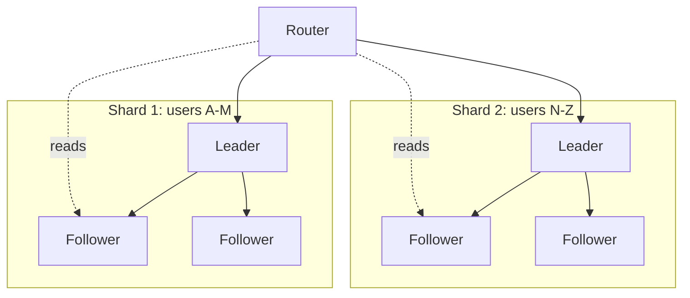
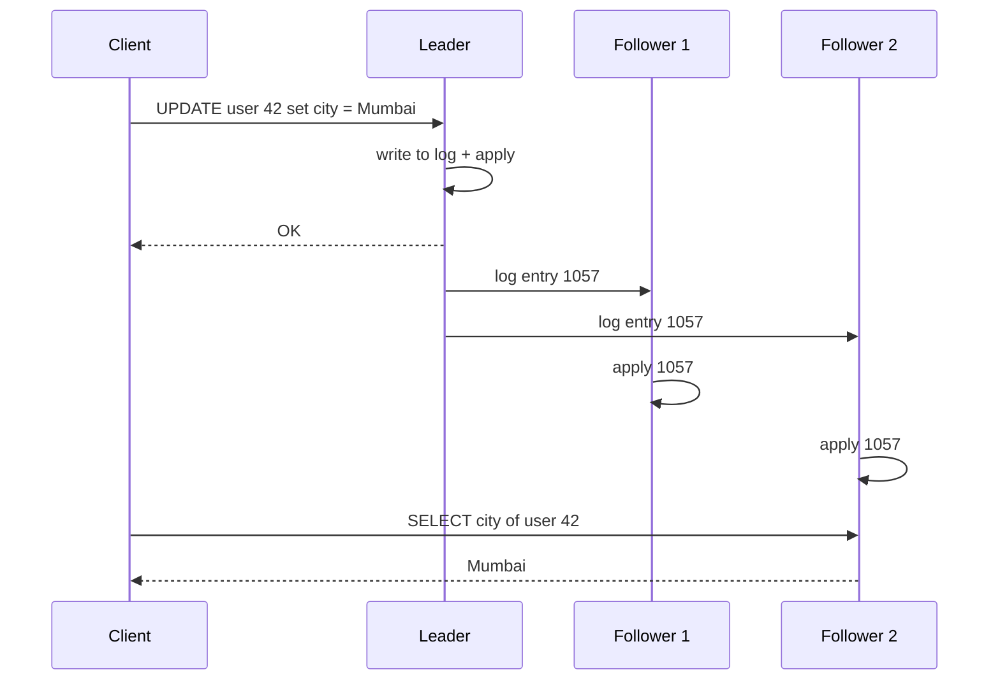
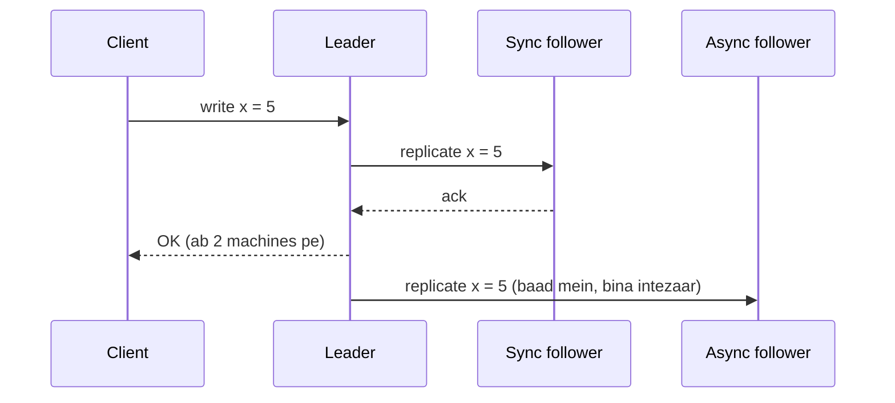
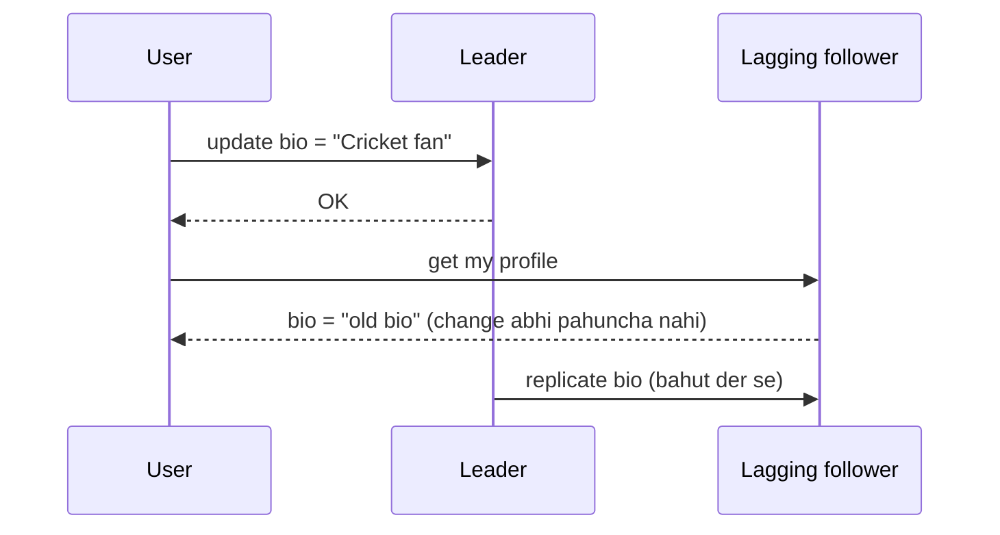
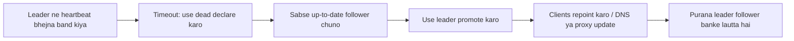
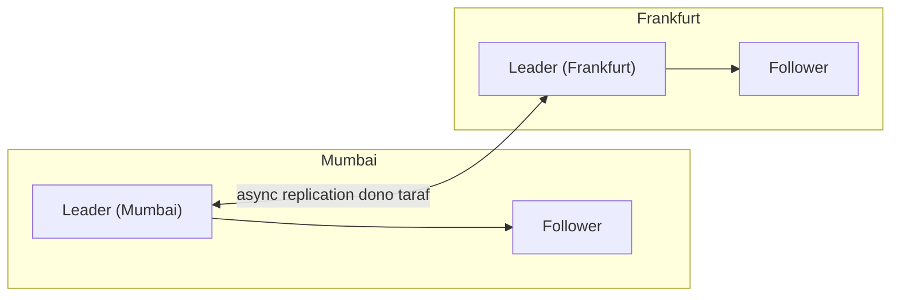
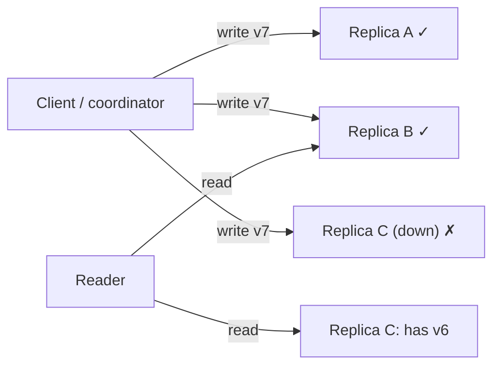
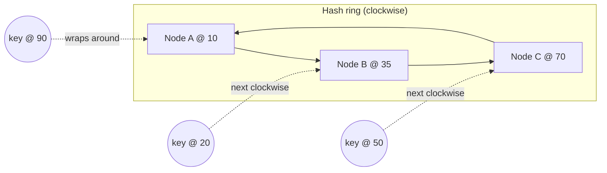
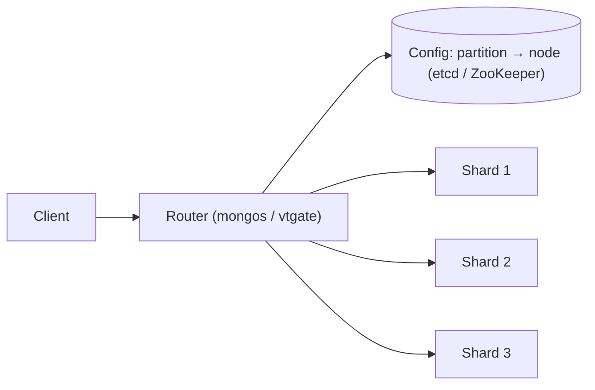
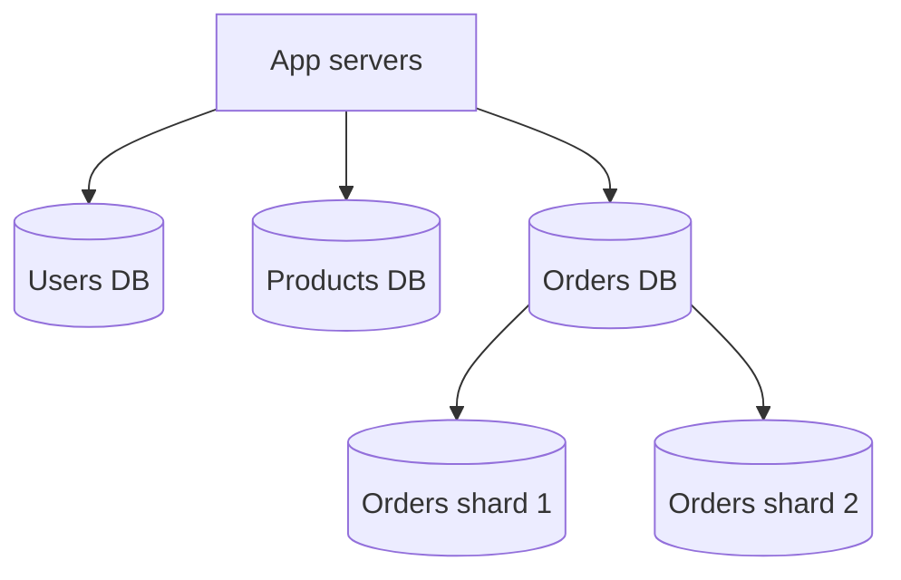

# Chapter 05 · Replication, Sharding & Consistent Hashing

> Tumhare college mein ek hi notebook hai jisme har student ke marks likhe hain. Do problems hain. Pehli: notebook kho gayi toh sab kuch gaya. Doosri: ek time pe sirf ek clerk usme likh sakta hai, aur bahar darwaze tak line lag jaati hai. Notebook ki photocopy kara lo, pehli problem solve (**replication**). Har department ki alag notebook bana do, doosri problem solve (**sharding**). Duniya ka har bada database ye dono kaam karta hai.

**Is chapter mein tum seekhoge:**
- Ek database machine kaafi kyun nahi hoti, aur iske do ilaaj: copies (replication) aur splits (sharding)
- Leader-follower, multi-leader, aur leaderless replication, aur synchronous vs asynchronous copying
- Replication lag ki problems (read-your-writes, monotonic reads, consistent prefix) aur unke fixes
- Failover: naya leader kaise chuna jaata hai aur kya galat ho sakta hai (lost writes, split brain)
- Partitioning strategies: range, hash, directory/lookup, geo; shard key chunna; hot spots; resharding
- Virtual nodes ke saath consistent hashing, Python mein bana ke aur measure karke
- Cross-shard queries aur transactions, aur federation (function ke hisaab se split)

**Isse pehle padho:** [Chapter 02 · Scalability & Load Balancing](02-scalability-load-balancing.md) (consistent hashing ka preview, stateless tiers) · [Chapter 03 · Databases](03-databases.md) (transactions, WAL, indexes)

---

## 🧠 The Big Idea · Asli Baat

[Chapter 02](02-scalability-load-balancing.md) mein humne app servers ko stateless banaya aur saara state database mein dhakel diya. Ab database hi bottleneck hai, aur wahi single point of failure bhi. Ise theek karne ke liye exactly do tools hain, aur dono alag-alag problems solve karte hain:

| Tool | What it does | Solves | Analogy |
|---|---|---|---|
| **Replication** | **Same data ki copies** kai machines pe rakho | Availability (failures jhelna), read throughput, latency (copies users ke paas) | Ek hi notebook ki photocopies |
| **Sharding** (partitioning) | **Data ko baant do** taaki har machine ke paas alag hissa ho | Write throughput, ek machine se bada data size | Har department ki alag notebook |



Real systems dono ko **milaate** hain: data shards mein baanta jaata hai, aur **har shard replicate hota hai**. Har shard ka apna leader aur apne followers hote hain.

> 🇮🇳 **Desi Analogy:** Indian Railways ka reservation chart socho. Poore desh ki saari trains ka ek hi register ho toh kya hoga? Isliye har train ka alag chart banta hai. Ye **sharding** hai: data baant diya, aur "train number" shard key hai. Ab har chart ki copies banti hain: ek station master ke paas, ek TTE ke paas, ek coach ke darwaze pe chipki hui. Ye **replication** hai: same data, kai jagah. TTE ki copy kho gayi toh station master wali se kaam chal jaayega. Aur coach pe chipka chart thoda purana ho sakta hai (last-minute RAC confirm hua, chart pe abhi update nahi hua). Yahi **replication lag** hai, jo is chapter ka bada villain hai.

> 💡 **Core insight:** replication data ko copy karta hai taaki failures jhel sakein aur reads scale ho sakein; sharding data ko baant-ta hai taaki writes aur size scale ho sakein. Copies apne saath problem laati hain **unhe sync mein rakhne ki**; splits apne saath problem laate hain **sahi tukda dhoondhne ki** aur **aisi queries ki jo kai tukdon mein phaili hon**.

---

## 🔨 Building It Up · Zero Se Shuru

### 1. Why replicate?

1. **High availability**: ek machine mari, toh doosri ke paas data hai aur woh kaam sambhaal leti hai.
2. **Read scaling**: reads ko kai copies pe baant do. Zyada tar apps likhne se kahin zyada padhti hain (aksar 10:1 se 100:1).
3. **Lower latency**: ek copy Mumbai mein, ek Frankfurt mein rakho, taaki users paas se padhein.
4. **Durability**: 3 machines pe pada data ek disk ke marne se nahi jaata.
5. **Workloads ka isolation**: bhaari analytics ek replica pe chalao, primary pe nahi ([Chapter 03](03-databases.md)).

Jo data **kabhi badalta hi nahi**, use replicate karna bachchon ka khel hai: ek baar copy karo, ho gaya. Saari mushkil **changes** ko handle karne mein hai. Teen main approaches hain: single-leader, multi-leader, leaderless.

### 2. Leader-follower (single-leader) replication

Ek replica **leader** hota hai (ise primary ya master bhi kehte hain). **Saare writes leader pe jaate hain.** Leader change ko locally likhta hai, phir ek **replication log** ke through **followers** (replicas, secondaries) ko bhejta hai (aksar [Chapter 03](03-databases.md) wala WAL, ya ek logical change stream). Followers changes ko **usi order mein** apply karte hain. Reads leader se bhi ho sakte hain ya kisi bhi follower se.



PostgreSQL, MySQL, SQL Server, MongoDB (replica sets), Redis, aur Kafka (har partition ke liye) yahi use karte hain.

**Pros:** simple mental model; **koi write conflicts nahi** (writes sirf ek jagah accept hote hain); ordering ke baare mein sochna aasaan.
**Cons:** saare writes ek machine se guzarte hain (write bottleneck); followers se reads **stale** ho sakte hain; leader fail hua toh **failover** chahiye.

> 🇮🇳 **Desi Analogy:** Joint family ka WhatsApp group socho jahan sirf Papa admin hain aur sirf wahi "family announcement" bhej sakte hain (**leader**). Baaki sab members (followers) messages padhte hain aur usi order mein dekhte hain jis order mein bheje gaye. Do log ek saath ulte announcements nahi bhej sakte, isliye **conflict hi nahi**. Lekin Papa ka phone switch off hua toh koi announcement nahi jaayega, jab tak kisi aur ko admin na banaya jaaye (**failover**). Aur Chachaji ka phone network ke bahar hai, toh unhe message der se milta hai (**stale read**).

### 3. Synchronous vs asynchronous replication

Leader client ko "OK" kab bolta hai?

- **Synchronous**: jab follower confirm kar de ki change uske paas aa gaya. Follower ka up to date hona guaranteed hai. Lekin follower slow ya down hai toh **writes ruk jaate hain**.
- **Asynchronous**: locally likhte hi turant. Fast hai aur followers kabhi rokte nahi, lekin agar leader change bhejne se pehle mar gaya, toh **acknowledged writes kho jaate hain** (jinke liye client ko "OK" bola ja chuka tha).
- **Semi-synchronous**: ek follower synchronous, baaki asynchronous. Sync follower slow hua toh kisi aur ko sync bana diya jaata hai. Data hamesha kam se kam do nodes pe hota hai, aur sab ka intezaar bhi nahi karna padta.



| | Synchronous | Asynchronous | Semi-synchronous |
|---|---|---|---|
| Write latency | Zyada (follower ka intezaar) | Sabse kam | Medium |
| Leader crash pe data loss | Nahi (follower ke paas hai) | Possible (haal ke writes) | Sync follower ke data ka nahi |
| Follower slow/down | Writes atak jaate hain | Koi asar nahi | Sync follower badal do |
| Typical use | Ek region ke andar, critical data | Cross-region replicas, read scaling | Common production default |

> 🇮🇳 **Desi Analogy:** UPI payment socho. **Synchronous** wala tareeka: dukaandaar tab tak saamaan nahi deta jab tak uske phone pe "₹500 received" ka message na aa jaaye. Slow hai, lekin paisa pakka. **Asynchronous** wala: tumne "bhej diya" bola aur dukaandaar ne bharose pe saamaan de diya, confirmation baad mein aayega. Fast hai, lekin agar beech mein transaction fail ho gaya, toh dukaandaar ka nuksaan (acknowledged write lost). **Semi-sync**: dukaandaar kehta hai "kam se kam bank ka SMS aa jaaye, khud ka app baad mein update ho jaayega."

Chalo async replication ke saath ek leader crash simulate karte hain:

```python
class Node:
    def __init__(self, name):
        self.name = name
        self.log = []                          # apply hue writes, order mein

def run(mode):
    leader, f1, f2 = Node("leader"), Node("f1"), Node("f2")
    pending = []                               # writes jo abhi followers tak nahi gaye
    acked = []
    for i in range(1, 6):
        write = f"w{i}"
        leader.log.append(write)
        if mode == "sync":
            f1.log.append(write)               # ack se pehle f1 ka intezaar
        else:
            pending.append(write)
        acked.append(write)                    # client ko "OK" bola gaya
        if i == 3 and mode == "async":         # replication ek baar catch up karta hai, w3 pe
            for w in pending:
                f1.log.append(w); f2.log.append(w)
            pending.clear()
    # leader abhi crash hota hai; f1 promote hota hai
    lost = [w for w in acked if w not in f1.log]
    print(f"{mode:<5}: client got OK for {acked}; new leader f1 has {f1.log}; LOST {lost}")

run("async")
run("sync")
```

```text
async: client got OK for ['w1', 'w2', 'w3', 'w4', 'w5']; new leader f1 has ['w1', 'w2', 'w3']; LOST ['w4', 'w5']
sync : client got OK for ['w1', 'w2', 'w3', 'w4', 'w5']; new leader f1 has ['w1', 'w2', 'w3', 'w4', 'w5']; LOST []
```

Abhi kya hua: async replication mein client ko bola gaya ki w4 aur w5 successful hain, lekin woh sirf mare hue leader pe the. Failover ke baad woh **gaye**. f1 ke saath sync replication mein ek bhi acknowledged write nahi khoya. Yahi **durability vs latency** ka buniyaadi trade-off hai.

### 4. Replication lag and the anomalies it causes

Async followers ke saath, follower normally leader se kuch milliseconds peeche hota hai, aur load ya network ki problem mein seconds ya minutes peeche bhi. Is delay ko **replication lag** kehte hain. System **eventually consistent** hai: writes ruk jaayein toh followers aakhir mein catch up kar lete hain. Lekin tab tak users ko ajeeb cheezein dikhti hain. Teen naam wali problems:

**a) Read-your-writes (read-after-write) violation.** Tumne apna profile update kiya (leader pe gaya), refresh kiya (read ek peeche chal rahe follower pe gaya), aur tumhara change gayab. Users ko lagta hai save fail ho gaya aur woh dobara click karte hain.



**b) Monotonic reads violation.** Tumne ek fresh follower se padha aur ek naya comment dikha; refresh kiya, zyada lag wala follower mila, aur comment **gayab**. Lagta hai time ulta chal raha hai.

**c) Consistent prefix violation.** Tumhe jawab us sawaal se pehle dikh gaya jiska woh jawab hai, kyunki do related writes tumhare replica pe ulte order mein pahunche (jab data kai partitions mein phaila ho tab ye common hai).

> 🤔 **Mann mein sawaal:** Read-your-writes aur monotonic reads toh ek jaise lagte hain. Dono mein "purana data dikh gaya", farak kya hai?
>
> **Jawab:** Farak **kiska data** aur **compared to what** mein hai. Read-your-writes **tumhare apne write** ke baare mein hai: "maine abhi likha, mujhe hi nahi dikh raha." Monotonic reads **tumhare pichhle read** ke baare mein hai, data kisi ka bhi ho: "mujhe abhi-abhi dikha tha, ab gayab ho gaya." Pehla kehta hai "apna likha dikhna chahiye", doosra kehta hai "jo dikh gaya woh wapas gayab nahi hona chahiye."

Chalo (a) aur (b) ko simulate karte hain, phir unhe fix karenge:

```python
class Replica:
    def __init__(self, name, lag):
        self.name, self.lag, self.data = name, lag, {}

class Cluster:
    def __init__(self):
        self.leader = {}
        self.history = []                          # leader pe (time, key, value) writes
        self.followers = [Replica("f1", lag=1), Replica("f2", lag=5)]

    def write(self, key, value, now):
        self.leader[key] = value
        self.history.append((now, key, value))

    def sync_followers(self, now):
        for f in self.followers:                   # har follower apne lag se purane writes dekhta hai
            for t, k, v in self.history:
                if t <= now - f.lag:
                    f.data[k] = v

    def read(self, key, replica, now):
        self.sync_followers(now)
        return replica.data.get(key, "<none>")

c = Cluster()
c.write("bio", "Cricket fan", now=10)
f1, f2 = c.followers
print("t=11 read your own write from f2:", c.read("bio", f2, now=11))
print("t=12 read from f1               :", c.read("bio", f1, now=12))
print("t=13 then from f2               :", c.read("bio", f2, now=13), "<- went back in time")
```

```text
t=11 read your own write from f2: <none>
t=12 read from f1               : Cricket fan
t=13 then from f2               : <none> <- went back in time
```

Abhi kya hua: user ko apna hi write nahi dikha (read-your-writes violation), phir dikha, phir dobara kho gaya (monotonic reads violation), sirf is wajah se ki kaunse replica ne jawab diya. Numbers se samjho: write t=10 pe hua. f2 ka lag 5 hai, toh use ye write t=15 se pehle nahi dikhega. f1 ka lag 1 hai, toh use t=11 se dikhne lagega. t=11 aur t=13 dono pe f2 abhi andhera hai.

**Fixes:**

| Problem | Fixes |
|---|---|
| Read-your-writes | **User ka apna data leader se padho** (jaise "my profile" leader se, doosron ke profiles followers se); ya user ke write ke baad N seconds tak leader se padho; ya client apne last write ki **log position (timestamp/LSN)** yaad rakhe aur sirf un replicas se padhe jo wahan tak catch up kar chuke hain |
| Monotonic reads | **Har user ko ek replica pe pin kar do** (jaise `hash(user_id)` se replica chuno); ya last-seen log position track karo aur usse purane replicas se bacho |
| Consistent prefix | Causally related data ko **same partition** mein likho; ya causal dependencies track karo ([Chapter 06](06-cap-consistency.md)) |

```python
class Replica:
    def __init__(self, name, applied_upto):
        self.name, self.applied_upto = name, applied_upto   # aakhri apply hui log position

def choose_replica(replicas, min_position, leader="leader"):
    """Read from any replica that has caught up to the client's last write; else the leader."""
    for r in replicas:
        if r.applied_upto >= min_position:
            return r.name
    return leader

replicas = [Replica("f1", applied_upto=1040), Replica("f2", applied_upto=1057)]
my_last_write = 1050                     # client ko write ke waqt wapas mila tha
print("read goes to:", choose_replica(replicas, my_last_write))
print("someone else (no recent write):", choose_replica(replicas, 0))
print("very recent write:", choose_replica(replicas, 1060))
```

```text
read goes to: f2
someone else (no recent write): f1
very recent write: leader
```

Abhi kya hua: client ek "freshness token" saath lekar chalta hai (apne last write ki log position). Router read ko sirf us replica pe bhejta hai jo kam se kam utna fresh ho, warna leader pe. Isse read-your-writes mil jaata hai, aur zyada tar reads phir bhi followers pe hi jaate hain. Teeno cases dekho: 1050 ke liye f1 (1040) peeche hai, f2 (1057) aage, toh f2. Token 0 ke liye pehla hi replica f1 chal jaata hai. 1060 ke liye koi replica wahan tak nahi pahuncha, toh leader.

> 🇮🇳 **Desi Analogy:** Courier ki tracking ID jaisa hai. Tumne parcel bheja aur receipt pe likha "entry #1050". Ab kisi bhi branch office se status poochne jaao, woh pehle apna register dekhega: "hamare paas entries #1040 tak hi aayi hain" toh woh kahega "yahan nahi, head office se poocho." Jis branch ka register #1057 tak update hai, wahi tumhe sahi status de sakti hai. Receipt number = **freshness token**.

### 5. Failover: when the leader dies

**Failover** = kisi follower ko promote karke naya leader banana. Steps:

1. **Detect** karo ki leader mar gaya. Usually timeout se: maan lo 10–30 seconds tak koi heartbeat nahi aaya. ("Mara hua" aur "slow" mein farak karne ka koi perfect tareeka nahi hai; [Chapter 06](06-cap-consistency.md).)
2. **Naya leader chuno**: ideally woh follower jiska log **sabse up-to-date** ho (taaki kam se kam data khoye). Robust systems mein ye faisla ek **consensus** protocol ya coordination service (ZooKeeper, etcd) karti hai, taaki saare nodes ek baat pe agree karein.
3. **Reconfigure** karo: clients aur baaki followers ab writes naye leader ko bhejte hain; purana leader wapas aaye toh use follower banna padega.



Kya galat hota hai (interviewers ko ye bahut pasand hai):

- **Lost writes**: async replication mein, jo writes purane leader ne acknowledge kiye lekin aage nahi bheje, woh kho jaate hain (humne abhi simulate kiya). Isse bhi bura: agar purana leader wapas aaya, toh uske extra writes naye leader ke writes se conflict karte hain.
- **Split brain**: purana leader mara nahi tha, bas network problem se kat gaya tha. Ab **do nodes sochte hain ki woh leader hain** aur dono writes accept karte hain, aur data alag-alag raaston pe chal padta hai (diverge). Bachaav: **fencing** (purane leader ko storage ya network se zabardasti kaat do, ise kabhi STONITH bhi kehte hain, "shoot the other node in the head"), **epoch/term numbers** (purane term ke writes reject ho jaate hain), aur **quorums** taaki network split ki sirf ek hi side leader chun sake ([Chapter 06](06-cap-consistency.md)).
- **Galat timeout**: bahut chhota → load spikes ke dauraan bekaar ke failovers (jo haalat aur bigaadte hain); bahut lamba → lambe outages.
- **Stale references**: ek famous incident pattern: naya leader woh auto-increment IDs dobara use kar leta hai jo purana leader pehle hi baant chuka tha (aur cache jaise doosre systems unhe abhi bhi refer kar rahe the), aur records aapas mein mix ho jaate hain.

> 🤔 **Mann mein sawaal:** Split brain mein toh purana leader "zinda" hai. Use pata kyun nahi chalta ki ab woh leader nahi raha?
>
> **Jawab:** Kyunki use koi bata hi nahi sakta: network kata hua hai! Uske hisaab se sab theek hai, bas baaki log chup ho gaye hain. Isliye ilaaj aisa chahiye jo purane leader ki marzi pe depend na kare. **Epoch/term number** yahi karta hai: naye leader ka term 8 hai, purane ka 7. Storage ya followers term 7 wale writes ko seedha reject kar dete hain, chahe purana leader kitna bhi khud ko leader samjhe. **Fencing** usse bhi seedha hai: uska storage access hi cut kar do.

**Manual vs automatic failover**: automatic tez hai (seconds), lekin zyada risky; kuch teams critical databases ke failover ke liye ek insaan ka approval pasand karti hain.

### 6. Multi-leader replication

**Ek se zyada node** ko writes accept karne do; har leader apne changes baaki leaders ko replicate karta hai.

**Ye kab kaam aata hai:**

- **Multi-datacenter / multi-region**: har region ka ek leader, taaki writes local aur fast hon, aur ek region gire toh doosra chalta rahe.
- **Offline-capable clients**: calendar app wala har phone ek "leader" hai jo baad mein sync karta hai.
- **Collaborative editing**: Google Docs jaisi ek saath editing.



**Sabse badi problem: write conflicts.** Mumbai mein user A ek document ka title "Plan A" karta hai; usi pal Frankfurt mein user B use "Plan B" kar deta hai. Dono locally successful. Jab leaders sync karenge, kaun jeetega?

Conflict resolution strategies ([Chapter 06](06-cap-consistency.md) mein detail):

- **Conflicts se bacho**: ek record ke saare writes ek hi leader pe bhejo (jaise user ka "home region"). Jab possible ho, ye sabse acchi strategy hai.
- **Last write wins (LWW)**: jis write ka timestamp sabse naya, woh rakho. Simple hai, lekin doosre write ko **chupchaap phenk deta hai**, aur clock skew "galat" wala chun sakta hai.
- **Merge**: values ko jodo (jaise shopping cart items ka union), ya **CRDTs** use karo, aise data types jo khud merge hone ke liye bane hain.
- **Dono rakho aur poocho**: dono versions store karo aur app ya user ko resolve karne do (Git merge conflict jaisa).

```python
def merge_lww(a, b):
    """Each write: (timestamp, node, value). Higher timestamp wins; node name breaks ties."""
    return max(a, b)

mumbai = (1000, "mumbai", "Plan A")
frankfurt = (1001, "frankfurt", "Plan B")
print("LWW keeps:", merge_lww(mumbai, frankfurt)[2], "| Plan A is silently lost")

cart_mumbai = {"phone", "case"}
cart_frankfurt = {"phone", "charger"}
print("union merge of carts:", sorted(cart_mumbai | cart_frankfurt))
```

```text
LWW keeps: Plan B | Plan A is silently lost
union merge of carts: ['case', 'charger', 'phone']
```

Ek chhoti si trick code mein dekho: `max(a, b)` tuples pe chalta hai, aur Python tuples ko left se compare karta hai. Pehle timestamp compare hota hai; barabar hua toh node ka naam tie todta hai. Isliye ek line mein poora LWW.

(Union merging ki apni problem hai: hata hua item wapas aa sakta hai agar kisi replica ke paas woh abhi bhi tha. CRDTs ise extra bookkeeping se sambhaalte hain. [Chapter 06](06-cap-consistency.md) mein samjhaaya hai kaise.)

**Topologies**: leaders **ring**, **star**, ya **all-to-all** mein replicate kar sakte hain. All-to-all sabse zyada fault-tolerant hai, lekin messages ulte order mein pahunch sakte hain (ek update us insert se pehle pahunch jaaye jise woh modify karta hai), jiske liye version tracking chahiye.

### 7. Leaderless replication

Koi leader hi nahi: client (ya uski taraf se kaam karne wala koordinator node) har write ko **kai replicas pe parallel** bhejta hai, aur har read bhi **kai replicas** se karta hai. Amazon ke **Dynamo** paper ne ise popular kiya; **Cassandra**, ScyllaDB, Riak, aur DynamoDB-style systems ise use karte hain.

- **N** = har key ke kitne replicas hain (jaise 3).
- Write tab successful jab **W** replicas confirm karein.
- Read replicas se poochta hai aur **R** responses ka intezaar karta hai, phir **sabse naya** version leta hai.
- Agar **R + W > N**, toh read set aur write set ko kam se kam ek replica pe **overlap karna hi padega**, isliye read ko latest write ki kam se kam ek copy zaroor dikhegi. Typical: N=3, W=2, R=2.



N=3, W=2 ke saath: write A aur B pe pahuncha. R=2 wala read jo B aur C se poochta hai, use B se v7 aur C se v6 milta hai, aur woh v7 chunta hai (zyada version). Overlap guarantee kaam karte hue.

> 🇮🇳 **Desi Analogy:** Teen dost hain jinke paas class ke notes ki copy hai (N=3). Teacher ne syllabus change kiya, aur tumne ye news kam se kam do doston ko bata di (W=2). Ab koi bhi ye jaanna chahe toh kam se kam do doston se poochta hai (R=2). Teen mein se do ko bataya, teen mein se do se poocha: dono groups mein kam se kam ek dost **common hoga hi** (2 + 2 > 3). Toh nayi news kahin na kahin mil hi jaayegi. Agar sirf ek ko bataya aur ek se poocha (1 + 1 = 2, 3 se kam), toh ho sakta hai galat dost se pooch liya.

> 🤔 **Mann mein sawaal:** R + W > N se overlap kyun guaranteed hai? Ye formula aaya kahan se?
>
> **Jawab:** Pigeonhole principle se. Total N replicas hain. Write W replicas pe gaya, read R replicas se poochta hai. Agar dono groups mein koi common na ho, toh total kam se kam W + R alag replicas chahiye honge. Lekin agar W + R > N, toh itne alag replicas hain hi nahi! Isliye kam se kam ek replica dono groups mein hoga. N=3, W=2, R=2: 4 slots, sirf 3 replicas, toh ek repeat hona hi hai.

Peeche chal rahe replicas catch up kaise karte hain:

- **Read repair**: jab read notice karta hai ki kisi replica ne purana version diya, client naya version us replica pe wapas likh deta hai.
- **Anti-entropy**: ek background process replicas ko compare karta hai aur missing data copy karta hai (**Merkle trees** use karke, aise hash trees jo do nodes ko har key compare kiye bina bata dete hain ki kaunse ranges alag hain).
- **Hinted handoff**: agar target replica down hai, toh koi doosra node write ko ek "hint" ke saath temporarily rakh leta hai aur replica lautne pe use de deta hai.

Quorums ko hum [Chapter 06](06-cap-consistency.md) mein properly simulate karenge, jahan ye bhi dekhenge ki R + W > N strong consistency ke barabar **nahi** hai.

| | Single-leader | Multi-leader | Leaderless |
|---|---|---|---|
| Writes kaun accept karta hai | Ek leader | Kai leaders | Koi bhi replica (quorum) |
| Write conflicts | Nahi | Haan, resolve karne padenge | Haan (concurrent writes), resolve karne padenge |
| Failures ke dauraan write availability | Leader failure → failover pause | High (baaki leaders chalte rehte hain) | High (sirf W replicas chahiye) |
| Consistency | Sabse aasaan (leader se padho toh strong) | Leaders ke beech weak | R, W se tunable |
| Examples | PostgreSQL, MySQL, MongoDB | Multi-region MySQL/Postgres setups, CouchDB, collaborative apps | Cassandra, ScyllaDB, Riak, Dynamo |

### 8. Why shard?

Replication **saara** data har replica pe copy karta hai, toh ye in cases mein madad nahi karta:

- **Writes** itne ho gaye ki ek leader nahi sambhaal sakta (har write abhi bhi usi ek leader pe jaata hai).
- **Data size** ek machine ki disk ya RAM se bada ho gaya (har replica sab kuch rakhta hai).
- Indexes memory mein fit nahi hote, toh queries slow ho jaati hain.

**Sharding** (ise **partitioning** bhi kehte hain) dataset ko tukdon mein baant-ta hai jinhe **shards** (ya partitions) kehte hain, aur har tukda alag node pe hota hai (aur usually har ek ki apni replicas hoti hain). Har record **exactly ek** shard ka hota hai. Ideally load barabar phailta hai aur har query sirf **ek** shard ko chhooti hai.

Alag-alag systems mein naam: shard (MongoDB, Elasticsearch), partition (Kafka), region (HBase), tablet (Bigtable), vnode (Cassandra). Sab roughly ek hi idea.

Central sawaal: **ek record diya hai, kaunsa shard use rakhta hai?** Ye faisla **shard key** (partition key) aur **partitioning strategy** karte hain.

### 9. Range partitioning

Key ki **lagataar ranges** har shard ko de do, encyclopedia ke volumes ki tarah: A–F, G–M, N–S, T–Z.

```text
shard 1: user_id 1        – 1,000,000
shard 2: user_id 1,000,001 – 2,000,000
shard 3: user_id 2,000,001 – 3,000,000
```

**Pros:** **range queries efficient hain**: "1 Oct se 7 Oct tak ke saare orders" ek ya do shards pe hi jaata hai; shard ke andar keys sorted rehti hain.
**Cons:** jab key monotonic ho (lagataar badhti ho) toh **hot spots**. Agar shard key timestamp ya auto-increment ID hai, toh **saare naye writes** aakhri shard pe jaate hain aur baaki khaali baithe rehte hain.

Ranges data distribution ke hisaab se chunni padti hain ("S" se shuru hone wale naam "X" se kahin zyada hote hain), aur HBase, Bigtable aur MongoDB jaise systems range bahut badi hone pe use apne aap **split** kar dete hain.

> 🇮🇳 **Desi Analogy:** Board exam centre pe roll numbers ke hisaab se rooms: Room 1 mein 1001–1100, Room 2 mein 1101–1200. "Roll 1050 se 1080 kahan hain?" Ek hi room mein, ek nazar mein (**range query efficient**). Lekin socho naye admissions ka form bhar rahe ho aur roll numbers badhte ja rahe hain: har naya student aakhri room mein hi jaayega, baaki rooms ke invigilator chai pee rahe hain. Yahi **monotonic key ka hot spot** hai.

### 10. Hash partitioning

Key pe ek hash function lagao aur hash se shard chuno. Accha hash lagataar ya skewed keys ko bhi **barabar** (uniformly) phaila deta hai.

**Pros:** barabar distribution; sequential keys se hot spots nahi.
**Cons:** **range queries toot jaati hain**: padosi keys alag-alag shards pe jaati hain, toh "1–7 Oct ke orders" ke liye har shard se poochna padega.

```python
import bisect
import hashlib
from collections import Counter

N_SHARDS = 4
RANGE_STARTS = [0, 1_002_500, 1_005_000, 1_007_500]   # shard i ke paas ids >= RANGE_STARTS[i]

def range_shard(order_id):
    return bisect.bisect_right(RANGE_STARTS, order_id) - 1

def hash_shard(order_id):
    return int(hashlib.md5(str(order_id).encode()).hexdigest(), 16) % N_SHARDS

new_orders = range(1_010_000, 1_012_600)              # aaj ke 2,600 naye, badhte hue ids
print("range partitioning:", dict(sorted(Counter(map(range_shard, new_orders)).items())))
print("hash partitioning :", dict(sorted(Counter(map(hash_shard, new_orders)).items())))
```

```text
range partitioning: {3: 2600}
hash partitioning : {0: 608, 1: 676, 2: 646, 3: 670}
```

Abhi kya hua: badhte ID pe ranges ke saath, har naya insert shard 3 pe gaya ("latest" range): ek write hot spot. Hashing ne sequential IDs ko chaaron shards pe lagbhag barabar bikher diya. (`bisect_right(RANGE_STARTS, id) - 1` bas ye dhoondhta hai ki id kis range ke start ke baad aata hai. 1,010,000 aakhri start 1,007,500 se bada hai, toh shard 3.)

**Compound-key trick** (Cassandra aur DynamoDB use karte hain) dono ka best deta hai: **pehla hissa hash karo, doosre se sort karo**. Key = `(user_id, timestamp)`: `user_id` hash hokar shard chunta hai (users mein barabar phailaav), aur shard ke andar ek user ki rows timestamp se sorted rehti hain ("user ki latest 20 posts" jaisi range queries efficient).

### 11. Directory-based (lookup) partitioning

Ek explicit **lookup table** (directory) rakho: key ya key-range → shard. Ek chhoti, highly available service (ya ZooKeeper/etcd jaisa coordination store) ise rakhti hai.

```text
tenant "acme"     -> shard 7
tenant "globex"   -> shard 2
tenant "initech"  -> shard 7
user range 0-99k  -> shard 1
```

**Pros:** poori flexibility: ek bade customer ko uske apne shard pe bhej do, rehash kiye bina rebalance karo, strategies mix karo.
**Cons:** har request pe ek extra lookup (clients mein cache kar lo), aur directory khud highly available aur consistent honi chahiye, warna woh SPOF ban jaati hai.

Multi-tenant SaaS mein use hota hai (bade tenants ko dedicated shards milte hain), aur bahut se systems andar hi andar partitions ko nodes pe map karne ke liye.

### 12. Geo partitioning

**Location** ke hisaab se partition karo: Indian users ka data Mumbai region mein, EU users ka Frankfurt mein.

**Pros:** local users ke liye low latency; **data residency** laws poore hote hain (kuch desh chahte hain ki citizens ka data desh ke andar hi rahe, aur EU ka GDPR transfers pe rok lagata hai).
**Cons:** shard sizes barabar nahi (India vs Iceland); jo users travel karte hain ya regions ke paar interact karte hain (Mumbai aur Berlin ke beech chat) unhe cross-region access chahiye.

### 13. Choosing a shard key

Sharding ka sabse important faisla; baad mein badalna bahut dard deta hai. Acchi shard key mein ye hona chahiye:

1. **High cardinality**: bahut saari alag values, taaki data kai shards pe phail sake. (`country` ki ~200 values: bura. `user_id`: accha.)
2. **Data aur traffic ka barabar distribution**: koi ek value haavi na ho. (Ek celebrity ke `user_id` ko normal se 1,000,000× traffic mil sakta hai.)
3. **Query alignment**: sabse common queries mein shard key ho, taaki woh **ek** shard pe jaayein. Chat app ke messages `conversation_id` se shard karo, kyunki "is conversation ke messages dikhao" hi hot query hai.
4. **Stability**: value badalni nahi chahiye. (Users ko `city` se shard kiya toh unke shift hone pe data move karna padega.)
5. **Transactions ke liye locality**: jo data saath mein update hota hai woh ek hi shard pe ho (order aur uske items, `order_id` se keyed, ya `customer_id` se agar customer ke hisaab se query karte ho).

| System | Good shard key | Why | Bad shard key | Why bad |
|---|---|---|---|---|
| Chat messages | `conversation_id` | Ek chat ke saare messages ek shard pe | `message_id` | "Load chat" har shard se poochta hai |
| E-commerce orders | `customer_id` (ya `order_id` ka hash) | "My orders" ek shard pe | `created_date` | Aaj ke saare writes ek shard pe |
| Multi-tenant SaaS | `tenant_id` (+ bade tenants ke liye directory) | Tenant isolation, single-shard queries | `region` | Low cardinality, skew |
| URL shortener | `short_code` ka hash | Barabar phailaav, code se lookups | code ka pehla letter | Uneven, low cardinality |
| IoT metrics | `(device_id, time bucket)` | Devices phailte hain, partition size bounded | sirf `timestamp` | Saare writes newest shard pe |

> 🤔 **Mann mein sawaal:** `country` se shard karna toh natural lagta hai. 200 values kam kyun hain? 200 shards toh bahut hain.
>
> **Jawab:** Do problems hain. Pehli, **skew**: India ya USA ka shard Iceland ke shard se hazaar guna bada hoga. Doosri, aur zyada khatarnak: **ek value kabhi do mein nahi toot sakti**. India ka shard bhar gaya toh kya karoge? "India" ek hi key hai, use do machines pe nahi baant sakte. High cardinality ka asli faayda yahi hai: bahut saari chhoti-chhoti values ho, toh unhe kabhi bhi naye shards pe phailaaya ja sakta hai.

### 14. Hot spots and how to cool them

Acchi key bhi **hot partition** bana sakti hai: viral post ke likes, celebrity ke followers, flash-sale product. Ilaaj:

- **Key salting / splitting**: kisi jaani-pehchaani hot key ke peeche 0–9 ka random suffix laga do, taaki uske writes 10 shards pe phail jaayein (`post:42#7`), aur padhte waqt saare 10 padh ke jod lo. Ye sirf un kuch keys ke liye karo jinhe zaroorat hai (unhe track karo).
- **Write buffering / aggregation**: likes ko memory ya queue mein gino aur jode hue increments periodically likho ([Chapter 08](08-queues-events.md)).
- Hot reads ke liye **caching** ([Chapter 04](04-caching-cdn.md)).
- **Isolate**: ek mega-tenant ko uska apna shard de do (directory-based).
- **Time-bucketed keys**: time series ke liye key mein time bucket daalo (`device_id:2026-10-31`), taaki ek partition hamesha badhta na rahe.

```python
import hashlib
import random
from collections import Counter

random.seed(7)
N_SHARDS = 8

def shard_of(key):
    return int(hashlib.md5(key.encode()).hexdigest(), 16) % N_SHARDS

likes = ["post:viral"] * 8000 + [f"post:{i}" for i in range(2000)]

plain = Counter(shard_of(k) for k in likes)
salted = Counter(shard_of(f"{k}#{random.randrange(N_SHARDS)}") if k == "post:viral" else shard_of(k)
                 for k in likes)

print("busiest shard without salting:", max(plain.values()), "of", len(likes))
print("busiest shard with salting   :", max(salted.values()), "of", len(likes))

def total_likes_viral(counts_by_salted_key):
    return sum(counts_by_salted_key.values())     # read side: saare salted hisse ikattha karo

parts = Counter(f"post:viral#{random.randrange(N_SHARDS)}" for _ in range(8000))
print("reassembled viral like count:", total_likes_viral(parts))
```

```text
busiest shard without salting: 8259 of 10000
busiest shard with salting   : 2303 of 10000
reassembled viral like count: 8000
```

Abhi kya hua: bina salting ke, ek shard ne viral post ke 8,000 writes apne normal hisse ke upar jhele (8000 + lagbhag 259 normal = 8259). Salting ne unhe saare shards pe phaila diya. Keemat aakhri line mein dikhti hai: ab total padhne ke liye har salted hisse se data ikattha karna padta hai.

> 🇮🇳 **Desi Analogy:** IPL final ke din stadium ka ek hi gate khola toh bheed mein bhagdad. Toh 8 gate khol do (salting): har aadmi ko ticket pe random gate number milta hai. Andar sab ek hi stadium mein pahunchte hain. Lekin ab "aaj kitne log aaye?" jaanne ke liye aathon gates ki ginti jodni padegi (**read side pe gather**).

### 15. Resharding: why `hash % N` is a trap

Data badhta hai; tumhe zyada shards chahiye. `shard = hash(key) % N` ke saath N ko 4 se 5 karne pe ~80% keys move hoti hain (humne ye [Chapter 02](02-scalability-load-balancing.md) mein measure kiya tha). 10 TB database ka 80% move karna matlab traffic serve karte-karte 8 TB copy karna. Ouch.

Kyun 80%? Ek key `hash % 4` aur `hash % 5` dono mein same jagah tabhi rehti hai jab dono ka remainder same ho, aur ye sirf lagbhag 1/5 keys ke saath hota hai. Baaki ~4/5 ka ghar badal jaata hai.

Behtar approaches:

1. **Partitions ka fixed number, nodes se kahin zyada.** Shuru mein hi, maan lo, 1,024 partitions bana lo; har node ko kai partitions do. Node add karna = **poore partitions** uspe move karna; key → partition mapping (`hash % 1024`) **kabhi nahi badalti**. Elasticsearch, Riak, Couchbase, Redis Cluster (16,384 hash slots), Kafka-style systems isse use karte hain.
2. **Dynamic splitting**: partition ek size limit se bada hua toh use do mein tod do (aur chhote wale jod do). HBase, Bigtable, MongoDB (range-based chunks), CockroachDB/TiDB-style systems.
3. **Consistent hashing** (agla section): node add karne pe sirf ~1/N keys move hoti hain. Cassandra, DynamoDB, Riak, aur bahut se caches aur load balancers.

```python
import hashlib

def h(key):
    return int(hashlib.md5(key.encode()).hexdigest(), 16)

keys = [f"user:{i}" for i in range(20_000)]
N_PARTITIONS = 64

def node_for_partition(p, n_nodes):
    return p % n_nodes                      # simple partition -> node assignment

def moved_fraction(n_before, n_after, scheme):
    moved = 0
    for k in keys:
        if scheme == "mod-N":
            a, b = h(k) % n_before, h(k) % n_after
        else:                               # fixed partitions, poore partitions reassign karo
            p = h(k) % N_PARTITIONS
            a = assignment[n_before][p]
            b = assignment[n_after][p]
        moved += a != b
    return moved / len(keys)

# fixed partitions: node add karte waqt bas utne partitions churao jitne barabar hisse ke liye chahiye
assignment = {4: {p: p % 4 for p in range(N_PARTITIONS)}}
new = dict(assignment[4])
per_node_target = N_PARTITIONS // 5          # naye node ke liye 12 partitions
for node in range(4):                        # har purane node se 3 partitions lo
    victims = [p for p, n in new.items() if n == node][:per_node_target // 4]
    for p in victims:
        new[p] = 4
assignment[5] = new

print(f"hash % N, 4 -> 5 nodes        : {moved_fraction(4, 5, 'mod-N'):.0%} of keys move")
print(f"64 fixed partitions, 4 -> 5   : {moved_fraction(4, 5, 'fixed'):.0%} of keys move")
```

```text
hash % N, 4 -> 5 nodes        : 79% of keys move
64 fixed partitions, 4 -> 5   : 19% of keys move
```

Abhi kya hua: mod-N ke saath lagbhag 80% keys ne node badla. Fixed partitions ke saath sirf woh 12 partitions move hue jo naye node ko diye gaye: data ka lagbhag 1/5, jo theoretical minimum hai (naye node ke paas aakhir mein sab kuch ka ~1/5 hona hi chahiye). 12/64 = 18.75%, isliye output mein ~19%.

> 🇮🇳 **Desi Analogy:** Shaadi mein 4 caterers ke counters hain aur mehmaan ko unki table number se counter milta hai. **`hash % N`** wala tareeka: "table number ko 4 se divide karo, remainder = counter." Paanchwa caterer aaya, formula "5 se divide karo" ho gaya, aur lagbhag har mehmaan ka counter badal gaya. Pandal mein afra-tafri. **Fixed partitions** wala tareeka: pehle se 64 tables ke groups bana lo aur har caterer ko 16 groups do. Naya caterer aaya toh har purane caterer se 3 groups le lo. Sirf 12 groups ke mehmaan uthe, baaki aaraam se khaate rahe.

### 16. Consistent hashing with virtual nodes

Hash space ko ek **ring** (ghadi ka dial) ki tarah socho, 0 se 2³²−1 tak (ya koi bhi bada number), jo ghoom ke wapas shuru pe aa jaata hai.

1. **Har node ko** ring pe `hash(node_name)` pe rakho.
2. **Har key ko** `hash(key)` pe rakho, phir **clockwise** chalo jab tak pehla node na mile: woh node us key ka maalik hai.
3. **Node add karna**: woh ek jagah pe baithta hai aur sirf apne predecessor aur khud ke beech ki keys le leta hai. Baaki har key apni jagah rehti hai.
4. **Node remove karna**: uski keys clockwise agle node pe chali jaati hain. Aur kuch nahi hilta.



> 🇮🇳 **Desi Analogy:** Ek gol (circular) metro line socho jisme stations hain (nodes) aur har ghar (key) line ke kinaare kahin bana hai. Rule simple: ghar se nikal ke **clockwise** chalo, jo pehla station mile wahi tumhara station. Naya station beech mein bana? Sirf us station aur pichhle station ke beech ke gharon ka station badla, baaki poore shehar ka nahi. Ek station band hua? Uske gharon wale bas agle station tak chal ke jaayenge. Kisi aur ka route nahi badla.

**Har node ka ek hi point hone ki problem:** random positions se **arcs barabar nahi bante**. Ek node ring ka 50% le sakta hai, doosra 10%. Aur jab koi node jaata hai, uska **saara** load **ek hi** padosi pe gir jaata hai.

**Virtual nodes (vnodes)** dono theek karte hain: har physical node ko ring pe **bahut saari** positions milti hain (jaise 100–256), `"A#0"`, `"A#1"`, ... ko hash karke. Arcs average ho jaate hain, toh load barabar. Node jaata hai toh uske bahut saare chhote arcs **bahut saare** alag padosiyon mein bant jaate hain. Bonus: zyada powerful machine ko **zyada vnodes** de sakte ho (weighted capacity).

Yahan measurements ke saath ek poora implementation hai:

```python
import bisect
import hashlib
from collections import Counter
from statistics import pstdev

def ring_hash(s):
    return int(hashlib.md5(s.encode()).hexdigest(), 16) % (2**32)

class ConsistentHashRing:
    def __init__(self, vnodes=100):
        self.vnodes = vnodes
        self.positions = []                  # sorted vnode positions
        self.owner = {}                      # position -> physical node

    def add_node(self, node, weight=1):
        for i in range(self.vnodes * weight):
            pos = ring_hash(f"{node}#{i}")
            bisect.insort(self.positions, pos)
            self.owner[pos] = node

    def remove_node(self, node):
        self.positions = [p for p in self.positions if self.owner[p] != node]
        self.owner = {p: n for p, n in self.owner.items() if n != node}

    def get_node(self, key):
        idx = bisect.bisect_right(self.positions, ring_hash(key))
        if idx == len(self.positions):       # aakhri position ke aage: shuru pe wrap karo
            idx = 0
        return self.owner[self.positions[idx]]

def build(nodes, vnodes):
    ring = ConsistentHashRing(vnodes)
    for n in nodes:
        ring.add_node(n)
    return ring

keys = [f"key-{i}" for i in range(30_000)]
nodes = ["A", "B", "C", "D"]

print("1) Balance: keys per node (ideal 7,500 each)")
for v in (1, 10, 100, 500):
    ring = build(nodes, v)
    load = Counter(ring.get_node(k) for k in keys)
    counts = [load[n] for n in nodes]
    print(f"   vnodes={v:>3}: {counts}  stdev={pstdev(counts):6.0f}")

print("2) Add node E (vnodes=100): how many keys move?")
ring = build(nodes, 100)
before = {k: ring.get_node(k) for k in keys}
ring.add_node("E")
after = {k: ring.get_node(k) for k in keys}
moved = [k for k in keys if before[k] != after[k]]
print(f"   moved {len(moved) / len(keys):.1%} of keys (ideal 1/5 = 20%)")
print(f"   every moved key went to E: {all(after[k] == 'E' for k in moved)}")

print("3) Remove node B: where do its keys go?")
ring = build(nodes, 100)
before = {k: ring.get_node(k) for k in keys}
ring.remove_node("B")
inherited = Counter(ring.get_node(k) for k in keys if before[k] == "B")
print(f"   B's keys spread over: {dict(sorted(inherited.items()))}")
others_moved = sum(1 for k in keys if before[k] != "B" and ring.get_node(k) != before[k])
print(f"   keys not on B that moved: {others_moved}")
```

```text
1) Balance: keys per node (ideal 7,500 each)
   vnodes=  1: [9293, 3212, 9095, 8400]  stdev=  2498
   vnodes= 10: [5228, 4573, 9563, 10636]  stdev=  2637
   vnodes=100: [7588, 7212, 6931, 8269]  stdev=   501
   vnodes=500: [7531, 7738, 7451, 7280]  stdev=   165
2) Add node E (vnodes=100): how many keys move?
   moved 14.8% of keys (ideal 1/5 = 20%)
   every moved key went to E: True
3) Remove node B: where do its keys go?
   B's keys spread over: {'A': 2480, 'C': 2952, 'D': 1780}
   keys not on B that moved: 0
```

Code ka dil `get_node` hai: `bisect_right` sorted positions mein binary search karke "key ke baad wali pehli position" dhoondhta hai, yaani **clockwise agla node**. Agar key aakhri position ke bhi aage hai, toh `idx == len(...)` hoga, aur hum `0` pe wrap kar dete hain. Yahi ring ka "gol" hona hai.

Abhi kya hua, teen hisson mein:

1. Har node ka **1** vnode ho toh load bahut uneven hai (node B ko node A ke hisse ka aadhe se bhi kam mila). 10 vnodes bhi badkismati se ubad-khabad ho sakte hain. 100 aur 500 vnodes pe har node ideal 7,500 ke kareeb hai, aur standard deviation ~2,500 se girke 165 pe aa gaya.
2. E add karne pe 14.8% keys move hui, aur saari ki saari **E ko** gayi. Kisi aur ki keys idhar-udhar nahi hui. (E ka hissa ideal 20% se thoda kam hai kyunki uski 100 random positions thode chhote arcs pe gir gayi; zyada vnodes ise kareeb laate hain.)
3. B ko hatane pe B ki keys **teeno** bache hue nodes pe phail gayi (sirf ek padosi pe nahi), aur jo keys B pe nahi thi unme se **zero** move hui.

**Ring pe replication**: N=3 copies rakhne ke liye, har key ko clockwise pehle node pe **aur uske baad ke agle 2 alag physical nodes** pe store karo (same machine ke vnodes skip karke, aur ideally same rack/AZ wale bhi). Dynamo-style systems mein ye list key ki **preference list** kehlati hai.

**Consistent hashing kahan use hoti hai:** Cassandra aur DynamoDB partitioning, Riak, distributed caches (Memcached ke liye client-side sharding), CDN request routing, stickiness chahne wale load balancers ([Chapter 02](02-scalability-load-balancing.md)), aur classic interview question *Design a distributed key-value store* ([Chapter 12](12-case-studies-1.md)).

> 💡 Ek badhiya alternative jo tum mention kar sakte ho: **rendezvous hashing** (highest random weight): har key ke liye har node ka `hash(key, node)` nikaalo aur sabse bada wala chuno. Ye bhi nodes badalne pe sirf ~1/N keys move karta hai, koi ring maintain nahi karni padti, lekin har lookup O(number of nodes) ka hai.

### 17. Request routing: how does a request find its shard?

Teen designs:

1. **Routing tier / proxy**: clients ek router se baat karte hain jise mapping pata hai aur woh request aage bhej deta hai (MongoDB ka `mongos`, MySQL ke liye Vitess ka `vtgate`, Twemproxy).
2. **Any node**: client kisi bhi node se baat karta hai; agar woh node key ka maalik nahi hai, toh woh sahi node ko forward kar deta hai (Cassandra coordinators) ya client ko bata deta hai kahan jaana hai (Redis Cluster ka `MOVED` redirect).
3. **Partition-aware client**: client library ke paas khud mapping hoti hai aur woh seedha sahi node se connect karti hai (sabse fast; mapping updates chahiye).

Mapping khud (partition → node) kisi aisi jagah store honi chahiye jis pe sab agree karein, aksar **ZooKeeper** ya **etcd** jaisi coordination service (jo consensus use karti hain, [Chapter 06](06-cap-consistency.md)), ya nodes ke beech **gossip** se phailayi jaati hai (Cassandra).



> 🇮🇳 **Desi Analogy:** Teeno designs ek bade sarkari daftar jaise hain. **Routing tier** = reception desk: tum kaam batao, receptionist tumhe sahi counter pe bhej dega. **Any node** = kisi bhi counter pe chale jaao; galat counter hua toh babu kahega "ye kaam counter 7 pe hota hai" (Redis ka `MOVED`). **Partition-aware client** = tumhare paas khud daftar ka naksha hai, seedha counter 7 pe jaate ho. Sabse fast, lekin daftar ne counters badle toh tumhara naksha purana pad jaayega.

### 18. Cross-shard queries

Jab query mein shard key nahi hoti, router ko **har shard** se poochna padta hai aur jawab jodne padte hain: **scatter-gather**.

```python
import hashlib
import heapq

N = 4
def shard_of(user_id):
    return int(hashlib.md5(str(user_id).encode()).hexdigest(), 16) % N

shards = [[] for _ in range(N)]
orders = [(uid, amount) for uid, amount in zip(range(1, 41), [17 * i % 97 for i in range(1, 41)])]
for uid, amount in orders:
    shards[shard_of(uid)].append((uid, amount))

# 1) shard key KE SAATH query: sirf ek shard
uid = 7
print("orders of user 7 (1 shard):", [o for o in shards[shard_of(uid)] if o[0] == uid])

# 2) shard key KE BINA query: amount ke hisaab se top 3 orders -> scatter-gather
partial = [heapq.nlargest(3, s, key=lambda o: o[1]) for s in shards]   # har shard: local top 3
top3 = heapq.nlargest(3, (o for part in partial for o in part), key=lambda o: o[1])
print("global top 3 (asked all", N, "shards):", top3)
```

```text
orders of user 7 (1 shard): [(7, 22)]
global top 3 (asked all 4 shards): [(17, 95), (34, 93), (11, 90)]
```

Abhi kya hua: pehli query ko shard pata tha. Doosri ko chaaron se poochna pada, **har shard ne apna local top 3 nikaala**, phir merge hua. Ye sahi kyun hai? Kyunki global top 3 ka har order kisi na kisi shard ka hai, aur apne shard mein woh zaroor top 3 mein hoga (agar global top 3 mein hai toh apne shard mein uske upar 2 se zyada nahi ho sakte). Isliye global top 3, local top 3s ke union ke andar hi milega. Ye wahi idea hai jo k sorted lists merge karne mein hota hai ([Heaps](../part-2-dsa/15-heaps.md)).

Scatter-gather ki keemat: latency = **sabse slow** shard ki (shards badhte hain toh tail latency aur bigadti hai); load guna ho jaata hai (har aisi query ke liye har shard kaam karta hai). Ilaaj:

- **Shard key aise chuno** ki hot queries mein woh shamil ho.
- **Global secondary indexes**: ek alag index, jo khud indexed value se sharded ho (jaise `email` ka index, email se sharded), toh email se lookup pehle ek index shard, phir ek data shard pe jaata hai. Writes mehenge ho jaate hain (data + index update, aksar asynchronously).
- **Local secondary indexes**: har shard sirf apne data ko index karta hai; us field se reads abhi bhi scatter-gather, lekin writes single-shard rehte hain.
- **Denormalize** karo ya har access pattern ke liye alag tables/views rakho (Cassandra mein common: har query ki ek table).
- **Analytics kahin aur bhejo**: data warehouse ([Chapter 03](03-databases.md)).

| | Local secondary index | Global secondary index |
|---|---|---|
| Stored | Har shard ke data ke saath | Alag se, indexed term se partitioned |
| Writes | Single shard (sasta) | Data shard + index shard (aksar async) |
| Indexed field se reads | Saare shards pe scatter-gather | Ek index shard (+ data fetch) |
| Examples | MongoDB, Cassandra, Elasticsearch | DynamoDB GSIs |

> 🇮🇳 **Desi Analogy:** School ki library har class ki alag almirah mein rakhi hai (shard by class). **Local index** = har almirah ke andar ek register: "is almirah mein kaunsi books hain". "Premchand ki saari kitaabein" dhoondhni hain? Har almirah ka register kholo (scatter-gather). **Global index** = library ke entrance pe ek bada author-wise register: "Premchand → almirah 3, 7, 9". Ek register dekho, seedha sahi almirah. Lekin har nayi kitaab aane pe almirah ke saath-saath entrance wala register bhi update karna padega (mehenga write).

**Cross-shard joins** aur bhi bure hain: alag shards pe padi tables ka join matlab machines ke beech data bhejna. Aam jawab: related data ko ek hi shard pe saath rakho (orders aur order items ko same key se shard karo), denormalize karo, ya application mein join karo.

### 19. Cross-shard transactions

**Ek shard** ko chhoone wala transaction normal local ACID transaction hai. **Kai shards** ko chhoone wala (shard 1 ke user se shard 3 ke user ko paisa bhejna) coordination maangta hai, taaki woh **ya toh har jagah commit ho ya kahin nahi**.

Options ([Chapter 06](06-cap-consistency.md) mein detail):

- **Two-phase commit (2PC)**: ek coordinator saare shards se **prepare** karne ko kehta hai (lock karo aur promise karo ki commit kar sakte ho), phir sabko **commit** bolta hai. Atomic hai, lekin agar coordinator galat pal pe mar jaaye toh blocking, aur slow (kai round trips, network ke paar locks pakde rehte hain).
- **Sagas**: local transactions ki ek series, har ek ke saath ek **compensating action** jo baad ka step fail hone pe use undo kare ("A se debit" phir "B ko credit"; credit fail hua toh "A ko refund"). Koi global locks nahi; eventually consistent.
- **Isse bacho**: shard key aise design karo ki zyada tar transactions single-shard hon. Ye sabse effective strategy hai, door-door tak.
- **Distributed SQL databases** (Google Spanner, CockroachDB, YugabyteDB, TiDB) cross-shard ACID transactions tumhare liye karte hain, consensus aur careful timestamping use karke, kuch latency ki keemat pe.

> 🇮🇳 **Desi Analogy:** **2PC** shaadi ke mandap jaisa hai. Pandit ji (coordinator) dono pakshon se poochte hain "aap taiyaar hain?" (prepare). Dono "haan" bolein tabhi phere (commit). Agar "haan" ke baad pandit ji gayab ho gaye, toh dono parivaar mandap mein atke baithe hain, na shaadi hui na toot sakti hai (**blocking**). **Saga** Swiggy order jaisa hai: paisa kat gaya (step 1), restaurant ne order cancel kar diya (step 2 fail), toh refund aa jaata hai (**compensating action**). Beech mein thodi der tumhara paisa "atka" dikhta hai, isliye eventually consistent.

### 20. Federation (functional partitioning)

**Ek table ko rows se** baantne ki jagah, **federation** database ko **function ke hisaab se** baant-ta hai: users ek database mein, products doosre mein, orders teesre mein. Har ek ko alag se scale, tune aur replicate kiya ja sakta hai.



**Pros:** chhote databases, kam write contention, har ek ka zyada hissa cache mein fit hota hai, teams apne data ki maalik hoti hain (microservices ke saath ye natural hai, [Chapter 09](09-microservices-reliability.md)).
**Cons:** functions ke beech joins application-level kaam ban jaate hain ("product names ke saath orders" ke liye do queries); unke beech transactions ke liye sagas chahiye; operate karne ko zyada databases.

Federation usually **pehla** split hota hai (ye simple hai), aur **sharding** kisi function ke andar tab hoti hai jab ek table ek machine se bada ho jaata hai (diagram mein orders).

| Technique | Splits by | Example |
|---|---|---|
| Federation (function ke hisaab se vertical partitioning) | Feature / domain | Users DB, Orders DB, Products DB |
| Vertical partitioning (ek table ke andar) | Columns | Bada `bio` text column apni alag table mein |
| Sharding (horizontal partitioning) | Rows | Orders 1–1M shard 1 pe, agle 1M shard 2 pe |

---

## 🔬 Under the Hood · Andar Ki Kahani

### What actually gets replicated

Leader followers ko changes teen tareekon se bata sakta hai:

- **Statement-based**: SQL statements bhejo. Non-deterministic functions (`NOW()`, `RAND()`) ya autoincrement races pe toot jaata hai. (Socho: leader pe `NOW()` 10:00:01 aaya, follower pe 10:00:03. Data alag ho gaya.) Zyada tar chhod diya gaya hai.
- **Physical / WAL shipping**: pages mein byte changes ka low-level log bhejo. Exact hai, lekin storage engine ke version se bandha hai, toh followers ko same version chalana padta hai (upgrades mein dard). PostgreSQL streaming replication aise hi kaam karti hai.
- **Logical (row-based)**: bhejo "table users mein id 42 wali row badli: city → Mumbai". Storage ke internals se independent; alag versions chal sakte hain aur doosre systems ko feed kar sakte ho (**change data capture**, jaise Debezium changes ko Kafka mein stream karta hai, [Chapter 08](08-queues-events.md)). MySQL ka row-based binlog aise kaam karta hai.

### How a new follower joins without stopping the world

1. Leader ka ek **consistent snapshot** lo (writes lock kiye bina; MVCC madad karta hai).
2. Snapshot naye follower pe copy karo.
3. Snapshot pe uski exact **log position** ka tag laga hota hai (PostgreSQL ka LSN, MySQL ke binlog coordinates/GTID).
4. Follower **us position ke baad** ke saare changes maangta hai aur tab tak apply karta hai jab tak **catch up** na kar le, phir lagataar stream karta rehta hai.

Isko aise socho: tumne class ke notes ki photocopy Monday ko li (snapshot), aur photocopy pe likha "page 57 tak". Ab dost se bas kehte ho "page 58 se aage ke notes de do". Poori notebook dobara copy nahi karni padi.

### Why consistent hashing moves only ~1/N keys

Har key ka maalik sirf **clockwise sabse paas wali node position** pe depend karta hai. Naye node ki positions daalne se maalik sirf un keys ka badalta hai jo nayi positions ke **theek pehle** wale arcs mein aati hain; jab positions random aur bahut saari hon, toh woh arcs milke ring ka lagbhag 1/(N+1) hote hain. Kisi aur key ka "clockwise sabse paas wala node" nahi badla. Mod-N mein iske ulat, har key ka bucket khud N pe depend karta hai, toh N badalte hi lagbhag sab kuch ulat-pulat ho jaata hai.

### Why more vnodes means better balance

Har node ki ek position ho toh har node ka hissa ek random arc hai; arc sizes mein bahut farak hota hai (kuch arcs average ke kai guna hote hain). Har node ki *v* positions hon toh node ka hissa **v random arcs ka sum** hai, aur bahut saari random values ka sum apne mean ke aas-paas kas ke ikattha hota hai (spread roughly 1/√v ki tarah sikudta hai). Isiliye har node pe 100–256 vnodes typical hain: accha balance, aur ek chhoti, fast lookup table (N × v positions pe binary search: O(log(N·v))).

Example ke liye: 1 vnode se 100 vnodes pe jaao toh theory kehti hai spread lagbhag 1/√100 = 1/10 reh jaana chahiye. Upar ke output mein stdev 2498 se 501, phir 500 vnodes pe 165 tak gira. Trend wahi hai; exact numbers random positions ki kismat pe depend karte hain, isliye bilkul 1/10 nahi aaya.

### Detecting divergence with Merkle trees

Do replicas jinke paas lakhon keys hain, unhe pata karna hai ki kaunsi keys alag hain. Har key compare karna matlab sab kuch bhejna. **Merkle tree** key ranges ko ek tree mein hash karta hai: leaves chhoti ranges ko hash karti hain, parents apne children ke hashes ko hash karte hain. Root hashes compare karo: barabar → identical, kaam khatam. Alag → children compare karo aur sirf alag wali branches mein neeche jaao. Har alag range ka farak O(log n) hash comparisons mein mil jaata hai. Cassandra ka anti-entropy repair, Git, aur blockchains sab yahi idea use karte hain.

---

## 🧩 Pattern Decoder · Pattern Pakdo

### Decision guide: replication

| Agar tumhe chahiye... | Choose | Kyunki |
|---|---|---|
| Simple, consistent, read-heavy scaling | Single-leader + read replicas | Koi conflicts nahi; sochna aasaan |
| Leader failure pe zero data loss | Synchronous ya semi-synchronous replication (region ke andar) | Acked writes ≥2 nodes pe hote hain |
| Kai regions mein low write latency, region independence | Multi-leader (har region ka ek) + conflict strategy | Local writes, region loss jhel lo |
| Bahut high write availability, tunable consistency | Leaderless (Dynamo-style quorums) | Koi bhi W replicas writes accept kar sakte hain |
| Replicas pe read-your-writes | Apna data leader se / freshness tokens | Likhne wale ke liye lagging replicas se bacho |
| Production ko nuksaan pahunchaaye bina analytics | Dedicated async replica ya warehouse | Workloads ka isolation |

### Decision guide: partitioning strategy

| Agar tumhari hot queries hain... | Choose | Dhyaan rakho |
|---|---|---|
| Key pe ranges (time windows, alphabetical) | Range partitioning | Monotonic keys → newest shard hot |
| Key se point lookups, barabar phailaav chahiye | Hash partitioning | Range queries scatter-gather ban jaati hain |
| "Entity X ke latest N" | Compound key: hash(X) + time se sort | Bahut badi single entities (hot partitions) |
| Per-tenant, kuch giant tenants ke saath | Directory-based | Directory HA aur cached honi chahiye |
| Region-local users, legal residency | Geo partitioning | Uneven sizes, cross-region interactions |
| Cluster baar-baar badhta hai | Fixed bahut saare partitions ya consistent hashing | Nodes pe `hash % N` mat use karo |

### Trade-off table: replication timing

| | Sync | Semi-sync | Async |
|---|---|---|---|
| Durability | Best | Good | Haal ke writes kho sakte hain |
| Write latency | Worst | Medium | Best |
| Writes ki availability | Sabse kam (slow follower rok deta hai) | Good | Best |
| Typical | Critical data, same region | Production default | Cross-region, read replicas |

### Trade-off table: rebalancing approaches

| Approach | Node add karne pe kitni keys move | Complexity | Used by |
|---|---|---|---|
| `hash % N` | ~N/(N+1) (lagbhag saari) | Trivial | Koi serious system nahi |
| Fixed partitions (bahut saare > nodes) | ~1/(N+1), poore partitions | Low | Elasticsearch, Redis Cluster, Riak |
| Dynamic split/merge | Sirf split hui ranges | Medium | HBase, Bigtable, MongoDB |
| Consistent hashing + vnodes | ~1/(N+1) | Medium | Cassandra, Dynamo, caches |

### The scale-the-data ladder (say this in interviews)

1. **Optimise**: indexes, query fixes ([Chapter 03](03-databases.md)).
2. Hot reads ko **cache** karo ([Chapter 04](04-caching-cdn.md)).
3. Database machine ko **scale up** karo.
4. Read scaling ke liye **read replicas** (replication lag sambhaalo!).
5. **Federation**: function ke hisaab se split.
6. Sabse badi tables ko ek soch-samajh ke chuni key se **shard** karo.
7. Ek **distributed database** socho (Cassandra, DynamoDB, Spanner/CockroachDB) jo shuru se isi ke liye bana ho.

Is ladder ko interview mein **neeche se upar** bolo. Interviewer ye dekhna chahta hai ki tum pehle saste, simple ilaaj aazmaate ho, aur sharding jaisi permanent complexity tabhi laate ho jab zaroori ho.

### When NOT to shard

- Ladder ke pehle ke saare dande aazmaaye bina. Sharding hamesha ki complexity laati hai: cross-shard queries, transactions, rebalancing, operations ka bojh.
- Jab dataset ek machine pe aaraam se fit hota hai aur writes moderate hain; replicas ke saath ek single primary aasaan bhi hai aur zyada consistent bhi.

---

## ⚠️ Traps & Common Mistakes · Yahan Sab Phisalte Hain

1. **Sochna ki replication writes scale karti hai.** Single-leader setups mein har write abhi bhi usi ek leader pe jaata hai. Replication **reads** scale karti hai; sharding **writes** scale karti hai.
2. **Maan lena ki replicas up to date hain.** Async replicas peeche chalti hain. Read-your-writes aur monotonic reads ke liye explicitly design karo.
3. **Bhool jaana ki async failover pe acknowledged writes kho sakte hain.** Jo data kho nahi sakte, uske liye semi-sync use karo.
4. **Split brain ko ignore karna.** Fencing / epochs / quorums ke bina failover do leaders aur alag-alag data paida kar sakta hai.
5. Range partitioning ke saath **monotonic shard keys** (timestamps, auto-increment IDs): har insert ek hi shard pe.
6. **Low-cardinality shard keys** (country, status): kuch bahut bade shards jinhe tum kabhi aage tod nahi sakte.
7. **Shard key jo hot query se match nahi karti**: har request scatter-gather ban jaati hai.
8. Node assignment ke liye **`hash(key) % N`**: resharding lagbhag sab kuch move kar deti hai.
9. **Vnodes ke bina consistent hashing**: uneven load, aur fail hua node sab kuch ek padosi pe phenk deta hai.
10. **Sharding ke liye Python ka built-in `hash()`**: strings ke liye ye har process mein randomised hota hai, toh alag-alag servers is baat pe agree nahi karenge ki key kahan rehti hai:

```py
# ❌ har process same key ke liye alag shard nikaal sakta hai
shard = hash(user_id) % N

# ✅ har jagah deterministic
import hashlib
shard = int(hashlib.md5(user_id.encode()).hexdigest(), 16) % N
```

(Ye Python ka security feature hai, "hash randomization", jo `PYTHONHASHSEED` se control hota hai. Ek hi process ke andar `hash("abc")` hamesha same hai, lekin naya process start karo toh number badal jaata hai. Dictionary ke liye ye theek hai, sharding ke liye zeher.)

11. **Har jagah cross-shard transactions.** Agar tumhare design ko har request pe 2PC chahiye, toh shard key galat hai.
12. **Peak traffic pe rebalancing.** Data move karna network aur disk khaata hai; ise throttle karo aur shaant ghanton mein schedule karo.

---

## 💡 Tips & Tricks · Pro Wale Moves

- Interview ke liye one-line definitions: **"Replication = same data, many places. Sharding = different data, different places."**
- Default architecture: **shard by a high-cardinality key that matches the hot query; replicate each shard 3× across AZs; semi-sync within region, async across regions.**
- Anomalies ke naam lo: **read-your-writes, monotonic reads, consistent prefix.** Phir har ek ka ek fix do.
- Jab poocha jaaye "downtime ke bina capacity kaise badhaoge?": **fixed partitions or consistent hashing with vnodes, move partitions in the background, switch ownership atomically.**
- Time series ke liye: `(entity, time_bucket)` se key karo; entity hash karo, time se sort karo.
- Multi-tenant ke liye: `tenant_id` se shard karo + ek directory, taaki bade tenants ko dedicated shards mil sakein.
- Pre-split: pehle din hi nodes se kahin zyada partitions bana lo (jaise 256 ya 1,024). Baad mein split karna hi mushkil hissa hai.
- Diagrams mein shards **aur** unki replicas dono draw karo; interviewers check karte hain ki sharding ne redundancy toh nahi hata di.

---

## 🎯 Interview Questions · Interview Mein Yahi Poochenge

### 1. What's the difference between replication and sharding? 🔥🔥🔥

<details><summary>Answer dekho 👀</summary>

**Replication** kai nodes pe **same data ki copies** rakhta hai: availability, durability, read throughput aur read latency behtar karta hai, lekin har replica sab kuch rakhti hai aur (single-leader mein) writes abhi bhi ek hi node se guzarte hain. **Sharding** data ko baant-ta hai taaki har node ek **subset** rakhe: write throughput aur total data size scale karta hai, lekin cross-shard queries aur transactions ko mushkil bana deta hai. Production systems dono milaate hain: har shard replicate hota hai (jaise AZs ke paar 3 replicas).

> 🗣️ **Interview mein aise bolo:** "Replication keeps copies of the same data on several nodes, which gives availability, durability and read scaling, but every write still goes through the leader. Sharding splits the data so each node holds a different subset, which scales writes and total size, at the cost of cross-shard queries and transactions. In practice I'd do both: shard the data and replicate each shard three times across availability zones."

</details>

### 2. Compare single-leader, multi-leader and leaderless replication. 🔥🔥🔥

<details><summary>Answer dekho 👀</summary>

- **Single-leader**: saare writes ek leader pe, followers log ko order mein replicate karte hain. Koi write conflicts nahi, simple, leader se padho toh strong consistency; write throughput ek node tak limited; failover chahiye.
- **Multi-leader**: kai nodes writes accept karte hain (aksar har region ka ek) aur ek doosre ko replicate karte hain. Local write latency kam, region failure jhel leta hai, offline kaam karta hai; **write conflicts** resolve karne padte hain (home-region routing se bachaav, LWW, merges/CRDTs, ya app-level resolution).
- **Leaderless**: clients quorums (N mein se W, R) ke saath kai replicas pe likhte aur unse padhte hain. High availability aur koi failover nahi; consistency tunable; repairs read repair, anti-entropy aur hinted handoff se; concurrent writes ke liye versioning/conflict resolution chahiye. Examples: Cassandra, Riak, Dynamo.

> 🗣️ **Interview mein aise bolo:** "Single-leader sends all writes to one node, so there are no conflicts and reasoning is simple, but write throughput is capped and failover is needed. Multi-leader lets each region accept writes locally, which is fast and survives region loss, but I then need a conflict strategy like home-region routing, last-write-wins or CRDTs. Leaderless uses quorums, writing to W and reading from R of N replicas, which gives high availability with tunable consistency, and relies on read repair and anti-entropy to converge."

</details>

### 3. Synchronous vs asynchronous replication? 🔥🔥🔥

<details><summary>Answer dekho 👀</summary>

Synchronous: leader write confirm karne se pehle follower ke acknowledgement ka intezaar karta hai: failover pe acknowledged data nahi khota, lekin latency zyada, aur follower slow ya unreachable ho toh writes ruk jaate hain. Asynchronous: leader turant confirm kar deta hai; latency kam aur followers ka koi asar nahi, lekin leader fail hua toh haal ke acknowledged writes kho sakte hain, aur followers peeche chalte hain. Semi-synchronous (ek sync follower, baaki async) aam samjhauta hai. Cross-region replication usually async hoti hai, kyunki har write pe 100+ ms ka intezaar bahut slow hai.

> 🗣️ **Interview mein aise bolo:** "With synchronous replication the leader waits for a follower's acknowledgement, so no acknowledged write is lost on failover, but writes are slower and can stall if the follower is slow. Asynchronous replication acknowledges immediately, which is fast but can lose the most recent writes if the leader dies. I'd use semi-synchronous within a region, one sync follower and the rest async, and pure async across regions because a 100-millisecond wait per write is too expensive."

</details>

### 4. What problems does replication lag cause and how do you handle them? 🔥🔥🔥

<details><summary>Answer dekho 👀</summary>

- **Read-your-writes**: user ko apna hi update nahi dikhta. Fix: user ka apna data leader se padho, write ke baad thodi der reads leader pe bhejo, ya freshness token (log position) use karo aur sirf catch up kar chuki replicas se padho.
- **Monotonic reads**: refreshes ke beech data dikhta hai phir gayab ho jaata hai. Fix: user ke reads ek replica pe pin karo (user ID ka hash) ya last-seen position track karo.
- **Consistent prefix**: effects causes se pehle dikhte hain (sawaal se pehle jawab). Fix: causally related writes ek partition mein rakho, ya causality track karo.

Saath mein lag monitor karo aur bahut peeche chal rahi replicas ko read pool se hata do.

> 🗣️ **Interview mein aise bolo:** "Replication lag causes three classic anomalies: a user not seeing their own write, data appearing and then disappearing across refreshes, and effects showing up before their causes. I fix read-your-writes by reading the user's own data from the leader or using a log-position freshness token, monotonic reads by pinning each user to one replica, and consistent prefix by keeping causally related writes in the same partition. I'd also monitor lag and pull badly lagging replicas out of the read pool."

</details>

### 5. How does leader failover work and what can go wrong? 🔥🔥

<details><summary>Answer dekho 👀</summary>

Heartbeat timeout se failure detect karo; sabse up-to-date follower chuno (ideally consensus/coordination service se, taaki sab agree karein); clients aur bache hue followers ko reconfigure karo; purana leader lautta hai toh use demote karo. Risks: async replication mein **acknowledged writes ka khona**; **split brain** (network partition ke baad do leaders writes accept kar rahe), jiska ilaaj fencing, lagataar badhte epochs/terms, aur quorum-based election hai; **bure timeouts** (load mein bekaar failovers ya lambe outages); purana leader extra writes ke saath lautta hai toh conflicts ya ID reuse.

> 🗣️ **Interview mein aise bolo:** "Failover means detecting the leader is gone through a heartbeat timeout, electing the most up-to-date follower through a consensus service, and repointing clients. The dangers are losing acknowledged async writes and split brain, where the old leader is only partitioned and keeps accepting writes. I'd prevent split brain with epoch numbers that reject writes from an old term, fencing, and quorum-based election."

</details>

### 6. How do you choose a shard key? 🔥🔥🔥

<details><summary>Answer dekho 👀</summary>

Aisi key chuno jisme **high cardinality** ho, **data aur traffic barabar bante** hon, jo **sabse frequent queries mein aati ho** (taaki woh ek shard pe jaayein), **stable** ho (badle nahi), aur **saath update hone wale data ko ek jagah rakhe**. Range partitioning ke saath monotonic keys (newest shard hot) aur low-cardinality keys se bacho. Examples: chat messages ke liye `conversation_id`, orders ke liye `customer_id`, SaaS ke liye `tenant_id` (giant tenants ke liye directory ke saath), URL shortener ke liye short code ka hash, IoT ke liye `(device_id, day)`.

> 🗣️ **Interview mein aise bolo:** "A good shard key has high cardinality, spreads both data and traffic evenly, appears in the hottest queries so they touch a single shard, never changes, and keeps data that's updated together on the same shard. For a chat app I'd shard by conversation ID, because loading a conversation is the hot query. I'd avoid timestamps or auto-increment IDs with range partitioning, since every new write would hit the newest shard."

</details>

### 7. Explain consistent hashing. Why virtual nodes? 🔥🔥🔥

<details><summary>Answer dekho 👀</summary>

Nodes aur keys dono ko ek circular hash space pe map karo; har key apni position se clockwise pehle node ki hoti hai. Node add ya remove karne pe sirf affected arc ki keys move hoti hain, lagbhag 1/N keys, jabki `hash % N` lagbhag saari keys remap kar deta hai. **Virtual nodes** har physical node ko ring pe bahut saari positions dete hain: isse arc sizes barabar ho jaate hain (balanced load), fail hue node ki keys ek padosi ki jagah kai nodes pe phailti hain, aur capacity ke hisaab se weighting ho sakti hai (badi machines ko zyada vnodes). Lookup sorted positions pe binary search hai, O(log(N·v)). Replicas clockwise agle alag physical nodes pe jaati hain.

> 🗣️ **Interview mein aise bolo:** "Consistent hashing places both nodes and keys on a hash ring, and each key belongs to the first node clockwise. Adding or removing a node only moves the keys in one arc, about 1/N of them, instead of almost all keys with hash mod N. Virtual nodes give each server many positions on the ring, which balances load, spreads a failed node's keys across many servers, and lets bigger machines take more vnodes. Lookup is a binary search over sorted positions, and replicas go on the next distinct physical nodes clockwise."

</details>

### 8. Range vs hash partitioning? 🔥🔥

<details><summary>Answer dekho 👀</summary>

Range partitioning keys ko lagataar ranges mein sorted rakhta hai: range scans aur ordered queries efficient, lekin sequential keys se hot spots aur uneven ranges ka risk (splitting chahiye). Hash partitioning patterns ki parwaah kiye bina keys ko barabar baant-ta hai: sequential hot spots nahi, lekin range queries ko saare shards pe jaana padta hai. Compound keys dono ko jodti hain: pehla component (jaise user ID) hash karke shard chuno, aur andar doosre (timestamp) se sort karo.

</details>

### 9. How do you handle a hot partition? 🔥🔥

<details><summary>Answer dekho 👀</summary>

Metrics se hot key(s) pehchaano. Write hot spots ke liye: key ko kai partitions pe salt/split karo (`key#0..9`) aur read pe aggregate karo; writes ko buffer aur batch karo (jaise counters ek queue ke through); directory-based mapping se ek giant tenant ko dedicated hardware pe alag karo. Read hot spots ke liye: jamke cache karo (local + distributed + CDN), read replicas jodo. Aisi shard keys chuno jo inherent skew se bachein (unbounded keys mein time buckets jodo).

</details>

### 10. How do you query across shards, or do transactions across shards? 🔥🔥

<details><summary>Answer dekho 👀</summary>

Shard key ke bina queries **scatter-gather** use karti hain: saare shards ko bhejo, partial results locally nikaalo (jaise local top-K), router pe merge karo; latency sabse slow shard se bandhi hai. Ise kam karo behtar shard keys se, global secondary indexes se (indexed value se sharded, asynchronously updated), denormalized per-query tables se, ya analytics ko warehouse pe bhej ke. Cross-shard **transactions** 2PC (atomic lekin blocking aur slow), compensating actions wale sagas (eventually consistent), ya distributed SQL database use karte hain. Sabse accha hai aisa design karna ki zyada tar transactions single-shard hon.

</details>

### 11. How do you add a new shard / rebalance without downtime? 🔥🔥

<details><summary>Answer dekho 👀</summary>

`hash % N` se bacho. Nodes pe mapped **bahut saare fixed partitions** use karo (poore partitions move karo) ya **vnodes ke saath consistent hashing** (sirf ~1/N data move hota hai). Process: node add karo; move hone wale partitions background mein copy karo (snapshot + log se catch-up, naye replica ki tarah); un partitions ke liye thodi der pause ya dual-write karo; routing metadata mein ownership atomically switch karo (ZooKeeper/etcd mein stored); clients routing refresh karte hain; purani copies baad mein delete karo. Live traffic bachane ke liye copying throttle karo.

</details>

### 12. What is federation and how is it different from sharding? 🔥

<details><summary>Answer dekho 👀</summary>

Federation (functional partitioning) database ko **domain** ke hisaab se baant-ta hai: users, orders aur products alag databases mein. Sharding **ek dataset ko rows se** shard key use karke nodes pe baant-ti hai. Federation contention kam karta hai aur har domain ko alag se scale aur own karne deta hai (microservices ke saath fit), lekin cross-domain joins aur transactions application layer pe aa jaate hain. Ye usually sharding se pehle kiya jaata hai; sabse bada federated domain baad mein shard ho sakta hai.

</details>

---

## 🏋️ Practice · Ab Tumhari Baari

**🟢 1. Classify.** Har ek ke liye batao: replication, sharding, ya dono: (a) DB read queries se 95% CPU pe hai; (b) dataset 40 TB hai aur badh raha hai; (c) business ko datacenter mein aag lagne pe bhi zinda rehna hai; (d) 200,000 writes/second; (e) Brazil ke users shikayat kar rahe hain ki site slow hai.

<details><summary>Solution dekho 👀</summary>

(a) **Replication** (read replicas), plus caching. (b) **Sharding** (koi single machine ise aaraam se nahi rakh sakti), aur har shard replicated. (c) AZs (ya regions) ke paar **replication**. (d) **Sharding** (ek leader saare writes nahi le sakta). (e) Paas ke region mein **replication** (read replicas ya multi-leader), plus ek CDN.

Pehchaanne ka shortcut: problem **reads, survival ya doori** ki hai → replication. Problem **writes ya size** ki hai → sharding.

</details>

**🟢 2. Quorum check.** N = 5 ke liye, kaunse (W, R) pairs read/write overlap guarantee karte hain: (1,5), (2,3), (3,3), (5,1), (2,2)?

<details><summary>Solution dekho 👀</summary>

Overlap ke liye R + W > N = 5 chahiye: (1,5) ✅ 6, (2,3) ❌ 5, (3,3) ✅ 6, (5,1) ✅ 6, (2,2) ❌ 4.

```python
N = 5
for w, r in [(1, 5), (2, 3), (3, 3), (5, 1), (2, 2)]:
    print((w, r), "overlap" if r + w > N else "no guarantee")
```

```text
(1, 5) overlap
(2, 3) no guarantee
(3, 3) overlap
(5, 1) overlap
(2, 2) no guarantee
```

(W=5 matlab ek dead replica saare writes rok deta hai; R=5 matlab ek dead replica reads rok deta hai. (3,3) balanced choice hai: ye 2 replicas ke marne ke baad bhi reads aur writes dono chalne deta hai.)

Dhyaan do (2,3) pe: total exactly 5 hai, 5 se zyada nahi. Toh ho sakta hai write replicas {1, 2} pe gaya aur read {3, 4, 5} se hua. Koi common nahi. Isliye condition **strictly greater** hai, "barabar" kaafi nahi.

</details>

**🟡 3. Pick shard keys.** Shard key design karo: (a) Instagram jaise posts, query "user X ki posts newest first"; (b) ride-hailing app ki trip history; (c) game scores ka ek global leaderboard; (d) Slack jaise messages.

<details><summary>Solution dekho 👀</summary>

(a) `hash(user_id)` se partition karo, partition ke andar `created_at DESC` se cluster karo. Celebrities reads ke liye caching ke saath theek hain; unka write volume kam hai (woh kabhi-kabhar hi post karte hain).
(b) "My trips" ke liye `hash(rider_id)` se partition (aur drivers ki history ke liye `driver_id` se ek doosri table: har query pattern ki ek table).
(c) Ek single global sorted structure acche se shard nahi hota: per-shard top-K rakho (scatter-gather aur merge), ya ek Redis sorted set (100 M members ek bade node ki memory mein fit ho jaate hain), ya approximate ranks ke liye scores ko ranges mein bucket karo ([Chapter 13](13-case-studies-2.md)).
(d) `channel_id` se partition, message time/ID se cluster; bahut bade channels ko time-bucketing `(channel_id, month)` chahiye ho sakti hai.

</details>

**🟡 4. Monotonic reads by pinning.** Section 4 ka lag simulation aise badlo ki har user apne user ID ke stable hash se ek replica pe pinned ho, aur dikhao ki uske reads kabhi time mein peeche nahi jaate.

<details><summary>Solution dekho 👀</summary>

```python
import hashlib

class Replica:
    def __init__(self, name, lag):
        self.name, self.lag = name, lag

history = [(10, "bio", "Cricket fan")]                 # leader pe (time, key, value)
replicas = [Replica("f1", 1), Replica("f2", 5)]

def read(replica, key, now):
    value = "<none>"
    for t, k, v in history:
        if k == key and t <= now - replica.lag:
            value = v
    return value

def pinned_replica(user_id):
    idx = int(hashlib.md5(user_id.encode()).hexdigest(), 16) % len(replicas)
    return replicas[idx]

r = pinned_replica("viewer-1")
print("viewer-1 pinned to", r.name)
print([read(r, "bio", t) for t in range(11, 18)])
```

```text
viewer-1 pinned to f1
['Cricket fan', 'Cricket fan', 'Cricket fan', 'Cricket fan', 'Cricket fan', 'Cricket fan', 'Cricket fan']
```

Ye viewer hash hokar f1 pe gaya, jiska lag 1 hai, toh use t=11 se value dikhti hai. f2 pe pinned viewer ko t=15 tak `<none>` dikhega aur phir hamesha `Cricket fan`. Dono cases mein sequence sirf **aage** badhta hai: stale ho sakta hai, lekin kabhi peeche nahi jaata.

Ek baat dhyaan rakho: pinning **monotonic reads** deta hai, **read-your-writes** nahi. f2 pe pinned user ne khud t=10 pe bio likha ho, toh bhi use t=15 tak apna write nahi dikhega. Dono guarantees chahiye toh pinning ke saath freshness token bhi lagao.

</details>

**🟡 5. Weighted consistent hashing.** Node "big" ki capacity "small1" aur "small2" ki dugni hai. Section 16 ki ring use karke, big ke liye `weight=2` ke saath, key distribution dikhao.

<details><summary>Solution dekho 👀</summary>

```python
import bisect
import hashlib
from collections import Counter

def ring_hash(s):
    return int(hashlib.md5(s.encode()).hexdigest(), 16) % (2**32)

positions, owner = [], {}
for node, weight in [("big", 2), ("small1", 1), ("small2", 1)]:
    for i in range(150 * weight):
        p = ring_hash(f"{node}#{i}")
        bisect.insort(positions, p)
        owner[p] = node

def get_node(key):
    i = bisect.bisect_right(positions, ring_hash(key)) % len(positions)
    return owner[positions[i]]

load = Counter(get_node(f"k{i}") for i in range(40_000))
total = sum(load.values())
for node in ("big", "small1", "small2"):
    print(f"{node:<7} {load[node] / total:.0%}")
```

```text
big     51%
small1  24%
small2  25%
```

"big" ko roughly 50% aur har small node ko roughly 25% mila, jo 2:1:1 capacity se match karta hai. Alag-alag size ki machines wale (heterogeneous) clusters vnode count se weighting karke hi balanced rehte hain.

(Notice karo: yahan wrap-around `% len(positions)` se ho raha hai, section 16 ke `if idx == len(...)` ki jagah. Dono same kaam karte hain: aakhri position ke aage gaye toh index 0.)

</details>

**🔴 6. Replicas on the ring.** Consistent hash ring mein `get_replicas(key, n)` jodo jo clockwise pehle `n` **alag physical** nodes return kare. Verify karo ki 4 nodes aur n=3 ke saath kisi key ki replica list mein duplicate nahi hai, aur har node lagbhag 3/4 lists mein aata hai.

<details><summary>Solution dekho 👀</summary>

```python
import bisect
import hashlib
from collections import Counter

def ring_hash(s):
    return int(hashlib.md5(s.encode()).hexdigest(), 16) % (2**32)

class Ring:
    def __init__(self, nodes, vnodes=100):
        self.positions, self.owner = [], {}
        for n in nodes:
            for i in range(vnodes):
                p = ring_hash(f"{n}#{i}")
                bisect.insort(self.positions, p)
                self.owner[p] = n

    def get_replicas(self, key, n):
        start = bisect.bisect_right(self.positions, ring_hash(key))
        result = []
        for step in range(len(self.positions)):           # clockwise chalo
            node = self.owner[self.positions[(start + step) % len(self.positions)]]
            if node not in result:                          # pehle se chuni machines ke vnodes skip karo
                result.append(node)
                if len(result) == n:
                    break
        return result

ring = Ring(["A", "B", "C", "D"])
lists = [ring.get_replicas(f"key{i}", 3) for i in range(10_000)]
print("any duplicates:", any(len(set(l)) != len(l) for l in lists))
appear = Counter(node for l in lists for node in l)
print({n: f"{appear[n] / len(lists):.0%}" for n in sorted(appear)})
print("example:", lists[0])
```

```text
any duplicates: False
{'A': '76%', 'B': '76%', 'C': '75%', 'D': '72%'}
example: ['B', 'C', 'A']
```

Har node lagbhag 75% lists mein aata hai (har key 4 mein se 3 nodes pe rehti hai). Production mein tum same rack ya AZ wale nodes ko bhi skip karoge, taaki 3 copies ek zone ke fail hone pe bhi bachi rahein.

Kyun skip karna zaroori hai? Ring pe clockwise chalte hue lagataar do positions same machine ke vnodes ho sakte hain (jaise "A#12" ke turant baad "A#57"). Agar skip na karo toh "3 replicas" mein se 2 ek hi machine pe baith jaayengi, aur woh machine gayi toh do copies ek saath gayi.

</details>

**🔴 7. Design challenge.** Ek food delivery platform ka single PostgreSQL users, restaurants, menus, aur 3 billion orders rakhta hai, jo roz 10 million badhte hain. Writes 15,000/s pe peak karte hain; "my past orders" page aur restaurant ka "today's orders" dashboard hot reads hain. Ek replication + partitioning plan propose karo.

<details><summary>Solution dekho 👀</summary>

1. **Federate**: users, restaurants/menus (read-heavy, cache + replicas), aur orders (sabse bada) ke liye alag databases.
2. **Orders: `customer_id` se shard** (hash) taaki "my past orders" single-shard ho, `(customer_id, created_at DESC)` ordering ke saath. Bahut saare logical partitions se shuru karo (jaise 1,024) jo ~16 physical shards pe mapped hon, taaki growth ka matlab partitions move karna ho, rehashing nahi.
3. **Restaurant dashboard** ko aaj ke orders `restaurant_id` se chahiye: ek **doosri, denormalized table** (ya global secondary index) rakho jo `(restaurant_id, date)` se partitioned ho, aur change data capture ya events se asynchronously bhari jaaye ([Chapter 08](08-queues-events.md)). Ye ek second peeche chal sakti hai, jo dashboard ke liye theek hai.
4. **Replication**: har shard ka doosre AZ mein ek semi-sync standby (failover pe koi order nahi khota) aur async read replicas; checkout ke turant baad "my orders" ke liye read-your-writes, thodi der leader se padh ke.
5. **Archive**: 1–2 saal se purane orders analytics ke liye saste storage / warehouse pe move karo.
6. **Cross-shard kaam** (jaise refund jo wallet + order dono ko chhoota hai) sagas se, kyunki wallet doosre database mein rehta hai.

Numbers ka sanity check: 10 million orders/day ÷ 86,400 seconds ≈ 116 orders/second average. 15,000/s peak toh order inserts se kahin zyada hai, matlab isme status updates, tracking pings waghera bhi shamil hain. Itne writes ek PostgreSQL primary ke liye bhaari hain, isliye orders ko shard karna sahi faisla hai. Aur 3 billion rows ko 16 shards pe baanto toh har shard pe ~190 million rows, jo ek machine sambhaal sakti hai.

</details>

---

## 🧠 Never-Forget Summary · Kabhi Mat Bhoolna

- **Replication = copies** (availability, read scale, latency). **Sharding = splits** (write scale, data size). Real systems dono karte hain.
- **Single-leader**: koi conflicts nahi, failover chahiye. **Multi-leader**: har region mein local writes, conflicts. **Leaderless**: quorums (R + W > N), repairs.
- **Sync** = koi loss nahi, slow. **Async** = fast, acked writes kho sakte hain. **Semi-sync** = aam beech ka raasta.
- Lag anomalies: **read-your-writes, monotonic reads, consistent prefix**. Fix: leader reads, pinning, freshness tokens.
- Failover ke khatre: **lost writes, split brain** (fencing, epochs, quorums), bure timeouts.
- Partitioning: **range** (acche scans, hot spots), **hash** (barabar, scans nahi), **compound** (hash + sort), **directory** (flexible), **geo** (latency, kaanoon).
- Shard key: **high cardinality, barabar load, hot queries se match, stable, transactions ek jagah**.
- Nodes ke liye kabhi `hash % N` nahi. **Fixed partitions** ya **consistent hashing + vnodes** use karo (~1/N keys move).
- Cross-shard: queries ke liye **scatter-gather**, transactions ke liye **2PC/sagas**, lekin sabse accha hai shard key se inse **bachna**.
- **Federation** function se baant-ta hai; sharding rows se.

**Memory hooks:**
- **"Copies for safety, splits for size."**
- **"Ring, walk clockwise, many little nodes."**
- **"Your writes, forward only, cause before effect"**: teeno lag guarantees.
- **"A good shard key is CHEST"**: **C**ardinality high, **H**ot queries hit one shard, **E**ven load, **S**table, **T**ransactions co-located.

**🪝 Yaad rakhne ka jugaad:** **"Photocopy bachaati hai, batwara badhaata hai."** Photocopy (replication) notebook ko khone se **bachaati** hai aur padhne waalon ki line chhoti karti hai. Batwara (sharding) likhne ki capacity **badhaata** hai, kyunki har department ka clerk apni notebook mein ek saath likh sakta hai. Aur consistent hashing ke liye: **"Gol metro, clockwise chalo, pehla station tumhara."** Lag ki teen problems ke liye socho ek hi WhatsApp group: **"Apna message dikhe, dikha hua na mite, jawab sawaal ke baad aaye."**

**One picture:**

| Problem | Tool | Price |
|---|---|---|
| Machine mar sakti hai | Replicas + failover | Lag, split-brain risk |
| Bahut zyada reads | Read replicas + cache | Staleness |
| Bahut zyada writes / bahut zyada data | Sharding | Cross-shard queries & transactions |
| Nodes add karna | Consistent hashing / fixed partitions | Rebalancing traffic |
| Global users | Multi-region replicas / multi-leader / geo shards | Conflicts, cross-region latency |

> **Agar sirf ek cheez yaad rakhni ho:** survival aur reads ke liye replicate karo, writes aur size ke liye shard karo, aur shard key aise chuno ki lagbhag har request exactly ek shard ko chhooye.

---
**Aage:** [Chapter 06 · CAP, Consistency Models & Consensus](06-cap-consistency.md)  ·  **Wapas** [Contents](../README.md)
