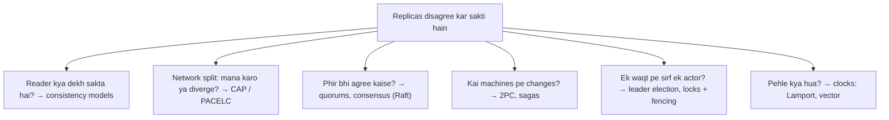
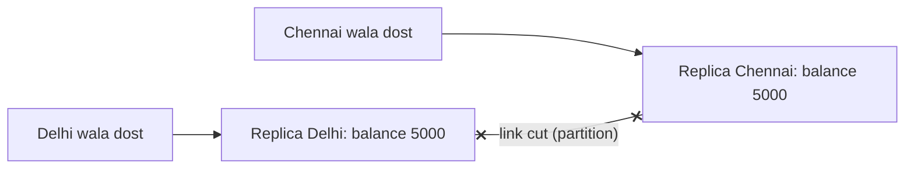
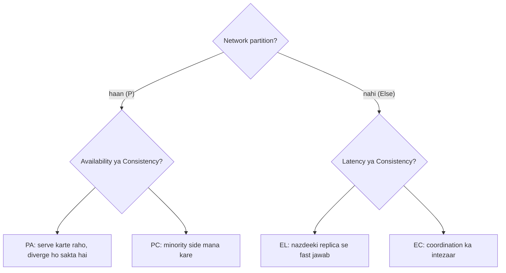
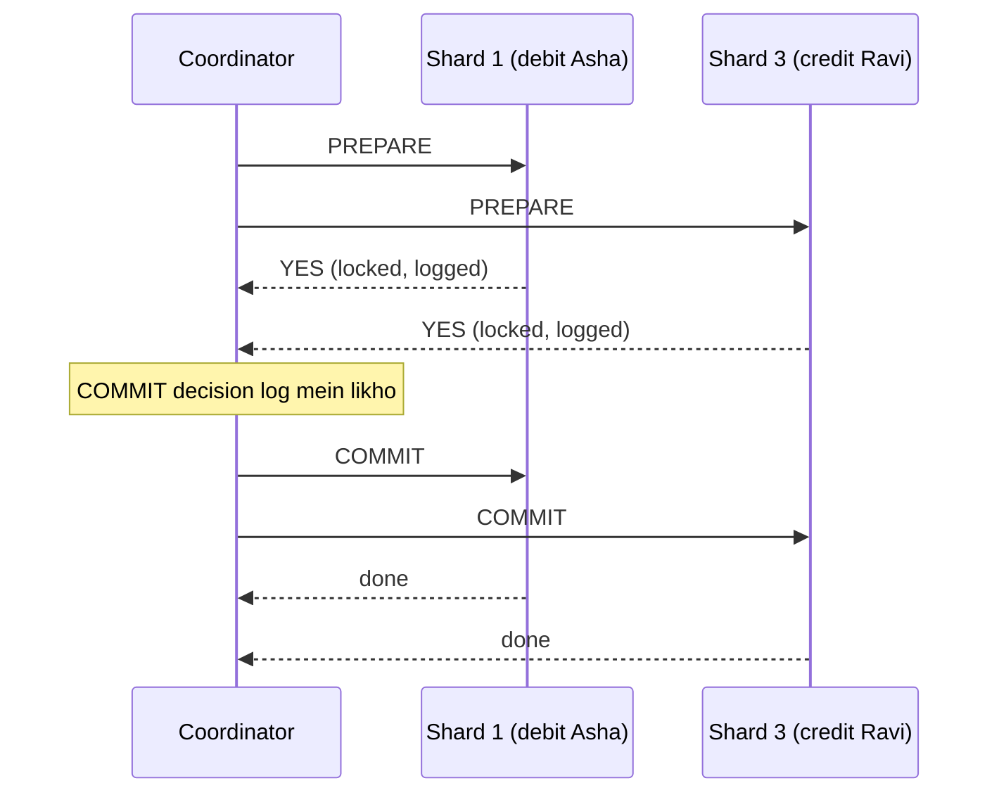
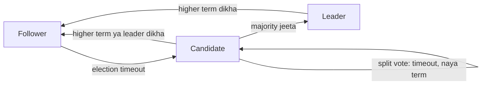
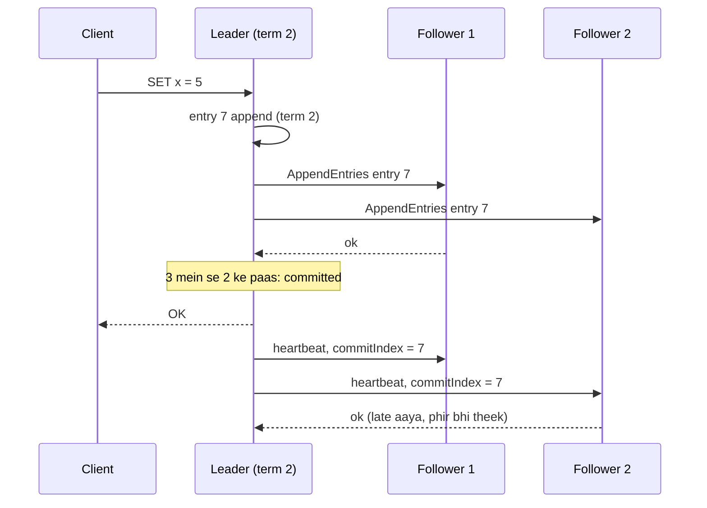
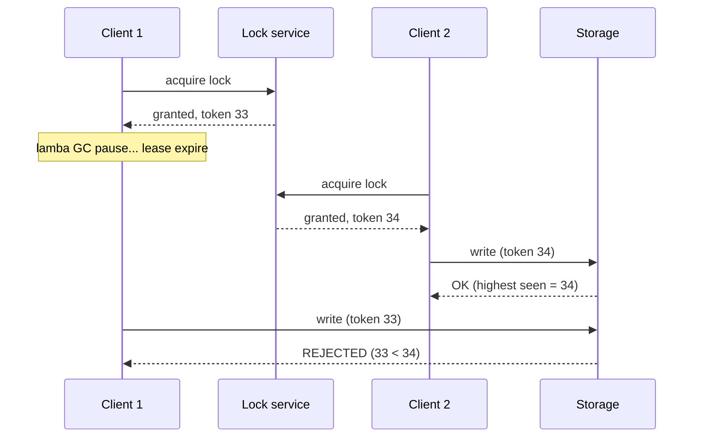

# Chapter 06 · CAP, Consistency Models & Consensus

> Do dost hain, dono ka ek joint bank account hai. Ek Delhi mein rehta hai, doosra Chennai mein. Bank ke do datacenters hain, aur unke beech ka cable (undersea nahi, zameen wala *overland* cable) ek construction crew ne khudaai mein kaat diya. Ab dono dost bilkul ek hi pal mein account ke aakhri ₹5,000 nikaalne ki koshish karte hain. Bank ke saamne do hi raaste hain: ek ko mana kar do (aur bank "down" dikhega), ya dono ko paisa de do (aur bank ₹5,000 ka nuksaan uthayega). Teesra koi raasta nahi hai. **Yahi choice CAP theorem hai**, aur ye chapter tumhe sikhayega ki ye choice soch-samajh ke, jaan-boojh ke kaise karte hain.

**Is chapter mein tum seekhoge:**
- CAP theorem ekdum precise shabdon mein, aur iske baare mein sabse common galatfehmiyaan
- PACELC: wo trade-off jo network bilkul theek hone par bhi rehta hai
- Consistency models: linearizable, sequential, causal, read-your-writes, eventual, examples ke saath
- Quorums (N, R, W) ek simulation ke saath, aur kyun R + W > N poori kahani nahi hai
- Conflict resolution: last-write-wins, vector clocks, aur CRDTs
- Distributed transactions: two-phase commit aur saga pattern
- Consensus: kyun chahiye, Raft ka leader election aur log replication intuitively, aur Paxos kahan fit hota hai
- Leader election, fencing tokens ke saath distributed locks, aur clocks (physical vs logical, Lamport)

**Isse pehle padho:** [Chapter 05 · Replication, Sharding & Consistent Hashing](05-replication-sharding.md) (leaders, followers, quorums, failover) · [Chapter 03 · Databases](03-databases.md) (transactions, isolation)

---

## 🧠 The Big Idea · Asli Baat

[Chapter 05](05-replication-sharding.md) mein humne data ki copies kai machines pe banayi thi. Copies bahut kaam ki cheez hain, **jab tak wo aapas mein disagree nahi karti**. Ye chapter disagreement ke rules ke baare mein hai:

- **Reader ko kya dikh sakta hai?** (consistency models)
- **Jab machines aapas mein baat hi na kar paayein toh kya hoga?** (CAP, PACELC)
- **Phir bhi machines ek sach pe kaise agree karti hain?** (quorums, consensus)
- **Ek saath kai machines pe kaam kaise karein?** (2PC, sagas, locks)



Ye mushkil kyun hai, iski gehri wajah samjho. Distributed system mein **messages late ho sakte hain, kho sakte hain, ya ulte order mein pahunch sakte hain. Machines ruk (pause) sakti hain ya crash ho sakti hain. Aur clocks aapas mein agree nahi karte.** Ek node kabhi pakka nahi bol sakta ki doosra node mar gaya hai ya bas slow hai. Is chapter ka har idea, in sab ke bawajood sahi (correct) rehne ka ek soch-samjha tareeka hai.

> 💡 **The core insight:** perfect agreement, perfect availability, aur network failures ko jhelna, teeno ek saath nahi mil sakte. Isliye **har feature ke liye alag se** decide karo ki kitna agreement chahiye, aur sirf utni hi keemat chukao.

> 🇮🇳 **Desi Analogy:** Joint family ka WhatsApp group socho. Mummy ne group pe likha "aaj dinner mein rajma". Papa ka phone tunnel mein hai (network partition). Ab chhota bhai Papa ko call karke poochta hai "dinner mein kya hai?". Papa ke paas do options hain: "pata nahi, network aane do phir batata hoon" (**consistency** chuni, jawab nahi diya), ya apni purani jaankari se bol do "kal ki daal hi hogi" (**availability** chuni, jawab diya par galat ho sakta hai). Har message ek copy hai, har member ek replica hai, aur ye poora chapter isi sawaal ka engineering version hai: purani copy se jawab do, ya ruk jao?

---

## 🔨 Building It Up · Zero Se Shuru

### 1. The CAP theorem, precisely

CAP ko Eric Brewer ne 2000 mein ek conjecture (andaaza) ke roop mein rakha tha, aur Gilbert aur Lynch ne 2002 mein isse prove kiya. Ye ek replicated data system ki teen properties ki baat karta hai:

- **C — Consistency**: yahan iska matlab hai **linearizability**. Har read sabse recent completed write ka value lautata hai, aise jaise data ki **sirf ek hi copy** ho. (Ye ACID wala "C" **nahi** hai!)
- **A — Availability**: har **non-failed** (zinda) node ko bheji gayi har request ka (error ke bina) response aata hai, der-saber hi sahi. "Sorry, baad mein try karo" allowed nahi.
- **P — Partition tolerance**: system tab bhi kaam karta rehta hai jab network nodes ke beech **messages drop ya delay** karne lage. **Network partition** yaani nodes aise groups mein bat jaate hain jo aapas mein baat nahi kar sakte.

**The theorem:** jab network partition hota hai, system ko **C** aur **A** mein se ek chunna padta hai. Dono ek saath nahi de sakta.

Kyun? Do replicas socho, Delhi aur Chennai, aur unke beech ka link kat gaya:



Ek withdrawal request Delhi pahunchti hai. Delhi ye baat Chennai ko bata nahi sakta.

- **C chuno (CP)**: Delhi mana kar deta hai (ya tab tak rukta hai) jab tak coordinate na kar sake. Consistent hai, lekin us request ke liye **available nahi** hai.
- **A chuno (AP)**: Delhi accept kar leta hai. Chennai bhi kata hua hai, wo bhi ek aur withdrawal accept kar leta hai. Dono available rahe, lekin ab replicas **disagree** karti hain aur account overdraw ho gaya. Consistent nahi.

```python
class Replica:
    def __init__(self, name, balance):
        self.name, self.balance = name, balance

def withdraw(replica, peer, amount, partitioned, mode):
    if partitioned and mode == "CP":
        return f"{replica.name}: ERROR, can't reach {peer.name}, try later"
    if replica.balance < amount:
        return f"{replica.name}: declined, insufficient funds"
    replica.balance -= amount
    if not partitioned:
        peer.balance = replica.balance          # normal case: peer ko turant (synchronously) copy bhejo
    return f"{replica.name}: OK, dispensed {amount}"

for mode in ("CP", "AP"):
    delhi, chennai = Replica("Delhi", 5000), Replica("Chennai", 5000)
    print(f"--- {mode} during a partition ---")
    print(withdraw(delhi, chennai, 5000, partitioned=True, mode=mode))
    print(withdraw(chennai, delhi, 5000, partitioned=True, mode=mode))
    print(f"total dispensed: {10000 - delhi.balance - chennai.balance}, real money: 5000")
```

```text
--- CP during a partition ---
Delhi: ERROR, can't reach Chennai, try later
Chennai: ERROR, can't reach Delhi, try later
total dispensed: 0, real money: 5000
--- AP during a partition ---
Delhi: OK, dispensed 5000
Chennai: OK, dispensed 5000
total dispensed: 10000, real money: 5000
```

Abhi kya hua, dekho: CP bank dono doston ke liye "down" tha, lekin ek paisa nahi gaya. AP bank ne dono ko serve kiya aur ₹5,000 ke account se ₹10,000 baant diye. **Dono mein se koi bhi "galat" nahi hai.** Ek ATM network AP chun sakta hai, har withdrawal pe chhoti si limit laga ke, aur overdraft baad mein theek kar sakta hai (asli ATMs kuch aisa hi karte hain). Lekin ek stock exchange ko CP hi chunna padega.

(Note: upar wale CP version mein ek smarter design ye karta ki jis side pe replicas ki **majority** hai, wo side serve karti rehti. 2 replicas mein koi majority hoti hi nahi, isliye dono mana karte hain. Isi wajah se real systems 3 ya 5 replicas rakhte hain, section 11 dekho.)

> 🇮🇳 **Desi Analogy:** IRCTC ka seat booking socho, jahan do booking counters hain, ek Delhi mein aur ek Chennai mein, aur dono ke beech ki line kat gayi. Train mein aakhri ek berth bachi hai. **CP counter** bolega "server se connect nahi ho raha, thodi der baad aao" (Tatkal ke time pe log gussa honge, par berth do logon ko nahi bikegi). **AP counter** dono ko ticket de dega, aur train mein do log ek hi berth pe jhagda karenge. Counter = replica, cut line = partition, aakhri berth = shared data. Booking ke liye CP sahi hai. Lekin "train kitni late hai" wala display board AP ho sakta hai: thoda purana time dikha diya toh koi aafat nahi.

> 🤔 **Mann mein sawaal:** CP wala system toh "down" ho gaya. Toh kya CP ka matlab hai ki system baar-baar band rehta hai?
>
> **Jawab:** Nahi. CP system sirf **partition ke dauraan**, aur sirf **minority side** pe mana karta hai. Normal din mein (jo 99.9% time hota hai) wo bilkul normal chalta hai. Aur 3 ya 5 replicas ke saath majority wali side partition mein bhi kaam karti rehti hai. "Down" hona sirf us chhoti, kati hui side ka hota hai.

### 2. Common CAP misunderstandings

1. **"Teen mein se koi bhi do chun lo."** Ye framing hi galat hai. Kisi bhi real network mein partitions **hoke rahenge**: switches fail hote hain, cables katte hain, aur lambe GC pauses bhi partition jaise hi dikhte hain. Tum "P chhod" nahi sakte. Asli choice ye hai: **partition ke dauraan**, C ya A?
2. **"CA systems."** Ek single-node database "CA" sirf is matlab mein hai ki replicas ke beech koi network hi nahi hai. Jaise hi tum network pe replicate karte ho, partitions ko handle karna hi padega.
3. **"CAP consistency = ACID consistency."** Nahi. CAP-C yaani linearizability (replicas agree karti hain, reads latest write dekhte hain). ACID-C yaani "constraints hold karte hain" (jaise balance negative nahi ho sakta).
4. **"CAP availability = 99.99% uptime."** Nahi. CAP-A ek strict theoretical property hai: *har* non-failed node ko *har* request ka jawab dena hai. Bahut se "CP" systems practice mein extremely available hote hain (bas partition ki minority side pe jawab nahi de paate).
5. **"Ek system ya toh CP hai ya AP, bas khatam."** Zyaadatar systems har operation ke hisaab se **tunable** hote hain (Cassandra ke consistency levels, DynamoDB ka strongly consistent reads wala option, MongoDB ke read/write concerns).
6. **"CAP latency ko explain karta hai."** CAP latency ki baat hi nahi karta. Uske liye PACELC hai.

Typical labels (upar wali chetaavni ke saath padhna):

| System | Usual classification | Why |
|---|---|---|
| ZooKeeper, etcd, Consul | CP | Consensus: minority side writes mana kar deti hai |
| HBase, Google Spanner, CockroachDB | CP | Consistency pehle; minority unavailable |
| MongoDB (default majority writes) | CP-ish | Primary sirf majority side pe ho sakta hai |
| Cassandra, ScyllaDB, Riak, DynamoDB (default) | AP | Jo bhi replica pahunch mein hai, writes accept karo; baad mein reconcile |
| DNS, CDNs, caches | AP | Fail hone ki jagah shayad-purana (stale) data serve karo |

> 🤔 **Mann mein sawaal:** Toh mera single PostgreSQL server "CA" hai, sahi?
>
> **Jawab:** Ek tarah se haan, lekin wo isliye ki uske paas "partition" hone ke liye doosri copy hi nahi hai. Jis din tum ek replica jodoge, us din se network beech mein aa gaya, aur partition ka sawaal wapas aa jaayega. Interview mein "CA" bolne ki jagah bolo: **"single node pe CAP apply hi nahi hota; distributed hote hi choice CP vs AP hai."**

### 3. PACELC: the trade-off when nothing is broken

Daniel Abadi ka **PACELC** CAP ko aage badhata hai:

> Agar **P**artition hai, toh **A**vailability aur **C**onsistency mein se chuno; **E**lse (normal operation mein), **L**atency aur **C**onsistency mein se chuno.

Network ekdum perfect ho tab bhi, replicas ko strongly consistent rakhne ka matlab hai har write ya read pe doosri replicas ka **intezaar karna** (round trips, shayad regions ke paar bhi). Intezaar chhod do toh tez ho jaoge, lekin readers ko stale data dikh sakta hai.



| System | PACELC | Meaning |
|---|---|---|
| Cassandra, DynamoDB (defaults), Riak | PA/EL | Partition mein available, baaki time fast; eventual consistency |
| Spanner, CockroachDB, etcd, ZooKeeper (writes) | PC/EC | Hamesha consistent; latency ki keemat chukata hai |
| MongoDB (typical config) | PA/EC ya PC/EC, settings pe depend | Tunable |
| PNUTS (Yahoo) | PC/EL | Unusual mix: har record ka apna master |

> 💡 Rozmarra ke design ke liye PACELC zyada kaam ka lens hai: partitions kabhi-kabhaar hote hain, lekin **consistency ki latency wali keemat** har ek request pe chukani padti hai.

> 🇮🇳 **Desi Analogy:** Kirana store ka khata socho, jiski do branches hain. Normal din (koi partition nahi) bhi, jab tum udhaar pe saamaan lete ho, dukaandar ke paas do option hain. Ya toh doosri branch ko phone karke confirm kare ki tumhara total udhaar kitna hai (**EC**: sahi hisaab, lekin har customer pe 2 minute ki deri), ya apne register se turant de de (**EL**: fast, lekin ho sakta hai doosri branch mein tumne kal hi limit cross kar li ho). Phone line kharab hone pe kya karna hai, wo CAP (PA/PC) wala hissa hai. Phone theek hone pe bhi "intezaar karun ya nahi", wo ELC wala hissa hai. Isliye PACELC rozana kaam aata hai.

### 4. Consistency models: what can a reader see?

**Consistency model** ek contract (wada) hai: "agar tum aise likhoge aur aise padhoge, toh tumhe ye dekhne ki guarantee hai." Sabse strong se sabse weak tak:

**Linearizability (strong consistency).** System aise behave karta hai jaise data ki **ek hi copy** ho, aur har operation apne start aur end ke beech kisi ek point pe **turant (instantly)** ho jaata hai. Ek baar write complete ho gaya, toh uske baad ka har read (kisi ka bhi) usse dekhega. Ek baar kisi bhi reader ne naya value dekh liya, toh uske baad koi bhi reader purana value nahi dekhega.

- Example: username registration. Ek baar "asha" le liya gaya, toh duniya mein kahin bhi kisi ko wo free nahi dikhna chahiye.
- Cost: har operation pe coordination (consensus, ya ek single leader se padhna).

**Sequential consistency.** Saare operations **kisi ek single order** mein dikhte hain jis pe har node agree karta hai, aur har client ke apne operations usi order mein dikhte hain jismein usne bheje the. Lekin wo order real time se match kare, ye zaroori nahi: kisi doosre client ka write khatam ho jaane ke baad bhi ek read purana value lauta sakta hai, bas sabko same order dikhna chahiye.

**Causal consistency.** Jo operations **causally related** hain (ek ne doosre ko influence kiya ho sakta hai: message ke baad reply, post padhne ke baad comment), wo sabko usi order mein dikhte hain. **Concurrent** (aapas mein unrelated) operations alag-alag nodes ko alag order mein dikh sakte hain.

- Example: Ravi post karta hai "I got the job!", Asha reply karti hai "Congrats!". Kisi ko bhi Asha ka reply, Ravi ki post ke bina nahi dikhna chahiye. Lekin do unrelated posts alag logon ko alag order mein dikh sakti hain.
- Ye wo sabse strong model hai jo partitions ke dauraan bhi available reh sakta hai. Isliye geo-replicated systems mein ye popular hai.

**Session guarantees** (client-centric, [Chapter 05](05-replication-sharding.md) se):

- **Read-your-writes**: tumhe hamesha tumhare apne writes dikhenge.
- **Monotonic reads**: ek baar koi value dekh li, toh usse purani value kabhi nahi dikhegi.
- **Monotonic writes**: tumhare writes usi order mein apply honge jismein tumne kiye.
- **Writes-follow-reads**: agar tumne kuch padha aur phir likha, toh tumhara write us padhi hui cheez ke baad order hoga.

**Eventual consistency.** Agar writes ruk jaayein, toh saari replicas **eventually** (aakhirkaar) ek hi value pe aa jaati hain. Usse pehle, reads kuch bhi lauta sakte hain jo kabhi likha gaya tha (stale data, alag replicas pe alag order mein values). Ye sabse weak, lekin kaam ka, wada hai.

- Example: like counts, view counts, DNS ([Chapter 01](01-foundations-internet.md)), product reviews.

> 🇮🇳 **Desi Analogy:** Cricket match ka score socho. **Linearizable** = stadium ka official scoreboard: jaise hi third umpire ne "OUT" diya, us second ke baad koi bhi screen "NOT OUT" nahi dikhayegi. **Causal** = commentary: "chhakka!" wala comment kabhi us ball se pehle nahi aayega jispe chhakka laga, lekin do alag matches ke updates kisi bhi order mein aa sakte hain. **Read-your-writes** = tumne apne fantasy team mein captain badla, toh refresh karke tumhe apna naya captain hi dikhna chahiye. **Eventual** = WhatsApp forward wala score: kisi ke paas 3 over purana, kisi ke paas latest, lekin match khatam hone ke thodi der baad sabke paas same final score.

> 🤔 **Mann mein sawaal:** Sequential aur linearizable mein farq kya hai? Dono mein "ek order" hai na?
>
> **Jawab:** Haan, dono mein sab ek hi order pe agree karte hain. Farq **real time** ka hai. Linearizable mein wo order wall-clock ke hisaab se bhi sahi hona chahiye: agar A ka write 10:00 pe khatam hua aur B ka read 10:01 pe shuru hua, toh B ko A ka write dikhna hi chahiye. Sequential mein ye zaroori nahi: B ko purana value dikh sakta hai, bas jo order sab dekh rahe hain wo sabke liye same ho aur har client ka apna order bana rahe.

Ab ek timeline dekho jo **linearizable nahi hai**, aur code se check karo:

```python
# Ek hi register x pe operations. Har ek: (client, op, value, start_time, end_time)
history = [
    ("A", "write", 1, 0, 2),
    ("B", "read", 1, 3, 4),     # B naya value 1 dekhta hai (A ka write khatam hone ke baad)
    ("C", "read", 0, 5, 6),     # C, jo BAAD mein shuru hua, purana value 0 dekhta hai
]

def violates_linearizability(history, initial=0):
    """Simplified check for a single-writer register: once a value has been
    returned by a read that ended before another read started, the later read
    must not return an older value."""
    write_order = [initial] + [v for _, op, v, _, _ in sorted(history, key=lambda h: h[3]) if op == "write"]
    reads = sorted([h for h in history if h[1] == "read"], key=lambda h: h[3])
    for i, earlier in enumerate(reads):
        for later in reads[i + 1:]:
            if earlier[4] < later[3] and write_order.index(later[2]) < write_order.index(earlier[2]):
                return f"{later[0]} read {later[2]} after {earlier[0]} already read {earlier[2]}"
    return None

print("violation:", violates_linearizability(history))
```

```text
violation: C read 0 after B already read 1
```

Abhi kya hua: B aur C ke reads overlap nahi karte. B ka read khatam hua, **uske baad** C ka shuru hua. Phir bhi C ne purana value dekha. Agar data ki ek hi copy hoti, toh ye impossible tha. Isliye ye history linearizable nahi hai. Async replicas ke saath ye **ho sakta hai** (B ek fresh replica pe gaya, C ek peeche chal rahi (lagging) replica pe). Fir bhi ye **eventually consistent** hai, kyunki aakhir mein sab 1 pe aa jaayenge.

| Model | Guarantee | Typical cost | Example use |
|---|---|---|---|
| Linearizable | Single-copy, real-time order | Sabse zyada latency; partitions mein unavailable | Locks, leader election, unique usernames, balances |
| Sequential | Ek global order, har client ka order bana rehta hai | High | Kuch replicated logs/caches |
| Causal | Har jagah cause pehle, effect baad mein | Moderate; available rehta hai | Comments/replies, chat, social feeds |
| Read-your-writes / monotonic | Per-session sanity | Low | Profile edits, dashboards |
| Eventual | Writes ruk jaayein toh converge | Sabse kam; hamesha available | Likes, views, DNS, caches |

### 5. Quorums: N, R, W

[Chapter 05](05-replication-sharding.md) ka leaderless replication yaad karo: har key **N** replicas pe store hoti hai; ek write **W** acknowledgements (haan, mil gaya) ka intezaar karta hai; ek read **R** responses ka intezaar karta hai aur unmein se sabse naya version leta hai.

- **R + W > N** → har read set, har write set ke saath kam se kam ek replica pe overlap karta hai. Isliye ek read normally **latest completed write dekh leta hai**.
- **W > N/2** → do writes, do alag-alag (disjoint) majorities pe ek saath succeed nahi kar sakte (writes ka order tay karne mein madad).
- Chhota W = fast aur zyada available writes; chhota R = fast reads. Workload ke hisaab se tune kar sakte ho.

| Config (N=3) | Behaviour |
|---|---|
| W=3, R=1 | Fast reads; koi bhi ek replica down ho toh writes fail |
| W=1, R=3 | Fast writes; koi bhi ek replica down ho toh reads fail |
| W=2, R=2 | Balanced; dono ke liye 1 node down jhel leta hai; overlap guaranteed |
| W=1, R=1 | Sabse fast, sabse available; **overlap ki koi guarantee nahi** → stale reads possible |

> 🇮🇳 **Desi Analogy:** Shaadi ki guest list teen rishtedaaron ke paas hai: Chacha, Mama, Bua (N=3). Naya mehmaan jodna ho toh tum kam se kam do logon ko bata ke hi "done" maante ho (W=2). Baad mein confirm karna ho ki mehmaan list mein hai, toh tum kam se kam do logon se poochte ho (R=2). Teen mein se jin do ko bataya aur jin do se poocha, unmein **kam se kam ek common hoga hi** (2 + 2 = 4 > 3). Wahi common rishtedaar tumhe naya naam bata dega. Agar sirf ek ko bataya (W=1) aur sirf ek se poocha (R=1), toh bahut chance hai ki tumne galat rishtedaar se poocha jo kuch jaanta hi nahi.

Chalo simulate karte hain: 3 replicas, har operation ke liye random replicas chuno, aur alag-alag R/W ke liye stale reads gino.

```python
import random

def simulate(n, w, r, trials=10_000, seed=1):
    rng = random.Random(seed)
    stale = 0
    for _ in range(trials):
        versions = [1] * n                            # shuru mein sab replicas pe version 1
        for i in rng.sample(range(n), w):             # write v2 sirf W replicas tak pahunchta hai
            versions[i] = 2                           # (baaki ko baad mein, async milega)
        responses = [versions[i] for i in rng.sample(range(n), r)]
        if max(responses) < 2:                        # R replies mein sabse naya version
            stale += 1
    return stale / trials

for w, r in [(1, 1), (2, 1), (1, 2), (2, 2), (3, 1), (1, 3)]:
    tag = "R+W>N" if r + w > 3 else "     "
    print(f"N=3 W={w} R={r} {tag}  stale read probability: {simulate(3, w, r):.1%}")
```

```text
N=3 W=1 R=1        stale read probability: 67.2%
N=3 W=2 R=1        stale read probability: 33.9%
N=3 W=1 R=2        stale read probability: 33.3%
N=3 W=2 R=2 R+W>N  stale read probability: 0.0%
N=3 W=3 R=1 R+W>N  stale read probability: 0.0%
N=3 W=1 R=3 R+W>N  stale read probability: 0.0%
```

Abhi kya hua: jab bhi R + W > 3 tha, stale reads **0%** ho gaye, kyunki jin replicas se padha unmein kam se kam ek aisi zaroor thi jisko write mila tha. R + W ≤ 3 hone pe ek asli chance hai ki tum sirf un replicas se padho jinke paas write abhi pahuncha hi nahi. (Theory: W=1, R=1 ke liye ye 2/3 hai: write 1 replica pe gaya, read 3 mein se kisi ek pe, toh 2/3 baar galat wali. W=2, R=1 ke liye 1/3 hai. W=1, R=2 ke liye bhi 1/3: dono read wali replicas wahi 2 hon jinhe write nahi mila, iske 3 mein se 1 chance hain.)

**Kyun R + W > N poori linearizability nahi hai** (interview mein ye depth achhi lagti hai):

- **Sloppy quorums / hinted handoff**: failures ke dauraan writes key ke normal N replicas ke bahar, kisi stand-in (kaam chalau) node pe land ho sakte hain. Tab overlap wali guarantee toot jaati hai.
- **Concurrent writes**: do writes jinka koi clear order nahi, unke liye conflict resolution chahiye (section 6). Skewed clocks ke saath LWW "galat" wala rakh sakta hai.
- **A write in progress**: ek read jo write ke saath-saath chal raha hai, ek replica pe naya value dekh sakta hai, aur baad wala read aisi replicas pe ja sakta hai jinke paas wo nahi hai (jab tak reads return karne se pehle synchronously **read repair** na karein).
- **Partial failure**: ek write jo W se kam replicas pe succeed hua, wo failure report karta hai, lekin jin replicas pe pahunch gaya tha wahan se rollback nahi hota.

Toh Dynamo-style quorums "usually fresh" (zyaadatar taaza) reads dete hain, strict guarantee nahi. Strict guarantees ke liye consensus chahiye (section 11).

> 🤔 **Mann mein sawaal:** Simulation mein toh R + W > N pe 0.0% stale aaya. Phir ye "full guarantee nahi" wali baat kahan se aayi?
>
> **Jawab:** Kyunki simulation ek ideal duniya hai: write poora ho chuka hai, koi node fail nahi hua, koi doosra write saath mein nahi chal raha, aur hamesha key ki asli N replicas use ho rahi hain. Upar ki chaar bullets wahi cheezein hain jo real duniya mein is ideal ko todti hain. Isliye bolo: "R + W > N gives overlap, not linearizability."

### 6. Conflict resolution: last-write-wins

Multi-leader ya leaderless replication mein, do replicas ek hi key pe **concurrent** writes accept kar sakti hain. Kisi na kisi ko final value decide karni padegi.

**Last-write-wins (LWW)**: har write ke saath ek timestamp lagao; jiska timestamp sabse bada, wahi rakho. Simple hai aur convergent hai: har replica aakhir mein same value pe pahunchti hai.

Problems:

- Ye concurrent writes ko **chupchaap (silently) phenk deta hai**. Agar do users ek shared list mein ek hi waqt pe alag-alag items jodte hain, toh ek addition gayab ho jaata hai.
- Physical clocks drift karti hain (section 16). Jis node ki clock 2 second aage chal rahi hai, wo **hamesha jeetega**, un writes ke against bhi jo asal mein baad mein hue.

LWW tab theek hai jab ek concurrent update kho jaana chalega (jaise "last seen online" timestamp, cache entries), ya jab har key sirf ek hi baar likhi jaati hai (unique IDs wala immutable data).

> 🇮🇳 **Desi Analogy:** Family WhatsApp group mein "Sunday ka plan" naam ka pinned message hai. Mummy ne edit kiya "Sunday ko mandir", aur usi minute Didi ne edit kiya "Sunday ko movie". Group sirf us edit ko rakhta hai jiska time baad ka hai (LWW). Didi ke phone ki ghadi 2 minute aage chal rahi thi, toh "movie" jeet gaya, aur Mummy ka plan bina kisi notification ke gayab. Kisi ko pata bhi nahi chala ki ek plan khoya. Yahi LWW ka khatra hai: **silent data loss**, aur galat ghadi wala hamesha jeetta hai.

### 7. Vector clocks: detecting concurrency

Ek single timestamp ye farq nahi bata sakta ki "A, B se pehle hua" ya "A aur B ek hi waqt pe hue, ek-doosre ke baare mein jaane bina". **Vector clock** ye bata sakta hai.

Har replica, har replica ke liye ek counter rakhta hai: `{A: 2, B: 0, C: 1}` ka matlab hai "is version mein A ke 2 updates aur C ka 1 update shaamil hai". Rules:

- Jab replica X kisi value ko update karta hai, wo **apni khud ki** entry badhata hai.
- Merge karte waqt, **element-wise maximum** lo (har entry ka alag-alag max).
- Do clocks V1, V2 compare karo:
  - V1 har entry mein ≤ V2 (aur dono equal nahi) → V1 **happened before** V2 → V2 ne V1 ko supersede kar diya, koi conflict nahi.
  - Koi bhi doosre se ≤ nahi → **concurrent** → asli conflict; dono ko rakho (**siblings**) aur resolve karo.

> 🇮🇳 **Desi Analogy:** Kirana store ke khate ki teen photocopies hain: Papa, Mummy, aur Bhaiya ke paas. Har copy ke upar ek chhota table hai: "Papa ne kitni entries likhi, Mummy ne kitni, Bhaiya ne kitni". Agar Mummy ki copy ka table har column mein Bhaiya ki copy ke table se bada ya barabar hai, toh Mummy ki copy mein Bhaiya ka sab kuch already hai, purani copy phenk do. Lekin agar Mummy ke paas "Mummy: 3" zyada hai aur Bhaiya ke paas "Bhaiya: 2" zyada, toh dono ne ek-doosre ko dekhe bina likha hai. Ab dono copies saath rakh ke milaana padega. Har column = ek replica ka counter, poora table = vector clock.

```python
def compare(v1, v2):
    keys = set(v1) | set(v2)
    le = all(v1.get(k, 0) <= v2.get(k, 0) for k in keys)
    ge = all(v1.get(k, 0) >= v2.get(k, 0) for k in keys)
    if le and ge:
        return "equal"
    if le:
        return "v1 happened before v2"
    if ge:
        return "v2 happened before v1"
    return "CONCURRENT (conflict)"

def bump(clock, node):
    new = dict(clock)
    new[node] = new.get(node, 0) + 1
    return new

def merge(v1, v2):
    return {k: max(v1.get(k, 0), v2.get(k, 0)) for k in set(v1) | set(v2)}

base = bump({}, "A")                 # A likhta hai cart = [milk]                {A:1}
on_b = bump(base, "B")               # B, base dekh ke, bread jodta hai          {A:1, B:1}
on_c = bump(base, "C")               # C bhi base se, eggs jodta hai             {A:1, C:1}
print("base vs on_b :", compare(base, on_b))
print("on_b vs on_c :", compare(on_b, on_c))
resolved = bump(merge(on_b, on_c), "A")   # A siblings ko merge karke union likhta hai
print("resolved     :", dict(sorted(resolved.items())))
print("on_c vs resolved:", compare(on_c, resolved))
```

```text
base vs on_b : v1 happened before v2
on_b vs on_c : CONCURRENT (conflict)
resolved     : {'A': 2, 'B': 1, 'C': 1}
on_c vs resolved: v1 happened before v2
```

Abhi kya hua: vector clock ne prove kar diya ki B aur C ke writes ek-doosre ki jaankari ke bina hue the. Isliye ek ko chupchaap phenkne (LWW) ki jagah, system ne dono rakhe aur unhe merge kiya (cart = milk, bread, eggs). Merged version dono siblings pe haavi (dominate) hai, toh siblings ab phenke ja sakte hain. Amazon ke original Dynamo ne isi tareeke se shopping carts se items khone se bachaya tha. (Riak iska ek variant use karta hai jise **dotted version vectors** kehte hain; idea wahi hai.)

Step-by-step dekho kyun `on_b vs on_c` concurrent aaya: `on_b = {A:1, B:1}`, `on_c = {A:1, C:1}`. B wale column mein on_b bada hai (1 > 0), C wale column mein on_c bada hai (1 > 0). Koi bhi har column mein doosre se chhota-ya-barabar nahi, isliye **CONCURRENT**.

Cost: writers ki ginti ke saath clocks bade hote jaate hain, aur application ko pata hona chahiye ki merge kaise karna hai.

### 8. CRDTs: data types that merge themselves

**CRDTs (Conflict-free Replicated Data Types)** aise data structures hain jo is tarah design kiye gaye hain ki replicas alag-alag, bina pooche update ho sakein aur **hamesha same result pe merge ho jaayein**, chahe merge kisi bhi order mein ho ya kitni bhi baar ho. Merge function:

- **commutative** hai (order matter nahi karta: merge(a, b) = merge(b, a)),
- **associative** hai (grouping matter nahi karti: merge(merge(a, b), c) = merge(a, merge(b, c))),
- **idempotent** hai (do baar merge karna = ek baar merge karna).

**G-Counter (grow-only counter)**: har replica sirf apne increments ginta hai; value = sabka sum; merge har replica ka maximum leta hai.

```python
class GCounter:
    def __init__(self, replica_id):
        self.id = replica_id
        self.counts = {}

    def increment(self, n=1):
        self.counts[self.id] = self.counts.get(self.id, 0) + n

    def value(self):
        return sum(self.counts.values())

    def merge(self, other):
        for rid, c in other.counts.items():
            self.counts[rid] = max(self.counts.get(rid, 0), c)

mumbai, delhi = GCounter("mumbai"), GCounter("delhi")
mumbai.increment(3)                     # Mumbai mein 3 likes
delhi.increment(5)                      # Delhi mein 5 likes, usi waqt
mumbai.merge(delhi); delhi.merge(mumbai)
mumbai.merge(delhi)                     # dobara merge karne se kuch nahi badalta (idempotent)
print("mumbai sees", mumbai.value(), "| delhi sees", delhi.value())
```

```text
mumbai sees 8 | delhi sees 8
```

Abhi kya hua: koi coordination nahi, koi increment nahi khoya, aur dono replicas 8 pe aa gayi. (Merge pe counts ko seedha jod kyun nahi dete? Kyunki same state ko do baar merge karne pe double counting ho jaati: 3 + 5 + 5 = 13. Har replica ka max lena idempotent hai: max(5, 5) = 5, chahe kitni baar karo.)

> 🇮🇳 **Desi Analogy:** Shaadi mein shagun ke lifafe do counters pe gine ja rahe hain: ek pe Chacha, ek pe Mama. Har koi **sirf apne counter ka total** apni diary mein ek alag line pe likhta hai: "Chacha: 30", "Mama: 45". Raat ko dono diary milaate hain. Rule simple hai: har naam ke aage jo **bada number** hai wo rakho, kabhi jodo mat. Mama ne apni diary do baar dikha di? Koi farq nahi, "Mama: 45" hi rahega, 90 nahi banega. Total = 30 + 45 = 75, dono diaries mein. Har naam ki line = per-replica count, "bada number rakho" = max merge, "do baar dikhane se farq nahi" = idempotent. Yahi **G-Counter** hai.

Other common CRDTs:

| CRDT | Supports | Idea |
|---|---|---|
| G-Counter | Increment | Per-replica counts, merge by max |
| PN-Counter | Increment aur decrement | Do G-Counters: P (plus) aur N (minus); value = P − N |
| G-Set | Sirf add | Union |
| 2P-Set | Add, ek baar remove | Add-set aur remove-set (tombstones, yaani "ye hata diya" ka nishaan); dobara add nahi kar sakte |
| OR-Set (observed-remove) | Add aur remove, re-add bhi | Har add ko ek unique tag do; sirf wahi tags remove karo jo tumne dekhe hain. Concurrent add, remove pe jeet jaata hai |
| LWW-Register | Single value | Timestamp jeetta hai (CRDT hai, lekin concurrent writes kho deta hai) |
| Sequence CRDTs (RGA, Logoot, Yjs/Automerge) | Collaborative text | Har character ki ek unique position |

Kahan use hote hain: Riak data types, Redis Enterprise active-active, collaborative editors (Figma-style multiplayer, Yjs, Automerge), shopping carts, aur globally replicated apps mein presence (kaun online hai) aur counters.

> 🤔 **Mann mein sawaal:** Agar CRDTs itne badhiya hain aur kabhi conflict nahi hota, toh sab kuch CRDT se kyun nahi banate? Bank balance bhi?
>
> **Jawab:** Kyunki CRDT "converge" karne ki guarantee deta hai, "rules follow karne" ki nahi. PN-Counter mein do replicas alag-alag ₹5,000 ghata sakte hain aur merge ke baad balance −₹5,000 ho jaayega. Sab agree karenge, lekin galat value pe. Jahan **invariant** (jaise "balance kabhi negative nahi") bachana hai, wahan coordination (CP) chahiye. CRDTs likes, views, carts, collaborative text ke liye hain, jahan har update ko bina pooche accept karna theek hai.

### 9. Distributed transactions: two-phase commit (2PC)

[Chapter 05](05-replication-sharding.md) mein humne cross-shard transactions dekhe the: shard 1 pe baithe user se shard 3 pe baithe user ko paise bhejna. Dono commit hon, ya koi bhi nahi. **Two-phase commit** isko coordinate karta hai.

**Phase 1, prepare (voting):** **coordinator** har **participant** se poochta hai "kya tum commit kar sakte ho?". Har participant saara kaam kar leta hai, usse apne log mein durably (disk pe, crash-proof) likh leta hai, affected rows ko **lock** kar leta hai, aur **YES** vote karta hai (ek pakka wada: "agar bola gaya toh main commit karunga, crash ke baad bhi") ya **NO**.

**Phase 2, commit/abort (decision):** agar **sabne** YES diya, coordinator apne log mein "COMMIT" likhta hai (point of no return, ab peeche nahi mud sakte) aur sabko commit karne bolta hai. Agar kisi ne bhi NO diya (ya time out ho gaya), toh sabko abort karne bolta hai.

> 🇮🇳 **Desi Analogy:** Shaadi ki date fix karni hai, aur pandit ji (coordinator) dono parivaaron (participants) se poochte hain. **Phase 1:** "Kya aap 15 tareekh ke liye taiyaar hain?" Dono parivaar hall book kar lete hain, rishtedaaron ko hold pe rakh dete hain (**locks**), aur bolte hain "haan, aap bolenge toh pakka" (**YES vote**, ab apne mann se badal nahi sakte). **Phase 2:** pandit ji apni diary mein likhte hain "15 tareekh final" (**COMMIT logged**) aur dono ko bata dete hain. Ab socho, pandit ji Phase 1 ke baad bina bataye teerth yatra pe chale gaye. Dono parivaar hall aur rishtedaaron ko hold pe rakhe baithe hain: na cancel kar sakte (shayad pandit ji ne final kar diya ho), na pakka kar sakte (shayad doosre parivaar ne mana kiya ho). Yahi 2PC ki **blocking** problem hai.



```python
class Participant:
    def __init__(self, name, will_vote_yes=True):
        self.name, self.will_vote_yes = name, will_vote_yes
        self.state = "idle"

    def prepare(self):
        self.state = "prepared (locks held)" if self.will_vote_yes else "aborted"
        return self.will_vote_yes

    def finish(self, decision):
        if self.state.startswith("prepared"):
            self.state = "committed" if decision == "COMMIT" else "aborted"

def two_phase_commit(participants, coordinator_crashes_after_prepare=False):
    votes = [p.prepare() for p in participants]                # phase 1: voting
    if coordinator_crashes_after_prepare:
        return "coordinator CRASHED before deciding"
    decision = "COMMIT" if all(votes) else "ABORT"              # phase 2: decision
    for p in participants:
        p.finish(decision)
    return decision

for label, ps, crash in [
    ("all yes", [Participant("S1"), Participant("S3")], False),
    ("one no", [Participant("S1"), Participant("S3", will_vote_yes=False)], False),
    ("coordinator dies", [Participant("S1"), Participant("S3")], True),
]:
    result = two_phase_commit(ps, crash)
    print(f"{label:<17}: {result:<38} states: {[p.state for p in ps]}")
```

```text
all yes          : COMMIT                                 states: ['committed', 'committed']
one no           : ABORT                                  states: ['aborted', 'aborted']
coordinator dies : coordinator CRASHED before deciding    states: ['prepared (locks held)', 'prepared (locks held)']
```

Abhi kya hua: teesra case 2PC ki mashhoor kamzori hai. Dono participants ne YES vote diya aur decision maanne ka **wada** kiya, isliye wo khud se decide nahi kar sakte (commit karna ek abort decision ke khilaaf ja sakta hai; abort karna ek commit ke khilaaf). Wo coordinator ke wapas aane tak **locks pakde atke rehte hain**. 2PC ek **blocking** protocol hai.

**2PC trade-offs:**

- ✅ Saare participants ke across atomic; strong consistency.
- ❌ Coordinator fail ho toh blocking; locks network round trips ke dauraan pakde rehte hain → kam throughput; kam se kam 2 round trips ki latency; har participant ka available hona zaroori (ek slow participant sabko slow kar deta hai).
- Mitigations (bachaav): coordinator ko hi consensus se replicate karo (Spanner yahi karta hai: participants aur coordinators Paxos groups hain), timeouts, aur transactions chhote rakho.
- (**3PC** ek aur phase jod ke blocking kam karta hai, lekin ye maan ke chalta hai ki network delays ki ek hadd (bound) hai, isliye practice mein kam hi use hota hai.)

Kahan dikhta hai 2PC: databases/queues ke across XA transactions, distributed SQL databases ke andar (Spanner, CockroachDB), aur Kafka ke transactional writes mein.

### 10. Sagas: long transactions without global locks

Microservices mein ([Chapter 09](09-microservices-reliability.md)) har service apna database rakhti hai, transactions minutes le sakte hain (payment ya driver ka intezaar), aur services ke across locks pakad ke baithna manzoor nahi. **Saga** bade transaction ko **local transactions ke ek sequence** mein tod deta hai, aur har ek ke saath ek **compensating transaction** hota hai jo usse "matlab ke hisaab se" (semantically) undo karta hai.

Trip booking: (1) flight reserve karo, (2) hotel reserve karo, (3) card charge karo. Agar charging fail ho: hotel cancel karo, flight cancel karo.


```python
def run_saga(steps):
    done = []
    for name, action, compensate in steps:
        try:
            action()
            done.append((name, compensate))
            print(f"  [ok]   {name}")
        except Exception as e:
            print(f"  [FAIL] {name}: {e}")
            for prev_name, comp in reversed(done):       # ulte order mein undo karo
                comp()
                print(f"  [undo] {prev_name}")
            return "saga ABORTED (compensated)"
    return "saga COMPLETED"

def fail(msg):
    raise RuntimeError(msg)

ok = lambda: None
steps = [
    ("reserve flight", ok, ok),
    ("reserve hotel", ok, ok),
    ("charge card", lambda: fail("card declined"), ok),
]
print(run_saga(steps))
```

```text
  [ok]   reserve flight
  [ok]   reserve hotel
  [FAIL] charge card: card declined
  [undo] reserve hotel
  [undo] reserve flight
saga ABORTED (compensated)
```

Dhyaan do: "charge card" fail hua, toh uska compensation chalaya hi nahi gaya, kyunki wo `done` list mein kabhi pahuncha hi nahi. Sirf jo steps poore hue the, unhi ko ulte order mein undo kiya.

> 🇮🇳 **Desi Analogy:** Goa trip plan karo. Tumne IRCTC pe train ticket book ki, phir hotel book kiya, phir cab ke liye advance UPI kiya, aur UPI fail ho gaya. Koi "global lock" nahi tha jo teeno ko ek saath pakad ke rakhe. Ab tum ulte order mein cancel karte ho: pehle hotel cancel, phir train ticket cancel. Ticket cancel karne pe paisa wapas aata hai, lekin cancellation charge kat jaata hai. Matlab undo "bilkul pehle jaisa" nahi hai, bas "matlab ke hisaab se" undo hai (**semantic compensation**). Har booking = local transaction, har cancellation = compensating transaction.

Saga chalane ke do tareeke:

- **Orchestration**: ek central **orchestrator** (ek workflow service, jaise Temporal ya AWS Step Functions se bani) har service ko batata hai ki aage kya karna hai aur failures handle karta hai. Samajhna aur badalna aasaan; bas ek aur service ban jaati hai.
- **Choreography**: koi central dimaag nahi; har service events sunti hai ("FlightReserved") aur apna step karke agla event emit karti hai ([Chapter 08](08-queues-events.md)). Loosely coupled, lekin poora flow dekhna aur debug karna mushkil.

> 🇮🇳 **Desi Analogy:** **Orchestration** = shaadi ka wedding planner: ek banda clipboard leke sabko bolta hai "ab haldi, ab mehendi, caterer late hai toh band ko rok do". **Choreography** = Mumbai ke dabbawalas: koi boss har dabba track nahi karta. Har banda apna signal (dabbe pe likha code) dekh ke apna kaam karta hai aur aage pass kar deta hai. Kamaal ka system hai, lekin agar ek dabba kho jaaye toh "galti kahan hui" dhoondhna mushkil hai.

**Saga caveats:**

- **No isolation**: doosre transactions beech ke states dekh sakte hain (payment hone se pehle flight reserved dikh rahi hai). Isko "pending" states, semantic locks, ya steps ko aise order karke handle karo ki sabse risky / sabse zyada fail hone wala step pehle aaye.
- Compensations **idempotent** aur **retryable** hone chahiye, kyunki wo ek se zyada baar chal sakte hain.
- Kuch actions undo ho hi nahi sakte (email chala gaya); unka compensation semantically karo ("sorry, aapki booking cancel ho gayi").

| | 2PC | Saga |
|---|---|---|
| Atomicity | Haan, all-or-nothing | Eventually, compensations ke through |
| Isolation | Haan (locks) | Nahi (beech ke states dikhte hain) |
| Locks held | Poore protocol ke dauraan | Sirf har local step ke andar |
| Failure of coordinator | Block ho sakta hai | Orchestrator ka state persist hota hai; wahin se resume |
| Latency / throughput | Kharab | Behtar |
| Best for | Ek database system / shards ke andar chhote transactions | Services ke across lambe chalne wale business workflows |

> 🤔 **Mann mein sawaal:** Toh 2PC aur saga mein se kab kya? Dono hi "sab ho ya kuch na ho" karte hain na?
>
> **Jawab:** 2PC sach mein "ek saath" all-or-nothing hai, beech mein koi kuch nahi dekhta, lekin wo locks pakad ke intezaar karta hai. Isliye ye chhote, milliseconds wale transactions ke liye hai jo ek hi database system ke shards ke andar hon. Saga "baad mein theek kar denge" wala all-or-nothing hai: beech ke states dikh sakte hain, lekin koi lock minutes tak nahi pakda jaata. Jab kaam alag services aur alag databases ke across ho, ya minutes lagein (payment, driver), toh saga.

### 11. Consensus: why we need it

Bahut si problems aakhir mein ek hi cheez pe aa jaati hain: kai nodes ko failures ke bawajood **ek value pe agree karwana**:

- **Leader kaun hai?** (bilkul ek, kabhi do nahi: no split brain, yaani "do-do boss" wali haalat nahi)
- **Log mein operations ka order kya hai?** (taaki har replica same changes same order mein apply kare)
- **Kya ye transaction committed hai?** (2PC ke coordinator ka decision, fault-tolerant banake)
- **Ye lock kiske paas hai?** **Cluster ka current configuration kya hai?**

**Consensus** wo problem hai jismein nodes ko aise agree karwana hai ki:

- **Agreement**: koi do nodes alag-alag decide nahi karte.
- **Validity**: jo value decide hui, wo kisi ne propose ki thi (hawa se nahi aayi).
- **Termination**: har non-crashed node aakhirkaar decide kar leta hai.
- Aur ye crashes jhel leta hai: **2f + 1** nodes ke saath, consensus **f** crashed nodes ke baad bhi chalta hai (ek **majority** bachni chahiye).

Majority hi kyun? Same group ki koi bhi do majorities kam se kam ek node pe **overlap** karti hain. Isliye do conflicting decisions dono majority nahi jutaa sakte: jo node dono mein common hai, usse dono ke liye vote karna padta, jo wo karega nahi.

> 🇮🇳 **Desi Analogy:** Society ki committee mein 5 members hain, aur koi bhi faisla 3 votes (majority) se pass hota hai. Ek faction 3 log jodke "Sharma ji secretary" pass karna chahta hai, doosra 3 log jodke "Verma ji secretary". 5 mein se do teen-teen ke group banao, kam se kam ek member dono groups mein hoga hi (3 + 3 = 6 > 5). Wo member ek hi term mein dono ko vote nahi dega. Isliye **do secretaries kabhi pass nahi ho sakte**. Committee = cluster, member = node, 3 votes = majority, overlap wala member = wo node jo conflict rokta hai.

```python
from itertools import combinations

def all_majorities_overlap(n):
    nodes = range(n)
    majority = n // 2 + 1
    groups = list(combinations(nodes, majority))
    return all(set(a) & set(b) for a in groups for b in groups)

for n in (3, 4, 5):
    print(f"{n} nodes: majority={n // 2 + 1}, tolerates {(n - 1) // 2} failures, "
          f"every pair of majorities overlaps: {all_majorities_overlap(n)}")
```

```text
3 nodes: majority=2, tolerates 1 failures, every pair of majorities overlaps: True
4 nodes: majority=3, tolerates 1 failures, every pair of majorities overlaps: True
5 nodes: majority=3, tolerates 2 failures, every pair of majorities overlaps: True
```

Abhi kya hua: 4 nodes utna hi ek failure jhelte hain jitna 3 nodes. Isliye clusters **odd sizes** (3 ya 5) use karte hain: ek extra even node cost badhata hai, fault tolerance nahi.

**Ek mashhoor impossibility (FLP, 1985):** ek poori tarah **asynchronous** system mein (message delays ki koi upper limit nahi), jahan ek bhi node crash ho sakta hai, koi bhi deterministic algorithm ye guarantee nahi de sakta ki consensus hamesha khatam (terminate) hoga. Practical algorithms iska tod **timeouts** se nikaalte hain (ye maan ke ki network *aakhirkaar* theek se behave karega): wo hamesha **safe** rehte hain (kabhi do alag values decide nahi karte), aur **live** hote hain (aage badhte hain) jab bhi network kaafi theek behave kare.

**Paxos** (Leslie Lamport, 1998 mein published) pehla widely known practical solution tha; ye correct hai lekin samajhne mein aur ek poore system (logs ke liye Multi-Paxos) mein badalne mein mashhoor roop se mushkil hai. Google ka Chubby lock service aur Spanner Paxos ke variants use karte hain. **Raft** (Ongaro aur Ousterhout, 2014) ko khaas taur pe **understandable** banane ke liye design kiya gaya, aur etcd, Consul, CockroachDB, TiKV, aur bahut se doosre ise use karte hain. ZooKeeper ek milta-julta protocol use karta hai jiska naam **Zab** hai.

> 🤔 **Mann mein sawaal:** FLP kehta hai consensus impossible hai, aur phir bhi etcd roz chal raha hai. Ye kaise?
>
> **Jawab:** FLP sirf ye kehta hai ki **hamesha khatam hone ki guarantee** nahi di ja sakti, jab network ki koi time limit hi na ho. Raft jaise algorithms **safety kabhi nahi chhodte** (do leaders ya do alag committed values kabhi nahi). Bas jab network bahut bura ho, wo kuch der ke liye **ruk jaate hain** (leader nahi chunte). Network theek hote hi timeouts kaam karte hain aur progress ho jaati hai. Matlab: "galat kabhi nahi, kabhi-kabhi late."

### 12. Raft, intuitively: leader election

Raft consensus ko teen hisson mein todta hai: **leader election**, **log replication**, aur **safety**. Har node teen mein se ek state mein hota hai: **follower**, **candidate**, ya **leader**. Time ko **terms** mein baanta jaata hai (numbered 1, 2, 3, ...); har term ek election se shuru hota hai, aur har term mein zyada se zyada ek leader hota hai.

1. Sab **follower** ke roop mein shuru karte hain. Leader regular **heartbeats** bhejta hai ("main zinda hoon").
2. Agar kisi follower ko apne **election timeout** (randomised, jaise 150–300 ms) tak kuch sunai nahi deta, wo maan leta hai leader mar gaya, **candidate** ban jaata hai, term badhata hai, khud ko vote deta hai, aur doosron se votes maangta hai (**RequestVote**).
3. Har node **ek term mein zyada se zyada ek vote** deta hai, pehle aao pehle pao, aur sirf usi candidate ko jiska log uske apne log jitna **ya usse zyada up to date** ho.
4. Jis candidate ko **majority** ke votes mil gaye, wo **leader** ban jaata hai aur heartbeats bhejne lagta hai.
5. Agar kisi node ko **higher term** wala message dikhta hai, wo turant follower ban jaata hai. Isi tarah ek purana leader jo kat gaya tha, usse pata chalta hai ki uski jagah koi aur aa gaya.

**Randomised timeouts** split votes ko rare bana dete hain: aksar ek follower sabse pehle time out hota hai aur doosron ke shuru karne se pehle hi jeet jaata hai.

> 🇮🇳 **Desi Analogy:** Cricket team ka captain (leader) har over ke baad field pe ishaara karta hai (heartbeat). Captain achanak injured hoke bahar chala gaya, aur kisi ko signal nahi mila. Har senior player ke mann mein alag "kitna wait karun" hai (randomised timeout). Jiska sabr sabse pehle toota, wo bolta hai "main captain banta hoon, is match ka naya session shuru" (term badha) aur sabse haath uthwata hai. Majority ne haath uthaya, wo captain. Agar purana captain wapas aaye aur dekhe ki naya session chal raha hai (higher term), toh chupchaap field pe aa jaata hai. Har player ka alag wait time hai, isliye do log ek saath "main captain" bahut kam bolte hain.



Ek deterministic simulation (yahan "random" timeouts fix kar diye hain taaki output har baar same aaye):

```python
class RaftNode:
    def __init__(self, name, timeout, log_len):
        self.name, self.timeout, self.log_len = name, timeout, log_len
        self.term, self.voted_for, self.state, self.alive = 0, None, "follower", True

def election(nodes):
    alive = [n for n in nodes if n.alive]
    candidate = min(alive, key=lambda n: n.timeout)       # jiska timeout pehle, wo pehle uthta hai
    candidate.term += 1
    candidate.state, candidate.voted_for = "candidate", candidate.name
    votes = 1
    for peer in alive:
        if peer is candidate:
            continue
        if candidate.term > peer.term:                     # naya term: purana vote reset
            peer.term, peer.voted_for, peer.state = candidate.term, None, "follower"
        log_ok = candidate.log_len >= peer.log_len         # stale log wale ko mat chuno
        if peer.voted_for is None and log_ok:
            peer.voted_for = candidate.name
            votes += 1
    majority = len(nodes) // 2 + 1                          # SAARE nodes ki majority
    if votes >= majority:
        candidate.state = "leader"
    print(f"term {candidate.term}: {candidate.name} got {votes}/{len(nodes)} votes -> "
          f"{candidate.state}")
    return candidate if candidate.state == "leader" else None

nodes = [RaftNode("n1", 150, 10), RaftNode("n2", 210, 10), RaftNode("n3", 180, 10),
         RaftNode("n4", 270, 9), RaftNode("n5", 240, 10)]
leader = election(nodes)

leader.alive = False                                        # leader crash ho gaya
leader.state = "follower"
for n in nodes:
    n.state = "follower" if n.alive else n.state
print("n1 crashed")
nodes[2].timeout = 160                                      # ab n3 sabse pehle time out hota hai
leader = election(nodes)

for n in nodes:
    if n.name in ("n2", "n3"):
        n.alive = False
print("n2 and n3 crashed too (3 of 5 down)")
for n in nodes:
    n.voted_for = None                                      # naya term, naye votes
election(nodes)
```

```text
term 1: n1 got 5/5 votes -> leader
n1 crashed
term 2: n3 got 4/5 votes -> leader
n2 and n3 crashed too (3 of 5 down)
term 3: n5 got 2/5 votes -> candidate
```

Abhi kya hua: n1 ka timeout sabse pehle fire hua, toh usne term 1 jeeta. Jab n1 crash hua, n3 ne term 2 mein 5 mein se 4 votes se jeeta (poore cluster ki majority, sirf zinda nodes ki nahi). Dhyaan do, n4 ka log thoda chhota hai (9), lekin wo **voter** hai, candidate nahi; candidate n3 ka log (10) n4 se up to date hai, toh n4 ne vote de diya. Jab 5 mein se 3 nodes down ho gaye, n5 sirf 2 votes jutaa paya, majority (3) se kam, isliye **koi leader nahi chuna gaya**. Cluster do leaders ka risk lene ki jagah aage badhne se mana kar deta hai: yahi Raft ka **CP** hona hai.

> 🤔 **Mann mein sawaal:** 3 nodes down hain, 2 zinda hain. Toh un 2 ki majority (2) kyun nahi gini? Wo toh dono agree kar rahe hain.
>
> **Jawab:** Kyunki zinda node ko pata hi nahi ki baaki 3 sach mein mare hain ya bas network ke doosri taraf hain. Ho sakta hai wo 3 aapas mein ek leader chun chuke hon. Agar ye 2 bhi "apni majority" se leader chun lein, toh do leaders (split brain). Isliye majority hamesha **poore cluster ke size** se gini jaati hai, zinda nodes se nahi.

### 13. Raft, intuitively: log replication

Chune jaane ke baad, saare client writes leader hi handle karta hai:

1. Client leader ko ek command bhejta hai (jaise `SET x = 5`).
2. Leader usse apne log mein **append** karta hai (current term ke saath) aur followers ko **AppendEntries** bhejta hai.
3. Followers usse append karke acknowledge karte hain.
4. Jab **majority** (leader ko milaake) ke paas entry pahunch jaati hai, wo **committed** ho jaati hai. Leader usse apni state machine pe apply karta hai, client ko reply karta hai, aur agle heartbeat mein followers ko naya **commit index** batata hai, aur wo bhi usse apply kar lete hain.
5. AppendEntries mein pichli entry ka index aur term bhi hota hai; jis follower ka log match nahi karta wo reject kar deta hai, aur leader peeche jaake us follower ki conflicting entries ko **overwrite** kar deta hai. Is tarah saare logs leader ke log jaise ho jaate hain.



```python
def commit_index(match_index, cluster_size):
    """Highest log index stored on a majority. match_index: highest index each node has."""
    for index in sorted(set(match_index), reverse=True):
        copies = sum(1 for m in match_index if m >= index)
        if copies >= cluster_size // 2 + 1:
            return index
    return 0

# leader ke paas 10 tak entries; followers ke paas 10, 8, 7, 3 tak
match = [10, 10, 8, 7, 3]
print("committed up to index", commit_index(match, 5))
match = [12, 9, 9, 4, 4]
print("committed up to index", commit_index(match, 5))
```

```text
committed up to index 8
committed up to index 9
```

Abhi kya hua: ek entry tab committed hoti hai jab majority ke paas store ho jaaye. Pehle case mein, index 8 5 mein se 3 nodes pe hai (10, 10, 8), toh 8 tak sab committed hai, bhale hi ek follower bahut peeche 3 pe atka hai. Doosre case mein index 9 teen nodes pe hai (12, 9, 9), lekin index 12 sirf ek pe, toh commit 9 tak. Ek slow minority cluster ko **slow nahi karti**.

**Ye safe kyun hai:** committed entry majority pe hai. Naye leader ko majority ke votes chahiye, aur voters sirf unhi candidates ko vote dete hain jinke logs kam se kam unke jitne up to date hon. Koi bhi do majorities overlap karti hain, isliye naye leader ke log mein **har committed entry honi hi chahiye**. Committed data kabhi nahi khota.

Raft tumhe kya deta hai: ek **replicated log** jise har node same order mein apply karta hai, isliye har node ki state machine (ek key-value store, ek config database, ek lock table) bilkul ek jaisi ho jaati hai. Isko **state machine replication** kehte hain, aur etcd, Consul, aur CockroachDB ki ranges isi tarah kaam karti hain.

> 🇮🇳 **Desi Analogy:** Railway reservation chart socho. Head TC (leader) ke paas master chart hai. Har nayi booking pehle wo apne chart mein likhta hai, phir baaki coaches ke TCs (followers) ko copy bhejta hai. Jab aadhe se zyada TCs bol dein "likh liya", tab booking pakki (committed) maani jaati hai aur passenger ko confirm SMS jaata hai. Agar kisi TC ke chart mein purani, galat entry hai, toh head TC ka chart jeetta hai aur wo entry mita ke sahi likhi jaati hai. Sab TCs same order mein same entries likhte hain, isliye har coach ka chart ek jaisa: yahi **state machine replication** hai.

### 14. Leader election in practice

Raft tum khud kabhi-kabhaar hi implement karoge. Apni service ke instances mein leader chunne ke liye (jaise "nightly billing job sirf ek instance chalaye" ya "ek hi scheduler active ho"), tum ek coordination service use karte ho:

- **etcd / Consul**: ek key banao jiske saath ek **lease** (TTL) ho. Jo usse banata hai wo leader hai, aur usse lease renew karte rehna padta hai. Leader mar gaya toh lease expire ho jaati hai aur baaki key banane ki race lagaate hain.
- **ZooKeeper**: har candidate ek **ephemeral sequential** node banata hai (`/election/n_0000000007`); jiska number sabse chhota, wo leader. Har node apne se thik pehle wale (next-lower) node ko watch karta hai, toh jab leader ka session marta hai, uska node gayab ho jaata hai aur agla wala sambhaal leta hai.
- **Database-based**: ek row jismein `leader_id, lease_expires_at` ho, jise ek atomic conditional `UPDATE ... WHERE lease_expires_at < now()` se update karo. Simple hai, lekin correctness DB aur clocks pe depend karti hai.

Pakad yahan hai: ek leader ye **maan** sakta hai ki wo ab bhi leader hai jab wo nahi hai (wo ek lambe garbage collection ya slow disk ki wajah se ruk gaya tha, aur is beech uski lease expire ho gayi). Yahi humein locks aur fencing tak le jaata hai.

### 15. Distributed locks and fencing tokens

**Distributed lock** ye ensure karta hai ki machines ke across ek waqt pe sirf ek client koi kaam kare: ek worker ye file process kare, ek instance job chalaye, ek request is document ko edit kare.

Redis ke saath basic recipe: `SET lock:job123 <random-token> NX PX 30000` (set karo agar exist nahi karta, 30 s mein expire). Release karte waqt delete **sirf tab karo jab token match kare** (ek chhoti Lua script se), taaki tum kabhi kisi aur ka lock delete na karo ([Chapter 04](04-caching-cdn.md) practice).

**Asli problem: leases + pauses.** Client 1 lock le leta hai (30 s lease), phir 40 s ke liye jam jaata hai (stop-the-world GC pause, VM migration, ya network delay). Lease expire ho jaati hai; client 2 lock le leta hai aur storage mein likhta hai. Client 1 jaagta hai, ab bhi ye **maan ke** ki lock uske paas hai, aur wo bhi likh deta hai. Data corrupt. Koi lock service us pause ko rok nahi sakti; client ko bas pata hi nahi ki time beet gaya.

**Fix: fencing tokens.** Lock service har lock grant ke saath ek **lagaatar badhta hua (monotonically increasing) number** deti hai (lock #33, phir #34, ...). Client har write ke saath storage ko wo token bhejta hai. **Storage** ab tak dekha gaya sabse bada token yaad rakhta hai aur usse chhote token wale har write ko **reject** kar deta hai.

> 🇮🇳 **Desi Analogy:** Bank mein token system socho. Tumhe token #33 mila, aur tum chai peene chale gaye (GC pause). Itni der mein counter ne #34 bula liya aur uska kaam ho gaya. Ab tum wapas aake bolte ho "mera kaam karo, mera token #33 hai". Cashier (storage) dekhta hai "main #34 tak serve kar chuka hoon, #33 purana hai", aur mana kar deta hai. Dhyaan do, **cashier** token check kar raha hai, token machine (lock service) nahi. Token machine tumhe chai peene se rok hi nahi sakti thi. Yahi fencing hai: purane token wala "zombie" seedha resource pe reject hota hai.



```python
class LockService:
    def __init__(self):
        self.holder, self.expires, self.token = None, -1, 0

    def acquire(self, client, now, lease=30):
        if self.holder is None or now >= self.expires:
            self.token += 1                         # hamesha badhta hi hai (monotonic)
            self.holder, self.expires = client, now + lease
            return self.token
        return None

class Storage:
    def __init__(self):
        self.max_token, self.data = 0, []

    def write(self, value, token):
        if token < self.max_token:
            return f"REJECTED {value!r} (token {token} < {self.max_token})"
        self.max_token = token
        self.data.append(value)
        return f"OK {value!r} (token {token})"

locks, storage = LockService(), Storage()
t1 = locks.acquire("client1", now=0)        # token 1, lease t=30 tak
# client1 40 second ke liye ruk jaata hai (GC)...
t2 = locks.acquire("client2", now=35)       # lease expire ho chuki: token 2
print(storage.write("from client2", t2))
print(storage.write("from client1 (woke up late)", t1))
print("final data:", storage.data)
```

```text
OK 'from client2' (token 2)
REJECTED 'from client1 (woke up late)' (token 1 < 2)
final data: ['from client2']
```

Abhi kya hua: zombie client ka write storage ne khud reject kar diya, kyunki uska token purana tha. Akele lock se hum nahi bach paate; **storage ke tokens check karne** ne bachaya.

Lessons:

- **Efficiency** ke liye locks (ek hi kaam do baar karne se bachna; kabhi-kabhaar double kaam chalega): ek simple Redis lock theek hai.
- **Correctness** ke liye locks (double kaam se data corrupt hota hai): ek consensus-backed lock service (etcd, ZooKeeper) use karo **aur** fencing tokens jo resource check kare. (etcd ke revision numbers aur ZooKeeper ka `zxid` fencing tokens ka kaam kar sakte hain.)
- Redlock (kai independent Redis nodes ki majority pe lock lena) pe experts mein behas hui hai, theek isliye kyunki ye timing assumptions pe tika hai aur koi fencing token nahi deta; correctness-critical locking ke liye fencing wale consensus systems ko prefer karo.

### 16. Clocks: physical time is a liar

Har machine mein ek **quartz clock** hoti hai jo drift karti hai (din mein kuch seconds aage ya peeche ho sakti hai), aur usse time servers ke saath **NTP** (Network Time Protocol) se samay-samay pe theek kiya jaata hai. Nateeje:

- Alag machines ki clocks normally milliseconds ka farq rakhti hain, aur jab NTP gadbad kare toh kahin zyada.
- NTP theek karte waqt clock **peeche jump** kar sakti hai (isliye wall clock pe "end − start" negative bhi aa sakta hai).
- Leap seconds aur VM pauses aur surprises jodte hain.

Har machine pe do tarah ki clock hoti hai:

- **Time-of-day (wall) clock**: `time.time()`. Machines ke across (lagbhag) compare ho sakti hai, lekin jump kar sakti hai. Insaanon ko dikhane wale timestamps ke liye use karo.
- **Monotonic clock**: `time.monotonic()`. Hamesha aage hi badhti hai; machines ke across iska koi matlab nahi. **Durations naapne** aur timeouts ke liye use karo.

Toh machines ke across "wall-clock timestamp se events ko order karo" bharose layak nahi hai: event B ko event A se chhota timestamp mil sakta hai, bhale hi B, A ke baad hua ho aur A ki wajah se hua ho. Skewed clocks ke saath LWW chupchaap galat winner chun leta hai.

Google **Spanner** isse **TrueTime** se nipatta hai: har datacenter mein GPS receivers aur atomic clocks ek time **interval** `[earliest, latest]` dete hain, jismein ek jaani-pehchaani chhoti uncertainty (kuch milliseconds) hoti hai. Spanner commit karne se pehle **uncertainty khatam hone tak wait karta hai**, jisse aise timestamps ki guarantee milti hai jo real-time order ka sammaan karein. Mehenga hardware, khoobsurat nateeja.

> 🇮🇳 **Desi Analogy:** Do doston ki ghadiyaan: ek ki 5 minute aage, ek ki 3 minute peeche. Dono apni ghadi dekh ke likhte hain "maine 7:00 baje chai order ki". Kaun pehle aaya, ghadiyon se tay nahi ho sakta. **Wall clock** = haath ki ghadi (time batane ke liye theek, compare karne ke liye nahi). **Monotonic clock** = cricket ka stopwatch: sirf "kitna time laga" batata hai, aur kabhi ulta nahi chalta. Aur Spanner aisa hai jaise dono dost bolein "mera time 7:00 hai, plus-minus 2 minute", aur order dene se pehle 2 minute ruk jaayein, taaki koi confusion na rahe.

### 17. Logical clocks: Lamport timestamps

Agar physical time pe bharosa nahi kar sakte, tab bhi hum **causality** pakad sakte hain: "A happened before B" (likhte hain A → B) agar A aur B ek hi node pe hain aur A pehle aaya, ya A message bhej raha hai aur B use receive kar raha hai, ya inke beech aise steps ki ek chain hai.

**Lamport clock** har node pe ek counter hai:

1. Har local event se pehle, `counter += 1`.
2. Message bhejte waqt, counter saath mein laga do.
3. Timestamp `t` wala message receive karte waqt, `counter = max(counter, t) + 1` set karo.

Guarantee: agar A → B, toh `L(A) < L(B)`. (Ulta sach nahi hai: chhota timestamp causality prove nahi karta; ye kaam vector clocks jodte hain.) Ties ko node ID se todne pe ek **total order** milta hai jis pe har node agree karta hai, aur jo causality ke saath consistent hai.

> 🇮🇳 **Desi Analogy:** Sarkari office ki file socho. Har clerk ke paas ek apna "entry number" register hai. Jab file tumhare paas aaye aur uspe likha ho "entry 40", aur tumhara register 12 pe hai, toh tum seedha 41 likhte ho (max(12, 40) + 1). Isse file ka safar hamesha badhte numbers mein dikhega: jisne pehle chhua, uska number chhota. Lekin do clerks jinhone kabhi ek-doosre ki file chhui hi nahi, unke numbers se ye nahi bata sakte ki pehle kaun tha. Wahi Lamport clock ki limit hai.

```python
class LamportNode:
    def __init__(self, name):
        self.name, self.clock, self.events = name, 0, []

    def local(self, what):
        self.clock += 1
        self.events.append((self.clock, self.name, what))

    def send(self, what):
        self.local(f"send {what}")
        return self.clock

    def receive(self, ts, what):
        self.clock = max(self.clock, ts) + 1
        self.events.append((self.clock, self.name, f"recv {what}"))

a, b, c = LamportNode("A"), LamportNode("B"), LamportNode("C")
for _ in range(5):
    c.local("busy work")                  # C busy hai: uska counter aage nikal jaata hai
a.local("write post")
m1 = a.send("post")                       # A -> B
b.receive(m1, "post")
m2 = b.send("reply")                      # B -> C (reply, post pe depend karta hai)
c.receive(m2, "reply")

for ts, node, what in sorted(a.events + b.events + c.events):
    print(f"L={ts:<2} {node}: {what}")
```

```text
L=1  A: write post
L=1  C: busy work
L=2  A: send post
L=2  C: busy work
L=3  B: recv post
L=3  C: busy work
L=4  B: send reply
L=4  C: busy work
L=5  C: busy work
L=6  C: recv reply
```

Abhi kya hua: causal chain "write post → send → receive → send reply → receive reply" ko lagaatar badhte timestamps mile (1, 2, 3, 4, 6), bhale hi C ka counter unrelated busy work ki wajah se aage nikal gaya tha. Receive karte waqt C seedha `max(5, 4) + 1 = 6` pe kooda, isliye reply un sab cheezon ke baad order hua jo C ne pehle ki thi. Ties (A aur C pe L=1) concurrent events hain, jinhe node name se order kiya gaya.

> 🤔 **Mann mein sawaal:** Output mein "L=3 C: busy work" pehle aur "L=4 B: send reply" baad mein hai. Toh kya C ka busy work, B ke reply se pehle hua?
>
> **Jawab:** Zaroori nahi. Lamport sirf ek direction ki guarantee deta hai: agar A → B, toh L(A) < L(B). Ulta nahi. C ka busy work aur B ka reply aapas mein concurrent hain (kisi ne doosre ko influence nahi kiya), toh unka Lamport order bas ek "sab agree karein" wala order hai, real time ka sach nahi. Concurrency pakadni ho toh vector clocks chahiye.

| Clock | Captures | Size | Detects concurrency? | Use |
|---|---|---|---|---|
| Wall clock | Real time (lagbhag) | 1 number | Nahi | Human timestamps, TTLs, LWW (risky) |
| Monotonic clock | Ek machine pe beeta hua time | 1 number | Nahi | Timeouts, durations naapna |
| Lamport clock | Causality → total order | 1 number | Nahi | Events ko order karna, total order broadcast |
| Vector clock | Exact causality | Har node ka 1 number | **Haan** | Multi-leader/leaderless mein conflict detection |
| Hybrid logical clock (HLC) | Causality + wall time ke kareeb | 2 numbers | Nahi (Lamport jaisa) | CockroachDB, YugabyteDB timestamps |
| TrueTime | Bounded error ke saath real time | Interval | n/a | Spanner ke externally consistent transactions |

---

## 🔬 Under the Hood · Andar Ki Kahani

### Why you can't tell "dead" from "slow"

Ek node request bhejta hai aur koi reply nahi aata. Possibilities: request kho gayi, remote node crash ho gaya, remote node ruka hua (paused) hai, reply kho gaya, ya sab kuch bas slow hai. Bhejne wale ki taraf se **ye sab bilkul ek jaise dikhte hain**. Iska ek hi tool hai: **timeout**, aur har timeout ek andaaza hai. Bahut chhota rakha toh healthy-lekin-slow nodes ko mara hua ghoshit kar doge (failovers honge jo load badhaayenge aur haalat aur kharab karenge); bahut lamba rakha toh asli failures handle hone mein yugon lag jaayenge. Isliye systems **fencing ke saath leases**, **majorities**, aur **terms/epochs** use karte hain: andaaza galat ho tab bhi wo **safe** rehte hain.

> 🇮🇳 **Desi Analogy:** Tumne Swiggy pe order kiya aur 40 minute se rider ka pin hil hi nahi raha. Kya hua? Rider ka accident? Phone ki battery khatam? Traffic jam? Ya bas GPS atak gaya? App ki taraf se ye sab ek jaisa dikhta hai: "koi update nahi". App ek andaaza lagata hai (timeout) aur naya rider assign kar deta hai. Lekin ho sakta hai pehla rider bhi khana leke pahunch jaaye, aur ab do riders tumhare darwaaze pe hain. Isliye systems aise design hote hain ki "andaaza galat bhi ho" toh nuksaan na ho.

### Why Raft's "up-to-date log" voting rule protects committed data

Voter candidate ki last log entry ko apni last entry se compare karta hai: jiski last entry ka **term** bada, wo jeeta; term barabar ho toh jiska log lamba, wo jeeta. Maan lo ek entry E term T mein commit hui: wo ek majority M1 pe hai. Kisi bhi future leader ko ek majority M2 ke votes chahiye. M1 aur M2 mein ek common node X hai jiske paas E hai. X kisi bhi aise candidate ko vote dene se mana karega jiska log X se kam up to date hai, aur jis log mein E (jo pehle commit hui) nahi hai, wo kam up to date hoga. Toh har future leader ke paas E hoga. Phir followers ke logs ko leader ke log jaisa banne pe majboor kiya jaata hai. Committed entries crashes ke kisi bhi sequence ke baad bhi bachi rehti hain, jab tak aakhir mein ek majority wapas aa jaaye.

### Linearizability vs serializability (they're different!)

- **Serializability** ([Chapter 03](03-databases.md)) **transactions** ke baare mein hai (kai objects pe operations ke groups): result transactions ke *kisi* serial order ke barabar hota hai. Wo order real time se match kare, ye zaroori nahi.
- **Linearizability** **single objects pe single operations** ke baare mein hai: har operation real time ke kisi point pe turant effect leta hua dikhta hai.
- **Strict serializability** = dono: transactions ek aise serial order mein dikhte hain jo real time ka sammaan karta hai. Spanner aur kuch distributed SQL databases ye dete hain.

> 🤔 **Mann mein sawaal:** Dono mein "serial/single order" hai, toh naam yaad kaise rakhun?
>
> **Jawab:** **Serializability = "S" for "Set of operations" (transactions)**, aur isolation ki guarantee hai: "transactions ek-doosre mein ghuse hue nahi dikhenge". **Linearizability = "Line" of real time**, aur recency ki guarantee hai: "ek operation ka effect real time ki line pe ek point pe dikhega, aur uske baad sabko naya value". Ek isolation ki baat karta hai, doosra freshness ki.

### Why 2PC blocks but consensus doesn't

2PC mein decision **ek** jagah rehta hai (coordinator), aur **har** participant ko yes vote karna padta hai. Prepare votes ke baad coordinator kho gaya, toh koi aur safely decide nahi kar sakta. Consensus ko decision lene aur yaad rakhne ke liye sirf ek **majority** chahiye, aur koi bhi majority kaam aage badha sakti hai. Isiliye modern systems 2PC ko consensus groups ke **upar** chalate hain: coordinator ka decision khud Raft/Paxos se replicate hota hai, toh coordinator crash ka matlab bas itna hai ki uski doosri replica kaam sambhaal leti hai.

### Why CRDT merges always converge

Agar merge operation commutative, associative aur idempotent hai (mathematically, ek semilattice mein **join**: "max" ya "set union" socho), toh replicas apne states kaise bhi exchange karein (kisi bhi order mein, kitni bhi baar, kisi bhi grouping mein), har wo replica jisko same updates mile hain, same result compute karega. G-Counter ke liye "har replica ka max" aur G-Set ke liye "union" bilkul aise hi operations hain.

---

## 🧩 Pattern Decoder · Pattern Pakdo

### Decision guide: what consistency does this feature need?

| If the feature is... | Choose | Because |
|---|---|---|
| Money balances, checkout pe inventory, seat booking | Linearizable / serializable transactions (single leader, consensus, distributed SQL) | Galat jawab ki keemat asli paisa hai |
| Unique usernames, leader election, locks, config | Linearizable (etcd/ZooKeeper, unique constraints) | Bilkul ek hi winner |
| Comments, chat replies, social posts | Causal (+ read-your-writes) | Effect cause ke baad; available rehta hai |
| User ki apni profile, settings | Read-your-writes, monotonic reads | User ko apne edits dikhne hi chahiye |
| Likes, views, counters, recommendations | Eventual (CRDT counters, async) | Speed aur availability zyada zaroori |
| DNS, CDN, caches | TTL ke saath eventual | Staleness bounded hai aur chalegi |

### Decision guide: CP or AP during a partition?

| Signal | Lean | Example |
|---|---|---|
| "Kabhi double-spend / double-book / oversell nahi hona chahiye" | CP | Payments, bank ledger, ticketing |
| "Writes hamesha accept karo, baad mein reconcile karo" | AP | Shopping cart, social likes, IoT ingestion |
| "Coordination metadata (leader kaun, config)" | CP | etcd, ZooKeeper |
| "Global, low latency reads sabse zaroori" | AP / EL | Product catalogue, feeds |

### Decision guide: conflict handling

| Situation | Strategy |
|---|---|
| Concurrent updates khona chalega | Last-write-wins |
| Concurrent updates bachane hain, app merge kar sakti hai | Vector clocks + siblings + app merge |
| Data ek counter, set, ya concurrently edit hone wala document hai | CRDTs |
| Conflicts kabhi hone hi nahi chahiye | Ek key ke saare writes ek leader pe bhejo, ya consensus use karo |

### Decision guide: multi-step changes

| If you need... | Choose |
|---|---|
| Ek database system ke shards ke across atomic change, short-lived | 2PC (ideally consensus-backed, jaise ek distributed SQL DB) |
| Microservices ke across workflow, shayad lamba chalne wala | Saga (complex flows ke liye orchestrated, simple ke liye choreographed) |
| Atomic single-key updates | Compare-and-set / conditional writes, koi distributed transaction nahi |

### Trade-off table: quorum settings (N = 3)

| W | R | Read latency | Write latency | Survives for writes | Survives for reads | Stale reads possible? |
|---|---|---|---|---|---|---|
| 1 | 1 | Lowest | Lowest | 2 down | 2 down | Haan |
| 2 | 2 | Medium | Medium | 1 down | 1 down | Rarely (edge cases) |
| 3 | 1 | Lowest | Highest | 0 down | 2 down | Rarely |
| 1 | 3 | Highest | Lowest | 2 down | 0 down | Rarely |

(Table padhne ka tareeka: "Survives for writes: 2 down" ka matlab hai 3 mein se 2 replicas down hon tab bhi writes chalenge, kyunki W=1 ke liye ek zinda replica kaafi hai.)

### When NOT to reach for consensus / strong consistency

- Jis data ke liye eventual consistency theek hai, wahan nahi: har consensus round ek majority round trip leta hai, aur cross-region consensus har write pe 100+ ms leta hai.
- Apna khud ka consensus ya lock service mat banao. etcd, ZooKeeper, Consul, ya database ke built-in features use karo.
- Jahan ek database constraint ya conditional update (`UPDATE ... WHERE version = ?`) kaam kar de, wahan distributed lock mat lagao.

---

## ⚠️ Traps & Common Mistakes · Yahan Sab Phisalte Hain

1. **"3 mein se 2 chuno."** Partitions optional nahi hain. Asli choice partition ke *dauraan* C vs A hai, aur baaki time latency vs consistency (PACELC).
2. **Consistencies ko mix karna**: ACID-C (constraints), CAP-C (linearizability), "eventual consistency" (convergence). Saaf bolo kaunsi wali ki baat kar rahe ho.
3. **Ye maanna ki R + W > N linearizability deta hai.** Sloppy quorums, concurrent writes, clock-based LWW aur partial failures ise tod dete hain.
4. **Wall clocks ke saath last-write-wins**, us data ke liye jahan writes khona matter karta hai. Clock skew chupchaap naya data phenk deta hai.
5. **Even-sized consensus clusters.** 4 nodes 1 failure jhelte hain, bilkul 3 ki tarah. 3 ya 5 use karo (kabhi-kabhaar 7).
6. **2PC ko "free atomicity" samajhna.** Coordinator failure pe ye block hota hai aur network ke across locks pakad ke rakhta hai.
7. **Bina idempotent compensations wale sagas**, ya ye bhool jaana ki beech ke states doosron ko dikhte hain.
8. Correctness-critical kaam ke liye **bina fencing ke distributed locks**. Ek ruka hua client lease khone ke baad aakhir mein likh hi dega.
9. **Wall clock se durations naapna**:

```py
# ❌ wall clock jump kar sakti hai (NTP adjustments), negative ya bahut bade durations aa sakte hain
import time
start = time.time()
do_work()
elapsed = time.time() - start

# ✅ monotonic clock sirf aage badhti hai
start = time.monotonic()
do_work()
elapsed = time.monotonic() - start
```

10. **Ye maan lena ki timeout ka matlab doosra node mar gaya.** Ho sakta hai wo zinda ho aur ab bhi kaam kar raha ho (zombie leader). Iske hisaab se design karo.
11. **High-volume data ke liye consensus use karna.** etcd/ZooKeeper chhote, critical metadata ke liye hain, tumhare 10 TB orders ke liye nahi.
12. **Minority side ko bhool jaana.** CP system mein, minority partition se jude clients ko errors milte hain; tumhari app ko unhe gracefully handle karna padega (kahin aur retry, ya ek message dikhao).

---

## 💡 Tips & Tricks · Pro Wale Moves

- CAP ka wo jawab jo impress karta hai: **"Partitions are inevitable, so during one I must choose consistency or availability per feature. Outside partitions the real trade-off is latency vs consistency (PACELC)."**
- Majority ka hisaab: **2f + 1 nodes, f failures jhelte hain.** 3 → 1, 5 → 2, 7 → 3.
- Raft ek saans mein yaad rakho: **"Randomised timeouts elect a leader by majority vote per term; the leader appends entries and commits them once a majority has them; voters only pick candidates with up-to-date logs."**
- Kisi bhi lock wale sawaal pe bolo **"lease + fencing token checked by the resource"**.
- Microservice workflows ke liye default: **idempotent steps aur compensations wale orchestrated sagas**.
- Regions ke across likes/views ke liye **CRDT counters**; chat aur comments ke liye **causal consistency**.
- Durations: `time.monotonic()`; insaanon ke liye timestamps: UTC mein wall clock; nodes ke across events order karna: logical clocks.

---

## 🎯 Interview Questions · Interview Mein Yahi Poochenge

### 1. Explain the CAP theorem. 🔥🔥🔥

<details><summary>Answer dekho 👀</summary>

Ek replicated system mein, jab **network partition** hota hai, tumhe **consistency** (linearizability: har read latest write dekhe, jaise ek hi copy ho) aur **availability** (har non-failed node har request ka jawab de) mein se ek chunna padta hai. Partition ke dauraan dono nahi mil sakte, kyunki jo node apne peers se kat gaya hai, usse ya toh mana karna hoga (consistent rehne ke liye) ya shayad-purane/diverge hote data se jawab dena hoga (available rehne ke liye).

Kyunki real networks mein partitions se bacha nahi ja sakta, distributed systems ke liye "CA" asli option hai hi nahi; choice har operation ke liye CP vs AP hai. Examples: etcd/ZooKeeper/Spanner CP hain; Cassandra/Dynamo-style stores default mein AP hain, tunable consistency ke saath. Normal operation ke latency vs consistency trade-off ke liye PACELC ka zikr karo.

> 🗣️ **Interview mein aise bolo:** "CAP says that when a network partition happens, a replicated system must choose between consistency, meaning every read sees the latest write, and availability, meaning every live node answers. Since partitions are unavoidable, the real choice is CP or AP, and I make it per feature: payments are CP, likes are AP. Outside partitions, PACELC reminds us we still trade latency for consistency."

</details>

### 2. What is PACELC and why is it more useful than CAP? 🔥🔥

<details><summary>Answer dekho 👀</summary>

PACELC: agar Partition hai, toh Availability ya Consistency chuno; Else (warna), Latency ya Consistency chuno. CAP sirf partitions ke dauraan ka behaviour batata hai, jo rare hote hain. PACELC rozana ki keemat pakadta hai: strong consistency ke liye har request pe coordination chahiye (replicas/majorities ka intezaar, shayad regions ke paar), jo network healthy hone pe bhi latency jodta hai. Cassandra/DynamoDB PA/EL hain; Spanner/CockroachDB/etcd PC/EC hain.

> 🗣️ **Interview mein aise bolo:** "PACELC extends CAP: during a partition you choose availability or consistency, else you choose latency or consistency. It's more practical because partitions are rare, but the latency cost of waiting for replicas is paid on every request. Cassandra is PA/EL, while Spanner and etcd are PC/EC."

</details>

### 3. Describe consistency models from strongest to weakest. 🔥🔥🔥

<details><summary>Answer dekho 👀</summary>

- **Linearizable**: single-copy ka bhram, real-time ordering; ek baar write complete hua, toh baad ke saare reads usse dekhte hain.
- **Sequential**: ek single total order jis pe sab agree karein, har client ka program order bana rahe, lekin real time zaroori nahi.
- **Causal**: causally related operations har jagah order mein dikhte hain; concurrent wale alag ho sakte hain. Partitions mein available rehne wala sabse strong model.
- **Session guarantees**: read-your-writes, monotonic reads, monotonic writes, writes-follow-reads.
- **Eventual**: updates ruk jaayein toh replicas converge; beech mein reads stale ho sakte hain.

Har feature ke liye chuno: balances linearizable, comments causal, likes eventual.

> 🗣️ **Interview mein aise bolo:** "From strongest to weakest: linearizable gives a single-copy illusion in real time; sequential gives one agreed order but not real time; causal preserves cause-before-effect and is the strongest model that stays available under partitions; session guarantees like read-your-writes keep each user sane; and eventual only promises convergence. I pick per feature: balances linearizable, comments causal, likes eventual."

</details>

### 4. How do quorums work? Does R + W > N guarantee strong consistency? 🔥🔥🔥

<details><summary>Answer dekho 👀</summary>

Har key ke N replicas hote hain; writes W acks ka intezaar karte hain, reads R responses ka aur sabse naya version lete hain. Agar R + W > N, toh read aur write sets overlap karte hain, isliye reads normally latest successful write dekhte hain; W/R tune karke read vs write latency aur availability ka trade-off hota hai (N=3, W=2, R=2 common hai).

Ye linearizability ki guarantee **nahi** deta: sloppy quorums/hinted handoff writes ko normal replica set ke bahar rakh sakte hain; concurrent writes ko conflict resolution chahiye (LWW data kho sakta hai); write ke saath chalne wala read naya phir purana value lauta sakta hai jab tak read repair synchronous na ho; failed writes aadhe-adhoore apply ho sakte hain. Strict guarantees ke liye consensus use karo.

> 🗣️ **Interview mein aise bolo:** "Each key lives on N replicas; a write waits for W acks and a read for R responses, taking the newest version. If R plus W is greater than N, every read set overlaps every write set, so reads usually see the latest write. But that's overlap, not linearizability: sloppy quorums, concurrent writes with last-write-wins, in-flight writes and partial failures can all return stale data, so for strict guarantees I'd use consensus."

</details>

### 5. How do you resolve conflicts in multi-leader or leaderless systems? 🔥🔥

<details><summary>Answer dekho 👀</summary>

Options: har key ke writes ek hi leader pe bhej ke conflicts se **bacho**; timestamp se **last-write-wins** (simple, convergent, chupchaap concurrent writes khota hai, clock skew se kamzor); concurrent writes pakadne ke liye **version vectors / vector clocks**, aur siblings ko application (ya user) se merge karwao; **CRDTs** jinka merge commutative, associative aur idempotent hai, toh replicas apne aap converge karti hain (counters, sets, collaborative text); ya application-specific merge logic (jaise cart items ka union).

</details>

### 6. What are vector clocks? 🔥🔥

<details><summary>Answer dekho 👀</summary>

Vector clock har version ke saath laga ek map hai: node → counter. Har update pe node apni entry badhata hai; merge element-wise max leta hai. Do clocks compare karna: agar ek saari entries mein doosre se ≤ hai, toh wo pehle hua (overwrite karna safe); agar koi bhi doosre pe haavi nahi, toh writes concurrent the → conflict resolve karna hai. Lamport clock ya timestamp ke ulat, ye concurrency ko ekdum sahi pakadta hai. Cost: writers ki ginti ke saath size badhta hai (systems prune karte hain ya dotted version vectors use karte hain).

</details>

### 7. Explain two-phase commit and its problems. 🔥🔥🔥

<details><summary>Answer dekho 👀</summary>

Coordinator **prepare** chalata hai: har participant durably prepare karta hai, resources lock karta hai aur yes/no vote deta hai. Sabne yes diya toh coordinator log karke **commit** bhejta hai; warna **abort**. Ye participants ke across atomicity deta hai.

Problems: ye **blocking** hai: agar participants ke yes vote ke baad coordinator crash ho jaaye, toh unhe uske recover hone tak locks pakde rehna padega; har participant ka available hona zaroori; ye round trips jodta hai aur network ke across locks pakadta hai, jisse throughput aur latency kharab hote hain. Mitigations: coordinator ko consensus se replicate karo (Spanner), timeouts, chhote transactions, ya sagas ya single-shard designs se ise avoid karo.

> 🗣️ **Interview mein aise bolo:** "In two-phase commit, the coordinator first asks every participant to prepare: they lock, log durably and vote. If all vote yes, it logs commit and tells everyone to commit; otherwise it aborts. The big problem is blocking: if the coordinator dies after the yes votes, participants are stuck holding locks. Spanner solves this by making the coordinator a consensus group; across microservices I'd use a saga instead."

</details>

### 8. What is the saga pattern? Orchestration vs choreography? 🔥🔥🔥

<details><summary>Answer dekho 👀</summary>

Saga ek lambe chalne wale distributed transaction ko local transactions ke sequence ke roop mein implement karta hai; har ek ke saath ek compensating action hota hai jo agle step ke fail hone pe ulte order mein chalaya jaata hai. Ye global locks se bachata hai aur alag-alag databases wali services ke across kaam karta hai, isolation ke bina eventual consistency deta hai (beech ke states dikhte hain; pending states, semantic locks, aur sabse risky steps pehle rakh ke isse sambhaalo). Steps aur compensations idempotent hone chahiye.

**Orchestration**: ek central orchestrator har step ko direct karta hai (saaf flow, error handling aasaan, central state). **Choreography**: services ek-doosre ke events pe react karti hain (decoupled, lekin flow chhupa hua aur trace karna mushkil). Complex workflows ke liye orchestration use karo.

> 🗣️ **Interview mein aise bolo:** "A saga splits a long business transaction into local transactions, each with a compensating action that runs in reverse order if a later step fails. There are no global locks, so intermediate states are visible, which I handle with pending states, and every step and compensation must be idempotent. With orchestration a central workflow engine drives the steps; with choreography services react to each other's events. For complex flows I prefer orchestration because it's easier to trace."

</details>

### 9. What is consensus and how does Raft work? 🔥🔥🔥

<details><summary>Answer dekho 👀</summary>

Consensus nodes ke ek group ko crashes ke bawajood values pe agree karne deta hai (ek leader, log entries ka order); f failures jhelne ke liye 2f + 1 nodes ki majority chahiye.

Raft: nodes followers, candidates ya leaders hote hain; time terms mein bata hota hai. Jo follower randomised election timeout tak heartbeats miss karta hai, wo candidate banta hai, term badhata hai aur votes maangta hai; nodes har term mein ek vote dete hain, sirf un candidates ko jinke logs unke jitne up-to-date hon; majority milne pe wo leader. Leader client commands ko apne log mein append karta hai aur AppendEntries se replicate karta hai; ek entry majority pe store hote hi committed hoti hai, phir har node ki state machine pe same order mein apply hoti hai. Higher terms purane leaders ko step down karwa dete hain. Overlapping majorities aur voting rule milke guarantee karte hain ki committed entries kabhi nahi khotin. etcd, Consul, CockroachDB, TiKV ise use karte hain.

> 🗣️ **Interview mein aise bolo:** "Consensus lets 2f plus 1 nodes agree on values while tolerating f crashes. In Raft, a follower that misses heartbeats for a randomised timeout becomes a candidate, bumps the term and asks for votes; nodes vote once per term and only for candidates with up-to-date logs, and a majority makes it leader. The leader replicates log entries, commits each once a majority stores it, and every node applies the log in the same order. Because majorities overlap, a committed entry can never be lost."

</details>

### 10. How do you implement a distributed lock safely? 🔥🔥

<details><summary>Answer dekho 👀</summary>

Lease (TTL) ke saath lock lo taaki crash hua holder hamesha ke liye block na kare, jaise Redis `SET key token NX PX ttl`, ya behtar, ek consensus-backed store (etcd lease, ZooKeeper ephemeral node). Release sirf tab karo jab tum ab bhi owner ho (token compare karo). Kyunki ek holder apni lease se aage tak ruk sakta hai aur phir "zombie" ki tarah kaam kar sakta hai, correctness-critical locks ko **fencing tokens** chahiye: har grant ke saath ek lagaatar badhta number, jo har write ke saath bheja jaaye aur storage check kare, jo ab tak dekhe sabse bade se chhote tokens reject kare. Simple Redis locks sirf efficiency (duplicate kaam se bachne) ke liye use karo, correctness ke liye nahi.

> 🗣️ **Interview mein aise bolo:** "I'd take the lock with a lease so a crashed holder can't block forever, ideally from a consensus-backed store like etcd or ZooKeeper. The catch is that a holder can pause past its lease and wake up as a zombie, so each grant comes with a monotonically increasing fencing token, and the storage rejects any write whose token is lower than the highest it has seen. A plain Redis lock is fine for efficiency, but not for correctness."

</details>

### 11. Why can't we just use timestamps to order events across machines? 🔥🔥

<details><summary>Answer dekho 👀</summary>

Physical clocks drift karti hain aur NTP se sirf dheele taur pe sync hoti hain; wo peeche jump kar sakti hain; milliseconds ya usse zyada skew ka matlab hai ki baad wala, causally dependent event bhi pehle ka timestamp pa sakta hai. Aise timestamps pe chalne wala LWW chupchaap naye writes phenk sakta hai. **Logical clocks** use karo: Lamport timestamps (causality ke saath consistent, tie-breaking se total order dete hain), vector clocks (concurrency pakadte hain), ya hybrid logical clocks; ya Spanner ke TrueTime jaisa khaas infrastructure jo clock uncertainty ko bound karta hai aur uska intezaar kar leta hai.

</details>

### 12. Why do consensus clusters have an odd number of nodes? 🔥

<details><summary>Answer dekho 👀</summary>

Consensus ko majority (⌊n/2⌋ + 1) chahiye. 2f + 1 nodes ka cluster f failures jhelta hai. Ek node jod ke even banane se (2f + 2) majority ka size badh jaata hai, lekin jhelne layak failures nahi badhte; ulta cost badhti hai, aur split partitions (2 vs 2) mein kisi bhi side pe majority nahi ban paati. Isliye 3 (1 jhelta hai) aur 5 (2 jhelta hai) standard hain.

</details>

### 13. Linearizability vs serializability? 🔥

<details><summary>Answer dekho 👀</summary>

Serializability ek transaction isolation guarantee hai: concurrent transactions wahi result dete hain jo kisi serial order mein dete (zaroori nahi ki real-time order ho). Linearizability single objects pe individual operations ki recency guarantee hai: har operation real time mein apne start aur end ke beech kisi point pe atomically effect leta hai. Strict serializability dono ko jodti hai (serial order jo real time ke saath consistent ho); Spanner aur kuch distributed SQL databases ye dete hain.

</details>

---

## 🏋️ Practice · Ab Tumhari Baari

**🟢 1. CP or AP?** Har feature ke liye partition ke dauraan CP ya AP behaviour chuno aur wajah do: (a) Uber surge pricing display; (b) IRCTC seat booking; (c) WhatsApp "last seen"; (d) ek bank transfer; (e) YouTube view counter; (f) ek config service jo store karti hai ki kaunsa database primary hai.

<details><summary>Solution dekho 👀</summary>

(a) AP: thoda purana multiplier chalega. (b) CP: double booking nahi honi chahiye. (c) AP: purana "last seen" se koi nuksaan nahi. (d) CP: double spending nahi. (e) AP: CRDT counters use karo, baad mein reconcile. (f) CP: do alag "primaries" split brain kar denge (isiliye ye etcd/ZooKeeper mein rehta hai).

</details>

**🟢 2. Majority sizing.** 2 failures ek saath jhelne ke liye kitne nodes chahiye? 3 failures ke liye? Har case mein majority size kya hai?

<details><summary>Solution dekho 👀</summary>

2f + 1: 2 jhelne ke liye → **5 nodes**, majority 3. 3 jhelne ke liye → **7 nodes**, majority 4.

```python
for f in (1, 2, 3):
    n = 2 * f + 1
    print(f"tolerate {f}: {n} nodes, majority {n // 2 + 1}")
```

```text
tolerate 1: 3 nodes, majority 2
tolerate 2: 5 nodes, majority 3
tolerate 3: 7 nodes, majority 4
```

</details>

**🟡 3. PN-Counter.** Do G-Counters se ek PN-Counter CRDT (increment aur decrement) implement karo, aur dikhao ki concurrent updates aur baar-baar merges ke baad do replicas converge karti hain.

<details><summary>Solution dekho 👀</summary>

```python
class GCounter:
    def __init__(self, rid):
        self.rid, self.c = rid, {}

    def inc(self, n=1):
        self.c[self.rid] = self.c.get(self.rid, 0) + n

    def value(self):
        return sum(self.c.values())

    def merge(self, other):
        for k, v in other.c.items():
            self.c[k] = max(self.c.get(k, 0), v)

class PNCounter:
    def __init__(self, rid):
        self.p, self.n = GCounter(rid), GCounter(rid)

    def inc(self, k=1):
        self.p.inc(k)

    def dec(self, k=1):
        self.n.inc(k)

    def value(self):
        return self.p.value() - self.n.value()

    def merge(self, other):
        self.p.merge(other.p)
        self.n.merge(other.n)

x, y = PNCounter("x"), PNCounter("y")
x.inc(10); x.dec(3)          # x: +10 -3
y.inc(4); y.dec(6)           # y: +4 -6 (usi waqt, concurrently)
x.merge(y); y.merge(x); x.merge(y); y.merge(x)
print(x.value(), y.value())
```

```text
5 5
```

(Dono pe 10 − 3 + 4 − 6 = 5, merge order ya repetition chahe jo ho.)

Trick samjho: decrement ko "negative increment" mat banao, kyunki G-Counter ka max-merge sirf badhne wale numbers pe kaam karta hai. Isliye ghataav ko ek **alag** grow-only counter (N) mein gino, aur value = P − N.

</details>

**🟡 4. Lamport ordering.** Teen nodes: A ek local event karta hai, B ko m1 bhejta hai; B ek local event karta hai, phir m1 receive karta hai, phir C ko m2 bhejta hai; C m2 receive karta hai. Har Lamport timestamp haath se likho, phir code se check karo.

<details><summary>Solution dekho 👀</summary>

A: local (1), send m1 (2). B: local (1), receive m1 → max(1, 2) + 1 = 3, send m2 (4). C: receive m2 → max(0, 4) + 1 = 5.

```python
clock = {"A": 0, "B": 0, "C": 0}

def tick(node):
    clock[node] += 1
    return clock[node]

def recv(node, ts):
    clock[node] = max(clock[node], ts) + 1
    return clock[node]

log = []
log.append(("A local", tick("A")))
m1 = tick("A"); log.append(("A send m1", m1))
log.append(("B local", tick("B")))
log.append(("B recv m1", recv("B", m1)))
m2 = tick("B"); log.append(("B send m2", m2))
log.append(("C recv m2", recv("C", m2)))
print(log)
```

```text
[('A local', 1), ('A send m1', 2), ('B local', 1), ('B recv m1', 3), ('B send m2', 4), ('C recv m2', 5)]
```

</details>

**🟡 5. Saga design.** Food order place karne ke liye saga design karo: steps, compensations, aur kaunsa step aakhir mein aana chahiye. Beech mein user ko kya dikhta hai?

<details><summary>Solution dekho 👀</summary>

Steps: (1) order `PENDING` mein banao (compensation: `CANCELLED` mark karo); (2) restaurant ke saath items reserve karo (compensation: reservation release karo); (3) payment authorise karo (compensation: authorisation void karo / refund); (4) rider assign karo (compensation: unassign); (5) order ko `CONFIRMED` mark karo.

Jo steps sabse zyada fail ho sakte hain (restaurant availability, payment) unhe **pehle** rakho, aur mushkil se undo hone wale steps (rider ko notify karna, "order confirmed" bhejna) **aakhir mein**. User ko confirmation tak "Placing your order..." (`PENDING` state) dikhta hai; agar kuch fail hua toh compensations chalne ke baad "Order failed, you have not been charged" dikhta hai. Orchestrator (ek workflow engine) use karo kyunki flow mein bahut branches hain, aur har step aur compensation ko order ID ke saath idempotent banao.

</details>

**🔴 6. Quorum with a failed node and read repair.** N=3 replicas simulate karo jismein ek write ke dauraan replica 2 down hai (W=2, replicas 0 aur 1 pe succeed). Phir replica 2 purane value ke saath wapas aata hai. Dikhao ki R=2 wala ek read jo sanyog se replicas 1 aur 2 se poochta hai, naya value lautata hai aur replica 2 ko **repair** kar deta hai.

<details><summary>Solution dekho 👀</summary>

```python
replicas = [{"v": 1, "val": "old"} for _ in range(3)]
up = [True, True, False]

def write(val, version, w):
    acks = 0
    for i, r in enumerate(replicas):
        if up[i]:
            r.update(v=version, val=val)
            acks += 1
    return acks >= w

def read(indexes):
    responses = [(replicas[i]["v"], replicas[i]["val"], i) for i in indexes]
    newest_v, newest_val, _ = max(responses)
    for v, _, i in responses:
        if v < newest_v:                                # read repair
            replicas[i].update(v=newest_v, val=newest_val)
            print(f"  read repair: replica {i} updated to v{newest_v}")
    return newest_val

print("write ok:", write("new", 2, w=2))
up[2] = True                                            # replica 2 wapas aaya, abhi bhi purana
print("replica 2 before read:", replicas[2])
print("read(R=2 from 1,2):", read([1, 2]))
print("replica 2 after read :", replicas[2])
```

```text
write ok: True
replica 2 before read: {'v': 1, 'val': 'old'}
  read repair: replica 2 updated to v2
read(R=2 from 1,2): new
replica 2 after read : {'v': 2, 'val': 'new'}
```

Kyunki R + W = 4 > 3, read set {1, 2} write set {0, 1} ke saath replica 1 pe overlap karta hai, isliye sabse naya version mil jaata hai, aur stale replica side effect ke roop mein theek ho jaati hai.

</details>

**🔴 7. Split brain thought experiment.** Ek 5-node Raft cluster {n1, n2} (jismein purana leader n1 hai) aur {n3, n4, n5} mein bat jaata hai. Batao har side pe kya hota hai, clients ko kya dikhta hai, aur partition heal hone pe kya hota hai.

<details><summary>Solution dekho 👀</summary>

- **Minority side {n1, n2}**: n1 ab bhi khud ko leader maanta hai (term t) aur client writes apne log mein accept kar sakta hai, lekin unhe majority tak replicate nahi kar sakta (5 mein se sirf 2), isliye wo **kabhi commit nahi hote**; confirmation ka intezaar karne wale clients time out hote hain ya errors paate hain.
- **Majority side {n3, n4, n5}**: inhe heartbeats sunai dena band ho jaata hai, ek time out hota hai, term t+1 shuru karta hai, 3 votes jeetta hai, leader banta hai, aur naye writes normally commit karta hai.
- **Healing**: n1 ko term t+1 > t wala message milta hai, wo follower ban jaata hai. Naye leader ke AppendEntries ko n1 aur n2 ki uncommitted entries conflicting milti hain aur wo unhe **overwrite** kar deta hai. Wo writes kabhi committed ke roop mein acknowledge hi nahi hue the, isliye koi confirmed write nahi khota.

Minority se jude clients ko errors (unavailability) dikhe: Raft ne **A ke upar C** chuna.

</details>

---

## 🧠 Never-Forget Summary · Kabhi Mat Bhoolna

- **CAP**: partition ke dauraan **consistency (linearizability)** ya **availability** chuno. Partitions optional nahi hain.
- **PACELC**: warna, **latency** ya **consistency** chuno. Ye rozana ka trade-off hai.
- Models, strong → weak: **linearizable → sequential → causal → session guarantees → eventual**.
- **Quorums**: R + W > N overlap deta hai, poori linearizability nahi.
- Conflicts: **LWW** (simple, data khota hai), **vector clocks** (concurrency pakadte hain), **CRDTs** (auto-merge: commutative, associative, idempotent).
- **2PC**: atomic, lekin coordinator mare toh block. **Sagas**: local steps + compensations, isolation nahi.
- **Consensus** ko 2f + 1 nodes ki **majority** chahiye; majorities overlap karti hain, isliye decisions conflict nahi kar sakte.
- **Raft**: randomised timeouts → har term mein election → leader append karta hai → majority pe commit → sab same log apply karte hain.
- **Locks** ko leases **aur fencing tokens** chahiye, jo resource check kare.
- Clocks: wall clocks jhooth bolti hain; durations ke liye **monotonic**, ordering ke liye **Lamport/vector/HLC**.

**Memory hooks:**
- **"Cut cable, pick a side: Correct or Answer."** (CAP)
- **"PAC-ELC: Partition → A or C; Else → Latency or C."**
- **"Line, Sequence, Cause, Session, Eventually"**: the consistency ladder.
- **"Raft: Timeout, Vote, Append, Majority, Apply."**
- **"Lease to hold, fence to write."**

**🪝 Yaad rakhne ka jugaad:**
- **"Taar kata? Ya sach bolo, ya jawab do. Taar juda? Ya jaldi, ya sahi."** Pehli line CAP hai (partition mein Consistency ya Availability), doosri PACELC (Else mein Latency ya Consistency).
- Consistency ladder ke liye cricket yaad karo: **"Umpire, Scorer, Commentator, Apna phone, WhatsApp forward"**: Umpire ka faisla = linearizable (ek hi sach, turant), Scorer = sequential (sabke liye ek order, thodi der se), Commentator = causal (ball pehle, "chhakka!" baad mein), Apna phone = session (tumhe apna update dikhega), WhatsApp forward = eventual (aakhir mein sab ko pata chal jaayega).
- Raft ke liye: **"Neend tooti, haath uthao, register likho, aadhe se zyada ne likha, sab pe lagao"** (Timeout, Vote, Append, Majority, Apply).
- Locks ke liye bank wala token: **"Token purana, kaam nahi hona."**

**One picture:**

| Question | Tool | Price |
|---|---|---|
| Readers kya dekh sakte hain? | Consistency model | Jitna strong, utna slow aur kam available |
| Network split? | CP (minority mana kare) ya AP (diverge, reconcile) | Errors ya conflicts |
| Ek value/order pe agree? | Consensus (Raft/Paxos) via etcd/ZooKeeper | Majority round trips |
| Concurrent writes? | LWW / vector clocks / CRDTs | Khoya data / complexity / limited types |
| Multi-node change? | 2PC / saga | Blocking / no isolation |
| Ek waqt pe ek hi actor? | Lease + fencing token | Storage ko tokens check karne padenge |
| Events order karne hain? | Lamport / vector / HLC clocks | Extra metadata |

> **Agar sirf ek cheez yaad rakhni hai:** distributed systems mein tum slow aur dead mein farq nahi bata sakte, isliye **majorities, terms aur fencing** se safe raho, aur har feature ke liye utni hi consistency khareedo jitni use chahiye.

---
**Aage:** [Chapter 07 · APIs & Communication Protocols](07-apis-communication.md)  ·  **Wapas** [Contents](../README.md)
