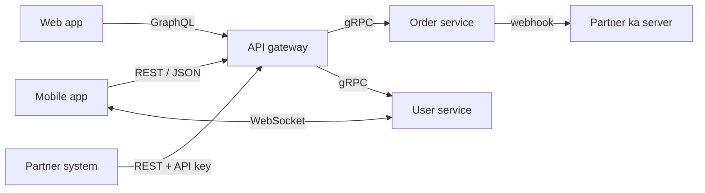
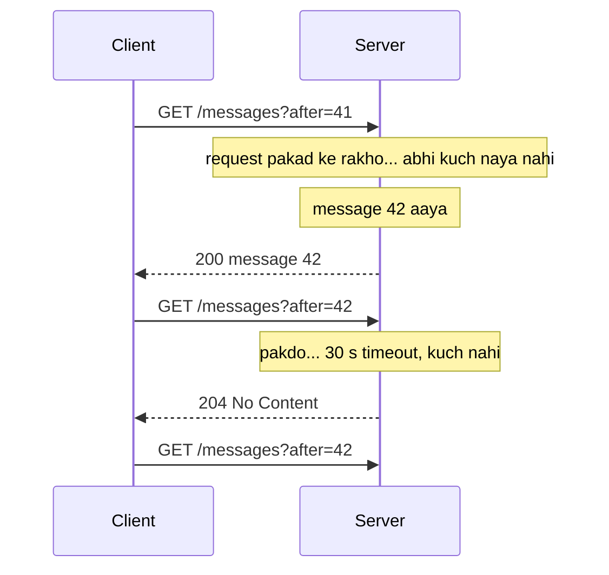
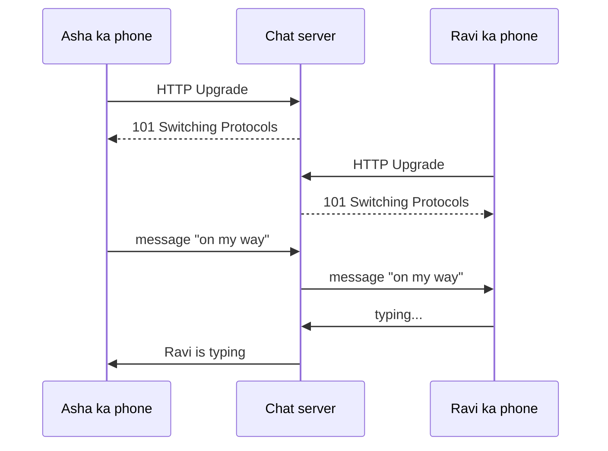
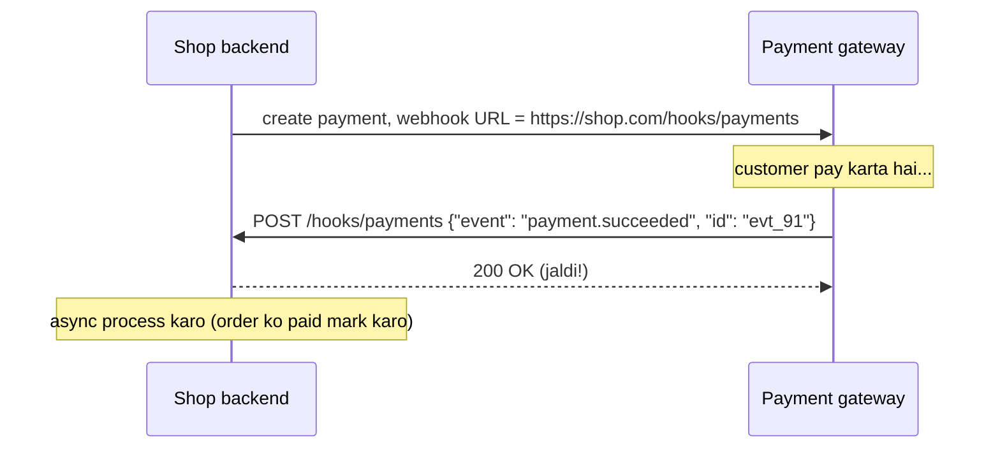
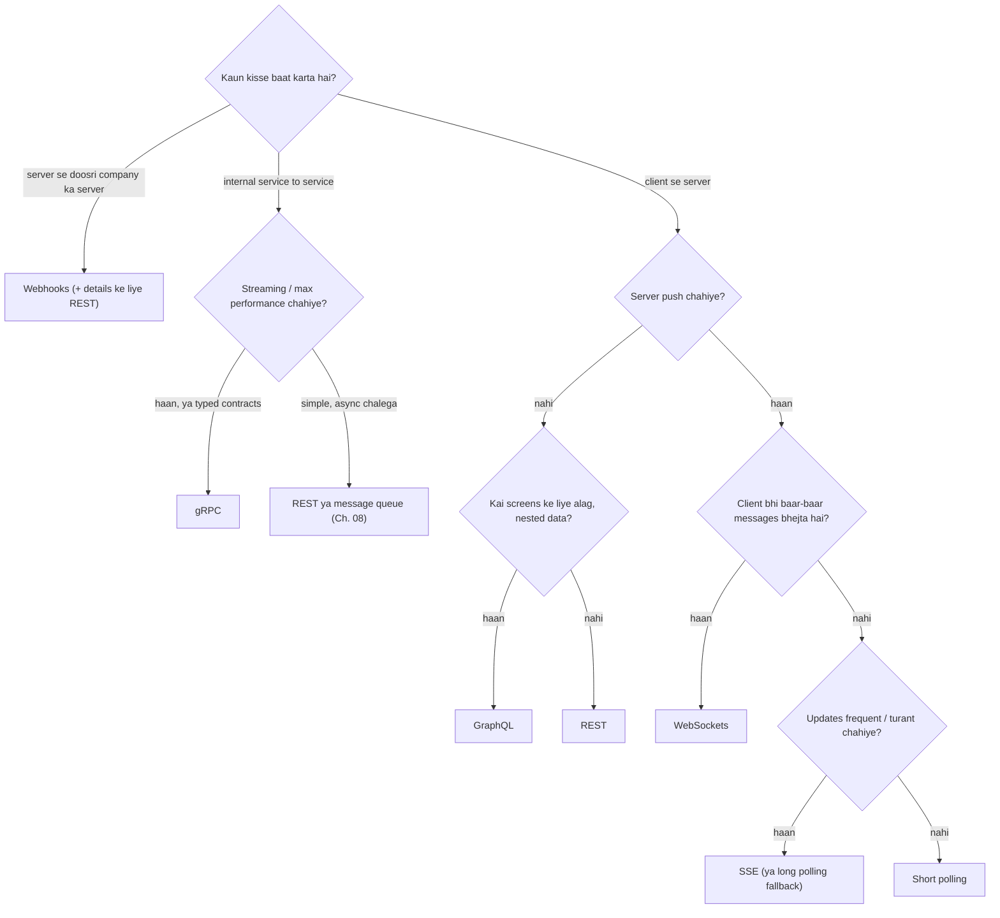
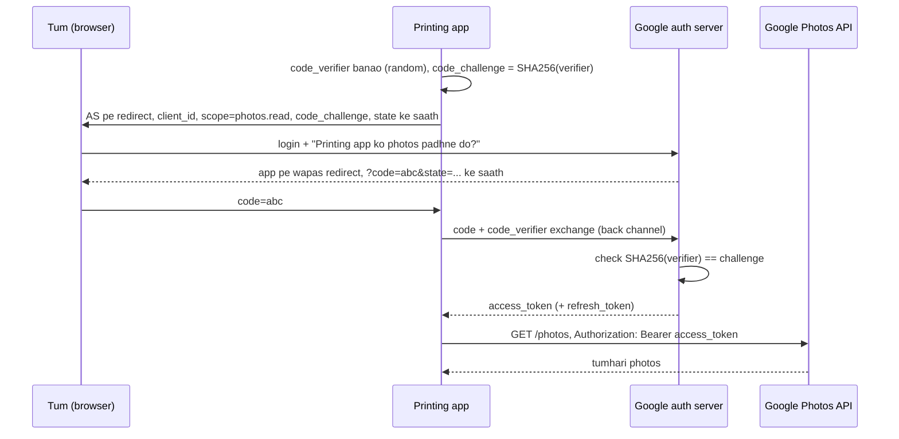
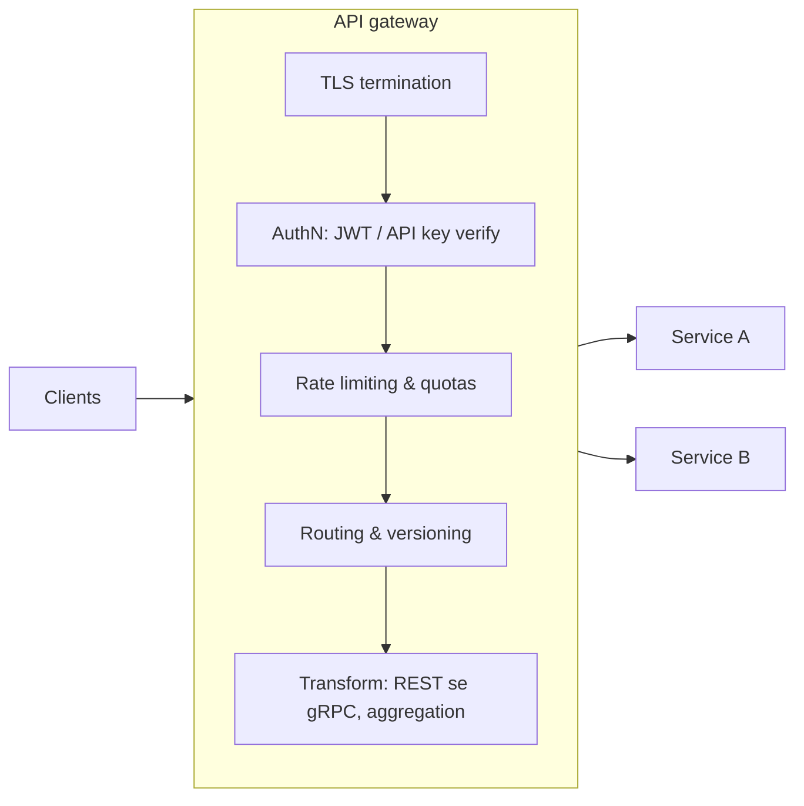

# Chapter 07 · APIs & Communication Protocols

> Ek restaurant isliye chalta hai kyunki menu ek contract hai. Tum kitchen mein ghus ke saamaan nahi uthaate. Tum ek aise format mein bolte ho jo kitchen samajhta hai, "ek masala dosa", aur tumhe bilkul wahi milta hai. **API kisi software system ka menu hai.** Isse bura design karo, toh jo bhi app ise use karti hai wo saalon tak bhugatti hai, kyunki ek baar log menu se order karne lagein, toh menu aasaani se badla nahi ja sakta.

**Is chapter mein tum seekhoge:**
- API kya hai, aur REST gehraai mein: resources, verbs, idempotency, status codes, versioning, pagination (offset vs cursor), filtering
- GraphQL aur gRPC (protobuf ke saath): ye kaunsi problems solve karte hain aur inki keemat kya hai
- Real-time options: polling, long polling, Server-Sent Events, WebSockets, aur webhooks
- In sab mein se kaise chunein, ek decision guide ke saath
- Authentication vs authorization, sessions vs JWT, OAuth 2.0 aur OpenID Connect flows, API keys
- Rate limiting headers, idempotency keys, API gateway ki zimmedaariyaan, aur ek API design interview checklist

**Isse pehle padho:** [Chapter 01 · Foundations](01-foundations-internet.md) (HTTP, status codes, cookies, TLS) · [Chapter 02 · Scalability](02-scalability-load-balancing.md) (API gateway, stateless servers) · [Chapter 04 · Caching](04-caching-cdn.md) (Cache-Control, ETags)

---

## 🧠 The Big Idea · Asli Baat

**API (Application Programming Interface)** ek contract hai jo kehta hai: "mujhe **is** shape mein request bhejo, aur main **us** shape mein jawab dunga." Client ko ye jaanne ki zaroorat nahi ki server andar se kaise kaam karta hai, sirf contract jaanna kaafi hai.



Koi ek "best" protocol nahi hai. Har ek alag zaroorat ka jawab hai:

| Need | Typical choice |
|---|---|
| Public API jise koi bhi developer `curl` se call kar sake | HTTP + JSON pe **REST** |
| Frontend jise ek hi round trip mein flexible, nested data chahiye | **GraphQL** |
| Internal microservices ke beech fast, typed calls | **gRPC** (HTTP/2 + protobuf) |
| Server browser ko updates push kare (ek taraf) | **Server-Sent Events** |
| Do-taraf, real-time chat ya games | **WebSockets** |
| Kisi doosri company ke server ko batana ki kuch hua | **Webhooks** |

> 💡 **The core insight:** API ek aisa **wada hai jo tumhare code se zyada lamba jeeta hai**. Ise client ki nazar se design karo, har operation ko retry ke liye safe banao, aur badlaav (versioning, pagination, limits) ki planning pehle din se karo.

> 🇮🇳 **Desi Analogy:** Swiggy app socho. Tum app pe "Paneer Butter Masala, 1 plate" order karte ho. Tumhe nahi pata restaurant ki kitchen mein kaun chef hai, gas kaunsi hai, paneer kahan se aaya. Tumhe bas **menu** (API contract) pata hai: item ka naam, quantity, address. Ab socho restaurant raaton-raat menu ke item ka naam "PBM" kar de, toh tumhara "repeat order" button toot jaayega. Yahi hai **breaking change**. Isliye API ko menu jaisa samjho: soch ke banao, aur badalna ho toh dhyaan se, purane customers ka khayal rakh ke.

---

## 🔨 Building It Up · Zero Se Shuru

### 1. REST: resources, not actions

**REST (Representational State Transfer)** ek architectural style hai jise Roy Fielding ne 2000 mein describe kiya tha. Practice mein "REST API" ka matlab hai:

1. **Har cheez ek resource hai** jise ek URL pehchaanta hai: `/users/42`, `/users/42/orders`, `/orders/9001`.
2. Resources pe tum **standard HTTP methods** (verbs) se kaam karte ho: GET, POST, PUT, PATCH, DELETE.
3. Requests **stateless** hoti hain: har request apne saath sab kuch laati hai jo chahiye (auth token, parameters). Server baatcheet ki koi yaad nahi rakhta, isliye koi bhi server use handle kar sakta hai ([Chapter 02](02-scalability-load-balancing.md)).
4. Responses batate hain ki wo **cacheable** hain ya nahi (`Cache-Control`, `ETag`, [Chapter 04](04-caching-cdn.md)).
5. Ek **uniform interface**: har jagah same verbs aur status codes, taaki clients ek baar seekh lein aur har jagah use karein.

> 🇮🇳 **Desi Analogy:** Railway station ka **platform number** system socho. Har train ka ek fixed pata hai (resource ka URL: "Platform 4, Rajdhani"). Aur har station pe kaam karne ke tareeke same hain (uniform interface): "enquiry" (GET), "ticket book" (POST), "ticket cancel" (DELETE). Tum Delhi mein seekho ya Chennai mein, tareeka wahi. Aur counter wala tumhe yaad nahi rakhta (stateless): har baar tum apna PNR (token) saath laate ho, isliye kisi bhi counter pe ja sakte ho.

**Resource naming rules:**

| ✅ Good | ❌ Bad | Why |
|---|---|---|
| `GET /orders/9001` | `GET /getOrder?id=9001` | URLs **cheezon** ka naam hain; verb HTTP method hai |
| `POST /orders` | `POST /createOrder` | Same |
| `GET /users/42/orders` | `GET /orders-of-user/42` | Ownership dikhane ke liye nest karo |
| `/orders` (plural) | `/order` | Collections plural hote hain; consistent raho |
| `/order-items` | `/orderItems`, `/Order_Items` | Lowercase, hyphens |
| `POST /orders/9001/cancel` | sirf `PATCH /orders/9001 {"status":"CANCELLED"}` | Side effects wale complex actions ek sub-resource "action" ho sakte hain (pragmatic) |

Do levels se zyada nesting (`/users/42/orders/9001/items/3/reviews`) bhaari ho jaati hai; jab ek resource ki apni pehchaan (identity) ho jaaye, toh `/order-items/3/reviews` jaisa chhota raasta prefer karo.

> 🤔 **Mann mein sawaal:** Table mein `POST /orders/9001/cancel` ko "good" bola, lekin isme toh "cancel" verb URL mein hai! Ye rule ke khilaaf nahi?
>
> **Jawab:** Achha pakda. Strict REST bolega `PATCH /orders/9001` with `{"status":"CANCELLED"}`. Lekin cancel karna sirf ek field badalna nahi hai: refund chalta hai, restaurant ko notify hota hai, rider hatta hai. Aise **side effects wale business actions** ko ek "action sub-resource" banana pragmatic hai: saaf dikhta hai, alag permissions aur rate limits lag sakte hain. Rule ye hai: CRUD ke liye nouns, aur bade business actions ke liye soch-samajh ke ek action endpoint. `/getOrder` jaisa CRUD verb-in-URL abhi bhi galat hai.

### 2. HTTP verbs, safety and idempotency

Inse tum [Chapter 01](01-foundations-internet.md) mein mil chuke ho. Ab API designer ki nazar se dekho:

| Verb | On a collection `/orders` | On an item `/orders/9001` | Safe | Idempotent |
|---|---|---|---|---|
| GET | Orders list karo | Ek order lao | ✅ | ✅ |
| POST | Naya order banao | (rare: koi action karo) | ❌ | ❌ |
| PUT | (rare: poora collection replace) | Order ko poora replace karo (ya is ID pe banao) | ❌ | ✅ |
| PATCH | — | Kuch fields badlo | ❌ | Guaranteed nahi |
| DELETE | (rare: sab delete) | Order delete karo | ❌ | ✅ |

- **Safe**: server ki state nahi badalta. Crawlers, prefetchers aur caches ise bina dare call kar sakte hain.
- **Idempotent**: ise ek baar call karo ya N baar, server **same state** mein rehta hai. (*Response* alag ho sakta hai: doosra DELETE 404 de sakta hai, lekin order toh delete hi rehta hai.)

Idempotency itni badi baat kyun hai: networks aksar tab fail hote hain jab server ne kaam **kar diya** lekin client tak reply **pahunchne se pehle**. Client ko pata nahi chal sakta, toh wo retry karta hai. Idempotent operations retries ko safe banate hain. Dekho:

> 🇮🇳 **Desi Analogy:** Lift ka button socho. "5th floor" ka button ek baar dabao ya das baar, lift ek hi baar 5th floor jaayegi: **idempotent** (PUT jaisa: "mujhe 5 pe le chalo"). Ab UPI pe "₹500 bhejo" socho: network atka, tumne "pay" dobara dabaya, aur dono baar ₹500 kat gaye: **non-idempotent** (POST jaisa: "ek naya payment banao"). Aur "balance mein +1 karo" (relative PATCH) bhi waisa hi: har dabaav pe ek aur badhega. Isliye UPI apps har payment ko ek unique transaction ID dete hain, wahi idempotency key hai (section 22).

```python
class OrderAPI:
    def __init__(self):
        self.orders, self.next_id = {}, 1

    def post_order(self, body):                 # idempotent NAHI: har baar naya order banata hai
        oid = self.next_id
        self.next_id += 1
        self.orders[oid] = dict(body)
        return 201, oid

    def put_order(self, oid, body):             # idempotent: poori state set karta hai
        self.orders[oid] = dict(body)
        return 200, oid

    def patch_increment(self, oid, field):      # idempotent NAHI: relative change
        self.orders[oid][field] += 1
        return 200, self.orders[oid][field]

    def delete_order(self, oid):                # idempotent: gaya toh gaya
        existed = self.orders.pop(oid, None) is not None
        return (204 if existed else 404), None

api = OrderAPI()
for attempt in range(3):                        # timeouts ke baad client 3 baar retry karta hai
    api.post_order({"item": "dosa", "qty": 1})
print("after 3x POST  :", len(api.orders), "orders  <- duplicates!")

api = OrderAPI()
for attempt in range(3):
    api.put_order(7, {"item": "dosa", "qty": 1})
print("after 3x PUT   :", len(api.orders), "order")

for attempt in range(3):
    api.patch_increment(7, "qty")
print("after 3x PATCH +1:", api.orders[7]["qty"], "<- intended 2")

print("DELETE twice   :", api.delete_order(7)[0], api.delete_order(7)[0])
```

```text
after 3x POST  : 3 orders  <- duplicates!
after 3x PUT   : 1 order
after 3x PATCH +1: 4 <- intended 2
DELETE twice   : 204 404
```

Abhi kya hua: retry hue POSTs ne duplicate orders bana diye, aur retry hua relative PATCH ("ek jodo") zyada gin gaya (qty 1 thi, ek baar +1 karna tha toh 2 honi chahiye thi, lekin 3 retries se 4 ho gayi). PUT aur DELETE retry ke liye safe the. POST ko hum section 22 mein **idempotency keys** se theek karenge.

> 💡 PATCH ko idempotent banaya ja sakta hai agar relative operations (`{"qty": "+1"}`) ki jagah **absolute** values (`{"qty": 2}`) bhejo, ya ek version check (`If-Match: "etag"`) use karo.

### 3. Status codes in API design

Inhe ekdum sahi use karo; clients inhi pe decide karte hain ki aage kya karna hai.

| Situation | Code | Notes |
|---|---|---|
| Successful read | 200 OK | |
| Resource ban gaya | 201 Created | `Location: /orders/9001` aur usually body bhi bhejo |
| Async processing ke liye accept kiya | 202 Accepted | Poll karne ke liye ek status URL do (`/jobs/77`) |
| Success, lautaane ko kuch nahi | 204 No Content | DELETE ke liye typical |
| Badla nahi (conditional GET) | 304 Not Modified | `ETag`/`If-None-Match` ke saath |
| Validation fail | 400 Bad Request (ya 422 Unprocessable Content) | Field-level errors lautao |
| Authenticated nahi | 401 Unauthorized | `WWW-Authenticate` include karo |
| Authenticated, lekin allowed nahi | 403 Forbidden | |
| Aisa resource nahi | 404 Not Found | Unauthorised users se resource ka hona chhupane ke liye bhi |
| Galat method | 405 Method Not Allowed | |
| State conflict | 409 Conflict | Duplicate, version conflict |
| Precondition fail | 412 Precondition Failed | `If-Match` ETag mismatch (optimistic locking) |
| Bahut zyada requests | 429 Too Many Requests | `Retry-After` ke saath |
| Server bug | 500 Internal Server Error | Stack traces kabhi leak mat karo |
| Upstream / overload | 502 / 503 / 504 | Planned overload ke liye `Retry-After` ke saath 503 |

**Consistent error bodies** utni hi zaroori hain jitne codes. Ek achha shape (RFC 9457 "Problem Details" jaisa):

```text
HTTP/1.1 422 Unprocessable Content
Content-Type: application/problem+json

{
  "type": "https://api.example.com/errors/validation",
  "title": "Invalid order",
  "status": 422,
  "detail": "2 fields failed validation",
  "errors": [
    {"field": "qty", "message": "must be between 1 and 20"},
    {"field": "address.pincode", "message": "must be 6 digits"}
  ],
  "request_id": "req_8f2c1a"
}
```

`request_id` se support teams logs mein bilkul wahi request dhoondh sakti hain ([Chapter 09](09-microservices-reliability.md)).

> 🤔 **Mann mein sawaal:** 401 aur 403 mein confusion hota hai. "Unauthorized" ka matlab toh "permission nahi" hona chahiye, phir wo 401 kyun?
>
> **Jawab:** Ye HTTP ki purani naming galti hai. **401 "Unauthorized" asal mein "Unauthenticated" hai**: "tum kaun ho, pata nahi; login karo ya token bhejo." **403 Forbidden** ka matlab: "tum kaun ho, pata hai, lekin tumhe ye karne ki ijaazat nahi." Yaad rakhne ka tareeka: 401 = darwaaze pe ID nahi dikhayi, 403 = ID dikhayi lekin guest list mein naam nahi.

### 4. Versioning

APIs badalti hain. Ek **breaking change** (koi field hatana, uska naam badalna, uska type ya matlab badalna, kisi optional input ko required banana) existing clients ko tod deta hai, aur tum laakhon installed mobile apps ko raaton-raat update karne pe majboor nahi kar sakte.

**Non-breaking (safe) changes:** naya endpoint jodna, ek optional request field jodna, ek response field jodna (clients ko **unknown fields ignore karne** chahiye, ye rule apne docs mein likhne layak hai).

Versioning strategies:

| Strategy | Example | Pros | Cons |
|---|---|---|---|
| URL path | `/v1/orders`, `/v2/orders` | Saaf dikhta hai, route aur cache karna aasaan, browser mein test karna aasaan | "Version" asal mein resource ki identity ka hissa nahi hai |
| Query parameter | `/orders?version=2` | Simple | Bhoolna aasaan; caching mein baarikiyaan |
| Header | `Accept: application/vnd.shop.v2+json` ya `Api-Version: 2026-10-01` | Saaf URLs; fine-grained | Kam dikhta hai; haath se test karna mushkil |
| Date-based versions (Stripe style) | `Stripe-Version: 2024-06-20` | Har account usi version pe pinned jisse usne shuru kiya; dheere-dheere upgrades | Server pe zyada machinery |

Zyaadatar public APIs major versions ke liye **URL versioning** use karte hain aur ek version ke andar compatible tareeke se badhte hain. Jo bhi chuno: **deprecations** jaldi announce karo (`Deprecation` / `Sunset` header aur docs), purane aur naye versions saath-saath chalao, aur purane ko band karne se pehle naapo ki ab bhi kaun use call kar raha hai.

> 🇮🇳 **Desi Analogy:** Purane ₹500 ke note ka notebandi wala din yaad karo: raaton-raat "ye ab nahi chalega". Poore desh mein lines lag gayi. Ye **bina warning ka breaking change** tha. Achhi API versioning ulta karti hai: naya note (v2) launch karo, purana (v1) bhi kuch mahine chalne do, akhbaar mein pehle se announce karo (`Sunset` header), aur dekhte raho ki kitne log abhi bhi purana note use kar rahe hain. Jab lagbhag koi na bache, tab band karo.

### 5. Pagination: offset vs cursor

Kabhi bhi unbounded (bina hadd ki) list mat lautao. 50,000 orders wale user ke liye `GET /orders` slow hoga, bahut bada hoga, aur server ko gira bhi sakta hai. **Paginate karo.**

**Offset pagination**: `GET /orders?limit=20&offset=40` → SQL `LIMIT 20 OFFSET 40`.

- ✅ Simple; seedha page 37 pe kood sakte ho; "page X of Y" wala UI aasaan.
- ❌ **Gehre pages ke liye slow**: database phir bhi skip ki gayi saari rows se guzarta hai (`OFFSET 1000000` ek million rows padhta hai sirf unhe phenkne ke liye).
- ❌ **Data badalne pe unstable**: agar tum page kar rahe ho aur upar ek naya item insert ho gaya, toh sab ek jagah khisak jaata hai, aur tumhe ek item **do baar** dikhta hai; deletions se tum items **skip** kar dete ho.

**Cursor (keyset) pagination**: server ek opaque (andar se chhupa hua) **cursor** lautata hai jo aakhri item ke thik baad wali jagah ko point karta hai; agli request us point ke **baad** wale items maangti hai. Andar se: `WHERE (created_at, id) < (:last_created_at, :last_id) ORDER BY created_at DESC, id DESC LIMIT 20`, jo seedha index use karta hai.

- ✅ Kisi bhi depth pe fast (ek index seek, [Chapter 03](03-databases.md)).
- ✅ Inserts aur deletes ke dauraan stable: na duplicates, na skips.
- ❌ Kisi bhi random page pe nahi kood sakte; sirf next/previous.
- ❌ Ek unique, sortable key chahiye (tie-breaker ke roop mein `id` jodo).

> 🇮🇳 **Desi Analogy:** Tum Instagram feed scroll kar rahe ho. **Offset** ka matlab hai "mujhe 41st se 60th post dikhao". Lekin beech mein tumhare dost ne naya post daal diya, toh sab ek khisak gaya, aur 40th wala post ab 41st hai: tumhe wo dobara dikh gaya. **Cursor** ka matlab hai bookmark: "mujhe us post ke **baad** wale dikhao jo maine aakhri dekha (id 7)". Upar naya post aaye ya na aaye, "id 7 ke baad" wali jagah wahin ki wahin hai. Jaise kitaab mein bookmark: koi aage naya page chipka de, tumhara bookmark phir bhi sahi jagah pe hai.

```python
import base64
import json

# newest pehle sorted feed; ids time ke saath badhte hain
feed = [{"id": i, "text": f"post {i}"} for i in range(10, 0, -1)]   # ids 10..1

def offset_page(items, offset, limit):
    return [p["id"] for p in items[offset:offset + limit]]

def encode_cursor(last_id):
    return base64.urlsafe_b64encode(json.dumps({"after": last_id}).encode()).decode()

def decode_cursor(cursor):
    return json.loads(base64.urlsafe_b64decode(cursor))["after"]

def cursor_page(items, cursor, limit):
    after = decode_cursor(cursor) if cursor else float("inf")
    page = [p for p in items if p["id"] < after][:limit]          # WHERE id < :after
    next_cursor = encode_cursor(page[-1]["id"]) if len(page) == limit else None
    return [p["id"] for p in page], next_cursor

# --- offset pagination, jab page 1 aur page 2 ke beech naya post aata hai ---
page1 = offset_page(feed, 0, 4)
feed.insert(0, {"id": 11, "text": "brand new post"})              # kisi ne post kiya
page2 = offset_page(feed, 4, 4)
print("offset page1:", page1, " page2:", page2, " <- 7 shown twice")

# --- cursor pagination, wahi insert ke saath ---
feed = [{"id": i, "text": f"post {i}"} for i in range(10, 0, -1)]
ids, cur = cursor_page(feed, None, 4)
feed.insert(0, {"id": 11, "text": "brand new post"})
ids2, cur2 = cursor_page(feed, cur, 4)
print("cursor page1:", ids, " page2:", ids2, " <- no duplicates")
print("cursor looks like:", cur)
```

```text
offset page1: [10, 9, 8, 7]  page2: [7, 6, 5, 4]  <- 7 shown twice
cursor page1: [10, 9, 8, 7]  page2: [6, 5, 4, 3]  <- no duplicates
cursor looks like: eyJhZnRlciI6IDd9
```

Abhi kya hua: offsets ke saath, naye post ne sab kuch ek slot neeche dhakel diya, toh post 7 dono pages pe aa gaya. Cursor ne yaad rakha "id 7 ke baad", jo naye posts aane pe nahi khisakta. Cursor ko **opaque** (base64-encoded) banane se tum baad mein uske andar ka format badal sakte ho bina clients ko tode. (Production mein ise sign ya encrypt bhi karo taaki clients isse chhedchhaad na kar sakein.) Waise `eyJhZnRlciI6IDd9` ko base64 decode karo toh bas `{"after": 7}` niklega.

Ek typical paginated response:

```text
GET /v1/users/42/orders?limit=20&cursor=eyJhZnRlciI6IDd9

{
  "data": [ {...}, {...} ],
  "next_cursor": "eyJhZnRlciI6IDN9",
  "has_more": true
}
```

| | Offset | Cursor (keyset) |
|---|---|---|
| Page N pe koodna | Haan | Nahi |
| Gehre pages | Slow (skip ki gayi rows scan karta hai) | Fast (index seek) |
| Paging ke dauraan data badalna | Duplicates / skips | Stable |
| Total count | Aasaan (lekin bade tables pe `COUNT(*)` mehenga) | Usually nahi diya jaata |
| Best for | Chhote admin tables, page numbers wale search results | Feeds, timelines, infinite scroll, bade datasets, public APIs |

### 6. Filtering, sorting, field selection

Common conventions (ek API ke andar consistent raho):

```text
GET /v1/products?category=shoes&price_min=500&price_max=2000   <- filtering
GET /v1/products?sort=-rating,price                             <- sort by rating desc, then price asc
GET /v1/products?fields=id,name,price                           <- sparse fieldsets: smaller payloads
GET /v1/products?q=running+shoes                                <- free-text search
GET /v1/orders?status=PLACED&created_after=2026-10-01T00:00:00Z <- ISO 8601 timestamps, UTC
```

Rules of thumb: allow-list rakho ki kaunse fields pe filter/sort ho sakta hai (har ek ko index chahiye); `limit` ko validate karo aur uski hadd rakho (jaise max 100); ISO 8601 UTC timestamps use karo; amounts ko sabse chhoti currency unit (paise, cents) mein integers ki tarah ya strings ki tarah lautao, floats kabhi nahi.

### 7. Other REST details worth knowing

- **Conditional requests / caching**: 304s ke liye `ETag` + `If-None-Match`; safe updates ke liye `If-Match` (optimistic locking: agar kisi aur ne badal diya toh 412).
- **Async operations**: lamba kaam `202 Accepted` ke saath `Location: /v1/jobs/77` lautata hai; client job ko poll karta hai ya ek webhook paata hai.
- **Bulk endpoints**: round trips kam karne ke liye `POST /v1/orders:batch` (har item ka alag result).
- **HATEOAS** (Hypermedia As The Engine Of Application State): responses mein related actions ke links hote hain (`"links": {"cancel": "/orders/9001/cancel"}`). Fielding ke original REST ka hissa; practice mein poori tarah kam hi use hota hai, lekin interviews mein pehchaanna achha hai.
- **Content negotiation**: `Accept: application/json`.
- **Compression**: `Accept-Encoding: gzip, br`.
- **CORS**: browsers cross-origin API calls ko block karte hain jab tak server `Access-Control-Allow-Origin` na lautaye (non-simple calls ke liye pehle ek preflight `OPTIONS` request jaati hai).

### 8. GraphQL: ask for exactly what you need

Frontends ke liye REST ke common dard:

- **Over-fetching**: `GET /users/42` 40 fields lautata hai; screen ko sirf 3 chahiye.
- **Under-fetching / N+1 requests**: ek user ko uske aakhri 5 orders aur har order ke restaurant ke saath dikhane ke liye, tum `/users/42` call karte ho, phir `/users/42/orders`, phir har order ke liye `/restaurants/...`: slow mobile network pe bahut saare round trips.

**GraphQL** (Facebook ne 2015 mein open-source kiya) **ek hi endpoint** (usually `POST /graphql`) aur ek **typed schema** expose karta hai. Client ek **query** bhejta hai jo bilkul batati hai ki use data ka kaunsa shape chahiye, aur use bilkul wahi shape wapas milta hai.

> 🇮🇳 **Desi Analogy:** REST ek **fixed thali** hai: "North Indian thali" maango toh daal, sabzi, raita, roti, chawal, meetha, sab aayega, chahe tumhe sirf daal-chawal chahiye tha (**over-fetching**). Aur agar tumhe papad bhi chahiye, toh alag se waiter ko bulana padega (**under-fetching**, ek aur round trip). GraphQL ek **buffet counter wala chef** hai jise tum ek parchi dete ho: "daal, do roti, aur papad". Ek hi baar mein bilkul wahi plate. Lekin chef ke liye kaam badh jaata hai: har parchi alag hai, toh pehle se bani thali (HTTP caching) kaam nahi aati, aur koi "sab kuch 50 baar" likh de toh kitchen ruk jaayegi (expensive queries).

```text
# Schema (server side)
type User       { id: ID!, name: String!, city: String, orders(last: Int): [Order!]! }
type Order      { id: ID!, total: Int!, restaurant: Restaurant! }
type Restaurant { id: ID!, name: String! }
type Query      { user(id: ID!): User }
type Mutation   { placeOrder(restaurantId: ID!, items: [ID!]!): Order! }

# Query (client side)
query {
  user(id: "42") {
    name
    orders(last: 2) { total restaurant { name } }
  }
}

# Response: exactly the requested shape
{"data": {"user": {"name": "Asha",
  "orders": [{"total": 450, "restaurant": {"name": "Dosa Corner"}},
             {"total": 1200, "restaurant": {"name": "Biryani House"}}]}}}
```

Teen operation types: **query** (read), **mutation** (write), **subscription** (real-time updates, usually WebSockets pe).

Server har field ke liye ek **resolver** function implement karta hai. Ek GraphQL server query ko kaise chalta hai, uska saar plain Python mein dekho:

```python
USERS = {"42": {"id": "42", "name": "Asha", "city": "Pune", "order_ids": [101, 102, 103]}}
ORDERS = {101: {"id": 101, "total": 450, "restaurant_id": 1},
          102: {"id": 102, "total": 1200, "restaurant_id": 2},
          103: {"id": 103, "total": 300, "restaurant_id": 1}}
RESTAURANTS = {1: {"id": 1, "name": "Dosa Corner"}, 2: {"id": 2, "name": "Biryani House"}}
db_calls = []

# resolvers: har us field ko kaise fetch karna hai jo plain value nahi hai
def resolve_user(args):
    db_calls.append("user")
    return USERS[args["id"]]

def resolve_orders(user, args):
    db_calls.append("orders")
    return [ORDERS[i] for i in user["order_ids"][-args.get("last", 10):]]

def resolve_restaurant(order, args):
    db_calls.append("restaurant")
    return RESTAURANTS[order["restaurant_id"]]

RESOLVERS = {"user": resolve_user, "orders": resolve_orders, "restaurant": resolve_restaurant}

def execute(obj, selection):
    """selection: {field: (args, sub_selection or None)}"""
    out = {}
    for field, (args, sub) in selection.items():
        if field in RESOLVERS:
            value = RESOLVERS[field](obj, args) if obj is not None else RESOLVERS[field](args)
        else:
            value = obj[field]
        if sub is None:
            out[field] = value
        elif isinstance(value, list):
            out[field] = [execute(v, sub) for v in value]
        else:
            out[field] = execute(value, sub)
    return out

query = {"user": ({"id": "42"}, {
    "name": ({}, None),
    "orders": ({"last": 2}, {"total": ({}, None),
                             "restaurant": ({}, {"name": ({}, None)})}),
})}
print(execute(None, query))
print("db calls:", db_calls)
```

```text
{'user': {'name': 'Asha', 'orders': [{'total': 1200, 'restaurant': {'name': 'Biryani House'}}, {'total': 300, 'restaurant': {'name': 'Dosa Corner'}}]}}
db calls: ['user', 'orders', 'restaurant', 'restaurant']
```

Abhi kya hua: ek request ne nested data lautaya jiska shape bilkul query jaisa tha, koi bina maanga field nahi (na `city`, na `id`). Lekin db calls dekho: **har order ke liye** ek `restaurant` call. 50 orders hon toh 50 calls: **N+1 problem** client se server pe shift ho gayi. Standard fix hai **DataLoader**: ek "tick" (event loop ka ek chakkar) mein maange gaye saare restaurant IDs ikattha karo aur unhe **ek batched query** mein fetch karo.

(Chhota sa note: `orders(last: 2)` ne aakhri do orders, 102 aur 103, lautaaye. Isliye response mein ₹1200 aur ₹300 hain, upar wale text example ke ₹450 aur ₹1200 nahi. Wo upar ka example sirf shape dikhane ke liye tha.)

> 🤔 **Mann mein sawaal:** GraphQL ne N+1 hata diya ya nahi? Client toh ek hi request bhej raha hai.
>
> **Jawab:** Client ki taraf se haan: network pe ek hi round trip. Lekin server ke andar resolvers ab bhi har order ke liye alag-alag DB call kar rahe hain. Matlab dard gaya nahi, bas **mobile network se hat ke server aur database ke beech aa gaya**, jahan latency kam hai. Phir bhi 50 alag queries bekaar hain, isliye DataLoader: "saari IDs ikattha karo, ek `WHERE id IN (...)` chalao."

GraphQL trade-offs:

| ✅ Strengths | ❌ Costs |
|---|---|
| Na over-fetching na under-fetching; nested data ke liye ek round trip | HTTP caching mushkil (ek URL, POST bodies); client-side caches (Apollo, Relay) ya persisted queries chahiye |
| Strongly typed schema = khud ka documentation, badhiya tooling | N+1 resolver problem (DataLoader batching chahiye) |
| Naye endpoints ke bina frontends badal sakte hain | Clients **bahut mehengi queries** likh sakte hain: depth limits, complexity scoring, timeouts chahiye |
| Bahut si backend services ko ek graph ke peeche jod do | Errors HTTP 200 ke saath ek `errors` array mein aate hain: monitoring ko andar dekhna padta hai |
| Real-time ke liye subscriptions | "Request" ke hisaab se rate limiting bematlab hai; query cost se rate-limit karna padta hai |

Achha fit: product frontends (mobile + web) jinki alag-alag screens bahut si backend services pe tiki hain, aksar ek **BFF (Backend For Frontend)** layer ke roop mein. Kamzor fit: simple public APIs, file uploads, bhaari server-to-server traffic.

### 9. gRPC and Protocol Buffers

Apni hi microservices ke beech tumhe aise calls chahiye jo **fast, chhote, strongly typed** hon, aur aisa lage jaise local function call kar rahe ho. **gRPC** (Google se, 2015 mein open-source) bilkul yahi deta hai:

- Tum services aur messages ek **`.proto`** file mein define karte ho (ek **IDL**, interface definition language).
- Ek compiler (`protoc`) kai languages (Python, Go, Java, C++, ...) mein **client aur server code generate** karta hai.
- Messages **Protocol Buffers (protobuf)** se encode hote hain, jo ek compact **binary** format hai.
- Calls **HTTP/2** pe chalti hain (multiplexing, header compression, [Chapter 01](01-foundations-internet.md)).
- Built-in **deadlines** (timeouts jo services ke across aage pass hote hain), cancellation, aur **streaming**.

```text
// order.proto
syntax = "proto3";

service OrderService {
  rpc GetOrder (GetOrderRequest) returns (Order);                    // unary
  rpc TrackOrder (TrackRequest) returns (stream LocationUpdate);     // server streaming
  rpc UploadPhotos (stream Photo) returns (UploadResult);            // client streaming
  rpc Chat (stream ChatMessage) returns (stream ChatMessage);        // bidirectional
}

message GetOrderRequest { int64 order_id = 1; }
message Order {
  int64 id = 1;
  string status = 2;
  int32 total_paise = 3;
  repeated string items = 4;
}
```

Chaar streaming modes ko aise samjho: **unary** = ek sawaal, ek jawab. **Server streaming** = ek sawaal, jawabon ki dhaara (rider ki location baar-baar). **Client streaming** = sawaalon ki dhaara, ek jawab (bahut si photos upload, aakhir mein ek "done"). **Bidirectional** = dono taraf dhaara (chat).

Numbers (`= 1`, `= 2`) **field tags** hain. Wire pe (network pe jaate waqt) protobuf `tag + type` aur value bhejta hai, field names **nahi**. Isiliye ye chhota hai, aur isiliye tumhe **kabhi bhi ek tag number dobara use ya change nahi karna chahiye**: protobuf isi tarah backward aur forward compatible rehta hai (purane clients unknown tags ignore kar dete hain; missing fields ko default values milti hain).

> 🇮🇳 **Desi Analogy:** Board exam ki OMR sheet socho. Tum "Question 3 ka answer: B" poore sentence mein nahi likhte, bas gola bharte ho: **number + option**. Isse sheet chhoti rehti hai aur machine fataft padh leti hai. Yahi protobuf hai: field ka naam nahi, sirf **tag number** + value. Aur agar board agle saal "Q3" ka matlab badal de, toh purani answer keys se checking gadbad ho jaayegi. Isliye protobuf ka golden rule: **tag number ek baar diya, toh hamesha ke liye uska**.

Chalo ek message ko waise hi haath se encode karte hain jaise protobuf karta hai, taaki size ka farq mehsoos ho:

```python
import json

def varint(n):
    """Protobuf varint: 7 bits per byte, high bit = 'more bytes follow'."""
    out = bytearray()
    while True:
        byte = n & 0x7F
        n >>= 7
        if n:
            out.append(byte | 0x80)
        else:
            out.append(byte)
            return bytes(out)

def field_varint(tag, value):          # wire type 0 = varint
    return varint(tag << 3 | 0) + varint(value)

def field_string(tag, text):           # wire type 2 = length-delimited (pehle length, phir bytes)
    data = text.encode()
    return varint(tag << 3 | 2) + varint(len(data)) + data

order = {"id": 9001, "status": "PLACED", "total_paise": 45000, "items": ["dosa", "vada"]}

proto = (field_varint(1, order["id"]) + field_string(2, order["status"])
         + field_varint(3, order["total_paise"])
         + b"".join(field_string(4, item) for item in order["items"]))
as_json = json.dumps(order, separators=(",", ":")).encode()

print("varint(300) bytes:", varint(300).hex(" "))
print("protobuf size:", len(proto), "bytes ->", proto.hex(" "))
print("JSON size    :", len(as_json), "bytes ->", as_json.decode())
```

```text
varint(300) bytes: ac 02
protobuf size: 27 bytes -> 08 a9 46 12 06 50 4c 41 43 45 44 18 c8 df 02 22 04 64 6f 73 61 22 04 76 61 64 61
JSON size    : 73 bytes -> {"id":9001,"status":"PLACED","total_paise":45000,"items":["dosa","vada"]}
```

Abhi kya hua: wahi order protobuf mein 27 bytes ka aur compact JSON mein 73 bytes ka bana, kyunki field names 1-byte tags ban gaye aur numbers variable-length binary ban gaye (9001 chaar characters ki jagah 2 bytes mein fit ho gaya). Binary parse karna text parse karne se kahin zyada fast bhi hai. Ise roz ke arbon internal calls se guna karo, tab ye farq maayne rakhta hai.

Bytes ko padhna seekho (pehle 3 bytes `08 a9 46`):
- `08` = tag 1, wire type 0: `1 << 3 | 0 = 8`. Matlab "field 1, varint aa raha hai".
- `a9 46` = 9001. 9001 ke neeche ke 7 bits = `0x29`, aur "aage aur bytes hain" wala high bit lagao toh `0x29 | 0x80 = 0xa9`. Baaki `9001 >> 7 = 70 = 0x46`. Bas, 2 bytes.
- Isi tarah `varint(300)`: 300 ke neeche ke 7 bits = 44 = `0x2c`, high bit ke saath `0xac`; baaki `300 >> 7 = 2` = `0x02`. Isliye `ac 02`.

gRPC trade-offs:

| ✅ Strengths | ❌ Costs |
|---|---|
| Chhote, fast binary messages; HTTP/2 multiplexing | Insaan padh nahi sakte (`grpcurl` jaise tools chahiye) |
| Strict contracts + kai languages mein generated code | Browsers seedha gRPC call nahi kar sakte (gRPC-Web + ek proxy chahiye) |
| Chaar streaming modes | HTTP caching/CDNs naturally apply nahi hote |
| Deadlines, cancellation, built-in status codes | Schema changes mein discipline chahiye (tags, compatibility) |
| Service-to-service ke liye badhiya | Lambe chalne wale HTTP/2 connections ko load balance karne ke liye L7-aware balancing chahiye ([Chapter 02](02-scalability-load-balancing.md)) |

**RPC vs REST mindset:** REST **resources** ko model karta hai (`GET /orders/9001`); RPC **actions** ko model karta hai (`OrderService.GetOrder(9001)`, `PaymentService.Refund(...)`). Internal service calls ke liye RPC natural lagta hai; ek public, cache-friendly, explore karne layak interface ke roop mein REST zyada dostana hai.

### 10. Getting updates in real time: the problem

HTTP **request/response** hai: client poochta hai, server jawab deta hai. Lekin bahut si features ko chahiye ki **server client ko bataye** jab kuch ho: naya chat message, rider ki location, stock price, "tumhara payment ho gaya".

Options, sabse simple se sabse capable tak:

1. **Short polling**: har kuch second mein poochho.
2. **Long polling**: poochho, aur server request ko tab tak pakad ke rakhta hai jab tak koi khabar na ho.
3. **Server-Sent Events (SSE)**: ek lambi chalne wali HTTP response jo events ki dhaara bhejti hai, server → client.
4. **WebSockets**: ek persistent, full-duplex (dono taraf) connection.
5. **Webhooks**: server-to-server: "jab kuch ho, toh mere is URL ko call karna".

> 🇮🇳 **Desi Analogy:** Tumhara Swiggy order aa raha hai. **Short polling** = har 5 minute mein restaurant ko phone karna "khana nikla?" (zyaadatar jawab "abhi nahi"). **Long polling** = phone karna aur restaurant wala bolta hai "line pe raho, jaise hi niklega bata dunga" (wo line pakde rehta hai). **SSE** = restaurant ka live radio: tum sirf sunte ho, wo updates bolta rehta hai ("pack ho gaya", "rider nikla"). **WebSocket** = rider ke saath walkie-talkie: dono kabhi bhi bol sakte ho ("gate number 2 pe aao" / "aa gaya"). **Webhook** = Swiggy ka system tumhare society ke security gate ke system ko khud call karta hai "rider aa raha hai, gate khol do": do machines ke beech, bina kisi insaan ke poochhe.

### 11. Short polling

Client ek timer pe poochta hai "kuch naya hai?".

```text
GET /v1/orders/9001/status   (every 5 seconds)
→ 200 {"status": "PREPARING"}
→ 200 {"status": "PREPARING"}
→ 200 {"status": "OUT_FOR_DELIVERY"}
```

- ✅ Ekdum simple; har jagah chalta hai; servers stateless.
- ❌ Bekaar kharcha: zyaadatar responses kehte hain "kuch naya nahi". ❌ Latency polling interval jitni ho sakti hai.
- Kab use karo: kam frequency wale updates jahan kuch seconds ki deri chalegi (order status, job progress).

### 12. Long polling

Client request bhejta hai; server **tab tak jawab nahi deta** jab tak naya data na ho (ya ek timeout, jaise 30 s). Jaise hi client ko response milta hai, wo turant agli request bhej deta hai.



- ✅ Lagbhag real-time; plain HTTP pe har jagah chalta hai (proxies, firewalls).
- ❌ Har intezaar karta client ek server connection pakde rehta hai; har message ke liye nayi request; reconnects ke across message ordering mein dhyaan chahiye ("after id" cursors use karo).
- Kab use karo: jab WebSockets blocked hon tab fallback; simple notification systems.

Chalo compare karte hain ki ek minute mein 3 events deliver karne mein har approach kitni requests kharch karti hai:

```python
EVENTS_AT = [7, 31, 32]          # kin seconds pe server ke paas khabar hai
DURATION = 60

def short_polling(interval):
    requests, delays = 0, []
    pending = list(EVENTS_AT)
    for t in range(interval, DURATION + 1, interval):
        requests += 1
        while pending and pending[0] <= t:
            delays.append(t - pending.pop(0))
    return requests, max(delays)

def long_polling(timeout=30):
    requests, t, delays = 0, 0, []
    pending = list(EVENTS_AT)
    while t < DURATION:
        requests += 1
        if pending and pending[0] - t <= timeout:
            t = max(t, pending[0])
            while pending and pending[0] <= t:      # jo bhi ready hai sab deliver karo
                delays.append(t - pending.pop(0))
        else:
            t += timeout                            # khaali haath timeout ho gaya
    return requests, max(delays)

for interval in (1, 5, 15):
    print(f"short polling every {interval:>2}s: {short_polling(interval)[0]:>2} requests, "
          f"worst delay {short_polling(interval)[1]}s")
print(f"long polling (30s timeout): {long_polling()[0]:>2} requests, worst delay {long_polling()[1]}s")
```

```text
short polling every  1s: 60 requests, worst delay 0s
short polling every  5s: 12 requests, worst delay 4s
short polling every 15s:  4 requests, worst delay 14s
long polling (30s timeout):  4 requests, worst delay 0s
```

Abhi kya hua: short polling tumhe bekaar requests (1 s pe 60 per minute) aur deri (15 s interval pe 14 s) mein se ek chunne pe majboor karta hai. Long polling ne har event turant sirf 4 requests mein deliver kar diya. SSE aur WebSockets isse bhi aage jaate hain: poore minute ke liye **ek** connection.

Long polling ke 4 requests ka hisaab: request 1 (t=0) event 7 pe lauti; request 2 (t=7) event 31 pe lauti; request 3 (t=31) event 32 pe lauti; request 4 (t=32) mein kuch nahi aaya, 30 s ka timeout t=62 pe hua aur minute khatam.

### 13. Server-Sent Events (SSE)

Client ek normal HTTP request kholta hai; server `Content-Type: text/event-stream` ke saath jawab deta hai aur **response ko khula rakhta hai**, events hote hi likhta jaata hai. Browser ka built-in `EventSource` API parsing aur **automatic reconnection** sambhaalta hai (`Last-Event-ID` bhejta hai taaki server wahin se resume kar sake).

```text
GET /v1/orders/9001/events
Accept: text/event-stream

HTTP/1.1 200 OK
Content-Type: text/event-stream
Cache-Control: no-store

id: 17
event: status
data: {"status": "PREPARING"}

id: 18
event: location
data: {"lat": 18.52, "lng": 73.85}

: this line is a comment, used as a keep-alive ping
```

Har event kuch `field: value` lines ka hota hai jo ek **khaali line** pe khatam hota hai. Ise parse karna simple hai:

```python
stream = (
    "id: 17\nevent: status\ndata: {\"status\": \"PREPARING\"}\n\n"
    ": keep-alive\n\n"
    "id: 18\nevent: location\ndata: {\"lat\": 18.52, \"lng\": 73.85}\n\n"
)

def parse_sse(text):
    for block in text.split("\n\n"):
        event = {}
        for line in block.splitlines():
            if not line or line.startswith(":"):      # comments / keep-alives
                continue
            field, _, value = line.partition(": ")
            event[field] = value
        if event:
            yield event

for e in parse_sse(stream):
    print(e)
```

```text
{'id': '17', 'event': 'status', 'data': '{"status": "PREPARING"}'}
{'id': '18', 'event': 'location', 'data': '{"lat": 18.52, "lng": 73.85}'}
```

- ✅ Simple, plain HTTP (existing infrastructure ke saath chalta hai, HTTP/2 multiplexing); auto-reconnect aur resume built in.
- ❌ **Sirf ek direction** (server → client); client → server ke liye ab bhi normal requests. ❌ Sirf text. ❌ HTTP/1.1 pe browsers ek domain pe ~6 connections ki limit rakhte hain (HTTP/2 pe ye issue nahi).
- Kab use karo: live scores, notifications, dashboards, order tracking, AI chat responses ki streaming.

> 🤔 **Mann mein sawaal:** ChatGPT jaisa chat toh do-taraf hai (main sawaal bhejta hoon, wo jawab). Toh wahan WebSocket kyun nahi, SSE kyun?
>
> **Jawab:** Kyunki tumhara sawaal ek normal POST request hai, ek baar jaata hai. Sirf **jawab** dheere-dheere, token by token, aata hai, aur wo ek taraf (server → client) hai. Uske liye SSE perfect hai: plain HTTP, auto-reconnect, koi stateful connection registry nahi. WebSocket tab chahiye jab **dono** taraf se lagaataar, kabhi bhi messages aayein (multiplayer game, co-editing).

### 14. WebSockets

**WebSocket** ek HTTP request ke roop mein shuru hota hai jo connection ko **upgrade** karne ko kehti hai; uske baad wahi TCP connection kabhi bhi **dono directions mein** messages le jaata hai, har message pe bahut chhoti framing overhead ke saath.

```text
GET /chat HTTP/1.1
Host: chat.example.com
Upgrade: websocket
Connection: Upgrade
Sec-WebSocket-Key: dGhlIHNhbXBsZSBub25jZQ==
Sec-WebSocket-Version: 13

HTTP/1.1 101 Switching Protocols
Upgrade: websocket
Connection: Upgrade
Sec-WebSocket-Accept: s3pPLMBiTxaQ9kYGzzhZRbK+xOo=
```

Server ye prove karta hai ki usne WebSocket handshake samjha, client ki key ko WebSocket standard (RFC 6455) mein defined ek fixed GUID ke saath hash karke. Hum ise khud compute kar sakte hain:

```python
import base64
import hashlib

WS_GUID = "258EAFA5-E914-47DA-95CA-C5AB0DC85B11"      # RFC 6455 ne fix kiya hai

def accept_key(client_key):
    digest = hashlib.sha1((client_key + WS_GUID).encode()).digest()
    return base64.b64encode(digest).decode()

print(accept_key("dGhlIHNhbXBsZSBub25jZQ=="))
```

```text
s3pPLMBiTxaQ9kYGzzhZRbK+xOo=
```

Abhi kya hua: ye bilkul wahi `Sec-WebSocket-Accept` value hai jo upar ke example mein hai (ye RFC ka khud ka example hai). `101 Switching Protocols` ke baad HTTP khatam, aur dono taraf WebSocket frames bolte hain.



- ✅ Asli **bidirectional**, low-latency messaging; har message pe minimal overhead; binary ya text.
- ❌ **Stateful**: har connection ek server pe rehta hai. Scale karne ke liye chahiye: connection-aware load balancing (least connections), "user → server" ka ek registry, aur servers ke beech pub/sub taaki doosre server se jude users ko messages pahunch sakein ([Chapter 13](13-case-studies-2.md) chat ke liye ise design karta hai).
- ❌ Automatic reconnection ya resume nahi (heartbeats, backoff ke saath reconnect, aur "is message id ke baad se dobara bhejo" tum khud banate ho).
- ❌ Kuch corporate proxies gadbad karte hain; HTTP caching apply nahi hoti.
- Kab use karo: chat, multiplayer games, collaborative editing, live trading UIs, kuch bhi jismein **dono taraf** se baar-baar messages hon.

### 15. Webhooks: server-to-server callbacks

**Webhook** ek "reverse API" hai: partner tumhe poll karne ("payment hua kya?") ki jagah ek **URL register karta hai**, aur jab event hota hai toh **tum** us URL pe HTTP POST bhejte ho.



Payment gateways (Stripe, Razorpay), GitHub, Slack, aur Shopify sab webhooks use karte hain. **Senders** ke liye design rules:

- **Har payload sign karo** (shared secret ke saath HMAC) taaki receivers verify kar sakein ki ye sach mein tumse aaya hai.
- Ek **event ID** aur **timestamp** include karo.
- Failure pe (non-2xx ya timeout) **exponential backoff ke saath retry karo**, ghanton ya dinon tak; phir alert karo ya disable karo.
- Delivery **at-least-once** hai: duplicates aayenge hi.

**Receivers** ke liye rules:

- **Signature verify karo** aur purane timestamps reject karo (jaali aur replay ki gayi requests se bachaata hai).
- **2xx jaldi lautao** (kuch seconds mein), phir ek queue ke through async process karo ([Chapter 08](08-queues-events.md)).
- **Event ID se deduplicate karo** (idempotent processing).
- Event order pe bharosa mat karo; agar order matter karta hai toh API se latest state fetch karo.

> 🇮🇳 **Desi Analogy:** Bank se aane wala SMS "₹45,000 credited" socho. Ek fraudster bhi aisa hi SMS bhej sakta hai. Isliye tum **sender ID** check karte ho ("VM-HDFCBK"): yahi **signature** hai, jo sirf asli bank bhej sakta hai. Agar SMS 3 din purana hai aur abhi aaya, toh shak karo: yahi **timestamp check** (replay se bachaav). Aur agar network ki wajah se ek hi SMS do baar aa gaya, toh tum do baar khush nahi hote ki ₹90,000 aa gaye: transaction ID dekh ke samajhte ho ki ek hi hai. Yahi **dedupe by event ID** hai.

```python
import hashlib
import hmac
import json

SECRET = b"whsec_shared_secret_from_dashboard"

def sign(payload: bytes, timestamp: int) -> str:
    message = f"{timestamp}.".encode() + payload        # timestamp + body ko ek saath sign karo
    return hmac.new(SECRET, message, hashlib.sha256).hexdigest()

def verify(payload: bytes, timestamp: int, signature: str, now: int, tolerance=300) -> str:
    if abs(now - timestamp) > tolerance:
        return "reject: too old (possible replay)"
    expected = sign(payload, timestamp)
    if not hmac.compare_digest(expected, signature):   # constant-time comparison
        return "reject: bad signature"
    return "accept"

body = json.dumps({"id": "evt_91", "type": "payment.succeeded", "amount": 45000}).encode()
ts = 1_760_000_000
sig = sign(body, ts)

print(verify(body, ts, sig, now=ts + 2))
tampered = body.replace(b"45000", b"99")
print(verify(tampered, ts, sig, now=ts + 2))
print(verify(body, ts, sig, now=ts + 3600))
```

```text
accept
reject: bad signature
reject: too old (possible replay)
```

Abhi kya hua: sirf secret rakhne wala hi valid signature bana sakta hai, body ka ek character bhi badlo toh signature toot jaata hai, aur purane messages reject hote hain, isliye attacker pakdi hui request ko baad mein replay nahi kar sakta. `hmac.compare_digest` **timing attacks** se bachata hai (normal `==` pehle alag character pe ruk jaata hai, aur response time se jaankari leak hoti hai).

Timestamp ko signature ke **andar** kyun daala? Agar sirf body sign hoti, toh attacker purani request ka timestamp header badal ke "naya" dikha deta. Timestamp signed hai, toh usse chhedna bhi signature tod deta hai.

### 16. Choosing a communication style



| | REST | GraphQL | gRPC | Short poll | Long poll | SSE | WebSocket | Webhook |
|---|---|---|---|---|---|---|---|---|
| Direction | Client → server | Client → server (+subs) | Dono (streams) | Client kheenchta hai | Client kheenchta hai (held) | Server → client | Dono | Server → server |
| Transport | HTTP/1.1, 2, 3 | HTTP (subs ke liye WS) | HTTP/2 | HTTP | HTTP | HTTP | Upgrade ke baad TCP | HTTP POST |
| Format | JSON (usually) | JSON | Protobuf (binary) | Koi bhi | Koi bhi | Text events | Text/binary frames | JSON (usually) |
| Real-time | Nahi | Subscriptions | Haan (streaming) | Deri se | Lagbhag | Haan | Haan | Haan (event-driven) |
| Caching | Excellent (HTTP) | Mushkil | Nahi | Thoda | Nahi | Nahi | Nahi | n/a |
| Browser support | Native | Native (ye HTTP hai) | gRPC-Web chahiye | Native | Native | Native (`EventSource`) | Native | n/a |
| Server state | Stateless | Stateless | Har client/stream ka connection | Stateless | Held request | Khula connection | Khula connection | Stateless (+ retry queue) |
| Typical use | Public APIs, CRUD | Rich frontends, BFF | Microservices | Kabhi-kabhaar updates | Fallback push | Feeds, notifications, streaming AI output | Chat, games, collaboration | Payment/Git events |

### 17. Authentication vs authorization

Do alag-alag sawaal:

- **Authentication (AuthN)**: **tum kaun ho?** Pehchaan saabit karna: password, OTP, fingerprint, ek signed token. Fail → **401**.
- **Authorization (AuthZ)**: **tumhe kya karne ki ijaazat hai?** Permissions check karna: "kya user 42 order 9001 cancel kar sakta hai?". Fail → **403** (ya 404, taaki ye na pata chale ki resource exist karta hai).

Analogy: airport pe passport dikhana **authentication** hai; boarding pass jo tay karta hai ki tum kaunsi flight aur seat pe ja sakte ho, wo **authorization** hai.

> 🇮🇳 **Desi Analogy:** Shaadi ka venue socho. Gate pe bouncer tumhara **Aadhaar/invitation card** dekhta hai: "haan, tum Sharma ji ke bete ho" (**authentication**, fail toh 401: "pehle batao kaun ho"). Andar jaake tum **mandap pe** baithne lago, toh pandit ji rok dete hain: "ye jagah sirf dulha-dulhan aur parivaar ke liye hai" (**authorization**, fail toh 403: "pata hai kaun ho, phir bhi ijaazat nahi"). Dono alag checks hain, aur dono zaroori hain.

Common authorization models:

- **RBAC (Role-Based Access Control)**: users ko roles milte hain (`admin`, `restaurant_owner`, `customer`), roles ko permissions.
- **ABAC (Attribute-Based)**: attributes pe rules ("order ka owner", "same tenant", "business hours ke dauraan").
- **ReBAC (Relationship-Based)**: graph mein relationships se permissions ("us folder ka editor jismein ye doc hai"), jaise Google Zanzibar.

```python
ROLE_PERMISSIONS = {
    "customer": {"order:create", "order:read_own", "order:cancel_own"},
    "restaurant_owner": {"order:read_restaurant", "menu:edit"},
    "admin": {"order:read_any", "order:cancel_any", "menu:edit"},
}
ORDERS = {9001: {"customer_id": 42, "restaurant_id": 7}}

def can_cancel(user, order_id):
    order = ORDERS[order_id]
    perms = ROLE_PERMISSIONS[user["role"]]
    if "order:cancel_any" in perms:                                   # RBAC
        return True
    if "order:cancel_own" in perms and order["customer_id"] == user["id"]:   # + ownership (ABAC)
        return True
    return False

for user in [{"id": 42, "role": "customer"}, {"id": 43, "role": "customer"},
             {"id": 1, "role": "admin"}, {"id": 7, "role": "restaurant_owner"}]:
    print(user, "->", "allowed" if can_cancel(user, 9001) else "403 Forbidden")
```

```text
{'id': 42, 'role': 'customer'} -> allowed
{'id': 43, 'role': 'customer'} -> 403 Forbidden
{'id': 1, 'role': 'admin'} -> allowed
{'id': 7, 'role': 'restaurant_owner'} -> 403 Forbidden
```

Dhyaan do: customer 43 ke paas bhi `order:cancel_own` permission hai (role same hai), lekin order 9001 uska nahi hai, isliye 403. Sirf role (RBAC) dekhna kaafi nahi tha; **ownership** (ABAC) check ne bachaya. Aur restaurant 7 ka owner apne restaurant ka order bhi cancel nahi kar sakta, kyunki uske role mein cancel permission hai hi nahi.

> ⚠️ Real duniya mein sabse common API vulnerability hai **broken object-level authorization (BOLA)**: ye check karna ki user logged in hai, lekin ye nahi ki order 9001 **usi ka hai**. Customer 43 bas URL mein ID badalta hai aur kisi aur ka order padh leta hai. Har object access pe ownership hamesha check karo.

### 18. Sessions vs JWT

Login ke baad, agli requests pe server user ko pehchaanta kaise hai?

**Server-side sessions** ([Chapter 01](01-foundations-internet.md), [Chapter 02](02-scalability-load-balancing.md)): server session data ko (Redis mein) ek random ID ke neeche store karta hai, aur client wo ID ek cookie mein bhejta hai.

**Tokens, usually JWT (JSON Web Token)**: server client ko ek **signed** token deta hai jismein claims hote hain (`user_id`, `role`, `exp`). Har request pe server **signature verify karta hai** aur claims pe bharosa karta hai, **bina kisi lookup ke**.

> 🇮🇳 **Desi Analogy:** **Session** = cloakroom ka token. Tumhe bas ek number wala token milta hai ("#47"), aur asli jaankari (tumhara bag) counter ke peeche rakhi hai. Har baar counter wala register dekhta hai (lookup). Token kho jaaye ya tumhe ban karna ho, toh counter register se #47 kaat do: turant khatam (**instant revocation**). **JWT** = metro ka smart card jispe sab kuch likha hai aur ek hologram (signature) laga hai. Gate bina kisi register ke, sirf hologram dekh ke andar jaane deta hai (**no lookup**). Lekin agar card chori ho gaya, toh expiry date tak chalta rahega, kyunki gate kisi register se poochta hi nahi (**revocation mushkil**). Aur card pe likha sab koi bhi padh sakta hai (base64, encryption nahi).

JWT teen base64url hisson ka bana hota hai jo dots se jude hain: `header.payload.signature`. Chalo sirf standard library se ek banate aur verify karte hain:

```python
import base64
import hashlib
import hmac
import json

SECRET = b"server-side-secret-never-shared"

def b64url(data: bytes) -> str:
    return base64.urlsafe_b64encode(data).rstrip(b"=").decode()

def b64url_decode(text: str) -> bytes:
    return base64.urlsafe_b64decode(text + "=" * (-len(text) % 4))

def make_jwt(claims):
    header = b64url(json.dumps({"alg": "HS256", "typ": "JWT"}, separators=(",", ":")).encode())
    payload = b64url(json.dumps(claims, separators=(",", ":")).encode())
    signature = hmac.new(SECRET, f"{header}.{payload}".encode(), hashlib.sha256).digest()
    return f"{header}.{payload}.{b64url(signature)}"

def verify_jwt(token, now):
    header, payload, signature = token.split(".")
    expected = b64url(hmac.new(SECRET, f"{header}.{payload}".encode(), hashlib.sha256).digest())
    if not hmac.compare_digest(expected, signature):
        return "401: bad signature"
    claims = json.loads(b64url_decode(payload))
    if now >= claims["exp"]:
        return "401: token expired"
    return f"OK: user {claims['sub']} with role {claims['role']}"

token = make_jwt({"sub": "42", "role": "customer", "exp": 1_000_900})
print("token:", token[:40] + "...")
print("payload is just base64, anyone can read it:", b64url_decode(token.split(".")[1]).decode())
print(verify_jwt(token, now=1_000_000))
print(verify_jwt(token, now=1_001_000))

h, p, s = token.split(".")
forged_payload = b64url(json.dumps({"sub": "42", "role": "admin", "exp": 1_000_900},
                                   separators=(",", ":")).encode())
print(verify_jwt(f"{h}.{forged_payload}.{s}", now=1_000_000))
```

```text
token: eyJhbGciOiJIUzI1NiIsInR5cCI6IkpXVCJ9.eyJ...
payload is just base64, anyone can read it: {"sub":"42","role":"customer","exp":1000900}
OK: user 42 with role customer
401: token expired
401: bad signature
```

Abhi kya hua: server ne token ko **bina kisi database lookup ke** verify kiya. Role ko `admin` karne se signature toot gaya. Lekin dhyaan do: payload **koi bhi padh sakta hai** (base64 encryption nahi hai), isliye JWT mein kabhi secrets mat daalo. Aur `exp` tak token valid rehta hai, chahe user logout kar de ya ban ho jaaye.

> 🤔 **Mann mein sawaal:** Agar payload koi bhi padh aur badal sakta hai, toh JWT safe kaise hai?
>
> **Jawab:** Padh sakta hai, haan. **Badal sakta hai, lekin pakda jaayega.** Signature `header.payload` ka HMAC hai, jo sirf secret key wala bana sakta hai. Payload mein ek bhi akshar badla, toh server jab dobara HMAC nikalega wo match nahi karega, aur "401: bad signature". Matlab JWT **integrity** (chhedchhaad pakadna) deta hai, **confidentiality** (chhupana) nahi. Isliye: andar user ID aur role theek hai, password ya Aadhaar number kabhi nahi.

| | Server-side session | JWT (stateless token) |
|---|---|---|
| State kahan rehti hai | Server store (Redis/DB) | Token ke andar (client ke paas) |
| Per-request cost | Ek store lookup (~1 ms) | Signature check (sirf CPU) |
| Revocation (logout, ban) | Turant: session delete karo | Mushkil: expiry tak valid (short expiry, ek denylist, ya token versioning chahiye) |
| Har request pe size | Chhota ID | Bada (sau bytes+) |
| Services/domains ke across | Shared store chahiye | Key wali koi bhi service verify kar sakti hai (asymmetric keys: RS256/ES256 se services ek **public** key se verify karti hain) |
| Typical use | Classic web apps | APIs, mobile apps, microservices, SSO |

**Common best practice:** short-lived **access tokens** (5–15 min ke JWTs) + long-lived **refresh tokens** (server-side stored, revocable, har use pe rotate). Logout ya ban ke liye refresh token revoke karo; access token kuch minutes mein khud mar jaata hai.

Browser mein tokens kahan rakhein: ek `HttpOnly`, `Secure`, `SameSite` cookie JavaScript chori (XSS) se bachati hai; `localStorage` ko page pe koi bhi script padh sakti hai.

### 19. API keys

**API key** ek lamba random secret hai jo ek **calling application** ko pehchaanta hai (kisi insaan user ko nahi): `X-API-Key: sk_live_51H...`.

- ✅ Server-to-server aur developer access ke liye simple; har key pe **rate limits, quotas aur billing** aasaan.
- ❌ Ye ek bearer secret hai: jiske paas hai wo use kar sakta hai. Na user identity, na fine-grained consent.
- Practices: sirf HTTPS pe bhejo, header mein (URL mein nahi, wo logs mein pahunch jaata hai); server pe **hashed** store karo (passwords ki tarah); ek se zyada keys aur **rotation** allow karo; unka scope rakho (read-only, specific resources); `sk_live_` / `pk_test_` jaise prefixes use karo taaki leak hui keys secret scanners aasaani se pakad sakein.

### 20. OAuth 2.0: delegated authorization

Problem: ek printing app tumhari Google Photos access karna chahti hai. Tumhe use apna Google password **nahi** dena chahiye. **OAuth 2.0** tumhe app ko **seemit access** (sirf photos, read-only, revocable) dene deta hai, aur app ko tumhare password ki jagah ek **access token** milta hai. Car ki **valet key** socho: car start kar deti hai lekin boot nahi kholti.

> 🇮🇳 **Desi Analogy:** Tum ghar se bahar ho, aur kirana wale ko ghar mein saamaan rakhwana hai. Tum use **ghar ki asli chaabi** (password) nahi dete. Tum society ke security guard (authorization server) ko bolte ho: "is bande ko sirf kitchen tak, sirf aaj, jaane do". Guard kirane wale ko ek **visitor pass** (access token) deta hai jispe likha hai "sirf kitchen, sirf aaj" (**scope** + **expiry**). Tum kabhi bhi guard se bol ke pass cancel karwa sakte ho (**revoke**). Kirane wale ko tumhari chaabi kabhi nahi mili. Yahi OAuth hai.

Roles:

- **Resource owner**: tum.
- **Client**: printing app.
- **Authorization server**: Google ki login aur consent service; tokens issue karti hai.
- **Resource server**: Google Photos API; tokens accept karti hai.

**Authorization Code flow with PKCE** (web, mobile aur single-page apps ke liye recommended flow):



Key ideas:

- User apna password **sirf Google pe** type karta hai.
- App ko browser ke through ek short-lived **code** milta hai, phir wo use ek direct server-to-server call pe tokens se exchange karti hai (taaki tokens browser history mein na padhe rahein).
- **`state`**: ek random value jise app wapas aane pe check karti hai, CSRF rokne ke liye (attacker apna khud ka code ghusa de, isse bachaav).
- **PKCE** (Proof Key for Code Exchange, bolte hain "pixy"): app prove karti hai ki code exchange usi app se aa raha hai jisne flow shuru kiya tha. Jo attacker code beech mein pakad le, wo secret `code_verifier` ke bina use use nahi kar sakta. Mobile aur browser apps ke liye zaroori, jo client secret chhupa ke nahi rakh sakte.
- **Scopes** token ki taakat seemit karte hain (`photos.read`).

```python
import base64
import hashlib

# RFC 7636 ka apna example verifier (asli apps mein: secrets.token_urlsafe(64))
code_verifier = "dBjftJeZ4CVP-mB92K27uhbUJU1p1r_wW1gFWFOEjXk"
code_challenge = base64.urlsafe_b64encode(
    hashlib.sha256(code_verifier.encode()).digest()).rstrip(b"=").decode()
print("code_challenge:", code_challenge)

def token_endpoint(stored_challenge, presented_verifier):
    computed = base64.urlsafe_b64encode(
        hashlib.sha256(presented_verifier.encode()).digest()).rstrip(b"=").decode()
    return "issue tokens" if computed == stored_challenge else "400 invalid_grant"

print("legit app      :", token_endpoint(code_challenge, code_verifier))
print("attacker w/ code:", token_endpoint(code_challenge, "guessed-verifier"))
```

```text
code_challenge: E9Melhoa2OwvFrEMTJguCHaoeK1t8URWbuGJSstw-cM
legit app      : issue tokens
attacker w/ code: 400 invalid_grant
```

Abhi kya hua: authorization server ne shuru mein sirf **hash** (challenge) store kiya; sirf wahi app exchange poora kar sakti hai jiske paas original verifier hai. (Ye challenge value bilkul wahi hai jo RFC 7636 ke example mein hai.)

> 🤔 **Mann mein sawaal:** Challenge toh browser ke URL mein khule mein gaya tha. Attacker ne wo dekh liya toh?
>
> **Jawab:** Dekh le, koi farq nahi. Challenge ek **SHA-256 hash** hai, aur hash se ulta chal ke original verifier nikaalna practically impossible hai. Token exchange ke time server **verifier** maangta hai, challenge nahi. Verifier kabhi browser se guzra hi nahi, wo sirf app ke paas tha aur seedha back channel pe gaya. Isliye code + challenge dono chura ke bhi attacker atak jaata hai.

Other OAuth grant types:

| Flow | Who uses it | Notes |
|---|---|---|
| Authorization Code + PKCE | Web apps, SPAs, mobile apps | User wali har cheez ke liye **default** |
| Client Credentials | Server-to-server (koi user nahi) | App apne ID/secret se authenticate karti hai; apne khud ke access ke liye token paati hai |
| Device Authorization | TVs, CLIs, bina keyboard wale devices | "example.com/device pe jao aur code WDJB-MJHT daalo" |
| Refresh Token | Koi bhi client jiske paas ho | Dobara login ke bina naye access tokens lo |
| ~~Implicit~~, ~~Password~~ | Legacy | Current best practice ne deprecate kiya: tokens leak hote hain / app password dekh leti hai |

### 21. OpenID Connect: login on top of OAuth

OAuth 2.0 **authorization** (resources ka access) ke baare mein hai. Ye define nahi karta ki **user kaun hai**. OAuth access token ko login ka saboot maan lena ek classic security galti hai. **OpenID Connect (OIDC)** ek identity layer jodta hai:

- Scope `openid` maango (saath mein `profile`, `email`).
- Token response mein ek **ID token** aata hai: identity provider ka signed ek **JWT**, jismein claims hote hain jaise `sub` (stable user ID), `email`, `name`, `iss` (issuer), `aud` (tumhari app ka client ID), `exp`, aur ek `nonce`.
- Tumhari app ID token ko **validate** karti hai (provider ki public keys se signature, `iss`, `aud`, `exp`, `nonce`) aur ab use pata hai ki kisne login kiya.

**"Sign in with Google / Apple / Microsoft"** aur enterprise **SSO** isi tarah kaam karte hain.

| | OAuth 2.0 | OpenID Connect |
|---|---|---|
| Kaunsa sawaal | "Kya ye app user ki taraf se X access kar sakti hai?" (AuthZ) | "Ye user kaun hai?" (AuthN) |
| Main artefact | Access token (format defined nahi) | ID token (hamesha JWT) + access token |
| Example | App tumhari Google Drive files padhti hai | "Sign in with Google" |

> 🤔 **Mann mein sawaal:** Access token toh Google ne diya, aur usse user ki photos bhi mil gayi. Toh usi se "ye user login ho gaya" kyun nahi maan sakte?
>
> **Jawab:** Kyunki access token ye nahi batata ki **wo kis app ke liye bana tha**. Ek bad app (jahan user ne kabhi login kiya tha) apne paas pada user ka access token tumhari app ko de de, toh tumhari app maan legi ki wo user login hai. ID token mein `aud` (audience) claim hota hai jo bolta hai "ye token sirf **is** app ke liye hai", aur `nonce` jo replay rokta hai. Isliye login ke liye hamesha **ID token validate** karo.

### 22. Idempotency keys: safe retries for POST

Section 2 ke duplicate orders pe wapas aao. Fix, jise Stripe ne popular kiya: client har logical operation ke liye ek unique **idempotency key** (ek UUID) banata hai aur request ke saath bhejta hai. Server key ko result ke saath store karta hai; same key wala retry dobara execute hone ki jagah **stored result** paata hai.

```text
POST /v1/payments
Idempotency-Key: 7c9e6679-7425-40de-944b-e07fc1f90ae7
Content-Type: application/json

{"order_id": 9001, "amount": 45000}
```

> 🇮🇳 **Desi Analogy:** Railway ka **PNR number** socho. Tumne ticket book ki, network atka, tumne "Book" dobara dabaya. Agar har click pe naya PNR bane, toh tumhare do tickets ban jaayenge aur paisa do baar katega. Achha system aise karta hai: booking shuru hote hi ek unique booking reference banta hai (idempotency key). Dobara click aaya same reference ke saath? System bolta hai "ye booking toh ho chuki, ye raha tumhara wahi PNR" (stored result). Ek ticket, ek charge, chahe kitni baar dabao.

```python
import hashlib
import json

class PaymentAPI:
    def __init__(self):
        self.idempotency_store = {}      # key -> (request_hash, status, response)
        self.charges = []

    def create_payment(self, key, body):
        request_hash = hashlib.sha256(json.dumps(body, sort_keys=True).encode()).hexdigest()
        if key in self.idempotency_store:
            stored_hash, status, response = self.idempotency_store[key]
            if stored_hash != request_hash:
                return 422, {"error": "idempotency key reused with a different request"}
            return status, response                       # original result hi dobara lautao
        charge_id = f"ch_{len(self.charges) + 1}"
        self.charges.append((charge_id, body["amount"]))  # asli side effect
        response = {"id": charge_id, "amount": body["amount"], "status": "succeeded"}
        self.idempotency_store[key] = (request_hash, 201, response)
        return 201, response

api = PaymentAPI()
body = {"order_id": 9001, "amount": 45000}
key = "7c9e6679-7425-40de-944b-e07fc1f90ae7"
for attempt in range(3):                          # network timeouts -> client retry karta hai
    print(f"attempt {attempt + 1}:", api.create_payment(key, body))
print("customer charged", len(api.charges), "time(s)")
print("misuse:", api.create_payment(key, {"order_id": 9001, "amount": 1}))
```

```text
attempt 1: (201, {'id': 'ch_1', 'amount': 45000, 'status': 'succeeded'})
attempt 2: (201, {'id': 'ch_1', 'amount': 45000, 'status': 'succeeded'})
attempt 3: (201, {'id': 'ch_1', 'amount': 45000, 'status': 'succeeded'})
customer charged 1 time(s)
misuse: (422, {'error': 'idempotency key reused with a different request'})
```

Abhi kya hua: teen attempts, ek charge, aur har retry ko same response mila. Isliye client ko ye jaanne ki zaroorat hi nahi ki pehla attempt "sach mein" hua tha ya nahi. Ek key ko alag body ke saath dobara use karna client ka bug maana gaya aur reject hua.

Production details:

- Keys ko ek durable store mein TTL ke saath rakho (jaise 24 ghante), jahan possible ho **side effect ke saath same transaction mein**, taaki aisa na ho ki charge ho gaya aur key record nahi hui.
- **Concurrent** duplicates handle karo: pehle key ko "in progress" status ke saath ek unique constraint use karke insert karo; doosri concurrent request use dekh ke parallel mein execute karne ki jagah 409 ("baad mein retry karo") lautati hai.
- Keys ka scope har client/account tak rakho.
- Yahi idea **message consumers** ko idempotent banata hai: message ID se dedupe ([Chapter 08](08-queues-events.md)).

### 23. Rate limiting and its headers

**Rate limiting** ek time window mein client ki requests ki hadd baandhta hai: tumhari service ko overload aur abuse se bachata hai, customers ke beech fairness rakhta hai, aur paid tiers lagu karta hai. (Algorithms, yaani token bucket, leaky bucket, fixed aur sliding windows, aur distributed design [Chapter 12](12-case-studies-1.md) mein hain.)

Clients ko chahiye **communication**: unhe unki limit batao, kitna bacha hai, aur kab retry karein.

```text
HTTP/1.1 200 OK
RateLimit-Limit: 100
RateLimit-Remaining: 37
RateLimit-Reset: 23

HTTP/1.1 429 Too Many Requests
Retry-After: 23
RateLimit-Limit: 100
RateLimit-Remaining: 0
RateLimit-Reset: 23
Content-Type: application/problem+json

{"title": "Too many requests", "detail": "Limit is 100 requests per minute"}
```

`Retry-After` ek standard HTTP header hai (seconds ya ek date). `RateLimit-*` fields ek IETF draft se aate hain; bahut se APIs purane `X-RateLimit-Limit / -Remaining / -Reset` naam use karte hain (jahan `Reset` aksar ek Unix timestamp hota hai). Ek simple token bucket jo headers bhi banata hai:

> 🇮🇳 **Desi Analogy:** Office ki canteen mein chai ki coupon wali thaili socho. Thaili mein zyada se zyada 3 coupons aa sakte hain (**capacity**), aur har 2 second mein ek naya coupon apne aap aa jaata hai (**refill rate**). Har chai ek coupon leti hai. Subah tum ek saath 3 chai le sakte ho (**burst**), lekin chauthi pe counter wala bolta hai "coupon nahi hai, 1.7 second baad aana" (**429 + Retry-After**). Ye counter wala bina jhagde exact time bata deta hai, yahi achhi rate limiting ki pehchaan hai.

```python
class TokenBucket:
    def __init__(self, capacity, refill_per_sec):
        self.capacity, self.rate = capacity, refill_per_sec
        self.tokens, self.last = float(capacity), 0.0

    def allow(self, now):
        self.tokens = min(self.capacity, self.tokens + (now - self.last) * self.rate)
        self.last = now
        if self.tokens >= 1:
            self.tokens -= 1
            return 200, {"RateLimit-Limit": self.capacity,
                         "RateLimit-Remaining": int(self.tokens)}
        wait = round((1 - self.tokens) / self.rate, 1)
        return 429, {"Retry-After": wait, "RateLimit-Remaining": 0}

bucket = TokenBucket(capacity=3, refill_per_sec=0.5)      # 3 ka burst, phir har 2 s mein 1
for t in [0, 0.1, 0.2, 0.3, 1.0, 2.5, 2.6]:
    print(f"t={t:<4}", *bucket.allow(t))
```

```text
t=0    200 {'RateLimit-Limit': 3, 'RateLimit-Remaining': 2}
t=0.1  200 {'RateLimit-Limit': 3, 'RateLimit-Remaining': 1}
t=0.2  200 {'RateLimit-Limit': 3, 'RateLimit-Remaining': 0}
t=0.3  429 {'Retry-After': 1.7, 'RateLimit-Remaining': 0}
t=1.0  429 {'Retry-After': 1.0, 'RateLimit-Remaining': 0}
t=2.5  200 {'RateLimit-Limit': 3, 'RateLimit-Remaining': 0}
t=2.6  429 {'Retry-After': 1.4, 'RateLimit-Remaining': 0}
```

Abhi kya hua: bucket ne 3 ka burst allow kiya, phir ek exact `Retry-After` ke saath reject kiya. t=2.5 tak itne tokens refill ho chuke the ki ek aur request chal gayi. Achhe clients `Retry-After` padhte hain aur peeche hat jaate hain (header na ho toh **exponential backoff aur jitter** ke saath), lagaataar hathoda maarne ki jagah.

Ek line ka hisaab dekho: t=0.3 pe kya hua? t=0.1 aur t=0.2 ke beech thoda refill hua tha (0.1 s × 0.5 = 0.05 har baar), toh t=0.3 tak bucket mein lagbhag 0.15 token tha. Ek poore token ke liye 0.85 aur chahiye, aur 0.5 token/second ki raftaar se wo 1.7 second leta hai. Isliye `Retry-After: 1.7`.

Limit **jo maayne rakhta hai uske hisaab se** lagao: har API key, har user, har IP (unauthenticated endpoints ke liye), har endpoint (login aur OTP endpoints ko brute force ke khilaaf strict limits chahiye), aur GraphQL ke liye **cost** se.

### 24. The API gateway's responsibilities

API gateway se tum [Chapter 02](02-scalability-load-balancing.md) mein mil chuke ho. API designer ki nazar se, ye wo jagah hai jahan **cross-cutting concerns** (wo kaam jo har service ko chahiye) rehte hain, taaki har service unhe dobara implement na kare:



| Responsibility | Example |
|---|---|
| TLS termination | Bahar HTTPS, andar plain ya mTLS |
| Authentication | JWTs/API keys ek baar validate karo; user identity aage ek trusted header mein pass karo |
| Coarse authorization | "Is key ke paas scope `orders.read` hai"; fine-grained ownership checks services mein hi rehte hain |
| Rate limiting & quotas | Har key/user/IP/endpoint; 429 + headers |
| Routing & versioning | `/v1/orders` → orders-v1, `/v2/orders` → orders-v2; canary splits |
| Request/response transformation | Bahar REST/JSON → andar gRPC; purane versions ke liye field renames |
| Aggregation / BFF | Ek mobile call 3 services pe fan out hoti hai aur results merge hote hain |
| Caching | Public GET responses cache karo |
| Validation | Galat bani requests ko jaldi reject karo (schema validation) |
| Observability | Har call ke liye request IDs, logs, metrics, traces ([Chapter 09](09-microservices-reliability.md)) |
| Security | IP allow/deny lists, WAF rules, request size limits, CORS |

> ⚠️ Business logic ko gateway se **bahar** rakho, ise horizontally scaled aur highly available rakho (ye har request ke raaste mein hai), aur phir bhi **object-level authorization services ke andar** lagu karo (defence in depth, yaani suraksha ki kai parat).

> 🇮🇳 **Desi Analogy:** API gateway ek badi housing society ka **main gate** hai. Gate pe guard ID check karta hai (authentication), visitor register mein entry karta hai (logging/observability), "ek din mein ek delivery boy 20 baar nahi aa sakta" (rate limiting), aur batata hai "Tower B, 12th floor" (routing). Lekin guard ye decide nahi karta ki flat 1204 ke andar kaunsa kamra kaun khol sakta hai: wo flat waale (service) khud tay karte hain (**object-level authorization**). Aur agar main gate hi band ho gaya toh poori society atak jaayegi, isliye gate pe kai guard (horizontally scaled, highly available).

### 25. The API design interview checklist

Jab poocha jaaye "X ke liye API design karo" (ya kisi bhi system design interview ke ek step ke roop mein, [Chapter 11](11-estimation-framework.md)):

1. **Clients aur use cases clear karo**: kaun call karta hai (mobile, web, partners, internal services)? Kaunse operations hot (sabse zyada use) hain?
2. **Style chuno**: public CRUD ke liye REST, flexible frontends ke liye GraphQL, andar gRPC, aur zaroorat ho toh push (WebSocket/SSE/webhooks). Wajah batao.
3. **Resources aur unke relationships model karo**; URLs ko nouns ki tarah naam do; endpoints methods ke saath list karo.
4. Key endpoints ke liye **request/response shapes define karo** (fields, types, IDs strings ki tarah, paise mein integers ke roop mein paisa, ISO 8601 UTC mein timestamps).
5. **Status codes aur error format** (consistent problem-details body, request IDs).
6. **Idempotency**: kaunse operations retry hote hain? Creates/payments ke liye `Idempotency-Key` jodo; PATCH mein absolute values.
7. **Pagination** (feeds/badi lists ke liye cursor), filtering, sorting, field selection, limits.
8. **AuthN/AuthZ**: users ke liye OAuth/OIDC, partners ke liye API keys ya client credentials, object-level checks, scopes.
9. **Rate limits aur quotas**, headers aur 429s ke saath.
10. **Versioning aur evolution** strategy; deprecation policy.
11. **Async operations**: 202 + job resource, ya completion ke liye webhooks.
12. **Caching**: GETs ke liye `Cache-Control`, ETags; CDN pe kya cache karna safe hai.
13. **Real-time needs**: kya push hota hai, kis channel pe, disconnect ke baad clients resume kaise karte hain.
14. **Observability aur documentation**: OpenAPI spec (REST) ya `.proto` files (gRPC), examples, SDKs.

Ek compact worked example, food ordering API:

```text
POST   /v1/orders                     Idempotency-Key required → 201 + Location
GET    /v1/orders/{order_id}          → 200 (owner, restaurant, or admin only)
GET    /v1/users/me/orders?limit=20&cursor=...   → cursor pagination, newest first
POST   /v1/orders/{order_id}/cancel   → 200 or 409 if already out for delivery
GET    /v1/orders/{order_id}/events   → SSE stream: status + rider location
GET    /v1/restaurants?lat=..&lng=..&cuisine=south-indian&cursor=...
POST   /v1/webhooks/payments          ← signed callbacks from the payment gateway
Auth: OIDC login → short-lived JWT access token + refresh token; partners: OAuth client credentials
Limits: 100 req/min per user; 10/min on /cancel; 429 + Retry-After
```

Is example mein checklist ke kitne points dikh rahe hain, gino: idempotency (POST pe key), authZ (owner/restaurant/admin), cursor pagination, 409 conflict, SSE real-time, webhooks, OIDC + JWT + refresh, rate limits. Interview mein yahi "chhota sa block" tumhe poore design ko ek mazboot neev (anchor) de deta hai.

---

## 🔬 Under the Hood · Andar Ki Kahani

### Why idempotent methods make the whole internet more reliable

Proxies, load balancers, browsers aur HTTP client libraries connection tootne pe request ko apne aap **retry** kar sakte hain, lekin sirf un methods ke liye jo idempotent defined hain (GET, HEAD, PUT, DELETE, OPTIONS). Ye HTTP spec ka infrastructure ko diya hua "retry karne ki ijaazat" hai. Agar tum ek aisa GET bana do jo state badalta hai (maan lo `GET /orders/9001/cancel`), toh ek prefetch karne wala browser ya retry karne wala proxy aise orders cancel kar sakta hai jinhe kisi ne cancel karne ko kaha hi nahi. Method semantics ka sammaan karna baal ki khaal nikaalna nahi hai; machines usi pe tiki hain.

### How cursor pagination becomes an index seek

`(user_id, created_at DESC, id DESC)` pe ek index ho, toh query `WHERE user_id = 42 AND (created_at, id) < (:c, :i) ORDER BY created_at DESC, id DESC LIMIT 20` database ko B+tree mein cursor ke thik baad wali jagah pe seedha koodne deti hai aur 20 lagaataar leaf entries padhne deti hai ([Chapter 03](03-databases.md)). Cost: O(log n + 20), page 1 ke liye bhi aur page 50,000 ke liye bhi same. Iske ulat `OFFSET 1,000,000` ek million entries se guzarta hai aur unhe phenk deta hai.

> 🇮🇳 **Desi Analogy:** Telephone directory socho, jo naam ke hisaab se sorted hai (index). **Cursor** = "Sharma, Ravi ke baad wale 20 naam do": tum seedha "S" pe khol ke Sharma dhoondhte ho aur 20 naam padh lete ho. Page 1 ho ya page 5000, mehnat lagbhag same. **Offset** = "shuru se 1,000,000 naam gino, phir agle 20 do": tumhe pehle ek million naam ek-ek karke ginne padenge. Isliye gehre pages pe offset ki saans phool jaati hai.

### Why gRPC needs L7 load balancing

gRPC **ek lambe chalne wala HTTP/2 connection** rakhta hai aur saari calls usi pe multiplex karta hai. Ek **L4** load balancer **connections** ko balance karta hai, toh ek client instance ki har call usi server se chipki rehti hai jisko uska connection mila tha, aur naye servers ko koi traffic nahi milta. Tumhe ek **L7** (HTTP/2 samajhne wala) proxy chahiye, jaise Envoy, jo alag-alag **requests (streams)** ko balance kare, ya servers ki list ke saath client-side load balancing ([Chapter 02](02-scalability-load-balancing.md)).

### What a JWT signature really proves

Signature prove karta hai ki token kisi aise ne banaya jiske paas key thi, aur usme badlaav nahi hua. **HS256** mein same secret sign bhi karta hai aur verify bhi, toh har verifier tokens bana bhi sakta hai. **RS256/ES256** (asymmetric) mein issuer ek **private** key se sign karta hai aur services **public** key se verify karti hain (ek JWKS URL pe published), toh ek compromised service tokens forge nahi kar sakti. Ek mashhoor bug class: libraries jo `"alg": "none"` accept kar leti thi ya key types mein confuse ho jaati thi; verify karte waqt hamesha expected algorithm pin karo.

### Why WebSockets complicate scaling

Ek HTTP API server jawab dete hi client ko bhool jaata hai. WebSocket server har khule connection ke liye memory (buffers, subscriptions) ghanton tak pakde rakhta hai. Ek single server bahut saare, zyaadatar idle connections pakad sakta hai (memory aur tuning ke hisaab se das hazaar se lekar laakhon tak), lekin tumhe ye karna padega: connection count se balance karo, deploys ke dauraan connections ko aaram se drain karo (clients kahin aur reconnect karte hain), Redis mein ek **presence registry** (user → server) rakho, aur **pub/sub** use karo taaki server A pe bana, server B pe jude user ke liye message sahi jagah pahunche. Yahi [Chapter 13](13-case-studies-2.md) mein chat design ka core hai.

---

## 🧩 Pattern Decoder · Pattern Pakdo

### Decision guide: API style

| If you need... | Choose | Because |
|---|---|---|
| Bahut se anjaan developers ke liye public API | REST + JSON + OpenAPI | Universal, cacheable, explore karna aasaan |
| Bahut si client screens jinhe alag nested data chahiye | GraphQL (BFF ke roop mein) | Ek round trip, exact fields |
| High-volume internal service calls, alag-alag languages wali teams | gRPC + protobuf | Fast, typed, generated clients, streaming |
| Browser ko sirf server push chahiye | SSE | Simple, auto-reconnect, plain HTTP |
| Baar-baar do-taraf messages | WebSockets | Full duplex, kam overhead |
| External systems ko events batana | Webhooks (signed, retried) | Partners ko poll nahi karna padta |
| Kabhi-kabhaar status updates, sabse simple | Short polling | Stateless, aasaan |
| Minutes lagne wala kaam | 202 + job resource (+ completion pe webhook/SSE) | Connections pakad ke mat rakho |

### Decision guide: pagination

| Situation | Choose |
|---|---|
| Infinite scroll, feeds, bada ya tezi se badalta data | Cursor (keyset) |
| Page numbers wale chhote, zyaadatar static admin tables | Offset |
| "Page 3 of 10" wale search results | Ek hard max depth ke saath offset (ya search engine ke apne cursors) |

### Decision guide: authentication mechanism

| Caller | Mechanism |
|---|---|
| Tumhari apni web app ke users | Server-side session cookie, ya OIDC + short JWT + refresh token |
| Mobile app users | OIDC (Authorization Code + PKCE), short access token + rotating refresh token |
| User ki taraf se kaam karti third-party app | Scopes ke saath OAuth 2.0 Authorization Code + PKCE |
| Partner server, koi user shaamil nahi | OAuth client credentials ya API key (+ IP allow list, mTLS) |
| Internal service to service | mTLS aur/ya signed service tokens (asymmetric keys wala JWT) |
| "Sign in with Google" | OpenID Connect (ID token validate karo) |

### Trade-off table: sessions vs JWT

| Priority | Lean |
|---|---|
| Turant revocation, simple web app | Sessions |
| Koi shared store nahi, bahut si services verify karti hain | Short expiry ke saath JWT (asymmetric) |
| Dono | Short JWT access token + revocable refresh token |

### When NOT to use...

- **GraphQL** ek simple public CRUD API ya file downloads ke liye: HTTP caching khote ho aur complexity paate ho.
- **WebSockets** jab updates ek-taraf hon (SSE use karo) ya kabhi-kabhaar hon (polling use karo).
- **gRPC** seedha browsers se (gRPC-Web proxy chahiye) ya anjaan clients wale public APIs ke liye.
- **JWT** session ki jagah, jab tumhe turant logout chahiye aur tumhare paas sirf ek backend hai.
- **API keys** insaan users ko pehchaanne ke liye ya client-side code mein (wo leak hongi hi).

---

## ⚠️ Traps & Common Mistakes · Yahan Sab Phisalte Hain

1. **URLs mein verbs** (`/getUser`, `/createOrder`). Nouns + HTTP methods use karo.
2. **State badalne wali GET requests.** Crawlers, prefetchers aur retries unhe chala denge.
3. Payments/orders ke liye **bina idempotency keys wale non-idempotent POSTs** → retry pe duplicate charges.
4. Errors ke liye **200 lautana** `{"success": false}` ke saath. Asli status codes use karo taaki clients, proxies aur monitoring samjhein.
5. **Unbounded lists.** Hamesha paginate karo aur `limit` ki hadd rakho.
6. **Feeds ke liye offset pagination**: slow gehre pages, duplicates aur skips.
7. **Naye version ke bina breaking changes** (fields ka naam badalna/hatana, types badalna).
8. **Authentication check karna lekin object ownership nahi** (BOLA): user 43 user 42 ka `/orders/9001` padh leta hai.
9. **JWT payloads mein secrets** (wo sirf base64 hain), ya bina revocation strategy ke lambe chalne wale JWTs.
10. **OAuth access tokens ko identity ka saboot maanna.** Login ke liye OIDC ID tokens use karo.
11. **Bina signatures ya dedup ke webhooks**: jaali events, double processing.
12. **URLs mein API keys** (wo logs, browser history aur analytics mein pahunch jaati hain).
13. **Secrets ko `==` se compare karna**, jo timing information leak karta hai:

```py
# ❌ pehle hi alag character pe jaldi return ho jaata hai
if provided_signature == expected_signature:
    accept()

# ✅ constant-time comparison
import hmac
if hmac.compare_digest(provided_signature, expected_signature):
    accept()
```

14. **Paisa floats mein** (`0.1 + 0.2 != 0.3`). Integer paise/cents ya decimal strings use karo.
15. **Login/OTP endpoints pe koi rate limit nahi**, jo brute force ko nyota deta hai.

---

## 💡 Tips & Tricks · Pro Wale Moves

- Pehle **OpenAPI** (ya `.proto`) spec likho; usi se docs, mocks aur client SDKs generate karo ("API-first design").
- POST se bana hua resource aur ek `Location` header lautao; isse clients ka ek round trip bachta hai.
- Current user ke liye **`/users/me`** use karo, clients ko apna ID jaanne pe majboor mat karo.
- JSON mein IDs **strings** ki tarah (JavaScript 64-bit integers ko exactly represent nahi kar sakti), timestamps **ISO 8601 UTC** mein, paisa **sabse chhoti unit mein integers** ki tarah.
- Har response aur har log line mein ek **`request_id`** jodo; support team tumhe dua degi.
- **Additive changes** prefer karo aur clients ko unknown fields ignore karne ko bolo; zyaadatar "versioning" problems gayab ho jaati hain.
- Real-time features ke liye hamesha **resume** design karo: clients "last event ID" ke saath reconnect karein aur jo chhoot gaya wo paayein.
- Interviews mein architecture draw karne se **pehle** methods, key fields, pagination aur idempotency ke saath 5–8 endpoints likho; ye poore design ko ek mazboot neev deta hai.

---

## 🎯 Interview Questions · Interview Mein Yahi Poochenge

### 1. What makes an API RESTful? What are its key principles? 🔥🔥🔥

<details><summary>Answer dekho 👀</summary>

REST system ko URLs se pehchaane jaane wale **resources** ki tarah model karta hai, jinhe ek **uniform interface** se badla jaata hai (standard HTTP methods jinke matlab defined hain: GET safe/idempotent, PUT aur DELETE idempotent, POST nahi), **stateless** requests ke saath (har ek apna auth aur context laati hai), **cacheable** responses (Cache-Control, ETags), client-server separation, aur ek layered system (proxies, gateways, CDNs beech mein baith sakte hain). Original mein HATEOAS bhi tha (hypermedia links jo state transitions chalate hain), jo kam hi poori tarah implement hota hai. Practically: URLs mein nouns, sahi status codes, consistent errors, pagination, versioning.

> 🗣️ **Interview mein aise bolo:** "A RESTful API models the system as resources identified by URLs and manipulates them through a uniform interface of HTTP methods with well-defined semantics: GET is safe, PUT and DELETE are idempotent, POST is not. Requests are stateless so any server can handle them, and responses declare whether they're cacheable. In practice that means nouns in URLs, precise status codes, a consistent error format, pagination and versioning."

</details>

### 2. What is idempotency? Which HTTP methods are idempotent, and how do you make POST safe to retry? 🔥🔥🔥

<details><summary>Answer dekho 👀</summary>

Ek operation idempotent hai agar use kai baar karne ka server state pe wahi asar ho jo ek baar karne ka. GET, HEAD, OPTIONS, PUT aur DELETE definition se idempotent hain; POST nahi; PATCH guaranteed nahi (relative updates idempotent nahi hote). Timeouts ke baad retries se bacha nahi ja sakta, isliye non-idempotent operations mein duplicates ka khatra hai. POST ko **idempotency key** se safe banao: client har logical operation ke liye ek unique key bhejta hai; server key ko result ke saath atomically record karta hai (ideally side effect ke saath same transaction mein) aur retries pe stored result lautata hai, alag payload ke saath dobara use ko reject karta hai, aur concurrent duplicates ko ek in-progress marker se handle karta hai.

> 🗣️ **Interview mein aise bolo:** "An operation is idempotent if doing it many times leaves the server in the same state as doing it once. GET, HEAD, OPTIONS, PUT and DELETE are idempotent; POST isn't, and PATCH isn't guaranteed. Since clients must retry after timeouts, I make POST safe with an idempotency key: the server stores the key with the result in the same transaction as the side effect, replays the stored result on retries, and uses an in-progress marker with a unique constraint to handle concurrent duplicates."

</details>

### 3. Offset vs cursor pagination? 🔥🔥🔥

<details><summary>Answer dekho 👀</summary>

Offset (`LIMIT/OFFSET`): simple, page N pe koodna aur totals support karta hai, lekin gehre pages slow hain kyunki DB skip ki gayi rows scan karke phenkta hai, aur concurrent inserts/deletes se duplicates ya skipped items aate hain. Cursor/keyset: client ek opaque cursor bhejta hai jismein aakhri item ki sort key encoded hoti hai (jaise `(created_at, id)`); query hai `WHERE (created_at, id) < cursor ORDER BY ... LIMIT n`, ek index seek jo kisi bhi depth pe fast hai aur changes ke dauraan stable hai, lekin random page access nahi. Feeds, timelines aur bade/public APIs ke liye cursors; chhoti admin lists ke liye offsets.

> 🗣️ **Interview mein aise bolo:** "Offset pagination is simple and supports jumping to page N, but deep pages are slow because the database scans and discards the skipped rows, and inserts during paging cause duplicates or skips. Cursor pagination encodes the last item's sort key, like created_at plus id, and queries for items after it, which is an index seek: fast at any depth and stable under changes. I'd use cursors for feeds and public APIs, and offsets only for small admin tables."

</details>

### 4. REST vs GraphQL vs gRPC? 🔥🔥🔥

<details><summary>Answer dekho 👀</summary>

- **REST**: resource URLs + HTTP verbs + JSON. Universal, HTTP/CDNs se cacheable, debug karna aasaan; over/under-fetch kar sakta hai aur nested data ke liye bahut round trips lag sakte hain.
- **GraphQL**: single endpoint, typed schema, client ek request mein exact fields aur nesting batata hai; alag-alag frontends ke liye badhiya; keemat: HTTP caching mushkil, N+1 resolvers (DataLoader), query cost limits chahiye, errors 200 responses mein.
- **gRPC**: contract-first `.proto`, HTTP/2 pe protobuf binary, generated clients, streaming aur deadlines; internal service-to-service calls ke liye bahut efficient; insaan padh nahi sakte, browsers ke liye gRPC-Web chahiye, L7 load balancing.

Typical: public APIs ke liye REST, frontend BFF ke roop mein GraphQL, microservices ke beech gRPC.

> 🗣️ **Interview mein aise bolo:** "REST is resource URLs plus HTTP verbs plus JSON: universal, cacheable and easy to debug, but it can over- or under-fetch. GraphQL gives one endpoint and a typed schema where the client asks for exactly the fields it needs, which is great for varied frontends, at the cost of harder caching, N+1 resolvers and query-cost limits. gRPC uses protobuf over HTTP/2 with generated clients and streaming, ideal between internal services. So typically REST for public APIs, GraphQL as a BFF, and gRPC between microservices."

</details>

### 5. Polling vs long polling vs SSE vs WebSockets? 🔥🔥🔥

<details><summary>Answer dekho 👀</summary>

- **Short polling**: periodic requests; simple aur stateless lekin bekaar kharcha aur deri.
- **Long polling**: server har request ko data aane ya timeout tak pakad ke rakhta hai; plain HTTP pe lagbhag real time; har message ke liye ek request, pakde hue connections.
- **SSE**: ek lambi chalne wali HTTP response jo text events server→client stream karti hai; `Last-Event-ID` ke saath built-in reconnect; ek-taraf.
- **WebSockets**: HTTP upgrade se ek persistent full-duplex connection; dono taraf sabse kam latency; stateful (connection registry, servers ke across pub/sub, custom reconnect/resume).

Chat/games/collaboration ke liye WebSockets chuno, notifications/feeds/live dashboards/streaming responses ke liye SSE, fallback ke roop mein long polling, aur kabhi-kabhaar updates ke liye short polling.

> 🗣️ **Interview mein aise bolo:** "Short polling asks on a timer, so it's simple but wasteful and delayed. Long polling holds each request until there's data, giving near-real-time over plain HTTP. SSE keeps one HTTP response open and streams events from server to client with built-in reconnect, which is perfect for notifications and streaming AI output. WebSockets upgrade to a full-duplex connection for chat and games, but they're stateful, so I need a connection registry and pub/sub across servers."

</details>

### 6. What's the difference between authentication and authorization? 🔥🔥🔥

<details><summary>Answer dekho 👀</summary>

Authentication **identity** verify karta hai (tum kaun ho: password, OTP, passkey, OIDC ID token, client certificate); fail hone pe 401 lautata hai. Authorization **permissions** tay karta hai (tum kya kar sakte ho: RBAC roles, ownership jaise ABAC attributes, ReBAC relationships); fail hone pe 403 (ya hona chhupane ke liye 404). Dono har request pe chahiye; sabse common API vulnerability hai users ko authenticate karna lekin ye check na karna ki specific object unka hai (BOLA/IDOR).

> 🗣️ **Interview mein aise bolo:** "Authentication answers who you are, through a password, OTP, passkey or an OIDC ID token, and a failure is a 401. Authorization answers what you're allowed to do, through roles, attributes like ownership, or relationships, and a failure is a 403, or a 404 to hide existence. The most common API bug is broken object-level authorization: the user is logged in, but we never check that this specific order belongs to them."

</details>

### 7. Sessions vs JWT: pros and cons? 🔥🔥🔥

<details><summary>Answer dekho 👀</summary>

Sessions state ko server-side (Redis) ek random cookie ID ke neeche rakhte hain: turant revocation, chhoti cookies, lekin har request pe ek lookup aur servers ke across ek shared store. JWTs signed, self-contained tokens hain: key wali (ya RS256/ES256 ke liye public key wali) koi bhi service bina lookup ke verify kar sakti hai, APIs aur microservices ke liye achha; lekin extra machinery ke bina expiry se pehle revoke nahi ho sakte, bade hote hain, aur unka payload padha ja sakta hai (koi secrets nahi). Best practice: short-lived JWT access tokens + revocable, rotating refresh tokens; web pe HttpOnly Secure SameSite cookies mein store karo.

> 🗣️ **Interview mein aise bolo:** "Sessions keep state server-side, keyed by a random cookie ID, so revocation is instant but every request needs a store lookup. JWTs are signed, self-contained tokens that any service can verify without a lookup, which suits APIs and microservices, but they can't be revoked before expiry and their payload is readable. So I combine them: a short-lived JWT access token of five to fifteen minutes plus a revocable, rotating refresh token, stored in an HttpOnly, Secure, SameSite cookie on the web."

</details>

### 8. Explain the OAuth 2.0 Authorization Code flow with PKCE. How is OIDC different? 🔥🔥🔥

<details><summary>Answer dekho 👀</summary>

Client ek random `code_verifier` aur uska SHA-256 `code_challenge` banata hai, phir user ko authorization server pe `client_id`, `redirect_uri`, `scope`, `state` aur challenge ke saath redirect karta hai. User wahan authenticate karta hai aur consent deta hai. Server ek one-time `code` ke saath wapas redirect karta hai (app CSRF ke khilaaf `state` verify karti hai). Client token endpoint pe `code` + `code_verifier` exchange karta hai; server check karta hai ki verifier challenge se match karta hai aur access token (aur refresh token) issue karta hai. Client resource server ko `Authorization: Bearer <token>` ke saath call karta hai. PKCE beech mein pakde gaye codes ko use hone se rokta hai.

OAuth delegated **authorization** hai; ye user identity define nahi karta. **OpenID Connect** authentication jodta hai: scope `openid` ke saath, server ek **ID token** bhi lautata hai (`sub`, `iss`, `aud`, `exp`, `nonce`, email... wala ek signed JWT) jise client user ko login karne ke liye validate karta hai.

> 🗣️ **Interview mein aise bolo:** "The app creates a random code verifier and sends only its SHA-256 hash, the code challenge, when it redirects the user to the authorization server. The user logs in and consents there, and the app gets back a one-time code, checking the state parameter against CSRF. The app then exchanges the code plus the original verifier over a back channel, so an intercepted code is useless without it. OAuth only grants access; OpenID Connect adds an ID token, a signed JWT with sub, iss, aud and nonce, which is what you validate to log a user in."

</details>

### 9. How would you version an API? 🔥🔥

<details><summary>Answer dekho 👀</summary>

Jahan ho sake breaking changes se bacho: fields/endpoints jodo, naye inputs optional rakho, clients ko unknown fields ignore karne ko kaho. Jo breaking changes zaroori hon, unke liye explicit versions use karo: URL path (`/v2/...`, sabse common aur dikhne wala), header/media type (`Accept: application/vnd.x.v2+json`), ya har account pe pinned date-based versions (Stripe). Versions saath-saath chalao (gateway pe route karo, purane formats transform karo), timelines aur `Deprecation`/`Sunset` headers ke saath deprecation announce karo, har version ka usage monitor karo, aur tabhi retire karo jab traffic khatam ho jaaye.

</details>

### 10. How do you design reliable webhooks? 🔥🔥

<details><summary>Answer dekho 👀</summary>

Sender: payloads ko HMAC se sign karo (har subscriber ka alag secret), timestamp ke saath; ek event ID aur type daalo; ghanton/dinon tak retries aur exponential backoff ke saath at-least-once deliver karo; delivery attempts record karo; subscribers ko events replay aur secrets rotate karne do; chaaho toh thin events (sirf IDs) bhejo aur receivers ko current state fetch karne do. Receiver: constant-time comparison se signature verify karo aur purane timestamps reject karo (replay protection); jaldi 2xx lautao aur queue ke through async process karo; event ID se dedupe karo; ordering maan ke mat chalo.

> 🗣️ **Interview mein aise bolo:** "On the sending side I sign each payload with an HMAC over the timestamp and body, include an event ID, and deliver at-least-once with exponential backoff for hours or days, letting subscribers replay events. On the receiving side I verify the signature with a constant-time compare, reject stale timestamps to stop replays, return a 2xx immediately and process asynchronously from a queue, deduplicate by event ID, and never assume ordering."

</details>

### 11. How do you communicate rate limits to clients? 🔥🔥

<details><summary>Answer dekho 👀</summary>

Har response pe headers lautao: limit, remaining, aur reset time (IETF draft ke `RateLimit-Limit`, `RateLimit-Remaining`, `RateLimit-Reset`, ya common `X-RateLimit-*` variants). Limit cross hone pe `Retry-After` aur ek saaf error body ke saath **429 Too Many Requests** lautao. Har tier/endpoint ki limits document karo; clients ko `Retry-After` maanna chahiye aur warna jitter ke saath exponential backoff use karna chahiye. API key/user/IP/endpoint ke hisaab se limit karo, aur GraphQL ke liye query cost se.

</details>

### 12. What does an API gateway do? 🔥🔥

<details><summary>Answer dekho 👀</summary>

Ye ek single entry point hai jo cross-cutting concerns sambhaalta hai: TLS termination, authentication (JWT/API key validation) aur coarse authorization (scopes), rate limiting aur quotas, routing aur versioning (canaries samet), protocol translation (REST↔gRPC), clients ke liye request aggregation (BFF), caching, request validation aur size limits, WAF/IP filtering, CORS, aur observability (request IDs, logs, metrics, traces). Ise highly available aur horizontally scaled hona chahiye, aur isme business logic nahi honi chahiye; services ab bhi object-level authorization lagu karti hain.

</details>

### 13. Design the API for a URL shortener. 🔥🔥

<details><summary>Answer dekho 👀</summary>

```text
POST /v1/links                 body: {"long_url": "...", "custom_alias": "opt", "expires_at": "opt"}
                               headers: Authorization (optional for anonymous), Idempotency-Key
                               → 201 {"code": "aZ3kP9", "short_url": "https://sho.rt/aZ3kP9", ...}
                               → 409 if custom alias taken, 422 invalid URL
GET  /{code}                   → 301/302 redirect with Location: long_url (302 if you need click analytics on every hit)
                               → 404 unknown / 410 Gone if expired
GET  /v1/links/{code}          → 200 metadata (owner only)
GET  /v1/links/{code}/stats?from=..&to=..   → click counts (owner only)
DELETE /v1/links/{code}        → 204 (owner only)
GET  /v1/users/me/links?cursor=..&limit=20  → cursor pagination
```

Har user/IP pe creation ko rate limit karo (spam), popular codes ke redirects ko CDN/edge pe cache karo (agar analytics chahiye toh dhyaan se), aur 301 vs 302 soch-samajh ke use karo. Poora design [Chapter 12](12-case-studies-1.md) mein.

301 vs 302 ka farq ek line mein: **301 (permanent)** browser ko yaad rakhne deta hai, toh agli baar wo tumhare server pe aata hi nahi (fast, lekin click ginna mushkil). **302 (temporary)** har baar tumhare server se guzarta hai (har click gin sakte ho, lekin load zyada).

</details>

---

## 🏋️ Practice · Ab Tumhari Baari

**🟢 1. Fix the endpoints.** Inhe RESTful tareeke se dobara likho: `GET /getAllProducts`, `POST /deleteProduct?id=5`, `GET /product/5/updatePrice?price=499`, `POST /users/42/addAddress`, `GET /searchOrders?userId=42&status=open`.

<details><summary>Solution dekho 👀</summary>

- `GET /v1/products` (paginated)
- `DELETE /v1/products/5`
- `PATCH /v1/products/5` body `{"price_paise": 49900}` ke saath (GET se kabhi state mat badlo)
- `POST /v1/users/42/addresses`
- `GET /v1/users/42/orders?status=open` (ya `GET /v1/orders?user_id=42&status=open`)

Dhyaan do: `price=499` rupaye the, body mein `49900` paise hain, kyunki paisa hamesha sabse chhoti unit mein integer.

</details>

**🟢 2. Pick the status code.** (a) Valid JSON lekin `qty` -3 hai; (b) aisa user banana jiska email pehle se exist karta hai; (c) koi token nahi bheja; (d) customer kisi doosre customer ka order padhne ki koshish karta hai; (e) export job accept hua, 5 minute mein khatam hoga; (f) `If-Match` wala PUT jiska ETag ab match nahi karta.

<details><summary>Solution dekho 👀</summary>

(a) Field errors ke saath 422 (ya 400). (b) 409 Conflict. (c) 401 Unauthorized. (d) 403 Forbidden (ya hona chhupane ke liye 404). (e) `Location: /v1/jobs/{id}` ke saath 202 Accepted. (f) 412 Precondition Failed.

</details>

**🟡 3. Keyset pagination in SQL.** `sqlite3` use karke ek `posts(id, user_id, created_at)` table banao, ek user ke liye 50 posts insert karo, aur ek function implement karo jo `(created_at, id)` cursor use karke newest-first 10-10 ke pages lautaye. Pehle teen pages ke IDs print karo.

<details><summary>Solution dekho 👀</summary>

```python
import sqlite3

db = sqlite3.connect(":memory:")
db.execute("CREATE TABLE posts (id INTEGER PRIMARY KEY, user_id INTEGER, created_at INTEGER)")
db.execute("CREATE INDEX idx_user_time ON posts(user_id, created_at DESC, id DESC)")
# 50 posts; kuch ka timestamp same hai, isliye id tie-breaker hai
db.executemany("INSERT INTO posts (id, user_id, created_at) VALUES (?, 42, ?)",
               [(i, 1000 + i // 2) for i in range(1, 51)])

def page(cursor=None, limit=10):
    if cursor is None:
        rows = db.execute("""SELECT id, created_at FROM posts WHERE user_id = 42
                             ORDER BY created_at DESC, id DESC LIMIT ?""", (limit,)).fetchall()
    else:
        c_time, c_id = cursor
        rows = db.execute("""SELECT id, created_at FROM posts
                             WHERE user_id = 42 AND (created_at < ? OR (created_at = ? AND id < ?))
                             ORDER BY created_at DESC, id DESC LIMIT ?""",
                          (c_time, c_time, c_id, limit)).fetchall()
    next_cursor = (rows[-1][1], rows[-1][0]) if len(rows) == limit else None
    return [r[0] for r in rows], next_cursor

cursor = None
for n in range(3):
    ids, cursor = page(cursor)
    print(f"page {n + 1}:", ids)
```

```text
page 1: [50, 49, 48, 47, 46, 45, 44, 43, 42, 41]
page 2: [40, 39, 38, 37, 36, 35, 34, 33, 32, 31]
page 3: [30, 29, 28, 27, 26, 25, 24, 23, 22, 21]
```

`(created_at = ? AND id < ?)` wala hissa timestamp pe ties sambhaalta hai, isliye koi row na skip hoti hai na repeat.

Tie ka example dekho: `1000 + i // 2` se posts 40 aur 41 dono ka `created_at` 1020 hai. Page 1 post 41 pe khatam hua, toh cursor `(1020, 41)` bana. Agar hum sirf `created_at < 1020` likhte, toh post 40 (jiska time bhi 1020 hai) chhoot jaata. `OR (created_at = 1020 AND id < 41)` usse pakad leta hai.

</details>

**🟡 4. Choose the channel.** Har ek ke liye polling, long polling, SSE, WebSocket, ya webhook chuno: (a) website pe live cricket score; (b) multiplayer ludo; (c) merchant ke server ko successful payments batana; (d) ek report export jo ~2 minute leta hai; (e) Google Docs-style co-editing; (f) ek AI assistant ka jawab token by token browser mein stream karna.

<details><summary>Solution dekho 👀</summary>

(a) **SSE** (ek-taraf, frequent). (b) **WebSocket** (do-taraf, low latency). (c) **Webhook** (server-to-server, signed, retried). (d) **202 + job ko poll karna** (ya khatam hone pe webhook/SSE). (e) **WebSocket** (do-taraf, frequent ops; CRDT/OT sync ke saath). (f) **SSE** (plain HTTP pe ek-taraf token stream; zyaadatar LLM chat UIs yahi use karti hain).

</details>

**🟡 5. JWT expiry and refresh.** JWT example ko aage badhao: 900 s ke liye valid ek access token aur server-side stored ek refresh token issue karo. Dikhao ki expiry ke baad client refresh token use karke naya access token leta hai, aur logout (refresh token revoked) ke baad nahi le sakta.

<details><summary>Solution dekho 👀</summary>

```python
import base64
import hashlib
import hmac
import json
import secrets

SECRET = b"k"
refresh_store = {}                          # refresh_token -> user_id (server-side, revoke ho sakta hai)

def b64(d):
    return base64.urlsafe_b64encode(d).rstrip(b"=").decode()

def make_access(user, now):
    payload = b64(json.dumps({"sub": user, "exp": now + 900}).encode())
    sig = b64(hmac.new(SECRET, payload.encode(), hashlib.sha256).digest())
    return f"{payload}.{sig}"

def check_access(token, now):
    payload, sig = token.split(".")
    good = hmac.compare_digest(sig, b64(hmac.new(SECRET, payload.encode(), hashlib.sha256).digest()))
    claims = json.loads(base64.urlsafe_b64decode(payload + "=" * (-len(payload) % 4)))
    return good and now < claims["exp"]

def login(user, now):
    rt = secrets.token_urlsafe(32)
    refresh_store[rt] = user
    return make_access(user, now), rt

def refresh(rt, now):
    user = refresh_store.get(rt)
    return make_access(user, now) if user else None

access, rt = login("42", now=0)
print("t=100 access valid:", check_access(access, 100))
print("t=1000 access valid:", check_access(access, 1000))
access = refresh(rt, now=1000)
print("t=1000 after refresh:", check_access(access, 1000))
del refresh_store[rt]                       # logout / ban
print("refresh after logout:", refresh(rt, now=2000))
```

```text
t=100 access valid: True
t=1000 access valid: False
t=1000 after refresh: True
refresh after logout: None
```

(Ek asli implementation har use pe refresh token ko rotate bhi karti hai aur purane tokens ke dobara use ko chori maan ke pakadti hai.)

</details>

**🔴 6. Concurrent idempotency.** Same idempotency key wali do bilkul ek jaisi payment requests do threads pe **ek hi waqt** aati hain. Ensure karo ki sirf ek charge ho aur doosri request ko ya toh stored result mile ya 409 "in progress", ek lock-protected "insert if absent" use karke jo database unique constraint ki nakal kare.

<details><summary>Solution dekho 👀</summary>

```python
import threading
import time

store, store_lock = {}, threading.Lock()
charges = []
results = []

def create_payment(key, amount):
    with store_lock:                                  # INSERT ... unique(key) ki nakal
        if key in store:
            entry = store[key]
            if entry["state"] == "in_progress":
                results.append((409, "in progress, retry later"))
                return
            results.append((200, entry["response"]))
            return
        store[key] = {"state": "in_progress"}
    time.sleep(0.05)                                  # bank ko call (slow), lock ke bahar
    charges.append(amount)
    with store_lock:
        store[key] = {"state": "done", "response": {"charged": amount}}
    results.append((201, {"charged": amount}))

threads = [threading.Thread(target=create_payment, args=("key-1", 45000)) for _ in range(2)]
for t in threads: t.start()
for t in threads: t.join()
print("charges:", charges)
print(sorted(results, key=lambda r: r[0]))
create_payment("key-1", 45000)                        # baad wala retry stored result paata hai
print("later retry:", results[-1])
```

```text
charges: [45000]
[(201, {'charged': 45000}), (409, 'in progress, retry later')]
later retry: (200, {'charged': 45000})
```

Pehli request ne key claim kar li; concurrent duplicate ne "in progress" dekha aur 409 paaya (client baad mein retry karta hai); baad wale retry ko stored response mila. Ek charge. Database mein ye "claim" ek idempotency table mein `INSERT` hai jismein key pe unique constraint hai.

Bank call ko lock ke **bahar** kyun rakha? Kyunki lock ke andar 50 ms ka slow call rakhte toh doosri, bilkul alag keys wali payments bhi ruki rehtin. Lock sirf "key claim karo" jaisa chhota, fast kaam pakadta hai; slow kaam bahar.

</details>

**🔴 7. Design a notification API.** Ek notification platform ka external API design karo jise doosri teams use karti hain: ek user ko notification (email/SMS/push) bhejo, delivery status check karo, aur senders ko batao jab delivery fail ho. Endpoints, idempotency, rate limits, async handling, aur callbacks shaamil karo.

<details><summary>Solution dekho 👀</summary>

```text
POST /v1/notifications
  Idempotency-Key: <uuid>   (required)
  {"user_id": "42", "channels": ["push", "email"], "template_id": "order_shipped",
   "params": {"order_id": "9001"}, "priority": "high", "callback_url": "https://team.x/hooks"}
  → 202 Accepted {"id": "ntf_7x", "status": "QUEUED"}   Location: /v1/notifications/ntf_7x

GET  /v1/notifications/ntf_7x           → per-channel status: QUEUED/SENT/DELIVERED/FAILED
GET  /v1/notifications?user_id=42&cursor=...   → history, cursor pagination
POST /v1/notifications:batch            → up to 1,000 per call, per-item results
Webhook to callback_url (signed, retried): {"event": "notification.failed", "id": "ntf_7x",
   "channel": "sms", "reason": "invalid_number"}
```

- Async: 202 + queue ([Chapter 08](08-queues-events.md)); har channel ke workers; backoff ke saath retries.
- Idempotency key callers ke retry karne pe duplicate sends rokti hai.
- Har calling team pe rate limits (quota) aur har end user pe (user ko spam mat karo: jaise din mein max N marketing pushes), 429 + `Retry-After` ke saath lautaaye jaate hain.
- Auth: calling services ke liye OAuth client credentials; har channel ke scopes.
- Priorities: alag queues taaki OTPs marketing blasts ke peeche na atkein.
- Poora system design [Chapter 12](12-case-studies-1.md) mein.

</details>

---

## 🧠 Never-Forget Summary · Kabhi Mat Bhoolna

- API ek **contract** hai; client ki nazar se design karo aur badlaav ki planning karo.
- **REST**: URLs mein nouns, HTTP verbs, stateless, cacheable, sahi status codes, consistent error bodies.
- **Idempotent**: GET, PUT, DELETE (aur HEAD, OPTIONS). POST nahi hai; use **idempotency keys** se safe banao.
- **Version** dhyaan se karo (URL `/v1` sabse common); additive changes prefer karo; deprecate zor se announce karke.
- Feeds aur badi lists ke liye **cursor pagination**; offset sirf chhoti, static lists ke liye.
- **GraphQL**: ek round trip mein exact data; N+1 (DataLoader), query cost, caching pe nazar rakho. **gRPC**: protobuf + HTTP/2, typed, streaming, internal calls ke liye.
- Push options: **polling < long polling < SSE (ek taraf) < WebSocket (dono taraf)**; server-to-server events ke liye **webhooks** (sign, retry, dedupe).
- **AuthN** = kaun (401); **AuthZ** = kya (403). **Object ownership** hamesha check karo.
- **Sessions** aasaani se revoke hote hain; **JWTs** bina lookup verify hote hain lekin revoke karna mushkil: short access + refresh tokens.
- **OAuth 2.0** = delegated access (Auth Code + PKCE); **OIDC** = login (ID token). API keys apps ko pehchaanti hain.
- Rate limits: **429 + Retry-After + RateLimit headers**. Gateways cross-cutting concerns ko ek jagah rakhte hain.

**Memory hooks:**
- **"Nouns in the URL, verbs in the method."**
- **"GET PUT DELETE: do it again, nothing changes. POST: bring a key."**
- **"Offset slips, cursor grips."**
- **"Who are you (401) vs what can you do (403)."**
- **"OAuth lends a valet key; OIDC shows your ID card."**

**🪝 Yaad rakhne ka jugaad:**
- **"URL mein naam, method mein kaam."** (Nouns URL mein, verbs HTTP method mein.)
- **"Lift ka button jitni baar dabao, floor ek hi (PUT/DELETE). UPI ka pay button dabao, har baar paisa kata (POST), isliye saath mein PNR (idempotency key) rakho."**
- **"Offset ginti karta, cursor bookmark lagata."** Ginti mein galti hoti hai jab beech mein naya page aa jaaye; bookmark wahin rehta hai.
- **"Gate pe Aadhaar = 401, mandap pe mana = 403."**
- **"OAuth = society ka visitor pass, OIDC = Aadhaar card."** Pass batata hai kahan ja sakte ho, Aadhaar batata hai tum kaun ho.
- Real-time ladder: **"Phone baar-baar (poll), line pe ruko (long poll), radio suno (SSE), walkie-talkie (WebSocket), society gate ko call (webhook)."**

**One picture:**

| Concern | Default answer |
|---|---|
| Public API style | REST + JSON + OpenAPI |
| Frontend data aggregation | GraphQL BFF |
| Service to service | gRPC (ya queues ke through async) |
| Browser ko server push | SSE; do-taraf ho toh WebSocket |
| Partners ko events | Signed, retried webhooks |
| Safe retries | Idempotent methods + Idempotency-Key |
| Lists | Cursor pagination, capped limit |
| User login | OIDC + short JWT + refresh token |
| Third-party access | OAuth Auth Code + PKCE, scopes |
| Overload / abuse | Rate limits, 429 + Retry-After, gateway pe |

> **Agar sirf ek cheez yaad rakhni hai:** har API call ko ye maan ke design karo ki wo **retry hogi, page hogi, abuse hogi aur badlegi**: idempotency keys, cursor pagination, ownership checks ke saath auth, rate limits, aur versioning extras nahi hain, **yahi API hai**.

---
**Aage:** [Chapter 08 · Message Queues & Event-Driven Architecture](08-queues-events.md)  ·  **Wapas** [Contents](../README.md)
