# Chapter 08 · Message Queues & Event-Driven Architecture

> Tumne pizza order kiya. Cashier tumhare paise haath mein pakad ke tab tak khada nahi rehta jab tak pizza bake, box aur deliver na ho jaaye. Woh ek ticket likhta hai, kitchen ki rail pe chipka deta hai, bolta hai "20 minute!" aur agle customer ko serve karne lagta hai. Kaagaz ke tickets wali woh chhoti si rail hi **message queue** hai. Aur duniya ke lagbhag har bade system ka fast rehna aur zinda rehna isi ek idea pe tika hai.

**Is chapter mein tum seekhoge:**
- "Baad mein kar lenge" (asynchronous work) se system fast *bhi* kyun hota hai aur todna mushkil *bhi* kyun hota hai
- Messaging ke teen bade models: **message queues**, **pub/sub**, aur **event streaming** (Kafka), aur kab kaunsa chunna hai
- Kafka asal mein kaise kaam karta hai: topics, partitions, offsets, consumer groups, replication aur retention
- RabbitMQ aur Amazon SQS same ideas ko alag tareeke se kaise model karte hain
- Delivery guarantees (at-most-once, at-least-once, "exactly-once") aur **idempotent consumers** kaise likhte hain
- Ordering, backpressure, retries, dead-letter queues aur **outbox pattern**
- Event-driven architecture, sagas, **event sourcing** aur **CQRS**, saath mein stream-processing ki basics
- Real use cases, aur interview mein in sab ke baare mein kaise baat karni hai

**Isse pehle padho:** [Scalability & Load Balancing](02-scalability-load-balancing.md) · [Databases](03-databases.md) · [Replication, Sharding & Consistent Hashing](05-replication-sharding.md) · [CAP & Consensus](06-cap-consistency.md) · [APIs & Communication Protocols](07-apis-communication.md) · [Queues & Deques (the data structure)](../part-2-dsa/12-queues-deques.md)

---

## 🧠 The Big Idea · Asli Baat

Ek restaurant chalane ke do tareeke socho.

**Restaurant A (synchronous):** waiter tumhara order leta hai, kitchen mein jaata hai, aur *chef ke bagal mein khada ho jaata hai* jab tak dish ready na ho. Phir dish laata hai, aur tab jaake agli table ka order leta hai. Chef slow hai? Har table wait karegi. Chef behosh ho gaya? Waiter wahin hamesha ke liye khada rahega aur poora restaurant freeze ho jaayega.

**Restaurant B (asynchronous):** waiter order ek ticket pe likhta hai aur rail pe pin kar deta hai. Chefs jab free hote hain, rail se ticket utha lete hain. Waiter tab tak agli table pe pahunch chuka hota hai.

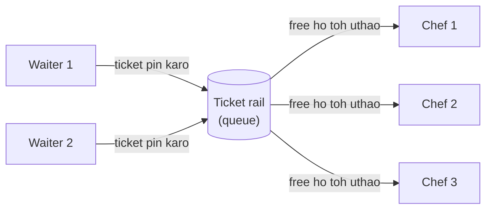

Us ek rail se Restaurant B ko chaar superpowers milti hain:

| Superpower | Restaurant mein iska matlab | Software mein iska matlab |
|---|---|---|
| **Customer ke liye speed** | Waiter 5 second mein free | API 3 s ki jagah 50 ms mein reply karti hai |
| **Decoupling** | Waiter ko pata hi nahi hona chahiye ki kaunsa chef pakayega | Sender ko na pata hai, na farak padta hai ki message kaun process karega |
| **Buffering** | 40 orders ka rush aaya toh bas rail lambi ho gayi | Traffic spike ek lambi queue ban jaata hai, crash nahi |
| **Fault tolerance** | Ek chef bimaar hoke ghar gaya, toh tickets doosre chef ka wait karte hain | Worker crash hua, toh message doosre worker ko dobara de diya jaata hai |

Iski keemat kya hai? Customer ko pizza *abhi isi waqt* nahi milta. Kabhi-kabhi ek ticket do baar pak jaata hai. Aur jab kuch galat hota hai, toh pata lagana mushkil hota hai ki gadbad kahan hui. Ye poora chapter isi baare mein hai: chaaron superpowers lo, aur ye costs control mein rakho.

> 🇮🇳 **Desi Analogy:** Mumbai ke **dabbawalas** socho. Ghar wali (producer) dabba tayyar karke darwaze pe rakh deti hai aur apne kaam pe lag jaati hai. Use office tak khud nahi jaana padta (async). Dabbe pe ek code likha hota hai (message ki metadata / routing key). Station pe dabbe ek jagah jama hote hain (broker / queue). Wahan se jo dabbawala free hai woh utha leta hai (consumer). Ghar wali ko ye jaanne ki zaroorat nahi ki kaunsa dabbawala le gaya (decoupling). Lunch time pe 1000 dabbe ek saath aa gaye? Station pe dher bada ho gaya, system crash nahi hua (buffering). Ek dabbawala chhutti pe hai? Uske dabbe koi aur utha leta hai (fault tolerance).

> 💡 **The core insight:** queue "ye abhi karo aur mujhe wait karao" ko badal deti hai "ye karna yaad rakhna, aur mujhe batana kab bhoolna safe hai" mein. Baaki sab kuch (Kafka, RabbitMQ, SQS, event sourcing) isi ka variation hai: yaad kaun rakhta hai, kitni der tak, aur padhne ka haq kisko hai.

---

## 🔨 Building It Up · Zero Se Shuru

### 1. Synchronous vs asynchronous communication

[Chapter 07](07-apis-communication.md) mein humne dekha ki services HTTP ya gRPC se ek doosre ko call karti hain. Ye **synchronous** hai: caller request bhejta hai aur jab tak response na aaye, *block* hokar baitha rehta hai.

**Asynchronous** communication ka matlab hai: caller ek **message** kisi durable (safe, crash pe bhi na mitne wali) jagah pe chhod deta hai aur aage badh jaata hai. Koi doosra process use baad mein utha leta hai.

Chalo ek checkout pe numbers lagate hain. User "Place order" click karta hai, toh chaar kaam hote hain:

```python
# Milliseconds mein simulated costs (yahan asli mein koi wait nahi hota).
STEPS = {"save_order": 20, "charge_card": 300, "send_email": 800, "update_analytics": 150}

def sync_checkout():
    """Do every step inside the user's request, one after another."""
    return sum(STEPS.values())

def async_checkout():
    """Do only what the user must wait for; queue the rest."""
    must_do_now = ["save_order", "charge_card"]
    publish_cost = 2                      # queue mein message append karna fast hai
    later = [s for s in STEPS if s not in must_do_now]
    waited = sum(STEPS[s] for s in must_do_now) + publish_cost * len(later)
    return waited, later

print("sync user waits :", sync_checkout(), "ms")
waited, later = async_checkout()
print("async user waits:", waited, "ms")
print("done in background:", later)
```

```text
sync user waits : 1270 ms
async user waits: 324 ms
done in background: ['send_email', 'update_analytics']
```

Abhi kya hua? Email aur analytics wale steps se confirmation page pe user ko dikhne wali cheez nahi badalti. Isliye humne unhe request se bahar nikaal diya. Sync mein total tha 20 + 300 + 800 + 150 = 1270 ms. Async mein sirf 20 + 300 + (2 × 2) = 324 ms. User ka wait lagbhag **4×** kam ho gaya. Aur sabse badi baat: agar email provider down hai, toh bhi checkout **chalta rehta hai**. Email wala message bas queue mein wait karta hai jab tak provider theek na ho jaaye.

**Kya async jaana chahiye, ye kaise decide karein?** Har step ke liye ek hi sawaal poocho: *kya reply karne se pehle user ko is step ka result chahiye?*

| Step | User ko result abhi chahiye? | Sync ya async |
|---|---|---|
| Login pe password check karna | Haan, warna andar kaise aane dein | Sync |
| Card charge karna | Usually haan ("payment failed" dikhana padega) | Sync (ya async with ek "processing" screen) |
| Receipt email bhejna | Nahi | Async |
| Upload hui photo ko 5 sizes mein resize karna | Nahi, tab tak placeholder dikha do | Async |
| Search index update karna | Nahi, kuch second ki delay chalegi | Async |
| Recommendations dobara calculate karna | Nahi | Async |

> ⚠️ Async free nahi hai. Tum speed aur resilience ke badle **immediate consistency** de rahe ho. User ke "My orders" page pe analytics count ek-do second tak purana dikh sakta hai. Isko **eventual consistency** kehte hain, jo tum [Chapter 06](06-cap-consistency.md) mein mil chuke ho.

> 🤔 **Mann mein sawaal:** Agar card charge async kar diya aur baad mein fail ho gaya, toh user ko kaise pata chalega?
>
> **Jawab:** Isliye card charge usually sync rakhte hain. Agar async karna hi hai (jaise bahut heavy traffic mein), toh UI ko "Payment processing..." state dikhani padti hai, aur result aane pe push notification, email ya page polling se user ko batate hain. Matlab async ka matlab "user ko kabhi nahi bataenge" nahi hai, matlab hai "abhi nahi, thodi der mein bataenge". Isi wajah se design karte waqt UI ko bhi is "beech wali" state ke liye ready rakhna padta hai.

### 2. The vocabulary in one place

Aage badhne se pehle words fix kar lete hain. Interview mein ye saare sunoge.

| Term | Matlab |
|---|---|
| **Message** | Data ka ek chhota tukda (usually JSON, Avro ya Protobuf, kuch KB ka) jo ek program doosre ko bhejta hai |
| **Producer** (publisher) | Wo program jo messages bhejta hai |
| **Consumer** (subscriber, worker) | Wo program jo messages receive aur process karta hai |
| **Broker** | Beech wala server jo messages store karta hai aur baant'ta hai (RabbitMQ, Kafka, SQS) |
| **Queue** | Ek buffer jahan har message **ek** consumer process karta hai |
| **Topic** | Ek naam wala channel jahan har message **kai** independent subscribers padh sakte hain |
| **Ack** (acknowledgement) | Consumer ka broker ko bolna "ye message ho gaya, ab tum ise bhool sakte ho" |
| **Command** vs **Event** | Command bolta hai "please X karo" (`SendEmail`). Event bolta hai "X ho gaya" (`OrderPlaced`). |

Command aur event ka farak jitna dikhta hai usse zyada important hai. **Command** ka ek intended handler hota hai, aur woh use mana bhi kar sakta hai ("nahi bhejunga, email address galat hai"). **Event** past ka ek fact hai: use mana nahi kar sakte, ho chuka hai. Aur kitni bhi services us pe react kar sakti hain. Events ka naam hamesha past tense mein rakho: `OrderPlaced`, `PaymentFailed`, `UserSignedUp`.

> 🇮🇳 **Desi Analogy:** Command vs event ko joint family ke WhatsApp group se samjho. Mummy ne papa ko personal message kiya "aate waqt doodh le aana" = **command** (ek specific insaan ke liye, aur papa "aaj nahi ho payega" bol sakte hain). Bhaiya ne family group pe daala "mera result aa gaya, 92% aaye!" = **event** (ho chuka fact hai, koi use reject nahi kar sakta; dadi mithai mangwayengi, chachi status lagayengi, chhota bhai jealous hoga: jitne log chahein utne react karein, bhaiya ko kisi ka pata nahi hona chahiye).

### 3. Model #1: The message queue (point-to-point)

**Message queue** wahi ticket rail hai. Har message, kai possible consumers mein se, exactly **ek** ko jaata hai. Ek hi queue ko padhne wale kai consumers ko **competing consumers** kehte hain: woh messages ke liye "compete" karte hain, aur isi se kaam baant jaata hai.

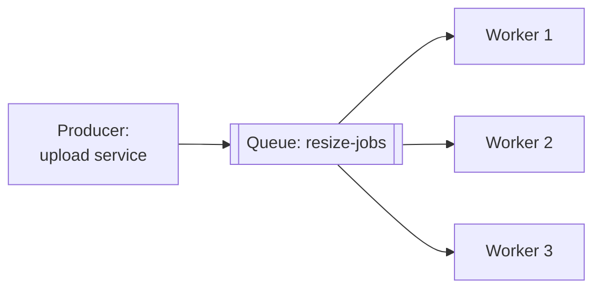

Queue ko *safe* banane wala asli mechanism hai **receive → process → ack** cycle, ek **visibility timeout** ke saath:

1. Worker ek message **receive** karta hai. Broker use delete nahi karta; bas maan lo 30 second ke liye **chhupa** (hide) deta hai.
2. Worker use process karta hai.
3. Worker use **ack** (delete) karta hai.
4. Agar worker crash ho gaya aur ack kabhi nahi kiya, toh 30 second khatam hote hi message phir se visible ho jaata hai, aur doosre worker ko mil jaata hai.

> 🇮🇳 **Desi Analogy:** Library mein book issue karna socho. Tumne book li (receive), toh woh shelf se gayab ho gayi, lekin library ke register mein abhi bhi hai, delete nahi hui (hidden, in-flight). Due date 14 din ki hai (visibility timeout). Book padh ke wapas kar di aur entry cross ho gayi (ack). Agar tum book le ke gaayab ho gaye aur due date nikal gayi, toh library maan leti hai ki woh "available" hai aur agle student ko de deti hai (redelivery). Yahan library ke paas copies ka jugaad hai, lekin idea same hai: **jab tak "ho gaya" ki entry nahi aati, record nahi mitta.**

Chalo ek simulated clock ke saath iska chhota version banate hain:

```python
from collections import deque

class SimpleQueue:
    """A tiny SQS-like queue. receive() hides a message; ack() deletes it.
    If nobody acks before the visibility timeout, the message reappears."""

    def __init__(self, visibility_timeout):
        self.ready = deque()
        self.in_flight = {}              # msg_id -> (body, deadline)
        self.timeout = visibility_timeout
        self.next_id = 1

    def send(self, body):
        self.ready.append((self.next_id, body))
        self.next_id += 1

    def receive(self, now):
        self._requeue_expired(now)
        if not self.ready:
            return None
        msg_id, body = self.ready.popleft()
        self.in_flight[msg_id] = (body, now + self.timeout)
        return msg_id, body

    def ack(self, msg_id):
        self.in_flight.pop(msg_id, None)

    def _requeue_expired(self, now):
        expired = [m for m, (_, deadline) in self.in_flight.items() if deadline <= now]
        for m in expired:
            body, _ = self.in_flight.pop(m)
            self.ready.append((m, body))

q = SimpleQueue(visibility_timeout=30)
for order in ["order-1", "order-2", "order-3"]:
    q.send(order)

a = q.receive(now=0)      # worker A
b = q.receive(now=1)      # worker B ... jo crash ho jaata hai aur kabhi ack nahi karta
q.ack(a[0])
print("A got", a, "| B got", b)

c = q.receive(now=10)     # worker C
q.ack(c[0])
print("t=10 C got", c)
print("t=40 redelivered:", q.receive(now=40))
print("t=41 queue empty:", q.receive(now=41))
```

```text
A got (1, 'order-1') | B got (2, 'order-2')
t=10 C got (3, 'order-3')
t=40 redelivered: (2, 'order-2')
t=41 queue empty: None
```

Abhi kya hua? Step by step dekho:
- t=0: worker A ne `order-1` liya. Deadline = 0 + 30 = 30.
- t=1: worker B ne `order-2` liya. Deadline = 1 + 30 = 31. Phir B crash ho gaya.
- A ne ack kiya, toh `order-1` hamesha ke liye gaya.
- t=10: C ne `order-3` liya aur ack kar diya.
- t=31 pe `order-2` ka timeout khatam ho gaya. t=40 pe jo agla worker aaya, use `order-2` **dobara** mil gaya.

`order-2` kho nahi gaya. Yahi **at-least-once delivery** ka dil hai: broker tumhe ek message do baar dena pasand karega, lekin ek baar bhi khona nahi. Ye line dimaag mein rakhna; section 10 mein ye wapas aayegi.

> 💡 Visibility timeout ko sabse slow *normal* processing time se aaraam se zyada rakho. Bahut chhota rakha toh slow-lekin-healthy worker ka message, jab woh abhi us pe kaam hi kar raha hai, doosre worker ko mil jaayega (duplicate kaam). Bahut lamba rakha toh crash hue worker ka message der tak chhupa pada rahega.

### 4. Model #2: Publish/subscribe (fan-out)

Ab ek alag zaroorat. Jab order place hota hai, toh *teen* teams ko farak padta hai: email, inventory, analytics. Queue ke saath, har message inmein se sirf ek ko milega. **Pub/sub** mein producer ek **topic** pe publish karta hai, aur **har subscriber ko apni alag copy milti hai**.

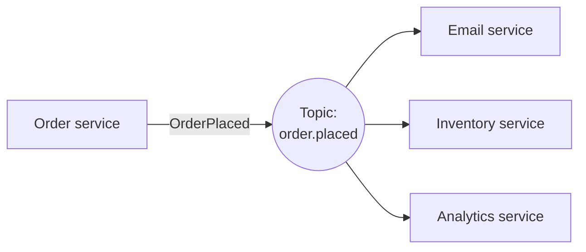

Dono ka farak side by side dekho:

```python
from collections import defaultdict

class PubSub:
    def __init__(self):
        self.subscribers = defaultdict(list)    # topic -> handlers ki list

    def subscribe(self, topic, handler):
        self.subscribers[topic].append(handler)

    def publish(self, topic, event):
        for handler in self.subscribers[topic]:  # HAR subscriber ko ek copy milti hai
            handler(event)

bus = PubSub()
bus.subscribe("order.placed", lambda e: print("  email     -> receipt for", e["id"]))
bus.subscribe("order.placed", lambda e: print("  inventory -> reserve items for", e["id"]))
bus.subscribe("order.placed", lambda e: print("  analytics -> revenue +", e["total"]))
print("Pub/sub: one event, every subscriber reacts")
bus.publish("order.placed", {"id": "A17", "total": 499})

print("Queue: many jobs, each handled by ONE worker")
workers = ["w1", "w2", "w3"]
jobs = [f"resize-{n}" for n in range(1, 7)]
for i, job in enumerate(jobs):
    print(" ", workers[i % len(workers)], "handles", job)
```

```text
Pub/sub: one event, every subscriber reacts
  email     -> receipt for A17
  inventory -> reserve items for A17
  analytics -> revenue + 499
Queue: many jobs, each handled by ONE worker
  w1 handles resize-1
  w2 handles resize-2
  w3 handles resize-3
  w1 handles resize-4
  w2 handles resize-5
  w3 handles resize-6
```

Abhi kya hua? Pub/sub ek message ko har interested party ke liye **copy** karta hai. Queue messages ko workers mein **split** (baant) karti hai. Real systems dono ko jod dete hain: order event ek topic pe publish hota hai, aur *har* subscribing team ke peeche uski apni queue hoti hai jismein kai competing workers hote hain. AWS pe ye classic **SNS → SQS fan-out** hai: ek SNS topic, aur har subscriber ki ek SQS queue.

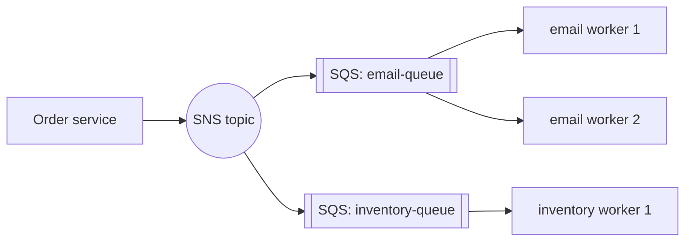

Jaadui shabd hai **decoupling**. Order service ko pata hi nahi ki email service exist karti hai. Agle mahine fraud team `order.placed` ko subscribe kar le, toh order service ke code mein ek line bhi nahi badalti.

> 🇮🇳 **Desi Analogy:** Queue vs pub/sub ko ek shaadi se samjho. Halwai ke paas 600 laddoo banane ka order aaya, aur kitchen mein 3 karigar hain. Har laddoo sirf ek karigar banayega, kaam baant gaya: ye **queue** (split) hai. Ab shaadi ka card. Ek hi card ki copy har rishtedaar ke ghar jaati hai, aur har ghar apne tareeke se react karta hai (koi gift khareedta hai, koi ticket book karta hai): ye **pub/sub** (copy) hai. Aur SNS → SQS? Card har ghar pahuncha (topic), aur har ghar ke andar kaam bachchon mein baant diya gaya (har subscriber ki apni queue).

### 5. Model #3: Event streaming (the log)

Classic queues ack hote hi message *delete* kar deti hain. Jobs ke liye theek hai, lekin iska matlab:
- Jo nayi service kal subscribe karegi, woh kal ke pehle ke events nahi dekh sakti.
- Agar tumne ek bug deploy kar diya jo messages galat process kar raha tha, toh tum "rewind" karke unhe dobara process nahi kar sakte.

**Event streaming** platforms (sabse famous **Apache Kafka**; baaki: Amazon Kinesis, Apache Pulsar, Redpanda) messages ko ek **append-only log** mein configured time tak rakhte hain (din, hafte, ya hamesha ke liye), chahe kisi ne padha ho ya nahi. Har consumer bas yaad rakhta hai ki **woh kahan tak padh chuka hai**, ek bookmark ki tarah.

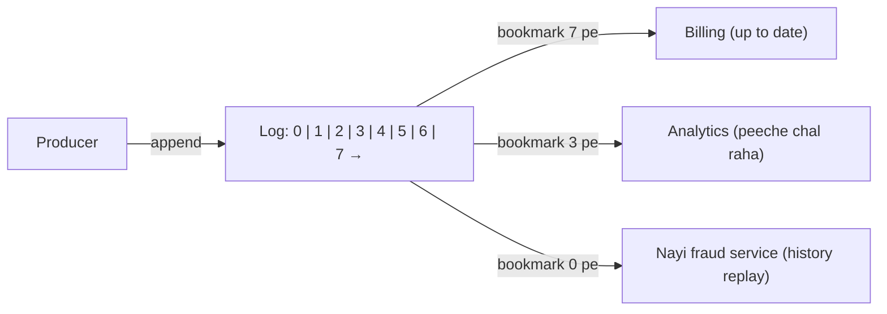

Isse ticket rail ki jagah ek **akhbaar ki archive** (newspaper archive) jaisa socho. Rail ticket pakte hi phenk deti hai. Archive har edition shelf pe rakhti hai, aur har padhne wala apna bookmark khud rakhta hai. Padhne se kuch bhi hat'ta nahi.

> 🇮🇳 **Desi Analogy:** Cricket ka **ball-by-ball commentary log** socho. Har ball ek line mein append hoti hai: "over 14.3: four", "14.4: dot"... purani lines kabhi badalti nahi (append-only, immutable). Ek dost live dekh raha hai (bookmark latest ball pe), doosra office se aake 10th over se highlights dekh raha hai (lagging consumer), aur ek analyst match ke baad pehli ball se poora data padh ke stats nikaal raha hai (replay). Kisi ke padhne se commentary mit'ti nahi. Yahi Kafka hai. Jabki queue ek **chai ka order** hai: chai pi li, order khatam, dobara usi chai ko "replay" nahi kar sakte.

| | Message queue (RabbitMQ, SQS) | Event log (Kafka, Kinesis) |
|---|---|---|
| Message process hone ke baad | Delete | Retention expire hone tak rakha jaata hai |
| "Main kahan tak pahuncha?" kaun track karta hai | Broker (har message ka) | Consumer (ek offset number) |
| Kai independent readers | Har ek ko apni queue chahiye | Free: har group ka apna offset |
| Purane messages replay karna | Nahi | Haan, bas offset peeche kar do |
| Per-message routing aur priorities | Bahut rich | Minimal |
| Typical throughput | Har queue pe hazaaron se dasiyon hazaar msg/s | Har cluster pe laakhon se millions msg/s |

> 🤔 **Mann mein sawaal:** Agar Kafka sab kuch hamesha rakh sakta hai, toh disk bhar nahi jaayegi? Aur kab tak rakhna chahiye?
>
> **Jawab:** Isliye **retention** configurable hai: by default 7 din jaise time ke baad purane segments delete ho jaate hain, ya size limit laga sakte ho (section 6f). "Forever" sirf tab rakhte hain jab woh history business ke liye zaroori ho (jaise event sourcing), aur tab bhi **log compaction** se sirf har key ki latest value rakh ke size control karte hain. Disk sasti hai, lekin unlimited nahi, toh retention ek conscious decision hota hai.

### 6. Kafka architecture, piece by piece

Kafka ke design mein chhe ideas hain. Ek-ek karke lete hain.

#### 6a. Topics and partitions

**Topic** ek naam wala stream hai, jaise `orders`. Ek machine pe ek hi log bottleneck ban jaata, isliye topic ko **partitions** mein tod diya jaata hai. Har partition apna khud ka ordered, append-only log hai, aur alag partitions alag servers (**brokers**) pe rehte hain. Partitions hi Kafka ki **parallelism** ki unit hain.

Jab producer ek **key** ke saath message bhejta hai (maan lo user ID), toh Kafka partition aise chunta hai: `hash(key) % number_of_partitions`. Same key → same partition → **un messages ka order bana rehta hai**. Bina key wale messages partitions mein faila diye jaate hain.

> 🇮🇳 **Desi Analogy:** Railway reservation counter socho jahan 3 khidkiyan hain, aur rule hai "PNR ka last digit dekh ke khidki chuno" (`hash(key) % 3`). Tumhara PNR hamesha usi khidki pe jaayega (same key → same partition). Tumhari booking, phir cancellation, phir refund: teeno usi line mein, usi order mein process honge. Lekin khidki 1 aur khidki 2 ke beech ka koi order nahi hai: doosre passenger ka kaam tumse pehle ho ya baad mein, kisi ko nahi pata. Bas yahi Kafka ka ordering promise hai: **per partition, global nahi.**

#### 6b. Offsets

Ek partition ke andar har message ko ek sequential number milta hai jise **offset** kehte hain: 0, 1, 2, ... Offsets kabhi badalte nahi aur dobara use nahi hote. Kisi bhi message ka poora address hai `(topic, partition, offset)`.

Chalo ek mini Kafka topic banate hain:

```python
import zlib

class Topic:
    def __init__(self, name, partitions):
        self.name = name
        self.logs = [[] for _ in range(partitions)]     # har partition ki ek append-only list

    def partition_for(self, key):
        # Same key -> same partition -> per-key ordering.
        # crc32 har run mein same rehta hai (Python ka str hash() har run mein random hota hai).
        return zlib.crc32(key.encode()) % len(self.logs)

    def produce(self, key, value):
        p = self.partition_for(key)
        self.logs[p].append((key, value))
        return p, len(self.logs[p]) - 1                 # (partition, offset)

orders = Topic("orders", partitions=3)
events = [("asha", "cart"), ("ravi", "cart"), ("asha", "pay"),
          ("meera", "cart"), ("ravi", "pay"), ("asha", "ship")]
for user, action in events:
    p, off = orders.produce(user, action)
    print(f"{user:5} {action:4} -> partition {p}, offset {off}")

for p, log in enumerate(orders.logs):
    print("partition", p, log)
```

```text
asha  cart -> partition 1, offset 0
ravi  cart -> partition 2, offset 0
asha  pay  -> partition 1, offset 1
meera cart -> partition 1, offset 2
ravi  pay  -> partition 2, offset 1
asha  ship -> partition 1, offset 3
partition 0 []
partition 1 [('asha', 'cart'), ('asha', 'pay'), ('meera', 'cart'), ('asha', 'ship')]
partition 2 [('ravi', 'cart'), ('ravi', 'pay')]
```

Abhi kya hua? Asha ke saare events partition 1 mein gaye, usi order mein jismein usne kiye: cart, pay, ship. Meera bhi sanyog se partition 1 mein uske saath hai, aur Ravi ke do events partition 2 mein hain. Har user ke events apne order mein hain. Dhyaan do, partition 0 khaali hai: sirf teen keys ke saath hashing lumpy (asamaan) ho sakti hai. Laakhon users ke saath ye barabar ho jaata hai, lekin ek akeli **hot key** (ek celebrity, ek bahut bada customer) ek partition ko overload kar sakti hai. Ye wahi hot-spot problem hai jo [Chapter 05](05-replication-sharding.md) mein hot shards ke saath dekhi thi.

> ⚠️ Kafka order ki guarantee **sirf ek partition ke andar** deta hai. Partitions ke beech koi global order nahi hai. Agar tumhe chahiye "order #42 ke saare events order mein", toh `order_id` ko key banao.

> 🤔 **Mann mein sawaal:** Code mein Python ka built-in `hash()` kyun nahi use kiya, `zlib.crc32` kyun?
>
> **Jawab:** Python mein strings ka `hash()` security ke liye har process run pe randomise hota hai (hash randomization). Matlab aaj "asha" partition 1 mein jaati, kal restart ke baad shayad partition 2 mein. Real Kafka mein ye disaster hoga: same key alag partitions mein = order khatam. Isliye partitioner ko **stable** hash chahiye jo har machine aur har run pe same answer de. Kafka ka default partitioner **murmur2** use karta hai; humne demo ke liye `crc32` liya kyunki woh bhi stable hai.

#### 6c. Consumer groups

**Consumer group** consumers ka ek set hai jo milkar ek topic padhne ka kaam baant'te hain. Rule ye hai:

> **Ek group mein har partition ko exactly ek consumer padhta hai.** Ek consumer kai partitions padh sakta hai.

Is ek rule se tumhe pehle wale dono models mil jaate hain:
- **Queue jaisa behaviour:** apne saare workers ko *ek* group mein daal do. Woh partitions aapas mein baant lenge.
- **Pub/sub jaisa behaviour:** har service ko *apna alag* group do. Har group har message padhega.

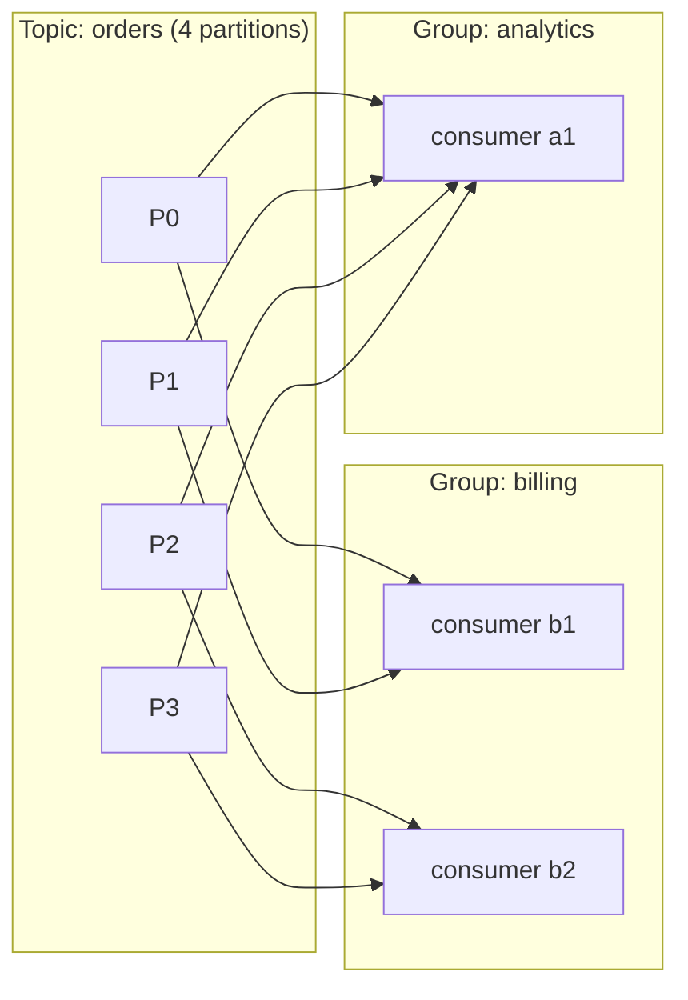

```python
def assign(num_partitions, consumers):
    """Round-robin: each partition goes to exactly one consumer in the group."""
    plan = {c: [] for c in consumers}
    for p in range(num_partitions):
        plan[consumers[p % len(consumers)]].append(p)
    return plan

print(assign(6, ["c1", "c2"]))
print(assign(6, ["c1", "c2", "c3"]))
print(assign(3, ["c1", "c2", "c3", "c4"]))
```

```text
{'c1': [0, 2, 4], 'c2': [1, 3, 5]}
{'c1': [0, 3], 'c2': [1, 4], 'c3': [2, 5]}
{'c1': [0], 'c2': [1], 'c3': [2], 'c4': []}
```

Abhi kya hua? Aakhri line dekho. 3 partitions aur 4 consumers mein **c4 khaali baitha hai**. Ek group ke andar parallelism ki chhat (ceiling) partitions ki ginti hai. Isliye teams topics ko aaj ki zaroorat se zyada partitions ke saath banati hain (jaise 12, 24 ya 48), taaki baad mein consumers add kar sakein. Baad mein partitions badhana possible hai, lekin isse badal jaata hai ki kaunsi key kis partition mein jaayegi (yaad karo `hash(key) % partitions`: denominator badla toh answer badla), aur thodi der ke liye per-key ordering toot jaati hai.

> 🇮🇳 **Desi Analogy:** Toll plaza pe 3 lanes hain (partitions) aur 4 toll collectors (consumers). Ek lane mein ek hi collector baith sakta hai (warna do log ek hi gaadi se paise maangenge). Chautha collector chai pee raha hai, kyunki uske liye lane hi nahi hai. Zyada collectors ka fayda tabhi hai jab zyada lanes hon. Aur doosri company ka survey team (doosra consumer group) usi highway ki gaadiyon ko apne hisaab se alag gin raha hai, pehle wale ke kaam mein dakhal diye bina.

Jab koi consumer join karta hai, chhod ke jaata hai ya crash hota hai, toh group **rebalance** hota hai: partitions zinda consumers mein dobara baant'e jaate hain. Rebalance ke dauraan consumption thodi der ke liye ruk jaata hai. Baar-baar rebalance hona (jaise ek consumer jo ek batch pe itna time leta hai ki Kafka sochta hai woh mar gaya) production ka ek classic sir-dard hai.

#### 6d. Committed offsets: the bookmark

Har group, har partition ke liye, **agla message jo woh padhega** uska offset store karta hai. Ise **committed offset** kehte hain, aur Kafka ise ek internal topic mein rakhta hai. Agar consumer crash ho jaaye, toh uski jagah aane wala committed offset se aage shuru karta hai. Kyunki har group ka bookmark alag hai, woh kabhi ek doosre ke kaam mein dakhal nahi dete:

```python
log = ["o1", "o2", "o3", "o4", "o5", "o6"]          # ek partition
committed = {"billing": 0, "analytics": 0}           # group -> agla offset jo padhna hai

def poll(group, max_records):
    start = committed[group]
    batch = log[start:start + max_records]
    committed[group] = start + len(batch)            # processing ke baad commit
    return batch

print("billing   reads", poll("billing", 10))
print("analytics reads", poll("analytics", 2))
print("analytics reads", poll("analytics", 2))
print("lag:", {g: len(log) - off for g, off in committed.items()})

committed["analytics"] = 0                           # bug fix ho gaya: shuru se replay karo
print("analytics replays", poll("analytics", 10))
```

```text
billing   reads ['o1', 'o2', 'o3', 'o4', 'o5', 'o6']
analytics reads ['o1', 'o2']
analytics reads ['o3', 'o4']
lag: {'billing': 0, 'analytics': 2}
analytics replays ['o1', 'o2', 'o3', 'o4', 'o5', 'o6']
```

Abhi kya hua? Do groups ne *same* log ko apni-apni speed pe padha. Billing ne ek baar mein sab padh liya (committed = 6, lag = 6 − 6 = 0). Analytics ne do-do karke 4 padhe (committed = 4, lag = 6 − 4 = 2). **Consumer lag** (latest offset minus committed offset) Kafka ka sabse important health metric hai: agar lag badhta hi jaa raha hai, toh consumers peeche reh rahe hain. Aur replay bas "bookmark peeche kar do" hai, jo delete-on-ack queue mein impossible hai.

#### 6e. Replication: surviving broker failure

Har partition kai brokers pe copy kiya jaata hai; kitni copies, ye **replication factor** decide karta hai (aam taur pe 3). Ek copy **leader** hoti hai: saare writes aur (by default) reads usi pe jaate hain. Baaki **followers** hain jo leader ka log copy karte rehte hain. Jo followers poori tarah caught up hain, woh **ISR** (in-sync replicas) kehlaate hain. Agar leader ka broker mar jaaye, toh ISR mein se ek follower naya leader ban jaata hai.

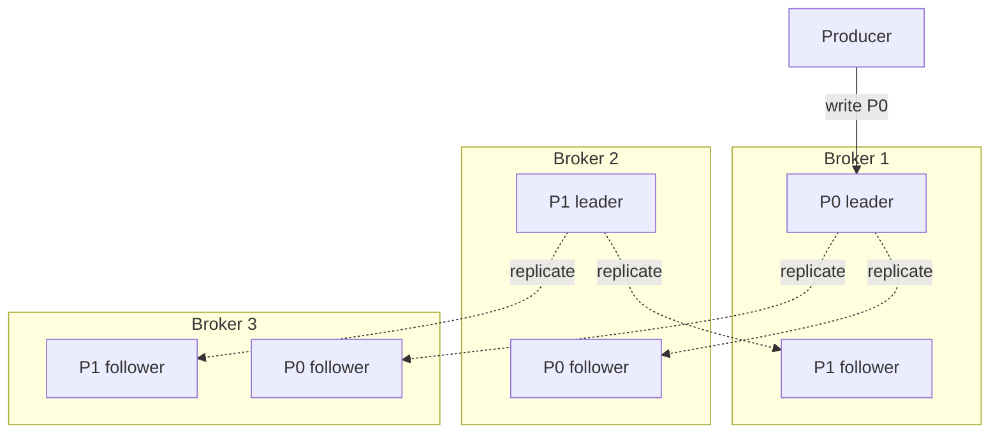

Dhyaan do, leaders alag brokers pe faile hue hain (P0 ka leader Broker 1 pe, P1 ka Broker 2 pe), taaki saara write load ek machine pe na aaye.

Producer **`acks`** setting se chunta hai ki use kitni safety chahiye:

| `acks` | Producer kiska wait karta hai | Speed | Data kab kho sakta hai... |
|---|---|---|---|
| `0` | Kisi ka nahi (fire and forget) | Sabse fast | Koi bhi network blip ya broker crash |
| `1` | Leader ne likh liya | Fast | Followers ke copy karne se pehle leader mar gaya |
| `all` (`-1`) | Har in-sync replica ne likh liya | Slower | Practically kabhi nahi, agar `min.insync.replicas` ≥ 2 |

Durable production recipe: replication factor 3, `acks=all`, `min.insync.replicas=2`. Tab ek write tabhi successful hota hai jab kam se kam 2 copies ke paas ho, toh tum ek broker kho ke bhi na data khote ho na availability. Ye [Chapter 05](05-replication-sharding.md) wala leader–follower replication hai, aur naya leader chunna [Chapter 06](06-cap-consistency.md) wali consensus problem hai: Kafka ka controller apna built-in Raft-based **KRaft** mode use karta hai (purane versions ZooKeeper use karte the).

> 🤔 **Mann mein sawaal:** `min.insync.replicas=2` kyun, 3 kyun nahi? Teeno copies ka wait karo toh aur safe nahi hoga?
>
> **Jawab:** Safe zaroor hoga, lekin tab ek bhi broker down hua (ya maintenance pe gaya) toh ISR mein sirf 2 bachenge, aur "3 chahiye" wali condition puri na hone ki wajah se saare writes **reject** ho jaayenge. Availability gayi. `=2` ke saath ek broker gire toh bhi writes chalte hain, aur har committed message kam se kam 2 jagah hai. Replication factor 3 + min ISR 2 = "ek failure jhelo, bina data ya availability khoye." Yahi sweet spot hai.

#### 6f. Retention and compaction

Kafka purana data **retention policy** se delete karta hai, acks se nahi:
- **Time-based:** 7 din rakho (common default), phir purane **segments** delete karo (log ek series of segment files ki tarah store hota hai).
- **Size-based:** har partition mein zyada se zyada N GB rakho.
- **Log compaction:** har **key ka sirf latest message** rakho. "Current state" wale topics ke liye zabardast, jaise har user ID ki latest profile. Key ke saath null value wala message (**tombstone**) us key ko delete kar deta hai.

```python
def compact(log):
    """Keep only the last value for each key, preserving offset order."""
    latest = {}
    for offset, (key, value) in enumerate(log):
        latest[key] = (offset, value)
    kept = sorted((off, key, val) for key, (off, val) in latest.items() if val is not None)
    return kept

log = [("u1", "Asha, Pune"), ("u2", "Ravi, Delhi"), ("u1", "Asha, Mumbai"),
       ("u3", "Meera, Goa"), ("u2", None)]        # None = tombstone: u2 delete ho gaya
for row in compact(log):
    print(row)
```

```text
(2, 'u1', 'Asha, Mumbai')
(3, 'u3', 'Meera, Goa')
```

Abhi kya hua? User u1 ka purana address (Pune, offset 0) gaya, sirf latest (Mumbai, offset 2) bacha. u2 tombstone se delete ho gaya. Aur bache hue messages ke offsets wahi rahe (2 aur 3), renumber nahi hue. Ek nayi service is compacted topic ko offset 0 se padh ke "har user ki current state" dobara bana sakti hai.

> 🇮🇳 **Desi Analogy:** Log compaction = class teacher ki **"parents ka current phone number" wali list**. Poore saal ki har din ki attendance normal log jaisi hai, sab kuch rakha jaata hai. Lekin phone list mein Asha ke papa ne number badla, toh purana kaat diya, sirf naya bacha (latest per key). Koi bachcha school chhod gaya, toh uski entry hi kaat di (tombstone). List chhoti rehti hai, aur nayi class teacher ise padh ke turant "sabka current number" jaan leti hai.

#### The whole Kafka picture

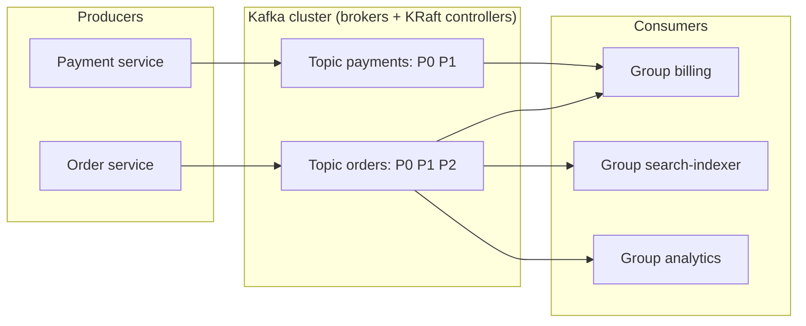

Poori picture ek line mein: producers topics mein likhte hain, topics partitions mein bante hain, partitions brokers pe replicate hote hain, aur har consumer group apna bookmark rakh ke apni speed se padhta hai.

### 7. The RabbitMQ model: smart broker, simple consumers

**RabbitMQ** ek classic **message broker** hai jo AMQP protocol pe bana hai. Iska design Kafka ka ulta hai: broker *smart* hai (routing, per-message acks, priorities, delivery tracking) aur consumer *simple*.

Producers kabhi seedhe queue mein nahi likhte. Woh ek **exchange** pe publish karte hain, aur **bindings** (rules) decide karte hain ki kis queue ko copy milegi:

| Exchange type | Message kahan route karta hai... | Kab use karo |
|---|---|---|
| **direct** | Un queues mein jinki binding key message ki routing key se exactly match kare | Har job type ki apni work queue |
| **topic** | Un queues mein jinka pattern routing key se match kare (`order.*.india`, `order.#`) | Category ke hisaab se flexible pub/sub |
| **fanout** | Har bound queue mein, key ko ignore karke | Broadcast |
| **headers** | Un queues mein jinke header rules match karein | Kam milta hai; attributes se routing |

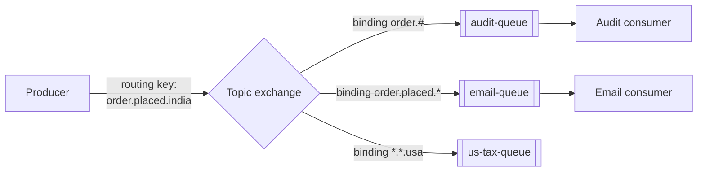

(`*` exactly ek word match karta hai, `#` zero ya zyada words. Routing key `order.placed.india` hai: `order.#` match karta hai, `order.placed.*` bhi match karta hai (`*` = `india`), lekin `us-tax-queue` ko kuch nahi milta kyunki key `india` pe khatam hoti hai, `usa` pe nahi.)

> 🇮🇳 **Desi Analogy:** RabbitMQ ka exchange = **India Post ka sorting office**. Tum letter seedha kisi ke letterbox mein nahi daalte, post office (exchange) mein daalte ho. Sorting office PIN code (routing key) dekh ke rules (bindings) ke hisaab se decide karta hai kaunse bag (queue) mein jaayega. "Saare 400xxx Mumbai wale bag mein" = topic pattern. "Har ghar mein Diwali offer ka pamphlet" = fanout. Postman (consumer) ka kaam simple hai: bas apna bag uthao aur baanto. Dimaag sorting office mein hai, postman mein nahi. Kafka mein ulta hai: broker bas register rakhta hai, dimaag (offset, kahan tak padha) consumer ke paas.

RabbitMQ ke key ideas:
- **Push with prefetch:** broker consumers ko messages push karta hai, lekin har consumer ko zyada se zyada `prefetch` un-acked messages (`basic.qos` se set). Ye built-in backpressure hai: slow consumer ko apne aap kam messages milte hain.
- **Acks and requeue:** dead connection ka un-acked message wapas queue mein aa jaata hai. Consumer ek message ko **nack** (negative ack) bhi kar sakta hai, requeue ke saath ya bina.
- **Messages are deleted once acked.** Replay nahi hota (RabbitMQ *Streams*, ek naya feature, Kafka jaisa log add karta hai, lekin classic model delete-on-ack hai).
- **Durability:** queues ko durable aur messages ko persistent mark karo, aur high availability ke liye **quorum queues** (Raft se replicated) use karo.

### 8. The Amazon SQS model: queues as a managed service

**SQS** (Simple Queue Service) ek fully managed queue hai: koi server nahi chalana, standard queues ke liye practically unlimited scale, aur per request payment. Iska model exactly wahi visibility-timeout wali queue hai jo humne section 3 mein banayi thi.

| Feature | SQS Standard | SQS FIFO |
|---|---|---|
| Delivery | At-least-once (kabhi-kabhi duplicates) | 5-minute deduplication window ke andar exactly-once *processing* |
| Ordering | Best effort (order bigad sakta hai) | **Message group ID** ke andar strict order |
| Throughput | Lagbhag unlimited | Per queue limited (sau se hazaaron messages per second, batching aur high-throughput mode ke saath zyada) |

Kuch aur knobs jo tumhe naam se pata hone chahiye:
- **Visibility timeout** (default 30 seconds, max 12 hours): receive hua message kitni der chhupa rehta hai.
- **Long polling** (20 seconds tak wait): receive call turant khaali haath lautne ki jagah messages ka wait karti hai, isse cost aur CPU dono bachte hain.
- **Retention**: default 4 din, max 14 din.
- **Redrive policy**: `maxReceiveCount` baar receive hokar fail hone ke baad message ek **dead-letter queue** mein chala jaata hai (section 13).
- **SNS** iska pub/sub partner hai; **SNS → SQS** standard fan-out hai. **EventBridge** AWS ka event bus hai jismein content-based routing rules hote hain.

> 💡 FIFO ka "message group ID" wahi idea hai jo Kafka ki key ka: ordering *per group* guaranteed hai, aur alag groups parallel mein process hote hain.

### 9. Choosing between them

| Tumhe chahiye... | Chuno | Kyunki |
|---|---|---|
| Background jobs (emails, thumbnails, PDFs) retries ke saath | **SQS** ya **RabbitMQ** | Per-message acks, visibility timeouts, DLQs out of the box |
| Complex routing (region, type, priority ke hisaab se) | **RabbitMQ** | Exchanges aur bindings routing khud kar dete hain |
| Kai teams same events alag-alag padhein | **Kafka** | Har consumer group ka apna offset; copies ki zaroorat nahi |
| History replay, database rebuild, bug ke baad reprocess | **Kafka** | Retention + movable offsets |
| Bahut high throughput (logs, clicks, metrics, IoT) | **Kafka / Kinesis** | Sequential disk writes, batching, partitions |
| Stream processing (windows, joins, aggregates) | **Kafka** + Flink / Kafka Streams | Log hi stream processors ka input hai |
| Zero ops, AWS-native, simple jobs | **SQS (+ SNS)** | Fully managed, bina soche scale hota hai |
| Simple queue semantics ke saath strict per-entity order | **SQS FIFO** ya **Kafka with a key** | Ordering per group/key |

### 10. Delivery semantics: at-most-once, at-least-once, exactly-once

Distributed systems ka ek kadwa sach ye hai: consumer kaam karne aur broker ko "ho gaya" bolne ke **beech mein** crash ho sakta hai. In do kaamon ko karne ke sirf do order ho sakte hain, aur dono alag tareeke se fail hote hain.

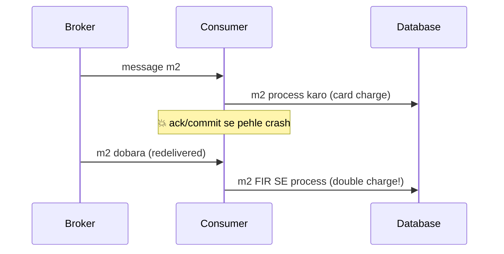

Chalo dono choices ko beech mein ek crash ke saath simulate karte hain:

```python
def consume(log, commit_first):
    committed = 0           # broker mein stored offset: crash ke baad bhi bachta hai
    processed = []          # humare side effects (rows likhi, emails bheje)
    crashed_once = False
    while committed < len(log):
        offset = committed                  # committed offset se (dobara) shuru karo
        msg = log[offset]
        if commit_first:
            committed = offset + 1          # 1. commit
            if msg == "m2" and not crashed_once:
                crashed_once = True         # 💥 processing se pehle crash
                continue
            processed.append(msg)           # 2. process
        else:
            processed.append(msg)           # 1. process
            if msg == "m2" and not crashed_once:
                crashed_once = True         # 💥 commit karne se pehle crash
                continue
            committed = offset + 1          # 2. commit
    return processed

log = ["m0", "m1", "m2", "m3"]
print("commit, then process (at-most-once): ", consume(log, commit_first=True))
print("process, then commit (at-least-once):", consume(log, commit_first=False))
```

```text
commit, then process (at-most-once):  ['m0', 'm1', 'm3']
process, then commit (at-least-once): ['m0', 'm1', 'm2', 'm2', 'm3']
```

Abhi kya hua? Pehle case mein bookmark aage kar diya, phir crash: restart pe consumer m3 se shuru karta hai, m2 kabhi process hi nahi hua. Doosre case mein m2 process ho gaya, lekin bookmark aage hone se pehle crash: restart pe consumer phir m2 se shuru karta hai, toh m2 do baar process hua.

| Semantics | Kaise | Kya galat ho sakta hai | Kahan theek hai |
|---|---|---|---|
| **At-most-once** | Pehle ack/commit, phir process | Messages **kho jaate hain** (m2 gayab) | Metrics, logs, live location pings jahan agla update is wale ko replace kar deta hai |
| **At-least-once** | Pehle process, phir ack/commit | Messages **duplicate** hote hain (m2 do baar) | Lagbhag sab kuch, *agar consumer idempotent hai* |
| **Exactly-once** | At-least-once delivery + deduplication / transactions | Complexity aur thoda throughput | Payments, ledgers, counters |

> 🇮🇳 **Desi Analogy:** Kirana store ka khata socho. Ramesh bhaiya ne udhaar chukaya. Dukandaar ke paas do kaam hain: (1) khate mein "paid" likhna (commit) aur (2) paisa galle mein daalna (process). Agar pehle "paid" likha aur paise daalne se pehle koi aur customer aa gaya aur paise counter pe hi reh gaye, gir gaye: entry hai, paise nahi (**at-most-once**, data loss). Agar pehle paise galle mein daale aur likhne se pehle phone aa gaya, toh agle din Ramesh bhaiya se phir maang liye (**at-least-once**, duplicate). Samajhdaar dukandaar har payment pe receipt number likhta hai, aur agar Ramesh bhaiya bolein "receipt #42 toh pehle hi de chuka hoon", toh dobara nahi leta: yahi **idempotency** hai, jisse exactly-once *effect* milta hai.

**Kya exactly-once delivery possible hai?** Ek unreliable network pe sender kabhi pakka nahi ho sakta ki message pahuncha *aur* exactly ek baar process hua. Ye wahi fundamental limit hai jo Two Generals problem ke peeche hai. Jo *achievable* hai woh hai **exactly-once processing** (jise **effectively-once** bhi kehte hain): message do baar deliver ho sakta hai, lekin uska *effect* ek hi baar hota hai. Ise paane ke do tareeke hain:

1. **Idempotent consumers** (kisi bhi broker ke saath chalta hai; agla section).
2. **Ek system ke andar transactions.** Kafka ek *idempotent producer* deta hai (broker producer ID aur sequence numbers se duplicate retries ko drop kar deta hai) aur *transactions* bhi, jo output messages likhna aur input offsets commit karna ek saath atomically karti hain, jinhe consumers `isolation.level=read_committed` ke saath padhte hain. Isse **Kafka-to-Kafka** pipelines ke liye exactly-once milta hai. Jaise hi tumhara consumer bahar ke kisi system ko chhoota hai (email bhejta hai, payment API call karta hai), tum wapas idempotency ki zaroorat pe aa jaate ho.

> 🤔 **Mann mein sawaal:** Toh "exactly-once" jo Kafka ki docs mein likha hai, woh jhooth hai kya?
>
> **Jawab:** Jhooth nahi, bas uska scope chhota hai. Kafka exactly-once tab deta hai jab input bhi Kafka hai aur output bhi Kafka (read → process → write back to Kafka, offsets ke saath ek transaction mein). Lekin woh email ko "un-send" nahi kar sakta, ya Stripe ke charge ko apne transaction mein nahi jod sakta. Isliye bahar ki duniya ke liye rule same hai: **delivery at-least-once, effect idempotency se exactly-once.**

> 💡 **Interview one-liner:** "Delivery is at-least-once; I make *processing* exactly-once by making the consumer idempotent."

### 11. Idempotent consumers

Koi operation **idempotent** hai agar use do baar karne ka effect ek baar karne jaisa hi ho. "Status ko SHIPPED set karo" idempotent hai (das baar karo, status SHIPPED hi rahega). "Balance mein ₹100 jodo" idempotent nahi hai (do baar kiya toh ₹200 jud gaye).

> 🇮🇳 **Desi Analogy:** Lift ka button idempotent hai: 5 baar dabao, lift ek hi baar aayegi. Lekin chai wale ko "ek chai" 5 baar bolo toh 5 chai aa jaayengi aur 5 ka bill. Tumhe consumers ko **lift ke button** jaisa banana hai, chai ke order jaisa nahi.

Consumers ko idempotent banane ke teen tareeke:

1. **Naturally idempotent operations use karo:** `SET status = 'SHIPPED'`, upserts (`INSERT ... ON CONFLICT DO UPDATE`), poori nayi value ke saath `PUT`.
2. **Message ID se deduplicate karo:** har message ke saath ek unique `event_id` aata hai. Processed IDs record karo, aur ideally **usi database transaction mein** jismein business change ho raha hai, taaki ya toh dono hon ya koi nahi.
3. **Version / sequence checks:** update tabhi apply karo jab uska version tumhare stored version se naya ho (section 12).

Ye raha approach 2, Python ke built-in `sqlite3` aur ek in-memory database ke saath:

```python
import sqlite3

db = sqlite3.connect(":memory:")
db.execute("CREATE TABLE accounts (id TEXT PRIMARY KEY, balance INTEGER)")
db.execute("CREATE TABLE processed_events (event_id TEXT PRIMARY KEY)")
db.execute("INSERT INTO accounts VALUES ('A', 0)")
db.commit()

def handle(event):
    """Apply a deposit exactly once, even if the event is delivered many times."""
    try:
        with db:   # ek transaction: dono statements commit honge, ya koi nahi
            db.execute("INSERT INTO processed_events VALUES (?)", (event["event_id"],))
            db.execute("UPDATE accounts SET balance = balance + ? WHERE id = ?",
                       (event["amount"], event["account"]))
        return "applied"
    except sqlite3.IntegrityError:          # primary key clash: ye event pehle dekh chuke hain
        return "duplicate, skipped"

deliveries = [
    {"event_id": "e1", "account": "A", "amount": 100},
    {"event_id": "e2", "account": "A", "amount": 50},
    {"event_id": "e1", "account": "A", "amount": 100},   # crash ke baad redeliver hua
]
for ev in deliveries:
    print(ev["event_id"], "->", handle(ev))
print("balance:", db.execute("SELECT balance FROM accounts").fetchone()[0])
```

```text
e1 -> applied
e2 -> applied
e1 -> duplicate, skipped
balance: 150
```

Abhi kya hua? `processed_events` ki primary key ek "kya maine ye pehle kiya hai?" wala lock ban gayi. Teesri delivery mein `e1` dobara insert karne ki koshish hui, primary key clash hua, `IntegrityError` aaya, aur `with db:` ne poora transaction rollback kar diya, balance update bhi nahi hua. Kyunki insert aur balance update **ek transaction** mein hain, aisa koi gap nahi jahan ek hua ho aur doosra nahi. Ek naive consumer ne balance 250 dikhaya hota (100 + 50 + 100).

> 🤔 **Mann mein sawaal:** Pehle `SELECT` karke check kyun nahi karte "ye event_id hai kya?", phir insert? Try/except ka jhanjhat kyun?
>
> **Jawab:** Kyunki check aur insert ke beech gap hai. Do workers ek hi duplicate ko ek saath uthaayein, dono `SELECT` karein, dono ko "nahi mila" dikhe, aur dono balance badha dein: race condition. Database ka **unique constraint** atomic hai: do mein se sirf ek insert jeetega, doosre ko error milega. Isliye "insert karke dekho, clash hua toh duplicate" hi sahi pattern hai.

> ⚠️ `event_id` aata kahan se hai? **Producer** ko use ek baar banana hota hai (ek UUID, ya ek natural key jaise `order_42_payment`) aur har retry pe wahi reuse karna hota hai. Agar producer har retry pe naya ID banata hai, toh dedup kaam nahi kar sakta. Payment APIs isi idea ko **idempotency key** kehti hain; [Chapter 09](09-microservices-reliability.md) mein HTTP APIs ke liye ye cover hai.

### 12. Ordering

Ordering mehenga hai, isliye "kya tumhe ordering chahiye?" ka imaandaar jawab usually hota hai "sirf per entity".

**Order kahan toot'ta hai:**
- Kai partitions ya kai competing consumers parallel mein process karte hain.
- Ek message fail hota hai, baad mein retry hota hai, aur agla message usse aage nikal jaata hai.
- Alag machines pe producers "ek hi time" pe bhejte hain, lekin unki clocks alag hain.

**Strategies:**

| Zaroorat | Strategy |
|---|---|
| Order per user/order/account | Us key se partition karo (Kafka) ya message group ID (SQS FIFO) |
| Global total order | Ek partition, ek consumer. Simple, lekin parallelism zero. Asal mein bahut kam chahiye hota hai. |
| Out-of-order delivery jhel lo | Har event mein ek **version** ya **sequence number** daalo; purane (stale) ignore karo |

Version wali trick sasti aur powerful hai:

```python
latest = {}      # order_id -> (version, status), jaisa is consumer ne store kiya

def apply(event):
    order, version, status = event["order"], event["version"], event["status"]
    current_version = latest.get(order, (0, None))[0]
    if version <= current_version:
        return f"ignored stale v{version}"
    latest[order] = (version, status)
    return f"applied v{version} -> {status}"

arrivals = [   # network aur retries ne inhe ulte-seedhe order mein deliver kiya
    {"order": "42", "version": 1, "status": "PLACED"},
    {"order": "42", "version": 3, "status": "SHIPPED"},
    {"order": "42", "version": 2, "status": "PACKED"},
    {"order": "42", "version": 3, "status": "SHIPPED"},   # duplicate
]
for ev in arrivals:
    print(apply(ev))
print("final:", latest["42"])
```

```text
applied v1 -> PLACED
applied v3 -> SHIPPED
ignored stale v2
ignored stale v3
final: (3, 'SHIPPED')
```

Abhi kya hua? Late aaya `PACKED` event order ko SHIPPED se *peeche* PACKED pe le jaata. Version check ne use rok diya (2 ≤ 3). Aur bonus mein duplicate v3 bhi nigal liya (3 ≤ 3). Ek check, do problems solve.

> 🇮🇳 **Desi Analogy:** Cricket scoreboard pe har update ke saath ball number aata hai: "14.3: 112/3". Agar network glitch se "14.1: 104/3" wala purana update baad mein pahunche, toh scoreboard operator dekhta hai "14.1 toh 14.3 se pehle ki ball hai" aur use ignore kar deta hai. Score kabhi peeche nahi jaata. Yahi version check hai.

> ⚠️ Kafka producers jo retry karte hain, agar kai batches ek saath in flight hon toh apne hi messages ka order bigaad sakte hain. **Idempotent producer** enable karna (modern Kafka clients mein default) retries ke saath bhi per-partition order bachaye rakhta hai.

### 13. Retries, backoff and dead-letter queues

Failures do flavour ki hoti hain:
- **Transient** (temporary): database busy tha, network timeout, partner se 503 aaya. Thodi der baad dobara try karoge toh shayad chal jaayega.
- **Permanent**: malformed JSON, aisa product ID jo exist hi nahi karta, is input ke liye humare code mein bug. Hamesha retry karte raho, kuch nahi hoga. Aise message ko **poison message** kehte hain.

Poison message khatarnaak hai: ek strictly ordered partition mein ye apne peeche sab kuch block kar deta hai ("head-of-line blocking"), aur kisi bhi queue mein hamesha CPU jalata rehta hai. Iska ilaaj hai ek retry budget plus ek **dead-letter queue (DLQ)**: N failed attempts ke baad message ko ek alag queue mein shift kar do jahan insaan aur alerts use dekh sakein.

> 🇮🇳 **Desi Analogy:** DLQ = post office ka **"Dead Letter Office"** (postal duniya mein ye sach mein hota hai; India Post mein ise aaj **Returned Letter Office** kehte hain, aur DLQ ka naam isi se aaya hai). Postman galat address wale letter ko teen baar try karta hai (retries). Phir bhi nahi pahuncha toh use poore din bag mein ghumata nahi rehta, warna baaki letters late honge (head-of-line blocking). Woh use alag dibbe mein daal deta hai, jahan koi officer baad mein dekh ke sahi address dhoondhta hai (human inspection + redrive).

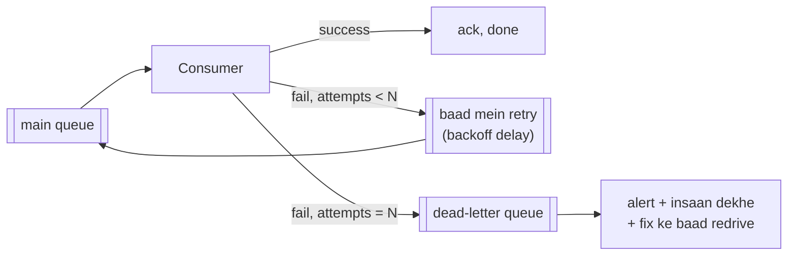

Retries ke beech hum **exponential backoff and jitter** ke saath wait karte hain: 1 s, 2 s, 4 s, 8 s... ko ek random factor se multiply karke, taaki hazaar fail hue messages ek hi pal mein retry karke database ko phir se na gira dein (ise "thundering herd" kehte hain). [Chapter 09](09-microservices-reliability.md) backoff mein gehraai se jaata hai; yahan dekho ye consumer mein kaise fit hota hai:

```python
import random

rng = random.Random(42)              # seed diya hai taaki output har baar same aaye
MAX_ATTEMPTS = 4
calls = {}

def handler(msg):
    calls[msg] = calls.get(msg, 0) + 1
    if msg == "bad-json":
        raise ValueError("cannot parse")                 # permanent failure
    if msg == "flaky" and calls[msg] < 3:
        raise TimeoutError("db busy")                    # transient: teesri try pe chal jaata hai
    return "ok"

def backoff(attempt, base=1.0, cap=30.0):
    """Full jitter: random delay between 0 and min(cap, base * 2^attempt)."""
    return rng.uniform(0, min(cap, base * 2 ** attempt))

dead_letters = []
for msg in ["good", "flaky", "bad-json"]:
    for attempt in range(1, MAX_ATTEMPTS + 1):
        try:
            handler(msg)
            print(f"{msg}: success on attempt {attempt}")
            break
        except (ValueError, TimeoutError) as err:
            if attempt == MAX_ATTEMPTS:
                dead_letters.append((msg, repr(err)))
                print(f"{msg}: attempt {attempt} failed -> sent to DLQ")
            else:
                print(f"{msg}: attempt {attempt} failed ({err}), retry in {backoff(attempt):.2f}s")

print("DLQ:", dead_letters)
```

```text
good: success on attempt 1
flaky: attempt 1 failed (db busy), retry in 1.28s
flaky: attempt 2 failed (db busy), retry in 0.10s
flaky: success on attempt 3
bad-json: attempt 1 failed (cannot parse), retry in 0.55s
bad-json: attempt 2 failed (cannot parse), retry in 0.89s
bad-json: attempt 3 failed (cannot parse), retry in 5.89s
bad-json: attempt 4 failed -> sent to DLQ
DLQ: [('bad-json', "ValueError('cannot parse')")]
```

Abhi kya hua? Flaky message apne aap theek ho gaya (teesri koshish mein). Poison message ko ek limited number of times retry kiya, phir DLQ mein park kar diya, aur consumer aage badh gaya. Dhyaan do, delays random hain lekin har attempt ke saath unki *upper limit* double hoti hai: attempt 1 pe 0 se 2 s, attempt 2 pe 0 se 4 s, attempt 3 pe 0 se 8 s. Isliye 0.10s bhi aa sakta hai aur 5.89s bhi. Ek smarter version `ValueError` (jo saaf-saaf permanent hai) ko bina retry kiye seedha DLQ bhej deta.

**Production ke liye DLQ checklist:**
- DLQ khaali na ho toh alert karo. Jis DLQ ko koi nahi dekhta, woh black hole hai.
- Message ke saath error aur attempt count bhi store karo.
- Ek **redrive** tool do: bug fix karne ke baad DLQ ke messages wapas main queue mein dhakelne ke liye.
- Kafka ke saath (jismein built-in DLQ nahi hai) **retry topics** (`orders.retry.1m`, `orders.retry.10m`) aur ek `orders.dlq` topic use karo, taaki wait karte waqt main partition block na ho.

### 14. Backpressure: when producers are faster than consumers

Agar producers 5,000 messages per second bhej rahe hain aur consumers 3,000 handle karte hain, toh backlog har second 2,000 se badhta hai, hamesha ke liye. **Backpressure** koi bhi aisa mechanism hai jo "dheere karo" ka signal source ki taraf wapas bhejta hai.

```python
def simulate(ticks, produce_rate, consume_rate, capacity=None):
    backlog, rejected = 0, 0
    for _ in range(ticks):
        incoming = produce_rate
        if capacity is not None:
            space = capacity - backlog
            accepted = min(incoming, space)
            rejected += incoming - accepted      # jaise client ko HTTP 429 "dheere karo"
            incoming = accepted
        backlog += incoming
        backlog -= min(backlog, consume_rate)
    return backlog, rejected

print("unbounded       (backlog, rejected):", simulate(10, 5, 3))
print("bounded cap=8   (backlog, rejected):", simulate(10, 5, 3, capacity=8))
print("scaled consumers(backlog, rejected):", simulate(10, 5, 6))
```

```text
unbounded       (backlog, rejected): (20, 0)
bounded cap=8   (backlog, rejected): (5, 15)
scaled consumers(backlog, rejected): (0, 0)
```

Abhi kya hua? Unbounded mein backlog har tick 2 se badhta hai (5 aaye, 3 gaye), 10 ticks mein 20. Real life mein iska matlab hai memory ya disk aakhir bhar jaayegi, ya messages padhne se pehle hi expire ho jaayenge. Bounded (cap 8) mein queue chhoti rehti hai, lekin extra wale *reject* ho jaate hain (pehle do ticks mein jagah thi, uske baad har tick 2 reject: 1 + 2 × 7 = 15) aur producer ko unse deal karna padta hai. Consumers badhaane (rate 6) se root cause hi theek ho gaya.

> 🇮🇳 **Desi Analogy:** IRCTC Tatkal ka 10 baje wala rush. Laakhon log ek saath aate hain. Agar sabko andar aane do, server gir jaata hai (unbounded). Isliye "Please wait, you are in queue" ya "Service unavailable, try again" aata hai (bounded queue + reject = 429). Aur festival season mein railways extra servers aur extra trains lagata hai (scale consumers). Lekin dhyaan do: agar har din 10 baje hi rush hai aur capacity kabhi nahi badhai, toh waiting room kuch nahi bacha payega. Queue **burst** ko jhelti hai, **sustained** overload ko nahi.

Tumhara backpressure toolbox:

| Technique | Kahan | Example |
|---|---|---|
| **Scale consumers** | Consumer side | Queue depth ya consumer lag pe workers autoscale karo (kaafi partitions chahiye!) |
| **Bounded queue + reject** | Broker / API | 429 Too Many Requests return karo; RabbitMQ max-length policy |
| **Block the producer** | Producer side | Buffer bhar jaaye toh Kafka producer block hota hai; Python `queue.Queue(maxsize=...)` |
| **Prefetch / pull-based consumption** | Consumer side | RabbitMQ prefetch; Kafka consumers apni speed se *pull* karte hain |
| **Shed load / sample** | Kahin bhi | Stress mein low-priority analytics events drop kar do |
| **Batching** | Consumer side | Har DB write mein 1 ki jagah 500 messages process karo |

> 💡 Queue **bursts** jhelti hai. **Sustained** rate mismatch woh theek nahi kar sakti. Agar average input rate average processing rate se upar hai, toh sirf do ilaaj hain: faster/zyada consumers, ya kam input.

### 15. The dual-write problem and the outbox pattern

Ye ek bug hai jo lagbhag har pehle event-driven design mein chhupa hota hai. Order service ye karti hai:

```py
db.save(order)                                  # step 1
broker.publish("OrderPlaced", order)            # step 2
```

Agar process step 1 aur step 2 ke beech crash ho jaaye toh? Order exist karta hai, lekin koi event nahi gaya: na email, na inventory reservation, hamesha ke liye. Steps ulat do toh aur bura: ek aise order ka event chala gaya jo kabhi save hi nahi hua. Tum ek database aur ek broker ko ek transaction mein nahi lapet sakte (dono ke across distributed two-phase commit slow hai aur aksar supported hi nahi). Ise **dual-write problem** kehte hain.

**Transactional outbox** pattern ise theek karta hai:
1. Business change wale **same database transaction** mein event ko ek `outbox` table mein insert karo.
2. Ek alag **relay** process `outbox` se unsent rows padhta hai, unhe publish karta hai, aur sent mark karta hai.

> 🇮🇳 **Desi Analogy:** Bank mein cashier ne tumhara cash deposit liya. Woh tumhe turant SMS khud type karke nahi bhejta. Woh deposit entry aur "SMS bhejna hai" wali entry, dono ek hi ledger page pe ek saath likhta hai (ek transaction). Peeche ek alag clerk (relay) har kuch minute mein ledger dekhta hai, "SMS pending" wali entries uthata hai, SMS bhejta hai, aur tick laga deta hai. Cashier ka computer beech mein band ho gaya? Koi baat nahi: ya toh dono entries hain ya koi nahi. Clerk tick lagane se pehle chai pe chala gaya? Wapas aake SMS dobara bhej dega (duplicate possible), lekin SMS kabhi chhootega nahi.

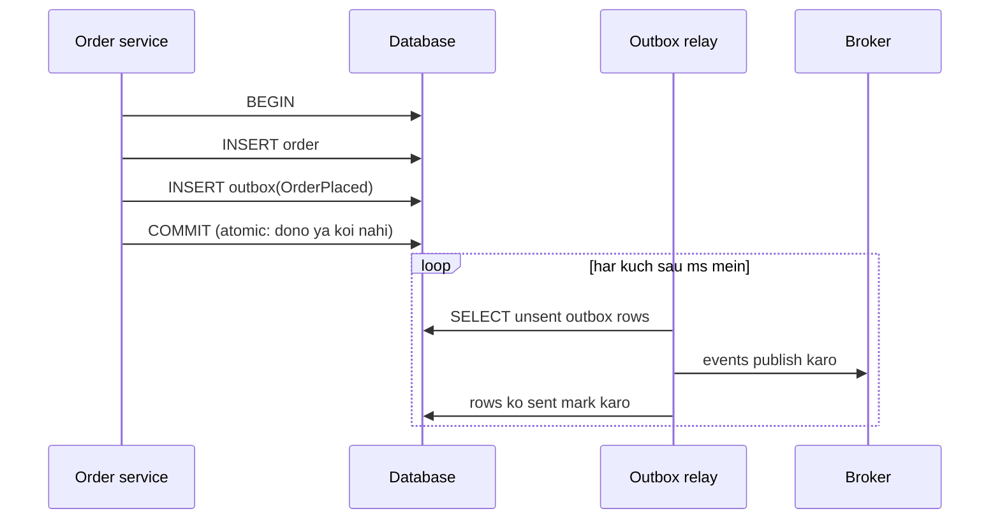

```python
import sqlite3, json

db = sqlite3.connect(":memory:")
db.execute("CREATE TABLE orders (id TEXT PRIMARY KEY, total INTEGER)")
db.execute("CREATE TABLE outbox (seq INTEGER PRIMARY KEY AUTOINCREMENT,"
           " event_id TEXT, payload TEXT, sent INTEGER DEFAULT 0)")
broker = []                                   # Kafka/RabbitMQ ki jagah khada hai

def place_order(order_id, total):
    with db:                                  # EK local transaction
        db.execute("INSERT INTO orders VALUES (?, ?)", (order_id, total))
        event = {"type": "OrderPlaced", "order": order_id, "total": total}
        db.execute("INSERT INTO outbox (event_id, payload) VALUES (?, ?)",
                   (f"evt-{order_id}", json.dumps(event)))

def relay_once(crash_before_marking=False):
    rows = db.execute("SELECT seq, event_id, payload FROM outbox WHERE sent = 0 ORDER BY seq").fetchall()
    for seq, event_id, payload in rows:
        broker.append((event_id, json.loads(payload)["order"]))
        if crash_before_marking:
            return "relay crashed after publishing!"
        with db:
            db.execute("UPDATE outbox SET sent = 1 WHERE seq = ?", (seq,))
    return f"published {len(rows)}"

place_order("o1", 300)
place_order("o2", 150)
print(relay_once(crash_before_marking=True))
print(relay_once())                           # relay restart hota hai aur catch up karta hai
print("broker received:", broker)
```

```text
relay crashed after publishing!
published 2
broker received: [('evt-o1', 'o1'), ('evt-o1', 'o1'), ('evt-o2', 'o2')]
```

Abhi kya hua? Orders aur unke events atomically save hue, toh kuch bhi kho nahi sakta. Relay `o1` publish karne ke baad, lekin use sent mark karne se pehle crash hua, isliye restart ke baad usne `o1` **dobara** publish kiya. Outbox tumhe **at-least-once** publishing deta hai. Bilkul isi wajah se consumers ka idempotent hona zaroori hai, aur isi wajah se har event ek stable `event_id` (dono baar `evt-o1`) ke saath aata hai jis pe woh dedupe kar sakein.

Polling relay ki jagah kai teams **Change Data Capture (CDC)** use karti hain: Debezium jaisa tool database ka apna replication log (MySQL binlog, PostgreSQL WAL) padhta hai aur outbox inserts ko Kafka mein stream kar deta hai. Latency kam, aur database pe polling ka load nahi.

> 💡 Consumer side pe iska mirror image hai **inbox pattern**: aane wale `event_id` ko ek `inbox`/`processed_events` table mein side effect wale same transaction mein record karo. Section 11 ke code ne exactly yahi kiya tha.

### 16. Event-driven architecture (EDA)

**Event-driven architecture** mein services ek doosre ko seedha call karne ki jagah mainly events publish karke aur unpe react karke baat karti hain.

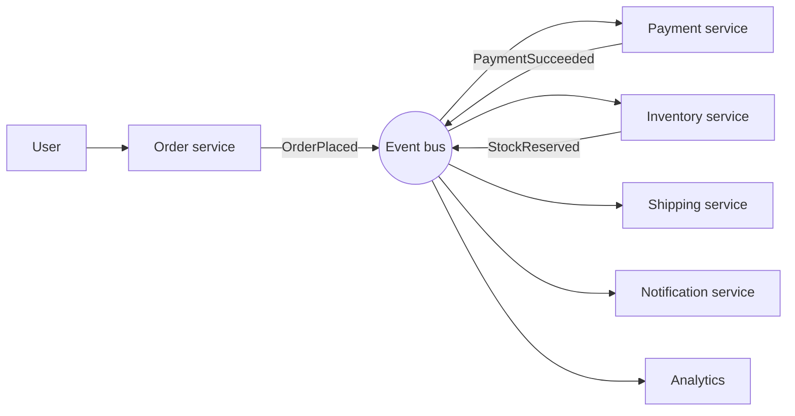

**Events ke teen flavour**, patle se mote tak:

| Style | Event mein kya hota hai | Pro | Con |
|---|---|---|---|
| **Event notification** | Sirf ID: `{"type": "OrderPlaced", "order_id": 42}` | Chhota, stale data ka sawaal nahi | Consumers ko details ke liye order service ko wapas call karna padta hai (coupling, load) |
| **Event-carried state transfer** | Saara zaroori data: items, address, totals | Consumers khud-mukhtaar hain, producer down ho tab bhi | Bade messages, schema dhyaan se manage karna padta hai |
| **Event sourcing** | Events *hi* source of truth hain (section 17) | Poori history, replay | Sabse bada mindset change |

> 🇮🇳 **Desi Analogy:** Swiggy notification socho. "Tumhara order #42 update hua" (sirf ID, details ke liye app kholo) = **event notification**. "Tumhara order #42: 2 masala dosa, ₹340, Ravi deliver kar raha hai, 12 min mein pahunchega" (sab kuch message mein hi) = **event-carried state transfer**. Pehle wale mein har baar app (producer) ko call karna padta hai; doosre mein app down ho tab bhi tumhe sab pata hai, bas message bhaari hai.

**Sagas: transactions across services.** Ek database mein tum "card charge + stock reserve + shipment create" ko ek transaction mein lapet dete. Services ke across ye nahi kar sakte. **Saga** local transactions ka ek sequence hai, jahan har step ek event publish karta hai jo agla step trigger karta hai, aur har step ka ek **compensating action** hota hai jo use undo karta hai agar baad wala koi step fail ho jaaye.

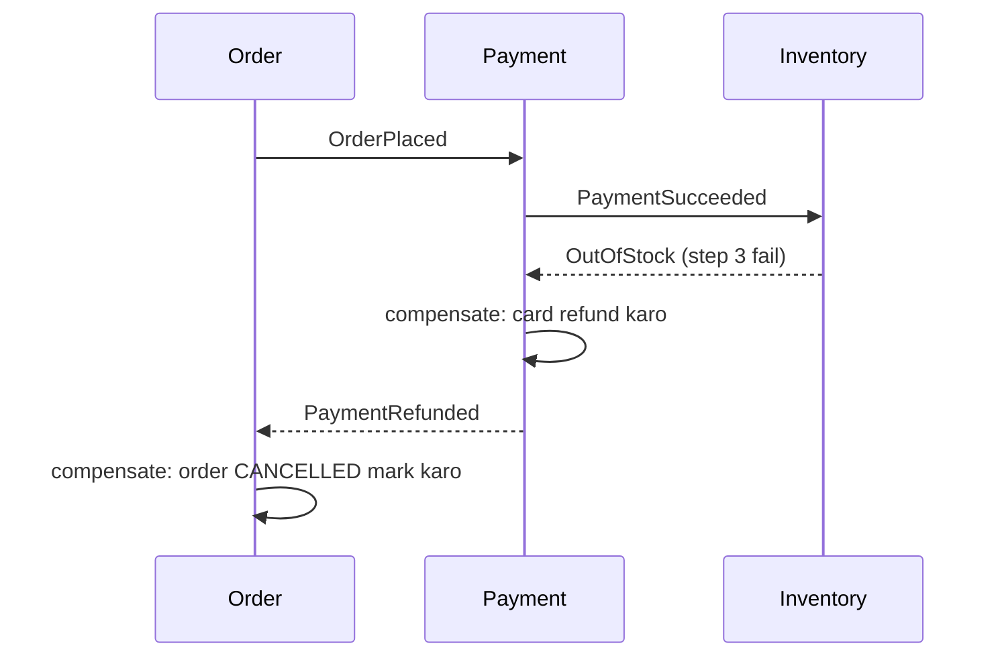

> 🇮🇳 **Desi Analogy:** Goa trip plan karna = saga. Step 1: train ticket book (IRCTC). Step 2: hotel book (OYO). Step 3: scooty rent. Teeno alag companies hain, koi ek "transaction" teeno ko ek saath lock nahi kar sakta. Agar step 3 fail hua (koi scooty nahi), aur tumne trip cancel ki, toh tum *ulte order* mein undo karte ho: hotel cancel karo (refund), train ticket cancel karo (refund, thoda cancellation charge kat ke). Ye undo karne wale kaam hi **compensating actions** hain. Dhyaan do: undo "jaise kuch hua hi nahi" nahi hota (cancellation charge kat gaya), isiliye compensations ko business logic ki tarah design karna padta hai.

- **Choreography:** koi central dimaag nahi; har service sunti hai aur react karti hai (upar jaisa). 2–4 steps ke liye simple, usse aage samajhna mushkil.
- **Orchestration:** ek **orchestrator** service har participant ko batati hai kya karna hai aur saga ki state track karti hai. Lambe flows ke liye samajhna aur monitor karna aasaan (tools: Temporal, AWS Step Functions, Camunda).

| | Choreography | Orchestration |
|---|---|---|
| Control | Distributed | Central orchestrator |
| Coupling | Kam, lekin flow implicit (kahin likha nahi) hai | Orchestrator ko har step pata hai |
| Visibility / debugging | Mushkil ("order 42 kahan atka hai?") | Aasaan: state ek jagah hai |
| Best for | Chhote, simple flows | Lambe, business-critical flows |

> 🇮🇳 **Desi Analogy:** **Choreography** = shaadi jahan koi wedding planner nahi. Mehendi wali ko pata hai "haldi khatam hote hi main aaungi", DJ ko pata hai "baraat aate hi bajaana hai". Chhoti shaadi mein chal jaata hai, badi mein "DJ kahan hai?" ka pata hi nahi chalta. **Orchestration** = wedding planner ke paas clipboard hai, har vendor ko woh call karke bolti hai "ab tum", aur kisi ne bhi poocha "kya chal raha hai?" toh ek hi jagah jawab milta hai.

**EDA ki imaandaar kamiyan:**
- Debug karna mushkil: ek request paanch services ke across events ki chain ban jaati hai. Tumhe **correlation IDs** aur distributed tracing chahiye ([Chapter 09](09-microservices-reliability.md)).
- Har jagah eventual consistency: UI ko "processing..." states handle karni padti hain.
- Schema evolution: ek baar 12 consumers `OrderPlaced` padhne lage, toh ise laaparwahi se badalna unhe tod deta hai. Compatibility rules ke saath ek **schema registry** use karo (optional fields add karo; bina migration ke fields kabhi rename ya remove mat karo).

### 17. Event sourcing

Normal databases **current state** store karte hain: `balance = 150`. **Event sourcing** woh **events ka sequence** store karta hai jisse state bani, aur state unhe replay karke compute karta hai. Tumhara bank statement event sourcing hai: transactions ki list hi sach hai; balance usse nikala jaata hai.

> 🇮🇳 **Desi Analogy:** Kirana store ka **khata** pure event sourcing hai. Dukandaar "Sharma ji: ₹450 baaki" ek slate pe likh ke mita-mita ke update nahi karta. Woh har entry likhta hai: "3 tareekh: aata ₹200", "5 tareekh: ₹100 diye", "7 tareekh: tel ₹350". Baaki raqam kabhi bhi jod ke nikal sakte ho. Aur jab Sharma ji jhagda karein "itna kaise?", toh poori history saamne hai (audit log). Galat entry ho gayi? Usse kaat'te nahi, ek nayi "correction" entry likhte hain (events immutable hain).

```python
from functools import reduce

events = [
    ("AccountOpened",  {"owner": "Asha"}),
    ("MoneyDeposited", {"amount": 500}),
    ("MoneyWithdrawn", {"amount": 120}),
    ("MoneyDeposited", {"amount": 75}),
    ("MoneyWithdrawn", {"amount": 200}),
]

def apply(state, event):
    """Pure function: (old state, event) -> new state. Never mutate history."""
    kind, data = event
    if kind == "AccountOpened":
        return {"owner": data["owner"], "balance": 0, "txns": 0}
    if kind == "MoneyDeposited":
        return {**state, "balance": state["balance"] + data["amount"], "txns": state["txns"] + 1}
    if kind == "MoneyWithdrawn":
        return {**state, "balance": state["balance"] - data["amount"], "txns": state["txns"] + 1}
    return state

current = reduce(apply, events, None)
print("current state:", current)

as_of_event_3 = reduce(apply, events[:3], None)          # time travel
print("state after 3 events:", as_of_event_3)

snapshot = reduce(apply, events[:4], None)               # beech-beech mein save kiya jaata hai
rebuilt = reduce(apply, events[4:], snapshot)            # sirf baad wale events replay karo
print("from snapshot:", rebuilt, rebuilt == current)
```

```text
current state: {'owner': 'Asha', 'balance': 255, 'txns': 4}
state after 3 events: {'owner': 'Asha', 'balance': 380, 'txns': 2}
from snapshot: {'owner': 'Asha', 'balance': 255, 'txns': 4} True
```

Abhi kya hua? State events ke upar ek **fold** hai (`reduce`, [Part 1 ke Chapter 11](../part-1-python/11-comprehensions-functional.md) se). Hisaab lagao: 0 + 500 − 120 + 75 − 200 = 255. Humein **time travel** free mein mila ("event 3 ke baad balance kya tha?" → 500 − 120 = 380). Aur **snapshots** replay ko fast rakhte hain: 1 crore events replay karne ki jagah, latest snapshot load karo aur sirf uske baad wale replay karo.

| Event sourcing tumhe deta hai | Iski keemat |
|---|---|
| Ek perfect audit log (finance, healthcare, legal ise pasand karte hain) | "Balance > 1000 wale saare accounts" jaise queries raw events pe mushkil hain (projections chahiye, yaani CQRS) |
| Time travel aur debugging ("production ko bug tak replay karo") | Events hamesha ke liye hain: schema changes ke liye purane events ko **upcast** karna padta hai |
| Naye read models kabhi bhi history se ban sakte hain | Zyada complexity aur storage; team ke liye seekhna mushkil |
| Event streaming ke saath natural fit | Personal data delete karna (jaise GDPR) dhyaan maangta hai: tombstones ya crypto-shredding |

> ⚠️ Event sourcing ek power tool hai, default nahi. Ise un domains mein use karo jahan history *hi* product hai (ledgers, orders, inventory movements, collaborative editing). User-profile CRUD service ke liye mat use karo.

### 18. CQRS: separate the writes from the reads

**CQRS** (Command Query Responsibility Segregation) ka matlab hai **likhne aur padhne ke liye alag models** use karna. Write side commands validate karti hai aur changes record karti hai. Read side ek ya zyada **projections** (read models) rakhti hai, jo exactly un screens ke shape mein hote hain jo unhe query karti hain, aur events consume karke update hote rehte hain.

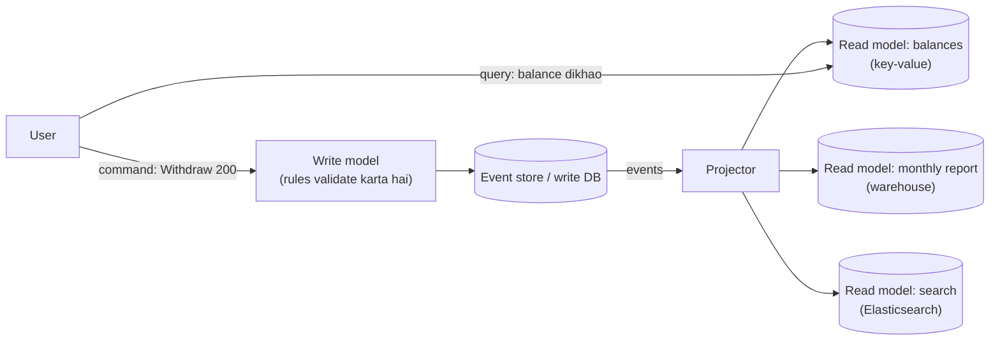

> 🇮🇳 **Desi Analogy:** School ka exam system. Answer sheets (write model) ek strict jagah jaati hain jahan rules check hote hain aur marks record hote hain. Lekin marks ko "padhne" ke liye alag-alag cheezein banti hain: report card (har student ke liye), merit list (topper dhoondhne ke liye), subject-wise analysis (teachers ke liye). Teeno same marks se bane hain, lekin har ek ek alag sawaal ke liye shape kiya gaya hai. Report card banana answer sheets ko chhoota nahi. Yahi CQRS hai: likhne ka raasta ek, padhne ke raaste kai.

```python
events = [
    {"account": "A", "type": "deposit", "amount": 500, "month": "2026-01"},
    {"account": "B", "type": "deposit", "amount": 900, "month": "2026-01"},
    {"account": "A", "type": "withdraw", "amount": 120, "month": "2026-02"},
    {"account": "B", "type": "withdraw", "amount": 50, "month": "2026-02"},
    {"account": "A", "type": "deposit", "amount": 75, "month": "2026-02"},
]

balances = {}                 # read model 1: "mera balance kya hai?" O(1) mein
monthly_outflow = {}          # read model 2: "har mahine bank se kitna paisa nikla?"

def project(event):
    sign = 1 if event["type"] == "deposit" else -1
    balances[event["account"]] = balances.get(event["account"], 0) + sign * event["amount"]
    if event["type"] == "withdraw":
        m = event["month"]
        monthly_outflow[m] = monthly_outflow.get(m, 0) + event["amount"]

for e in events:
    project(e)
print("balances:", balances)
print("monthly outflow:", monthly_outflow)
```

```text
balances: {'A': 455, 'B': 850}
monthly outflow: {'2026-02': 170}
```

Abhi kya hua? Same event stream ne do bilkul alag read models ko feed kiya, har ek ek sawaal ke liye optimise kiya hua. A: 500 − 120 + 75 = 455. B: 900 − 50 = 850. Feb ka outflow: 120 + 50 = 170 (Jan mein koi withdrawal nahi tha, isliye woh key hi nahi bani). Agle quarter teesra view chahiye? Ek naya projector likho aur events shuru se replay kar do.

CQRS ko event sourcing ki **zaroorat nahi** hai (tum normal DB se CDC ke through bhi project kar sakte ho), lekin event sourcing lagbhag hamesha CQRS ke saath aata hai. Iski keemat hai **read-your-writes lag**: withdrawal ke turant baad, balance read model kuch sau milliseconds peeche ho sakta hai. Common fixes: command ke response mein hi nayi state return karo, ya UI tab tak wait kare jab tak projection ne us event ka version process na kar liya ho.

> 🤔 **Mann mein sawaal:** Ek hi database se read aur write dono kyun nahi? Ye alag-alag models ka jhanjhat kyun?
>
> **Jawab:** Chhote apps mein bilkul ek hi DB rakho, CQRS overkill hai. Problem tab aati hai jab reads aur writes ki zaroorat bahut alag ho: writes ko strict rules aur normalized tables chahiye, reads ko 10 alag shapes chahiye (search, reports, dashboards) aur writes se 100× zyada traffic. Ek hi table sabko khush nahi kar sakti. CQRS kehta hai: har sawaal ko uski apni table do, aur events se sab sync rakho. Faayda: har side alag scale aur optimise hoti hai. Keemat: read side thoda late (eventually consistent) hoti hai.

### 19. Stream processing basics

**Batch processing** data ke ek fixed dher pe chalti hai ("raat 2 baje kal ka revenue nikaalo"). **Stream processing** kabhi na khatam hone wale events pe lagaataar compute karti hai ("pichhle ek minute ka revenue, har kuch second mein update"). Engines: **Apache Flink**, **Kafka Streams**, **Spark Structured Streaming**.

Central idea hai **window**, kyunki ek infinite stream pe "clicks gino" ka koi answer nahi hai, lekin "har minute ke clicks gino" ka hai:

| Window | Shape | Example |
|---|---|---|
| **Tumbling** | Fixed size, koi overlap nahi: [0–60), [60–120) | Har minute ke clicks |
| **Hopping / sliding** | Fixed size, overlapping: har 1 minute pe 5-minute window | "Pichhle 5 minute", har minute refresh |
| **Session** | Inactivity ke ek gap ke baad khatam | Ek user ka browsing session (30 idle minutes ke baad khatam) |

> 🇮🇳 **Desi Analogy:** Cricket se teeno windows. **Tumbling** = "har over mein kitne runs" (over 1, over 2, koi overlap nahi). **Hopping** = TV pe "last 5 overs: 48 runs" wala graphic, jo har over ke baad update hota hai (windows overlap karti hain). **Session** = ek batsman ki innings: jab tak out nahi hota (gap nahi aata), session chalta hai; out hua toh session khatam.

```python
from collections import Counter, defaultdict

clicks = [  # (event_time_seconds, page)
    (3, "home"), (15, "cart"), (42, "home"), (59, "home"),
    (61, "cart"), (75, "home"), (118, "cart"), (121, "home"),
]

def tumbling_counts(events, size):
    windows = defaultdict(Counter)
    for t, page in events:
        start = (t // size) * size              # ye event kis window mein aata hai
        windows[start][page] += 1
    return {f"[{s},{s + size})": dict(c) for s, c in sorted(windows.items())}

for window, counts in tumbling_counts(clicks, 60).items():
    print(window, counts)
```

```text
[0,60) {'home': 3, 'cart': 1}
[60,120) {'cart': 2, 'home': 1}
[120,180) {'home': 1}
```

Abhi kya hua? Har event ko us bucket mein daal diya gaya jismein uska timestamp aata hai. Jaise t=75: 75 // 60 = 1, 1 × 60 = 60, toh window [60,120). Stream processor bilkul yahi lagaataar karta hai, har window ka counter **state** ki tarah rakh ke.

Teen ideas jinke naam tumhe pata hone chahiye:
- **Event time vs processing time:** event time woh hai jab phone pe click hua; processing time woh jab server ne use dekha. Tunnel mein ghusa phone 10 minute purana click bhej sakta hai. Sahi analytics **event time** use karti hai.
- **Watermarks:** stream processor ka andaaza ki "time T tak ke saare events shayad aa chuke hain", taaki woh T ki window band karke result emit kar sake. Uske baad aane wale events **late events** hain: unhe drop karo, ya ek grace period do aur result update karo.
- **Stateful processing and checkpoints:** counts, joins aur aggregates state hain. Flink jaise engines state ko input offsets ke saath periodically **checkpoint** karte hain, taaki crash ke baad consistently resume kar sakein. Isi tarah woh exactly-once results dete hain.

> 🤔 **Mann mein sawaal:** Watermark ka matlab "T tak ke saare events aa gaye" hai, toh agar koi late event aa gaya toh kya galti watermark ki hai?
>
> **Jawab:** Watermark ek **andaaza** hai, guarantee nahi. Ye ek trade-off hai: watermark jaldi aage badhao toh results jaldi milte hain lekin zyada events late ho jaate hain; der se badhao toh results zyada sahi lekin late. Isliye engines "allowed lateness" (grace period) dete hain: window band hone ke baad bhi kuch der tak late events aane pe result update ho jaata hai. Board exam jaisa hai: result ek date pe aata hai (watermark), lekin revaluation ke baad marks update ho sakte hain (late event).

### 20. Real use cases

| System | Queues/events kaise use hote hain |
|---|---|
| **E-commerce order flow** | `OrderPlaced` payment, inventory, email, analytics tak fan out hota hai; failures ke liye compensation wala saga |
| **Image/video upload** | Upload service queue mein job daalti hai; transcoding workers queue depth ke saath scale hote hain ([Chapter 13](13-case-studies-2.md)) |
| **Notifications** | Notification service events consume karti hai aur email/SMS/push queues mein daalti hai, har channel ke apne workers aur retries ke saath ([Chapter 12](12-case-studies-1.md)) |
| **Social feed fan-out** | Naye post ka event fan-out workers trigger karta hai jo followers ke feed caches mein likhte hain |
| **Ride-hailing** | Driver location pings Kafka se matching aur ETA services tak stream hote hain (pings ke liye at-most-once chalega: agla ping is wale ko replace kar deta hai) |
| **Activity tracking & analytics** | Clicks aur page views Kafka mein stream hote hain, phir data warehouse aur real-time dashboards tak |
| **Search indexing** | Main DB se CDC Kafka mein, jise ek indexer consume karke Elasticsearch update karta hai ([Chapter 10](10-storage-search-ids.md)) |
| **Log and metrics pipelines** | Hazaaron servers logs Kafka ko bhejte hain; consumers storage aur alerting systems mein likhte hain |
| **Fraud detection** | Stream processor payments ko ek time window ke andar user ke recent behaviour se join karta hai aur seconds mein anomalies flag karta hai |
| **Database migration / cache invalidation** | CDC har row change stream karta hai taaki caches aur naye databases sync mein rahein |

---

## 🔬 Under the Hood · Andar Ki Kahani

### Why Kafka is so fast

Kafka ordinary hardware pe roz millions messages per second handle karta hai. Paanch design choices isko explain karti hain:

1. **Append-only sequential writes.** Disks (SSDs bhi) random writes se kahin zyada fast sequential writes karti hain. Partition bas ek file hai jo sirf end pe badhti hai, toh Kafka ko disk pe idhar-udhar seek nahi karna padta.
2. **The OS page cache.** Kafka apna koi bada in-memory cache nahi rakhta. Woh files mein likhta hai aur operating system ko recently likhe pages RAM mein cache karne deta hai. Jo consumers up to date hain, woh seedha memory se padhte hain.
3. **Zero-copy transfer.** Consumer ko log data bhejne ke liye Kafka OS se (`sendfile`) kehta hai ki bytes seedhe page cache se network socket tak copy kar do, application ki memory se ghoomkar aane ka chakkar skip karke.
4. **Batching and compression.** Producers kai messages ko ek batch mein jodte hain (`linger.ms`, `batch.size`) aur poore batch ko compress karte hain (lz4, zstd, snappy). Ek network request aur ek disk write sau messages le jaate hain.
5. **Dumb broker, smart consumer.** Broker track nahi karta ki har consumer ne kaunsa message ack kiya. Woh har group, har partition ka sirf ek offset store karta hai. Har message ki state machine ki jagah bas kuch bytes ka hisaab.

> 🇮🇳 **Desi Analogy:** Kafka ek **register mein bas neeche-neeche likhne** wala munshi hai. Woh kabhi peeche ke pages palat ke kuch nahi badalta (sequential, append-only), isliye bahut tez likhta hai. Har aadmi ka alag hisaab nahi rakhta ki "isne kaunsi line padhi", bas har team ka ek bookmark number (dumb broker). Aur ek-ek line bolke likhne ki jagah ek baar mein poora paragraph likhta hai (batching). RabbitMQ waala munshi har chitthi ka status alag yaad rakhta hai, jo flexible hai lekin bade dher pe thakta hai.

Offset X se padhne wala consumer bhi sasta hai: har segment file ka ek sparse **offset index** hota hai jo offsets ko byte positions se map karta hai, toh Kafka index pe binary search ([Part 2, Chapter 08](../part-2-dsa/08-binary-search.md)) karta hai aur streaming shuru kar deta hai.

### What "committed" means for a Kafka write

`acks=all` ke saath, ek message tab **committed** hai jab ISR ke har replica ke paas woh ho. Leader **high watermark** track karta hai: sabse bada offset jo saare in-sync replicas tak copy ho chuka hai. Consumers sirf high watermark tak padh sakte hain. Isse ek gandi situation bachti hai: consumer leader se offset 100 padh leta hai, leader use replicate karne se pehle mar jaata hai, aur naye leader ke paas offset 100 kabhi tha hi nahi. Sirf replicated data dikha ke Kafka pakka karta hai ki consumers kabhi aisa message na dekhein jo baad mein "un-happen" ho jaaye (jaise hua hi na ho).

### How a RabbitMQ classic queue differs internally

RabbitMQ queue **har message ki state** track karti hai (ready, delivered-unacked, acked). Acked messages hata diye jaate hain, aur queue chhoti aur zyaadatar memory mein rehne ki koshish karti hai. Isliye RabbitMQ per-message features (priorities, TTLs, per-message routing) ke saath low-latency job distribution mein zabardast hai, lekin jab queues dasiyon millions messages tak badh jaati hain toh struggle karta hai: use aisi queues ke liye design kiya gaya tha jo usually lagbhag khaali rehti hain. Kafka ulta hai: use aise logs ke liye design kiya gaya hai jo hamesha bahut bade hote hain.

### Why exactly-once delivery is impossible but exactly-once processing isn't

Message bhejne wala kabhi farak nahi kar sakta ki "message kho gaya" ya "message pahunch gaya lekin acknowledgement kho gaya". Dono silence jaise dikhte hain. Toh use ya toh dobara bhejna padega (duplicate ka risk) ya nahi bhejna (loss ka risk). Koi protocol isse bach nahi sakta, isliye industry at-least-once delivery pe settle karti hai. Lekin agar receiver duplicate pehchaan sake (ek unique ID jo woh pehle record kar chuka hai, effect wale same atomic transaction ke andar), toh *effect* exactly ek baar hota hai. Kafka ke transactions andar hi andar yahi karte hain, "outputs likhna + input offsets commit karna" ko Kafka ke andar ek atomic unit bana ke.

> 🇮🇳 **Desi Analogy:** Tumne dost ko UPI se ₹500 bheje aur network atak gaya. Screen pe "pending" aa raha hai. Paise gaye ya nahi? Tumhe pata nahi: ya toh request bank tak pahunchi hi nahi, ya pahunch gayi aur "success" wala reply raste mein kho gaya. Dobara bhejoge toh shayad ₹1000 chale jaayein; nahi bhejoge toh shayad dost ko kuch na mile. UPI isko kaise solve karta hai? Har transaction ka ek **unique reference ID** hota hai, aur bank same ID wali request dobara aaye toh paisa dobara nahi kaat'ta. Delivery do baar hui, effect ek baar: exactly-once processing.

### Consumer lag: the number that tells you everything

```text
partition:            P0      P1      P2
log end offset:      9,812   9,790   9,905
committed offset:    9,800   6,100   9,900
lag:                    12   3,690       5
```

P0 aur P2 pe total lag chhota hai, lekin P1 bahut peeche hai. Ye pattern (ek partition lag kar raha hai) usually ek **hot key** ya P1 pe atke hue consumer ki taraf ishaara karta hai, capacity problem ki taraf nahi. *Saare* partitions pe lag badh raha hai toh tumhe zyada consumers (ya faster processing) chahiye. Lag ko time mein badlo: agar lag 3,690 hai aur consumer 100 messages/s process karta hai, toh P1 ka data lagbhag 37 seconds purana hai (3,690 ÷ 100 ≈ 37).

---

## 🧩 Pattern Decoder · Pattern Pakdo

### Signals: when an interviewer wants you to add a queue

| Tum sunte ho... | Socho |
|---|---|
| "X ke baad email / SMS / push bhejo" | Async job queue + workers + retries + DLQ |
| "uploads process karo, video transcode karo, thumbnails/PDFs banao" | Job queue; queue depth pe workers autoscale |
| "traffic spikes", "flash sale", "bursts handle karo" | API aur slow hisse ke beech buffer ki tarah queue |
| "kai services ko same cheez pe react karna hai" | Pub/sub topic (Kafka topic ya SNS→SQS fan-out) |
| "replay", "audit", "rebuild", "history" | Retention wala event log (Kafka) ya event sourcing |
| "real-time analytics / counts / trending / last N minutes" | Event stream + windows wala stream processor |
| "search index / cache / warehouse ko DB ke saath sync rakho" | CDC → Kafka → consumers |
| "services ke across transaction", "flight + hotel book karo" | Compensations ke saath saga (lambe flows ke liye orchestrated) |
| "double-charge / double-send nahi hona chahiye" | At-least-once + idempotency keys / dedup table |
| "updates per user/order order mein hone chahiye" | Us key se partition (Kafka) / message group ID (SQS FIFO) |

### Decision guide

- **Agar tumhe chahiye** ek background job jise koi bhi ek worker ek baar process kare, **toh chuno** message queue (SQS/RabbitMQ), **kyunki** ye per-message acks, visibility timeouts aur DLQs bina extra code ke deti hai.
- **Agar tumhe chahiye** same events ke kai independent consumers, **toh chuno** pub/sub (Kafka consumer groups ya SNS→SQS), **kyunki** ye producers ko ek anjaan, badhte hue consumers ke set se decouple karta hai.
- **Agar tumhe chahiye** replay, bahut high throughput ya stream processing, **toh chuno** Kafka/Kinesis, **kyunki** retained log plus consumer ke paas rakhe offsets dobara padhna free bana dete hain.
- **Agar tumhe chahiye** ordering, **toh chuno** per-key ordering, **kyunki** global ordering parallelism ko maar deti hai. Poocho: "order *kis cheez* ke hisaab se?"
- **Agar tumhe chahiye** ek reliable "DB mein save karo aur event publish karo", **toh chuno** outbox pattern ya CDC, **kyunki** dual writes crash pe events kho dete hain.
- **Agar tumhe chahiye** exactly-once effects, **toh chuno** at-least-once delivery plus ek idempotent consumer, **kyunki** exactly-once ka sirf yahi roop external systems ke contact mein bachta hai.
- **Agar tumhe chahiye** 3–4 se zyada steps wala cross-service workflow, **toh chuno** orchestrated saga, **kyunki** choreography trace karna impossible ho jaata hai.
- **Agar tumhe chahiye** complete audit history aur time travel, **toh chuno** event sourcing + CQRS, **kyunki** immutable events se nikali state hamesha dobara compute ho sakti hai.
- **Agar** caller ko aage badhne ke liye answer chahiye (login, price check, "kya ye seat free hai?"), **toh queue mat** use karo. Synchronous call use karo ([Chapter 07](07-apis-communication.md)).

### Template: a production-grade consumer loop

```py
def consumer_loop(broker, handler, dedup_store, max_attempts=5):
    while running:
        batch = broker.poll(max_records=100, timeout_s=1)      # pull: natural backpressure
        for msg in batch:
            if dedup_store.seen(msg.event_id):                 # idempotency
                continue
            try:
                with db.transaction():                         # effect + dedup record ek saath atomically
                    handler(msg)
                    dedup_store.record(msg.event_id)
            except PermanentError as err:                      # kharab data, bug: retry mat karo
                broker.send_to_dlq(msg, reason=repr(err))
            except TransientError as err:
                if msg.attempts + 1 >= max_attempts:
                    broker.send_to_dlq(msg, reason=repr(err))
                else:
                    broker.retry_later(msg, delay=backoff_with_jitter(msg.attempts))
        broker.commit(batch)                                   # processing ke BAAD: at-least-once
        metrics.gauge("consumer_lag", broker.lag())            # lagaataar badhe toh alert
```

Is template ki har line is chapter ke ek section se aayi hai: pull = backpressure (section 14), dedup = idempotency (section 11), transaction = inbox pattern (section 15), permanent vs transient + DLQ (section 13), commit after processing = at-least-once (section 10), lag metric (Under the Hood). Interview mein ise likh diya toh samjho poora chapter dikha diya.

### Trade-off table: the whole messaging landscape

| | RabbitMQ | Amazon SQS | Kafka | Redis Streams / Pub/Sub |
|---|---|---|---|---|
| Core model | Smart broker, queues + exchanges | Managed queue | Partitioned, replicated log | In-memory streams; fire-and-forget pub/sub |
| Retention | Ack hone tak | 14 din tak | Configurable: ghante se hamesha tak | Memory-bound (pub/sub: kuch nahi) |
| Replay | Nahi (classic queues) | Nahi | Haan | Streams: haan |
| Ordering | Per queue (single consumer) | FIFO per group ID | Per partition | Per stream |
| Routing | Rich (exchanges) | Kuch nahi (SNS/EventBridge use karo) | Key → partition | Minimal |
| Throughput | High | Very high (standard) | Very high | Very high, memory-limited |
| Ops burden | Khud chalao (ya managed) | Kuch nahi | Kaafi zyada (ya managed: MSK, Confluent) | Kam |
| Sweet spot | Task queues, complex routing, RPC-style kaam | AWS jobs, zero ops | Event backbone, analytics, CDC, replay | Lightweight, low-latency, ephemeral (kshanik) |

### Variation: designing the async part of "upload a photo"

**Problem:** users photos upload karte hain; humein 3 thumbnail sizes banane hain, content moderation chalana hai, aur user ki gallery update karni hai.

**Idea:** upload API original ko object storage mein rakhti hai ([Chapter 10](10-storage-search-ids.md)), `status = PROCESSING` ke saath ek `photos` row aur ek outbox event `PhotoUploaded` likhti hai, aur 202 Accepted return karti hai. Do consumer groups tak fan-out: thumbnailer aur moderator. Dono idempotent hain (thumbnail paths deterministic hain, jaise `photo_id/320.jpg`, toh kaam dobara karne se bas wahi file overwrite hoti hai). Jab dono khatam ho jaate hain, ek chhota orchestrator (ya counter wali ek status table) photo ko `READY` kar deta hai aur user ko notify karta hai.

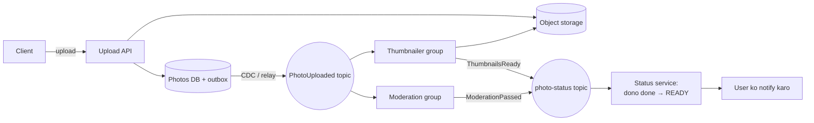

Dekho, is ek design mein chapter ke kitne ideas ek saath aa gaye: outbox (dual write se bachne ke liye), pub/sub fan-out (do groups), idempotent consumers (deterministic paths), claim-check (photo storage mein, message mein sirf ID), aur eventual consistency (`PROCESSING` → `READY`).

### When NOT to use a queue

- **Caller ko aage badhne ke liye result chahiye.** Login check ko queue se bhejna sirf latency aur complexity badhata hai.
- **Chhote systems.** Ek service, ek database, kam traffic: ek background thread ya cron job kaafi ho sakta hai. Broker ek aur cheez hai jise chalana, monitor aur secure karna padta hai.
- **Strong read-after-write consistency hard requirement hai** aur tum UI ko "processing" state ke around design nahi kar sakte.
- **Database ki tarah.** Kafka data hamesha rakh sakta hai, lekin "ID 42 wala order dhoondho" efficiently answer nahi kar sakta. Ise databases ko feed karne ke liye use karo, unhe replace karne ke liye nahi (compacted topics + ek materialised view exception hai, rule nahi).

---

## ⚠️ Traps & Common Mistakes · Yahan Sab Phisalte Hain

1. **Exactly-once delivery maan lena.** Har real broker ek message do baar deliver kar sakta hai. Pehle din se har consumer ko idempotent design karo.
2. **Processing se pehle offsets commit karna** (aksar galti se, timer pe chalne wale auto-commit ke saath). Crash hua toh messages chupchaap kho jaate hain. Kaam hone ke baad commit karo.

```py
# ❌ har 5 s mein auto-commit, processing khatam hui ho ya nahi
consumer = KafkaConsumer("orders", enable_auto_commit=True)

# ✅ batch process hone ke baad explicitly commit karo
consumer = KafkaConsumer("orders", enable_auto_commit=False)
for batch in poll_batches(consumer):
    process(batch)
    consumer.commit()
```

3. **Har retry pe naya message ID banana.** Tab dedup har retry ko bilkul naya message samajhta hai. ID ek baar, source pe banao, aur reuse karo.
4. **Multi-partition topic se global order expect karna.** Order sirf ek partition ke andar hota hai. Partition key soch-samajh ke chuno (woh entity jiske events order mein rehne chahiye).
5. **Partitions se zyada consumers.** Extra consumers khaali baithe rehte hain. Future scale ke liye partition count plan karo.
6. **DLQ nahi, ya aisa DLQ jise koi nahi dekhta.** Poison message ya toh queue ko hamesha block karta hai ya chupchaap gayab ho jaata hai. DLQ depth pe alert lagao.
7. **Tight loop mein turant retry karna.** Ye pehle se pareshaan dependency pe hathoda chalata hai. Exponential backoff with jitter aur max attempt count use karo.
8. **Dual write** (`db.save(); broker.publish()`). Beech mein crash events kho deta hai ya jhoothe events bana deta hai. Outbox pattern ya CDC use karo.
9. **Visibility timeout processing time se chhota.** Pehla worker abhi kaam kar hi raha hai aur message redeliver ho jaata hai: duplicates aur bekaar kaam. Ise apne p99 processing time se upar rakho, ya kaam karte-karte badhate raho (heartbeat).
10. **Bahut bade messages.** Brokers chhote messages ke liye hain. 50 MB ka video object storage mein rakho aur uska URL/key bhejo (**claim-check pattern**).
11. **Event schemas todna.** Ek field rename kiya aur har woh consumer toot gaya jise tum bhool chuke the. Schema registry aur sirf backward-compatible changes use karo.
12. **Hot partitions.** `country` se key kiya aur 70% users ek hi country mein hain, toh ek partition 70% kaam karega. High-cardinality (bahut saari alag values wali) key chuno, ya hot key ke saath suffix jod ke use faila do (us key ka strict order chala jaayega).
13. **Jahan synchronous call chahiye tha wahan queue use karna**, aur phir ek kamzor "reply message ka wait karo" mechanism banana. Abhi answer chahiye toh synchronously call karo.

> 🤔 **Mann mein sawaal:** Trap 2 mein auto-commit itna bura kyun hai? Kafka ne default mein `enable_auto_commit=True` diya hi kyun?
>
> **Jawab:** Auto-commit ek timer pe chalta hai (default har 5 second), tumhare processing ko dekhta nahi. Agar tumne batch poll kiya, timer ne commit kar diya, aur processing poori hone se pehle crash hua, toh woh messages kabhi dobara nahi aayenge = at-most-once, chupchaap data loss. Default isliye hai kyunki simple use cases (logs, metrics) mein thoda loss chalta hai aur code aasaan rehta hai. Business events (orders, payments) ke liye hamesha manual commit, processing ke baad.

---

## 💡 Tips & Tricks · Pro Wale Moves

- Interview mein jaise hi tum "queue" bolo, saath mein teen cheezein aur bolo: **delivery guarantee** ("at-least-once"), **idempotency** ("consumers event ID pe dedupe karte hain"), aur **failure handling** ("backoff ke saath retries, phir DLQ"). Yahi juniors aur seniors ka farak hai.
- Partition key bol ke batao aur kyun: "partition by `order_id` so all events for an order stay in order".
- Default production Kafka settings jo quote karne laayak hain: replication factor 3, `acks=all`, `min.insync.replicas=2`, idempotent producer on.
- **Consumer lag** (Kafka) ya **queue depth + sabse purane message ki age** (SQS/RabbitMQ) dekho. Sabse purane message ki age "kya users pe asar pad raha hai?" ka sabse accha signal hai.
- Consumers ko queue depth/lag pe autoscale karo, CPU pe nahi.
- Messages chhote aur self-describing rakho: `event_id`, `type`, `version`, `occurred_at`, `correlation_id`, aur payload.
- "Har user ke liye din mein ek baar process karo" jaise jobs ke liye `digest:user42:2026-10-31` jaisi deterministic idempotency key random UUID se behtar hai.
- Agar poocha jaaye "Kafka ya RabbitMQ?", toh favourite mat chuno. Poocho: "Kya humein replay aur kai independent consumers chahiye (Kafka), ya per-message routing aur task distribution (RabbitMQ)?"
- Claim-check: bada payload object storage mein, message mein chhota pointer.
- Database ke aage queue lagane se write spike ek smooth stream ban jaata hai. Is pattern ko **queue-based load leveling** kehte hain.

---

## 🎯 Interview Questions · Interview Mein Yahi Poochenge

### 1. What's the difference between a message queue, pub/sub, and an event stream like Kafka? 🔥🔥🔥

<details><summary>Answer dekho 👀</summary>

- **Message queue (point-to-point):** har message kai competing consumers mein se **ek** ko deliver hota hai aur ack hone ke baad delete ho jaata hai. Kaam baantne ke liye: emails, thumbnails. Examples: SQS, RabbitMQ queues.
- **Pub/sub:** topic pe publish hua har message **har** subscriber ko deliver hota hai. Kai independent services tak events broadcast karne ke liye. Examples: SNS, Google Pub/Sub, RabbitMQ fanout exchange.
- **Event stream / log:** messages ek partitioned, durable log mein append hote hain aur consumption ki parwaah kiye bina configured time tak **retain** rehte hain. Consumers apne offsets khud track karte hain, toh kai consumer groups independently padh sakte hain aur history **replay** kar sakte hain. Example: Kafka, Kinesis.

Kafka dono jaisa behave kar sakta hai: ek group ke consumers partitions baant lete hain (queue semantics); alag groups mein se har ek har message dekhta hai (pub/sub semantics). Jobs ke liye queue chuno, fan-out ke liye pub/sub, aur log tab jab replay, bahut high throughput ya stream processing bhi chahiye.

> 🗣️ **Interview mein aise bolo:** "A queue splits messages across competing consumers, and each message is deleted once one consumer acks it. Pub/sub copies every message to all subscribers. A log like Kafka retains messages for a set period and lets each consumer group track its own offset, so many groups can read independently and replay history. Kafka actually gives both behaviours: consumers within a group act like a queue, separate groups act like pub/sub."

</details>

### 2. How does Kafka guarantee ordering, and how would you keep all events of one order in sequence? 🔥🔥🔥

<details><summary>Answer dekho 👀</summary>

Kafka order ki guarantee **sirf ek partition ke andar** deta hai: partition ke messages ke offsets badhte jaate hain aur offset order mein padhe jaate hain. Partitions ke across koi order nahi hai.

Ek order ke saare events sequence mein rakhne ke liye:
1. `order_id` ko message ki **key** banao. Default partitioner same key ko same partition mein bhejta hai.
2. Ek consumer group ke andar har partition ek hi consumer padhta hai, toh woh order mein process hote hain.
3. **Idempotent producer** enable karo taaki producer ke retries ek partition ke andar messages ko reorder ya duplicate na kar sakein.
4. Ek partition ke messages ko unordered thread pool se process mat karo. Agar consumer ke andar parallel karna hai, toh *key ke hisaab se* parallel karo.
5. Saavdhaan: partition count badhane se key→partition mapping badal jaati hai. Partition counts pehle se plan karo.

Extra safety ke liye har event mein ek per-entity **version** daalo aur consumers stale versions ignore karein.

> 🗣️ **Interview mein aise bolo:** "Kafka only guarantees order within a partition, so I'd use order_id as the message key, which sends every event for that order to the same partition. Within a consumer group only one consumer reads that partition, so events are processed in sequence. I'd enable the idempotent producer so retries can't reorder messages, and add a version number to each event so consumers can ignore anything stale."

</details>

### 3. Can you achieve exactly-once delivery? How would you guarantee a payment is processed exactly once? 🔥🔥🔥

<details><summary>Answer dekho 👀</summary>

Unreliable network pe exactly-once **delivery** achievable nahi hai: sender kho gaye message aur kho gaye acknowledgement mein farak nahi kar sakta, toh use ya toh dobara bhejna padega (duplicate ka risk) ya nahi (loss ka risk). Jo hum banaate hain woh hai exactly-once **processing** (effectively-once): at-least-once delivery + idempotent handling.

Payments ke liye:
1. Producer ek stable **idempotency key** lagata hai (jaise `payment:order_42`), jo ek baar bani hai aur retries pe reuse hoti hai.
2. Consumer, **ek database transaction** mein, key ko ek `processed_payments` table (unique constraint ke saath) mein insert karta hai aur ledger update karta hai. Duplicate constraint todta hai aur skip ho jaata hai.
3. External payment provider ko calls mein wahi idempotency key jaati hai (Stripe jaise providers ise support karte hain), toh retry hui charge request double-charge nahi karti.
4. Offset commit / message ack sirf transaction commit hone ke baad karo.

Sirf-Kafka pipelines ke andar, Kafka transactions (idempotent producer + atomic offset commit + `read_committed` consumers) tumhari apni dedup table ke bina exactly-once semantics dete hain.

> 🗣️ **Interview mein aise bolo:** "True exactly-once delivery isn't possible over an unreliable network, because a sender can't tell a lost message from a lost ack. So I'd use at-least-once delivery and make processing idempotent. The producer attaches a stable idempotency key, and the consumer inserts that key into a table with a unique constraint in the same transaction as the ledger update, so duplicates are skipped. I'd pass the same key to the payment provider and only commit the offset after the transaction commits."

</details>

### 4. What are at-most-once, at-least-once and exactly-once semantics? Give a use case for each. 🔥🔥

<details><summary>Answer dekho 👀</summary>

- **At-most-once:** processing se pehle ack/commit. Crash hua toh message kho jaata hai; duplicate kabhi nahi. Aise data ke liye jahan thoda khona chalta hai aur freshness zaroori hai: metrics samples, live GPS pings, debug logs.
- **At-least-once:** process karo, phir ack/commit. Processing ke baad lekin ack se pehle crash redelivery karata hai, toh duplicates hote hain; kabhi khota nahi. Zyaadatar business events (orders, emails) ka default, idempotent consumers ke saath.
- **Exactly-once (processing):** at-least-once delivery plus dedup ya transactions taaki effect ek baar ho. Paise ke movement, inventory counts, billing ke liye.

Farak sach mein code ki do lines ke order ka hai: commit-then-process vs process-then-commit.

> 🗣️ **Interview mein aise bolo:** "The difference is just the order of processing and committing. Commit first and you get at-most-once, which can lose messages but never duplicates, fine for metrics or GPS pings. Process first and you get at-least-once, which never loses but can duplicate, the default for business events. Exactly-once processing is at-least-once plus deduplication or transactions, which I'd use for payments and inventory."

</details>

### 5. Kafka vs RabbitMQ: when would you choose each? 🔥🔥🔥

<details><summary>Answer dekho 👀</summary>

| **Kafka** chuno jab | **RabbitMQ** chuno jab |
|---|---|
| Kai independent consumers ko same events chahiye | Kaam workers mein per-message acks ke saath baantna hai |
| Replay / reprocessing / lambi retention chahiye | Messages temporary tasks hain, kaam hote hi delete |
| Throughput bahut high hai (clickstreams, logs, CDC) | Rich routing (topic/headers exchanges), priorities, per-message TTLs chahiye |
| Stream processing karoge (Flink, Kafka Streams) | Simple consumers ke saath low-latency push delivery chahiye |
| Scale pe per-key ordering important hai | Queues usually chhoti hain aur broker ko message state track karni chahiye |

Architecture summary: Kafka ek **dumb broker with smart consumers** hai (ek replicated log; consumers offsets rakhte hain). RabbitMQ ek **smart broker with simple consumers** hai (woh har message ki delivery state track karta hai aur exchanges se route karta hai). Kai companies dono chalati hain: Kafka event backbone ki tarah, RabbitMQ/SQS task queues ke liye.

> 🗣️ **Interview mein aise bolo:** "I'd choose Kafka when many teams need to read the same events independently, when I need replay or long retention, or for very high-throughput streams and stream processing. I'd choose RabbitMQ for task distribution with per-message acks, complex routing, priorities, and low-latency delivery to simple workers. Kafka is a dumb broker with smart consumers, RabbitMQ is a smart broker with simple consumers, and many companies run both."

</details>

### 6. What is the dual-write problem and how does the outbox pattern solve it? 🔥🔥🔥

<details><summary>Answer dekho 👀</summary>

Ek service jo apne database mein likhti hai *aur* broker pe publish karti hai, dono ke beech crash ho sakti hai, aur dono inconsistent reh jaate hain: order save hua lekin event nahi gaya (downstream ko kabhi pata nahi chala), ya ek aise order ka event publish ho gaya jo rollback ho gaya. Bina bhaari distributed transactions ke tum dono ko ek transaction mein nahi lapet sakte.

**Transactional outbox:** business change wale same local DB transaction mein event ko ek `outbox` table mein insert karo. Ek relay process (polling, ya Debezium jaisa CDC jo DB ka log padhta hai) outbox rows ko broker pe publish karta hai aur sent mark karta hai. Kyunki event aur state change atomically commit hote hain, koi event nahi khota. Relay ek row do baar publish kar sakta hai (publish ke baad, mark karne se pehle crash), toh delivery at-least-once hai aur consumers ko event ID pe dedupe karna padega.

> 🗣️ **Interview mein aise bolo:** "The dual-write problem is when a service writes to its database and then publishes to a broker, and a crash in between leaves them inconsistent. With the transactional outbox, I insert the event into an outbox table in the same local transaction as the business change, so both commit or neither does. A relay, either polling or CDC like Debezium, publishes outbox rows and marks them sent. It can publish twice, so consumers dedupe on the event ID."

</details>

### 7. Consumer lag keeps increasing. How do you investigate and fix it? 🔥🔥

<details><summary>Answer dekho 👀</summary>

1. **Lag saare partitions pe badh raha hai ya ek pe?**
   - **Ek partition:** hot key (skewed partitioning), ya ek atka/slow consumer instance, ya loop mein retry ho raha poison message. Key choice theek karo, hot key ko split karo, poison messages ko DLQ mein bhejo.
   - **Saare partitions:** consumers overall saath nahi de paa rahe.
2. **Kya hum consumers add kar sakte hain?** Sirf group ke partitions ki ginti tak. Agar consumers ≥ partitions, toh partitions badhao (key remapping accept karke) ya har consumer ko fast karo.
3. **Processing fast karo:** DB writes batch karo, slow services ki synchronous calls hot path se hatao, async I/O use karo, lookups cache karo, consumer ke andar key ke hisaab se parallel karo.
4. **Rebalances check karo:** agar ek batch process karna `max.poll.interval.ms` se zyada leta hai, toh Kafka sochta hai consumer mar gaya aur baar-baar rebalance karta hai. `max.poll.records` kam karo ya processing fast karo.
5. **Downstream check karo:** aksar asli bottleneck woh database hota hai jismein consumer likhta hai.
6. **Short-term:** lag pe autoscale karo; non-critical data ke liye kuch der skip ya sample karo.

> 🗣️ **Interview mein aise bolo:** "First I'd check whether lag is growing on one partition or all of them. One partition usually means a hot key, a stuck consumer or a poison message; all partitions means we lack capacity. Then I'd scale consumers up to the partition count, speed up processing with batching and by removing slow synchronous calls, check for rebalance storms caused by exceeding max.poll.interval.ms, and look at the downstream database, which is often the real bottleneck."

</details>

### 8. How do you handle a poison message? 🔥🔥

<details><summary>Answer dekho 👀</summary>

Poison message har baar fail hota hai (kharab format, unexpected data, ek bug). Bina plan ke ye ya toh partition/queue block karta hai ya hamesha loop karta rehta hai.

- Errors classify karo: **permanent** errors (validation, parse) seedhe DLQ mein; **transient** errors (timeouts, 503s) exponential backoff aur jitter ke saath N attempts tak retry, phir DLQ.
- SQS mein **redrive policy** (`maxReceiveCount`) set karo taaki ye apne aap shift ho jaaye. RabbitMQ mein dead-letter exchange use karo. Kafka mein retry topics plus ek DLQ topic use karo taaki main partition block na ho.
- Message ke saath error, stack trace aur attempt count store karo; DLQ depth pe alert karo; fix ke baad replay ke liye redrive tool do.
- Agar strict per-key ordering zaroori hai, toh us key ke *saare* baad wale messages ko bhi park karne ka socho, warna consumer us entity ke baad wale events out of order process kar dega.

> 🗣️ **Interview mein aise bolo:** "I'd classify errors: permanent ones like parse or validation failures go straight to a dead-letter queue, while transient ones are retried with exponential backoff and jitter up to a limit, then dead-lettered. I'd store the error and attempt count with the message, alert on DLQ depth, and provide a redrive tool. In Kafka I'd use retry topics so the main partition isn't blocked, and if per-key order matters I'd park later messages for the same key too."

</details>

### 9. What is a saga? Choreography vs orchestration? 🔥🔥

<details><summary>Answer dekho 👀</summary>

**Saga** ek aisi business transaction ko implement karta hai jo kai services mein faili hai, **local transactions** ke sequence ki tarah. Har step apni service mein commit hota hai aur agla trigger karta hai; agar koi step fail ho, toh pehle complete hue steps **compensating actions** se undo hote hain (card refund karo, stock release karo). Ye bina distributed locks ya two-phase commit ke eventual consistency deta hai.

- **Choreography:** services ek doosre ke events pe react karti hain; koi coordinator nahi. Kam coupling aur chhote flows ke liye simple, lekin overall flow implicit hai aur monitor ya change karna mushkil.
- **Orchestration:** ek central orchestrator har service ko commands bhejta hai aur saga ki state track karta hai (aksar ek state machine ki tarah, Temporal ya Step Functions jaise tools ke saath). Samajhna, monitor karna, time out aur retry karna aasaan; orchestrator ko khud durable hona padta hai.

Compensations bhi idempotent hone chahiye, aur kuch actions undo nahi ho sakte (email ja chuka hai), toh tum "semantic" compensations design karte ho (cancellation email bhejo).

> 🗣️ **Interview mein aise bolo:** "A saga splits a cross-service transaction into a sequence of local transactions, each with a compensating action that undoes it if a later step fails, like refunding a card when stock runs out. In choreography, services react to each other's events with no coordinator, which is simple for short flows. In orchestration, a central orchestrator drives each step and tracks state, which is easier to monitor for long, business-critical flows."

</details>

### 10. Explain event sourcing and CQRS. When would you use them and when not? 🔥🔥

<details><summary>Answer dekho 👀</summary>

**Event sourcing** har state change ko ek immutable event ki tarah ek append-only event store mein store karta hai; current state events replay karke nikaali jaati hai (replay fast rakhne ke liye snapshots ke saath). Fayde: complete audit trail, time travel, history se naye views banana, events ke through natural integration. Keemat: complexity, event schema evolution (upcasting), ad-hoc queries mushkil, data deletion ko dhyaan se handle karna.

**CQRS** write model (commands validate karta hai, changes record karta hai) ko read models (queries ke liye bani projections) se alag karta hai, jo events se asynchronously up to date rehte hain. Fayde: har side independently scale aur optimise hoti hai; kai specialised read models (lookups ke liye KV, search ke liye Elasticsearch, reports ke liye warehouse). Keemat: read models eventually consistent hote hain.

Ledgers, order lifecycles, inventory, collaborative ya compliance-heavy domains ke liye use karo. Simple CRUD ke liye avoid karo jahan kisi ko bas current state chahiye.

> 🗣️ **Interview mein aise bolo:** "Event sourcing stores every change as an immutable event and derives current state by replaying them, with snapshots for speed, which gives a full audit trail and time travel. CQRS separates the write model from read models that are projected from those events and shaped for specific queries. I'd use them for ledgers or order lifecycles where history matters, and avoid them for simple CRUD, since the cost is complexity and eventually consistent reads."

</details>

### 11. Why is Kafka so fast? 🔥🔥

<details><summary>Answer dekho 👀</summary>

- Har partition pe **sequential, append-only disk I/O**, jo random I/O se kahin fast hai.
- Application cache ki jagah **OS page cache**; up-to-date consumers RAM se padhte hain.
- Page cache se socket tak **zero-copy** (`sendfile`).
- Producer pe **batching + compression**, jo end to end reuse hota hai, toh ek request mein kai messages jaate hain.
- **Partitioning** load ko brokers aur consumers mein parallel faila deta hai.
- **Minimal broker bookkeeping:** har message ki ack state ki jagah har group, har partition ka ek committed offset.
- Pull-based consumers apni speed se bade batches fetch karte hain.

> 🗣️ **Interview mein aise bolo:** "Kafka writes each partition as an append-only file, so disk I/O is sequential, and it relies on the OS page cache so up-to-date consumers read from memory. It uses zero-copy sendfile to move bytes from cache to socket, batches and compresses messages end to end, and spreads load across partitions. The broker only stores one offset per group per partition instead of per-message state, so bookkeeping is tiny."

</details>

### 12. A flash sale sends 50× normal traffic to the "place order" API. How do queues help, and what are the limits? 🔥🔥

<details><summary>Answer dekho 👀</summary>

API aur order processing ke beech ek queue lagao (**queue-based load leveling**): API request validate karti hai, use idempotency key ke saath enqueue karti hai aur order-tracking ID ke saath 202 Accepted return karti hai. Workers queue ko us rate pe khaali karte hain jo database aur payment provider jhel sakein, aur queue depth pe autoscale hote hain. UI "Order received, confirming..." dikhata hai aur polling ya push se update hota hai.

Limits:
- Queue bursts jhelti hai, sustained overload nahi; users haar maanein usse pehle backlog khaali hona chahiye, toh sabse purane message ki age dekho.
- Overselling se bachne ke liye inventory ko ab bhi ek sahi, atomic reservation chahiye (jaise DB ya Redis mein conditional decrement); queue akele ye solve nahi karti.
- Agar enqueue karna bhi system ko overwhelm kar de, toh aage ek waiting room / rate limiter lagao, aur queue bahut gehri ho jaaye toh 429 se reject karo (backpressure).
- Agar per-entity ordering zaroori hai toh product ya user se partition karo.

> 🗣️ **Interview mein aise bolo:** "I'd put a queue between the API and order processing: the API validates, enqueues with an idempotency key and returns 202 with a tracking ID, and workers drain the queue at the rate the database and payment provider can handle, autoscaling on depth. The limits are that a queue absorbs bursts but not sustained overload, it doesn't prevent overselling on its own, so I still need an atomic stock reservation, and I'd add a rate limiter or waiting room and return 429 when the queue is too deep."

</details>

### 13. How do you evolve an event's schema without breaking consumers? 🔥

<details><summary>Answer dekho 👀</summary>

- Explicit schemas wala format use karo (Avro, Protobuf, ya JSON Schema) aur ek **schema registry** jo compatibility rules enforce kare.
- Sirf **backward-compatible** changes karo: defaults ke saath naye optional fields add karo; kisi existing field ko kabhi in place remove, rename ya uska type change mat karo.
- Breaking changes ke liye ek naya event version (`OrderPlaced.v2`) ya naya topic publish karo, consumers migrate karein tab tak dono parallel chalao, phir purana retire kar do.
- Consumers ko unknown fields ignore karne chahiye ("tolerant reader" principle).
- Event-sourced systems mein purane events hamesha store mein rehte hain, toh tum unhe **upcast** karte ho (padhte waqt v1 ko v2 mein convert karna).

</details>

---

## 🏋️ Practice · Ab Tumhari Baari

**🟢 1. Ek food-delivery app mein inhe sync ya async mein classify karo, aur har ek ko ek line mein justify karo:** (a) restaurant khula hai ya nahi check karna, (b) "order confirmed" SMS bhejna, (c) delivery partner assign karna, (d) coupons ke saath price compute karna, (e) restaurant ka monthly sales dashboard update karna.

<details><summary>Solution dekho 👀</summary>

- (a) **Sync:** user band restaurant se order nahi kar sakta; answer abhi chahiye.
- (b) **Async:** confirmation page ko SMS deliver hone ki zaroorat nahi; retries ke saath queue karo.
- (c) **Async:** matching mein seconds lag sakte hain; "finding a partner..." return karo aur update app pe push karo.
- (d) **Sync:** pay karne se pehle user ko final price dikhna chahiye.
- (e) **Async:** analytics seconds ya minutes peeche chal sakti hai; event stream karo.

Yaad rakho test: *"kya reply se pehle user ko ye result chahiye?"* Haan = sync, nahi = async.

</details>

**🟢 2. Ek topic mein 8 partitions hain. Group A mein 3 consumers hain, group B mein 10. Har consumer ko kitne partitions milte hain, aur kitne consumers khaali baithte hain?**

<details><summary>Solution dekho 👀</summary>

```python
def assign(num_partitions, consumers):
    plan = {c: [] for c in consumers}
    for p in range(num_partitions):
        plan[consumers[p % len(consumers)]].append(p)
    return plan

a = assign(8, [f"a{i}" for i in range(3)])
b = assign(8, [f"b{i}" for i in range(10)])
print("group A:", {c: len(ps) for c, ps in a.items()})
print("group B idle:", [c for c, ps in b.items() if not ps])
```

```text
group A: {'a0': 3, 'a1': 3, 'a2': 2}
group B idle: ['b8', 'b9']
```

Group A: 3, 3 aur 2 partitions (8 = 3 + 3 + 2), koi khaali nahi. Group B: 8 consumers ko ek-ek partition milta hai aur **2 khaali baithte hain**. Dono groups independently har message receive karte hain.

</details>

**🟡 3. Ek idempotent "send welcome email" consumer likho.** Deliveries repeat ho sakti hain, aur same user ke liye do alag event IDs se bhi aa sakti hain (sign-up service ne galti se naye ID ke saath retry kar diya). Pakka karo ki har user ko zyada se zyada ek welcome email mile.

<details><summary>Solution dekho 👀</summary>

Sirf event ID pe nahi, ek **business key** (`welcome:<user_id>`) pe dedupe karo, kyunki producer ke retry ne ek fresh ID bana diya.

```python
sent_keys = set()          # production mein: UNIQUE constraint wali ek DB table
outbox = []                # emails jo humne "bheje"

def on_user_signed_up(event):
    key = f"welcome:{event['user_id']}"
    if key in sent_keys:
        return "skip"
    sent_keys.add(key)
    outbox.append(f"Welcome email to {event['email']}")
    return "sent"

deliveries = [
    {"event_id": "e1", "user_id": 7, "email": "asha@example.com"},
    {"event_id": "e1", "user_id": 7, "email": "asha@example.com"},   # broker redelivery
    {"event_id": "e9", "user_id": 7, "email": "asha@example.com"},   # producer retry, naya ID
    {"event_id": "e2", "user_id": 8, "email": "ravi@example.com"},
]
print([on_user_signed_up(d) for d in deliveries])
print(outbox)
```

```text
['sent', 'skip', 'skip', 'sent']
['Welcome email to asha@example.com', 'Welcome email to ravi@example.com']
```

Real-world caveat: key record karna aur email bhejna jitna ho sake atomically karo (ya pehle "sending" record karo aur baad mein reconcile karo), kyunki email provider ki call tumhare DB transaction mein shaamil nahi ho sakti. Agar provider support karta hai, toh wahi key provider ki idempotency key ki tarah bhejna ye gap band kar deta hai.

</details>

**🟡 4. Sliding (hopping) window counts.** Click timestamps diye hain. 60-second ki window jo har 30 second aage badhti hai, usme clicks ki ginti print karo, 0, 30, 60, 90 se shuru hone wali windows ke liye.

<details><summary>Solution dekho 👀</summary>

Size 60 aur hop 30 wali hopping window ka matlab hai har event **do** windows mein aata hai.

```python
clicks = [3, 15, 42, 59, 61, 75, 118, 121]
size, hop = 60, 30
for start in range(0, 120, hop):
    count = sum(1 for t in clicks if start <= t < start + size)
    print(f"[{start},{start + size}) -> {count}")
```

```text
[0,60) -> 4
[30,90) -> 4
[60,120) -> 3
[90,150) -> 2
```

Haath se check karo: [30,90) mein 42, 59, 61, 75 aate hain = 4. [90,150) mein 118, 121 = 2. Ek real engine dobara scan nahi karta: woh har event ko har us window mein jod deta hai jismein woh aata hai, aur jab watermark window ke end se aage nikal jaata hai tab window emit karta hai.

</details>

**🟡 5. Design question:** tumhari team `UserUpdated` events ek 12-partition Kafka topic pe publish karti hai, har event ke liye ek random UUID ko key bana ke. Consumers kabhi-kabhi purana profile update naye ke baad apply kar dete hain. Explain karo kyun, aur do fixes do.

<details><summary>Solution dekho 👀</summary>

**Kyun:** key har event ke liye random hai, toh ek hi user ke do updates **alag partitions** mein jaate hain, jo alag consumers parallel mein consume karte hain, aapas mein koi order nahi. Purana update aakhir mein process ho ke naye ko overwrite kar sakta hai.

**Fix 1:** `user_id` se key karo, taaki ek user ke saare updates ek partition mein jaayein aur order mein consume hon.

**Fix 2:** har event mein ek lagaataar badhta `version` (ya DB row ka update sequence) daalo, aur consumers conditional write karein: `UPDATE profiles SET ... WHERE user_id = ? AND version < ?`. Stale events no-op ban jaate hain (kuch nahi karte).

Practice mein dono use karo: keying normal case mein order deti hai; versions retries, replays aur producer bugs se bachate hain. "Har user ki latest profile" ke liye ek **compacted** topic bhi consider karo.

</details>

**🔴 6. Consumer groups, offsets aur DLQ wala ek mini broker banao.** Ek single-partition log, `poll(group, n)`, commit-after-process semantics, aur ek per-message retry limit implement karo, jiske baad message DLQ mein jaata hai aur group aage badh jaata hai. Do groups dikhao: ek healthy, ek jiska handler message `"m3"` pe hamesha fail hota hai.

<details><summary>Solution dekho 👀</summary>

```python
class MiniBroker:
    def __init__(self, max_attempts=3):
        self.log, self.offsets, self.attempts, self.dlq = [], {}, {}, []
        self.max_attempts = max_attempts

    def produce(self, msg):
        self.log.append(msg)

    def run_group(self, group, handler):
        """Process the whole log for a group, retrying failures, then DLQ."""
        done = []
        off = self.offsets.get(group, 0)
        while off < len(self.log):
            msg = self.log[off]
            try:
                handler(msg)
                done.append(msg)
                off += 1                                   # success ke baad commit
            except Exception as err:
                key = (group, off)
                self.attempts[key] = self.attempts.get(key, 0) + 1
                if self.attempts[key] >= self.max_attempts:
                    self.dlq.append((group, off, msg, str(err)))
                    off += 1                               # haar maan lo, aage badho
            self.offsets[group] = off
        return done

def picky(msg):
    if msg == "m3":
        raise ValueError("cannot handle m3")

b = MiniBroker(max_attempts=3)
for i in range(1, 6):
    b.produce(f"m{i}")

print("billing  :", b.run_group("billing", lambda m: None))
print("analytics:", b.run_group("analytics", picky))
print("offsets  :", b.offsets)
print("dlq      :", b.dlq)
```

```text
billing  : ['m1', 'm2', 'm3', 'm4', 'm5']
analytics: ['m1', 'm2', 'm4', 'm5']
offsets  : {'billing': 5, 'analytics': 5}
dlq      : [('analytics', 2, 'm3', 'cannot handle m3')]
```

Dekho, ek group ki failure ne doosre group pe bilkul asar nahi daala: independent offsets hi consumer groups ko isolated banaate hain. `m3` offset 2 pe hai (0 se ginti), teen baar fail hua, DLQ mein gaya, aur analytics ne `m4`, `m5` process kar liye. Aage try karne ke liye extensions: backoff delays add karo, permanent aur transient errors alag karo, aur ek `redrive(group)` method add karo jo DLQ entries dobara process kare.

</details>

**🔴 7. Outbox + idempotent consumer, end to end.** Outbox relay (jo duplicates publish kar sakta hai) ko ek aise consumer ke saath jodo jo "total revenue" counter update karta hai. Simulation se saabit karo ki relay publish ke baad crash ho tab bhi revenue sahi rehta hai.

<details><summary>Solution dekho 👀</summary>

```python
import sqlite3

db = sqlite3.connect(":memory:")
db.execute("CREATE TABLE orders (id TEXT PRIMARY KEY, total INTEGER)")
db.execute("CREATE TABLE outbox (seq INTEGER PRIMARY KEY AUTOINCREMENT, event_id TEXT, amount INTEGER, sent INTEGER DEFAULT 0)")
broker = []

def place_order(oid, total):
    with db:
        db.execute("INSERT INTO orders VALUES (?, ?)", (oid, total))
        db.execute("INSERT INTO outbox (event_id, amount) VALUES (?, ?)", (f"evt-{oid}", total))

def relay(crash_after_publish=False):
    for seq, eid, amount in db.execute("SELECT seq, event_id, amount FROM outbox WHERE sent = 0 ORDER BY seq").fetchall():
        broker.append((eid, amount))
        if crash_after_publish:
            return
        with db:
            db.execute("UPDATE outbox SET sent = 1 WHERE seq = ?", (seq,))

revenue, seen = 0, set()
def consume_all():
    global revenue
    for eid, amount in broker:
        if eid in seen:          # idempotent consumer
            continue
        seen.add(eid)
        revenue += amount

for oid, total in [("o1", 300), ("o2", 150), ("o3", 50)]:
    place_order(oid, total)
relay(crash_after_publish=True)
relay()
consume_all()
expected = db.execute("SELECT SUM(total) FROM orders").fetchone()[0]
print("messages delivered:", len(broker))
print("revenue:", revenue, "| expected:", expected, "| correct:", revenue == expected)
```

```text
messages delivered: 4
revenue: 500 | expected: 500 | correct: True
```

Teen orders ke liye chaar deliveries (crash se ek duplicate: `evt-o1` do baar), phir bhi revenue bilkul sahi hai (300 + 150 + 50 = 500). At-least-once + idempotency = exactly-once effect.

</details>

---

## 🧠 Never-Forget Summary · Kabhi Mat Bhoolna

- **Async = "ye baad mein karna yaad rakhna".** Jo kaam user ko abhi nahi chahiye, use request se bahar nikaalo: fast responses, spikes ki buffering, failures se isolation.
- **Queue** messages ko competing workers mein split karti hai; **pub/sub** har message har subscriber ko copy karta hai; ek **event log** (Kafka) messages retain karta hai aur har consumer group ko apna offset rakhne aur replay karne deta hai.
- **Kafka** = topics → partitions (parallelism aur ordering ki unit) → offsets; consumer groups (har group mein har partition ka ek consumer); leader + ISR ke saath replication (`acks=all`, `min.insync.replicas=2`); time/size ya compaction se retention.
- **RabbitMQ** = smart broker: exchanges + bindings queues tak route karte hain; prefetch ke saath push; ack pe delete. **SQS** = managed visibility-timeout queue; Standard vs FIFO; fan-out ke liye SNS.
- **Delivery:** commit-then-process = at-most-once (loss); process-then-commit = at-least-once (duplicates). Exactly-once *processing* = at-least-once + idempotency (ya Kafka ke andar Kafka transactions).
- **Idempotent consumers:** effect wale same transaction mein ek stable event ID pe dedupe karo; upserts aur version checks use karo.
- **Ordering** per partition/group key hai. Key = woh entity jise order chahiye. Versions late aane walon se bachate hain.
- **Failures:** exponential backoff + jitter ke saath retries, limited attempts, phir ek **DLQ** jise koi dekhta ho.
- **Backpressure:** queues bursts jhelti hain, sustained overload nahi. Consumers scale karo, queues bound karo, 429 se reject karo, apni speed se pull karo.
- **Outbox** dual write theek karta hai: event + state change ek local transaction mein, relay/CDC publish karta hai (at-least-once).
- **EDA** services ko decouple karta hai; **sagas** distributed transactions ki jagah local steps + compensations use karte hain.
- **Event sourcing** events ko sach maan ke store karta hai (state = events ke upar fold); **CQRS** unse query-optimised projections banata hai. Stream processing event time aur watermarks ke saath windows pe compute karti hai.

**Memory hook: "SPLIT, COPY, KEEP"**
- **Split** the work → queue
- **Copy** to everyone → pub/sub
- **Keep** it all with bookmarks → log (Kafka)

**Aur reliability ke liye: "At-least-once, Idempotent, Backoff, DLQ, Outbox" → "A-I-B-D-O": *"Always Idempotent, Back off, Dead-letter, Outbox."***

**🪝 Yaad rakhne ka jugaad:** Teen models ko teen desi cheezon se yaad rakho: **"Laddoo, Card, Commentary."** Halwai ke **laddoo** karigaron mein *baant'te* hain (queue = split). Shaadi ka **card** har ghar mein *copy* jaata hai (pub/sub = copy). Cricket ki **commentary** *rakhi* rehti hai, jo jab chahe jahan se chahe padhe (Kafka log = keep). Aur reliability ke liye ek line ratt lo: **"Do baar aayega, late aayega, ulta aayega, phir bhi hisaab sahi rahega."** Do baar = idempotency, late = DLQ/retries, ulta = version check.

**Ek picture mein:**

| Concern | Tool / pattern | One-line rule |
|---|---|---|
| Slow side work | Job queue + workers | User ko abhi nahi chahiye, toh queue karo |
| Kai react karne wale | Pub/sub / consumer groups | Producers ko apne consumers ka pata nahi hona chahiye |
| History & replay | Kafka log + offsets | Padhne se kuch delete nahi hota; bookmark khiskao |
| Parallelism | Partitions | Group mein max consumers = partitions |
| Ordering | Partition key / group ID / versions | Order per entity, kabhi global nahi |
| Duplicates | Idempotent consumer | Same transaction mein event ID pe dedupe |
| Failures | Backoff + jitter, DLQ | Transient retry karo, permanent park karo |
| Overload | Backpressure | Bursts buffer karo, sustained load pe scale ya reject |
| DB + event consistency | Outbox / CDC | Kabhi dual-write mat karo |
| Cross-service transactions | Saga | Local steps + compensations |
| Audit & time travel | Event sourcing + CQRS | State events ke upar ek fold hai |

> **Agar sirf ek cheez yaad rakhni hai:** har message kabhi na kabhi do baar, late, ya out of order deliver hoga, toh aise consumers design karo jinhe farak hi na pade: idempotent, version-aware, aur ek DLQ ke saath.

---
**Aage:** [Chapter 09 · Microservices, Reliability & Observability](09-microservices-reliability.md)  ·  **Wapas** [Contents](../README.md)
