# Chapter 09 · Microservices, Reliability & Observability

> Sale day hai, raat ke 9:00 baje. "Recommended for you" wali service thodi slow ho jaati hai. 9:04 tak checkout page timeout dene lagta hai. 9:06 tak poori site down. Aur root cause? Ek widget jise koi dekhta bhi nahi. Ye chapter isi baare mein hai ki ye tumhare saath kabhi na ho: system ko services mein kaise todo, ek bimaar hisse ko baaki sab ko maarne se kaise roko, aur andar kya chal raha hai usse *dekho* kaise.

**Is chapter mein tum seekhoge:**
- Monolith vs microservices, ekdum imaandari se: kab todna fayda deta hai aur kab ye ek trap hai
- Services ek doosre ko kaise dhoondhti hain aur baat karti hain: service discovery, API gateways, sidecars aur service meshes
- Reliability ka toolkit: **timeouts, retries with exponential backoff + jitter, circuit breakers, bulkheads**, load shedding aur graceful degradation
- Paanch **rate-limiting algorithms** (token bucket, leaky bucket, fixed window, sliding log, sliding window counter), chalne wale code ke saath
- **Idempotency**: payment ko retry kaise karo bina do baar paise kaate
- **Observability**: logs, metrics, traces, aur SLI / SLO / SLA with error budgets
- Safely ship kaise karo: rolling, blue-green, canary deployments aur feature flags
- Disaster recovery (RPO / RTO, backups) aur containers aur Kubernetes ki ek intuitive picture

**Isse pehle padho:** [Scalability & Load Balancing](02-scalability-load-balancing.md) · [Replication, Sharding & Consistent Hashing](05-replication-sharding.md) · [APIs & Communication Protocols](07-apis-communication.md) · [Message Queues & Event-Driven Architecture](08-queues-events.md)

---

## 🧠 The Big Idea · Asli Baat

Ek **ship** (jahaaz) socho.

Purana lakdi ka jahaaz ek bada khula hull hota hai. Banana simple, andar ghoomna aasaan. Lekin waterline ke neeche ek chhed hua, aur poore jahaaz mein paani bhar jaata hai. Jahaaz doob jaata hai.

Modern jahaaz **watertight compartments** mein bata hota hai (inhe *bulkheads* kehte hain). Ek chhed se sirf ek compartment mein paani bharta hai, uske darwaze band ho jaate hain, aur jahaaz thoda neeche baith ke bhi chalta rehta hai. Keemat kya hai? Jahaaz design karna mushkil ho jaata hai. Har compartment mein darwaze, pumps aur sensors chahiye. Aur ek end se doosre end tak jaane ke liye bahut saare darwaze kholne padte hain.

Poora chapter bas isi ek picture mein hai:

| Ship | Software |
|---|---|
| Ek khula hull | Ek **monolith**: ek program, ek deploy, ek database |
| Watertight compartments | **Microservices**: bahut saare chhote programs, har ek ka apna data |
| Compartments ke beech darwaze | Services ke beech network calls (slow, fail ho sakti hain) |
| Paani aate hi dhadaam se band hone wale darwaze | **Circuit breakers, bulkheads, timeouts** |
| Bridge pe gauges aur alarms | **Observability**: logs, metrics, traces, alerts |
| Lifeboats aur drills | **Disaster recovery**: backups, failover, RPO/RTO |

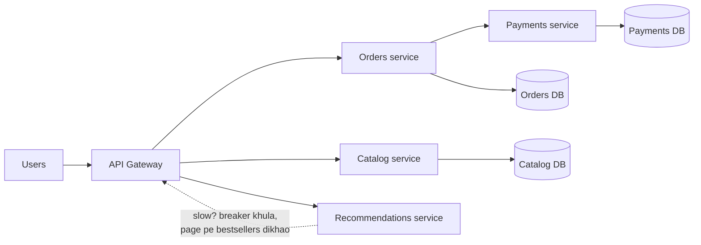

> 💡 **The core insight:** system ko todne se woh reliable nahi ho jaata. Failures tabhi *chhote* hote hain jab tum darwaze (timeouts, breakers, bulkheads) aur gauges (observability) bhi lagao. Inke bina microservices monolith se *zyada* fail hote hain, kyunki ab parts zyada hain aur unke beech ek network hai.

> 🇮🇳 **Desi Analogy:** Ek joint family socho jo ek hi bade ghar mein rehti hai, ek kitchen, ek bijli ka meter. Ye **monolith** hai: sab kuch ek jagah, baat karna aasaan (bas awaaz do), lekin kitchen mein aag lagi toh poora ghar khatre mein. Ab wahi family ek society ke alag alag flats mein shift ho jaaye: har flat ka apna kitchen, apna meter, apna taala. Ye **microservices** hain: ek flat mein short circuit hua toh baaki flats ki light jalti rehti hai. Lekin ab chacha se baat karni hai toh phone karna padega (network call), aur phone kabhi nahi lagta (failure). Har flat mein MCB (circuit breaker) lagana padega, aur society ke gate pe ek guard (API gateway) bhi chahiye. Flats tabhi safe hain jab MCB lage hon. Bina MCB ke, ek flat ki wiring poori building ka transformer uda sakti hai.

---

## 🔨 Building It Up · Zero Se Shuru

### 1. Start with the monolith (it's not a dirty word) · Monolith gaali nahi hai

**Monolith** ek application hai jo ek single unit ki tarah build aur deploy hota hai. Saare features (users, catalog, orders, payments) ek codebase mein rehte hain, ek process mein chalte hain, aur aam taur pe ek hi database share karte hain.

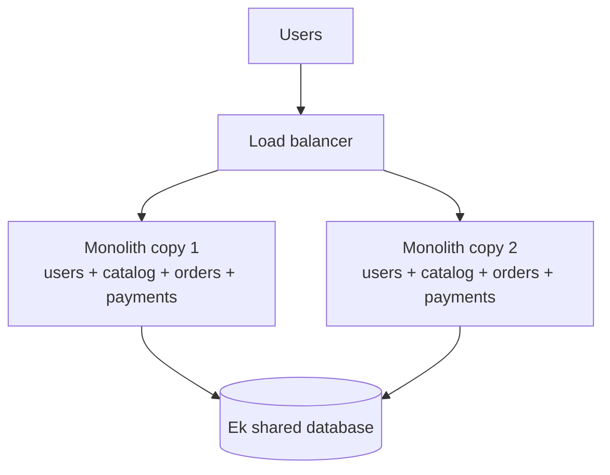

Dhyaan do, monolith **scale kar sakta hai**: tum load balancer ke peeche bahut saari identical copies chala do ([Chapter 02](02-scalability-load-balancing.md)). Shopify, Stack Overflow aur Basecamp ne (achhe se organised) monoliths pe bahut bade successful business chalaye hain.

**Monolith mein kya badhiya hai:**
- "orders" aur "payments" ke beech function call nanoseconds leta hai, aur network ki wajah se kabhi fail nahi hota.
- Ek database matlab asli **transactions**: "order banao AUR stock kam karo" ya toh dono honge ya koi nahi ([Chapter 03](03-databases.md)).
- Build, test, deploy aur debug karne ke liye ek hi cheez. Ek stack trace poori kahani bata deta hai.

**Dard kahan se shuru hota hai (aam taur pe 50+ engineers pe, 5 pe nahi):**
- 200 developers ek codebase mein commit kar rahe hain, ek doosre ke pair pe pair rakhte hain. Har deploy mein sabke changes hote hain, toh ek bug sabko rok deta hai.
- Parts ko alag se scale nahi kar sakte. Agar image resizing ko 40 CPUs chahiye, toh tumhe *sab kuch* ki 40 copies chalani padengi.
- Kisi chhote feature ka ek memory leak poore process ko crash kar deta hai.
- Tum hamesha ke liye ek language aur ek framework version mein phase ho.

Ek accha beech ka raasta hai **modular monolith**: deploy abhi bhi ek hi hota hai, lekin code strict boundaries wale modules mein bata hota hai (orders module, payments module ko sirf uske public interface se call kar sakta hai, uski tables ko kabhi haath nahi laga sakta). Agar kabhi todna pada, toh silaai (seams) pehle se bani hui hain.

> 🤔 **Mann mein sawaal:** Sab bade log toh microservices ki baat karte hain. Monolith se shuru karna "purana" nahi lagega?
>
> **Jawab:** Bilkul nahi. Monolith ek tool hai, sharm ki baat nahi. Chhoti team ke liye woh sabse fast ship hota hai. Asli galti hai *gande* monolith banana, jismein sab kuch sab se juda ho. Modular monolith banao: aaj speed milegi, aur kal todna pada toh module ki boundary hi service ki boundary ban jaayegi.

### 2. Microservices: what actually changes · Asal mein kya badalta hai

**Microservice** ek chhoti, independently deployable service hai jo ek business capability *aur uska data* own karti hai. "Independently deployable" hi asli phrase hai: payments team Tuesday dopahar 3 baje bina kisi se pooche ship kar sakti hai.

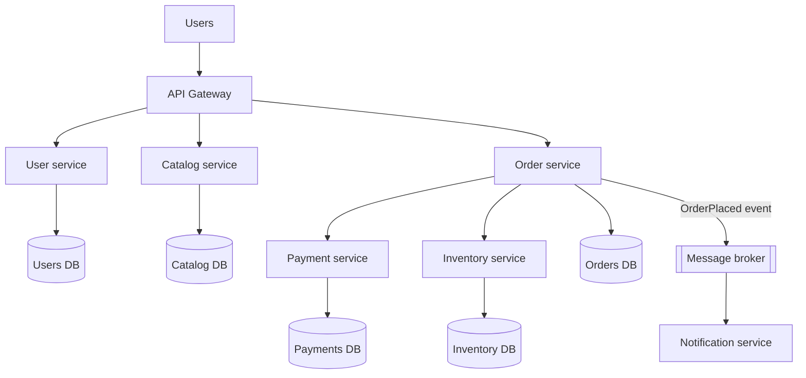

Jo rule beginners ko chaunkata hai: **har service apna database own karti hai, aur koi aur use haath nahi lagata.** Agar order service ko user ka email chahiye, toh woh user service se uski API ke through poochti hai (ya events se ek copy rakh leti hai). Itna strict kyun? Agar do services tables share karti hain, toh ek ko badlo toh doosri toot jaati hai. Tum wapas monolith pe aa gaye, bas ab network calls ke saath. Is nightmare ka ek naam hai: **distributed monolith**.

> 🇮🇳 **Desi Analogy:** Kirana store ka khata socho. Sharma ji ki dukaan ka khata sirf Sharma ji likhte hain. Agar bagal wale Gupta ji ko jaanna hai ki tumpe kitna udhaar hai, toh woh Sharma ji se *poochte* hain (API call). Woh khud Sharma ji ki diary kholke usmein kuch nahi likhte. Ab socho dono ek hi diary mein likhne lagein: Sharma ji ne columns badle, Gupta ji ka hisaab gadbad. Yahi **shared database** ki problem hai. Ek khata, ek maalik. Baaki sab poochke kaam chalate hain.

### 3. The honest trade-off table · Imaandaar hisaab

| | Monolith | Microservices |
|---|---|---|
| Features ke beech call | In-process, ~nanoseconds, kabhi "lost" nahi | Network, ~milliseconds, timeout ya fail ho sakti hai |
| Transactions | Aasaan, ek database | Mushkil: sagas, outbox, eventual consistency ([Chapter 08](08-queues-events.md)) |
| Deploy | Sab ya kuch nahi; ek kharab change sabko rokta hai | Har service alag se, din mein kai baar |
| Scaling | Poori app scale karo | Sirf garam (hot) service scale karo |
| Fault isolation | Ek crash sab kuch gira sakta hai | Failure contain *ho sakta hai* (agar darwaze banaye ho) |
| Team autonomy | Shared codebase, coordination ka bojh | Teams apni services end to end own karti hain |
| Tech choice | Ek stack | Har service apna chun sakti hai (lekin bahut saare stacks = chaos) |
| Debugging | Ek stack trace, ek log file | Distributed tracing, central logs chahiye |
| Testing | Ek app chalao | Contract tests, bahut saare moving parts |
| Operational cost | Kam | Zyada: har service ka CI/CD, discovery, mesh, monitoring |
| Best for | Chhoti/medium teams, naye products, unclear domains | Bade orgs, clear domains, bahut alag scaling needs |

> ⚠️ **The honest truth:** microservices mainly ek **organisational** problem ka solution hain (bahut saari teams ek product pe kaam kar rahi hain), technical problem ka nahi. Agar tumhare paas 6 engineers hain, toh modular monolith lagbhag hamesha zyada fast ship karega. Interviewers ko ye sunna bahut pasand hai, aur uske baad "...aur main *tab* todunga jab..." bolo.

Is idea ko **Conway's Law** kehte hain: system ka structure us organisation ke communication structure jaisa ban jaata hai jo use banati hai. Companies isse jaan-boojh ke use karti hain ("inverse Conway manoeuvre"): team boundaries waise design karo jaisi tumhe service boundaries chahiye.

### 4. Drawing service boundaries · Service ki seema kahan kheenchein

Galat boundaries microservices ke bigadne ka #1 kaaran hain. Agar ek order place karne mein 8 services pe 12 synchronous calls lagti hain, toh tumhari boundaries galat hain.

**Achhe guidelines:**

1. **Business capability se todo, technical layer se nahi.** "Payments", "Inventory", "Shipping" achhi services hain. "Database service", "Validation service" buri hain: har feature ko in sabki zaroorat padegi.
2. **Bounded contexts use karo** (Domain-Driven Design ka ek idea). "Product" ka matlab har team ke liye alag hai: catalog ke liye woh title, images aur description hai; inventory ke liye SKU aur stock count; shipping ke liye weight aur dimensions. Har context ka apna model aur apni service. Woh sirf ek ID share karte hain.
3. **High cohesion, low coupling.** Jo cheezein saath badalti hain, woh saath rehti hain. Agar orders ke har change ke saath pricing bhi badalni padti hai, toh shayad dono ek hi service hain.
4. **Data ownership faisla karti hai.** Poocho "is data ka single source of truth kaun hai?" Wahi owning service hai.
5. **Chatty boundaries se bacho.** Agar A ek request mein B ko 50 baar call karta hai, toh dono ko merge karo ya redesign karo.
6. **Bada shuru karo, baad mein todo.** Ek service ko todna aasaan hai, do services ko jodna mushkil jo alag alag disha mein badh chuki hain.

> 🇮🇳 **Desi Analogy:** **Bounded context** samajhna hai toh ek shaadi socho. "Dulha" shabd ka matlab har department ke liye alag hai. Caterer ke liye dulha = "ek plate, veg, no onion". Tailor ke liye dulha = "chest 40, sherwani size". Pandit ji ke liye dulha = "naam, gotra, janam samay". Teeno ek hi insaan ki baat kar rahe hain, lekin har ek ka apna register hai aur apne kaam ki details. Sabko jodta hai sirf dulhe ka naam (ID). Agar teeno ek hi giant register share karein, toh tailor ki ek galti pandit ji ka muhurat bigaad degi.

**Monolith se migrate kar rahe ho?** **Strangler fig pattern** use karo (naam ek bel se aaya hai jo dheere dheere ek ped ke chaaron taraf ugti hai). Monolith ke aage ek router lagao. Ek nayi service banao (maan lo notifications), aur sirf wahi requests uski taraf route karo. Feature by feature repeat karo, jab tak purane monolith mein kuch na bache aur use band kar sako. Koi risky "big-bang rewrite" nahi.

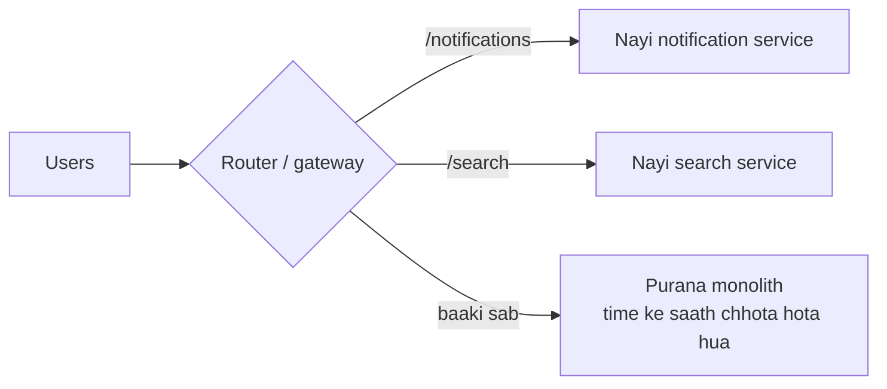

### 5. How services talk to each other · Services aapas mein kaise baat karti hain

Do families hain, aur dono se tum pehle mil chuke ho:

| Style | Kaise | Examples | Kiske liye accha | Khatra |
|---|---|---|---|---|
| **Synchronous** request/response | Caller answer ka wait karta hai | REST over HTTP, gRPC ([Chapter 07](07-apis-communication.md)) | Reads, "mujhe answer abhi chahiye" (price, auth) | Caller blocked rehta hai; failures chain mein upar tak cascade hote hain |
| **Asynchronous** messaging | Caller message daal ke aage badh jaata hai | Kafka, RabbitMQ, SQS ([Chapter 08](08-queues-events.md)) | "Kuch hua hai, jisko farak padta hai, react kare" | Eventual consistency, trace karna mushkil |

Thumb rules:
- Internal service-to-service calls ke liye jahan speed matter karti hai, **gRPC** use karo (binary Protobuf, HTTP/2, generated clients). Public APIs ke liye **REST/JSON**.
- Jis cheez ko turant answer nahi chahiye, uske liye **events** prefer karo: "OrderPlaced" → email, analytics, loyalty points. Order service ko pata bhi hona zaroori nahi ki ye listeners exist karte hain.
- Synchronous chains **chhoti** rakho. Har hop latency aur failure probability ko multiply karta hai (Under the Hood mein iska maths karenge).

**Saga** ek business transaction ko services ke across handle karta hai, bina ek bade database transaction ke: local transactions ka ek sequence, aur har ek ke saath ek **compensating action** jo use undo kare agar baad wala step fail ho ("reserve stock" ↔ "release stock", "charge card" ↔ "refund"). Ise ek central **orchestrator** coordinate kar sakta hai, ya services ek doosre ke events pe react karke (**choreography**). [Chapter 08](08-queues-events.md) mein outbox pattern hai jo events ko reliable banata hai.

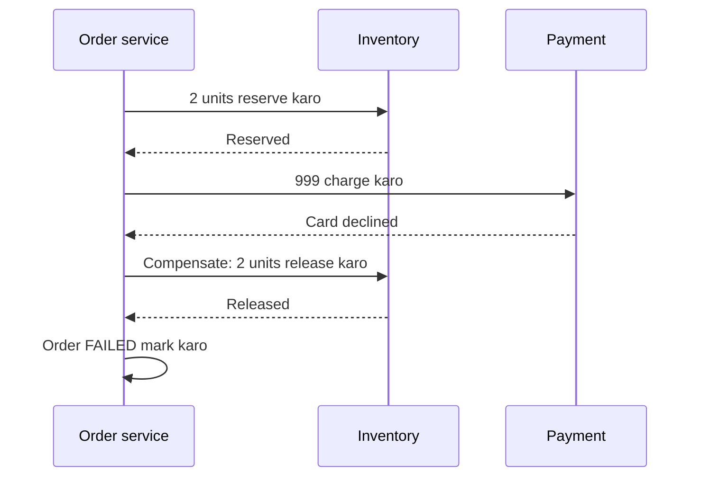

> 🇮🇳 **Desi Analogy:** **Saga** ko IRCTC + hotel + cab wali trip booking ki tarah socho. Tumne pehle train ticket book ki (step 1), phir hotel (step 2), phir cab try ki (step 3), lekin cab nahi mili aur trip cancel. Ab koi "magic undo" button nahi hai jo teeno ek saath wapas le le. Tumhe har step ka **ulta kaam** khud karna padta hai: hotel cancel (compensating action), ticket cancel karke refund lo (compensating action). Har step apne aap mein ek chhota pakka kaam hai, aur har ek ka "wapas lene ka tarika" pehle se tay hai. Yahi saga hai.

### 6. Service discovery: "where is the payment service right now?" · "Payment service abhi kahan hai?"

Cloud mein service instances aate jaate rehte hain: autoscaling 5 add karta hai, ek crash 1 hata deta hai, ek deploy sabko replace kar deta hai. IP addresses badalte rehte hain. Config file mein `10.0.0.7` hard-code karna dopahar tak bhi nahi tikega.

**Service discovery** isse ek **service registry** se solve karta hai: `service name → healthy addresses` ki ek live phone book.

1. Jab instance start hota hai, woh khud ko **register** karta hai ("orders 10.0.0.1:8080 pe hai").
2. Woh har kuch second mein ek **heartbeat** bhejta hai. Agar heartbeats ruk gayi, toh registry use hata deti hai.
3. Callers naam se lookup karte hain aur healthy addresses mein se ek chun lete hain.

> 🇮🇳 **Desi Analogy:** School ki morning attendance socho. Har bachcha roz "Present sir!" bolta hai (heartbeat). Agar Pappu teen din se "present" nahi bola, toh teacher uska naam "absent" mein daal deti hai aur usse koi kaam nahi deti (TTL expire). Monitor ko kisi ko notebook bhejni ho, toh woh register dekhta hai ki aaj kaun present hai, aur unhi mein baari baari se bhejta hai (round robin). Kisi ko "Pappu nahi aayega" alag se batane ki zaroorat nahi padi. Chup rehna hi kaafi signal tha.

```python
import itertools

class ServiceRegistry:
    def __init__(self, ttl):
        self.ttl = ttl                       # itne seconds bina heartbeat -> mara hua maano
        self.instances = {}                  # service -> {address: last_heartbeat}
        self._rr = {}

    def register(self, service, address, now):
        self.instances.setdefault(service, {})[address] = now

    heartbeat = register                     # heartbeat matlab bas "main abhi bhi yahan hoon"

    def healthy(self, service, now):
        return sorted(a for a, seen in self.instances.get(service, {}).items()
                      if now - seen <= self.ttl)

    def pick(self, service, now):
        """Client-side load balancing: round robin over healthy instances."""
        alive = self.healthy(service, now)
        if not alive:
            raise LookupError(f"no healthy {service}")
        counter = self._rr.setdefault(service, itertools.count())
        return alive[next(counter) % len(alive)]

reg = ServiceRegistry(ttl=10)
for addr in ("10.0.0.1:8080", "10.0.0.2:8080", "10.0.0.3:8080"):
    reg.register("orders", addr, now=0)

print("t=0 :", [reg.pick("orders", 0) for _ in range(4)])
# Instance 1 aur 2 heartbeat bhejte rehte hain; instance 3 chupchaap crash ho gaya.
reg.heartbeat("orders", "10.0.0.1:8080", now=8)
reg.heartbeat("orders", "10.0.0.2:8080", now=8)
print("t=15 healthy:", reg.healthy("orders", 15))
print("t=15:", [reg.pick("orders", 15) for _ in range(4)])
```

```text
t=0 : ['10.0.0.1:8080', '10.0.0.2:8080', '10.0.0.3:8080', '10.0.0.1:8080']
t=15 healthy: ['10.0.0.1:8080', '10.0.0.2:8080']
t=15: ['10.0.0.1:8080', '10.0.0.2:8080', '10.0.0.1:8080', '10.0.0.2:8080']
```

Abhi kya hua: instance 3 bina bye bole crash ho gaya. Uska last heartbeat t=0 pe tha, aur t=15 tak woh 10-second TTL se purana ho chuka tha (15 − 0 = 15 > 10). Toh registry ne chupchaap use dena band kar diya. Instance 1 aur 2 ne t=8 pe heartbeat bheja tha, 15 − 8 = 7 ≤ 10, toh woh healthy hain. Kisi ko config file edit nahi karni padi.

Registry use karne ke do tarike hain:

| | Client-side discovery | Server-side discovery |
|---|---|---|
| Registry kaun dekhta hai | Calling service khud (ek library ke saath) | Beech mein ek load balancer / proxy |
| Example | Netflix Eureka + client library | Kubernetes Services, AWS ALB, Consul + Envoy |
| Pro | Koi extra hop nahi; smart client-side balancing | Callers "dumb" reh sakte hain; kisi bhi language ke liye chalta hai |
| Con | Har language ko library chahiye | Ek aur hop/component chalana padta hai |

Real registries: **Consul**, **etcd**, **ZooKeeper**, **Eureka**. Kubernetes mein discovery built-in hai: tum `http://orders` call karte ho aur uska internal DNS plus ek virtual IP tumhe ek healthy pod tak pahuncha deta hai. Registry khud highly available honi chahiye, isliye etcd aur ZooKeeper 3 ya 5 nodes pe consensus chalate hain (Raft / ZAB, [Chapter 06](06-cap-consistency.md)).

### 7. The API gateway: one front door · Ek hi main gate

Agar mobile app ko 8 services directly call karni padti, toh use 8 addresses yaad rakhne padte, 8 auth schemes handle karni padti, aur slow phone network pe 8 round trips karne padte. Isliye hum aage ek **API gateway** lagate hain: ek single entry point jo boring-lekin-zaroori kaam ek hi baar kar deta hai.

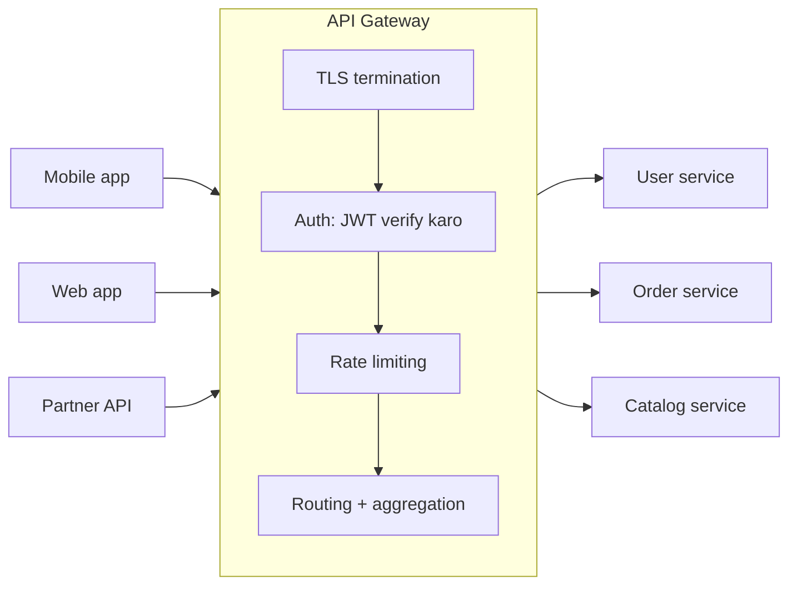

**Gateway aam taur pe kya karta hai:**
- **Routing**: `/orders/*` → order service, `/users/*` → user service
- **Authentication** (token ek baar verify karo, user ID neeche pass kar do)
- **Rate limiting** aur har API key ke quotas (section 14)
- **TLS termination**, request/response transformation, compression
- **Aggregation**: ek client call 3 services tak fan out hoti hai aur ek combined response wapas aata hai
- Caching, logging, metrics, tracing ke liye request IDs

**API gateway vs load balancer:** load balancer traffic ko *ek hi* service ki copies mein baantta hai (zyaadatar layer 4/7 ki plumbing). Gateway *tumhari API* samajhta hai: users, keys, routes, quotas. Practice mein gateway aksar load balancer ke peeche baithta hai ya usse andar rakhta hai. Examples: Kong, AWS API Gateway, Apigee, NGINX, Envoy.

**BFF (Backend for Frontend):** har client type ke liye ek alag chhota gateway (ek mobile ke liye, ek web ke liye), kyunki phone ko desktop browser se chhota aur alag shape ka response chahiye.

> 🇮🇳 **Desi Analogy:** Gateway ek bade office building ka reception/security desk hai. Har visitor ko andar har floor ka rasta nahi pata hona chahiye. Gate pe guard ID card check karta hai (authentication), visitor register mein entry karta hai (logging), "aaj itne log hi andar" ka niyam lagata hai (rate limiting), aur bolta hai "accounts teesri manzil pe" (routing). Lekin guard khud tumhara salary slip nahi banata. Agar guard business ka kaam karne lage, toh har department ko apne kaam ke liye guard se baat karni padegi. Isiliye gateway mein business logic mat daalo.

> ⚠️ Business logic ko gateway se **bahar** rakho. Ye sabka shared hai; agar ye smart ho gaya, toh ye ek naya monolith ban jaayega jise har team ko badalna padega.

### 8. Sidecars and the service mesh · Sidecar aur service mesh

Har service ko same networking features chahiye: retries, timeouts, services ke beech TLS, metrics, tracing. Inhe har language (Python, Go, Java) mein likhna waste bhi hai aur inconsistent bhi.

**Sidecar** pattern: har service instance ke *bagal mein* (same pod / machine mein) ek chhota helper proxy chalao. Service sirf `localhost` se baat karti hai; asli network sidecar sambhalta hai: encryption, retries, timeouts, metrics. Bilkul motorbike ke sidecar ki tarah: juda hua, har jagah saath jaata hai, extra saamaan uthata hai.

**Service mesh** tab banta hai jab *har* service ke paas sidecar ho aur ek central **control plane** un sabko configure kare.

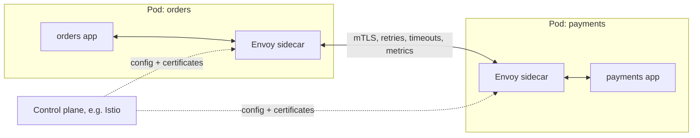

- **Data plane**: sidecar proxies (aam taur pe **Envoy**) jo traffic dhote hain.
- **Control plane**: rules push karta hai ("payments: 2 s timeout, 3 retries, 5% traffic v2 ko") aur certificates bhi. Examples: **Istio**, **Linkerd**.

**Free mein kya milta hai:** mutual TLS (har service saabit karti hai ki woh kaun hai), ek jaise retries/timeouts/circuit breaking, canaries ke liye traffic splitting, har call ke golden metrics, aur tracing headers aage pass hote hain.

**Keemat kya hai:** har call pe ek extra network hop (aam taur pe ek millisecond ya kam, lekin zero nahi), har pod pe zyada CPU aur memory, aur seekhne aur chalane ke liye ek complex system. Thumb rule: kai languages mein darjanon services ho toh worth it; paanch ke liye overkill.

> 🤔 **Mann mein sawaal:** API gateway aur service mesh dono hi traffic ke beech baithte hain, retries aur auth karte hain. Toh dono mein farak kya hai?
>
> **Jawab:** Direction ka farak hai. **Gateway** "north-south" traffic sambhalta hai: bahar ki duniya (mobile, web, partners) se andar aane wala traffic. Ek hi front door. **Service mesh** "east-west" traffic sambhalta hai: andar ki services ka aapas mein baat karna. Gateway = building ka main gate. Mesh = har flat ke darwaze pe laga intercom aur taala. Bade systems mein dono saath hote hain.

### 9. Why distributed systems fail: the network is not your friend · Network tumhara dost nahi hai

Ek process ke andar function call ya toh return karta hai ya exception throw karta hai. Network pe ek teesra, zyada ganda outcome hai: **tumhe pata hi nahi.** Tumne "₹500 charge karo" bheja aur koi reply nahi aaya. Request kho gayi? Ya request succeed hui aur *reply* kho gaya? Ya server bas slow hai?

> 🇮🇳 **Desi Analogy:** UPI se ₹500 bheje, aur screen pe "Pending" atak gaya. Paise kate ya nahi? Dukandaar ko mile ya nahi? Tumhe *pata hi nahi*. Agar tum ghabra ke dobara bhej do, toh ho sakta hai ₹1000 kat jaayein. Yahi network ka teesra outcome hai. Isiliye UPI har transaction ko ek unique ID deta hai, taaki dobara bhejne pe double na kate (ye idea section 16 mein **idempotency** banke aayega).

Classic **fallacies of distributed computing** (cheezein jo beginners chupchaap maan lete hain, aur sab galat hain):
1. Network reliable hai.
2. Latency zero hai.
3. Bandwidth infinite hai.
4. Network secure hai.
5. Topology kabhi nahi badalti.
6. Ek hi administrator hai.
7. Transport cost zero hai.
8. Network homogeneous (sab ek jaisa) hai.

Aur sabse khatarnaak failure woh service nahi jo *down* hai (woh fast fail hoti hai, ek millisecond mein "connection refused" mil jaata hai). Sabse khatarnaak woh service hai jo **slow** hai. Dekho ek slow service sab kuch kaise maar deti hai, ek **cascading failure**:

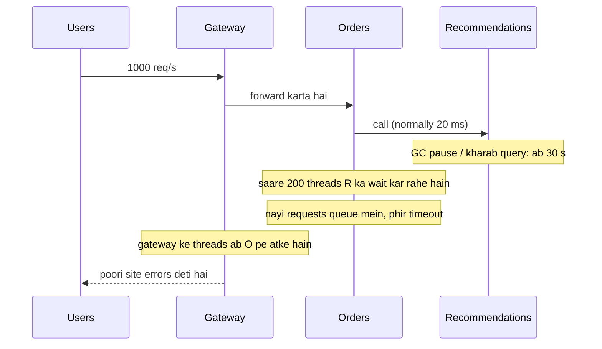

Orders ka har thread Recommendations ke intezaar mein atka hai. Orders *kuch bhi* serve nahi kar paata, woh requests bhi nahi jinhe recommendations chahiye hi nahi. Phir gateway ke threads Orders ke intezaar mein jama hone lagte hain. Ek slow patti (leaf) ne poora ped gira diya.

> 🤔 **Mann mein sawaal:** Ek *mari hui* service slow service se kam khatarnaak kaise? Down toh down hai na?
>
> **Jawab:** Socho do dukaanein hain. Ek ka shutter band hai: tum dekhte ho, turant mud jaate ho, ek second barbaad. Doosri ka shutter khula hai lekin dukandaar har customer ko 30 minute line mein khada rakhta hai. Ab tum *aur tumhare peeche wale sab* line mein phase ho. Dead service turant "no" bolti hai, toh tumhara thread free ho jaata hai. Slow service tumhara thread pakad ke baith jaati hai. Threads limited hain, aur woh khatam hote hi tum bhi slow ho jaate ho. Isi ka maths "Little's Law" mein Under the Hood mein dekhenge.

Agle paanch sections woh darwaze hain jo baadh ko rokte hain: **timeouts, retries, circuit breakers, bulkheads, rate limiting**.

### 10. Timeouts: never wait forever · Kabhi hamesha ke liye wait mat karo

Reliability ka pehla rule: **har network call ko ek timeout milta hai.** Bahut saari HTTP libraries ka default *no timeout* hota hai (Python ka `requests` hamesha wait karta rehta hai jab tak tum `timeout=` pass na karo). Phir ek atka hua connection ek thread ko hamesha ke liye pakad ke rakhta hai.

```py
import requests
resp = requests.get("http://inventory/stock/42", timeout=(0.5, 2.0))  # (connect, read) seconds mein
```

> 🤔 **Mann mein sawaal:** `timeout=(0.5, 2.0)` mein do numbers kyun? Ek hi kaafi nahi?
>
> **Jawab:** Do alag cheezein measure ho rahi hain. Pehla (**connect timeout**, 0.5 s) ye hai ki server se *connection judne* mein kitna wait karoge. Server zinda hai toh ye bahut jaldi hota hai, isliye chhota rakhte hain. Doosra (**read timeout**, 2.0 s) ye hai ki connection judne ke baad *jawab aane* mein kitna wait karoge. Server ko kaam karna hai, isliye ye thoda bada hota hai. Ek dhyaan ki baat: `requests` mein read timeout "do bytes ke beech ka gap" hai, poore response ka total time nahi.

**Number kaise chunein:** dependency ki latency ka **p99** dekho (woh time jiske andar 99% calls khatam ho jaati hain) aur timeout usse thoda upar rakho. Agar inventory ka p99 300 ms hai, toh 500 ms timeout theek hai; 30 seconds nahi.

**Deadline propagation.** User lagbhag 1 second wait karega. Agar gateway 1 s ke baad haar maan leta hai lekin uske peeche ki services ke apne 5 s ke timeouts hain, toh woh us request pe kaam karti rehti hain jiska ab koi intezaar nahi kar raha. Fix: request ke saath ek **deadline** (bacha hua time budget) pass karo, aur har hop use check kare. gRPC ye natively karta hai.

> 🇮🇳 **Desi Analogy:** Tatkal booking socho. Window 10 baje khulti hai aur 10:02 tak saari seats khatam. Tumhare paas total 2 minute ka budget hai. Agar login mein 50 seconds lag gaye, captcha mein 40, toh passenger details ke liye sirf 30 bache. Ab agar passenger details bharne mein 60 seconds lagte hain, toh samajhdaar insaan wahin ruk jaata hai, kyunki ticket ab mil hi nahi sakti. Har step pe "kitna time bacha hai" check karna hi **deadline propagation** hai. Faltu ka kaam bachta hai.

```python
class DeadlineExceeded(Exception):
    pass

def call(service_name, cost_ms, remaining_ms):
    """Each hop checks the remaining budget before doing work."""
    if cost_ms > remaining_ms:
        raise DeadlineExceeded(f"{service_name} needs {cost_ms} ms, only {remaining_ms} ms left")
    print(f"  {service_name:<10} took {cost_ms:>3} ms, {remaining_ms - cost_ms:>3} ms left")
    return remaining_ms - cost_ms

def handle_request(budget_ms, costs):
    remaining = budget_ms
    try:
        for name, cost in costs:
            remaining = call(name, cost, remaining)
        print("  -> response sent")
    except DeadlineExceeded as e:
        print("  -> give up early:", e)

print("Normal day (budget 500 ms):")
handle_request(500, [("gateway", 10), ("orders", 120), ("inventory", 90), ("pricing", 60)])
print("Inventory is slow today:")
handle_request(500, [("gateway", 10), ("orders", 120), ("inventory", 340), ("pricing", 60)])
```

```text
Normal day (budget 500 ms):
  gateway    took  10 ms, 490 ms left
  orders     took 120 ms, 370 ms left
  inventory  took  90 ms, 280 ms left
  pricing    took  60 ms, 220 ms left
  -> response sent
Inventory is slow today:
  gateway    took  10 ms, 490 ms left
  orders     took 120 ms, 370 ms left
  inventory  took 340 ms,  30 ms left
  -> give up early: pricing needs 60 ms, only 30 ms left
```

Abhi kya hua: slow din pe pricing ko call hi nahi kiya gaya, kyunki time pe khatam karne ka koi tarika hi nahi tha. Isse pricing faltu kaam karne se bach gaya aur resources turant free ho gaye. (Real life mein tumhe cost pehle se pata nahi hoti; har hop bas apna timeout `min(own_timeout, remaining_deadline)` set kar leta hai.)

### 11. Retries with exponential backoff and jitter · Retry karo, lekin tameez se

Bahut saare failures **transient** (thodi der ke) hote hain: ek packet drop hua, ek pod restart ho raha tha, thodi der ka overload. Retry karne se aksar kaam ban jaata hai. Lekin bholepan wale retries khatarnaak hain: agar ek service overload ki wajah se pareshaan hai, aur har client turant 3 baar retry kar de, toh tumne uska load **chaar guna** kar diya (1 asli + 3 retries). Ise **retry storm** kehte hain, aur ye ek chhoti hichki ko outage bana deta hai.

Teen rules retries ko safe banate hain:

1. **Sirf woh retry karo jo retry karna safe hai.** Transient errors (timeouts, 503, 429, connection reset), haan. 400 "bad request" hamesha fail hoga, toh nahi. Aur sirf **idempotent** operations retry karo (section 16), warna retried "charge card" do baar charge kar dega.
2. **Exponentially back off karo.** 100 ms wait, phir 200, 400, 800... service ko sambhalne ki jagah do. Wait aur attempts dono pe hamesha ek cap lagao.
3. **Jitter (randomness) daalo.** Iske bina, 10,000 clients jo ek hi pal mein fail hue, sab theek 100 ms pe retry karenge, phir sab 200 ms pe, aur server pe synchronised lehron mein hamla karenge (**thundering herd**). Jitter unhe bikher deta hai.

> 🇮🇳 **Desi Analogy:** Mumbai local ka darwaza socho. Train aayi, darwaze pe bheed, koi nahi chadh paaya. Agar saare log *theek ek saath* dobara dhakka maarein, phir *theek ek saath* teesri baar, toh har baar wahi jam lagega. Ye **thundering herd** hai. Ab maan lo har koi thoda alag waqt pe try kare, koi abhi, koi do second baad, koi paanch baad. Bheed apne aap bikhar jaati hai aur log chadhne lagte hain. Ye **jitter** hai. Aur har baar thoda zyada ruk ke try karna (2 s, phir 4, phir 8) **exponential backoff** hai: platform ko saans lene ka mauka do.

Popular **"full jitter"** formula: `wait = random(0, min(cap, base × 2^attempt))`.

Ise ek baar haath se chalake dekho (base = 0.1 s, cap = 5 s):
- attempt 0: ceiling = min(5, 0.1 × 1) = 0.1 → wait 0 se 0.1 ke beech koi bhi random number
- attempt 1: ceiling = 0.2 → 0 se 0.2 ke beech
- attempt 2: ceiling = 0.4 → 0 se 0.4 ke beech
- ... attempt 6: 0.1 × 64 = 6.4, lekin cap 5 hai, toh ceiling = 5

```python
import random

def backoff_delays(attempts, base=0.1, cap=5.0, rng=None):
    """Return the wait before each retry, using 'full jitter'."""
    delays = []
    for attempt in range(attempts):
        ceiling = min(cap, base * (2 ** attempt))   # 0.1, 0.2, 0.4, 0.8 ...
        delays.append(round(rng.uniform(0, ceiling), 3))
    return delays

rng = random.Random(42)
print("no jitter :", [min(5.0, 0.1 * 2 ** a) for a in range(6)])
print("client A  :", backoff_delays(6, rng=rng))
print("client B  :", backoff_delays(6, rng=rng))
```

```text
no jitter : [0.1, 0.2, 0.4, 0.8, 1.6, 3.2]
client A  : [0.064, 0.005, 0.11, 0.179, 1.178, 2.165]
client B  : [0.089, 0.017, 0.169, 0.024, 0.35, 1.617]
```

Abhi kya hua: bina jitter ke, har client theek 0.1, 0.2, 0.4 s wait karta, sab ek taal mein (lockstep). Jitter ke saath, clients A aur B same badhti hui ceiling ke neeche alag alag random waits chunte hain, toh unke retries ab takraate nahi.

> 🤔 **Mann mein sawaal:** Client A ka doosra wait (0.005) pehle wale (0.064) se *chhota* hai. Ye "exponential" kaise hua?
>
> **Jawab:** Exponential *ceiling* badhti hai, har ek wait nahi. Full jitter mein wait 0 se ceiling ke beech koi bhi number ho sakta hai, toh kabhi kabhi chhota bhi aayega. Lekin *average* wait har attempt ke saath double hota jaata hai (ceiling ka aadha). Bahut saare clients ko milake dekho toh load exponentially kam hota dikhta hai. Yahi chahiye tha.

Ab ek flaky (kabhi chalne, kabhi na chalne wali) nakli service ke against ek poora retry wrapper. Hum sach mein sleep nahi karte, bas waits ko jodte hain, taaki demo turant chale:

```python
import random

class TransientError(Exception):
    pass

class FlakyService:
    """Fails the first `failures` calls, then succeeds."""
    def __init__(self, failures):
        self.failures = failures
        self.calls = 0

    def get_price(self, item):
        self.calls += 1
        if self.calls <= self.failures:
            raise TransientError(f"503 on call {self.calls}")
        return 499

def call_with_retry(fn, *args, max_attempts=4, base=0.1, cap=2.0, seed=7):
    rng = random.Random(seed)
    total_wait = 0.0
    for attempt in range(max_attempts):
        try:
            result = fn(*args)
            print(f"  attempt {attempt + 1}: success -> {result}")
            return result, round(total_wait, 3)
        except TransientError as err:
            if attempt == max_attempts - 1:
                print(f"  attempt {attempt + 1}: {err}, giving up")
                raise
            wait = rng.uniform(0, min(cap, base * 2 ** attempt))
            total_wait += wait        # real client yahan time.sleep(wait) karta
            print(f"  attempt {attempt + 1}: {err}, retrying in {wait:.3f}s")

print("Service that fails twice:")
print(call_with_retry(FlakyService(failures=2).get_price, "book"))

print("Service that fails five times:")
try:
    call_with_retry(FlakyService(failures=5).get_price, "book")
except TransientError as err:
    print("  caller sees:", err)
```

```text
Service that fails twice:
  attempt 1: 503 on call 1, retrying in 0.032s
  attempt 2: 503 on call 2, retrying in 0.030s
  attempt 3: success -> 499
(499, 0.063)
Service that fails five times:
  attempt 1: 503 on call 1, retrying in 0.032s
  attempt 2: 503 on call 2, retrying in 0.030s
  attempt 3: 503 on call 3, retrying in 0.260s
  attempt 4: 503 on call 4, giving up
  caller sees: 503 on call 4
```

Abhi kya hua: ek chhota glitch (2 failures) caller ko dikha hi nahi. Ek asli outage (5 failures) pe 4 attempts ke baad haar maan li gayi, taaki caller latakne ki jagah fast fail kare ya degrade kare.

**Production mein use hone wale teen aur retry protections:**
- **Retry budget**: retries zyada se zyada, maan lo, 10% extra traffic jod sakte hain. Agar 10% se zyada calls pehle se retries hain, toh retry karna band. Google ki SRE book aur gRPC ye idea use karte hain.
- **Sirf ek layer pe retry karo.** Agar gateway, orders aur inventory ke clients *har ek* 3 baar retry karein, toh ek user click neeche pahunchte pahunchte 3 × 3 × 3 = 27 calls ban sakta hai. Retry ke liye ek layer chuno (aam taur pe failure ke sabse paas wali, ya edge wali).
- 429/503 responses pe server ke **`Retry-After`** header ki izzat karo.

### 12. Circuit breaker: stop calling the broken thing · Toote hue ko call karna band karo

Retries chhoti hichkiyon mein madad karte hain. Lekin agar payment service *sach mein* down hai, toh har request pe retry karna bas time barbaad karta hai aur us service pe hathoda chalata rehta hai jo restart hone ki koshish kar rahi hai. **Circuit breaker** tumhare ghar ke electrical breaker jaisa kaam karta hai: fault hone pe woh trip ho jaata hai, current ka flow kaat deta hai, taaki ghar na jale.

> 🇮🇳 **Desi Analogy:** Ghar ka MCB bilkul yahi hai, teeno states ke saath. **CLOSED**: switch upar, current beh raha hai, sab normal. Short circuit hua, toh MCB trip, switch neeche: **OPEN**. Ab tum kitna bhi pankha on karo, kuch nahi chalega, aur wiring jalne se bach gayi. Thodi der baad tum switch ek baar upar karke *try* karte ho: ye **HALF-OPEN** hai. Light aa gayi? Wapas normal (CLOSED). Phir se trip? Wapas OPEN, aur thodi der aur ruko. Software breaker bas ye "thodi der baad try karna" khud karta hai. (Naam ulta lagta hai na? Bijli mein "closed circuit" = current behta hai, "open circuit" = taar kata hua. Isiliye CLOSED normal hai aur OPEN tripped.)

Iske teen states hain:

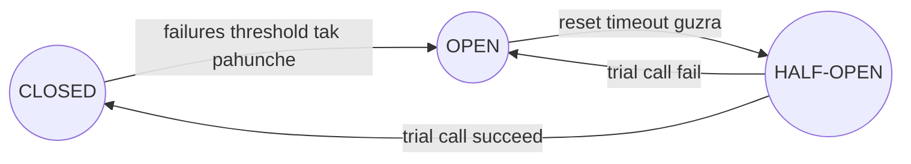

- **CLOSED** (normal): calls aage jaati hain. Failures gino.
- **OPEN** (tripped): try bhi mat karo. Microseconds mein **fail fast** karo, fallback return karo. Isse bimaar service ko saans lene ki jagah milti hai aur tumhare threads free hote hain.
- **HALF-OPEN** (testing): cool-down ke baad, ek (ya kuch) trial requests jaane do. Success → CLOSED. Failure → wapas OPEN.

```python
class CircuitOpenError(Exception):
    pass

class CircuitBreaker:
    def __init__(self, failure_threshold=3, reset_timeout=10.0):
        self.failure_threshold = failure_threshold
        self.reset_timeout = reset_timeout
        self.state = "CLOSED"
        self.failures = 0
        self.opened_at = None

    def call(self, fn, now):
        if self.state == "OPEN":
            if now - self.opened_at >= self.reset_timeout:
                self.state = "HALF_OPEN"          # sirf EK trial request jaane do
            else:
                raise CircuitOpenError("fail fast: circuit is open")
        try:
            result = fn()
        except Exception:
            self._on_failure(now)
            raise
        self._on_success()
        return result

    def _on_failure(self, now):
        self.failures += 1
        if self.state == "HALF_OPEN" or self.failures >= self.failure_threshold:
            self.state = "OPEN"
            self.opened_at = now

    def _on_success(self):
        self.state = "CLOSED"
        self.failures = 0

# Ek nakli downstream jo t=0 se t=15 ke beech toota hua hai
def make_downstream(clock):
    def payment_service():
        if clock["t"] < 15:
            raise ConnectionError("payment service down")
        return "paid"
    return payment_service

clock = {"t": 0}
breaker = CircuitBreaker(failure_threshold=3, reset_timeout=10)
service = make_downstream(clock)

for t in [0, 1, 2, 3, 5, 12, 13, 23, 24]:
    clock["t"] = t
    try:
        outcome = breaker.call(service, now=t)
    except CircuitOpenError as e:
        outcome = str(e)
    except ConnectionError as e:
        outcome = f"error: {e}"
    print(f"t={t:>2}  {breaker.state:<9} {outcome}")
```

```text
t= 0  CLOSED    error: payment service down
t= 1  CLOSED    error: payment service down
t= 2  OPEN      error: payment service down
t= 3  OPEN      fail fast: circuit is open
t= 5  OPEN      fail fast: circuit is open
t=12  OPEN      error: payment service down
t=13  OPEN      fail fast: circuit is open
t=23  CLOSED    paid
t=24  CLOSED    paid
```

**Trace karo:**

| t | Kya hua | Baad mein state |
|---|---|---|
| 0, 1 | Asli calls fail (failures = 1, 2) | CLOSED |
| 2 | Teesra failure threshold pe pahuncha → trip | OPEN (2 pe khula) |
| 3, 5 | Khulne ke 10 s ke andar: turant reject, service ko call hi nahi kiya | OPEN |
| 12 | 10 s guzar gaye → HALF_OPEN, ek trial call... abhi bhi down | OPEN (12 pe khula) |
| 13 | Turant reject | OPEN |
| 23 | 12 ke baad 11 s → trial call succeed (service 15 pe theek ho gayi thi) | CLOSED |

Ek baariki pakdo: t=2 pe output mein "OPEN" ke saath "error" likha hai, "fail fast" nahi. Kyunki t=2 wali call *asli* call thi jo fail hui, aur usi failure ne breaker trip kiya. State call ke *baad* print hota hai. Isi tarah t=12 pe HALF_OPEN ki trial call fail hui, toh print hote waqt state phir se OPEN hai.

Production breakers (Java mein Resilience4j, .NET mein Polly, Python mein `pybreaker`, ya service mesh) aam taur pe raw count ki jagah **sliding window pe failure rate** se trip karte hain (jaise "pichhli 100 calls mein 50% se zyada fail hui, aur kam se kam 20 calls hui ho"), aur slow calls ko bhi failures maante hain.

> 💡 **Retry vs circuit breaker:** retry kehta hai "phir se try karo, shayad chhoti hichki hai." Breaker kehta hai "ruko, ye saaf saaf toota hua hai." Dono use karo: retry breaker ke *andar* jaata hai, taaki breaker khulte hi koi retry na ho.

### 13. Bulkheads: don't let one leak sink the ship · Ek chhed se poora jahaaz mat dubao

Wapas jahaaz pe. **Bulkhead** limit karta hai ki koi ek dependency tumhare kitne resources use kar sakti hai. Agar tumhari service ke paas 10 worker threads hain aur slow recommendations ki calls sabko pakad sakti hain, toh checkout bhookha mar jaata hai. Har dependency ko apna chhota pool do (ya concurrent calls pe cap), aur ek slow dependency sirf *apna* pool khatam kar paayegi.

> 🇮🇳 **Desi Analogy:** Shaadi ka buffet socho jahan 10 waiters hain. Agar chaat counter pe line itni lambi ho gayi ki 10 ke 10 waiters wahin atak gaye, toh khaana (asli cheez) koi serve hi nahi kar raha. Samajhdaar caterer pehle se tay karta hai: chaat ke liye max 4 waiters, main course ke liye 6. Ab chaat wali line kitni bhi lambi ho, main course chalta rahega. Jo log chaat ke 4 waiters busy hone pe aaye, unhe turant bol diya "abhi chaat nahi, baad mein aao" (fail fast). Yahi **bulkhead** hai: waiters = threads, counters = dependencies.

```python
class Bulkhead:
    """A fixed number of 'seats' per dependency. No seat -> reject immediately."""
    def __init__(self, name, max_concurrent):
        self.name, self.max_concurrent, self.in_use = name, max_concurrent, 0

    def try_enter(self):
        if self.in_use < self.max_concurrent:
            self.in_use += 1
            return True
        return False

    def leave(self):
        self.in_use -= 1

# Total 10 worker threads. Bulkheads ke bina, slow recommendations service
# saare 10 pakad sakti hai aur checkout bhookha marta hai. Bulkheads ke saath: 4 + 6.
pools = {"recommendations": Bulkhead("recommendations", 4),
         "checkout": Bulkhead("checkout", 6)}

# Recommendations atki hui hai, toh har request apni seat pakad ke baithi hai.
rejected = 0
for _ in range(20):
    if not pools["recommendations"].try_enter():
        rejected += 1        # fail fast, uski jagah "no recommendations" dikhao
print("recommendation calls stuck:", pools["recommendations"].in_use, "| rejected fast:", rejected)

served = 0
for _ in range(6):
    if pools["checkout"].try_enter():
        served += 1
        pools["checkout"].leave()
print("checkout requests still served:", served, "of 6")
```

```text
recommendation calls stuck: 4 | rejected fast: 16
checkout requests still served: 6 of 6
```

Abhi kya hua: atki hui dependency sirf 4 "seats" phasa paayi. Baaki 16 recommendation calls turant reject ho gayi (aur page ek fallback dikha sakta tha), jabki checkout, jo asli paisa kamata hai, chalta raha. Real code mein bulkhead ek `threading.Semaphore`, ek alag thread pool, ya har downstream ke liye connection-pool limit hota hai. Bade scale pe, bulkheads har customer tier ya region ke liye alag **clusters** hote hain ("cell-based architecture"), taaki ek kharab tenant sabko nuksaan na pahunchaye.

### 14. Rate limiting: five algorithms · Paanch algorithms

**Rate limiting** cap karta hai ki ek client ek time period mein kitni requests kar sakta hai: "har API key ke liye 100 requests per minute". Kyun?
- Services ko overload, bugs (loop mein phasa hua client) aur abuse (scraping, brute-force logins, DDoS) se bachane ke liye.
- Fairness: ek bada customer baaki sabko bhookha na maare.
- Cost control aur business plans ("free tier: 1,000 calls/day").

Jab client limit se upar hota hai, server **HTTP 429 Too Many Requests** se jawab deta hai, aam taur pe `Retry-After: 30` aur `X-RateLimit-Remaining: 0` jaise headers ke saath. Limits user ID, API key, ya IP address se keyed hoti hain, aur aam taur pe API gateway pe enforce hoti hain.

Ye rahe paanch classic algorithms. Saare demos nakli timestamps use karte hain, taaki turant chalein aur har baar same result dein.

#### 14a. Token bucket (the most popular) · Sabse popular

Ek bucket mein zyada se zyada `capacity` tokens aa sakte hain. Tokens `refill_rate` per second ki speed se tapakte hain. Har request ek token leti hai; token nahi, toh entry nahi. Bhari hui bucket `capacity` requests ka ek **burst** allow karti hai, phir lambe time ka rate refill rate hi rehta hai. AWS API Gateway, Stripe aur zyaadatar cloud APIs ye use karte hain.

> 🇮🇳 **Desi Analogy:** Metro ka token counter socho jahan ek tray mein max 3 tokens rakh sakte hain, aur staff har second ek naya token tray mein daalta hai (tray bhari ho toh nahi daalta). Teen dost ek saath aaye: tray mein 3 tokens hain, teeno ek jhatke mein andar (burst). Chautha turant aaya: tray khaali, ruko. Ek second baad naya token aaya, toh ek aur andar. Lambe time mein speed "1 log per second" hi rahegi, lekin agar tray kuch der bhari padi rahi, toh achanak aayi bheed mein 3 log ek saath ja sakte hain. Tray = bucket, tray ka size = capacity, staff ki speed = refill_rate.

```python
class TokenBucket:
    def __init__(self, capacity, refill_rate):
        self.capacity = capacity          # max burst size
        self.refill_rate = refill_rate    # har second mein itne tokens judte hain
        self.tokens = capacity            # bhari hui bucket se shuru
        self.last = 0.0

    def allow(self, now):
        # Lazy refill: pichhli baar dekhne ke baad jitne tokens kamaaye, jod do.
        elapsed = now - self.last
        self.tokens = min(self.capacity, self.tokens + elapsed * self.refill_rate)
        self.last = now
        if self.tokens >= 1:
            self.tokens -= 1
            return True
        return False

bucket = TokenBucket(capacity=3, refill_rate=1)   # 3 ka burst, phir 1 req/sec
times = [0.0, 0.1, 0.2, 0.3, 0.4, 1.4, 1.5, 3.5, 3.6, 3.7, 3.8]
for t in times:
    print(f"t={t:<4} {'ALLOW' if bucket.allow(t) else 'deny '}  tokens left={bucket.tokens:.1f}")
```

```text
t=0.0  ALLOW  tokens left=2.0
t=0.1  ALLOW  tokens left=1.1
t=0.2  ALLOW  tokens left=0.2
t=0.3  deny   tokens left=0.3
t=0.4  deny   tokens left=0.4
t=1.4  ALLOW  tokens left=0.4
t=1.5  deny   tokens left=0.5
t=3.5  ALLOW  tokens left=1.5
t=3.6  ALLOW  tokens left=0.6
t=3.7  deny   tokens left=0.7
t=3.8  deny   tokens left=0.8
```

Pehli kuch lines haath se check karo, taaki "lazy refill" dimaag mein baith jaaye:
- t=0.0: tokens = 3, kuch elapsed nahi. 1 kharch → **2.0**.
- t=0.1: 0.1 s guzre, 0.1 token juda → 2.1. 1 kharch → **1.1**.
- t=0.2: 0.1 aur juda → 1.2. 1 kharch → **0.2**.
- t=0.3: 0.2 + 0.1 = 0.3. Ek poora token nahi hai → deny, tokens **0.3** hi rahe.
- t=1.4: 0.4 + 1.0 = 1.4 → allow → **0.4**.

Abhi kya hua: pehli 3 requests bhari bucket pe burst karke nikal gayi. Phir bucket lagbhag khaali hai aur 1 token/second se bharti hai, toh requests tabhi allow hoti hain jab tokens wapas kamaaye jaate hain. Dhyaan do, hum kabhi background timer nahi chalaate: refill ko request aane pe elapsed time se **lazily** calculate karte hain. Isiliye token bucket ko har user ke liye sirf do numbers (`tokens`, `last`) chahiye, jisse millions of users ke liye ise Redis mein store karna sasta hai.

#### 14b. Leaky bucket · Tapakti baalti

Requests ek queue (bucket) mein girti hain aur **fixed, steady rate** se process hone ke liye "leak" hoti (tapakti) hain. Agar queue bhari hai, toh nayi requests chhalak ke drop ho jaati hain. Jahan token bucket bursts ko *aage jaane* deta hai, leaky bucket unhe ek constant stream mein **smooth** kar deta hai. Accha hai jab tumhare peeche wali cheez ko steady speed chahiye (jaise ek SMS provider jo 2 messages per second leta hai). NGINX ka `limit_req` isi pe based hai.

> 🇮🇳 **Desi Analogy:** Mandir mein darshan ki line socho jahan andar ek baar mein ek hi aadmi jaata hai, har 30 second mein ek (fixed rate). Bahar barricade mein sirf 3 log khade ho sakte hain (queue capacity). Bus se 5 log ek saath utre: 3 barricade mein, 2 ko guard bol deta hai "jagah nahi, baad mein aao" (DROPPED). Andar jaane ki speed hamesha same rehti hai, bahar kitni bhi bheed ho. Token bucket se farak: wahan 3 dost *ek saath andar* chale gaye the. Yahan woh *line mein lag ke ek ek karke* jaate hain.

```python
from collections import deque

class LeakyBucket:
    """A queue of fixed size that drains (processes) at a constant rate."""
    def __init__(self, capacity, leak_rate):
        self.capacity = capacity
        self.leak_rate = leak_rate        # har second itni requests process hoti hain
        self.queue = deque()
        self.last_leak = 0.0
        self.processed = []

    def _leak(self, now):
        # last_leak ke baad kitni poori requests nikal sakti thi?
        can_drain = int((now - self.last_leak) * self.leak_rate)
        if can_drain > 0:
            for _ in range(min(can_drain, len(self.queue))):
                self.processed.append(self.queue.popleft())
            self.last_leak += can_drain / self.leak_rate

    def submit(self, request_id, now):
        self._leak(now)
        if len(self.queue) < self.capacity:
            self.queue.append(request_id)
            return True
        return False                      # bucket chhalak rahi hai: drop karo

bucket = LeakyBucket(capacity=3, leak_rate=2)     # 2 req/sec bahar, 3 ki queue
for i, t in enumerate([0.0, 0.0, 0.0, 0.0, 0.0, 0.6, 1.0, 1.0]):
    ok = bucket.submit(f"r{i}", t)
    print(f"t={t}  r{i} {'queued ' if ok else 'DROPPED'}  queue={list(bucket.queue)}")
bucket._leak(3.0)
print("processed by t=3.0:", bucket.processed)
```

```text
t=0.0  r0 queued   queue=['r0']
t=0.0  r1 queued   queue=['r0', 'r1']
t=0.0  r2 queued   queue=['r0', 'r1', 'r2']
t=0.0  r3 DROPPED  queue=['r0', 'r1', 'r2']
t=0.0  r4 DROPPED  queue=['r0', 'r1', 'r2']
t=0.6  r5 queued   queue=['r1', 'r2', 'r5']
t=1.0  r6 queued   queue=['r2', 'r5', 'r6']
t=1.0  r7 DROPPED  queue=['r2', 'r5', 'r6']
processed by t=3.0: ['r0', 'r1', 'r2', 'r5', 'r6']
```

Abhi kya hua: 5 ka burst ek saath aaya; 3 queue mein fit hue, 2 chhalak gaye. Har aadhe second ek request process hone ke liye nikli aur jagah bani (t=0.6 pe 0.6 × 2 = 1.2, yaani ek poori request nikli: r0; t=1.0 pe ek aur: r1). Input kitna bhi bursty ho, output rate ekdum steady hai. Nuksaan: queue mein khadi requests wait karti hain (extra latency), aur purani requests ka ek burst nayi requests ko rok sakta hai.

#### 14c, 14d, 14e. The window family: fixed window, sliding log, sliding window counter · Window wala parivaar

**Fixed window counter:** time ko windows mein kaato (jaise har minute) aur har window ka ek counter rakho. Simple: har user ke liye ek integer, Redis mein ek `INCR`. Kami hai **boundary burst**: client 0:59 pe poori limit bhej sakta hai aur phir 1:01 pe dobara, yaani **2 seconds mein 2× limit**.

**Sliding log:** har accepted request ka timestamp store karo. Har request pe, window se purane timestamps hata do, aur jo bache unhe gino. Ekdum accurate, lekin har request ki ek entry store hoti hai, toh memory har user ke liye O(limit) hai. Badi limits pe mehenga.

**Sliding window counter:** chalaak samjhauta. Sirf do counters rakho, current window aur previous wali, aur pichhle 60 seconds ki requests ka *andaaza* lagao, previous window ko utna weight dekar jitna uska hissa abhi bhi overlap kar raha hai:

```text
estimate = previous_count × (1 − elapsed_in_current / window) + current_count
```

> 🤔 **Mann mein sawaal:** Ye `(1 − elapsed / window)` wala hissa kahan se aaya?
>
> **Jawab:** Socho tumhari "pichhle 60 second" wali khidki ek sarakti hui patti hai. Agar current window mein 15 second guzre hain, toh patti ka 15 second current window mein hai aur baaki 45 second (yaani 45/60 = 75%) previous window mein. Hum maan lete hain ki previous window ki requests poori window mein barabar faili thi, toh uski requests ka 75% hissa abhi bhi hamari patti ke andar hai. Wahi `1 − 15/60 = 0.75` hai. Ye ek andaaza hai, isiliye ise "approximation" kehte hain.

Teeno pe boundary burst se hamla karte hain:

```python
from collections import deque

class FixedWindow:
    def __init__(self, limit, window):
        self.limit, self.window = limit, window
        self.current_window, self.count = None, 0

    def allow(self, now):
        w = int(now // self.window)            # hum kaunsi window mein hain?
        if w != self.current_window:
            self.current_window, self.count = w, 0
        if self.count < self.limit:
            self.count += 1
            return True
        return False

class SlidingLog:
    def __init__(self, limit, window):
        self.limit, self.window = limit, window
        self.log = deque()                     # accepted requests ke timestamps

    def allow(self, now):
        while self.log and self.log[0] <= now - self.window:
            self.log.popleft()                 # window se purani requests bhool jao
        if len(self.log) < self.limit:
            self.log.append(now)
            return True
        return False

class SlidingWindowCounter:
    def __init__(self, limit, window):
        self.limit, self.window = limit, window
        self.curr_start, self.curr_count, self.prev_count = 0, 0, 0

    def allow(self, now):
        start = int(now // self.window) * self.window
        if start != self.curr_start:
            # Nayi window mein aa gaye. Agar poori ek window skip hui, toh prev 0 hai.
            self.prev_count = self.curr_count if start - self.curr_start == self.window else 0
            self.curr_start, self.curr_count = start, 0
        overlap = 1 - (now - start) / self.window   # previous window ka kitna hissa abhi bhi "andar" hai
        estimate = self.prev_count * overlap + self.curr_count
        if estimate < self.limit:
            self.curr_count += 1
            return True
        return False

# Limit: 60 s mein 5 requests. Ek chalaak client t=59 pe 5 aur t=61 pe 5 bhejta hai.
burst = [59.0] * 5 + [61.0] * 5
for limiter in (FixedWindow(5, 60), SlidingLog(5, 60), SlidingWindowCounter(5, 60)):
    accepted = sum(limiter.allow(t) for t in burst)
    print(f"{type(limiter).__name__:<21} accepted {accepted} of 10 within 2 seconds")
```

```text
FixedWindow           accepted 10 of 10 within 2 seconds
SlidingLog            accepted 5 of 10 within 2 seconds
SlidingWindowCounter  accepted 6 of 10 within 2 seconds
```

Abhi kya hua:
- **Fixed window** poori tarah bewakoof ban gaya: t=59 window 0 mein hai, t=61 window 1 mein, naya counter, 10 accepted (limit ka double).
- **Sliding log** ekdum exact tha: t=61 pe, t=59 wale paanchon timestamps abhi bhi pichhle 60 s ke andar hain, toh aur kuch allow nahi.
- **Sliding window counter** ne andaaza lagaya: t=61 pe hum nayi window mein 1 s andar hain, toh previous window 5 × (59/60) ≈ 4.92 count hoti hai. Ye 5 se kam hai, toh ek request phisal ke nikal gayi; phir 4.92 + 1 = 5.92 upar hai. Thoda dildaar, lekin memory sirf do integers. Cloudflare ne report kiya ki unke real traffic pe ye approximation exact ke bahut kareeb tha, isiliye scale pe ye favourite hai.

#### Rate limiters compared · Aamne saamne

| Algorithm | Har key ki memory | Bursts | Accuracy | Kab use karein |
|---|---|---|---|---|
| Token bucket | 2 numbers | Capacity tak bursts allow | Achhi | General API limits; chhote bursts allow karne hain (sabse common answer) |
| Leaky bucket | Capacity tak queue | Bursts ko smooth karta hai | Achhi | Downstream ko steady rate chahiye (SMS, payments partner) |
| Fixed window | 1 counter | Boundaries pe 2× tak | Sabse kamzor | Simple quotas ("10,000 per day") jahan edges matter nahi karte |
| Sliding log | Har request ka 1 timestamp | Koi nahi | Exact | Chhoti limits jahan precision matter karti hai (login attempts) |
| Sliding window counter | 2 counters | Bahut chhota overshoot | Bahut kareeb | High-traffic APIs jinhe accuracy aur kam memory dono chahiye |

**Distributed rate limiting:** 20 gateway servers hain toh har ek apna counter nahi rakh sakta (user ko 20× limit mil jaayegi). Counters ko centrally **Redis** mein rakho, aur read-check-update **atomically** karo (ek Lua script ya `INCR` + `EXPIRE`), warna do servers dono "4" padh sakte hain aur dono 5th request allow kar denge. Har request pe Redis round trip bachane ke liye, kuch systems local counters rakhte hain aur periodically sync karte hain, thodi inaccuracy maan ke. Ek poora distributed rate limiter hum [Chapter 12](12-case-studies-1.md) mein design karenge.

### 15. Load shedding and graceful degradation · Bojh girao, izzat se jhuko

Jab demand tumhari capacity se zyada ho, tumhare paas do choices hain: **sabko** ek slow, toota hua experience milega, ya **kuch** requests jaldi reject hongi taaki baaki ekdum perfectly chalein. Hamesha doosra chuno.

**Load shedding** = jaan-boojh ke extra kaam girana. Server apni health dekhta rehta hai (queue length, CPU, in-flight requests) aur overload hone pe jaldi se 503 de deta hai. Smart shedding sabse *kam zaroori* traffic pehle girata hai: checkout se pehle background sync aur prefetch; paid se pehle free tier; aur woh requests jo pehle hi client ke timeout se zyada wait kar chuki hain (client toh waise bhi haar maan chuka hai!).

> 🇮🇳 **Desi Analogy:** Garmi mein bijli ki demand supply se zyada ho jaaye toh electricity board kya karta hai? Poore shehar ko dim, flicker karti bijli nahi deta (sab ko bura experience). Woh kuch areas mein load shedding (scheduled power cut) karta hai, taaki hospitals aur baaki shehar ko poori, stable bijli mile. Aur pehle kaatta bhi un areas ko hai jo kam critical hain. Software mein bhi yahi: sabse pehle background jobs aur free tier girao, checkout aur payments ko bachao.

**Graceful degradation** = jab koi non-critical dependency fail ho, error ki jagah page ka ek chhota version serve karo. Pehle se tay karo kya **core** hai (chalna hi chahiye) aur kya **optional** hai:

```python
class ServiceDown(Exception):
    pass

def recommendations_service(user):
    raise ServiceDown("recommendations timed out")

def reviews_service(product):
    return ["Great phone!", "Battery lasts 2 days"]

POPULAR_FALLBACK = ["Bestseller #1", "Bestseller #2"]   # pehle se bani, cached list

def product_page(user, product):
    page = {"product": product, "price": 19999}          # CORE: ye chalna hi chahiye
    try:
        page["recommended"] = recommendations_service(user)
    except ServiceDown:
        page["recommended"] = POPULAR_FALLBACK            # degrade: generic list dikhao
    try:
        page["reviews"] = reviews_service(product)
    except ServiceDown:
        page["reviews"] = []                              # degrade: section chhupa do
    return page

print(product_page("asha", "Phone X"))
```

```text
{'product': 'Phone X', 'price': 19999, 'recommended': ['Bestseller #1', 'Bestseller #2'], 'reviews': ['Great phone!', 'Battery lasts 2 days']}
```

Abhi kya hua: personalised recommendations fail hui, toh user ko unki jagah bestsellers dikhe. Woh phone abhi bhi khareed sakta hai. Real-world examples: personalisation down ho toh Netflix ek generic "Popular on Netflix" row dikhata hai; ek feed thoda purana cached content serve kar sakti hai; ek search page heavy load mein spell-correction band kar sakta hai.

**Fallback options, best se worst tak:** cached (purana) data → ek samajhdaar default → feature chhupa do → sirf us hisse ke liye ek friendly error.

### 16. Idempotency: safe to do twice · Do baar karo, farak na pade

Ek operation **idempotent** hai agar use do baar karne ka asar ek baar karne jaisa hi ho. `SET balance = 100` idempotent hai. `ADD 100 to balance` nahi hai.

> 🇮🇳 **Desi Analogy:** Lift ka button socho. "5th floor" button ek baar dabao ya das baar, lift 5th floor pe hi jaayegi, ek hi baar. Ye **idempotent** hai. Ab chai wale ko "ek chai aur" bolo. Do baar bologe toh do chai aayengi, aur paise bhi do ke kategne. Ye **idempotent nahi** hai. Payment API ko lift ke button jaisa banana hai, chai ke order jaisa nahi.

Ye kyun matter karta hai: section 9 mein humne dekha ki timeout ke baad **tumhe pata nahi** ki request succeed hui ya nahi. Retry karne ka ek hi safe tarika hai: retry nuksaan na kar sake. HTTP methods: `GET`, `PUT`, `DELETE` idempotent hone ke liye bane hain; `POST` nahi.

Toh "card charge karo" (ek POST) ko retry ke liye safe kaise banaoge? Ek **idempotency key** se: client *iraade* ("order 9917 ka payment") ke liye ek unique ID (UUID) banata hai, har attempt ke saath use bhejta hai, aur server yaad rakhta hai ki kaunsi keys woh pehle process kar chuka hai. Stripe ki API bilkul aise hi kaam karti hai, `Idempotency-Key` header ke saath.

```python
import uuid

class PaymentService:
    def __init__(self):
        self.processed = {}        # idempotency_key -> stored response
        self.balance_charged = 0

    def charge(self, idempotency_key, amount):
        if idempotency_key in self.processed:
            return self.processed[idempotency_key] + " (replayed)"
        self.balance_charged += amount
        response = f"charged {amount}"
        self.processed[idempotency_key] = response
        return response

svc = PaymentService()
key = str(uuid.UUID(int=12345))   # demo ke liye fixed; real code mein: uuid.uuid4()

# Client bhejta hai, response network mein kho jaata hai, toh woh do baar retry karta hai.
for attempt in range(3):
    print(f"attempt {attempt + 1}:", svc.charge(key, 500))
print("total charged:", svc.balance_charged)
```

```text
attempt 1: charged 500
attempt 2: charged 500 (replayed)
attempt 3: charged 500 (replayed)
total charged: 500
```

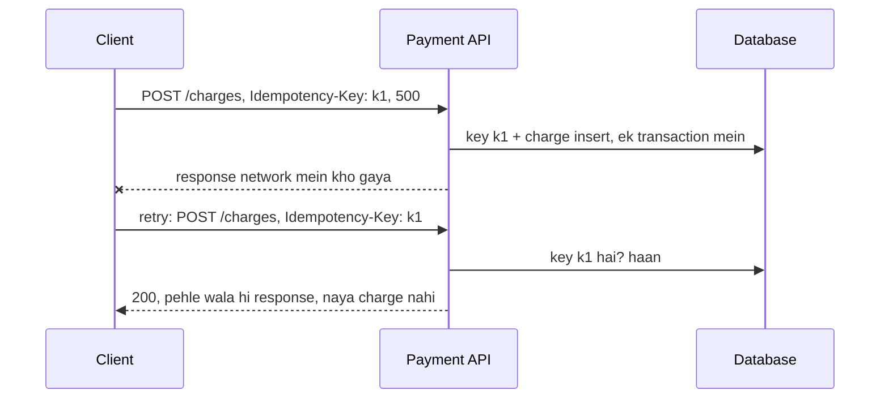

> 🤔 **Mann mein sawaal:** Key client kyun banata hai? Server hi har request ko ek ID de de, simple nahi hoga?
>
> **Jawab:** Nahi, kyunki server ko pata hi nahi ki doosri request "nayi" hai ya "pehle wali ka retry". Dono bilkul same dikhti hain. Sirf client jaanta hai ki "ye wahi payment hai jo maine abhi try kiya tha". Isliye client *iraade* ke liye ek baar key banata hai aur har retry pe wahi bhejta hai. Agar server ID banaata, toh har retry ko nayi ID milti aur double charge ho jaata.

**Production details jo interviewers khodte hain:**
- Key aur result ko side effect ke saath **same database transaction mein** store karo, warna "charge" aur "key save" ke beech ek crash guarantee tod dega. Key column pe ek `UNIQUE` constraint concurrent duplicates ko safely fail karwata hai.
- Same request ki do copies **ek hi waqt** pe aa sakti hain. Pehle key ko `IN_PROGRESS` status ke saath insert karo; doosri request use dekhti hai aur wait karti hai ya 409 Conflict paati hai.
- Keys kuch der baad expire hoti hain (Stripe unhe 24 hours rakhta hai).
- Message consumers ko bhi yahi idea chahiye, kyunki queues aam taur pe "at least once" deliver karti hain ([Chapter 08](08-queues-events.md)): processed message IDs record karo, ya update ko naturally idempotent banao (`UPDATE ... SET status='PAID' WHERE status='PENDING'`).

### 17. Observability: logs, metrics, traces · Andar jhaankne ki aankh

Monolith crash hota hai toh tum ek log file padhte ho. 40 services ke saath, ek user kehta hai "9:03 pe checkout slow tha" aur woh request 30 machines pe 7 services se guzri. **Observability** ka matlab hai ki system ke outputs se tum kitna achhe se samajh sakte ho ki andar kya ho raha hai. Iske teen pillars:

| Pillar | Kya hai | Kis sawaal ka jawab | Tools |
|---|---|---|---|
| **Logs** | Events ke timestamped records | "*Is* request ke saath exactly kya hua?" | ELK (Elasticsearch, Logstash, Kibana), Loki, Splunk |
| **Metrics** | Time ke saath aggregate kiye numbers | "System *overall* kaisa chal raha hai? Bigad raha hai kya?" | Prometheus + Grafana, Datadog, CloudWatch |
| **Traces** | Ek request ka services ke across raasta, timings ke saath | "Is slow request ne time *kahan* lagaya?" | Jaeger, Zipkin, Tempo, OpenTelemetry |

> 🇮🇳 **Desi Analogy:** Swiggy order socho. **Metrics** = restaurant ka dashboard: "aaj 2,000 orders, average delivery 32 min, 3% cancel." Overall sehat. **Logs** = har order ki diary: "8:14 order aaya, 8:16 restaurant ne accept kiya, 8:31 rider ne pickup kiya." **Trace** = ek order ki live map wali journey: kitna time kitchen mein laga, kitna rider ke intezaar mein, kitna traffic mein. Aur teeno ko jodta hai **order ID** (trace ID): dashboard pe spike dikha, order ID se diary kholi, map pe dekha ki rider 20 minute ek hi signal pe atka tha.

**Logs: unhe structured banao.** `"payment failed for user 42"` search karna mushkil hai. Fields wala JSON filter karna aasaan: `{"level":"ERROR","service":"payments","user_id":42,"trace_id":"abc123","msg":"card declined"}`. Saare logs ek central jagah bhejo. Log levels (DEBUG, INFO, WARN, ERROR) shor control karte hain. Passwords, card numbers ya tokens kabhi log mat karo.

**Metrics: golden signals.** Google ki SRE book har service ke liye chaar cheezein dekhne ko kehti hai:
1. **Latency**: requests kitna time leti hain (success aur error latency alag track karo)
2. **Traffic**: requests per second
3. **Errors**: fail hone wali requests ka rate
4. **Saturation**: tum kitne "bhare" ho (CPU, memory, queue depth, connection pool)

(Do related checklists: **RED** = Rate, Errors, Duration, services ke liye; **USE** = Utilisation, Saturation, Errors, disks aur CPUs jaise resources ke liye.)

> 🤔 **Mann mein sawaal:** Success aur error ki latency alag kyun track karein? Ek hi number kaafi nahi?
>
> **Jawab:** Kyunki errors aksar *bahut fast* hote hain. Socho database down hai aur har request 2 ms mein "500 error" de rahi hai. Agar sab mila ke latency dekho, toh graph kahega "wah, system pehle se fast ho gaya!" jabki asal mein sab toot raha hai. Alag rakho toh dono sach dikhte hain.

**Average latency pe kabhi bharosa mat karo.** **Percentiles** use karo: p50 (median), p95, p99. Dekho averages kya chhupate hain:

```python
import random

rng = random.Random(1)
# 1,000 request latencies: zyaadatar fast hain, 2% ek slow database path pe jaati hain.
latencies = [rng.gauss(80, 15) if rng.random() > 0.02 else rng.gauss(1500, 200)
             for _ in range(1000)]

def percentile(values, p):
    ordered = sorted(values)
    index = min(len(ordered) - 1, int(round(p / 100 * len(ordered))) - 1)
    return ordered[max(index, 0)]

print(f"average : {sum(latencies) / len(latencies):7.1f} ms")
for p in (50, 90, 99, 99.9):
    print(f"p{p:<5}  : {percentile(latencies, p):7.1f} ms")
```

```text
average :   107.1 ms
p50     :    78.9 ms
p90     :    99.6 ms
p99     :  1579.3 ms
p99.9   :  1929.2 ms
```

Abhi kya hua: average kehta hai "107 ms, sab theek." p99 kehta hai ki har 100 mein se 1 user **1.5 seconds** wait karta hai. Wahi user Twitter pe complain karta hai, aur ek busy site pe ye ghante mein hazaaron log hain. Ye bhi dekho: average (107) *kisi ko bhi* describe nahi karta: lagbhag sab ~80 ms pe hain aur kuch ~1,500 ms pe. Percentiles asli shape dikhate hain.

> 🇮🇳 **Desi Analogy:** Class ka average marks 70% hai. Sun ke lagta hai sab theek padh rahe hain. Lekin ho sakta hai 98 bachche 72% pe hon aur 2 bachche fail (zero). Average un 2 ko chhupa deta hai. Principal ko "neeche ke 1% kaun hain" dekhna chahiye, wahi p99 hai. Aur dhyaan do, "70%" kisi ek bachche ka marks bhi nahi hai.

**Traces: ek request ka peecha karo.** Edge (gateway) ek **trace ID** banata hai aur use ek header mein (W3C `traceparent` standard) har us service ko pass karta hai jise woh call karta hai; woh aage pass karti hain. Kaam ki har unit ek **span** record karti hai: naam, start, duration, aur parent span. Spans ko jodo toh ek waterfall milta hai:

```python
import json

class Tracer:
    def __init__(self):
        self.spans = []
        self._next = 0

    def span(self, trace_id, name, parent, start_ms, end_ms):
        self._next += 1
        span_id = f"s{self._next}"
        self.spans.append({"trace_id": trace_id, "span_id": span_id, "parent": parent,
                           "name": name, "start": start_ms, "ms": end_ms - start_ms})
        return span_id

t = Tracer()
trace = "abc123"                     # edge pe bana, har hop ko header mein pass hota hai
root = t.span(trace, "GET /checkout (gateway)", None, 0, 480)
cart = t.span(trace, "cart-service", root, 5, 40)
pay = t.span(trace, "payment-service", root, 45, 470)
t.span(trace, "fraud-check", pay, 50, 430)
t.span(trace, "bank API", pay, 432, 465)

# Waterfall view: indentation = parent/child, bar ki lambai = duration
depth = {None: -1}
for s in t.spans:
    depth[s["span_id"]] = depth[s["parent"]] + 1
    bar = " " * (s["start"] // 20) + "#" * max(1, s["ms"] // 20)
    print(f"{'  ' * depth[s['span_id']] + s['name']:<28}{s['ms']:>4} ms |{bar}")

slowest_leaf = max((s for s in t.spans if s["name"] in ("cart-service", "fraud-check", "bank API")),
                   key=lambda s: s["ms"])
print("\nbottleneck:", slowest_leaf["name"])
print("structured log line:", json.dumps({"level": "WARN", "trace_id": trace,
      "service": "payment-service", "msg": "slow fraud check", "ms": slowest_leaf["ms"]}))
```

```text
GET /checkout (gateway)      480 ms |########################
  cart-service                35 ms |#
  payment-service            425 ms |  #####################
    fraud-check              380 ms |  ###################
    bank API                  33 ms |                     #

bottleneck: fraud-check
structured log line: {"level": "WARN", "trace_id": "abc123", "service": "payment-service", "msg": "slow fraud check", "ms": 380}
```

Abhi kya hua: waterfall pe ek nazar aur pata chal gaya "checkout slow hai kyunki 480 mein se 380 ms fraud-check le raha hai." Aur kyunki log line mein wahi `trace_id` hai, tum trace se seedha us service ke logs pe, isi exact request ke liye, jump kar sakte ho. **Teeno pillars ko trace ID se jodna** hi asli superpower hai. **OpenTelemetry** teeno ko produce karne ka vendor-neutral standard hai.

**Alerting:** un **symptoms pe alert karo jo users mehsoos karte hain** (error rate, latency SLO toota), har cause pe nahi (CPU 80% pe). Raat 3 baje engineer ko uthane wala har page urgent aur actionable hona chahiye, warna log alerts ko ignore karna shuru kar dete hain ("alert fatigue").

### 18. SLI, SLO, SLA and error budgets · Teen acronyms, ek baar mein saaf

Ye teen acronyms lagaataar mix ho jaate hain. Ye raha saaf version:

| Term | Matlab | Example | Kisko farak padta hai |
|---|---|---|---|
| **SLI** (Indicator) | Service health ka ek *measurement* | "Checkout requests ka % jo 300 ms se kam mein succeed hoti hain" | Engineers |
| **SLO** (Objective) | Ek period ke liye SLI ka *target* | "30 din mein 99.9% checkout requests 300 ms se kam mein succeed hon" | Engineers + product |
| **SLA** (Agreement) | Customers ke saath *contract*, todne pe penalty | "99.9% monthly uptime warna tumhare bill ka 10% refund" | Customers, lawyers |

SLA hamesha SLO se dheela hota hai (jaise SLO 99.95%, SLA 99.9%), taaki paisa dena pade usse pehle tum gadbad pakad ke theek kar sako.

> 🇮🇳 **Desi Analogy:** Pizza delivery socho. **SLI** = "kitne % orders 30 minute ke andar pahunche" (jo measure ho raha hai). **SLO** = andar ka target: "95% orders 25 minute mein" (manager ka goal). **SLA** = customer se waada: "30 minute mein nahi pahuncha toh pizza free" (todne pe nuksaan). Dhyaan do, andar ka target (25 min) bahar ke waade (30 min) se tight hai. Isiliye SLO hamesha SLA se strict hota hai.

**The nines**, aur har ek kitna downtime allow karta hai:

```python
def error_budget(slo_percent, days=30):
    minutes = days * 24 * 60
    allowed_bad = minutes * (100 - slo_percent) / 100
    return allowed_bad

for slo in (99.0, 99.9, 99.95, 99.99, 99.999):
    m = error_budget(slo)
    print(f"SLO {slo:>7}%  -> downtime budget per 30 days: {m:8.1f} min ({m / 60:5.2f} h)")

# Budget burn: is mahine 1,000,000 requests pe 99.9% ka SLO
slo, total, failed = 99.9, 1_000_000, 650
budget = total * (100 - slo) / 100
print(f"\nbudget = {budget:.0f} failed requests, used = {failed} ({failed / budget:.0%})")
print("decision:", "keep shipping" if failed < budget else "freeze features, fix reliability")
```

```text
SLO    99.0%  -> downtime budget per 30 days:    432.0 min ( 7.20 h)
SLO    99.9%  -> downtime budget per 30 days:     43.2 min ( 0.72 h)
SLO   99.95%  -> downtime budget per 30 days:     21.6 min ( 0.36 h)
SLO   99.99%  -> downtime budget per 30 days:      4.3 min ( 0.07 h)
SLO  99.999%  -> downtime budget per 30 days:      0.4 min ( 0.01 h)

budget = 1000 failed requests, used = 650 (65%)
decision: keep shipping
```

Ek baar haath se: 30 din = 30 × 24 × 60 = **43,200 minutes**. 99.9% SLO matlab 0.1% bura allowed: 43,200 × 0.001 = **43.2 minutes**. Har extra "9" budget ko 10 guna chhota kar deta hai.

(Woh aakhri 0.4 minutes "five nines" ke liye mahine ke lagbhag **26 seconds** hain. Koi insaan itni jaldi login karke kuch theek bhi nahi kar sakta; five nines ko poori tarah automatic failover chahiye.)

**Error budget** chalaak hissa hai. Agar tumhara SLO 99.9% hai, toh 0.1% failure *allowed* hai. Woh 0.1% ek budget hai jise tum **kharch** kar sakte ho: risky deploys, experiments, planned maintenance pe. Jab tak budget bacha hai, fast ship karo. Khatam ho gaya, toh feature launches freeze karo aur time reliability pe lagao. Isse "developers ship karna chahte hain" aur "operations stability chahte hain" ki hamesha wali ladaai ek number mein badal jaati hai jis pe dono ne haami bhari hai.

> 💡 100% galat target hai. Woh namumkin had tak mehenga hai, aur users 99.99% aur 100% mein farak bata hi nahi sakte, kyunki unka apna Wi-Fi aur phone usse zyada baar fail hota hai.

### 19. Deploying without fear · Bina dar ke deploy karo

Zyaadatar outages **changes** se hote hain: naya deploy, config edit, migration. Isliye *kaise* release karte ho, woh utna hi matter karta hai jitna *kya* release karte ho.

**Rolling deployment:** instances ko thode thode karke replace karo. Har pal zyaadatar servers up hain, toh koi downtime nahi. Health checks fail hon toh ruko aur roll back karo. Kubernetes mein ye default hai.

```python
def rolling_update(servers, new_version, batch_size, healthy):
    """Replace servers batch by batch. Stop (and roll back) if a batch fails its health check."""
    fleet = list(servers)
    for start in range(0, len(fleet), batch_size):
        batch = range(start, min(start + batch_size, len(fleet)))
        for i in batch:
            fleet[i] = new_version
        live = sum(v == new_version for v in fleet)
        if not healthy(new_version):
            print(f"  batch at {start}: health check FAILED -> rolling back")
            return list(servers)
        print(f"  batch at {start}: ok, fleet = {fleet}  ({live}/{len(fleet)} on {new_version})")
    return fleet

print("Deploy v2 (healthy):")
rolling_update(["v1"] * 6, "v2", 2, healthy=lambda v: True)
print("Deploy v3 (broken):")
print("  final fleet:", rolling_update(["v2"] * 6, "v3", 2, healthy=lambda v: v != "v3"))
```

```text
Deploy v2 (healthy):
  batch at 0: ok, fleet = ['v2', 'v2', 'v1', 'v1', 'v1', 'v1']  (2/6 on v2)
  batch at 2: ok, fleet = ['v2', 'v2', 'v2', 'v2', 'v1', 'v1']  (4/6 on v2)
  batch at 4: ok, fleet = ['v2', 'v2', 'v2', 'v2', 'v2', 'v2']  (6/6 on v2)
Deploy v3 (broken):
  batch at 0: health check FAILED -> rolling back
  final fleet: ['v2', 'v2', 'v2', 'v2', 'v2', 'v2']
```

Pakad: rolling deploy ke dauraan **v1 aur v2 ek saath chalte hain**, toh unhe ek doosre ke saath aur database ke saath compatible hona chahiye.

**Blue-green deployment:** do poore environments chalao. **Blue** live traffic serve karta hai (v1). v2 ko **green** pe deploy karo, privately test karo, phir load balancer ko ek hi step mein green pe palat do. Kuch toota toh wapas palat do: rollback seconds mein. Keemat: switch ke dauraan double infrastructure, aur database shared hai, toh schema changes mein ab bhi dhyaan chahiye.

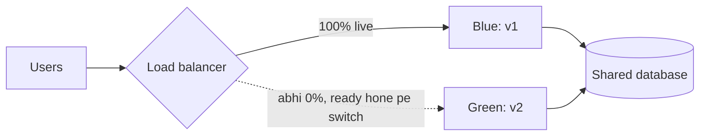

**Canary deployment:** naam un canary chidiyon se aaya jinhe khadaan wale gas pakadne ke liye saath le jaate the. Real traffic ka ek chhota hissa (1%, phir 5%, 25%, 100%) naye version ko bhejo aur uska error rate aur latency purane version se compare karo. Canary bimaar dikhe, toh sirf 1% users pe asar hua aur tum roll back kar dete ho. Kai teams analysis automate karti hain ("agar canary ka error rate baseline ka 2× hai, toh abort").

> 🇮🇳 **Desi Analogy:** Teen tarike, ek restaurant ki nayi recipe ke saath. **Rolling**: ek ek table pe nayi dish dena shuru karo, dheere dheere poore hall mein. **Blue-green**: bagal mein ek poora naya kitchen taiyaar rakho, aur ek din ek jhatke mein saare order wahan bhejo; kuch gadbad toh wapas purane kitchen pe. **Canary**: pehle sirf ek table ko nayi dish chakhao, unka chehra dekho, pasand aaye toh 5 tables, phir aadha hall, phir sab. **Feature flag**: dish menu card mein chhapi hai lekin "hidden" hai; manager ek switch se use dikhata ya chhupata hai, kitchen badle bina.

**Feature flags:** **deploy** (code servers pe hai) ko **release** (users dekhte hain) se alag karo. Naya code band hokar ship hota hai, `if flags.is_enabled("new_checkout", user):` mein lipta hua, aur tum use pehle employees ke liye, phir 1%, phir sabke liye on karte ho, bina redeploy kiye. Gadbad kare, toh seconds mein off kar do. Key trick hai ek **stable hash**, taaki user har page load pe purane aur naye ke beech jhilmilaye nahi:

```python
import hashlib

def bucket_of(user_id, flag_name):
    """Stable 0-99 bucket: the same user always lands in the same bucket."""
    digest = hashlib.sha256(f"{flag_name}:{user_id}".encode()).hexdigest()
    return int(digest, 16) % 100

def is_enabled(user_id, flag_name, rollout_percent):
    return bucket_of(user_id, flag_name) < rollout_percent

users = [f"user{i}" for i in range(10_000)]
for percent in (1, 10, 50, 100):
    on = sum(is_enabled(u, "new_checkout", percent) for u in users)
    print(f"rollout {percent:>3}% -> {on:>5} of 10000 users see the new checkout")

# Rollout badhane se kisi ko wapas OFF nahi kiya jaata:
early = {u for u in users if is_enabled(u, "new_checkout", 10)}
later = {u for u in users if is_enabled(u, "new_checkout", 50)}
print("everyone from the 10% group still in at 50%:", early <= later)
```

```text
rollout   1% ->   104 of 10000 users see the new checkout
rollout  10% ->   977 of 10000 users see the new checkout
rollout  50% ->  4886 of 10000 users see the new checkout
rollout 100% -> 10000 of 10000 users see the new checkout
everyone from the 10% group still in at 50%: True
```

Abhi kya hua: hashing har user ko 0 se 99 tak ek fixed number deti hai. "Rollout 10%" matlab "buckets 0–9". Ise 50% karo toh buckets 10–49 judte hain, toh shuru wale users andar hi rehte hain. Hash mein flag ka naam daalne se alag flags alag users chunte hain (taaki wahi bechaare 1% har cheez test na karein). **Purane flags delete karna** yaad rakho; sainkdon baasi flags untested code paths ki bhool-bhulaiya ban jaate hain.

> 🤔 **Mann mein sawaal:** `random.random() < 0.10` se seedha 10% users kyun nahi chun lete? Hash ka jhanjhat kyun?
>
> **Jawab:** Kyunki random har call pe naya jawab deta hai. Asha ne page khola, nayi checkout dikhi. Refresh kiya, purani wapas. Phir nayi. User ko lagega app pagal ho gaya. Hash *deterministic* hai: same `flag:user` pe hamesha same number. Toh Asha ya toh hamesha andar hai ya hamesha bahar, jab tak tum percent na badlo.

**Database changes: expand and contract.** Kyunki purana aur naya code saath saath chalte hain, kabhi bhi ek step mein breaking schema change mat karo. Ek column ka naam badalna hai: (1) **expand**: naya column add karo, dono mein likho; (2) purani rows backfill karo; (3) reads naye column pe switch karo; (4) **contract**: purane mein likhna band karo aur use drop karo, ek baad wale release mein.

| Strategy | Rollback speed | Extra cost | Risk exposure | Best for |
|---|---|---|---|---|
| Rolling | Minutes (dheere dheere aage/peeche) | Kuch nahi | Batch dar batch badhta hai | Stateless services ka default |
| Blue-green | Seconds (wapas palto) | Switch ke dauraan 2× infra | Flip ke baad sab users ek saath | Jab fast, saaf rollback matter kare |
| Canary | Seconds (route hata do) | Thoda | Sirf canary % | High-traffic services, risky changes |
| Feature flag | Seconds (toggle) | Code complexity | Jo % chaho, per user | Product features, experiments, kill switches |

### 20. Disaster recovery: RPO, RTO and backups · Jab sab kuch jal jaaye

Replication ([Chapter 05](05-replication-sharding.md)) tumhe ek machine ke marne se bachata hai. Lekin agar poora region andhere mein chala jaaye, ya koi `DELETE FROM orders` bina `WHERE` ke chala de? Replication woh delete milliseconds mein har replica pe imaandari se copy kar dega. Tumhe **backups** aur ek **disaster recovery (DR)** plan chahiye.

Do numbers kisi bhi DR plan ko define karte hain:

- **RPO (Recovery Point Objective):** kitna **data** khona afford kar sakte ho, time mein measure kiya hua. "RPO = 5 minutes" matlab disaster ke baad tum zyada se zyada pichhle 5 minute ke writes kho sakte ho. Ye is baat se tay hota hai ki tum kitni baar backup ya replicate karte ho.
- **RTO (Recovery Time Objective):** kitni der **down** reh sakte ho. "RTO = 1 hour" matlab service ek ghante ke andar wapas aani chahiye.

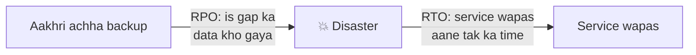

Memory hook: **RPO = Point = waqt mein kitna peeche jaate ho. RTO = Time = wapas aane mein kitna lagta hai.**

> 🇮🇳 **Desi Analogy:** Board exam ke din tumhara laptop mar gaya jismein project tha. **RPO** = tumhara aakhri Google Drive backup kab ka tha? Kal raat ka, toh aaj subah ka kaam gaya (RPO = kuch ghante). **RTO** = naya laptop arrange karke, Drive se download karke, wapas kaam shuru karne mein kitna laga? Do ghante (RTO = 2 ghante). Ek data ke nuksaan ka sawaal hai (peeche dekho), doosra downtime ka (aage dekho).

**DR strategies, saste aur slow se mehenge aur fast tak:**

| Strategy | Kaise kaam karti hai | RPO | RTO | Cost |
|---|---|---|---|---|
| Backup & restore | Regular backups doosre region mein copy; disaster pe unse sab kuch dobara banao | Hours | Hours se ek din | $ |
| Pilot light | Core data region B mein live replicate; wahan servers band hain, disaster pe start karo | Minutes | Das-bees minutes | $$ |
| Warm standby | Region B mein ek chhoti lekin chalti hui copy; disaster pe scale up | Seconds se minutes | Minutes | $$$ |
| Multi-site active-active | Dono regions hamesha live traffic serve karte hain | ~0 | ~0 (automatic) | $$$$ |

**Backup ke rules jo careers bachate hain:**
- **3-2-1 rule:** data ki 3 copies, 2 alag tarah ke storage pe, unmein se 1 off-site (doosra region/account).
- Full backups ko incremental backups aur database ke **write-ahead logs** ke saath milao taaki **point-in-time recovery** ho sake ("14:31:59 pe restore karo, galat DELETE se ek second pehle").
- Kam se kam ek copy **immutable** rakho (N din tak na badal sake na delete ho sake), taaki ransomware ya chori hua admin password tumhare backups bhi na mita sake.
- **Jo backup tumne kabhi restore nahi kiya, woh backup nahi, ek ummeed hai.** Restores regularly test karo. DR drills ("game days") chalao. Netflix ka **Chaos Monkey** production instances ko randomly maarta hai taaki failure jhelna roz ki baat ban jaaye.

> 🤔 **Mann mein sawaal:** Mere paas 3 replicas hain teen alag zones mein. Phir backup ki kya zaroorat?
>
> **Jawab:** Replicas *machine ke marne* se bachate hain, *galti* se nahi. Replica ka kaam hai primary ki har baat turant copy karna, achhi ho ya buri. Kisi ne galti se poori table delete ki, toh teeno replicas pe bhi milliseconds mein delete. Backup ek *purani tasveer* hai jo galti se pehle li gayi thi. Replication = live CCTV. Backup = kal ki photo. CCTV pe chor dikhega, lekin saamaan wapas photo se hi pehchaanoge.

### 21. Containers and Kubernetes, intuitively · Seedhi samajh

"Mere machine pe toh chal raha tha" isliye hota hai kyunki tumhare laptop aur server ke Python versions, libraries aur settings alag hain. **Container** tumhare code ko **aur uski har zaroorat** (runtime, libraries, config) ko ek **image** mein pack karta hai jo har jagah ek jaisa chalta hai.

Shipping-container wali analogy bilkul literal hai: standard containers se pehle, jahaaz load karne ka matlab tha har shape ki boriyaan, peeppe aur crates sambhalna. Ek standard steel ke dabbe ne cranes, jahaaz aur trucks sabko interchangeable bana diya. Software containers ne servers ke liye yahi kiya.

> 🇮🇳 **Desi Analogy:** Mumbai ke dabbawalas socho. Har ghar ka khaana alag (roti, chawal, dal, sabzi, alag bartan), lekin sab ek **standard dabbe** mein pack hota hai. Ab dabbawala ko farak nahi padta andar kya hai: woh har dabba ek hi tarike se uthata hai, train mein rakhta hai, office pahunchata hai. Container yahi hai: andar tumhara Python, libraries, config, kuch bhi ho, bahar se sab ek standard dabba hai jo har server pe ek hi tarike se chalta hai. Aur **Kubernetes** dabbawalon ka poora network hai: kaunsa dabba kis train mein, koi dabbawala beemar toh doosra uska kaam le, aur har dabba time pe sahi desk pe.

**Container vs virtual machine:** VM poore computer ki nakal karta hai, apne operating system kernel samet (gigabytes, boot hone mein ek minute). Container host ka kernel share karta hai aur sirf process ko alag karta hai (Linux namespaces se "main kya dekh sakta hoon" aur cgroups se "main kitna CPU/memory use kar sakta hoon"). Nateeja: megabytes, lagbhag ek second mein start, ek machine pe darjanon. **Docker** ne containers ko popular banaya: ek `Dockerfile` batata hai ki image kaise build karni hai.

```py
# Dockerfile (Python nahi hai, bas swaad ke liye dikhaya hai)
FROM python:3.11-slim
WORKDIR /app
COPY requirements.txt .
RUN pip install -r requirements.txt
COPY . .
CMD ["gunicorn", "app:server", "--bind", "0.0.0.0:8000"]
```

Haath se 3 containers chalana theek hai. 200 machines pe 3,000 chalana, crash hone walon ko restart karna, naye versions roll out karna, aur unhe traffic route karna, nahi. Ye **container orchestration** hai, aur **Kubernetes** (K8s) iska standard hai.

Kubernetes ke key words:

| Concept | Seedha matlab |
|---|---|
| **Cluster** | Machines (**nodes**) ka ek group jo saath manage hota hai |
| **Pod** | Sabse chhoti unit: ek ya zyada containers jo saath chalte hain (jaise tumhari app + uska sidecar) |
| **Deployment** | "Mujhe `orders:v7` ki 3 copies chalti hui chahiye." Rolling updates aur rollbacks sambhalta hai |
| **Service** | Ek stable naam aur virtual IP (`http://orders`) jo healthy pods mein load-balance karta hai: built-in service discovery |
| **Ingress** | Bahar ke HTTP traffic ko services tak route karta hai (ek mini gateway jaisa) |
| **ConfigMap / Secret** | Pods mein daali gayi configuration aur passwords |
| **HorizontalPodAutoscaler** | CPU ya custom metrics ke basis pe pods add/remove karta hai |
| **Liveness / readiness probes** | "Zinda ho?" (nahi toh restart) aur "Traffic ke liye ready ho?" (abhi tumhe route mat karo) |

Woh core idea jisse Kubernetes "click" karta hai: ye **declarative** hai. Tum nahi kehte "ek pod start karo". Tum kehte ho "**3 hone chahiye**", aur ek **control loop** *desired state* ko *actual state* se lagaataar compare karta hai aur farak theek karta rehta hai, hamesha:

```python
def reconcile(desired, actual):
    """One pass of a Kubernetes-style control loop: make actual look like desired."""
    actions = []
    running = [p for p in actual if p["status"] == "Running"]
    for p in actual:
        if p["status"] != "Running":
            actions.append(f"delete {p['name']} ({p['status']})")
    missing = desired["replicas"] - len(running)
    for i in range(missing):
        actions.append(f"create pod {desired['app']}-new{i + 1} from image {desired['image']}")
    for p in running[desired["replicas"]:]:
        actions.append(f"delete {p['name']} (too many)")
    return actions

desired = {"app": "orders", "image": "orders:v7", "replicas": 3}
actual = [{"name": "orders-a", "status": "Running"},
          {"name": "orders-b", "status": "CrashLoopBackOff"},
          {"name": "orders-c", "status": "Running"}]
for action in reconcile(desired, actual):
    print(action)

print("--- someone scales down to 1 ---")
desired["replicas"] = 1
for action in reconcile(desired, [{"name": "orders-a", "status": "Running"},
                                  {"name": "orders-c", "status": "Running"},
                                  {"name": "orders-new1", "status": "Running"}]):
    print(action)
```

```text
delete orders-b (CrashLoopBackOff)
create pod orders-new1 from image orders:v7
--- someone scales down to 1 ---
delete orders-c (too many)
delete orders-new1 (too many)
```

Abhi kya hua: humne system ko kabhi nahi bataya ki cheezein *kaise* theek karni hain; humne bataya ki hume *kya* chahiye, aur loop ne actions khud nikaal liye. Crash hua pod replace ho jaata hai. Ek machine mar gayi, toh uske pods kahin aur dobara ban jaate hain. Image ko `v8` kar do, aur Deployment controller rolling update kar deta hai. Ye "desired state + reconcile loop" idea hi Kubernetes ka dil hai.

> 🇮🇳 **Desi Analogy:** AC ka thermostat. Tum AC ko ye nahi kehte "compressor 7 minute chalao, phir 3 minute band karo." Tum bas kehte ho "**24°C chahiye**" (desired state). AC lagaataar room ka temperature (actual state) naapta hai: garam hai toh thanda karo, thanda ho gaya toh ruk jao. Darwaza khula, garmi aayi, AC khud sambhal leta hai. Kubernetes bhi bilkul yahi: "3 pods chahiye", aur woh khud dekhta hai kam hain toh banao, zyada hain toh hatao.

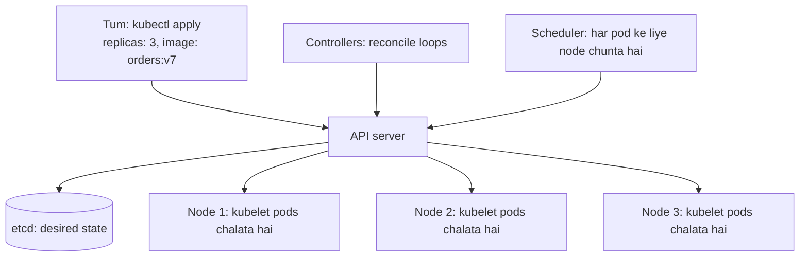

---

## 🔬 Under the Hood · Andar Ki Kahani

### The maths of "more services = more failure" · "Zyada services = zyada failure" ka maths

Teen chhoti calculations is chapter ke lagbhag har reliability rule ko samjha deti hain.

```python
# 1) Fan-out: ek page N backends ko parallel mein call karta hai. Har backend 1% time
#    slow hota hai (apne p99 se upar). POORA page kitni baar slow hota hai?
for n in (1, 10, 50, 100):
    print(f"fan-out {n:>3}: page is slow {1 - 0.99 ** n:6.1%} of the time")

# 2) Retry amplification: 5 layers gehra, har layer 3 baar tak try karti hai.
layers, attempts = 5, 3
print(f"\nworst-case calls hitting the bottom service: {attempts ** layers}")

# 3) Series vs parallel mein availability
a = 0.999
print(f"\n3 services in series   : {a ** 3:.4%}")
print(f"2 replicas in parallel : {1 - (1 - a) ** 2:.4%}")
```

```text
fan-out   1: page is slow   1.0% of the time
fan-out  10: page is slow   9.6% of the time
fan-out  50: page is slow  39.5% of the time
fan-out 100: page is slow  63.4% of the time

worst-case calls hitting the bottom service: 243

3 services in series   : 99.7003%
2 replicas in parallel : 99.9999%
```

**1. Tail latency fan-out ke saath badhti hai.** Page apni N calls mein se *sabse slow* ka wait karta hai. Saari N fast hon, iska chance 0.99ᴺ hai, toh kam se kam ek slow ho, iska chance 1 − 0.99ᴺ. 100 backends ke saath, ek "rare" 1% slowness **63%** pages ko lagti hai. Isiliye badi companies averages nahi, p99 aur p99.9 ke peeche padi rehti hain (Google ka is pe mashhoor paper hai "The Tail at Scale"). Fixes: kam aur chhoti call chains; **hedged requests** (agar ek call p95 time tak wapas nahi aayi, toh doosri replica ko duplicate bhejo aur jo pehle jawab de woh le lo); aur timeouts.

> 🇮🇳 **Desi Analogy:** Shaadi mein baraat tabhi nikalti hai jab *saare* rishtedaar taiyaar hon. Har ek ke late hone ka chance sirf 1% hai. 1 rishtedaar ho toh baraat 1% late. Lekin 100 rishtedaar? Kam se kam ek ka late hona lagbhag pakka (63%). Isiliye jitne zyada log (backends) ka intezaar, utni zyada der. Hedged request = "chacha ko do baar phone karo, ek ghar pe ek mobile pe, jo pehle uthaye."

**2. Retries layers ke across multiply hote hain.** Agar 5 mein se har layer 3 baar try kare, toh neeche ek single failure 3⁵ = **243** calls ban jaata hai. Neeche wali service, jo pehle se pareshaan hai, ek 243× toofan jhelti hai. Isliye: ek layer pe retry karo, retry budgets use karo, aur retries ko circuit breakers ke andar rakho.

**3. Series uptime ko neeche multiply karta hai; parallel downtime ko neeche multiply karta hai.** Jab request ko A *aur* B *aur* C chahiye, availabilities multiply hoti hain: teen 99.9% services 99.7% deti hain (kisi ek ke downtime ka lagbhag 3×). Jab tumhare paas redundant copies hain aur sirf *ek* up chahiye, toh *failure* probabilities multiply hoti hain: do 99.9% replicas 99.9999% deti hain. Replicas ka, aur synchronous chains chhoti rakhne ka, yahi mathematical kaaran hai. (Parallel formula maanta hai ki failures independent hain. Same rack mein do replicas, jin pe same kharab deploy gira, independent *nahi* hain, isiliye replicas ko zones mein phailaate hain.)

Parallel wala ek baar haath se: ek replica ke down hone ka chance 0.001 hai. Dono ek saath down: 0.001 × 0.001 = 0.000001. Toh kam se kam ek up: 1 − 0.000001 = **99.9999%**.

### Why a slow service is worse than a dead one: Little's Law · Slow service mari hui se buri kyun

**Little's Law** kehta hai: `requests in flight = arrival rate × time each request takes`.

Maan lo orders ko 100 requests/second milti hain aur recommendations ki har call normally 50 ms leti hai: 100 × 0.05 = **5** requests in flight. 200-thread pool ke saath ekdum theek. Ab recommendations slow hoke 30 s ki ho gayi: 100 × 30 = **3,000** requests in flight hongi. 200 ka pool do second mein bhar jaata hai (100/s × 2 s = 200), aur baaki sab uske peeche queue mein. Ek *mari hui* service lagbhag ek millisecond mein fail hoti hai (connection refused), toh woh threads ko mushkil se pakadti hai. Isiliye defence ki pehli line **timeout** hai: woh "har request kitna time leti hai" ko cap karta hai, jo in-flight count ko cap karta hai.

> 🇮🇳 **Desi Analogy:** Chai tapri pe har minute 10 customers aate hain, aur har ek 1 minute mein chai peeke chala jaata hai: tapri pe ek waqt mein ~10 log khade hain (10 × 1). Ab chai banne mein 30 minute lagne lage: 10 × 30 = 300 log khade honge! Tapri pe jagah 20 ki hai. Baaki sab sadak pe, aur jo log sirf biscuit lene aaye the, woh bhi atak gaye. Agar tapri band hoti (dead service), log dekhte hi aage nikal jaate. Timeout = "5 minute mein chai nahi mili toh nikal lo" ka rule.

### How the patterns stack together · Patterns ek ke upar ek kaise lagte hain

Timeout ke bina breaker failures dekh bhi nahi sakta: calls bas latki rehti hain, aur latakna abhi "failed" nahi hai. Timeouts slowness ko errors mein badalte hain; breakers baar baar ke errors ko fast rejections mein; fallbacks fast rejections ko ek degraded-lekin-chalte page mein. Aam order, bahar se andar:

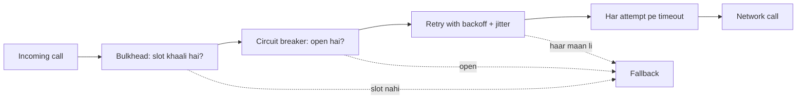

### How a service mesh intercepts traffic · Mesh traffic kaise pakadta hai

Sidecar un calls ko kaise "dekhta" hai jo app `http://payments` ko karti hai? Kubernetes mein, jab pod start hota hai, mesh pod ke network namespace ke andar **iptables** rules (Linux kernel ke packet-routing rules) install karta hai jo saara aane-jaane wala TCP traffic sidecar ke port pe redirect kar dete hain. App ko kuch pata nahi. Sidecar apni routing table dekhta hai (jo control plane ne push ki), destination ke sidecar se mTLS connection kholta hai, timeouts aur retries lagata hai, aur metrics record karta hai. Naye "ambient" ya eBPF-based meshes ye kaam har pod se bahar nikaal dete hain taaki cost kam ho, lekin idea wahi hai: networking policy tumhare code ke bahar rehti hai.

### How a token bucket lives in Redis with no timer · Bina timer ke Redis mein token bucket

Token bucket ko tokens "tapkaane" ke liye kabhi background job nahi chahiye. Request aane pe woh calculate karta hai `tokens = min(capacity, tokens + (now − last) × rate)`. Toh har user ke liye bas `(tokens, last)` store karte ho. Redis mein, read-compute-write ek **Lua script** ki tarah chalta hai, jise Redis atomically execute karta hai (woh commands ek ek karke chalata hai), toh do gateway servers dono aakhri token kharch nahi kar sakte. Key pe ek `EXPIRE` ka matlab hai ki idle users ka koi kharcha nahi.

### What Kubernetes actually does when a node dies · Node marta hai toh Kubernetes asal mein kya karta hai

1. Har node ka agent (**kubelet**) regularly API server ko report karta hai.
2. Reports ruk jaati hain. Ek grace period ke baad, node controller node ko `NotReady` mark karta hai, aur ek aur timeout ke baad uske pods evict ho jaate hain.
3. Deployment ka controller dekhta hai "desired 3, running 2" aur ek naya pod object banata hai.
4. **Scheduler** ek aisa node chunta hai jismein kaafi free CPU/memory ho aur jo pod ki constraints satisfy kare.
5. Us node ka kubelet image pull karta hai aur container start karta hai. Readiness probe pass hota hai, aur Service us pe traffic route karna shuru kar deti hai.

Har step ek alag loop hai jo **etcd** mein store shared state ko dekh raha hai. Koi ek component poori cheez "orchestrate" nahi karta; har ek apna hissa reconcile karta hai. Isi design ki wajah se Kubernetes khud ko heal karta hai.

---

## 🧩 Pattern Decoder · Pattern Pakdo

### Decision guide: monolith or microservices? · Monolith ya microservices?

| Agar... | Chuno | Kyunki |
|---|---|---|
| Chhoti team (lagbhag 20 engineers se kam), naya product, domain abhi badal raha hai | **Modular monolith** | Badalna fast; boundaries abhi pata nahi; ops cost kam |
| Bahut saari teams ek doosre ke deploys se ruki hui hain | Team lines ke hisaab se **Microservices** | Independent deploys hi main fayda hai |
| Ek hisse ko bahut alag scaling chahiye (video encoding, ML inference) | **Sirf woh hissa nikaalo** | Use akele scale karo; baaki simple rakho |
| Har jagah cross-entity transactions chahiye | **Monolith** (ya un entities ko ek service mein rakho) | Distributed transactions dardnaak hain |
| Legacy system migrate kar rahe ho | **Strangler fig**, ek capability ek baar mein | Koi big-bang rewrite nahi |

### Decision guide: which reliability pattern? · Kaunsa reliability pattern?

| Jo problem dikh rahi hai | Pattern | Kyun kaam karta hai |
|---|---|---|
| Calls latak rahi hain, threads jama ho rahe hain | **Timeout** (+ deadline propagation) | Har call ka time cap, toh in-flight kaam cap |
| Kabhi kabhi transient errors | **Retry + exponential backoff + jitter** | Zyaadatar hichkiyaan jaldi theek hoti hain; jitter synchronised herds se bachata hai |
| Dependency minutes ke liye down | **Circuit breaker** + fallback | Fail fast, resources free, use sambhalne do |
| Ek slow dependency unrelated features ko bhookha maarti hai | **Bulkhead** | Alag pools nuksaan ko contain karte hain |
| Clients bahut zyada bhejte hain (bugs, abuse, spikes) | Gateway pe **Rate limiting** | Fair share; backends ki hifazat |
| Abhi capacity se upar | **Load shedding** (low priority pehle) | Kuch users achhe se served > sab bure se served |
| Optional feature fail ho raha hai | **Graceful degradation** | Core path cached/default content ke saath up rehta hai |
| Retried writes double apply ho sakte hain | **Idempotency keys** / dedup | Safe retries |
| Bahut saari services mein ek jaisa network behaviour chahiye | **Service mesh / sidecar** | Policy code ke bahar |

### Decision guide: which rate limiter? · Kaunsa rate limiter?

- "Bursts allow karo, average cap karo" → **token bucket**. (Default interview answer.)
- "Downstream ko steady pace milni chahiye" → **leaky bucket**.
- "Simple daily/monthly quota" → **fixed window**.
- "Exact, chhoti limit, jaise 15 minute mein 5 login attempts" → **sliding log**.
- "High traffic, accurate, sasti memory" → **sliding window counter**.

### Decision guide: which deployment strategy? · Kaunsi deployment strategy?

- Stateless service, routine change → **rolling**.
- Turant, saaf rollback chahiye aur thodi der 2× capacity afford kar sakte ho → **blue-green**.
- High-traffic service pe risky change → automated metric comparison ke saath **canary**.
- Product feature, gradual rollout, A/B test, kill switch → **feature flag**.
- Hamesha: schema changes ke liye **expand-and-contract**.

### Decision guide: which DR tier? · Kaunsa DR tier?

| Business kehta hai | RPO / RTO | Strategy |
|---|---|---|
| "Internal tool hai, ek din down chalega" | Hours / ek din | Backup & restore |
| "Kuch minute ka data kho sakte hain, ghante bhar mein wapas chahiye" | Minutes / 1 h se kam | Pilot light |
| "Customers minutes mein notice kar lenge" | Seconds / minutes | Warm standby |
| "Payments hain, kabhi rukne nahi chahiye" | ~0 / ~0 | Active-active multi-region |

### The resilient call: a reusable template · Ek baar likho, har jagah use karo

```py
def call_dependency(request, deadline):
    if not bulkhead.try_enter():                  # 1. concurrency limit karo
        return fallback(request)
    try:
        if breaker.is_open():                     # 2. pata hai toota hai, toh fail fast
            return fallback(request)
        for attempt in range(MAX_ATTEMPTS):       # 3. bounded retries
            timeout = min(PER_CALL_TIMEOUT, deadline.remaining())   # 4. timeout <= deadline
            if timeout <= 0:
                break
            try:
                result = client.call(request, timeout=timeout,
                                     idempotency_key=request.key)   # 5. retry ke liye safe
                breaker.record_success()
                return result
            except RetryableError:
                breaker.record_failure()
                sleep(random.uniform(0, min(CAP, BASE * 2 ** attempt)))  # 6. backoff + jitter
        return fallback(request)                  # 7. degrade karo, phato mat
    finally:
        bulkhead.leave()
```

Is template ko upar se neeche ek kahani ki tarah padho: pehle seat milegi? (bulkhead) → pata hai toota hai? (breaker) → kuch baar try karo (retry) → har try ka time budget ke andar (timeout + deadline) → har try safe hai (idempotency key) → beech mein tameez se ruko (backoff + jitter) → kuch na chale toh izzat se jhuko (fallback). Aur `finally` mein seat hamesha wapas, chahe kuch bhi ho.

### When NOT to use these tools · Kab ye tools MAT lagao

- **Non-idempotent operations ko retry mat karo** bina idempotency key ke.
- **4xx client errors ko retry mat karo** (408/429 ko chhod ke): woh dobara fail honge.
- Ek hi language mein mutthi bhar services ke liye **service mesh mat lagao**; ek achhi HTTP client library kaafi hai.
- "Netflix jaisa banne" ke liye **microservices mein mat todo**. Unke paas sainkdon engineers aur ek khaas scaling problem thi.
- **100% availability ka target mat rakho**: cost phat jaati hai aur users farak bata bhi nahi sakte.

---

## ⚠️ Traps & Common Mistakes · Yahan Sab Phisalte Hain

1. **Koi timeout nahi (ya default "hamesha").** Cascading failures ka sabse common akela kaaran.

```py
# ❌ galat: server atak gaya toh hamesha wait karega
resp = requests.get(url)

# ✅ sahi: connect + read timeouts, dependency ke p99 se thoda upar
resp = requests.get(url, timeout=(0.5, 2.0))
```

2. **Bina backoff ya jitter ke retry.** Hazaaron clients ke turant retries ek synchronised lehar banate hain jo service ko down hi rakhti hai.

```py
# ❌ galat: hathoda chalao, har error nigal jao
for _ in range(5):
    try:
        return call()
    except Exception:
        pass

# ✅ sahi: sirf transient errors, exponential backoff, full jitter, capped attempts
for attempt in range(4):
    try:
        return call()
    except TransientError:
        time.sleep(random.uniform(0, min(2.0, 0.1 * 2 ** attempt)))
raise ServiceUnavailable()
```

3. **Har layer pe retry.** 3 tries × 5 layers = 243 calls (3⁵). Ek hi jagah retry karo.
4. **Aise POST ko retry karna jo idempotent nahi hai.** Customer ka do baar paisa kata. Idempotency keys use karo.
5. **Services ke beech shared database.** Ek distributed monolith: network ka saara dard, independence ka zero fayda.
6. **Nano-services.** Har function ki ek service, toh har request darjan bhar network calls ban jaati hai.
7. **Lambi synchronous chains.** A → B → C → D → E: latencies judti hain, availabilities ghat-ti hain. Events use karo ya services merge karo.
8. **Averages dekhna.** Average slow 1% ko chhupa deta hai. p99 aur error rate pe alert karo.
9. **Bina trace ID ke logs.** 7 services ke across ek request ka peecha nahi kar sakte. Har jagah ek ID propagate karo.
10. **Jahan precision matter kare wahan fixed-window limiter.** Window edges pe limit ka 2× allow karta hai.
11. **Globally ki jagah har server pe rate limiting.** 20 gateway servers local counters ke saath = intended limit ka 20×.
12. **Ek deploy mein breaking schema changes.** Rollout ke beech abhi bhi chal rahe purane pods naye schema pe crash. Expand, migrate, phir contract.
13. **Replication ko backup samajhna.** Ek galat `DELETE` milliseconds mein replicate ho jaata hai. Point-in-time backups chahiye, aur unhe restore karke test karna zaroori hai.
14. **Jhooth bolne wale (ya zyada check karne wale) health checks.** DB unreachable hai phir bhi `/health` 200 de raha hai, toh toota pod rotation mein bana rehta hai. Lekin ek *liveness* probe jo database check kare, woh DB ki har hichki pe Kubernetes se har pod restart karwa dega. Liveness = "mera process theek hai?"; readiness = "kya main abhi traffic serve kar sakta hoon?".

> 🤔 **Mann mein sawaal:** Trap 14 confusing hai. Liveness probe mein DB check kyun nahi karna? DB ke bina app kaam ka nahi na?
>
> **Jawab:** Socho kya hoga. DB 30 second ke liye hichki leta hai. Liveness probe sabhi 50 pods pe fail. Kubernetes sochta hai "ye sab pods mar gaye" aur *saare 50 restart* kar deta hai. Restart se DB theek nahi hota, ulta 50 pods ek saath DB se dobara connect karne ki koshish karte hain aur DB pe aur bojh. Sahi tarika: DB check **readiness** mein daalo. DB gaya toh pod "not ready" ho jaata hai, traffic aana ruk jaata hai, lekin pod zinda rehta hai. DB wapas, pod turant ready. Restart sirf tab jab process khud atka ho.

---

## 💡 Tips & Tricks · Pro Wale Moves

- Interviews mein "**timeouts, retries with backoff and jitter, circuit breakers, bulkheads**" ek saath bolo. Ye standard resilience quartet hai.
- Timeouts data se chuno: **dependency ke p99 se thoda upar**, aur caller ki bachi hui deadline se kabhi zyada nahi.
- "Design a rate limiter" ka default answer hai **token bucket in Redis with an atomic Lua script**, user/API key se keyed, gateway pe enforce, aur 429 + `Retry-After` return karta hua.
- **Har log line mein trace ID** daalo. Ye logs, metrics aur traces ko jodta hai.
- **Chaar golden signals** dekho: latency, traffic, errors, saturation.
- SLOs **user ke nazariye** se likho ("checkout 300 ms mein succeed hota hai"), machine ke nahi ("CPU 70% se neeche").
- "Deploy" ≠ "release". Feature flags tumhe andhere mein deploy karne aur ek toggle se release karne dete hain.
- Jo fallback tumne kabhi trigger nahi kiya, woh untested code hai. Chaos experiments aur game days use karo.
- Nines ratt lo: **99.9% ≈ 43 minutes/month, 99.99% ≈ 4.3 minutes/month**.
- Jab poocha jaaye "monolith or microservices?", toh shuru karo "it depends on team size and how well we understand the domain," se, phir modular monolith → zaroorat pe nikaalo wala raasta batao. Ye senior sunai deta hai, kyunki ye senior soch hi hai.

---

## 🎯 Interview Questions · Interview Mein Yahi Poochenge

### 1. Monolith vs microservices: when would you choose each? 🔥🔥🔥

<details><summary>Answer dekho 👀</summary>

**Monolith** (ideally modular) tab, jab team chhoti ho, product naya ho aur domain boundaries abhi clear na hon. Fayde: simple deploys, in-process calls, asli ACID transactions, aasaan debugging, kam operational cost.

**Microservices** tab, jab bahut saari teams ko independently deploy karna ho, system ke hisson ki scaling ya reliability needs bahut alag hon, aur domains achhe se samajh aa chuke hon. Fayde: independent deploys aur scaling, fault isolation, team autonomy, technology ki azaadi.

**Microservices ki keemat:** network latency aur partial failures, distributed transactions (sagas, eventual consistency), mushkil testing, discovery, gateways, tracing aur har service ke CI/CD ki zaroorat, aur aam taur pe ek platform team.

Ek strong answer aise khatam hota hai: "I'd start with a modular monolith with strict module boundaries, and extract a service when there's a concrete reason: a team bottleneck, a scaling hotspot, or a different reliability or security need. When migrating, I'd use the strangler fig pattern." Ye bhi bolo ki har service ko apna data own karna chahiye; shared database se distributed monolith banta hai.

> 🗣️ **Interview mein aise bolo:** "It depends mainly on team size and how well we understand the domain. For a small team or a new product I'd build a modular monolith: one deploy, real transactions, cheap to run. I'd extract a service only for a concrete reason, like teams blocking each other's deploys or one component needing very different scaling, and I'd migrate gradually with the strangler fig pattern, making sure each service owns its own data."

</details>

### 2. What is a circuit breaker and how does it work? 🔥🔥🔥

<details><summary>Answer dekho 👀</summary>

Ek dependency ki calls ke around ek wrapper, jo use call karna band kar deta hai jab woh saaf saaf fail ho rahi ho. Teen states:

- **Closed:** calls jaati hain; failures (errors aur timeouts) gine jaate hain, aksar sliding window pe failure rate ki tarah.
- **Open:** threshold paar hote hi, calls network ko chhue bina turant fail hoti hain, aur ek fallback return hota hai. Isse caller ke threads bachte hain aur dependency ko sambhalne ka time milta hai.
- **Half-open:** cool-down ke baad, kuch trial calls jaane di jaati hain. Success → closed. Failure → wapas open.

Kyun matter karta hai: ye cascading failures aur retry storms rokta hai. Ye timeouts ke saath jodi banata hai (taaki slowness failure gini jaaye) aur fallbacks ke saath (taaki open circuit gracefully degrade kare). Libraries: Resilience4j, Polly, pybreaker; service meshes network layer pe milta-julta kaam karte hain (Envoy ka "outlier detection" kharab hosts ko nikaal deta hai). Chalne wala code section 12 mein dekho.

> 🗣️ **Interview mein aise bolo:** "A circuit breaker wraps calls to a dependency and has three states. Closed: calls pass through and we track the failure rate. Once it crosses a threshold the breaker opens, and calls fail fast with a fallback, which protects our threads and gives the dependency time to recover. After a cool-down it goes half-open and lets a few trial calls through: success closes it, failure opens it again."

</details>

### 3. Why use exponential backoff with jitter for retries? 🔥🔥🔥

<details><summary>Answer dekho 👀</summary>

**Exponential backoff** (100 ms, 200, 400, 800... capped) ek overloaded ya restart hoti service ko sambhalne ke liye badhti hui jagah deta hai, constant rate se hathoda chalane ki jagah.

**Jitter** (har wait ko random banana, jaise full jitter `random(0, min(cap, base × 2^n))`) **thundering herd** ko rokta hai: jab hazaaron clients ek hi pal mein fail hote hain, toh plain backoff unhe bhi ek hi pal pe retry karwata hai, synchronised spikes mein. Randomness retries ko time pe barabar phaila deti hai.

Saath mein: sirf transient errors retry karo (timeouts, 429, 502/503/504), sirf idempotent operations (ya idempotency key ke saath), attempts cap karo, ek hi layer pe retry karo, `Retry-After` ki izzat karo, aur ek retry budget socho (jaise retries ≤ traffic ka 10%).

> 🗣️ **Interview mein aise bolo:** "Exponential backoff gives a struggling service increasing room to recover instead of hammering it at a fixed rate. Jitter randomises each wait, because otherwise thousands of clients that failed together would all retry at the same instants and create synchronised spikes, the thundering herd. I'd also retry only transient errors on idempotent operations, cap the attempts, and retry at a single layer."

</details>

### 4. Compare rate-limiting algorithms. Which would you use for a public API? 🔥🔥🔥

<details><summary>Answer dekho 👀</summary>

| Algorithm | Idea | Pros | Cons |
|---|---|---|---|
| Token bucket | Tokens rate r se capacity b tak bharte hain; har request ek kharch karti hai | Bursts allow, smooth average, har key ke 2 numbers | Do parameters tune karne padte hain |
| Leaky bucket | Queue constant rate se khaali hoti hai | Ekdum smooth output | Bursts wait karte hain (latency) ya drop hote hain |
| Fixed window | Har time window ka counter | Sabse simple, 1 counter | Window boundaries pe limit ka 2× tak |
| Sliding log | Har request ka timestamp store | Exact | Memory har key ki requests ke saath badhti hai |
| Sliding window counter | Previous + current window counts, weighted | Accurate aur sasta | Approximation hai |

Public API ke liye: **token bucket** (ya sliding window counter), API key se keyed, gateway pe enforce, state Redis mein jo ek Lua script se atomically update ho, aur **429 Too Many Requests** ke saath `Retry-After` aur `X-RateLimit-*` headers return kare. Ye bhi tay karo ki Redis unreachable ho toh kya hoga: aam taur pe **fail open** (traffic allow karo) taaki limiter khud single point of failure na bane, jab tak woh kisi critical cheez ki hifazat na kar raha ho.

> 🗣️ **Interview mein aise bolo:** "For a public API I'd use a token bucket per API key: it allows short bursts but caps the long-run rate, and it needs only two numbers per key. I'd enforce it at the gateway with the state in Redis, updated atomically by a Lua script so concurrent gateways can't double-spend tokens, and return 429 with a Retry-After header. If Redis is down, I'd usually fail open so the limiter doesn't become a single point of failure."

</details>

### 5. How do you make a payment API safe to retry? 🔥🔥🔥

<details><summary>Answer dekho 👀</summary>

**Idempotency keys** use karo. Client har logical operation ke liye ek unique key (UUID) banata hai aur har attempt pe bhejta hai (`Idempotency-Key` header). Server:

1. Key lookup karta hai. Agar operation khatam ho chuka, toh dobara charge kiye bina **stored response** return karta hai.
2. Agar key nayi hai, use `IN_PROGRESS` status ke saath insert karta hai (ek unique constraint do concurrent inserts rokta hai), kaam karta hai, aur result ko side effect ke saath **same transaction mein** store karta hai.
3. Agar pehli abhi `IN_PROGRESS` hai aur duplicate aa jaaye, toh 409 Conflict return karta hai (ya wait karta hai).
4. Ek period ke baad keys expire karta hai (jaise 24 h).

Ye bhi check karo ki dobara use hui key ke saath request body bhi same ho, aur mismatch reject karo. Downstream, message consumers message ID se dedupe karte hain kyunki queues at least once deliver karti hain. Stripe ki API aise hi kaam karti hai.

> 🗣️ **Interview mein aise bolo:** "I'd use idempotency keys. The client generates a UUID per payment intent and sends it on every retry. The server stores the key with a unique constraint, in the same transaction as the charge: if the key already completed, it returns the stored response instead of charging again, and if it's still in progress it returns 409. Keys expire after about 24 hours, and a reused key with a different body is rejected."

</details>

### 6. Explain SLI, SLO, SLA and error budgets. 🔥🔥

<details><summary>Answer dekho 👀</summary>

- **SLI:** ek measured indicator, jaise "requests ka fraction jo 300 ms se kam mein succeed hoti hain".
- **SLO:** ek window ke liye SLI ka internal target, jaise "30 din mein 99.9%".
- **SLA:** consequences (refunds/credits) wala external contract agar miss hua; SLO se dheela rakha jaata hai.

**Error budget** = 100% − SLO. 30 din pe 99.9% ka matlab lagbhag 43 minute ka poora downtime, ya 1,000 mein 1 failed request. Jab tak budget bacha hai, teams ship karti hain aur risk leti hain; kharch ho gaya, toh launches freeze aur mehnat reliability pe. Ye product aur reliability goals ko ek agreed number pe align karta hai. **Burn rate** pe alert karo (budget kitni tezi se kharch ho raha hai), jaise agar ek mahine ka budget kuch ghanton mein jal jaaye toh kisi ko page karo.

> 🗣️ **Interview mein aise bolo:** "An SLI is what we measure, like the percentage of requests served successfully under 300 ms. An SLO is our internal target for it, say 99.9% over 30 days, and an SLA is the looser external contract with penalties. The error budget is 100% minus the SLO, roughly 43 minutes a month at three nines: while budget remains we ship, and when it's burned we freeze launches and invest in reliability."

</details>

### 7. What are the three pillars of observability? How does distributed tracing work? 🔥🔥

<details><summary>Answer dekho 👀</summary>

**Logs** (detailed events, structured, centralised), **metrics** (time ke saath aggregated numbers: latency percentiles, traffic, errors, saturation; store karne aur alert karne mein saste), aur **traces** (ek request ka saari services se guzarta raasta, timings ke saath).

**Tracing:** pehli service ek **trace ID** banati hai; har outgoing call use ek header mein le jaati hai (W3C `traceparent`). Har operation ek **span** record karta hai (trace ID, span ID, parent span ID, naam, start, duration, attributes). Spans ek collector (Jaeger, Zipkin, Tempo) ko bheje jaate hain aur ek tree/waterfall mein jode jaate hain jo dikhata hai time kahan gaya. Sab kuch trace karna mehenga hai, isliye systems **sample** karte hain (jaise 1% requests, ya "tail-based sampling" se saare errors aur slow requests rakho). OpenTelemetry standard SDK hai. Pillars ke beech jump karne ke liye log lines mein trace ID daalo.

> 🗣️ **Interview mein aise bolo:** "The three pillars are logs for detailed per-request events, metrics for cheap aggregated numbers like p99 latency and error rate, and traces for the path of one request across services. Tracing works by creating a trace ID at the edge and propagating it in a header; each service records spans with parent IDs, and a collector assembles them into a waterfall. I'd put the trace ID in every log line so we can jump between the three."

</details>

### 8. Blue-green vs canary vs rolling deployments? 🔥🔥

<details><summary>Answer dekho 👀</summary>

- **Rolling:** instances ko batches mein replace karo; koi extra infrastructure nahi; purane aur naye versions saath rehte hain; rollback ek aur rolling deploy hai.
- **Blue-green:** do poore environments; load balancer pe saara traffic ek saath switch; wapas switch karke turant rollback; switch ke dauraan 2× capacity chahiye; shared database ko ab bhi backward-compatible migrations chahiye.
- **Canary:** real traffic ka chhota percentage naye version ko bhejo, uske metrics baseline se compare karo, phir dheere dheere badhao ya abort karo; blast radius limit karta hai; achhe metrics aur traffic splitting chahiye.

Saath mein **feature flags** deploy ko release se alag karne ke liye. Sabko **backward-compatible** changes chahiye (schemas ke liye expand-and-contract), kyunki do versions ek saath chalte hain.

</details>

### 9. How do services find each other? What does an API gateway do? 🔥🔥

<details><summary>Answer dekho 👀</summary>

**Service discovery:** instances ek registry (Consul, etcd, ZooKeeper, Eureka, ya Kubernetes API) mein register karte hain aur heartbeats bhejte hain; mare hue instances expire ho jaate hain. Callers ya toh registry query karke khud load-balance karte hain (**client-side**) ya ek stable naam/virtual IP call karte hain aur ek proxy ko chunne dete hain (**server-side**, jaise Kubernetes Services, DNS + load balancer).

**API gateway:** external clients ke liye single entry point: routing, authentication, rate limiting, TLS termination, request aggregation, caching, logging, request-ID injection. Ye load balancer se alag hai, jo bas ek service ki copies mein traffic baantta hai. Isse business logic se door rakho; har client type ke liye ek Backend-for-Frontend socho.

</details>

### 10. What is a service mesh? When is it worth it? 🔥

<details><summary>Answer dekho 👀</summary>

Service-to-service traffic ke liye ek infrastructure layer. Har service instance ko ek **sidecar proxy** (aam taur pe Envoy) milta hai jo uska traffic intercept karta hai (**data plane**); ek **control plane** (Istio, Linkerd) saare proxies configure karta hai aur certificates issue karta hai.

Ye deta hai: har jagah mTLS, ek jaise retries/timeouts/circuit breaking, canaries ke liye traffic splitting, aur consistent metrics aur tracing, application code badle bina, kisi bhi language mein.

Iski keemat: har hop pe extra latency, har pod pe CPU aur memory, aur asli operational complexity. Kai languages mein bahut saari services aur strict security needs ho toh worth it; kuch services ke liye overkill.

</details>

### 11. How do you prevent cascading failures? 🔥🔥🔥

<details><summary>Answer dekho 👀</summary>

Pehle mechanism samjhao: ek slow dependency threads pakadti hai (Little's Law), caller ke pools bhar jaate hain, caller slow ho jaata hai, aur slowness upar ki taraf phailti hai. Phir defences ki parten lagao:

1. Har call pe **timeouts**, propagated deadlines ke saath.
2. **Retries** sirf backoff + jitter ke saath, bounded, ek layer pe, retry budget ke saath.
3. Dependency unhealthy ho toh fail fast karne ke liye **circuit breakers**.
4. **Bulkheads**: har dependency ke liye alag thread/connection pools; bade scale pe cell-based isolation.
5. Extra ko jaldi aur saste mein reject karne ke liye **rate limiting** aur **load shedding**, low-priority pehle.
6. **Graceful degradation**: non-critical features ke liye cached ya default responses.
7. Non-critical kaam ke liye **async messaging**, taaki slow consumers request path ko block na karein.
8. **Autoscaling** plus headroom; cron jobs aur cache expiries mein jitter daalo taaki clients synchronise na hon.
9. Saabit karo ki ye kaam karta hai: load tests aur chaos engineering.

> 🗣️ **Interview mein aise bolo:** "Cascading failures usually start with a slow dependency: by Little's Law it holds threads, the caller's pool fills up, and the slowness propagates upstream. So first I put a timeout with deadline propagation on every call, then bounded retries with backoff and jitter at one layer, circuit breakers to fail fast, and bulkheads so one dependency can't exhaust shared pools. On top of that, rate limiting and load shedding at the edge, graceful degradation for non-critical features, and chaos testing to prove it works."

</details>

### 12. What are RPO and RTO? Sketch a DR plan for an e-commerce orders database. 🔥🔥

<details><summary>Answer dekho 👀</summary>

**RPO** = maximum acceptable data loss, time mein measure kiya hua. **RTO** = maximum acceptable downtime.

Ek orders database ke liye, maan lo RPO ≤ 1 minute aur RTO ≤ 15 minutes:
- Zone failures ke liye doosre availability zone mein ek synchronous replica, automatic failover ke saath (RPO ≈ 0).
- Region failures ke liye doosre region mein ek asynchronous replica (warm standby): RPO = replication lag (seconds), RTO = minutes, scripted promotion aur traffic/DNS switch ke saath.
- Daily snapshots plus continuous write-ahead-log archiving, doosre region aur account ke object storage mein, immutability ke saath, logical errors (kharab deploy, galti se delete) se **point-in-time recovery** ke liye, jinhe replication khushi khushi copy kar dega.
- Regular restore tests aur failover drills, runbooks, aur replication lag aur backup failures pe alerts.

> 🗣️ **Interview mein aise bolo:** "RPO is how much data we can afford to lose, measured in time, and RTO is how long we can be down. For an orders database I'd use a synchronous replica in another zone with automatic failover, an async warm-standby replica in another region, and continuous WAL archiving plus snapshots to immutable storage in a separate account for point-in-time recovery, because replication would happily copy a bad DELETE. And we'd test restores and failovers regularly."

</details>

### 13. How do you handle a business transaction that spans multiple services? 🔥🔥

<details><summary>Answer dekho 👀</summary>

Pehle, isse bachne ki koshish karo: jo entities atomically badalni chahiye, unhe ek service mein rakho. Warna ek **saga** use karo: local transactions ka ek sequence, har ek ke saath ek **compensating action** (stock release karo, payment refund karo). Ise **orchestration** (ek central coordinator; follow aur monitor karna aasaan) ya **choreography** (services ek doosre ke events pe react karti hain; looser coupling, trace karna mushkil) se coordinate karo. Har step idempotent banao, events ko **transactional outbox** se reliably publish karo ([Chapter 08](08-queues-events.md)), aur beech ke states users ko dikhao ("order pending"). Two-phase commit exist karta hai lekin coordinator fail ho toh block ho jaata hai aur services ko kas ke jodta hai, isliye microservices ke beech kam hi use hota hai.

</details>

### 14. What is Kubernetes, in simple terms? 🔥

<details><summary>Answer dekho 👀</summary>

Ek container orchestrator. Tum desired state declare karte ho ("image `orders:v7` ki 3 replicas, har ek ko aadha CPU, service `orders` naam se reachable"), aur Kubernetes ke control loops lagaataar reality ko usse match karte hain: pods ko nodes pe schedule karna, crash hue containers restart karna, mare hue nodes ke pods replace karna, rolling updates, autoscaling, aur Services aur DNS se service discovery plus load balancing. Key objects: Pod, Deployment, Service, Ingress, ConfigMap/Secret, HorizontalPodAutoscaler, plus liveness aur readiness probes. Cluster ka state etcd mein rehta hai (Raft se replicated). Containers app ko uski dependencies ke saath pack karte hain aur host ka kernel share karte hain, isliye VMs se bahut halke hain.

</details>

---

## 🏋️ Practice · Ab Tumhari Baari

**🟢 1. Availability arithmetic.** Ek request gateway (99.9%) → orders (99.9%) → payments (99.9%) se guzarti hai. Alag se, orders database akela 99.5% hai, lekin tum automatic failover ke saath do replicas chala sakte ho. Chain ki availability, replicated DB ki availability, aur gateway → orders → replicated DB wali chain calculate karo.

<details><summary>Solution dekho 👀</summary>

```python
def series(*avail):
    total = 1.0
    for a in avail:
        total *= a                      # SAB up hone chahiye
    return total

def parallel(a, copies):
    return 1 - (1 - a) ** copies        # kam se kam EK up hona chahiye

print(f"gateway -> orders -> payments (each 99.9%): {series(0.999, 0.999, 0.999):.4%}")
print(f"one DB at 99.5%                          : {0.995:.4%}")
print(f"two DB replicas with failover            : {parallel(0.995, 2):.4%}")
print(f"chain with replicated DB                 : {series(0.999, 0.999, parallel(0.995, 2)):.4%}")
```

```text
gateway -> orders -> payments (each 99.9%): 99.7003%
one DB at 99.5%                          : 99.5000%
two DB replicas with failover            : 99.9975%
chain with replicated DB                 : 99.7976%
```

Sabak: redundancy ek kamzor component ko mazboot walon se bhi upar utha deti hai (99.5% ki do copies = 99.9975%, jo 99.9% se behtar hai), aur series mein har extra hop total ko neeche kheenchta hai.

</details>

**🟢 2. Per-user fixed-window limiter.** Har user ko har `window_seconds` mein zyada se zyada `limit` requests allow karo. Users ek doosre ko affect nahi karne chahiye.

<details><summary>Solution dekho 👀</summary>

Counter ko `(user, window number)` se key karo. Production mein tum purani keys expire karoge (Redis `INCR` + `EXPIRE`).

```python
from collections import defaultdict

class PerUserFixedWindow:
    def __init__(self, limit, window_seconds):
        self.limit, self.window = limit, window_seconds
        self.counts = defaultdict(int)          # (user, window_number) -> count

    def allow(self, user, now):
        key = (user, int(now // self.window))
        if self.counts[key] >= self.limit:
            return False
        self.counts[key] += 1
        return True

rl = PerUserFixedWindow(limit=2, window_seconds=10)
events = [("asha", 1), ("asha", 2), ("asha", 3), ("ravi", 3), ("asha", 11)]
for user, t in events:
    print(user, t, "ALLOW" if rl.allow(user, t) else "429")
```

```text
asha 1 ALLOW
asha 2 ALLOW
asha 3 429
ravi 3 ALLOW
asha 11 ALLOW
```

Dekho: t=3 pe asha block hui lekin ravi usi second allow hua, kyunki unki keys alag hain (`("asha", 0)` vs `("ravi", 0)`). Aur t=11 pe asha nayi window `("asha", 1)` mein hai, toh fresh count.

</details>

**🟡 3. Should I retry?** `should_retry(method, status, attempt)` likho jo sirf retryable statuses (429, 502, 503, 504) retry kare, sirf idempotent methods ke liye (ya idempotency key wala POST), aur zyada se zyada 3 attempts allow kare.

<details><summary>Solution dekho 👀</summary>

```python
RETRYABLE_STATUS = {429, 502, 503, 504}
IDEMPOTENT_METHODS = {"GET", "PUT", "DELETE", "HEAD"}

def should_retry(method, status, attempt, max_attempts=3, has_idempotency_key=False):
    if attempt >= max_attempts:
        return False
    if status not in RETRYABLE_STATUS:
        return False                         # 400, 404, 401... dobara fail honge
    return method in IDEMPOTENT_METHODS or has_idempotency_key

cases = [("GET", 503, 1, False), ("GET", 404, 1, False), ("POST", 503, 1, False),
         ("POST", 503, 1, True), ("PUT", 429, 3, False)]
for method, status, attempt, key in cases:
    print(f"{method:<4} {status} attempt={attempt} key={key!s:<5} -> retry? {should_retry(method, status, attempt, has_idempotency_key=key)}")
```

```text
GET  503 attempt=1 key=False -> retry? True
GET  404 attempt=1 key=False -> retry? False
POST 503 attempt=1 key=False -> retry? False
POST 503 attempt=1 key=True  -> retry? True
PUT  429 attempt=3 key=False -> retry? False
```

</details>

**🟡 4. Token bucket with `Retry-After`.** Ek per-user token bucket banao jo allow hone pe `(200, 0)` return kare aur na hone pe `(429, seconds_to_wait)`, jahan wait ek poora token available hone tak ka time hai, upar ki taraf round kiya hua.

<details><summary>Solution dekho 👀</summary>

```python
import math

class PerUserTokenBucket:
    def __init__(self, capacity, refill_per_sec):
        self.capacity, self.rate = capacity, refill_per_sec
        self.state = {}                                  # user -> (tokens, last_time)

    def check(self, user, now):
        tokens, last = self.state.get(user, (self.capacity, now))
        tokens = min(self.capacity, tokens + (now - last) * self.rate)
        if tokens >= 1:
            self.state[user] = (tokens - 1, now)
            return 200, 0
        self.state[user] = (tokens, now)
        retry_after = math.ceil((1 - tokens) / self.rate)  # 1 token aane tak ke seconds
        return 429, retry_after

rl = PerUserTokenBucket(capacity=2, refill_per_sec=0.5)   # har 2 s mein 1 token
for user, t in [("u1", 0), ("u1", 0), ("u1", 0), ("u2", 0), ("u1", 1), ("u1", 2)]:
    status, retry_after = rl.check(user, t)
    extra = f"  Retry-After: {retry_after}" if status == 429 else ""
    print(f"t={t} {user} -> {status}{extra}")
```

```text
t=0 u1 -> 200
t=0 u1 -> 200
t=0 u1 -> 429  Retry-After: 2
t=0 u2 -> 200
t=1 u1 -> 429  Retry-After: 1
t=2 u1 -> 200
```

Haath se: t=0 pe u1 ke 0 tokens bache, ek token ke liye (1 − 0) / 0.5 = **2** s. t=1 pe 0.5 token jud gaya, toh (1 − 0.5) / 0.5 = **1** s. t=2 pe ek poora token, allow.

</details>

**🟡 5. Failure-rate circuit breaker.** Failures ginne ki jagah, breaker tab kholo jab pichhli 10 calls mein **50% se zyada** fail hui hon, lekin tabhi jab kam se kam 5 calls dekhi ja chuki hon (taaki 1 call mein 1 failure use trip na kare).

<details><summary>Solution dekho 👀</summary>

`deque(maxlen=10)` ek ready-made sliding window hai: purane results apne aap gir jaate hain.

```python
from collections import deque

class RateBreaker:
    """Opens when the failure RATE over the last `window` calls exceeds `threshold`."""
    def __init__(self, window=10, threshold=0.5, min_calls=5):
        self.results = deque(maxlen=window)   # True = failure
        self.threshold, self.min_calls = threshold, min_calls
        self.open = False

    def record(self, failed):
        self.results.append(failed)
        if len(self.results) >= self.min_calls:
            rate = sum(self.results) / len(self.results)
            self.open = rate > self.threshold
        return self.open

br = RateBreaker()
pattern = [False, True, False, True, True, True, False, True]
for i, failed in enumerate(pattern, 1):
    state = "OPEN" if br.record(failed) else "closed"
    rate = sum(br.results) / len(br.results)
    print(f"call {i}: {'FAIL' if failed else 'ok  '}  failure rate={rate:.2f}  breaker={state}")
```

```text
call 1: ok    failure rate=0.00  breaker=closed
call 2: FAIL  failure rate=0.50  breaker=closed
call 3: ok    failure rate=0.33  breaker=closed
call 4: FAIL  failure rate=0.50  breaker=closed
call 5: FAIL  failure rate=0.60  breaker=OPEN
call 6: FAIL  failure rate=0.67  breaker=OPEN
call 7: ok    failure rate=0.57  breaker=OPEN
call 8: FAIL  failure rate=0.62  breaker=OPEN
```

Call 2 pe failure rate 50% hai lekin sirf 2 calls hui, toh `min_calls` breaker ko closed rakhta hai. Call 4 pe bhi 50% hai, lekin rule "50% se *zyada*" (`>`) hai, toh closed. Call 5 pe 5 calls aur 60%, toh OPEN. (Ek poore breaker mein section 12 wala OPEN → HALF_OPEN timer bhi hota; ye demo bas results record karta hai taaki tum rate dekh sako.)

</details>

**🔴 6. Idempotency store with in-progress and expiry.** `begin(key, now)` implement karo jo nayi key pe `"PROCEED"` return kare, same key abhi process ho rahi ho toh ek 409 message, khatam ho chuki ho toh saved response ka replay, aur key apne TTL se purani ho jaaye toh dobara `"PROCEED"`.

<details><summary>Solution dekho 👀</summary>

```python
class IdempotencyStore:
    def __init__(self, ttl):
        self.ttl = ttl
        self.records = {}          # key -> {"status", "response", "created"}

    def begin(self, key, now):
        rec = self.records.get(key)
        if rec and now - rec["created"] > self.ttl:
            del self.records[key]                     # expire ho gayi: nayi maano
            rec = None
        if rec is None:
            self.records[key] = {"status": "IN_PROGRESS", "response": None, "created": now}
            return "PROCEED"
        if rec["status"] == "IN_PROGRESS":
            return "409 CONFLICT (same request still running)"
        return "REPLAY: " + rec["response"]

    def finish(self, key, response):
        self.records[key].update(status="DONE", response=response)

store = IdempotencyStore(ttl=86_400)            # 24 ghante
print(store.begin("k1", now=0))                 # pehli request kaam shuru karti hai
print(store.begin("k1", now=1))                 # kaam chalte hue duplicate aaya
store.finish("k1", "charged 500")
print(store.begin("k1", now=5))                 # success ke baad retry
print(store.begin("k1", now=90_000))            # ek din baad: key expire ho gayi
```

```text
PROCEED
409 CONFLICT (same request still running)
REPLAY: charged 500
PROCEED
```

Real system mein "check and insert" atomic hona chahiye: `UNIQUE` key wali table mein ek `INSERT` (race haarne wale ko constraint error milta hai), ya Redis `SET key value NX EX 86400`. Ek worker jo `IN_PROGRESS` ke dauraan crash ho jaaye, use bhi handle karo: us state ko apna chhota timeout do taaki key dobara try ho sake.

</details>

**🔴 7. Adaptive concurrency limit (AIMD).** Fixed limits tune karna mushkil hai. Ek limiter implement karo jo har healthy response ke baad allowed in-flight requests ko 1 se badhaye aur overload signal (timeout ya 503) pe use **aadha** kare, 1 aur 100 ke beech rehte hue. 10 se shuru karke, har signal ke baad limit print karo: 5 healthy, 1 overload, 3 healthy, 2 overloads, 2 healthy.

<details><summary>Solution dekho 👀</summary>

Ye **AIMD** (additive increase, multiplicative decrease) hai, wahi idea jo TCP congestion control ke liye use karta hai, aur Netflix ki `concurrency-limits` library ke peeche ka idea. Ye dheere dheere upar probe karta hai aur tezi se peeche hat-ta hai.

```python
class AdaptiveLimiter:
    """AIMD: +1 allowed in-flight request on success, halve on overload signal."""
    def __init__(self, start=10, floor=1, ceiling=100):
        self.limit, self.floor, self.ceiling = start, floor, ceiling

    def on_result(self, overloaded):
        if overloaded:
            self.limit = max(self.floor, self.limit // 2)
        else:
            self.limit = min(self.ceiling, self.limit + 1)

lim = AdaptiveLimiter()
signals = [False] * 5 + [True] + [False] * 3 + [True, True] + [False] * 2
history = []
for overloaded in signals:
    lim.on_result(overloaded)
    history.append(lim.limit)
print(history)
```

```text
[11, 12, 13, 14, 15, 7, 8, 9, 10, 5, 2, 3, 4]
```

Trace: 10 se 5 healthy → 15. Overload → 15 // 2 = 7. 3 healthy → 10. Do overloads → 5, phir 5 // 2 = 2. 2 healthy → 4.

</details>

**🔴 8. Design exercise: split a food-delivery monolith.** Ek food-delivery app ek Django monolith hai ek Postgres database pe: users, restaurants aur menus, orders, payments, delivery-partner tracking, notifications. 8 teams mein 80 engineers slow, risky deploys ki shikayat karte hain, aur live location updates (hazaaron per second) database ko overload kar dete hain. Propose karo kaunsi services pehle nikaaloge, kaun kis data ka maalik hai, woh kaise baat karti hain, aur order path pe kaunse reliability patterns.

<details><summary>Solution dekho 👀</summary>

**Sab kuch ek saath mat todo.** Strangler fig use karo aur wahan se nikaalo jahan dard hai:

1. **Location/tracking service pehle**: ye scaling hotspot hai. Writes Postgres ki jagah ek in-memory geo store (jaise Redis geo indexes) mein jaate hain, aur updates ek stream (Kafka) se consumers tak bahte hain (ETA calculation, WebSockets pe customer app). Isse main database location ki is baadh se bach jaata hai.
2. **Notification service**: naturally async; `OrderPlaced` aur `OrderPickedUp` events consume karti hai. Kam risk, jaldi jeet.
3. **Payments service**: security aur compliance ke liye alag (chhota audit scope) aur badalne ki speed alag; payments DB ki maalik; har charge pe idempotency keys.
4. Baad mein, jab team ownership set ho jaaye: **Catalog/menus** (read-heavy, cacheable, images CDN pe) aur **Orders** (core, order state machine ki maalik).

**Communication:** synchronous gRPC sirf wahan jahan turant answer chahiye (orders → payments authorisation, idempotency key ke saath); baaki sab outbox pattern se publish hue events se. Place-order ek **saga** ki tarah chalta hai: order banao (PENDING) → payment authorise karo → restaurant ko notify karo; failure pe compensate karo (authorisation void karo, order cancel karo).

**Order path pe reliability:** auth aur per-user rate limiting wala gateway; deadline propagation ke saath timeouts; backoff + jitter ke saath retries sirf idempotent calls pe; payments aur restaurant-tablet integration ke around circuit breakers; bulkheads taaki slow menu-image loading order placement ko bhookha na maare; graceful degradation (recommendations ya ETA down hon toh unke bina menu dikhao; notifications down hon toh unhe queue karo).

**Ops:** har service ek container mein Kubernetes Deployment ke saath; orders aur payments ke liye canary releases; "99.95% of order placements succeed within 1 s" jaise SLOs; saga ke across distributed tracing; orders aur payments ke liye cross-region replicas (kam RPO), sabke backups, aur tested restores.

> 🗣️ **Interview mein aise bolo:** "I wouldn't split everything at once. I'd use the strangler fig and extract where the pain is: first location tracking, since it's the scaling hotspot, moving it to Redis geo plus Kafka; then notifications, which are naturally async; then payments for compliance and idempotency. Each service owns its data, synchronous gRPC only where we need an immediate answer, events via the outbox otherwise, and order placement runs as a saga with timeouts, breakers and bulkheads on the critical path."

</details>

---

## 🧠 Never-Forget Summary · Kabhi Mat Bhoolna

- **Monolith** simple aur fast hai; **microservices** independent deploys aur scaling khareedte hain, keemat hai network, distributed data aur bhaari operations. Modular shuru karo, team ya scaling ke kaaran todo, **strangler fig** se migrate karo.
- **Har service apna data own karti hai.** Shared database se distributed monolith banta hai.
- Services ek doosre ko **registry + heartbeats** se dhoondhti hain; bahar wale **API gateway** se andar aate hain; **service mesh** networking policy ko **sidecars** mein le jaata hai.
- Network ka ek teesra outcome hai: **"mujhe nahi pata."** Uske liye design karo.
- **Slow** dependency mari hui se zyada khatarnaak hai: woh threads pakadti hai (Little's Law) aur slowness upar tak cascade hoti hai.
- Reliability quartet: **timeouts → retries (backoff + jitter) → circuit breakers → bulkheads**, phir rate limiting, load shedding aur graceful degradation.
- **Rate limiters:** token bucket (bursts OK, default), leaky bucket (steady output), fixed window (simple, edge pe 2× burst), sliding log (exact, memory-heavy), sliding window counter (accurate aur sasta).
- **Idempotency keys** retried writes ko safe banati hain.
- **Observability** = logs + metrics + traces, ek **trace ID** se jude hue. **p99** dekho, averages nahi.
- **SLI** naapta hai, **SLO** target karta hai, **SLA** waada karta hai. **Error budget** = 100% − SLO, change pe kharch hota hai.
- **Rolling / blue-green / canary** aur **feature flags** se ship karo; schemas **expand-and-contract** se badlo.
- **RPO** = kitna data kho sakte ho, **RTO** = kitni der down reh sakte ho. Replication backup nahi hai; restores test karo.
- **Kubernetes** = containers ke upar desired state + reconcile loops.

**Memory hooks:**
- **"TRCB: Try Really Carefully, Buddy"**: **T**imeout, **R**etry with jitter, **C**ircuit breaker, **B**ulkhead.
- **"Tokens let you sprint, leaks make you walk."** Token bucket bursts allow karta hai; leaky bucket steady pace lagata hai.
- **"Point back, Time forward."** RPO peeche khoye data ko dekhta hai; RTO aage recovery ko.
- **"Logs tell the story, metrics take the pulse, traces draw the map."**
- **"Deploy dark, release bright."** Feature flags ship karne ko dikhane se alag karte hain.

**🪝 Yaad rakhne ka jugaad:**
- **"Time pe Ruko, Chhota Bandh"**: **T**imeout (time pe ruko), **R**etry, **C**ircuit breaker, **B**ulkhead (chhote kamre band). Ya socho ghar ka setup: *ghadi* (timeout) dekh ke *dobara* (retry) bell bajao, na khule toh *MCB* (breaker) gira do, aur *kamron ke darwaze* (bulkhead) band rakho taaki aag ek kamre tak rahe.
- **"Metro token mein bheed ghus jaati hai, mandir ki line mein ek ek."** Token bucket = burst OK. Leaky bucket = steady line.
- **"Lift ka button, chai ka order nahi."** Payment API idempotent ho: das baar dabao, ek hi baar jaaye.
- **"MCB gira, thoda ruko, ek baar uthao."** Closed → Open → Half-open.
- **"CCTV aur photo."** Replication = live CCTV (galti bhi copy). Backup = kal ki photo (galti se pehle ki).
- **"Average class ka, p99 Pappu ka."** Average sab theek dikhata hai; p99 batata hai ki peeche wala kitna pareshaan hai.

**One picture:**

| Problem | Tool | One-line rule |
|---|---|---|
| Team collisions, uneven scaling | Business capability ke hisaab se microservices | Har ek apna data own kare; kaaran ho tabhi todo |
| Instances dhoondhna | Service registry / K8s Service | Register + heartbeat + TTL |
| Ek front door | API gateway | Auth, routing, rate limits; business logic nahi |
| Ek jaisi networking | Sidecar / service mesh | mTLS, retries, metrics code ke bahar |
| Latakti calls | Timeout + deadline | p99 se thoda upar, bache budget se kabhi upar nahi |
| Hichkiyaan | Retry + backoff + jitter | Transient errors, idempotent ops, ek layer |
| Dependency down | Circuit breaker | Closed → Open → Half-open |
| Shor machaata padosi | Bulkhead | Har dependency ka alag pool |
| Bahut zyada traffic | Rate limit / shed load | Redis mein token bucket, 429 + Retry-After |
| Optional feature fail | Graceful degradation | Cached → default → hide |
| Double charges | Idempotency key | Key + result ek transaction mein store |
| "Kya chal raha hai?" | Logs, metrics, traces | Har jagah trace ID; golden signals; p99 |
| Kitna reliable kaafi hai? | SLO + error budget | 99.9% ≈ 43 min/month |
| Risky releases | Rolling, blue-green, canary, flags | Chhota blast radius, fast rollback |
| Disasters | Backups + DR tiers | Apna RPO/RTO jaano; restores test karo |

> **Agar sirf ek cheez yaad rakhni hai:** distributed system mein failure normal hai. Har call pe timeout lagao, har retry ko safe aur tameezdaar banao, aur har service aise design karo ki jab uska padosi doobe, woh tairti rahe.

---
**Aage:** [Chapter 10 · Storage, Search & Unique IDs](10-storage-search-ids.md)  ·  **Wapas** [Contents](../README.md)
